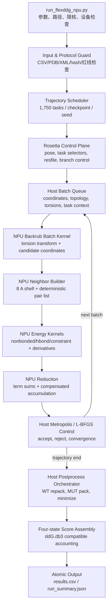

# Rosetta Flex ddG 端到端异构加速设计文档

| 项目 | 内容 |
| --- | --- |
| 文档版本 | v1.0，设计评审稿 |
| 修订日期 | 2026-11-25 |
| 任务名称 | 11 月社区任务-生命科学 Flex ddG ΔΔG 计算加速（24 核 CPU + 950） |
| 目标硬件 | Ascend 950PR 单卡，24 核 CPU |
| 软件基线 | Rosetta 2026.29 / `80a0635615`，Kortemme-Lab `flex_ddG_tutorial` |
| 力场与协议 | `talaris2014`，官方 `ddG-backrub.xml` |
| 评测数据 | BD-623，50 个抗原侧单点突变 |
| 设计状态 | 设计方案，不含代码完成、目标环境实测或验收结论 |

本文以任务书、随包基线脚本、参考 CSV 和官方设计模板为依据。文中性能数值是设计预算和验收门槛，不是已经获得的实测结果。当前工作区没有 Ascend 950PR、CANN 运行环境及 PyRosetta，因此本文不把任何历史数据或参考 CSV 当作本方案结果。

# 需求背景（required）

## 需求来源

任务要求在 24 核 CPU 与单卡 Ascend 950PR 上完成 Rosetta Flex ddG 的整模块端到端加速，对 BD-623 的 50 个突变完成计算，并在保持官方协议语义和 `talaris2014` 力场的前提下达到：

```text
端到端墙钟时间 wall_time_s <= 5,565.3 s
相对 48 核 CPU 基线加速比 >= 10.0x
```

本任务不是单个 aclnn 或 PyTorch 算子任务，也不是只把结果公式迁移到 NPU 的模型适配任务。交付边界覆盖输入准备、初始最小化、backrub 采样、WT/MUT 后处理、四态打分、结果聚合和验收输出。

## 背景介绍

### 开源基线

随任务提供的基线为 48 进程开源 Rosetta 2026.29，使用 `talaris2014` 和官方 `ddG-backrub.xml`。任务书给出：

| 指标 | 基线数值 |
| --- | ---: |
| 50 突变累计 CPU 时间 | 2,671,363.3 s，约 742.05 CPU·h |
| 48 核端到端墙钟 | 55,653.4 s，约 15.46 h |
| 每突变 35 条轨迹 | 1,750 条轨迹 |
| 每条轨迹 backrub 步数 | 35,000 |
| 单突变参考 CPU 时间 | 50,618 至 60,127 s |

### 性能目标的真实含义

48 核基线按 `742.05 / 48 = 15.46 h` 估算。若把相同工作量直接放到 24 核 CPU 上，即使 24 核全部满载，理论下界也约为 `742.05 / 24 = 30.92 h`。

验收目标为 `1.55 h`，因此本方案相对 24 核纯 CPU 实际需要约 `20x` 的整体吞吐提升，而不是简单地把 48 核换成 24 核。以下工作不能支撑该目标：

- 只在 NPU 上计算 GAM 重加权。
- 只把 CSV 解析、SQLite 汇总或结果拼接放到 NPU。
- 降低轨迹数、采样步数或邻域范围。
- 用参考 CSV、代理模型或简化能量函数替代 Rosetta 协议。

### 计算热点判断

单条轨迹包含 35,000 次 backrub 采样，并在轨迹终点执行 WT repack、突变、约束最小化和四态打分。主要时间消耗在重复的全原子能量评估、非键相互作用、构象更新和最小化过程，而不是最终结果数据量。

因此加速边界必须进入轨迹计算核心，至少覆盖以下一类或多类热点：

1. 扭转角变化后的坐标更新和邻域原子筛选。
2. `fa_atr`、`fa_rep`、`fa_sol`、`fa_elec`、`hbond_sc`、`hbond_bb_sc`、`hbond_lr_bb` 等能量项及导数。
3. 多轨迹批量能量评估和归约。
4. 后处理最小化中的批量线搜索能量与梯度评估。
5. pack 过程中的候选构象批量评分。

## 官方协议语义

### 结构准备

- 读取 BD-623 PDB 全原子结构，任务输入不允许 `HETATM`。
- 抗原链为 `A`，抗体链为 `H`、`L`；解离态移动链为 `A`。
- 按 `cb8` 和 `Neighborhood distance="8.0"` 构造 `bubble`。
- 取 `bubble` 前后各一个残基组成 `neighbor_shell`。
- 校验每个突变的 `chain`、`pdb_position`、`icode`、`wt_aa` 和 `mut_aa`。

### 初始最小化

使用官方 CA 距离约束：

```text
coord_dev=0.5
max_distance=9
CA_only=1
method=lbfgs_armijo_nonmonotone
tolerance=1e-6
max_iter=5000
abs_score_convergence_threshold=1.0
```

### Backrub 与后处理

- `mc_kt=1.2`
- `nstruct=35`
- `backrub_trials=35000`
- `trajectory_stride=35000`
- `pivot_residue_selector=neighbor_shell`
- 命令行使能 `-ex1 -ex2`
- `ExtraChiCutoff` 的 `extrachi_cutoff=0`
- WT 侧使用 `UseMultiCoolAnnealer states=6` repack
- MUT 侧执行突变 packing
- 两侧均执行约束 L-BFGS 后处理最小化

### 四态能量与 GAM

官方 `InterfaceDdGMover` 按以下四态计算：

```text
ddG = E_bound_mut + E_unbound_wt - E_bound_wt - E_unbound_mut
```

输出 7 个分子间能量项及其和。ZEMu GAM 为：

```text
gam(x, term) = -exp(a_term) + 2 * exp(a_term) / (1 + exp(-x * exp(b_term)))
ddG_gam = sum(gam(ddG_term, term), term in 7_intermolecular_terms)
```

参数固定使用官方教程中的 7 组 `(a, b)`，不得重新拟合。

# 需求分析（required）

## 需求描述

实现统一的端到端入口 `run_flexddg_npu.py`，使用 Host CPU 负责协议控制、输入校验、任务调度、轨迹状态和结果输出，使用 Ascend 950PR 批量执行可并行的构象与能量热点。全部 1,750 条轨迹必须实际完成，输出 50 行、22 列标准结果和运行摘要。

## 需求拆解

| 编号 | 需求 | 设计响应 | 验收出口 |
| --- | --- | --- | --- |
| R01 | 官方协议完整覆盖 | 按 XML 阶段图执行，不跳过阶段 | 协议静态检查、轨迹阶段审计 |
| R02 | `talaris2014` 保持 | 固定力场参数表及 `restore_talaris_behavior` | 参数表哈希、逐项能量对拍 |
| R03 | 不降低采样预算 | `35 x 35,000` 固定并写入摘要 | 输出字段与运行计数 |
| R04 | 24 核真实限核 | `taskset -c 0-23`，进程池上限 24 | 运行摘要记录 CPU affinity |
| R05 | 单卡 950PR | 设备探测、CANN 版本和能力检查 | `npu-smi`、设备属性 |
| R06 | 端到端时间 | 轨迹批处理、常驻数据和流水线 | `wall_time_s <= 5565.3` |
| R07 | 分层精度 | CPU/NPU 逐项能量和全链路对拍 | 15 个大效应、35 个小效应 |
| R08 | 标准输出 | 50 x 22 CSV 与 JSON 摘要 | 自动验收脚本 |
| R09 | 异常输入拒绝 | 启动前完整校验和非零退出 | 负向测试矩阵 |
| R10 | 可复现与可恢复 | `--seed`、任务指纹、轨迹 checkpoint | 重复运行和断点续跑 |

## 输入契约

### 突变 CSV

必须存在且只包含以下 6 列：

```text
pdb_id,chain,pdb_position,icode,wt_aa,mut_aa
```

校验规则：

- `pdb_id` 必须是 `--pdb-dir` 下的文件名，不得是路径。
- `chain` 为单字符。
- `pdb_position` 为非负整数。
- `icode` 为空或单字符。
- `wt_aa` 和 `mut_aa` 为标准单字母氨基酸且不能相同。
- 不允许重复突变。
- 正式运行必须恰好 50 行。

### PDB

- 只接受 `ATOM` 记录，出现 `HETATM` 时拒绝。
- 位点必须存在，PDB 实际残基必须等于 `wt_aa`。
- `--move-chain` 指定的链必须存在。

### XML

- 正式模式校验官方文件 SHA-256。
- 解析并检查 `talaris2014`、8.0 Å 邻域、backrub、repack、mutate、minimize 和四态打分节点。
- 只允许替换官方占位符、工作路径和数据库文件名。
- 出现无法识别的协议节点或阶段顺序变化时拒绝计算。

## 输出契约

### `results.csv`

输出与输入突变一一对应，共 50 行、22 列：

| 分组 | 字段 |
| --- | --- |
| 突变标识 | `pdb_id,chain,pdb_position,icode,wt_aa,mut_aa` |
| 原始统计 | `ddG_mean(REU),ddG_std(REU),ddG_all(REU)` |
| 能量项 | `ddG_fa_atr(REU)`、`ddG_fa_rep(REU)`、`ddG_fa_sol(REU)`、`ddG_fa_elec(REU)`、`ddG_hbond_sc(REU)`、`ddG_hbond_bb_sc(REU)`、`ddG_hbond_lr_bb(REU)` |
| 自洽 | `ddG_residual(REU)` |
| GAM | `ddG_gam_mean(kcal/mol),ddG_gam_std(kcal/mol)` |
| 完整性 | `nstruct_done,backrub_trials,cpu_time(s)` |

约束：

```text
ddG_std 使用样本标准差，ddof=1
ddG_all 包含 35 个分号分隔的有限浮点数
nstruct_done == 35
backrub_trials == 35000
abs(ddG_residual) <= 0.01
```

### `run_summary.json`

至少包含：

```text
wall_time_s
mutations_completed
cpu_cores_limit
npu_device
cann_version
seed
git_commit
command
```

建议附加：

```text
protocol_xml_sha256
device_model
driver_version
worker_count
trajectory_count
stage_timing
checkpoint_format_version
```

## 性能预算

### 总体模型

端到端时间拆分为：

```text
T_total =
  T_validate
  + T_prepare
  + T_sampling
  + T_postprocess
  + T_scoring
  + T_aggregate
  + T_io
```

目标是：

```text
T_total <= 5565.3 s
```

设计内部设置 10% 余量：

```text
T_total_design <= 5000 s
T_sampling_and_energy <= 4200 s
T_other <= 800 s
```

该预算不是实测结论，用于选择 batch、queue depth 和 profiling 断点。

### 吞吐要求

```text
1,750 trajectories / 5,565.3 s = 0.3145 trajectories/s
```

平均每条轨迹只允许约 3.18 s 墙钟摊销时间。必须通过跨突变、跨轨迹批量并行达到该吞吐，不能按单轨迹串行执行。

## 约束与不做项

- 不支持跨机、多卡或多进程绕过 24 核限制。
- 不允许 NPU 未参与核心计算却标记为“NPU 加速”。
- 不允许用参考 CSV 直接生成生产结果。
- 不允许使用代理模型替代官方四态能量。
- 不要求不同 seed 间逐比特一致。
- 不把设计阶段估算写成性能验收结果。

# 详细设计（required）

## 总体架构



### CPU 与 NPU 分工

| 模块 | CPU | NPU | 设计理由 |
| --- | --- | --- | --- |
| 输入与协议校验 | 全部 | 无 | 文本解析、XML语义和错误码控制 |
| Rosetta pose/topology | 全部 | 只保留只读副本 | 控制语义和类别分支复杂，避免设备分支爆炸 |
| 任务调度/checkpoint | 全部 | 无 | 24 核固定资源、断点恢复 |
| Backrub 候选坐标 | 参数控制 | 批量扭转和坐标变换 | 轨迹间可并行 |
| 邻域搜索 | 任务选择 | 批量距离、排序、pair list | 规则计算密集 |
| 能量项与导数 | 分支控制 | 批量内核 | 主要热点 |
| Metropolis 接受/拒绝 | 每条轨迹 | 无或批量辅助 | 依赖当前轨迹状态，CPU保留语义 |
| L-BFGS 迭代控制 | 全部 | 批量函数和梯度评估 | 优化顺序由 CPU 控制 |
| WT/MUT pack 状态 | 分支与合法性 | 候选构象批量打分 | 离散状态控制复杂 |
| 四态相减/GAM/CSV | 全部 | 可选批量预计算 | 数据量小，不能成为卖点 |

## 主机侧设计

### 入口与预检

推荐入口：

```bash
taskset -c 0-23 python3 run_flexddg_npu.py \
  --selected bd623_mutations.csv \
  --pdb-dir PDB \
  --xml ddG-backrub.xml \
  --out results.csv \
  --summary run_summary.json \
  --work work \
  --move-chain A \
  --nstruct 35 \
  --trials 35000 \
  --cpu-cores 24 \
  --device-id 0 \
  --seed 111111
```

预检顺序：

1. 解析参数并拒绝非法整数、空路径和越界值。
2. 校验 24 核 affinity；正式模式要求 affinity 数恰好为 24。
3. 校验 `npu-smi` 可用、设备号存在、设备型号包含 `950PR`。
4. 读取并校验 CSV、PDB 残基和 XML 指纹。
5. 创建 work 和输出目录，验证可写性。
6. 生成 run fingerprint，指纹至少包含 XML SHA、PDB SHA、参数和 seed。
7. 初始化 Rosetta 控制面和 NPU runtime。

任一步失败都返回非零退出码，不写半成品 `results.csv`。

### 协议控制面

CPU 侧保留 Rosetta 的 pose、残基编号、原子类型、rotamer 库和任务选择器。XML 不直接改写，而是先做完整性与阶段图解析，再由执行器映射到以下阶段：

```text
P0  input_validate
P1  add_constraints
P2  initial_minimize
P3  select_neighbor_shell
P4  backrub_loop
P5  wt_repack
P6  wt_post_minimize
P7  mutate_and_pack
P8  mut_post_minimize
P9  four_state_score
P10 aggregate_and_write
```

每个阶段写入轨迹级审计记录。最终必须验证 P0 至 P10 全部出现，不能仅依据最终 CSV 推断阶段完成。

### 任务与 seed

任务树为：

```text
50 mutations x 35 replicates x 35,000 steps
```

每条轨迹 seed 通过稳定哈希构造：

```text
trajectory_seed = H(base_seed, mutation_key, replicate) mod 2^31
```

CPU 调度器只按轨迹分配任务，不按突变固定绑核。这样可避免 Y369C 等较慢位点造成长尾空闲。

### 断点恢复

轨迹目录：

```text
work/<pdb>_<chain><pos><icode><mut>_<replicate>/
  state.json
  protocol_snapshot.xml
  score_state.bin
  pose_final.db3
  trajectory_result.json
```

`state.json` 记录：

- run fingerprint
- 当前轨迹阶段
- 已完成步数
- 最近 checkpoint 步
- seed
- device、CANN 和二进制版本

只有 fingerprint 完全匹配时才恢复；参数、XML、PDB 或二进制版本变化时拒绝静默复用。

## NPU 侧设计

### 总体数据布局

静态数据常驻设备：

- PDB 原子表
- 残基、原子、键和 torsion tree
- `talaris2014` 系数表
- rotamer 候选表
- 8 Å neighbour shell 的残基集合
- 每个能量项的 pair type 表

动态数据按 batch 传输：

- 当前轨迹构象坐标
- 当前 torsion 状态
- 轨迹 ID 和 step ID
- 当前约束
- 能量/梯度输出缓冲区

Batch 维建议先按 `B=32` 或 `B=64` 轨迹设计，按 UB 大小、pair 数量和 double buffer 需求在 profiling 后确定。Batch 只合并独立轨迹，不改变单条轨迹的 MC 顺序。

### 内核 1：Backrub 批量采样

输入：

- pivot residue
- 当前 backbone torsion
- 采样区间和随机数
- `neighbor_shell` mask

处理：

1. 对 B 条轨迹同时生成 step proposal。
2. 更新 pivot 前侧/后侧刚体坐标。
3. 更新受影响原子坐标。
4. 保持未选残基坐标不变。

输出：

- candidate coordinates
- old/new torsion delta
- candidate 能量评估请求

CPU 根据 NPU 返回的能量执行 Metropolis 接受/拒绝。拒绝时恢复上一份坐标，不改变官方 MC 语义。

### 内核 2：邻域与 pair list

处理：

1. 对 `neighbor_shell` 与 `bubble` 原子执行 8 Å 距离筛选。
2. 将候选 pair 按残基编号、原子编号和 pair type 稳定排序。
3. 过滤只参与分子内抵消项的 pair。
4. 生成非键、氢键和约束三类列表。

排序必须在 CPU/NPU 两侧一致，以便重复运行和故障复现。pair list 的生成规则需从 Rosetta 实际 score setup 提取，不能凭经验重写。

### 内核 3：能量项

至少实现：

| 能量项 | 主要输入 | 输出 |
| --- | --- | --- |
| `fa_atr` | pair distance、atom type、权重 | energy、distance derivative |
| `fa_rep` | pair distance、atom type、权重 | energy、distance derivative |
| `fa_sol` | atom burial、distance、LJ 参数 | energy、derivative |
| `fa_elec` | charge、distance | energy、derivative |
| `hbond_sc` | donor/acceptor geometry | energy、derivative |
| `hbond_bb_sc` | backbone-sidechain geometry | energy、derivative |
| `hbond_lr_bb` | long-range backbone geometry | energy、derivative |
| distance constraint | CA pair、bound | energy、derivative |

实现要求：

- 能量常数和 pair type 由 `talaris2014` 参数导出，代码中不得重新拟合。
- 距离和三角函数使用固定表达式顺序。
- 分块结果使用补偿求和，最终项总和在 host float64 中归并。
- 每个 pair 的 `fa_atr/fa_rep` 平滑切换区间与 Rosetta 完全一致。
- 氢键角度、距离、方向项必须按 Rosetta 源码路径验证，不能只用简化几何。

### 内核 4：梯度与最小化

L-BFGS 的优化步骤由 CPU 控制，NPU 提供：

- 批量能量
- 原子/扭转梯度
- 约束能量和梯度
- 点积、范数和线搜索候选批量评估

一次 line-search 可以同时评估多个 alpha，减少 CPU 与 NPU 往返。CPU 根据返回值选择 alpha，并维护历史向量和收敛判断。

### 内核 5：WT/MUT pack 辅助

pack 的离散状态机仍在 CPU，NPU 负责：

- 候选 rotamer 对当前环境的能量矩阵
- 多状态候选评分
- `UseMultiCoolAnnealer states=6` 下的批量温度评分
- 选中构象后的坐标提交

若某些离散选择无法在设备上等价实现，首版保留 CPU Rosetta 路径，并把性能优化集中到 backrub 和最小化；不能用不同 pack 策略换取精度。

## 流水线设计

采用双缓冲和多轨迹批处理：

```text
CPU prepare batch n+1
NPU evaluate batch n
CPU accept/checkpoint batch n-1
```

至少两个 device stream：

- `stream_score`：坐标、邻域和能量
- `stream_post`：后处理最小化评估

所有结果通过 event 或同步点回到 CPU。禁止在没有依赖证明时跨流覆盖同一轨迹状态。

调度约束：

- 24 个 host worker 是上限，不是必须同时创建 24 个线程。
- 单个 NPU 服务的 batch queue 有界，避免主机内存无限增长。
- 长突变和短突变混排，按已完成步数动态补充。
- host 线程库限制为单线程，防止 OpenMP/BLAS 与 worker 池叠加超核。

## 数值一致性设计

### 分层验证

| 层级 | 验证对象 | 判据 |
| --- | --- | --- |
| L0 | 力场参数、pair type、邻居选择 | 表项逐一相等 |
| L1 | 单个固定构象的 7 个能量项 | 与 PyRosetta 逐项比较 |
| L2 | 单条固定 seed 轨迹 | 采样上下文、能量和四态结果检查 |
| L3 | 单突变 35 条轨迹 | 均值/标准差进入参考分布 |
| L4 | 50 突变全量 | 任务书分层精度和性能 |

### 固定对拍顺序

1. 用相同 PDB 和 seed 生成固定构象。
2. 在 CPU 侧输出每个能量项和总能量。
3. 在 NPU 侧输出同一构象的分块项和、总项和及梯度。
4. 对 `fa_atr` 到 `hbond_lr_bb` 逐项比较，先定位差异到 pair type、邻居或几何项。
5. 只在逐项对拍通过后执行 35 条轨迹统计对拍。
6. 最后执行全量验收，避免用随机系综涨落掩盖内核错误。

由于官方协议使用随机系综，不要求 NPU 与 CPU 逐比特相同；但固定 seed、固定构象下的能量函数和坐标变换必须可重复。

### 关键风险

- Rosetta 能量常数、平滑函数和 rotamer 库版本不同会产生系统偏差。
- NPU float32 与 Rosetta host 双精度累加可能造成长轨迹漂移。
- 8 Å 残基邻域与原子 cutoff 是两个不同概念，不能混用。
- `UseMultiCoolAnnealer` 的状态和温度更新顺序必须逐步对齐。
- 后处理最小化的线搜索顺序会影响最终构象，不能只保证能量公式一致。

## 异常处理

| 场景 | 行为 |
| --- | --- |
| CSV 缺列、空表、重复突变 | 非零退出，不初始化计算 |
| PDB 缺文件、有 HETATM、残基不符 | 非零退出 |
| XML hash 或阶段图不符 | 非零退出 |
| 设备不存在、非 950PR、CANN 不匹配 | 非零退出 |
| CPU affinity 不等于 24 | 正式模式非零退出 |
| 任一轨迹未完成 35,000 步 | 不写最终通过结果 |
| NPU kernel 失败或超时 | 保留 checkpoint，返回非零 |
| 输出含 NaN/Inf、缺 35 个值或 schema 不符 | 删除临时输出并失败 |

# 接口与工程结构

## 支持硬件

| 芯片/平台 | 支持状态 | 说明 |
| --- | --- | --- |
| Ascend 950PR 单卡 | 目标平台 | 正式验收设备 |
| Ascend 910B/A2/A3 | 非本任务验收范围 | 不以其结果替代 950PR 实测 |
| 24 核 x86/ARM 主机 | 受约束 Host | 必须通过 `taskset -c 0-23` 或 cpuset 限核 |

## 算子约束限制

- 仅支持本任务规定的 BD-623 全原子蛋白输入和 50 个标准单点突变。
- 不支持跨机、多卡 DDP 或超核进程池。
- 不提供任意蛋白体系的通用 NPU 加速承诺。
- 不支持以低精度或简化力场换取性能。
- 不在本设计中承诺任意 Rosetta XML 的自动设备化。

## CLI 参数

| 参数 | 类型 | 必选 | 说明 |
| --- | --- | --- | --- |
| `--selected` | path | 是 | 50 突变 CSV |
| `--pdb-dir` | dir | 是 | PDB 目录 |
| `--xml` | path | 是 | 官方协议 XML |
| `--out` | path | 是 | `results.csv` |
| `--summary` | path | 是 | `run_summary.json` |
| `--work` | dir | 是 | 轨迹工作目录 |
| `--move-chain` | str | 是 | BD-623 为 `A` |
| `--nstruct` | int | 是 | 正式 35 |
| `--trials` | int | 是 | 正式 35,000 |
| `--cpu-cores` | int | 是 | 正式 24 |
| `--device-id` | int | 是 | 950PR 设备号 |
| `--seed` | int | 否 | 默认 111111 |

## 建议目录

```text
rosetta_flex_ddg/
├── README.md
├── build.sh
├── env/
│   └── set_env.sh
├── pipeline/
│   ├── run_flexddg_npu.py
│   ├── validate_inputs.py
│   ├── protocol_guard.py
│   ├── scheduler.py
│   ├── checkpoint.py
│   └── aggregate.py
├── kernels/
│   ├── backrub/
│   ├── neighbor/
│   ├── energy/
│   ├── minimize/
│   └── common/
├── tests/
│   ├── unit/
│   ├── parity/
│   └── e2e/
└── task_submission/
    ├── 1 自验证步骤说明.md
    ├── 2.1 精度自验证报告.xlsx
    ├── 2.2 精度自验证日志.log
    ├── 3.1 性能自验证报告.xlsx
    └── 3.2 性能自验证日志.log
```

## 模块边界

| 模块 | 责任 | 不允许承担 |
| --- | --- | --- |
| `protocol_guard` | XML hash、阶段和红线检查 | 静默改写官方协议 |
| `scheduler` | 轨迹队列、限核、checkpoint | 按超核方式启动进程 |
| `backrub` kernel | 扭转和坐标变换 | 自行决定接受/拒绝 |
| `energy` kernel | 能量和导数 | 改用简化函数 |
| `minimize` 控制 | line-search 和收敛 | 删除最小化阶段 |
| `aggregate` | 四态、GAM、22 列输出 | 从参考 CSV 复制结果 |

## 兼容性分析

本模块作为 Rosetta Flex ddG 的独立执行组件交付，不修改已有 CANN 算子 ABI，也不替换 Rosetta 公共 Python/C++ 接口。新增设备侧内核通过内部 runtime 和任务包中约定的 `run_flexddg_npu.py` 入口接入。

兼容性边界如下：

- 输入 CSV、PDB 和 XML 必须与任务发布版本一致。
- 输出遵循任务书的 22 列格式；参考 CSV 中的非标准附加列不进入生产输出。
- Rosetta 源码、数据库和 rotamer 库版本必须在摘要中记录。
- 任何内核二进制升级都使旧 checkpoint 失效，防止跨版本复用产生静默偏差。

# 可维可测分析

## 正向测试

### 全量测试

- 输入：随包 50 个 BD-623 突变。
- PDB：`BD-623.pdb`。
- XML：官方 `ddG-backrub.xml`。
- 运行：24 核 affinity，35 trajectories，35,000 steps。
- 结果：50 行、22 列、每行 35 个有限轨迹值。

### 精度测试

大效应组：

```text
15 mutations with abs(ddG_ref) > 1.0
median(abs(ddG_pred - ddG_ref) / abs(ddG_ref)) < 0.05
```

小效应组：

```text
35 mutations with abs(ddG_ref) <= 1.0
for each i: abs(ddG_pred_i - ddG_ref_i) < std_ref_i
```

### 性能测试

- 使用完整 50 突变端到端命令，不截取单突变时间代替。
- 计时从进程启动到 `results.csv` 落盘。
- 记录 stage timeline、NPU utilization、host CPU utilization、队列深度、H2D/D2H 和 kernel 时间。
- 至少重复一次性能运行，报告每次 `wall_time_s`，不只报告最好一次。

## 负向测试

| 用例 | 期望 |
| --- | --- |
| `--selected` 不存在 | 非零退出 |
| CSV 缺 `wt_aa` | 非零退出 |
| CSV 空表 | 非零退出 |
| 位点不存在 | 非零退出 |
| PDB 实际残基与 `wt_aa` 不符 | 非零退出 |
| PDB 含 HETATM | 非零退出 |
| `--cpu-cores 25` | 非零退出 |
| `--nstruct 0` | 非零退出 |
| `--trials 0` | 非零退出 |
| `--device-id` 越界 | 非零退出 |
| XML 被修改 | 非零退出 |
| XML 出现 REF2015 | 非零退出 |
| 输出存在 NaN/Inf | 验收失败 |
| `nstruct_done != 35` | 验收失败 |

## 验收命令

```bash
python3 verify_bd623.py \
  --pred results.csv \
  --ref bd623_reference.csv \
  --summary run_summary.json \
  --json-out verify_report.json
```

最终通过必须同时满足 schema、精度和性能；任一项失败均不得提交为已验收。

# 实施计划

| 阶段 | 内容 | 退出条件 |
| --- | --- | --- |
| M0 | Host 入口、输入校验、XML guard、输出 schema | 负向测试全部通过 |
| M1 | CPU/PyRosetta 参考执行器 | 单突变降低预算功能验证 |
| M2 | NPU 坐标更新与邻域内核 | 固定构象坐标和 neighbor list 对拍 |
| M3 | 7 个能量项与约束导数内核 | L0/L1 逐项对拍通过 |
| M4 | 多轨迹批处理、双缓冲、L-BFGS 评估 | 单突变 35 轨迹统计合理 |
| M5 | 全量 50 突变调优 | 精度和 `wall_time_s` 同时达标 |
| M6 | 报告、日志、复现脚本和提交包 | 所有验收产物可复现 |

每个阶段都必须保留独立证据。不能因为 M4 的 smoke 结果正常就提前声明 M5 验收完成。

# 已知边界与评审确认项

1. Rosetta 2026.29 的具体 C++ API 接入方式需要在目标分支源码中确认，特别是 score method、rotamer pack 和 `InterfaceDdGMover` 的可替换边界。
2. `talaris2014` 的 pair type、平滑函数和氢键几何需以目标 commit 源码及数据库为准。
3. NPU 内核能否接受 Rosetta host 双精度语义，需要在 950PR 上完成逐项精度实验。
4. 35,000 步 MC 的 checkpoint 间隔需要平衡恢复成本与 I/O 开销。
5. 任务要求“不改变协议语义”，因此任何为并行化增加的状态拆分、批处理和调度都不能改变单轨迹采样顺序。
6. 本文没有目标硬件实测数据。性能、精度和代码完成度均待后续实现与验收。

# 参考资料

- RosettaCommons/rosetta，2026.29，commit `80a0635615`。
- Kortemme-Lab/flex_ddG_tutorial，官方 `ddG-backrub.xml` 和 `analyze_flex_ddG.py`。
- 随任务提供的 `Rosetta_Flex_ddG_Atlas950_task_doc.md`。
- 随任务提供的 `test_cases/baseline/`、`bd623_reference.csv`、`verify_bd623.py`。
- CANN 社区任务设计模板 `04_tasks/01_community-task-2026/resources/design_template.md`。
- Barlow et al., J. Phys. Chem. B 2018, Flex ddG 方法论文。
