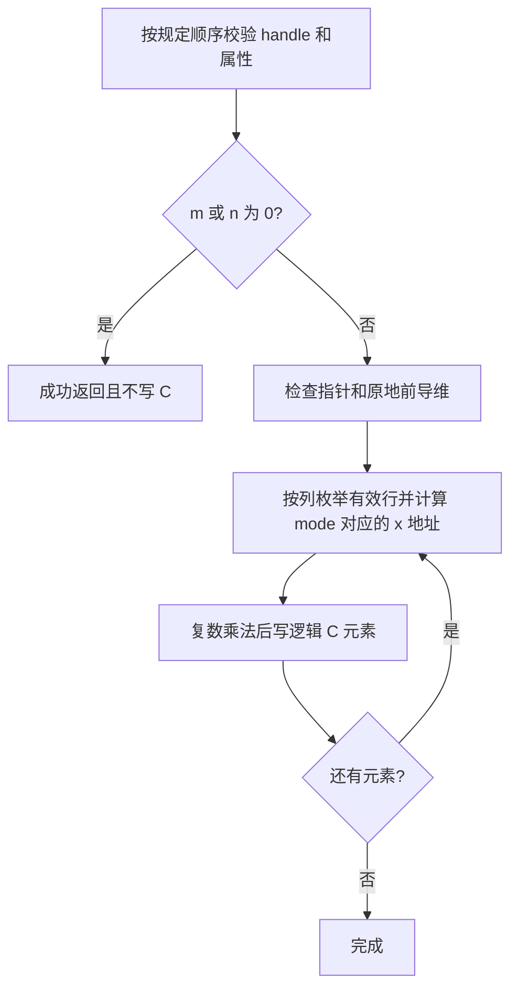
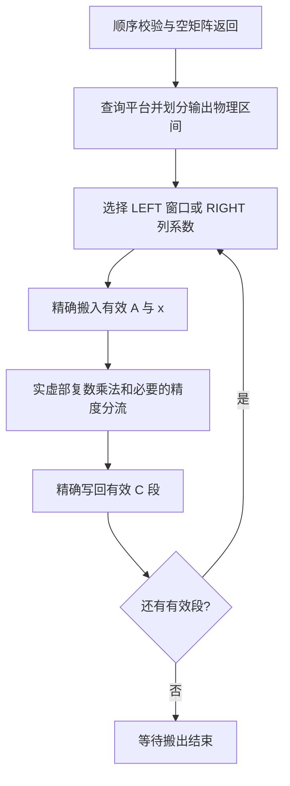

# 一、需求背景

## 1.1 需求来源

承接“11月社区任务-aclblasCdgmm算子开发（950）”，为 Ascend 950PR 补齐 COMPLEX64 对角矩阵缩放接口。需求依据任务包 `aclblasCdgmm_Atlas950PR_task_doc.md`、`test_cases/cdgmm_golden.h`、`cdgmm_test.csv` 和 `gpu_baseline.csv`，按[设计模板](../../../../resources/design_template.md)组织。当前任务列表尚未给出本任务编号，暂在完整任务名目录下提交，后续以官方目录映射为准。

## 1.2 背景介绍

### 1.2.1 aclblasCdgmm 算子实现优化

对列主序复数矩阵执行 LEFT 行缩放或 RIGHT 列缩放，核心为逐元素复数乘法。设计重点为列内连续搬运、对角向量复用、正负 incx 索引及原地执行保护。代码使用 BLAS Kernel 直调，没有对应的 TBE Python 源码、TBE 算子信息库或 ACLNN 两段接口。

源码现状核对基于 ops-blas 提交 `25e4a371df3f08150975893b97e692e7a6a472fc`：

| 用途 | 文件 |
| --- | --- |
| 已有公共声明及复数类型 | `include/cann_ops_blas.h`、`include/cann_ops_blas_common.h` |
| 同平台实数参考 | `blas/dgmm/arch35/sdgmm_host.cpp`、`sdgmm_kernel.cpp`、`sdgmm_kernel.h`、`sdgmm_tiling_data.h` |
| 本次新增实现 | `blas/dgmm/arch35/cdgmm_host.cpp`、`cdgmm_kernel.cpp`、`cdgmm_kernel.h`、`cdgmm_tiling_data.h` |
| 本次新增测试 | `test/dgmm/cdgmm/arch35/cdgmm_test.cpp`、`cdgmm_npu_wrapper.h`、`cdgmm_golden.h`、`cdgmm_test.csv` |
| 配套适配 | `test/dgmm/cdgmm/CMakeLists.txt`、`blas/dgmm/README.md`、`docs/zh/api_list.md` |

arch22 的 `cdgmm*` 属于另一产品线的行主序、仅 LEFT 契约，本设计不引用其算法、参数校验或 golden；公共签名保持不变。arch35 实数同族仅作为列访问与工程接入参考，其非法 mode 返回码和 quick return 顺序也必须按本任务重写。

### 1.2.2 aclblasCdgmm 算子现状分析

#### 1.2.2.1 标杆算子支持的数据类型和数据格式

| 参数 | 类型与位置 | 数据格式及约束 |
| --- | --- | --- |
| handle | Host 句柄 | 携带有效 stream |
| mode | `aclblasSideMode_t` | `ACLBLAS_SIDE_LEFT` 或 `ACLBLAS_SIDE_RIGHT` |
| m、n | Host int | 行数、列数，均非负 |
| A | Device `const aclblasComplex*` | COMPLEX64，列主序，`A[i+j*lda]` |
| x | Device `const aclblasComplex*` | COMPLEX64，LEFT 逻辑长度 m，RIGHT 逻辑长度 n |
| C | Device `aclblasComplex*` | COMPLEX64，列主序，`C[i+j*ldc]` |
| lda、ldc | Host int | 均不小于 `max(1,m)`；以复数元素为单位 |
| incx | Host int | 任意非零有符号步长，负值从向量尾部反向访问 |

复数以实、虚两个 FLOAT32 交错存储，每元素 8 Byte。A、C 的物理存储分别为 `lda*n`、`ldc*n` 个复数；x 的物理跨度为 `1+(L-1)*abs(int64(incx))`，L 由 mode 决定。

#### 1.2.2.2 标杆算子实现描述

功能对标 [cuBLAS dgmm](https://docs.nvidia.com/cuda/cublas/index.html#cublas-t-dgmm)，任务包提供独立的列主序 CPU golden `test_cases/cdgmm_golden.h`，不是 CBLAS 接口。对逻辑位置 `(i,j)`，令 `k=i,L=m`（LEFT）或 `k=j,L=n`（RIGHT）：

```text
idx(k) = k*incx                         incx > 0
       = (L-1-k)*abs(int64(incx))        incx < 0
a = A[i+j*lda]; z = x[idx(k)]
C.real = float32(float64(a.real)*z.real - float64(a.imag)*z.imag)
C.imag = float32(float64(a.real)*z.imag + float64(a.imag)*z.real)
```

golden 用 FLOAT64 求中间乘积再收窄为 FLOAT32，设备按任务要求使用 FLOAT32 计算并接受混合容差验证。没有共轭、转置或约束 `|x|=1`。只更新 m×n 逻辑矩阵，padding 保持原值。数值参考采用随包文件，禁止误用 GEAM 或旧产品线的同名 golden。

#### 1.2.2.3 标杆算子实现流程图



该图描述随包 CPU 参考流程；cuBLAS 内部 kernel 调度不公开。

# 二、需求分析

## 2.1 外部组件依赖

使用 CANN 9.1.0、Ascend 950PR 编译目标及 ACL Runtime；采用 ops-blas 现有 CMake、GTest 与 CSV 框架。主路径先采用同族已有的 Vector/MTE 编程方式，实现 FLOAT32 复数展开；无需 Cube。CPU golden 不依赖 Netlib DGMM 符号。性能使用任务提供的 H100 基线和 msprof op。

## 2.2 内部适配模块

复用 handle/stream、平台核数与 UB 查询、日志和 kernel launcher。`test/dgmm/cdgmm/CMakeLists.txt` 已注册 `cdgmm_test`，接入 arch35 源文件及本地 golden，避免同时包含父目录 arch22 golden 的同名函数。实现交付时同步更新产品能力表及 `docs/zh/api_list.md`，分产品线描述布局、mode、步长和前导维语义。

## 2.3 需求模块设计

### 2.3.1 Ascend C 算子原型

```cpp
aclblasStatus_t aclblasCdgmm(
    aclblasHandle_t handle, aclblasSideMode_t mode, int m, int n,
    const aclblasComplex* A, int lda, const aclblasComplex* x, int incx,
    aclblasComplex* C, int ldc);
```

沿用现有声明。Tiling 记录 mode、维度、前导维、有符号 incx、64 位 x 起点、输出物理分片边界、tileM、向量缓存长度和缓冲槽数。kernel 入口接收 A/x/C 和 tiling，不引入额外公共参数。

### 2.3.2 Ascend C 算子相关约束

依次检查：handle 非空 → mode 合法 → m 非负 → n 非负 → incx 非零 → lda、ldc 均不小于 `max(1,m)` → m=0 或 n=0 快返 → A/x/C 非空 → 若 `A==C` 则要求 `lda==ldc`。空 handle 返回 `ACLBLAS_STATUS_HANDLE_IS_NULLPTR`，其他列举的非法参数均返回 `ACLBLAS_STATUS_INVALID_VALUE`，非法 mode 不返回 INVALID_ENUM。

空矩阵也必须校验 mode、incx 和前导维，通过后才允许空数据指针且不访问数据。incx 为 INT32_MIN 不因取绝对值溢出而被误拒绝，先转 int64 再取绝对值；任务未要求 INT32 元素跨度上限，不添加该限制。尺寸、字节跨度使用带溢出检查的宽整数计算，对无法表示的地址范围在访问前报错，不能通过截断继续执行。

# 三、需求详细设计

## 3.1 调用方式

建立 ACL context、stream 和 BLAS handle，绑定 stream，准备列主序 A、x 及预填哨兵的 C，调用接口，stream 同步后读取结果。原地用例令 `C=A` 且 `ldc=lda`；每次性能迭代前恢复原始 A，恢复和 golden 计算置于计时区间之外。SUCCESS 不替代后续同步的运行错误检查。

## 3.2 需求总体设计

每元素执行 4 次实乘、2 次加减，工作量 `6mn FLOPs`。A 读取与 C 写回合计 `16mn Byte`；x 完美复用时额外 `8L Byte`，无复用时可达 `8mn Byte`。理想算术强度约为 `6mn/(16mn+8L)`，这里只表示有效请求量，不能等同于实际 HBM 流量或已达到带宽上限。

RIGHT 在列内复用一个复数系数；LEFT 缓存完整 x 或行窗口，在同核负责的多列间复用。用唯一输出物理块所有权分核，兼顾 padding、原地执行和窄长矩阵。正常实现不需 GM workspace。

### 3.2.1 host 侧设计

#### 3.2.1.1 分核策略

查询可用 AIV 核数 Pmax，以有效工作量 mn 选择 P，最小每核工作量 G 待实测标定。小输入使用单核。标准 32 Byte 对齐的 C 基址按有效元素秩 `r_b=floor(b*mn/P)` 生成候选切点：`j=r_b/m`、`i=r_b%m`、`q=j*ldc+i`，将内部 q 向下对齐到 4 个复数，设置首尾边界为 0 和 `ldc*n`，去重后形成有序物理区间。

每核仅处理自己物理区间与各列 `[j*ldc,j*ldc+m)` 的交集，并由该区间换算 A 和 x 地址。相邻核的内部边界均为 32 Byte 对齐，避免 padding 较小时不同列的写回共享同一个物理块；窄长矩阵可自然在列内分段。合并过小区间，核数不超过 Pmax。

合法但非标准对齐的输出基址先走单核精确搬运；后续再对齐到绝对物理地址扩展多核，不能仅凭逻辑元素不重叠就认定写回安全。A==C 时每个输出复数由同一核先完整读取原始实虚部再覆盖。

#### 3.2.1.2 数据分块和内存优化策略

令 T 为一次处理的复数个数，W 为驻留 x 窗口长度，U 为查询到的可用 UB，H 为对齐、事件及临时开销。保守预算如下，各项分别对齐 32 Byte：

| 存活对象 | Byte 预算 |
| --- | --- |
| A 双输入槽、C 双输出槽 | `32T` |
| A 实虚平面、结果实虚平面及乘积临时平面 | `32T` |
| 交错 x 与 x 实虚平面 | `16W` |
| 合计 | `64T+16W+H <= U` |

RIGHT 仅需少量系数存储；LEFT 优先令 W=m，在容量不足时令 W=T。例 T=1024、W=1024 时上述数组占 80 KiB；W=8192 时占 192 KiB，只有实际 UB 余量足够才采用，不写死平台容量。跨步 x 的搬入槽若采用每记录 32 Byte 暂存，还需额外预算或缩减 W。

列内整块连续搬入，尾段按有效 `8*count` Byte 使用 DataCopyPad，禁止读写 padding。负步长 x 按非负物理地址读取并恢复逻辑次序；跨步多块搬运先核对参数单位和上限，超范围拆分，不能用负 DMA stride 或逐步累加的 int32 地址。LEFT 的缓存窗口跨列保持，RIGHT 的系数跨同列行 tile 保持。

双缓冲仅在一个分片有多个 tile 时开启。输入搬入完成才能计算，输出搬出完成才能复用槽；同核同一物理块的精确短写按序完成。所有 Vector 运算的 repeat/mask 长度根据实际 API 上限分段，尾部无效 lane 不写回。

#### 3.2.1.3 tilingKey 规划策略

| Key | 条件 | 处理方式 |
| --- | --- | --- |
| 0 | LEFT，incx=1 | 连续 x 窗口复用 |
| 1 | LEFT，其他非零 incx | 按有符号步长收集 x 窗口 |
| 2 | RIGHT，任意非零 incx | 每列读取系数并广播 |

核数、单/双槽、原地标志和基址回退由 tiling 字段表达，不复制公共接口或无意义扩张 key。空矩阵不启动 kernel。

### 3.2.2 kernel 侧设计

#### 3.2.2.1 kernel 侧实现描述

1. 由输出区间算出当前列及有效行段，使用独立 lda、ldc 定位 A/C；装入 x 系数或窗口。
2. CopyIn 有效 A 段后解交织实虚部，按 `cr=ar*xr-ai*xi`、`ci=ar*xi+ai*xr` 计算；两路结果完成前保留原始 A 实虚部。
3. 正常值路径先采用显式 FLOAT32 乘法和加减。随包 golden 为 FLOAT64 中间量，必须单独验证大幅值、相消、subnormal 与中间溢出；不能仅凭复数公式相同声称全值域已通过。
4. 极值精度路径作为实现阶段的专项：对有限数用位级指数分类，分别归一化每项乘积，将两项乘积对齐到共同指数后用补偿乘积/加减保留相消残差，再缩放到 FLOAT32 输出。FMA 残差及指数缩放需在 950PR/CANN 9.1.0 验证；以通过全部极值 golden 用例作为启用条件。非有限值按原公式处理，不用 x=0/1 快捷路径消除 `0*Inf` 等行为。
5. 输出重交织后精确写有效 C 行段，保持 padding。多核无归约、无原子加和跨核自旋；执行顺序固定，满足同设备同 tiling 的确定性要求。

#### 3.2.2.2 Ascend C 实现流程图



#### 3.2.2.3 Ascend C 实现流程图与标杆算子流程图存在的差异点和原因

CPU 逐元素以 double 计算，设备按 tile 使用 FLOAT32 Vector，误差由任务混合容差及极值专项验证约束。CPU 串行遍历改为独占输出区间并行，数据与公式不变；LEFT/RIGHT 的不同 x 复用方式减少重复搬运，精确尾段处理用于保护前导维 padding。优化参数在目标设备实测后确定。

## 3.3 支持硬件

本任务目标为 Ascend 950PR、arch35/DAV_3510、CANN 9.1.0。核数及可用 UB 从平台查询；不将 950DT 或 A2/A3 自动算作已验证产品。报告记录实际 SoC、驱动、CANN/编译器版本及源码提交。

## 3.4 算子约束限制

仅支持 COMPLEX64，按列主序前导维与有符号 incx 访问，不解释任意 Tensor stride。C==A 仅在 lda==ldc 时支持；C 与 x 不共用存储，其他部分重叠未定义，由调用方避免。无广播、转置、共轭、批量接口；调用方保证足够的物理缓冲和异步执行期间的生命周期。

# 四、特性交叉分析

| 交叉项 | 风险与措施 |
| --- | --- |
| mode × x 长度 | LEFT 使用 m、RIGHT 使用 n，矩形用例检出混用 |
| 负步长 × 地址类型 | int64 取绝对值，宽类型计算元素及字节偏移 |
| 原地 × 分核 | 输出物理块独占，先读完整复数再写 |
| 空矩阵 × 校验 | mode、incx、lda/ldc 先于早返回，空指针检查在其后 |
| padding × DMA | 精确段长，不用整列物理长度覆盖未参与行 |
| FLOAT64 golden × FLOAT32 | 常规与极值分别验证，禁止放宽门槛掩盖相消问题 |
| 同符号跨产品线 | 公共 API 不变，产品支持文档明确各自布局和约束 |

# 五、可维可测分析

## 5.1 精度标准/性能标准

实部、虚部各自按 FLOAT32 混合容差判定：`rtol=atol=2^-13`、有限元素匹配率至少 0.99，并满足 `1e-2 或 32×ULP` 的最大绝对误差限制。非有限值单列：同 NaN、同号 Inf、NaN 与 Inf 按任务规则等效；有限/非有限不一致或异号 Inf 失败。有限集合为空时不计算比例。逻辑 C 必须全部写入，padding 原值必须保持，A/x 只读性及原地输入快照单独检查。

附件实有 1200 条 CSV：1000 条非 PF、200 条 PF，其中 17 条 INVALID_VALUE；200 个 PF 参数组合均唯一，与 GPU 基线完整匹配，LEFT/RIGHT 各 100 条。已含正态填充：A 为 501 行、x 为 472 行；随机选择的实际计数不是严格 50%，实现验收应按有效随机子集统计并补齐配额，PF 保持均匀分布。`GAUSS_NORM_5_2` 使用随机 μ/σ 后截断到 [-5,5]，应记录分布与种子。

补充手工 GTest：空 handle；空矩阵与非法 mode/步长/前导维的组合；A==C 两种前导维情况；正负步长、INT32_MIN 地址模型；padding/非 32 Byte 基址；大矩形和分核边界；有限极值相消、Inf/NaN、subnormal；重复执行确定性。非法参数用 dummy 缓冲避免巨大预分配；超大合法跨度先做地址模型验证，不能冒充实际大内存 NPU 测试。

950PR 上先 warmup 5 次，再用 msprof op 采集至少 10 次成功执行的 task duration，取算术平均。H100 基线环境由任务包给定：H100 80GB、CUDA 13.2、cuBLAS 13.3、驱动 580.65 及以上。对每个 PF，`r_i=GPU_ms*1000/NPU_avg_us`，要求每个 `r_i>=0.4` 且全部 200 个倍率的算术平均 `>=0.5`，不能用总耗时比替代。

附件 `verify_performance.py` 从 GTest 整体用例的整数毫秒读取时间，包含准备、golden 和比对，不是正式 kernel 耗时；其 NO_REF 分支可能仍返回零退出码。验收必须另核对 200 条全部有有效 msprof 样本及基线、无缺失/失败/NO_REF，按上述两项门槛判断。当前交付为设计，尚无 NPU 精度和性能结果；实现后提交源码、可复现步骤及原始自验报告，不把本地模型检查写成目标设备验证。

## 5.2 兼容性分析

公共签名保持不变，新增 arch35 实现及独立测试 golden，不改变 arch22 的既有契约。实现与精度报告均能独立复现，不依赖其他社区任务文档或提交。后续按[社区流程](../../../../README.md)交付，并在 API 列表与族 README 中同步标明 950PR 的列主序、双 mode 和负步长支持。
