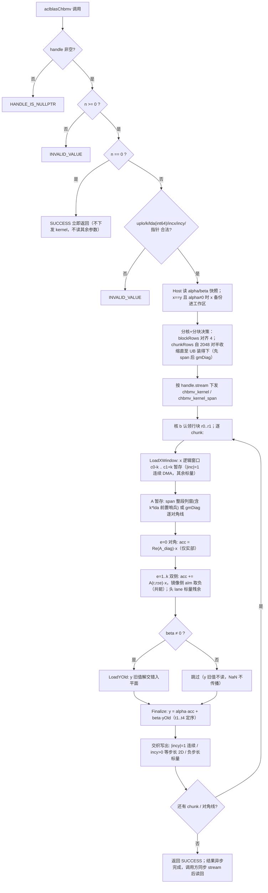

# aclblasChbmv 算子设计文档

| 项目 | 内容 |
| --- | --- |
| 算子名 / 接口名 | `aclblasChbmv`（单精度复数 Hermitian 带状矩阵-向量乘） |
| 适配硬件 | Atlas A2 系列产品（性能测试设备 Atlas 800T A2 / 910B3）与 Atlas A3 系列产品（arch22） |
| CANN 版本 | CANN 9.1.0 |
| 工程模式 | Ascend C kernel 直调（ops-blas 仓工程框架，句柄式 BLAS 接口） |
| 实现落位 | `blas/sbmv/arch22/`（与实数同族算子 `aclblasSsbmv` 同目录族） |
| 测试落位 | `test/sbmv/chbmv/arch22/`（CSV 驱动 GTest，含 csv 文件） |
| 开发者 / 团队 | yingtguo |
| 文档状态 | 待评审 |

依据：《aclblasChbmv 算子开发任务书》（AtlasA2/A3，随任务发布）、`test_cases/`（1200 条 CSV 用例与 200 行 A100 基线）、cann-competitions 仓 `resources/design_template.md`、ops-blas 主仓 `CONTRIBUTING.md`。功能与性能对标 cuBLAS `cublasChbmv`，算法语义与精度 golden 参考 Netlib BLAS 3.10.0 `cblas_chbmv`（`CblasColMajor`）。

本算子为 ops-blas 仓**新增能力**（补齐 Blas 仓能力），不是对既有 TBE/ACLNN 算子的优化：仓内不存在 chbmv 的 TBE 版本、aclnnChbmv 文件或历史 impl 路径，因此本文不含"迁移前实现"章节；标杆分析以 cuBLAS/Netlib 官方语义为准。实现已在个人私仓完成首版（行-对角分解 + span/gmDiag 双形态内核），单核正确性约 95% 以上，多核路径正在收尾（详见 §3.2.2.4 与 §5.3），本设计文档描述目标形态与已定型的技术决策。

---

# 一、需求背景

## 1.1 需求来源

通过【社区任务】完成昇腾算子开源仓算子贡献：在 Atlas A2/A3 系列 NPU（arch22）上使用 Ascend C 编程语言开发单精度复数（complex64）Hermitian 带状矩阵-向量乘算子 `aclblasChbmv`，完成设计、开发、测试全流程，验收通过后合入昇腾算子开源仓 <https://gitcode.com/cann/ops-blas>（合入目录 `blas/sbmv/arch22/`，测试代码合入 `test/sbmv/chbmv/arch22/`）。本任务为补齐 Blas 仓 Level-2 带状族复数能力。

## 1.2 背景介绍

### 1.2.1 算子功能

CHBMV 属于 BLAS Level-2，计算：

```
y := alpha * A * x + beta * y
```

其中 `alpha`、`beta` 为复数标量（Host 内存），`x`、`y` 为 n 元素复数向量，`A` 为 n×n **Hermitian 带状**矩阵（`A^H = A`），仅 k 条次对角线与 k 条超对角线在带内。A 按列主序带状格式存于 `lda×n` 数组（`lda ≥ k+1`），仅 `uplo` 指定的带形三角被引用，另一侧由 Hermitian 共轭对称性隐含补全：

- `uplo = ACLBLAS_UPPER`：主对角存于第 k+1 行，第 1 条超对角存于第 k 行（从第 2 列开始），依此类推；元素 A(i,j) 存于 A(1+k+i-j, j)（j=1..n，i∈[max(1,j-k), j]）；数组左上 k×k 三角不被引用。
- `uplo = ACLBLAS_LOWER`：主对角存于第 1 行，第 1 条次对角存于第 2 行（从第 1 列开始），依此类推；元素 A(i,j) 存于 A(1+i-j, j)（j=1..n，i∈[j, min(n,j+k)]）；数组右下 k×k 三角不被引用。
- **对角元素的虚部假定为 0**（Hermitian 性质），实现只取对角元素实部参与计算。

Hermitian 性质带来两条与实数 Ssbmv、与复数对称 Csymv 都不同的硬约束：

1. 对角元素只取**实部**参与计算（Netlib `DBLE` 语义），不得把整个复数对角乘进结果；
2. 未存储侧的镜像元素必须取**共轭**（虚部取反）参与计算，而不是原样复用——这正是 `aclblasChbmv` 不能通过改名调用 `aclblasSsbmv`（实数，无虚部）或 `aclblasCsymv`（复数对称，不共轭且对角虚部参与计算）得到正确结果的原因。

### 1.2.2 标杆算子（cuBLAS cublasChbmv）支持的数据类型与格式

| 项目 | cuBLAS `cublasChbmv` | 本任务 `aclblasChbmv` |
| --- | --- | --- |
| 数据类型 | COMPLEX64（实/虚各 FP32），alpha/beta 复数标量 | 一致（复数类型复用仓内 `include/cann_ops_blas_common.h` 的 `aclblasComplex`） |
| 存储格式 | 列主序带状（lda×n），ND 排布 | 一致 |
| uplo | CUBLAS_FILL_MODE_UPPER / LOWER | ACLBLAS_UPPER / LOWER（枚举值 121/122） |
| 维数参数 | `int` | `int`（与仓内同族实数接口 `aclblasSsbmv` 口径一致） |
| 标量位置 | host/device pointer mode 两种 | 仅 Host 内存指针（对齐仓内句柄式 BLAS 接口） |
| 步长 | incx/incy 可正可负、非零 | 一致 |

计算量为 O(n·k) 次复数乘加；无 trans、无 batch、无 broadcast、无转置参数。

### 1.2.3 标杆算子实现描述与流程（Netlib 参考主干）

cuBLAS 内部实现不开源，本文不推测其分核方式或访存策略；算法参考以 Netlib `chbmv.f`（语义与 CBLAS `cblas_chbmv` 一致）为准，其主干为**按列扫描**：

```text
参数检查（uplo, n, k, lda, incx, incy，非法则 XERBLA）
  → 快速返回：n == 0 或 (alpha == 0 且 beta == 1)
  → 由步长符号决定 x、y 的起始元素（负步长从末元素起反向）
  → beta != 1：y := beta*y（beta == 0 时置零，不读旧值）
  → alpha == 0：返回
  → 按列 j = 1..n 遍历存储三角：
       temp1 = alpha*x(j)，temp2 = 0
       UPPER：对 i = max(1,j-k) .. j-1
                  y(i) += temp1*A(i,j)          （存储侧直接项）
                  temp2 += conj(A(i,j))*x(i)    （镜像侧共轭项，升序累加）
              y(j) += temp1*real(A(j,j)) + alpha*temp2
       LOWER：y(j) += temp1*real(A(j,j))
              对 i = j+1 .. min(n,j+k)
                  y(i) += temp1*A(i,j)
                  temp2 += conj(A(i,j))*x(i)
              y(j) += alpha*temp2
```

语义要点（均已按任务书冻结）：

- `n = 0` 为合法 quick return，直接返回 SUCCESS，不执行计算；
- `beta = (0,0)` 时不读取 y 旧值（NaN/Inf 不传播），但 y 指针仍须非空；
- `alpha = (0,0)` 时按 `y = beta × y` 计算（实现不保证跳过 A/x 读取，故含 Inf/NaN 的 x 用例不得与 `alpha = (0,0)` 组合）；
- `k > n-1` 合法：超出矩阵的带无对应元素，按有效带宽 `min(k, n-1)` 参与计算（`lda` 仍按原始 k 校验）。

### 1.2.4 ops-blas 仓现状核对

| 项目 | ops-blas 仓现状 | Chbmv 需要 |
| --- | --- | --- |
| 公共头 | `include/cann_ops_blas.h` 尚无 `aclblasChbmv` 声明（本算子为新增接口） | 按 §2.3 新增声明，供其他产品线共用；禁止定义私有平行接口 |
| 复数类型 | `include/cann_ops_blas_common.h`：`aclblasComplex{float real; float imag;}`，状态码 0/2/3/5/7/9/10 等 | 直接复用，不新增类型、不改布局 |
| 带状实现 | `blas/sbmv/arch22/ssbmv_{host,kernel,tiling_data}`：实数对称带状，行独占分核 + 带状访存 | 复用其工程骨架、分核公式与 UB 切分范式；带存寻址、共轭补全、对角取实部、复数乘加必须新写 |
| 复数 Level-2 | 仓内复数同族 `aclblasCsymv` 等 | 仅作复数运算范式参考；其非法 uplo 返回 `INVALID_ENUM`，与本任务书冻结口径（`INVALID_VALUE`）不同，不跟随 |
| 测试工程 | `test/sbmv/ssbmv/`：CSV 驱动 GTest、Netlib golden | 复用 CSV 加载/设备缓冲/GTest 骨架，新增 Hermitian 约束填充与复数双分量比对 |
| 文档 | `blas/sbmv/README.md` 仅覆盖 Ssbmv | 增补 Chbmv 章节；产品支持表标注 Atlas A2/A3：支持 |

核对结论：仓内没有可被 Chbmv 直接调用的同语义实现；`Ssbmv`(arch22) 提供工程与分核范式，是本设计的同目录族基准。

# 二、需求分析

## 2.1 需求描述

在 ops-blas 仓新增 `aclblasChbmv`：句柄式接口，经 handle 绑定的 stream 直调 Ascend C AIV kernel，在 Atlas A2/A3（arch22）上完成 complex64 Hermitian 带状矩阵-向量乘；语义、参数序列与 `cublasChbmv` 一一对应，只引用 `uplo` 指定带形三角，满足任务书 §3.2 精度判据与 §3.3 性能判据（NPU 平均单次耗时 ≤ A100 标杆耗时的 1.25 倍）。

## 2.2 外部组件依赖

| 类别 | 依赖 | 用途与边界 |
| --- | --- | --- |
| 硬件 | Atlas A2 系列（Atlas 800T A2 / 910B3）、Atlas A3 系列（arch22，AIV 向量核） | 本次适配硬件 |
| 软件 | CANN 9.1.0（asc 前端、ACL runtime、tiling/platform 平台信息接口） | kernel 直调；不使用 ACLNN 算子包/OPP 注册 |
| 构建 | 仓内 CMake（`build.sh --ops=chbmv`）、GCC/G++（Host 侧 `*_host.cpp` 按普通 C++ 编译） | 跟随主仓构建，不新建平行工程 |
| 测试 | GTest、Netlib BLAS 3.10.0（`cblas_chbmv` golden，fp64 真值计算、按输出 FLOAT32 收窄落盘）、Python3、msprof op | CSV 驱动精度测试、单算子 task duration 采集 |

## 2.3 内部适配模块

| 模块 | 内容 |
| --- | --- |
| 公共 API/ABI | `include/cann_ops_blas.h` 新增声明；类型与状态码复用 `cann_ops_blas_common.h`，不破坏既有接口 |
| Host 模块 | 参数校验（§3.2.1.1 冻结顺序）、tiling 决策、就地 x 备份、kernel 下发（`chbmv_kernel_do`） |
| Device 模块 | AIV 向量 kernel：行-对角分解、span/gmDiag 双形态 A 暂存、复数乘加、共轭补全、对角取实部、beta/alpha 分支、负步长正确性路径 |
| 测试模块 | CSV 解析/参数装配、Hermitian 约束填充、Netlib golden、实/虚双分量混合容差比对、未引用区域哨兵校验 |

## 2.4 Ascend C 算子原型（接口定义）

在 `include/cann_ops_blas.h` 新增且只新增如下声明（签名按 `cublasChbmv` 参数序列，维数参数 `int`，与 `aclblasSsbmv` 口径一致）：

```cpp
aclblasStatus_t aclblasChbmv(
    aclblasHandle_t handle,
    aclblasFillMode_t uplo,
    int n, int k,
    const aclblasComplex* alpha,
    const aclblasComplex* A, int lda,
    const aclblasComplex* x, int incx,
    const aclblasComplex* beta,
    aclblasComplex* y, int incy);
```

### 参数说明（对齐任务书 §2.4）

| 参数名 | 输入/输出 | 描述 | dtype | 排布 | 维度/值域 | 异常行为 |
| --- | --- | --- | --- | --- | --- | --- |
| handle | 输入 | ops-blas 库上下文句柄，携带 stream，Host 内存 | scalar | - | 指向已创建的有效句柄 | nullptr → `ACLBLAS_STATUS_HANDLE_IS_NULLPTR` |
| uplo | 输入(attr) | 带形三角存储模式 | int 枚举 | - | {ACLBLAS_UPPER, ACLBLAS_LOWER} | 其他值 → `ACLBLAS_STATUS_INVALID_VALUE` |
| n | 输入 | 方阵 A 的阶数 | int scalar | - | n ≥ 0 | n<0 → INVALID_VALUE；n=0 合法 quick return（SUCCESS） |
| k | 输入 | 带宽（次/超对角线条数） | int scalar | - | k ≥ 0；k>n-1 按有效带宽 min(k,n-1) 计算 | k<0 → INVALID_VALUE |
| alpha | 输入 | 复数标量乘数指针，Host 内存 | COMPLEX64 | - | 实/虚取值 FLOAT32 全集 | n>0 时 nullptr → INVALID_VALUE |
| A | 输入 | Hermitian 带状矩阵，Device 只读，列主序 (k+1)×n（数组维度 lda×n），仅 uplo 指定带形三角被引用，对角虚部假定为 0 | tensor COMPLEX64 | ND | (k+1)×n | n>0 时 nullptr → INVALID_VALUE |
| lda | 输入 | 带状数组前导维度（列主序） | int scalar | - | lda ≥ k+1 | 否则 INVALID_VALUE（k+1 计算与比较在 int64 域，防 k=INT32_MAX 时 int32 回绕穿透） |
| x | 输入 | 输入向量，Device 只读 | tensor COMPLEX64 | ND | ≥ 1+(n-1)\|incx\| 元素 | n>0 时 nullptr → INVALID_VALUE |
| incx | 输入 | x 步长（可正可负） | int scalar | - | ≠0 且非 INT32_MIN | 0 或 INT32_MIN → INVALID_VALUE；(n-1)\|incx\| 超 int32 → INVALID_VALUE（host 侧 int64 计算，issue #780/#866 口径） |
| beta | 输入 | 复数标量乘数指针，Host 内存；(0,0) 时 y 不必是有效输入 | scalar COMPLEX64 | - | 实/虚 FLOAT32 全集 | n>0 时 nullptr → INVALID_VALUE |
| y | 输出(原地) | 输入/输出向量，Device 内存，原地覆写 | tensor COMPLEX64 | ND | ≥ 1+(n-1)\|incy\| 元素 | n>0 时 nullptr → INVALID_VALUE；beta=(0,0) 不豁免非空 |
| incy | 输入 | y 步长（可正可负） | int scalar | - | ≠0 且非 INT32_MIN | 同 incx |

返回值 `aclblasStatus_t`：`SUCCESS(0)` / `INVALID_VALUE(3)` / `EXECUTION_FAILED(5)`（取核数失败等运行期错误）/ `ALLOC_FAILED(2)`（就地备份工作区扩容失败）/ `NOT_SUPPORTED(7)`（无 tiling 可装入 UB）/ `HANDLE_IS_NULLPTR(9)`。

## 2.5 与标杆算子相比的功能约束（缺失/差异说明）

1. 标量 pointer mode：仅支持 Host 内存标量（对齐仓内接口口径），不支持 device 标量指针模式；
2. 非 bit-exact：本算子为浮点乘累加运算，不承诺与 golden 逐位一致，精度按 §5.1 混合容差判定；
3. 非法 uplo 统一返回 `ACLBLAS_STATUS_INVALID_VALUE`（任务书 §7-5 与研发确认口径；仓内复数同族 `aclblasCsymv` 当前返回 `INVALID_ENUM`，差异由研发后续统一，本算子不跟随也不改动 Csymv）；
4. 不支持超出 lda/incx/incy 语义的非连续内存访问（任务书 §2.5：不涉及），不支持 broadcast/batch/转置参数。

## 2.6 需求拆解

1. 公共 API：新增 `aclblasChbmv` 声明，供其他产品线共用（如 950PR 产品线），禁止私有平行接口；
2. 参数校验：严格按 §3.2.1.1 冻结顺序，含 `n=0` quick return、int64 域 lda/incx 溢出检查与 `INVALID_VALUE` 口径；
3. 带存寻址与 Hermitian 补全：UPPER/LOWER 各一组公式，未存储侧取共轭，对角只取实部，未引用区域（UPPER 左上 k×k、LOWER 右下 k×k 与 lda padding）不读；
4. 标量与分支：`beta=0` 不读 y；`alpha=0` 退化为 `y = beta*y`（含 beta=0 时清零）；
5. 步长与 padding：incx/incy 正负与绝对值≠1 的物理布局；lda padding 列间空隙不读；k>n-1 有效带宽退化；
6. 精度：实/虚部分别按 FLOAT32 混合容差判定，含 Inf/NaN 等价规则（§5.1）；
7. 性能：200 条性能用例逐条达到 A100 标杆 0.8 倍以上（§5.1）；
8. 交付：README（产品支持表标注 Atlas A2/A3：支持）、测试工程与可复现步骤、自测报告、`task_submission/` 目录交付件。

# 三、需求详细设计

## 3.1 调用方式

**Kernel 直调**（任务书 §2.2）：基于 ops-blas 开源仓工程框架实现句柄式 BLAS 接口，通过 handle 绑定 stream 直调 NPU kernel，不经过 ACLNN 算子包/OPP 注册。调用序列：

```text
aclblasCreate → aclblasSetStream(handle, stream)
  → aclblasChbmv(handle, uplo, n, k, alpha, A, lda, x, incx, beta, y, incy)
  → aclrtSynchronizeStream(stream) → 读回 y
```

工程落位（文件结构与主仓同族算子一致，无冗余文件）：

```text
include/cann_ops_blas.h                    新增 aclblasChbmv 声明（共用）
blas/sbmv/README.md                        增补 Chbmv 章节，产品支持表标注 A2/A3 支持
blas/sbmv/arch22/
  chbmv_host.cpp                           参数校验、tiling 决策、就地 x 备份、kernel 下发
  chbmv_kernel.cpp                         AIV 向量 kernel 与直调入口
  chbmv_kernel.h                           kernel 入口声明
  chbmv_tiling_data.h                      tiling 结构与 UB 预算公式（host/kernel 共用）
test/sbmv/chbmv/
  CMakeLists.txt                           注册 chbmv_test
  arch22/chbmv_test.cpp                    CSV 驱动 GTest（Hermitian 填充、golden、比对）
  arch22/chbmv_test.csv                    随任务提供的 1200 条用例
  arch22/gpu_baseline.csv                  随任务提供的 200 行 A100 基线
```

## 3.2 需求总体设计

### 3.2.1 host 侧设计

#### 3.2.1.0 参数校验（冻结顺序）

严格按任务书 §2.5 口径，**handle 判空最优先，quick return 不得先于判空**（#765/#861 维护者拍板）：

1. `handle == nullptr` → `ACLBLAS_STATUS_HANDLE_IS_NULLPTR`；
2. `n < 0` → `ACLBLAS_STATUS_INVALID_VALUE`；
3. `n == 0` → 直接返回 `ACLBLAS_STATUS_SUCCESS`，不读 uplo/k/lda/incx/incy/alpha/beta/A/x/y，不下发 kernel；
4. `uplo ∉ {ACLBLAS_UPPER, ACLBLAS_LOWER}` → `INVALID_VALUE`；
5. `k < 0` → `INVALID_VALUE`（k>n-1 合法，由 kernel 行域裁剪天然实现有效带宽 min(k,n-1)）；
6. `lda < k+1` → `INVALID_VALUE`，**比较在 int64 域**（防 k 取 INT32_MAX 时 int32 回绕使校验穿透）；
7. `incx`/`incy` 为 0 或 INT32_MIN → `INVALID_VALUE`；`(n-1)×|inc|` 在 host 侧以 int64 计算，超出 int32 表示范围 → `INVALID_VALUE`；
8. `alpha`/`beta`/`A`/`x`/`y` 任一为 nullptr → `INVALID_VALUE`（n>0 时，无 alpha=0 豁免）。

校验通过后：读取 alpha/beta 标量快照（Host 内存直接解引用）、决策 tiling、绑定 `handle->stream` 下发 kernel。

#### 3.2.1.1 分核策略

**行块均分、优先满核、行数下限保护**（与仓内 Ssbmv 获胜架构一致的复数移植）：

```
aivCoreNum = GetAivCoreCount()                       // 平台 AIV 核数；0 → EXECUTION_FAILED
aivCoreNum = min(aivCoreNum, CHBMV_MAX_CORE_NUM=64)  // 分发规模上限
useCoreNum = max(1, min(aivCoreNum, ceil(n / CHBMV_ROWS_PER_CORE=32)))
                                                       // 每核至少 32 行才有意义，
                                                       // 行块太碎只买分发税（小 case 分发地板 ~3.9µs）
blockRows  = CeilAlign(ceil(n / useCoreNum), 4)       // 对齐到 4 行（32B 向量粒度）
numBlocks  = ceil(n / blockRows)
```

- **行独占划分**：核 b 拥有输出行区间 `[r0, r1) = [b×blockRows, min((b+1)×blockRows, n))`，`r0 ≥ n` 的核直接不激活。每个输出行有**唯一写者**，天然无原子、无 scatter、无跨核同步。
- 与 Netlib 的按列扫描不同，本设计把 `y = alpha·A·x + beta·y` 改写为**行-对角分解**：输出行 r 的结果 = 对角线偏移 e∈[-k,k] 各条贡献之和 `y[r] += A(r, r+e)·x[r+e]`，等价性与顺序论证见 §3.2.2.3。
- 多核路径已实现（`GetBlockIdx()` 行块寻址）；开发期以 `CHBMV_ENABLE_MULTICORE` 环境变量作为对比实验开关，多核向量段问题收尾后默认开启（见 §5.3 风险表）。

#### 3.2.1.2 数据分块和内存优化策略

**UB 预算与 chunk 收缩**（充分使用 UB 空间的原则，兼顾不同硬件 UB 大小差异）：

```
ubBudget(float 数) = (平台 GetCoreMemSize(UB) − 1024B 安全余量) / 4    // arch22 实测 192KB
chunkRows 初值     = min(blockRows, CHBMV_CHUNK_ROWS_CAP=2048)
循环：每档先试 span 形态（快），装不下再试 gmDiag 形态，仍装不下 chunkRows 对半收缩
      （下限 4 行 = 32B 对齐粒度），直至某形态 ChbmvUbFloats(...) ≤ ubBudget；
      全部失败 → NOT_SUPPORTED（n ≤ 4096 用例域内不触发）
```

单 chunk 的 UB 占用（float 单位，host/kernel 两侧公式逐字对应，见 `ChbmvUbFloats`）：

```
accF = 2 × (CeilAlign(chunkRows,4) + 16)          // 单平面容量（尾块 32B 余量）
总占用 = 12×accF                                   // 9 个解交错平面(acc/yOld/a/xv/tmp…) + 交织写出暂存
        + idxT/offAT/interT 三张逐 lane 偏移表
        + x 窗口 2×(chunkRows + 2k + 16)          // 交织、逻辑序
        + 对角线暂存 2×(chunkRows + 16)
        + [span 形态] 2×(lda×(chunkRows+2k) + 前置哨兵 k×lda + 16)
```

要点：

1. **span 形态**（窄带首选）：把本 chunk 需要的 A 列窗口（UPPER 为列 [c0, c1+k)、LOWER 为列 [c0-k, c1)）连同**前置哨兵 k×lda 个复数**（吸收头部 lane 的负 gather 基址）用**一段连续 GM 拷贝**搬入 UB；之后每条对角线以 `Gather + 等步长偏移表 offAT (i×lda×8B)` 从 UB 取平面。连续大块搬运对 MTE2 友好，单块 blockLen 上限 64KB，超过按 8192 复数分段。
2. **gmDiag 形态**（宽带 k≳128 唯一能装进 192KB 的形态）：不做整段暂存，逐条对角线直取 GM 暂存到 `aDiag` 平面，UB 占用从 O(lda×(rows+2k)) 降为 O(rows+k)。带内元素为 8B 复数块，MTE2 2D 拷贝的 blockLen 须满足 32B 块粒度约束（cgbmv byColumn 实证 8B 元素块会读到垃圾），故对角线暂存采用**标量直装**保正确性（宽带性能优化列为遗留项，见 §5.3）。
3. **对齐纪律**：所有 UB 区域基址向上取整到 8 float（32B）——DataCopy/Gather 的 UB 基址须 32B 对齐；`accF` 恒为 8 的倍数。行区间起点向上对齐到 4 行，**对齐头 lane（至多 3 行）走标量直积**累加，规避部分 lane 清零、Duplicate 粒度、gather 基址钳位三重坑（开发期实测 507035 内部错误与行 0-3/8-9/16-17 失配的根源，已修复）。
4. **就地别名（x==y）**：`x` 与 `y` 同指针且 alpha≠0 时，kernel 读写 y 会覆盖 x——host 侧先经 `aclrtMemcpyAsync` 把 x 备份进 handle 工作区（同 stream 保序，必要时扩容），kernel 改读备份。
5. **标量与事件同步**：alpha/beta 在 host 解引用为 4 个 float 进 tiling（kernel 不解释 Host 指针）；MTE2→V、V→MTE3、MTE3→MTE2、S→V、V→S 五类事件按依赖显式同步，chunk 间以 MTE3→MTE2 复用同一批 UB（当前为空间复用，double buffer 为后续优化项）。

#### 3.2.1.3 tilingKey 规划策略

本工程为 kernel 直调，不经过 ACLNN 算子注册，**无 tilingKey 概念**。等价的分支控制收敛为 tiling 结构内的两个形态位 + kernel 入口选择：

| 分支 | 载体 | 取值与条件 |
| --- | --- | --- |
| uplo | `tiling.uplo` → 模板/运行期分支 | UPPER / LOWER（寻址与共轭方向二分支） |
| spanForm | `tiling.spanForm` | 1：span 整段暂存（UB 装得下时优先）；0：gmDiag 逐对角线暂存（宽带） |
| kernel 入口 | `chbmv_kernel_do` 按_launch 级量_单点判定 | span 形态 + incx>0 + incy>0 + alpha≠0 → 精简入口 `chbmv_kernel_span`（只含该路径代码）；否则通用入口 `chbmv_kernel` |

`ChbmvTilingData` 字段全部有用、按值随 kernel 参数传递（不走 Host 栈地址）：

| 字段 | 类型 | 说明 |
| --- | --- | --- |
| n / k / lda / uplo | uint32 | 规模、带宽（原始 k）、前导维、三角选择 |
| useCoreNum / blockRows / chunkRows | uint32 | 分核数、每核行块高、单 chunk 行数 |
| spanForm / ubFit | uint32 | A 暂存形态；UB 预算回验通过标志 |
| alphaR/alphaI/betaR/betaI | float | Host 读取的标量快照 |
| incx / incy | int64 | 步长（先提升 64 位，kernel 内不做 int 取反） |

不携带指针、workspace 地址与核数之外的派生量；不设未使用的 path/tail 字段。

### 3.2.2 kernel 侧设计

#### 3.2.2.1 kernel 侧实现描述

`chbmv_kernel`（AIV_ONLY 任务型）按 `Init → Process` 两阶段组织；Process 内每个 chunk 走 CopyIn（MTE2/标量）→ Compute（向量）→ CopyOut（MTE3/标量）：

1. **Init**：解析 tiling、设置 GM 缓冲（A/x/y 以 float 视图，长度按 int64 计算）、`TPipe` 一次性划分全部 UB 区域（平面/表/窗口布局与 host 公式逐字对应）、构建三张逐 lane 偏移表并做 S→V 同步。
2. **LoadXWindow**：本 chunk 行域 `[c0, c1)` 需要的 x 逻辑窗口 `[c0−k, c1+k)`（裁剪到 [0, n)，lead 空位保留保证对角线 gather 的 xRel ≥ 0 恒成立）暂存到 `xWinT`（交织、逻辑序）。正步长 |incx|=1 走连续 `DataCopyPad`；|incx|≠1 与负步长走标量直装（2D 搬运 8B 块违反 32B 粒度约束 / 负步长反向寻址，均为正确性路径）。
3. **A 暂存**：span 形态整段搬列窗（含前置哨兵）；gmDiag 形态逐条对角线按行 r 的列号/槽位公式（UPPER：e≥0 → 列 r+e 槽 k−e、e<0 → 列 r 槽 k+e；LOWER：e≥0 → 列 r 槽 e、e<0 → 列 r+e 槽 |e|）直取 GM，LOWER 的 e<0 头 lane 负列写 0。
4. **DiagPass(e)**（核心计算，逐条错位对角线）：行域裁剪 `[loRaw, hiRaw)`（e≥0 时 lo=c0、hi=min(n−e, c1)；e<0 时 lo=max(|e|, c0)、hi=c1——**k>n-1 的有效带宽退化由此天然实现，且带内行基址始终用原始 k**）。对齐头残余行（≤7 行）标量直积累加；其余行解交错为平面后走向量指令：
   - `e=0`（Hermitian 对角）：仅实部参与——`Mul/MulAddDst(accR, aReT, xvReT)`、`Mul/MulAddDst(accI, aReT, xvImT)`（Netlib DBLE 语义）；
   - `e≠0`：复数乘加六拍——`MulAddDst(accR, aRe, xvRe)`，`Mul(tmp, aIm, xvIm)` 后按共轭方向 `Add/Sub`（**UPPER 的 e<0、LOWER 的 e>0 为镜像侧，aIm 取负即共轭**），`MulAddDst(accI, aRe, xvIm)`，`Mul(tmp, aIm, xvRe)` 后反向 `Sub/Add`；
   - 首条（e=0）用 `Mul` 直写累加器，其余 `MulAddDst` 累加。
5. **LoadYOld**（beta≠0）：y 旧值按 incy 定位装入 yOld 平面（正步长 |incy|=1 走 DMA+`Gather` 解交错；其余标量直装）。
6. **FinalizeAndStore**：`y = alpha·acc + beta·yOld`。alpha 折叠按 t1..t4 显式定序（t4=αI·accRe 必须先算，accRe 随即被覆盖的 WAR 依赖）；beta 项四个 Muls + Add/Sub。输出交织：`interT` 表单次 `Gather` 把 平面拼成交织序列，随后 |incy|=1 连续 `DataCopyPad`、incy>0 等步长 2D `DataCopyPad`（行块 8B、步长 (|incy|−1)×8B）、负步长标量写出。
7. **HandleAlphaZero**（alpha=(0,0)）：`y = beta·y`；beta 也为 0 时 `Duplicate` 清零，不读任何 A/x（含 NaN 的 y 旧值不传播）。
8. **chunk 循环**：`for c0 = r0; c0 < r1; c0 += chunkRows`，chunk 间 MTE3→MTE2 同步复用 UB。

#### 3.2.2.2 Ascend C 实现流程图



#### 3.2.2.3 与标杆算子流程图的差异点和原因

| 差异点 | Netlib `chbmv.f`（按列扫描） | 本设计（行-对角分解 + AIV 向量化） | 原因与影响 |
| --- | --- | --- | --- |
| 计算组织 | 按列 j 遍历，同一 y 元素被多列读改写（temp1/temp2 两路累加） | 核独占连续行块，行 r 的结果 = 2k+1 条错位对角线贡献之和，寄存器/UB 平面累加后一次写出 | 消除多写者与跨核同步；数学恒等：Σ_j A(r,j)x(j) = Σ_e A(r,r+e)·x[r+e]，逐元素加法结合次序变化在本任务非 bit-exact 口径（§5.1 混合容差）内 |
| alpha 折叠位置 | 直接项先乘 `temp1=alpha·x(j)`，镜像项整体 `alpha·temp2` | 累加器存纯 `A·x` 部分和，alpha 在 Finalize 一次性折叠 | 向量路径下免每条对角线 2 次额外向量乘；溢出边界形态与 golden（fp64 真值收窄）可能不同，由 Inf/NaN 等价规则（§5.1）覆盖 |
| 对角 | `real(A(j,j))` 标量乘 | `aReT` 平面 Mul/MulAddDst，实数×复数两拍 | 不构造复数对角参与四乘，避免 0×Inf 类伪影 |
| 镜像侧 | `conjg(A(i,j))` 就地共轭 | 平面 `aIm` 按共轭方向 Add/Sub 实现取负 | 向量指令无"共轭乘"，拆为实部乘加与虚部乘减两拍等价实现 |
| 步长基址 | `KX = 1-(n-1)·INCX`（1 基） | 0 基：负步长第 i 个逻辑元素位于 `(n-1-i)·\|inc\|`，基址为分配起点；incx/incy 先提升 int64 | 防 `abs(INT32_MIN)` 回绕；DMA 只搬正步长形态，负步长标量正确性路径 |
| 快速返回 | `n==0` 或 `alpha==0 && beta==1` 立即返回 | `n==0` 在 host 侧（不下发 kernel）；`alpha==0` 在 kernel 内只算 `beta·y`；`alpha==0 && beta==1` 写回与旧值逐位相同的结果 | 任务书 §2.5 校验顺序要求 handle 判空最优先、quick return 不先于判空；beta=(1,0) 时 `1.0×y` 写回位不变 |
| 标量位置 | Fortran 传值 | Host 指针，host 解引用快照进 tiling | 与仓内所有句柄式 BLAS 接口一致；kernel 不触碰 Host 指针 |
| x==y 别名 | 未定义（调用方保证） | host 侧自动备份 x 进 handle 工作区（同 stream 保序） | 提升易用性；备份为逐字节拷贝，不改数值 |

### 3.3 支持硬件

| 支持的芯片版本 | 涉及勾选 |
| --- | --- |
| Atlas 800I/T A2（arch22，性能测试设备 Atlas 800T A2 / 910B3） | √ |
| Atlas A3 系列产品（arch22） | √ |

README 产品支持表标注：Atlas A2 训练/推理系列产品、Atlas A3 系列：支持。自验证覆盖一种款型即可（精度建议 910B3 或 A3，性能建议 910B3，任务书 §3.1）。

### 3.4 算子约束限制

| 约束项 | 内容 |
| --- | --- |
| 参数合法性 | n ≥ 0；k ≥ 0；lda ≥ k+1（int64 域）；incx/incy ≠ 0 且非 INT32_MIN、(n-1)×\|inc\| 不超 int32；alpha/beta/A/x/y 非空；任一非法（含 uplo 非法）返回 `INVALID_VALUE`；校验顺序见 §3.2.1.1 |
| 三角引用 | 仅引用 uplo 指定带形三角；未引用侧由共轭对称隐含；对角虚部假定为 0（仅实部参与）；UPPER 左上 k×k、LOWER 右下 k×k 及 lda padding 不被引用 |
| 有效带宽 | k>n-1 合法，按 min(k,n-1) 参与（kernel 行域裁剪实现；带内行基址始终用原始 k，lda 按原始 k 校验） |
| 非连续 Tensor | 不涉及（步长语义由 incx/incy/lda 描述，不支持额外 stride） |
| broadcast / dynamic shape | 不涉及；n/k 为运行时入参，无 shape 编译期绑定 |
| 原地与视图语义 | y 原地覆写，不返回视图；x==y 别名自动备份（§3.2.1.2-4）；A 与 y 重叠未定义 |
| 确定性计算 | 不要求 bit-exact；无原子、无跨核规约，同输入同实现结果确定 |
| 空 Tensor 与 0 维 | n=0 合法 quick return（SUCCESS，不计算）；`alpha=(0,0)` 与 `beta=(1,0)` 组合不要求额外短路 |
| 异步执行 | 依赖 `aclblasSetStream` 绑定 stream；读回 Device 结果前须同步 stream |

# 四、特性交叉分析

| 交叉特性 | 易错点 | 设计与验证 |
| --- | --- | --- |
| uplo × 共轭 × 对角 | 把 Hermitian 当对称（镜像不取共轭）、对角虚部污染结果 | 镜像侧 aIm 取负（UPPER e<0 / LOWER e>0）；对角仅 aRe 平面参与；uplo 全组合用例覆盖 |
| k>n-1 × lda × 寻址 | 行基址误用有效带宽、lda 误按有效带宽校验、int32 回绕 | lda 按原始 k 在 int64 域校验；行基址用原始 k、仅列范围裁剪；用例覆盖 k>n-1 |
| 负步长 × 基址 × DMA | 指针预偏移起点错误、2D 搬运 8B 块违反 32B 粒度 | 0 基 `(n-1-i)·\|inc\|` 定位 + int64；负步长全程标量正确性路径；测试断言步长空隙哨兵不变 |
| lda padding × 未引用区 | 误读 padding 或未承载元素的带内槽位 | 地址在读取前按公式判定（不整块搬运后掩码）；未引用槽位与 padding 填有限哨兵中毒校验 |
| n=0 × 其他非法参数 | quick return 前提前解引用/校验 | 校验顺序冻结：handle → n≥0 → n==0 → 其余；n=0 叠加非法 uplo/k/lda/inc/空指针用例期望 SUCCESS |
| alpha=0 / beta=0 / beta=1 × 指针与 NaN | beta=0 仍读旧 y（NaN 传播）、alpha=0 误读含 Inf/NaN 的 x | kernel 分支明确：alpha=0 不读 A/x；beta=0 不读 y；含 Inf/NaN 的 x 用例不与 alpha=0 组合（任务书口径） |
| Inf/NaN × 累加次序 | 有限/非有限形态随折叠次序漂移 | 行内对角线次序固定（e: 0, +1, −1, …）；alpha 统一 Finalize 折叠；非有限值按 §5.1 等价规则单独判定 |
| 多核 × 行块 × 唯一写者 | 同一行被两核写、尾核越界 | 行块闭开区间划分 + `r0 < n` 激活判定；无原子无规约 |
| UB 预算 × 形态选择 × 对齐 | UB 区域基址非 32B 对齐（核内 507035）、部分 lane 清零/钳位 | 区域尺寸向上取整 8 float；行起点向上对齐 4 + 头 lane 标量残余；host/kernel UB 公式逐字对应 + ubFit 回验 |
| span 单块超限 × MTE2 | blockLen 超 64KB 被截断 → 数值错 | span 按 8192 复数分段下发（实证 k=64/chunk128 时 99840B 单块截断） |
| x==y 别名 × workspace | kernel 写 y 覆盖未消费的 x | host 同 stream 异步备份；工作区不足时扩容，失败返回 ALLOC_FAILED |

# 五、可维可测分析

## 5.1 精度标准/性能标准

| 验收标准 | 描述 | 标准来源 |
| --- | --- | --- |
| 精度标准 | 见下；golden 为 `cblas_chbmv`（Netlib BLAS 3.10.0，CblasColMajor，输入转 float64 真值计算、按输出 FLOAT32 收窄落盘），输出 y 全量验证、实部/虚部分别比对；golden 生成按 Hermitian 约束解释 A（对角只取实部、未存储带形三角按共轭对称补全） | 任务书 §3.2 + 生态算子开源精度标准（mixed_tolerance_standard.md） |
| 性能标准 | COMPLEX64 输入场景平均单次耗时（msprof op 单算子 task duration，自带 5 次 warmup 不计样本，有效采样 ≥10 取算术平均）不高于 GPU 标杆（A100-SXM4-80GB / CUDA 12.8 / cuBLAS 12.8.4，随包 gpu_baseline.csv）耗时的 1.25 倍，即达到标杆 0.8 倍以上；单 case 与全量 200 条判据一致 | 任务书 §3.3 |

**精度判定**（COMPLEX64 实部/虚部分别按 FLOAT32）：

| 数据类型 | rtol | atol | required_matched_ratio | max_abs_error_limit |
| --- | --- | --- | --- | --- |
| FLOAT32（复数分量） | 2^-13 (1.2e-4) | 2^-13 (1.2e-4) | 0.99 | 1e-2 或 32×ULP（按最大误差点 golden 值动态计算，2026-09-24 修订口径） |

- 逐元素通过条件 `|actual − golden| ≤ atol + rtol×|golden|`；用例须同时满足 matched_ratio ≥ 0.99 且 max_abs_error ≤ max_abs_error_limit。
- **Inf/NaN 规则**：不适用上式；同为 NaN、同为同号 Inf、或一方 NaN 另一方 ±Inf 视为等效通过；一方有限另一方非有限判失败；非有限值元素不计入 matched_ratio 与 max_abs_error，单独记录总数与通过数。
- 本算子为确定性浮点乘累加，非随机类算子（§3.5 均匀/正态分布是测试输入生成规则，非算子行为）。

**测试方案**：ops-blas 仓 test 目录 CSV 驱动 GTest 工程加载 `chbmv_test.csv`（1200 条：1000 精度 + 200 性能/内存）调用接口执行并与 golden 比对。用例覆盖（任务书 §3.5-4）：uplo 全组合小尺寸基础、尺寸扫描（0、1、小质数、2 的幂及 ±1、非对齐值至大规模）、带宽扫描（k=0/1/小带宽/满带 k=n-1）、标量特殊值（(0,0)/(1,0)/纯虚数/大值）、前导维紧凑与 padding、步长 ±1/±2/±3 及零步长负向、边界负向（零维 SUCCESS、handle 空指针、非法 uplo/前导维/负维度/零步长/INT32_MIN 步长/非 handle 空指针 → INVALID_VALUE）、Inf/NaN 特殊值、性能用例。随包 `gen_csv.py` 默认仅均匀分布 `RANDOM_NORM_5_5`，**正态分布用例（μ∈[-5,5]、σ∈[0.1,2]，token `GAUSS_NORM_5_2`）由开发者补齐**（扩展生成器或补充 CSV），纳入精度自验并在自测报告说明补齐方式与数量。A 按 Hermitian 带状约束生成（对角虚部 0、带内共轭对称、带外 0），未引用区域与步长空隙以有限哨兵中毒，调用后校验 A/x 逐字节未变、空隙未被写。

**性能典型 case（gpu_baseline.csv 前 4 条，A100 实测）**：

| case | uplo | n | k | gpu 基线 (µs) | 判据时限 (µs) = 1.25×基线 |
| --- | --- | --- | --- | --- | --- |
| chbmv-base-000 | UPPER | 512 | 8 | 9.88 | 12.35 |
| chbmv-base-001 | UPPER | 1024 | 16 | 15.87 | 19.84 |
| chbmv-base-002 | LOWER | 2048 | 32 | 28.01 | 35.01 |
| chbmv-base-003 | LOWER | 4096 | 64 | 53.03 | 66.28 |

以 base-003 计唯一字节流量（A 8×65×4096 ≈ 2.13MB + x 32KB + y 读写 64KB ≈ 2.2MB / 53µs ≈ 42GB/s @GPU 时间；时限内 ≈ 33GB/s），远低于 910B3 HBM 带宽，瓶颈在固定开销与搬运效率；小 case（n≤8）判据约 7~9µs，需压 launch 与分发开销（分核策略的 32 行下限即为此服务）。内存要求：任务书 §3.4 不涉及。

## 5.2 兼容性分析

- 只新增 `aclblasChbmv` 声明与 `blas/sbmv/arch22/chbmv_*`、`test/sbmv/chbmv/*`，不改动既有接口签名、状态码枚举或类型布局；`aclblasSsbmv` 等既有算子行为与用例不受影响。
- 接口声明放入 `include/cann_ops_blas.h` 供其他产品线共用（如 950PR 同名任务共用同一 API），禁止私有平行接口。
- 非法 uplo 返回 `INVALID_VALUE` 为任务书 §7-5 冻结口径；与仓内 `aclblasCsymv` 的 `INVALID_ENUM` 并存属已知差异，由研发后续统一，本 PR 不改动 Csymv（README 约束说明中标注该差异）。
- 新算子，不涉及对既有调用方的兼容性回归；README 产品支持表新增 Atlas A2/A3：支持。
- 许可与文件头沿用仓内规范（CANN Open Software License Agreement Version 2.0）。

## 5.3 风险与遗留项

| 风险/遗留 | 现状与依据 | 应对 |
| --- | --- | --- |
| 多核向量段问题 | 行块划分已实现；多核下个别向量段结果异常待定位，当前默认单核（`CHBMV_ENABLE_MULTICORE=1` 重开对比），单核正确性 ~95%+ 且冒烟 15/19（stride2 与三个量级用例收尾中） | 按 Ssbmv 多核范式排查 chunk/事件依赖；修复后全量回归 1200 条再开默认多核；大 n 用例以多核达标为验收前提 |
| gmDiag 形态标量暂存性能 | 8B 复数块不满足 MTE2 2D 拷贝 32B 块粒度约束（cgbmv 实证），当前标量直装保正确 | 宽带大 k 用例（k≳128）如性能不达标，评估 4 复数打包/对角线批量暂存优化 |
| Inf/NaN × alpha 折叠次序 | alpha 统一 Finalize 折叠，与 golden（fp64 真值）的溢出边界形态可能不同 | 按 §5.1 等价规则判定；TC_FL 类用例全量回归验证 |
| 正态分布用例补齐 | 随包生成器仅均匀分布 | 扩展 gen_csv/测试框架支持 `GAUSS_NORM_5_2`，补齐后纳入自测报告 |
| 小 case 固定开销 | 判据最小约 7~9µs，与 launch/分发地板同量级 | warmup 5 后采样；精简入口 `chbmv_kernel_span` 收缩代码体积与启动开销 |

---

## 附：交付与验收对照

| 交付件 | 落位 |
| --- | --- |
| 设计文档（本文件） | cann-competitions 仓 `04_tasks/01_community-task-2026/tasklist/` 对应任务目录 `{TeamName}/docs/design.md`，PR 评审合入 |
| 算子代码 | 个人仓 `blas/sbmv/arch22/`（4 文件）+ `include/cann_ops_blas.h` 声明 + `blas/sbmv/README.md` 增补 |
| 测试代码 | 个人仓 `test/sbmv/chbmv/arch22/`（GTest + CSV，含复现步骤 readme） |
| 自测报告 | 模板化报告（用例参数、实/虚部精度对比截图、性能数据截图）；私仓根目录 `task_submission/` 按 1/2.x/3.x/4.x 命名同步提交 |
| 待验收代码地址 | 个人仓链接 + 分支 + 算子目录；邀请 Ascend-CANN 为开发者；任务 IT 系统说明中填验收 commit 链接 |
