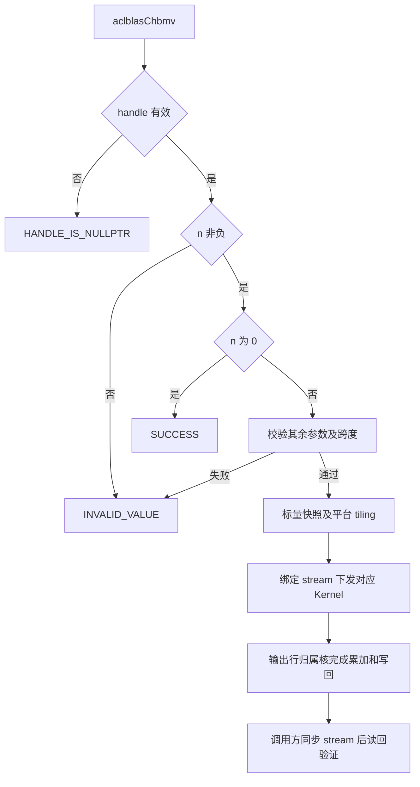

# 需求背景（required）

## 需求来源

本设计对应 2026 年 11 月社区任务 `aclblasChbmv`，目标产品为 Atlas A2/A3，开发语言为 Ascend C，工程采用 `ops-blas` 句柄式 BLAS 接口及 Kernel 直调。开发者 GitCode ID 为 `Agoni-02`。需求和验收口径依据任务书第 2～5 节及其配套测试包。[任务页面](https://www.hiascend.com/activities/task-center/details/ea8efcc9f98c4d54930f8b8e94a59366?menu=tasks) · [官方任务附件](https://www.hiascend.com/p/resource/202611/87d7ffb2d85c4a3eba8727ec14683bec.zip)

| 版本 | 日期 | 修改人 | 修订内容 |
| --- | --- | --- | --- |
| 1.0 | 2026-11-11 | Agoni-02 | 提出接口、寻址、分核、UB 规划、优化方法及验收方案 |

当前处于设计评审阶段。文中的 Kernel 路径和 tiling 参数属于实现计划，精度、性能及 CANN 9.1.0 真机编译结果将在实现阶段记录。

## 背景介绍

### aclblasChbmv 算子实现优化

CHBMV 是 BLAS Level-2 的单精度复数 Hermitian 带状矩阵与向量乘运算。矩阵仅存储一个三角带，另一侧通过共轭对称性得到，对角只使用实部。设计围绕有效带内计算、复数向量运算和输入窗口复用组织数据流。[cuBLAS HBMV](https://docs.nvidia.com/cuda/cublas/index.html#cublas-t-hbmv) · [Netlib CHBMV](https://www.netlib.org/blas/chbmv.f)

本任务在 `include/cann_ops_blas.h` 增加公共 `aclblasChbmv` API，源码落位 `blas/sbmv/arch22/`，测试落位 `test/sbmv/chbmv/arch22/`。实现复用仓内句柄、stream、状态码、平台查询和测试框架。功能标杆采用 cuBLAS/Netlib，性能标杆采用任务包给定的 A100 数据。

### aclblasChbmv 算子现状分析

核验的 `ops-blas` 基线为 `5bd95145a9c499e43ebad44a313a1029c63d54bc`。该版本公共头文件尚无 `aclblasChbmv` 声明，`sbmv/arch22` 提供 `Ssbmv`，`gbmv/arch22` 提供 `Cgbmv`。前者可参考带状三角访问和按输出行归属分核，后者可参考 complex64 解交织、复数乘加和非对齐搬运。实现时需逐项保持本任务的校验顺序及返回码。[公共接口](https://gitcode.com/cann/ops-blas/blob/5bd95145a9c499e43ebad44a313a1029c63d54bc/include/cann_ops_blas.h) · [Ssbmv Host](https://gitcode.com/cann/ops-blas/blob/5bd95145a9c499e43ebad44a313a1029c63d54bc/blas/sbmv/arch22/ssbmv_host.cpp) · [Cgbmv Kernel](https://gitcode.com/cann/ops-blas/blob/5bd95145a9c499e43ebad44a313a1029c63d54bc/blas/gbmv/arch22/cgbmv_kernel.cpp)

| 参考实现 | 可复用内容 | 本任务需要补齐的行为 |
| --- | --- | --- |
| `aclblasSsbmv`，arch22 | 列主带状寻址、输出行分工、x 窗口、平台 UB 查询 | 复数乘加、镜像侧共轭、对角仅取实部 |
| `aclblasCgbmv`，arch22 | 交错复数与实虚分量转换、复数计算、搬运及测试解析 | 单三角存储与 Hermitian 补全，以及本任务的 quick return 和判空规则 |
| Netlib `chbmv` / `zhbmv` | 带状存储、负步长及数学参考 | Host 状态码和 quick return 顺序按本任务书执行 |

### aclblasChbmv 算子功能分析

输入为复数标量 `alpha`、`beta`，列主带状矩阵 `A`、输入向量 `x` 和输出向量的旧值 `y`。输出原地覆盖 `y`。数据类型为 `aclblasComplex`，其 `real`、`imag` 均为 float32，定义复用公共头文件。[公共类型及状态码](https://gitcode.com/cann/ops-blas/blob/5bd95145a9c499e43ebad44a313a1029c63d54bc/include/cann_ops_blas_common.h)

# 需求分析（required）

## 需求描述

实现 `y = alpha * A * x + beta * y`，支持 UPPER/LOWER、带宽退化、前导维 padding、正负向量步长和规定的异常参数。目标开发环境为 CANN 9.1.0，自验证覆盖一种 A2/A3 款型，性能验收使用 Atlas 800T A2（910B3）。

### 公共接口

```cpp
aclblasStatus_t aclblasChbmv(
    aclblasHandle_t handle,
    aclblasFillMode_t uplo,
    int n, int k,
    const aclblasComplex* alpha,
    const aclblasComplex* A, int lda,
    const aclblasComplex* x, int incx,
    const aclblasComplex* beta,
    aclblasComplex* y, int incy);
```

| 参数 | 内存位置 | 类型与形状 | 约束和作用 |
| --- | --- | --- | --- |
| `handle` | Host | `aclblasHandle_t` | 有效库句柄，携带绑定的 stream |
| `uplo` | Host | `aclblasFillMode_t` | `ACLBLAS_UPPER` 或 `ACLBLAS_LOWER` |
| `n` | Host | `int` | 矩阵阶数，`n >= 0` |
| `k` | Host | `int` | 声明的半带宽，`k >= 0`，有效半带宽 `w=min(k,n-1)` |
| `alpha` | Host | `const aclblasComplex*`，标量 | 复数乘数，`n>0` 时非空 |
| `A` | Device | `const aclblasComplex*`，`lda*n` 个元素 | 单三角列主带状存储，`n>0` 时非空 |
| `lda` | Host | `int` | `lda >= int64_t(k)+1`，列间跨度以复数元素计 |
| `x` | Device | `const aclblasComplex*` | 至少 `1+(n-1)*abs(incx)` 个元素，`n>0` 时非空 |
| `incx` | Host | `int` | 非 0、非 `INT32_MIN`，跨度乘积不超过 `INT32_MAX` |
| `beta` | Host | `const aclblasComplex*`，标量 | 复数乘数，`n>0` 时非空 |
| `y` | Device | `aclblasComplex*` | 至少 `1+(n-1)*abs(incy)` 个元素，原地输出，`n>0` 时非空 |
| `incy` | Host | `int` | 非 0、非 `INT32_MIN`，跨度乘积不超过 `INT32_MAX` |

`beta=(0,0)` 时输出计算跳过旧 `y` 的加载。`alpha=(0,0)` 时采用缩放路径计算 `beta*y`，参数非空要求仍按任务书保留。标量由 Host 在校验通过后按值写入 tiling，使异步 Kernel 使用本次调用的标量值。

## 需求拆解

| 编号 | 需求及任务书位置 | 设计落点 | 验证方式 |
| --- | --- | --- | --- |
| R1 | §2.1、§2.3 公共 complex64 API | 公共头文件与 arch22 Host 入口 | 声明、链接、调用顺序检查 |
| R2 | §2.1 单三角、共轭、实对角 | 带状寻址与三类贡献分解 | UPPER/LOWER 对照、毒化未引用槽位及对角虚部 |
| R3 | §2.4、§2.5 校验与 quick return | Host 有序校验 | 全部边界 CSV，加空 handle 及组合单测 |
| R4 | §2.4 前导维和正负步长 | 64 位地址计算、通用步长路径 | padding 与 `incx/incy` 六种值的全组合 |
| R5 | §2.5 stream 异步及原地输出 | 绑定 stream 下发、精确回写 | 同流串行依赖、同步读回、输出间隙保护 |
| R6 | §3.2、§3.5 精度和输入分布 | fp64 golden、mixed 比对及补充用例 | 原包 1000 条和新增正态/专项用例 |
| R7 | §3.3 性能 | 输出行分核、数据复用与容量驱动分块 | 200 条逐 case profiling，与 A100 基线比对 |
| R8 | §4、§5 工程交付 | 设计、代码、测试、README、自测材料 | 路径、模板、commit 和复现步骤核验 |

# 详细设计（required）

## 算子分析

### 数学公式

采用 0 基逻辑下标，`i,j` 的范围均为 `[0,n)`。当 `n>0`，定义 `w=min(k,n-1)`，每个输出只累加 `j` 位于 `[max(0,i-w),min(n-1,i+w)]` 的项。

$$
s_i=\sum_{j=\max(0,i-w)}^{\min(n-1,i+w)} H_{ij}x_j,
\qquad y_i=\alpha s_i+\beta y_i.
$$

`H` 为由物理带状数组解释得到的逻辑 Hermitian 矩阵。令 `B[p]` 表示物理数组中第 `p` 个复数元素，四种访问分别为

| 存储模式 | 逻辑位置 | `H(i,j)` |
| --- | --- | --- |
| UPPER | `i<j` | `B[j*lda+k+i-j]` |
| UPPER | `i>j` | `conj(B[i*lda+k+j-i])` |
| LOWER | `i>j` | `B[j*lda+i-j]` |
| LOWER | `i<j` | `conj(B[i*lda+j-i])` |

对角分别读取 UPPER 的 `B[i*lda+k].real` 和 LOWER 的 `B[i*lda].real`。对角乘法直接用实数乘 `x.real`、`x.imag`，防止对角虚部参与计算。`k>n-1` 时循环范围使用 `w`，UPPER 的物理对角偏移仍使用原始 `k`。

以 `n=3,k=1,lda=2` 为例，每列的有效存储如下。`a00,a11,a22` 的虚部忽略，星号为未引用槽位。

```text
UPPER                     LOWER
column 0  [*,   a00]       column 0  [a00, conj(a01)]
column 1  [a01, a11]       column 1  [a11, conj(a12)]
column 2  [a12, a22]       column 2  [a22, *]
```

对 `a=ar+i*ai`、`x=xr+i*xi`，复数乘法按以下 float32 分量计算。镜像侧先将 `ai` 取反，对角单独处理。

```text
product.real = ar*xr - ai*xi
product.imag = ar*xi + ai*xr
```

有效逻辑非零位置数为 `n*(2*w+1)-w*(w+1)`。计算量随 `n*(w+1)` 增长，带状存储空间为 `lda*n` 个复数。满带时计算量随 `n*n` 增长。

### 支持数据类型

矩阵、向量和标量使用 complex64，实虚分量运算及累加使用 float32。UB 中以实部平面和虚部平面组织向量计算，GM 中保持公共类型的交错实虚布局。长归约分块累加，必要时比较分段或树形归约对误差的影响。

### 支持形状

支持任务书规定的运行时 `n/k/lda/incx/incy`。`n=0` 直接返回，`k=0` 退化为实对角与复数向量逐元素乘。对任一步长 `inc`，逻辑元素 `t` 的物理位置为

```text
start = (inc < 0) ? int64_t(n-1)*(-int64_t(inc)) : 0
position(t) = start + int64_t(t)*inc
```

所有 GM 偏移和字节数在 64 位域计算。`abs(inc)` 在转为 64 位后求值。矩阵列偏移及 `8*lda*n` 的容量检查采用无符号 64 位安全乘法，UB Gather 的局部字节偏移仅在 tile 范围内收窄。

## 算子实现

### 实现方案

Host 完成参数校验、平台查询和 tiling，Kernel 由对应 stream 直调。常规路径中每个输出归一个核负责，核内完成直接三角、共轭镜像与对角的累加，最后一次写回输出。



#### 3.2.1 host 侧设计

##### 1. 参数校验与异步调用

校验按以下顺序执行，与任务书 §2.5 一致。

1. `handle==nullptr` 返回 `ACLBLAS_STATUS_HANDLE_IS_NULLPTR`。
2. `n<0` 返回 `ACLBLAS_STATUS_INVALID_VALUE`。
3. `n==0` 返回 `ACLBLAS_STATUS_SUCCESS`，在此之前只执行上述两项检查。
4. `n>0` 时检查 `uplo`、`k`、`lda`、`incx/incy`、跨度和 `alpha/beta/A/x/y`，非法项返回 `ACLBLAS_STATUS_INVALID_VALUE`。
5. 校验通过后读取 Host 标量值，取得 `handle->stream`，查询 AIV 核数及可用 UB，构造 tiling 并下发。

`lda` 比较使用 `int64_t(lda) >= int64_t(k)+1`。向量跨度使用 `int64_t(n-1)*abs(int64_t(inc))` 并检查不超过 `INT32_MAX`。`alpha=0`、`beta=0` 的快路径在这些校验之后选择。

正常输入校验和零维路径的状态码分别为 SUCCESS(0)、INVALID_VALUE(3)、HANDLE_IS_NULLPTR(9)。平台查询或下发失败沿用仓内运行时错误处理并返回相应失败状态。输出保持 stream 异步语义，测试负责同步后的执行错误检查。

##### 2. 分核策略

连续输出且基址满足分区对齐条件时，以 8 个复数（64B）作为输出分组粒度。令 `G=ceil(n/8)`，实际核数 `C=min(平台AIV核数,G)`。将 `G` 个分组按商和余数分给 `C` 个核，各核独占相邻输出分组，最后一组按有效长度写回。首版对 `n<=32` 使用单核，阈值根据小尺寸 profiling 调整。

每核再以 `R` 行为计算块，`R` 取 8 的倍数。输入矩阵和 x 可以被多个核只读使用，输出行仅由归属核写入。普通连续路径在核内完成整行归约，跨核工作空间大小为 0。

`incy!=1` 或输出基址不满足分区条件时，首版使用单核通用路径，按逻辑位置精确写出复数。该路径覆盖负步长及非单位步长，用例的物理间隙保持原值。`beta=0` 时仅写逻辑输出位置，避免为了保留间隙而加载旧输出。

##### 3. 数据分块和 UB 规划

Host 用平台查询结果 `U` 计算可用预算，按实际 InitBuffer 分配、队列物理缓冲份数、局部索引、描述信息和归约临时区逐项检查。数据区以 32B 对齐，向量 repeat 所需的额外尾部空间在分配时计入。Buffer 生命周期允许复用时共用存储。

常规列分片路径使用以下符号。`R` 为本块输出行数，`P` 为一批处理的存储列数，`T` 为每列本次搬入的最大有效复数个数，`Q=P*ceil(T/4)*4` 为槽位对齐后的 A 片容量，`L=max(R,T)`。`W` 为缓存的 x 逻辑窗口长度，上界为 `min(n,R+2*w)`。记 `a8(z)=align32(8*z)`、`a4(z)=align32(4*z)`。

| UB 区域 | 保守容量上界，单位 B | 使用方式 |
| --- | --- | --- |
| A 交错搬入区 | `d*a8(Q)` | `d` 为 1 或 2，批内各列槽起点满足对齐 |
| A 实部、虚部平面 | `2*a4(Q)` | 为有效数据解交织，共轭计算使用对应平面 |
| x 窗口及其分量 | `a8(W)+2*a4(W)` | 覆盖直接计算和镜像计算所需输入 |
| 向量与索引临时区 | `10*a4(L)` | 覆盖取数向量、乘积、复用临时平面和局部索引 |
| 输出累加及打包区 | `2*a4(R)+a8(R)` | 实虚累加驻留，结尾复用打包区处理 beta 并写回 |
| 列片描述信息 | `align32(32*P+64)` | 列号、有效区间、UB 偏移及控制信息 |
| 归约临时区 | `F(T)` | 按采用的归约 API 与实际 tile 查询并对齐 |

容量判据为

```text
B = d*a8(Q) + 2*a4(Q) + a8(W) + 2*a4(W)
    + 10*a4(L) + 2*a4(R) + a8(R)
    + align32(32*P+64) + F(T)
B <= U
```

首版在小集合中选择候选 `R/P/T`，例如 `R∈{8,16,32,64}`、`P∈{1,4,8}`、`T∈{32,64,128}`。先求满足预算的单缓冲方案，再比较双缓冲能容纳的分片及预期流水收益。最终只保留能由 profiling 解释收益的分支。

若完整 x 窗口占用过大，缩小 `R`，并分阶段缓存当前列片所需的 x 区间。通用点积路径使用 `P=1`、分段 x 输入和分段 A 输入，其分配单独计算并纳入同一 `B<=U` 检查，允许减少到单行单片。合法的大带宽、较大 lda 和步长输入通过分片完成。

复数大小及所有乘法先用 64 位计算。将参数写入搬运描述和 Gather 索引前，校验其在实际 CANN 9.1.0 API 字段及 UB 索引范围内，超出单次搬运能力时拆片。实现阶段同步核对 Host 预算和 Kernel 的全部分配。

##### 4. tiling 路径规划

| 路径 | 条件 | 计算方式 |
| --- | --- | --- |
| 缩放 | `alpha=(0,0)` | `beta=0` 直接写零，其余计算 `beta*y` |
| 对角 | `alpha!=0` 且 `w=0` | 实对角乘复数 x，再融合 alpha/beta |
| 小规模 | 常规输入，首版 `n<=32` | 单核按行点积，减少初始化和分工开销 |
| 连续行块 | `incx=incy=1`，分区对齐及 UB 预算满足 | 直接三角和镜像共用 A 列片及 x 窗口 |
| 通用步长/分片 | 其余合法输入 | 64 位地址映射、分段点积及精确输出 |

tiling 保存 `n/k/w/lda`、带符号 64 位步长、向量起点、`alpha/beta` 四个 float 分量、路径标识、分组范围、`R/P/T`、缓冲份数及各区容量。这些字段随本次 Kernel 参数传递，工程结构沿用同族直调方式。

#### 3.2.2 kernel 侧设计

##### 1. 初始化与通用正确性路径

Init 设置 A/x/y 的 GM 视图、分工范围和 UB 分区。通用路径逐行计算带内点积，将可连续的 A 和 x 片段搬入 UB，跨列或非单位步长部分在局部片内整理。归约结果跨片合并，得到 `s_i` 后融合 alpha/beta。负步长按照前述 `position(t)` 公式取数。

对 `alpha=0` 直接选择缩放分支。对 `beta=0` 分支不提交旧 y 的搬入。对角元素读取实部并使用实数乘复数运算。无效 padding 位在求和前初始化为零，指令的实际有效长度与尾部 mask 一并限制，避免引入带外输入和 `0*Inf` 污染。

##### 2. 连续行块路径

设当前归属的输出行块为 `I=[r0,r1)`。只遍历与该行块有关的存储列，UPPER 和 LOWER 都可将列范围限制在 `[max(0,r0-w),min(n,r1+w))`。对每列 `c` 构造以下贡献。

| 贡献 | UPPER 有效存储行 | LOWER 有效存储行 | 本核的更新 |
| --- | --- | --- | --- |
| 直接三角 | `[max(0,c-w),c)` 与 I 的交集 | `(c,min(n-1,c+w)]` 与 I 的交集 | 对本核拥有的 r 累加 `A(r,c)*x[c]` |
| 共轭镜像 | c 属于 I 时的 `[max(0,c-w),c)` | c 属于 I 时的 `(c,min(n-1,c+w)]` | 对本核拥有的 c 累加 `conj(A(r,c))*x[r]` |
| 对角 | c 属于 I 时的 r=c | c 属于 I 时的 r=c | 累加 `real(A(c,c))*x[c]` |

列片中的存储值同时服务直接和镜像贡献。只有满足贡献条件的元素进入运算，对角独立处理一次。每列搬运的起点和长度由有效存储行区间生成，较长区间分为至多 `T` 个复数的片段。只为这些有效段创建搬运请求，UB 槽位尾部由本地初始化补齐。

将同批 `P` 列片装入对齐 UB 槽，再解交织并使用局部字节索引抽取向量。x 窗口在本行块或相邻列片之间复用。处理完全部相关列片后，实虚累加仍在 UB，融合 `alpha` 与 `beta`，以实际输出字节数回写。

##### 3. 搬运与同步

采用仓内 arch22 已使用的 `DataCopyPad`、`Gather`、`Mul/Muls`、`Add/Sub` 和归约实现。以 float 平面表达复数，搬入、搬出长度为有效复数个数乘 8B，Gather 索引按接口规定使用字节偏移。[仓内同族数据流](https://gitcode.com/cann/ops-blas/blob/5bd95145a9c499e43ebad44a313a1029c63d54bc/blas/sbmv/arch22/ssbmv_kernel.cpp)

单缓冲先建立正确同步，双缓冲按两份物理存储分别管理生产消费。计算消费前等待 MTE2 完成，MTE3 写回前等待向量或标量打包完成，复用缓冲前等待其全部消费者结束。标量写 UB、向量读 UB，以及向量计算结果转标量使用时，分别补齐对应方向的事件。队列管理与手动事件的职责在同一缓冲上保持一致。

输出连续路径按有效长度搬出。通用步长路径对逻辑元素精确回写，对不属于向量的物理间隙不提交写请求。多轮、多流及重复执行测试用于检查生命周期和异步错误。

##### 4. 从官方样例迁移的方法

已核验 `cann-samples` 的版本为 `86ad0f800890fe7629cb884e00604271c09a3ba1`。其中 Softmax MemBase 专题面向 `dav-2201`，样例验证环境为 910B3/CANN 9.1.1。本任务采用其分工、数据驻留、缓冲复用和同步方法，实际 API 在 CANN 9.1.0 再编译核验。样例数值结果和耗时仅用于理解样例。

| 样例方法及证据 | 与 CHBMV 的对应关系 | 迁移条件和验证项 |
| --- | --- | --- |
| 按完整输出行分核，Softmax v01 | 一行点积由一个核完成，多核分配输出行组 | 输出写回边界对齐，尾组由单一核拥有，验证核边界和小 n |
| 整行驻留与双缓冲，Softmax v02 | x 窗口、A 列片和输出累加留在 UB，批次间试验搬算重叠 | 将 complex64、索引和归约临时区全部计入预算，比较单缓冲与双缓冲 |
| 生命周期复用，Softmax v04 | 结束消费的乘积区和打包区可复用，扩大有效 tile | 同时活跃的实虚输入及累加量保持独立，验证流水依赖 |
| 减少归约后 `GetValue` 等待，Softmax v03 | 归约和 alpha/beta 融合尽可能留在向量侧，批量提交小片运算 | 核对归约 API 的结果布局、尾部中性值及复数分量精度 |

具体实现依据位于 [v01](https://gitcode.com/cann/cann-samples/blob/86ad0f800890fe7629cb884e00604271c09a3ba1/Samples/2_Performance/softmax_membase_story/src/v01/README.md)、[v02](https://gitcode.com/cann/cann-samples/blob/86ad0f800890fe7629cb884e00604271c09a3ba1/Samples/2_Performance/softmax_membase_story/src/v02/README.md)、[v03](https://gitcode.com/cann/cann-samples/blob/86ad0f800890fe7629cb884e00604271c09a3ba1/Samples/2_Performance/softmax_membase_story/src/v03/README.md)、[v04](https://gitcode.com/cann/cann-samples/blob/86ad0f800890fe7629cb884e00604271c09a3ba1/Samples/2_Performance/softmax_membase_story/src/v04/README.md) 和 [样例构建配置](https://gitcode.com/cann/cann-samples/blob/86ad0f800890fe7629cb884e00604271c09a3ba1/Samples/2_Performance/softmax_membase_story/CMakeLists.txt)。

检索覆盖输出分核、带内访存、局部重排、流水、归约和标量等待。`full_load`、`slide_window_adaptive_template` 样例的构建目标为 `dav-3510`，其矩阵 L1 全载和二维调度依赖与本方案不同。当前方案的 x 局部驻留和列片复用依据同架构 MemBase 样例及仓内 Ssbmv 数据流展开。[全载样例](https://gitcode.com/cann/cann-samples/blob/86ad0f800890fe7629cb884e00604271c09a3ba1/Samples/1_Features/memory_optimization/full_load/README.md) · [滑窗调度样例](https://gitcode.com/cann/cann-samples/blob/86ad0f800890fe7629cb884e00604271c09a3ba1/Samples/1_Features/memory_optimization/slide_window_adaptive_template/README.md)

设计过程使用 `cannbot-skills` 的 `ascendc-tiling-design` 检查分核、分块、缓冲和路径覆盖，使用 `samples` 核验样例的架构、版本和迁移条件。归约及索引参考用于方法检查，本任务的平均耗时、精度阈值和 Kernel 直调工程约束采用任务书口径。[Tiling 技能](https://gitcode.com/cann/cannbot-skills/blob/389877da6c92fbb5c8ee7db6989d6818c5eb9a2a/ops/ascendc-tiling-design/SKILL.md) · [样例检索技能](https://gitcode.com/cann/cannbot-skills/blob/389877da6c92fbb5c8ee7db6989d6818c5eb9a2a/ops/samples/SKILL.md)

##### 5. 工程文件规划

| 文件或目录 | 职责 |
| --- | --- |
| `include/cann_ops_blas.h` | 新增公共声明 |
| `blas/sbmv/arch22/chbmv_host.cpp` | 校验、平台查询、tiling 和直调 |
| `blas/sbmv/arch22/chbmv_kernel.cpp` | 各计算路径、搬运、同步和写回 |
| `blas/sbmv/arch22/chbmv_kernel.h` | 沿用同族的 Kernel launch 声明 |
| `blas/sbmv/arch22/chbmv_tiling_data.h` | Host/Kernel 共用 tiling 和容量定义 |
| `blas/sbmv/README.md` | 接口与 A2/A3 产品支持说明 |
| `test/sbmv/chbmv/` | 按同族注册 CMake、参数解析、golden、GTest、CSV 和复现说明 |
| `task_submission/` | 任务书模板要求的自验证步骤、报告和日志 |

使用上游构建自动发现及同族测试注册，核对 `--ops=chbmv` 对文件前缀和 arch22 的选择。设计合入后先编译单算子，再做同族回归。

## 支持硬件

| 目标产品 | 涉及勾选 | 计划验证 |
| --- | --- | --- |
| Atlas A2 系列，含 Atlas 800T A2 | √ | 910B3，CANN 9.1.0，精度及性能 |
| Atlas A3 系列，含 Atlas 800T A3 | √ | 共用 arch22 代码，执行目标架构构建核验 |

以上为任务要求的适配目标。自验证按任务书覆盖一种款型，README 产品支持表根据最终交付情况填写。核数及 UB 容量由实际平台查询，样例的固定核数和容量用于理解其预算计算。

## 算子约束限制

支持范围以任务书 §2.4、§2.5 的参数和内存语义为准。A/x/y 为独立输入矩阵和向量，连续性由 lda/incx/incy 描述，输出更新 y 的逻辑位置。动态参数通过本次 tiling 传入，任务的广播、额外视图布局和随机算子行为均标为不涉及。确定性按任务书执行浮点精度验收。

A 仅引用指定三角的有效带内元素，对角虚部忽略。`n>0` 时标量及 Device 数据指针均需非空，`beta=0` 保留 y 非空要求。含 Inf/NaN 的 x 用例与 `alpha=0` 的组合按任务书的输入约束处理。调用方在读回输出前同步绑定的 stream。

# 可维可测分析

## 精度标准/性能标准

| 验收标准 | 描述 | 标准来源 |
| --- | --- | --- |
| 精度 | complex64 实虚部分别按 FLOAT32 mixed 标准，`atol=rtol=2^-13`，有限点匹配率至少 0.99，同时满足动态最大绝对误差上限 | 任务书 §3.2，指定版 opbase 标准 |
| 性能 | 910B3，`msprof op` 单算子 task duration，warmup 5 次后至少 10 个成功样本的算术平均，逐 case 满足 `NPU_us<=GPU_ms*1000/0.8` | 任务书 §3.3、§7.4 及包内 GPU CSV |
| 内存项 | 按任务书 §3.4 标为不涉及，交付时按模板填写该项说明 | 任务书 §3.4、§4 |

### 精度 golden 与特殊值

以实际生成的 complex64 输入为起点，转 complex128 后调用 Netlib BLAS 3.10.0 的 `cblas_zhbmv(CblasColMajor,...)` 生成 fp64 真值，再将逻辑输出收窄为 complex64。配套 README 已明确双精度复数接口承担 fp64 计算。golden 保持相同 lda、UPPER/LOWER 及正负步长语义，另核对对角与未引用槽位的解释。[Netlib ZHBMV](https://www.netlib.org/blas/zhbmv.f)

有限点使用 `abs(actual-golden)<=atol+rtol*abs(golden)`。实部和虚部分别统计有限点匹配率与最大误差，误差上限取 `max(1e-2,32*ULP(g_low))`，其中 `g_low` 为该分量最大绝对误差点的 float32 golden。ULP 沿用指定标准及其实现。某分量的有限点数量为 0 时，有限统计记为 N/A，该分量按非有限点全部通过判定，另记录非有限点总数和通过数量。[指定版精度标准](https://gitcode.com/cann/opbase/blob/28a1ce52ae856353589841226a0002af73314a6b/docs/zh/ops_precision_standard/mixed_tolerance_standard.md)

非有限点按任务书单独判定。同为 NaN、同号 Inf，或 NaN 与任意符号 Inf 的配对视为等效。有限值与非有限值配对、正负 Inf 相互配对判失败，所有非有限点都需通过。CSV 的 `mere_threshold/mare_multiplier` 保留用于框架适配，正式结论使用上述 mixed 判据。

### 用例覆盖

原包共 1200 条，分为 1000 条精度与边界、200 条性能，GPU CSV 有 200 条已回填数据，性能参数与其逐条对应。原包 CSV 保留，新增用例使用独立命名，并在报告中统计。

| 类别 | 覆盖项 |
| --- | --- |
| 基础功能 | UPPER/LOWER，小尺寸手算复数例，n=1，小质数、非对齐、2 的幂及其邻值 |
| 带宽和 lda | k=0/1/小带宽/大带宽/n-1/>n-1，最小 lda 及多档 padding |
| 步长 | incx、incy 取 ±1/±2/±3 全组合，首尾逻辑位置和物理间隙保护 |
| 标量与特殊值 | alpha/beta 的零、1、纯虚、一般复数、大值，beta=0 且旧 y 为 NaN |
| 校验顺序 | 空 handle 与 n=0 组合，负 n 与非法 uplo 组合，n=0 叠加其余非法参数 |
| 非法参数 | 非法 uplo、k、lda、零步长、INT32_MIN、跨度溢出、n>0 的各空指针，以及 k=INT32_MAX |
| 存储引用 | 对角虚部、带状未引用槽位及 lda padding 分别填 NaN，核对有效逻辑输出 |
| 异步和内存 | 同一 stream 前后依赖，重复运行，尾块、核边界和输出间隙保护 |
| 输入分布 | 原有均匀分布与补充正态分布，实虚独立采样，覆盖 alpha/beta/A/x/y |

原包 `gen_csv.py --dist mixed` 仍生成均匀输入。实现测试时增加 `GAUSS_NORM_5_2` 填充支持，并为随机输入组按 50% 均匀、50% 正态组织配对用例。正态的均值从 `[-5,5]`、标准差从 `[0.1,2]` 选择，记录固定种子与实际参数，特殊值专项单独统计。精度报告列出补充数量和最终分布比例。

非法步长或跨度溢出用例先配置单元素 dummy 缓冲区，由 Host 返回预期状态，避免测试端按非法跨度申请内存。零维及空指针用例独立验证状态。空 handle 使用显式接口单测补齐，CSV 中沿用有效句柄。

### 性能采集与优化验证

性能基线由任务包给定，环境为 NVIDIA A100-SXM4-80GB、CUDA 12.8、cuBLAS 12.8.4。按完整参数 `uplo/n/k/lda/incx/incy` 关联用例。GPU 的 ms 统一换算为 us 后计算 `GPU_us/NPU_us`，每条至少达到 0.8。四条典型 case 的目标为

| uplo | n | k | GPU 平均耗时，us | NPU 平均耗时上限，us |
| --- | --- | --- | --- | --- |
| UPPER | 512 | 8 | 9.88159995 | 12.3519999375 |
| UPPER | 1024 | 16 | 15.8719998 | 19.83999975 |
| LOWER | 2048 | 32 | 28.0064001 | 35.008000125 |
| LOWER | 4096 | 64 | 53.0261327 | 66.282665875 |

每条用例预分配并初始化 Device 数据，排除 Host 造数、golden、H2D/D2H 和输出比对阶段。按任务书用 `msprof op` 采集对应 Kernel 的 `Task Duration(us)`，排除 5 次 warmup 后，对至少 10 次返回 SUCCESS 且执行成功的样本求算术平均。逐 case 采集或保存明确的调用关联，归档原始数据、有效样本和异常说明。

常规路径计划单 Kernel 完成计算。若后续实现引入额外设备任务，报告同一次接口调用内的任务组成和完整计算耗时，确保与基线比较覆盖完整运算。性能重复执行使用符合 warmup/采样要求的算子调用，连续更新 y 的影响通过性能 case 的既定 alpha/beta 配置及正确性专项分别核查。

随包 `verify_performance.py` 从 `[PERF] avg_us` 读取 GTest 的 `aclrtEvent` 时间，README 将其作为判定值，这与任务书 §3.3 的 msprof 口径存在差异。开发回归保留 event 数据，正式性能报告按任务书统计 profiling 数据，测试 README 说明转换和复现步骤。[任务附件中的脚本与 README](https://www.hiascend.com/p/resource/202611/87d7ffb2d85c4a3eba8727ec14683bec.zip)

优化按小规模、k=0、窄带和宽带分别检查。对每种输入比较单核/多核、单缓冲/双缓冲、x 窗口缓存及列批量大小。记录单项改动前后的相同 case、相同环境和同一计时口径，先过精度再比较平均耗时，以实际 profiling 确定瓶颈和最终阈值。

### 实现及自验步骤

设计阶段已在 CPU 上以固定种子 `20261111` 验证 972 组有限值数学模型，覆盖 UPPER/LOWER、超矩阵带宽、lda padding、输出行块切分、六种正负步长、beta=0 时旧 y 毒化、对角虚部与未引用槽位毒化以及输出间隙保护。列贡献分解结果与显式 Hermitian 矩阵乘法一致。对原包 1200 条记录的 Host 参数状态模型和空 handle 优先级检查均通过，200 条性能记录与 GPU 基线的完整参数一致。这些结果用于核验设计公式，Kernel 编译、NPU mixed 精度、同步和性能验证在以下步骤执行。

1. 跑通仓内 Ssbmv 构建和测试，新增公共声明、Host 校验与通用 Kernel，小规模验证 UPPER/LOWER 和负步长。
2. 接入 fp64 golden、mixed 比对及原包全部精度用例，补齐正态、毒化、校验顺序和异步专项。
3. 实现连续输出行块、列片和 x 窗口复用，逐项核对 UB 分配、尾块与同步，回归全部精度用例。
4. 在 910B3 采集 200 条性能用例，按 profiling 结果调整核数、R/P/T 和缓冲份数，生成逐 case 比对报告。
5. 完成 A2/A3 构建核验、README、复现命令和 task_submission 材料，提交验收代码 commit 与最终 PR。

构建入口沿用 `bash build.sh --soc=ascend910b3 --ops=chbmv`，A3 使用 `--soc=ascend910_93`，编译后用对应 GTest 二进制及配套脚本执行分组和全量回归。二进制实际落点和采集命令写入测试 README，并在真机上复现。

## 兼容性分析

新增公共 `aclblasChbmv` 符号，参数顺序与 cuBLAS Chbmv 对齐，维度采用仓内同族的 int。公共复数布局、句柄、stream 和状态码沿用 `ops-blas` 定义。各产品线共用此 API，A2/A3 的实现使用 arch22 选择逻辑。

回归检查包含既有 Ssbmv 的构建与执行、公共头文件和库链接、`--ops=chbmv` 单算子发现、A2/A3 编译选择及测试 CSV 解析。编译或 API 差异由目标环境的 CANN 9.1.0 和仓内公共封装核实后处理。

交付时按任务书提供设计 PR、自测代码与 CSV、精度和性能报告及原始日志、个人代码仓分支和算子目录。`task_submission` 使用模板规定的文件名，内存报告项填写任务书的“不涉及”说明。在个人验收仓邀请 `Ascend-CANN`，在任务系统说明中填写验收 commit 链接，验收通过后按流程合入 `ops-blas`。[设计模板](https://gitcode.com/cann/cann-ops-competitions/blob/master/04_tasks/01_community-task-2026/resources/design_template.md) · [提交说明](https://gitcode.com/cann/cann-ops-competitions/blob/master/04_tasks/01_community-task-2026/README.md)
