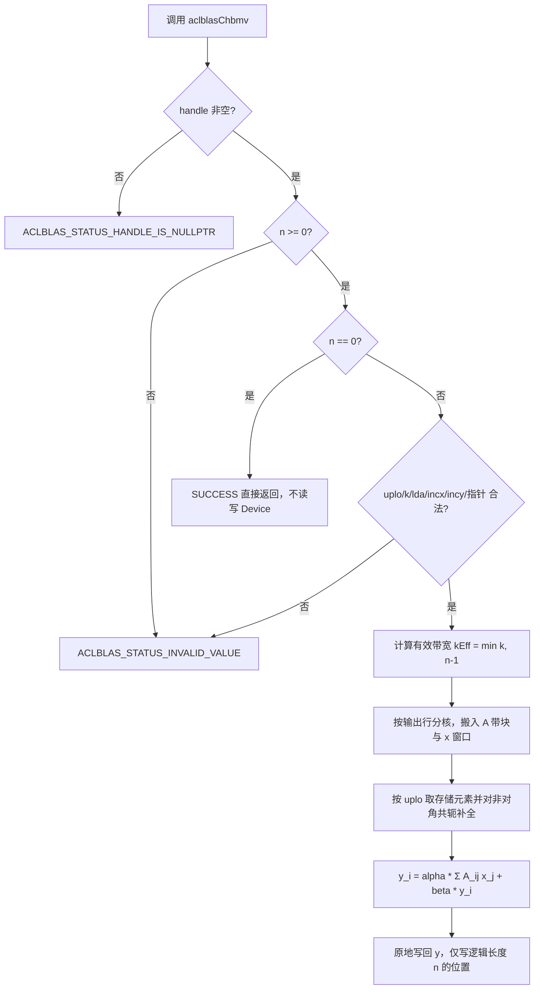
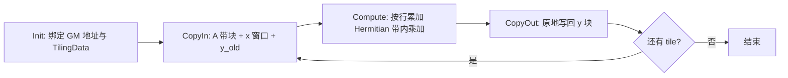

# aclblasChbmv 算子设计文档

> **任务**：11月社区任务 - aclblasChbmv 算子开发（A2A3）
> **目标仓**：`cann/ops-blas`，代码目录 `blas/sbmv/arch22/`，测试目录 `test/sbmv/chbmv/arch22/`
> **适配硬件**：Atlas A2 系列（含 Atlas 800T A2 / 910B3）、Atlas A3 系列（arch22）；CANN 9.1.0
> **数据类型**：complex64（单精度复数，实部/虚部各 float32）

---

# 一、需求背景

## 1.1 需求来源

Ascend CANN 社区任务：在 Atlas A2/A3 系列产品上，基于 `ops-blas` 开源仓工程框架，使用 Ascend C kernel 直调方式实现单精度复数 Hermitian 带状矩阵-向量乘算子 `aclblasChbmv`，与 cuBLAS `cublasChbmv` / Netlib `chbmv` 的数学语义和参数序列对齐，用于补齐 Blas 仓 complex64 带状 BLAS 能力。本算子为**新增公共接口**，不是既有 TBE/ACLNN 算子的 Ascend C 改写。

## 1.2 背景介绍

### 1.2.1 标杆来源、TBE 源码与算子信息库核查

| 审核对象 | 核查结论 | 依据及替代参考 |
| --- | --- | --- |
| 原 TBE 算子源码路径 | **不适用**：任务书未给出 `aclblasChbmv` 的 TBE 实现，目标仓也不存在该 complex64 公共接口；本任务不注册 ACLNN 算子 | 数学与 API 语义以 cuBLAS `cublasChbmv`、Netlib `chbmv.f` 为准 |
| 算子信息库路径 | **不适用**：接口为 `aclblas*` 公共 C API，非 `aclnn*`，不使用算子信息库 | 接口声明位于 `include/cann_ops_blas.h`；复数类型定义位于 `include/cann_ops_blas_common.h` |
| 可复用工程实现 | **适用** | `blas/sbmv/arch22/` 中同族实数算子 `aclblasSsbmv`（句柄、stream 绑定、tiling 与 kernel 启动框架、构建自动发现）；`test/sbmv/ssbmv/` 的 CSV 驱动 GTest 框架与 `ssbmv_param.h` 的填充列解析 |

因此本文不虚构 TBE 标杆或算子信息库文件，仅把 `aclblasSsbmv` 作为**工程接入参考**；复数语义、Hermitian 共轭对称、对角实部以及特殊值行为均以任务书指定的 cuBLAS / Netlib 参考为准。

### 1.2.2 aclblasChbmv 标杆算子现状分析

#### 1.2.2.1 对标接口能力

`cublasChbmv` 计算 `y = alpha * A * x + beta * y`，其中 `A` 为 n×n **Hermitian** 带状矩阵，含 k 条次对角线与 k 条超对角线；`A` 按列主序带状压缩格式存放于 `lda × n` 数组（`lda ≥ k+1`），仅 `uplo` 指定的带形三角被引用，另一侧由 `A = A^H` 隐含补全。与 `cublasChemv` 等接口不同，该接口**没有 trans 参数**，`op(A)` 恒为 `A`。对角元素虚部按 Hermitian 性质假定为 0，实现只取其虚部为 0 的实部参与计算。

Netlib `chbmv.f` 的遍历规则为：先校验 `uplo/n/k/lda/incx/incy`，对 `n = 0` 或 `alpha = (0,0) 且 beta = (1,0)` 做 quick return；随后按 `uplo` 逐列遍历带内元素，对 `(i, j)` 与 `(j, i)` 成对累加，并对 `y` 做 `beta` 缩放。

#### 1.2.2.2 仓内现状与差异

`include/cann_ops_blas.h` 当前尚无 `aclblasChbmv` 声明，本任务需按任务书 §2.3 新增，供其他产品线共用，禁止定义私有平行接口。`blas/sbmv/arch22/` 已有实数同族 `aclblasSsbmv`，可复用句柄与 stream 绑定、host 参数校验骨架、kernel 启动方式及构建接入；但其 dtype 为 `float`、矩阵性质为对称（Symmetric），**数值实现不可复用**：complex64 需处理实部/虚部两个分量、Hermitian 共轭、对角虚部归零及复数标量乘加。

| 项目 | `aclblasSsbmv`（仓内已有） | `aclblasChbmv`（本任务） |
| --- | --- | --- |
| dtype | float32 | complex64（`aclblasComplex`） |
| 矩阵性质 | 对称带状 `A = A^T` | Hermitian 带状 `A = A^H` |
| 未存储侧补全 | 直接取对称值 | 取**共轭**值 |
| 对角元素 | 标量 | 虚部假定为 0，仅实部参与 |
| alpha/beta | 实数标量 | complex64 标量 |
| 非法 uplo 返回码 | 按仓内既有实现 | `ACLBLAS_STATUS_INVALID_VALUE`（任务书 §7.5 明确口径，与仓内 `aclblasCsymv` 的 `INVALID_ENUM` 暂不一致，以任务书为准） |

#### 1.2.2.3 标杆算子实现流程



## 1.3 aclblasChbmv 算子功能分析

**计算公式**：

```text
y = alpha * A * x + beta * y
A = A^H（Hermitian），带宽 k，A(i,j) = 0 当 |i-j| > k
```

按 1-based 索引展开到每个输出元素：

```text
y(i) = alpha * Σ_{j=max(1,i-k)}^{min(n,i+k)} A(i,j) * x(j) + beta * y(i)
```

其中 `A(i,j)` 由存储三角给出或由共轭对称补全：

```text
UPPER:  A(i,j) = AB(1+k+i-j, j)            , j = 1..n, i ∈ [max(1,j-k), j]
        A(j,i) = conj(AB(1+k+i-j, j))      , i ≠ j
LOWER:  A(i,j) = AB(1+i-j, j)              , j = 1..n, i ∈ [j, min(n,j+k)]
        A(j,i) = conj(AB(1+i-j, j))        , i ≠ j
对角:    A(i,i) = AB(1+k, i) 或 AB(1, i)，虚部强制取 0
```

**带状存储布局**（列主序，`AB` 物理维度 `lda × n`，逻辑维度 `(k+1) × n`）：

| uplo | 主对角位置 | 第 1 条偏离对角 | 不被引用的区域 |
| --- | --- | --- | --- |
| `ACLBLAS_UPPER` | 第 `k+1` 行 | 第 `k` 行（从第 2 列开始，对应第 1 条超对角） | 左上 `k×k` 三角 |
| `ACLBLAS_LOWER` | 第 1 行 | 第 2 行（从第 1 列开始，对应第 1 条第对角） | 右下 `k×k` 三角 |

**输入**：`handle`、`uplo`、`n`、`k`、`alpha`、`A`、`lda`、`x`、`incx`、`beta`、`y`、`incy`。
**输出**：`y` 原地覆写（输入旧值参与 `beta * y`）。

**支持数据类型**：仅 complex64。
**支持广播 / 非连续 Tensor / 动态 shape / 确定性计算**：均不涉及或不做要求；步长语义完全由 `incx`/`incy` 与 `lda` 描述。

**关键边界语义**：

1. `n = 0` 为合法 quick return，返回 `ACLBLAS_STATUS_SUCCESS`，不执行计算；但该返回**不得先于 handle 判空与 n 合法性校验**。
2. `beta = (0,0)` 时不读取 `y` 旧值，但 `y` 仍不可为 nullptr。
3. `alpha = (0,0)` 时按 `y = beta * y` 计算，实现不保证跳过 `A`/`x` 读取，故含 Inf/NaN 的 `x` 用例不得与 `alpha = (0,0)` 组合。
4. `k > n-1` 时超出矩阵范围的带无对应元素，按有效带宽 `min(k, n-1)` 参与计算。
5. 输出 `y` 仅写逻辑索引 `0..n-1` 对应的物理位置，步长覆盖的其他位置保持不变。

---

# 二、需求分析

## 2.1 外部组件依赖

| 组件 | 适配状态 | 用途 |
| --- | --- | --- |
| CANN 9.1.0 Ascend C / ACL runtime | 已适配 | 编译 kernel、管理 Device 内存、在 stream 上启动 kernel |
| Atlas A2 / Atlas A3（arch22） | 已适配 | 本任务验收硬件；性能采集建议 910B3 |
| Netlib CBLAS（BLAS 3.10.0） | 仅测试期依赖 | `cblas_zhbmv` 以 fp64 真值生成 golden，按 FLOAT32 收窄落盘；不作为运行时依赖 |
| cuBLAS | 仅语义参考 | 参数序列与 API 语义对标，不参与运行 |
| msprof | 仅测试期依赖 | `msprof op` 采集 kernel task duration 作交叉验证 |

不新增 CATLASS、TBE、ACLNN 或其他生产第三方依赖。

## 2.2 内部适配模块

| 模块 | 仓内位置 | 适配内容 |
| --- | --- | --- |
| 公共 BLAS API | `include/cann_ops_blas.h` | 新增 `aclblasChbmv` 声明，供其他产品线共用 |
| 复数类型与状态码 | `include/cann_ops_blas_common.h` | 复用 `aclblasComplex`、`aclblasStatus_t`、`aclblasFillMode_t` 定义，不新增类型 |
| Host 侧实现 | `blas/sbmv/arch22/` | 参数校验、有效带宽计算、tiling、stream 绑定与 kernel 启动 |
| Kernel 侧实现 | `blas/sbmv/arch22/` | complex64 Hermitian 带内乘累加、共轭补全、对角实部处理、步长索引 |
| 测试工程 | `test/sbmv/chbmv/arch22/` | CSV 驱动 GTest、param 解析、golden 生成、精度/性能打点、`chbmv_test.csv` |
| 算子 README | `blas/sbmv/arch22/` | 按 ops-blas 规范编写，产品支持表标注 Atlas A2/A3：支持 |

## 2.3 接口定义

按任务书 §2.3，在 `include/cann_ops_blas.h` 新增如下声明（维数参数采用 `int`，与仓内 `aclblasSsbmv` 口径一致，与 `cublasChbmv` 参数序列一一对应）：

```cpp
aclblasStatus_t aclblasChbmv(
    aclblasHandle_t handle,
    aclblasFillMode_t uplo,
    int n, int k,
    const aclblasComplex* alpha,
    const aclblasComplex* A, int lda,
    const aclblasComplex* x, int incx,
    const aclblasComplex* beta,
    aclblasComplex* y, int incy);
```

## 2.4 参数规格

| 参数 | 输入/输出 | 描述 | dtype / 位置 | 值域与约束 | 异常行为 |
| --- | --- | --- | --- | --- | --- |
| handle | 输入 | 库上下文句柄，携带 stream | Host scalar | 有效句柄 | nullptr → `HANDLE_IS_NULLPTR` |
| uplo | 输入 | 带形三角存储模式 | Host attr | `ACLBLAS_UPPER` / `ACLBLAS_LOWER` | 非法枚举 → `INVALID_VALUE` |
| n | 输入 | 方阵阶数 | Host scalar | `n ≥ 0` | `n < 0` → `INVALID_VALUE`；`n = 0` quick return |
| k | 输入 | 带宽度 | Host scalar | `k ≥ 0`；`k > n-1` 按 `min(k, n-1)` | `k < 0` → `INVALID_VALUE` |
| alpha | 输入 | 复数标量乘数 | complex64 / Host | FLOAT32 全集 | `n > 0` 且 nullptr → `INVALID_VALUE` |
| A | 输入 | Hermitian 带状矩阵，只读 | complex64 / Device | `lda × n`，`lda ≥ k+1` | `n > 0` 且 nullptr → `INVALID_VALUE` |
| lda | 输入 | 带状数组前导维 | Host scalar | `lda ≥ k+1` | `lda < k+1` → `INVALID_VALUE` |
| x | 输入 | 输入向量，只读 | complex64 / Device | 至少 `1+(n-1)*abs(incx)` 元素 | `n > 0` 且 nullptr → `INVALID_VALUE` |
| incx | 输入 | x 步长，可正可负 | Host scalar | `incx ≠ 0` 且非 `INT32_MIN` | 0 / `INT32_MIN` / 跨度溢出 → `INVALID_VALUE` |
| beta | 输入 | 复数标量乘数 | complex64 / Host | FLOAT32 全集 | `n > 0` 且 nullptr → `INVALID_VALUE` |
| y | 输出（原地） | 输入/输出向量 | complex64 / Device | 至少 `1+(n-1)*abs(incy)` 元素 | `n > 0` 且 nullptr → `INVALID_VALUE`；`beta=(0,0)` 不豁免非空 |
| incy | 输入 | y 步长，可正可负 | Host scalar | `incy ≠ 0` 且非 `INT32_MIN` | 0 / `INT32_MIN` / 跨度溢出 → `INVALID_VALUE` |

返回值：`aclblasStatus_t`，语义与 `include/cann_ops_blas_common.h` 一致（`SUCCESS`(0) / `INVALID_VALUE`(3) / `HANDLE_IS_NULLPTR`(9) / `INVALID_ENUM`(10) 等）。

## 2.5 校验顺序与整数域安全

校验顺序为任务书 §2.5 / §7 拍板口径，**不得调整**：

```text
1. handle 是否为 nullptr          → HANDLE_IS_NULLPTR（最高优先级）
2. n >= 0 校验                    → INVALID_VALUE
3. n == 0 quick return            → SUCCESS（不再校验后续参数、不读写 Device）
4. uplo / k / lda / incx / incy / alpha / beta / A / x / y   → INVALID_VALUE
```

整数域安全（host 侧统一用 `int64_t` 计算，避免 int32 回绕使校验穿透）：

- `lda` 校验用 `(int64_t)k + 1` 与 `lda` 比较，防止 `k = INT32_MAX` 时 `k+1` 回绕为负数。
- `incx`/`incy` 的 `abs` 用 `int64_t` 承载，显式拒绝 `INT32_MIN`（其绝对值无法用 int32 表示）。
- 跨度校验 `(int64_t)(n-1) * abs(inc)` 超出 `INT32_MAX` 时返回 `INVALID_VALUE`（issue #780/#866 口径）。
- `kEff = min((int64_t)k, (int64_t)n - 1)`，后续索引与带宽计算统一在 int64 域完成后再收窄到 int32。

## 2.6 需求拆解

1. 在 `include/cann_ops_blas.h` 新增公共接口声明，不引入私有平行 API。
2. 实现 complex64 Hermitian 带状语义：UPPER/LOWER 存储映射、非对角共轭补全、对角仅取实部。
3. 实现完整参数校验链与 quick return，含 int64 防回绕与负向用例。
4. 实现 handle 绑定 stream 的 kernel 直调，支持 `incx`/`incy` 正负步长与 `lda` padding。
5. 按 FLOAT32 生态精度标准满足精度判据，含 Inf/NaN 特殊值等效判定。
6. 满足性能判据（NPU 平均单次耗时 ≤ A100 标杆 / 0.8），warmup 5 次 + ≥10 次有效采样。
7. 新建 `test/sbmv/chbmv/arch22/` 测试工程，覆盖随包 1200 条用例并补齐正态分布用例。
8. 按 ops-blas 规范提供算子 README 与产品支持表，产出设计文档、自测报告与 `task_submission` 交付件。

---

# 三、详细设计

## 3.1 调用方式

```cpp
aclblasHandle_t handle;
aclblasCreate(&handle);
aclblasSetStream(handle, stream);            // 绑定 stream，读回前须同步

aclblasComplex alpha{1.0f, 0.5f}, beta{0.0f, 0.0f};
// A: lda × n 的 complex64 带状数组（Device），仅 uplo 指定三角有效
// x, y: complex64 向量（Device），支持正负步长
aclblasStatus_t st = aclblasChbmv(
    handle, ACLBLAS_UPPER, n, k,
    &alpha, A, lda, x, incx,
    &beta, y, incy);
aclrtSynchronizeStream(stream);              // 异步执行，读回结果前同步
```

## 3.2 算子数据模型

### 3.2.1 数学公式与索引映射

设 `kEff = min(k, n-1)`。对输出行 `i`（0-based），参与累加的列 `j ∈ [max(0, i-kEff), min(n-1, i+kEff)]`。每一项 `A(i,j)` 的来源由 `uplo` 与 `i`、`j` 的大小关系决定：

```text
若 i == j:  val = AB(diagRow, j)，仅取实部，虚部置 0
若 uplo == UPPER 且 i < j:  val =       AB(k + i - j, j)      （直接取超对角）
若 uplo == UPPER 且 i > j:  val = conj( AB(k + j - i, i) )    （由已存三角共轭补全）
若 uplo == LOWER 且 i > j:  val =       AB(i - j, j)           （直接取次对角）
若 uplo == LOWER 且 i < j:  val = conj( AB(j - i, i) )         （由已存三角共轭补全）
否则 |i-j| > kEff:  val = 0（不读取）
```

其中 `AB(row, col) = A[col * lda + row]`（列主序，`lda` 为前导维，允许 padding）。复数乘加按实部/虚部分别展开：

```text
(a.r + a.i·i) × (b.r + b.i·i) = (a.r·b.r - a.i·b.i) + (a.r·b.i + a.i·b.r)·i
conj(a.r + a.i·i)             =  a.r - a.i·i
```

`alpha`、`beta` 同样按复数乘法参与：先算 `acc = Σ A(i,j)·x(j)`，再算 `y(i) = alpha·acc + beta·y_old(i)`；`beta = (0,0)` 时跳过 `y_old` 读取（但仍须做非空校验）。

### 3.2.2 支持数据类型、形状与布局

| 项目 | 说明 |
| --- | --- |
| dtype | `aclblasComplex`（complex64，实部/虚部各 float32），alpha/beta/A/x/y 全部一致 |
| A 形状 | 逻辑 `(k+1) × n`，物理 `lda × n`，`lda ≥ k+1`，列主序 |
| x/y 形状 | 逻辑长度 n，物理长度 ≥ `1 + (n-1)·abs(inc)` |
| 布局 | 仅 BLAS 带状布局 + 向量步长，不涉及 ND 格式、广播、视图或非连续 Tensor |
| 动态 shape | 不要求；n/k/lda/inc 均为运行时入参，由 tiling 动态计算 |

### 3.2.3 计算与访存特征

- 计算量约 `n · (2·kEff + 1)` 次复数乘加；`A` 有效元素约 `(kEff+1)·n` 个 complex64。
- 按**输出行**分核时，`y` 的每个逻辑元素仅由唯一一个核写入，**无核间写冲突、无需原子累加或跨核归约**，这是本算子采用行分核的核心原因；若按列分核则每列会散射更新 `2kEff+1` 个 `y` 元素，需原子操作，明显劣化。
- 单个输出行 `i` 所需的 `A` 元素在物理内存中沿"斜带"跨列分布，非连续；因此 kernel 侧按**列块**搬入 `A`、按窗口搬入 `x`、按行块搬出 `y`，在 UB 内完成重排与累加。

## 3.3 Host 侧设计

### 3.3.1 参数校验与启动边界

按 §2.5 顺序实现，全部校验在 host 侧完成，非法入参不启动 kernel、不读写 Device 内存。`n = 0` 的 quick return 在第 3 步，保证叠加非法 `uplo`/`k`/`lda`/`incx`/空指针的零维用例仍返回 `SUCCESS`。`handle` 有效性检查读取句柄内部 stream，失败返回 `HANDLE_IS_NULLPTR`。

### 3.3.2 有效带宽与索引预计算

host 侧计算并写入 TilingData：`kEff`、`diagRow`（UPPER 为 `k`，LOWER 为 `0`，0-based）、`n`、`lda`、`incx`、`incy`、`alpha`、`beta`、`betaIsZero`、`uplo`、各步长符号。逻辑起点按 BLAS 规则给出：

```text
xStart = (incx > 0) ? 0 : (n - 1) * (-incx)
yStart = (incy > 0) ? 0 : (n - 1) * (-incy)
```

`x(i)` 的物理地址为 `x + (xStart + i·incx) * sizeof(aclblasComplex)`（负步长时 `xStart` 为向量末尾）；`y` 同理。所有乘法在 int64 域完成。

### 3.3.3 分核策略

优先使用满核，按输出 `y` 的 `n` 个逻辑元素切分：

```text
minRowsPerCore = max(1, ceil(kEff / 2))        // 避免小 n 大带宽时核间负载过碎
usedCores      = min(ceil(n / minRowsPerCore), aiCoreNum)
baseRows       = n / usedCores
remainder      = n % usedCores
core c 负责   [c·baseRows + min(c, remainder),  (c+1)·baseRows + min(c+1, remainder))
```

余出的行分配给前 `remainder` 个核，保证大小核负载差 ≤ 1 行。核数由平台信息（`GetCoreNumAiv` / 等价接口）获取；当 `n < aiCoreNum` 时按实际行数收缩核数，避免空核启动开销。

### 3.3.4 数据分块与 LocalMemory 优化策略

每个核把自己负责的行区间 `[i0, i1)` 再切成 `tileRows` 大小的 tile。对一个 tile：

```text
需要的 x 索引窗口: [i0 - kEff, i1 + kEff) ∩ [0, n)     长度 ≈ tileRows + 2·kEff
需要的 A 列范围  : 同一窗口，物理跨度 lda × (tileRows + 2·kEff) 个 complex64
需要写回的 y     : tileRows 个 complex64
```

UB 预算按 `A 块 + x 窗口 + y 块 + 累加缓冲 + double buffer 临时区` 估算，`tileRows` 由 `GetCoreMemSize` 得到的 UB 大小与 `BUFFER_NUM` 反推：

```text
bytesPerCol ≈ (kEff + 1) × 8                       // 每个 complex64 为 8 字节
tileRows    ≈ (ubBytes / BUFFER_NUM - fixedBytes) / (bytesPerCol + 3×8)
```

当 `kEff` 很大（如满带 `k = n-1`）导致单个 tile 的 A 窗口超出 UB 预算时，切换到 **通用 GM 基线分支**：不批量搬入 A，直接按元素从 GM 读取带内元素并在寄存器中累加，牺牲局部性换取可实现性与内存安全。两条路径由 tilingKey 分派，保证任意 `n`/`k` 组合都能正确执行。

优化点：

- `A` 与 `x` 采用 double buffer 流水，搬运与计算重叠；
- 同一 tile 内被多行复用的 `x` 窗口只搬一次；
- `incx = incy = 1` 且 `lda = kEff+1` 的紧凑连续场景走对齐向量路径，减少标量地址计算；
- `y` 以 `DataCopy` 批量写回，尾块单独处理，避免越界写；
- `beta = (0,0)` 分支跳过 `y_old` 搬入，减少一次 Device 读。

### 3.3.5 tilingKey 规划策略

tilingKey 用于让 kernel 在编译期分派不同分支，避免运行时分支开销。按位组合：

| bit | 含义 | 取值 |
| --- | --- | --- |
| 0 | `uplo` | 0 = UPPER，1 = LOWER |
| 1 | `incx < 0` | 负步长索引方向 |
| 2 | `incy < 0` | 负步长索引方向 |
| 3 | `betaIsZero` | 跳过 `y_old` 读取 |
| 4 | `largeBandwidth` | `kEff > tileThreshold`，走通用 GM 基线分支 |
| 5 | `alphaIsZero` | 仅做 `y = beta·y`（仍不保证跳过 A/x 读取，按任务书语义） |

host 侧把 `uplo`、步长符号、标量零值、带宽阈值打包成 key，kernel 侧用模板参数特化。紧凑连续 + 小带宽的常见性能用例（k=8/16/32/64）落在向量优化路径；满带退化与极端 padding 落在通用路径。

### 3.3.6 TilingData ABI

host 与 kernel 共用的 POD 结构（建议置于 `blas/sbmv/arch22/chbmv_tiling_data.h`，字段按仓内规范调整）：

```cpp
struct ChbmvTilingData {
    int32_t n;
    int32_t k;
    int32_t kEff;
    int32_t lda;
    int32_t incx;
    int32_t incy;
    int32_t uplo;
    int32_t diagRow;
    int32_t usedCores;
    int32_t baseRows;
    int32_t remainder;
    int32_t tileRows;
    int32_t betaIsZero;
    int32_t alphaIsZero;
    int64_t xStart;
    int64_t yStart;
    float   alphaReal, alphaImag;
    float   betaReal,  betaImag;
};
```

所有跨 host/kernel 的索引量上限已在 §2.5 校验中限制在 int32 可表示范围内，ABI 内不传递可能溢出的中间量。

### 3.3.7 异步执行与 stream

复用 `aclblasSsbmv` 的句柄与 `aclblasSetStream` 绑定方式，从 handle 取得 `aclrtStream` 并在该 stream 上启动 kernel；接口立即返回，调用方在读回 `y` 前须 `aclrtSynchronizeStream`。host 侧不读 Device 数据（alpha/beta 为 Host 标量），A/x/y 均为 Device 指针。

## 3.4 Kernel 侧设计

### 3.4.1 Init / Process 流水



- **Init**：按 `block_idx` 计算本核负责的行区间，设置 `A`/`x`/`y` 的 GM 基址与逻辑起点偏移，初始化 UB 缓冲与流水队列。
- **CopyIn**：把 tile 覆盖的 A 列块、x 窗口、y 旧值搬入 UB；负步长在地址计算阶段处理，不做物理重排。
- **Compute**：对每个输出行 `i` 遍历 `j ∈ [i-kEff, i+kEff]`，按 §3.2.1 规则取 `AB` 元素并对非对角做共轭，复数乘加到 `acc`；对角元素只取实部；最后 `y(i) = alpha·acc + beta·y_old(i)`。
- **CopyOut**：把 `tileRows` 个结果写回 `y` 的物理位置，尾块按实际行数写，不越界。

### 3.4.2 复数乘累加与 Hermitian 补全

`AB` 中存储的是已选三角，未存储侧不读取。对于 `i ≠ j`，若所需元素在未存储侧，则读取其对称位置的存储元素并取共轭（`real` 不变、`imag` 取负）。对角位置的虚部按 Hermitian 约束强制为 0，不读取输入中的虚部分量。累加在 fp32 分量上完成，避免引入额外中间精度转换；实数/虚数分量分别累加，降低相互污染。

### 3.4.3 负步长与跨度映射

`x`/`y` 的逻辑索引 `i` 到物理索引的映射统一为 `start + i·inc`，其中负步长时 `start` 指向向量末尾。kernel 内用 int64 计算字节偏移后再取址；`lda` padding 通过 `col·lda + row` 体现，不假设 `lda = k+1`。UPPER 的左上 `k×k`、LOWER 的右下 `k×k` 区域按索引规则自然不会被访问到。

### 3.4.4 浮点顺序与特殊值

- 本算子为浮点乘累加，非 bit-exact；golden 由 `cblas_zhbmv` 以 fp64 真值计算后按 FLOAT32 收窄，因此实部/虚部分别按 FLOAT32 标准判定（`rtol = atol = 2⁻¹³`）。
- 累加顺序与标杆不同会造成末位差异，通过 `atol + rtol·|golden|` 容差覆盖；不做人为的精度截断或额外舍入。
- `0 × Inf`、`Inf - Inf`、累加溢出等不定式产生的 NaN/±Inf，最终形态取决于累加顺序，按任务书 §3.2 的等效规则判定（同为 NaN、同为同号 Inf，或一方 NaN 另一方 ±Inf 视为等效）；非有限值元素不计入 matched_ratio 与 max_abs_error 统计。
- `alpha = (0,0)` 时不额外短路 A/x 读取，符合任务书「实现不保证跳过」的约定。

### 3.4.5 与标杆实现的差异及原因

| 差异点 | Netlib / cuBLAS | 本设计 | 原因 |
| --- | --- | --- | --- |
| 并行方式 | 标量逐列遍历 | 按输出行分核、tile 流水 | 利用 A2/A3 多核与 UB 带宽 |
| A 访问 | 按列顺序访问带内元素 | 按 tile 批量搬入 + UB 内重排 | 减少 GM 访问次数，隐藏访存延迟 |
| 未存储侧 | 成对更新 `(i,j)` 与 `(j,i)` | 按输出行按需共轭读取 | 避免跨核写冲突与原子累加 |
| 大带宽 | 同一循环 | 通用 GM 基线分支 | 保证 UB 预算内可执行 |
| 非法 uplo | 依实现 | `INVALID_VALUE` | 任务书 §7.5 明确口径 |

## 3.5 支持硬件

| 支持的芯片版本 | 涉及勾选 | 说明 |
| --- | --- | --- |
| Atlas 800T A2（910B3） | √ | 性能采集设备，arch22 |
| Atlas 800I/T A2 | √ | arch22 |
| Atlas A3 系列 | √ | arch22，精度自验证可用 |

CANN 版本 9.1.0。A2 编译参数 `--soc ascend910b`，A3 编译参数 `--soc ascend910_93`，两者均对应 `arch22` 目录。

## 3.6 算子约束限制

| 约束项 | 内容 |
| --- | --- |
| 参数合法性 | 见 §2.4 / §2.5；任一非法返回 `INVALID_VALUE`，handle 空返回 `HANDLE_IS_NULLPTR` |
| 三角引用 | 仅引用 `uplo` 指定带形三角；未引用侧由共轭对称补全；对角虚部假定为 0 |
| 有效带宽 | `k > n-1` 按 `min(k, n-1)` 处理 |
| 非连续 / broadcast | 不涉及，步长语义由 `lda`/`incx`/`incy` 描述 |
| 动态 shape / 确定性 | 不要求 / 不要求 |
| 原地语义 | `y` 原地覆写，不返回视图 |
| 空 Tensor | `n = 0` 合法 quick return |
| 异步执行 | 依赖 `aclblasSetStream`；读回前须同步 stream |
| 内存要求 | 任务书 §3.4 判定不涉及，但交付件仍需包含 `4.1/4.2` 两个内存自验证文件 |

---

# 四、可维可测分析

## 4.1 精度标准

golden 由 `cblas_chbmv`（Netlib CBLAS 复数实现，`CblasColMajor`；以 `cblas_zhbmv` 承担 fp64 真值计算，按输出 FLOAT32 收窄落盘）单标杆生成，按 Hermitian 约束解释 A（对角只取实部、未存储带按共轭对称补全）。输出 `y` 的 n 个逻辑元素全量验证，实部、虚部分别比对：

| 项目 | 阈值 |
| --- | --- |
| 逐元素通过条件 | `|actual - golden| ≤ atol + rtol × |golden|` |
| rtol / atol（FLOAT32） | `2⁻¹³ ≈ 1.22e-4` / `2⁻¹³ ≈ 1.22e-4` |
| required_matched_ratio | 0.99 |
| max_abs_error_limit | `1e-2` 或 `32 × ULP`（按最大误差点 golden 动态计算） |
| 用例通过条件 | `matched_ratio ≥ 0.99` 且 `max_abs_error ≤ limit`，且非有限值元素全部按等效规则通过 |

CSV 中的 `mere_threshold` / `mare_multiplier` 为测试工程保留列，不参与生态精度标准比对。Inf/NaN 按 §3.4.4 规则单独记录，不计入有限值统计。

## 4.2 性能标准

- 测试设备：Atlas 800T A2（910B3），complex64 输入，平均单次耗时单位 us。
- 采样：GTest 在预置 device 缓冲上先 warmup 5 次（不计时），再连续 10 次有效采样取算术平均；H2D/D2H、host 侧造数与 golden 比对排除在计时窗口外；算子返回 SUCCESS 方计入有效样本，异常样本在报告中说明。
- 打点格式：GTest 须按用例打印 `[PERF] case=<case_name> ... avg_us=<数值>`，供 `verify_performance.py` 解析。
- 判据：NPU 平均单次耗时 ≤ `gpu_baseline.csv` 的 `gpu_ms` / 0.8（即达到 A100 标杆 0.8 倍以上性能）；基线按 `(uplo, n, k, incx, incy)` 联合匹配，标杆环境为 NVIDIA A100-SXM4-80GB / CUDA 12.8 / cuBLAS 12.8.4。
- 交叉验证：`msprof op --application="./build/test/sbmv/chbmv/chbmv_test --gtest_filter=*TC_PF*"`，从 `OpBasicInfo.csv` 的 `Task Duration(us)` 统计 kernel 平均耗时；该口径仅供分析，不参与判定。
- 典型性能 case：UPPER 512/k8、UPPER 1024/k16、LOWER 2048/k32、LOWER 4096/k64，与 `chbmv-base-000~003` 逐参数对应。

优化方向：紧凑 `lda` 与连续步长走对齐向量路径；A/x double buffer 重叠搬运与计算；小 n 收缩核数减少空核开销；大带宽退化路径避免 UB 溢出；`beta=(0,0)` 省去一次 y 读取。

## 4.3 内存

任务书 §3.4 明确「不涉及」。测试包给出的 host 侧预算为单用例 ≤ 512MB（设计选择，非硬件限制），性能用例 n 上限 4096；kernel 侧 UB 占用由 §3.3.4 的 `tileRows` 反推约束。交付件仍按模板提供 `4.1 内存自验证报告.xlsx` 与 `4.2 内存自验证日志.log`，并在其中说明「本任务不涉及内存指标」及上述预算口径。

## 4.4 测试用例与覆盖

随包 `chbmv_test.csv` 共 1200 条（固定种子 20261028）：1000 条精度 + 200 条性能。

| 类别 | 前缀 | 条数 | 覆盖要点 |
| --- | --- | --- | --- |
| L0 基础 | `TC_L0` | 6 | uplo × 小尺寸 (4/8/12)，k=1 |
| L1 尺寸/带宽 | `TC_SQ` | 90 | 尺寸扫描、带宽扫描、k>n-1 退化 |
| L2 标量 | `TC_AB` | 16 | alpha/beta 的 0/1/-1/复数/纯虚数 |
| L4 前导维 | `TC_LD` | 12 | `lda = k+1+pad`，pad=1/4/8/16 |
| L4 步长 | `TC_INC` | 72 | incx×incy ∈ ±1/±2/±3 全组合 |
| L5 填充 | `TC_FL` | 18 | 均匀/全零/交替/极端值/Inf/NaN |
| L5b 覆盖 | `TC_CV` | 16 | 中等尺寸、k=n/2 |
| L6 边界与负向 | `TC_ED` | 33 | 零维、空指针、非法 uplo/lda、负维度、零步长、INT32_MIN、跨度溢出 |
| EX 扩展 | `TC_EX` | 737 | 尺寸 × 带宽 × uplo × 标量 × 步长 × padding 确定性采样 |
| PF 性能 | `TC_PF` | 200 | 4 条典型 case + 小尺寸 + 阶数对数扫描 + n=2048 带宽扫描 |

**需自行补齐的部分**：随包生成器默认仅使用均匀分布 `RANDOM_NORM_5_5`（[-5,5]）；任务书 §3.5-3 要求 50% 正态分布用例（μ∈[-5,5]、σ∈[0.1,2]，填充 token `GAUSS_NORM_5_2`）。计划扩展 `gen_csv.py`（或单独补充 CSV 用例），按相同类别分布补充正态用例，并纳入精度自验证；自测报告中说明补齐方式、用例数量与覆盖情况。

**负向用例缓冲区分配**：期望返回非 SUCCESS 的用例（尤其 INT32_MIN 步长与跨度溢出）不得按 `(n-1)×|inc|` 预分配 x/y 缓冲区，须以单元素 dummy 缓冲区占位，由接口在读取数据前返回预期错误码即判定通过，避免测试工程自身分配失败导致误判。

## 4.5 测试工程与数据流

仓内目前仅有实数 `test/sbmv/ssbmv/` 工程，需新建 `test/sbmv/chbmv/arch22/`：

```text
test/sbmv/chbmv/arch22/
├── chbmv_test.csv              # 1200 条 + 补充的正态分布用例
├── chbmv_param.h               # 解析 CSV：alpha_real/alpha_imag、beta_real/beta_imag、
│                               # a_fill/x_fill/y_fill、uplo、expect_result 等
├── chbmv_golden.cpp/.h         # cblas_zhbmv fp64 真值 → FLOAT32 收窄
├── test_chbmv.cpp              # GTest 用例装配、接口调用、精度比对、[PERF] 打点
├── CMakeLists.txt
└── README.md                   # 编译与复现步骤
```

`a_fill` / `x_fill` / `y_fill` 沿用仓内 `ReadFillColumn` 同时接受裸列名与 `<参数>_fill` 的规则；复数标量列需在新 param 中自行解析。空 handle 负向用例无法通过 CSV 表达，由测试工程在参数装配层固定传入有效句柄，并单独用接口单测覆盖 `HANDLE_IS_NULLPTR`。

自验证命令（A3 环境用 `ascend910_93`，A2 用 `ascend910b`）：

```bash
python3 verify_accuracy.py   --repo /path/to/ops-blas --soc ascend910b --csv ./chbmv_test.csv
python3 verify_performance.py --repo /path/to/ops-blas --soc ascend910b --timeout 3600
```

精度脚本自动排除 `TC_PF_` 前缀用例；性能脚本把 CSV 安装到 `test/sbmv/chbmv/arch22/`（原文件备份为 `.bak`）后执行 `TC_PF` 用例。

## 4.6 兼容性分析

本算子为新增公共接口，不涉及历史版本行为变更；`include/cann_ops_blas.h` 新增声明对既有接口无 ABI 影响。需注意的是：与仓内复数同族 `aclblasCsymv` 相比，本算子非法 uplo 按任务书返回 `INVALID_VALUE` 而非 `INVALID_ENUM`，差异由研发后续统一，本文按任务书执行。与 `aclblasSsbmv` 共用 `blas/sbmv/arch22/` 目录族与构建接入，不修改其实现。

## 4.7 实现与验证状态

本文为**设计阶段**交付物，随任务书完成需求、接口、host/kernel 方案与可维可测方案的设计。实机精度、性能、内存数据须在 Atlas A2/A3 + CANN 9.1.0 环境完成开发后采集，以《自验证报告》及配套日志为准；设计文档中不预填未经实测的数值。设计文档 PR 评审通过并合入后，方可进入代码开发与自验证阶段。

---

# 五、参考资料

1. 任务书：`11月社区任务-aclblasChbmv算子开发（A2A3）/aclblasChbmv_AtlasA2_A3_task_doc.md`
2. 随包测试用例与指导：`test_cases/README.md`、`gen_csv.py`、`verify_accuracy.py`、`verify_performance.py`、`gpu_baseline.csv`
3. 算子设计文档模板：`04_tasks/01_community-task-2026/resources/design_template.md`
4. ops-blas 开源仓：https://gitcode.com/cann/ops-blas
5. 生态算子开源精度标准：https://gitcode.com/cann/opbase/blob/28a1ce52ae856353589841226a0002af73314a6b/docs/zh/ops_precision_standard/mixed_tolerance_standard.md
6. cuBLAS `cublasChbmv`：https://docs.nvidia.com/cuda/cublas/index.html#cublas-t-hbmv
7. Netlib BLAS `chbmv.f`：https://www.netlib.org/blas/chbmv.f
8. Ascend C 算子开发文档：https://www.hiascend.com/document/detail/zh/CANNCommunityEdition/850/opdevg/Ascendcopdevg/atlas_ascendc_map_10_0002.html
