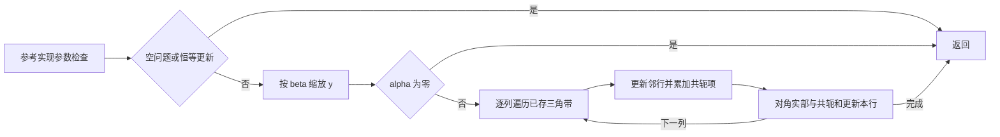
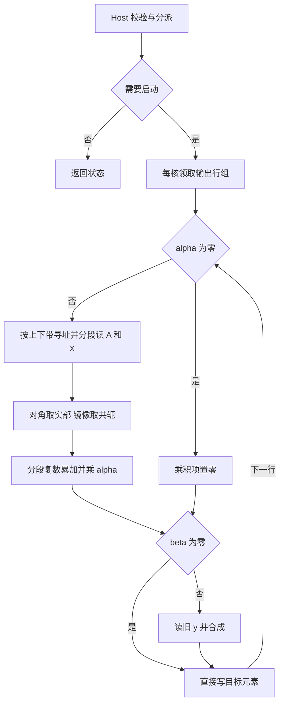

# aclblasChbmv 算子开发方案（Atlas A2/A3）

承接人 CyndiZ。目标版本 CANN 9.1.0，工程目标 cann/ops-blas。本文记录拟实现行为与验收方法。

## 1 需求背景

### 1.1 需求来源

11 月社区任务要求在 Atlas A2/A3 补齐单精度复数 Hermitian 带状矩阵向量乘。调用者仅提交一个三角带，以原地更新 y 的方式计算 y ← αAx + βy。保持带状表示可避免为窄带问题分配 n² 个复数。

### 1.2 现状与参考实现

本任务为新增 handle 式 BLAS 接口。任务书未指定历史 TBE 源文件、TBE 算子信息库条目或对应 aclnn API，因此 checklist 中 TBE 的路径、类型表、实现分析和流程图没有可比对象。公共接口文件为 ops-blas 的 `include/cann_ops_blas.h`，复数、枚举和状态码定义见 `include/cann_ops_blas_common.h`。同族工程可参考 `blas/sbmv/arch35/ssbmv_host.cpp` 的职责划分；其数据类型和平台与本任务不同。

Netlib 的 CHBMV 按列访问所存三角。先执行 βy 的缩放，β=0 时清零。随后每列 j 形成 αx[j]，沿有效带更新邻行 y[i]，同时累加 conj(A[i,j])x[i] 的列内和，最后将对角实部的贡献及列内和加到 y[j]。上带访问 i<j，下带访问 i>j。其 BLAS 参数错误处理与本任务 handle 状态码分别遵循各自接口。[Netlib chbmv.f](https://www.netlib.org/blas/chbmv.f)



## 2 需求分析

### 2.1 外部依赖与 2.2 内部适配

运行时依赖 CANN 9.1.0 的 Ascend C 编译链、ACL Runtime 和 A2/A3 stream。Host 与 kernel 纳入 ops-blas 的 arch22 构建；接口声明和导出复用公共 BLAS 库。测试接入 `test/sbmv/chbmv/arch22/` 的 CSV 驱动 GTest，CPU golden 使用 Netlib BLAS 3.10.0 的 CBLAS，性能使用随包 A100 基线与 msprof。两类标杆均仅用于测试。

### 2.3 原型与约束

```cpp
aclblasStatus_t aclblasChbmv(
    aclblasHandle_t handle, aclblasFillMode_t uplo, int n, int k,
    const aclblasComplex* alpha, const aclblasComplex* A, int lda,
    const aclblasComplex* x, int incx, const aclblasComplex* beta,
    aclblasComplex* y, int incy);
```

handle、维数、步长和复数标量在 Host，A、x、y 在 Device。复数由两个 float32 组成。A 是 ND 列主序 lda×n 的带状数组，x、y 的逻辑长度为 n，物理长度至少为 1+(n−1)|inc|。仅支持 COMPLEX64、UPPER/LOWER，无转置参数、广播或额外视图语义。n/k 为运行时标量。对 TBE 的功能差集无适用基线。

## 3 详细设计

### 3.1 调用与校验

1. 检查 handle；空句柄返回 HANDLE_IS_NULLPTR。随后 n<0 返回 INVALID_VALUE，n=0 直接返回 SUCCESS。
2. 对 n>0 验证 uplo、k≥0、int64(lda)≥int64(k)+1，incx/incy 均非 0 和 INT32_MIN。用 int64 计算两条向量的 (n−1)|inc|，任一超过 INT32_MAX 即返回 INVALID_VALUE。alpha、beta、A、x、y 任一空也返回 INVALID_VALUE。非法 uplo 的状态码同为 INVALID_VALUE。以上状态均带 ACLBLAS_STATUS_ 前缀。
3. 读取 Host 标量并按值传入 launch 参数，在 handle 经 aclblasSetStream 绑定的 stream 上异步直调 `blas/sbmv/arch22/` 的 kernel。向调用者传播启动错误，读回结果前由调用者同步 stream。

### 3.2.1 Host 分核、分块与 tilingKey

以输出向量物理下标递增分组，令 g=4/gcd(4,|incy|)，每 g 个逻辑输出跨越整数个 32 B 块。设 G=ceil(n/g)，C=min(G,平台可用向量核数)，核 b 处理组区间 [floor(bG/C),floor((b+1)G/C))。末组截到 n，incy<0 时物理顺序上的第 t 个元素对应逻辑行 n−1−t。各核独占输出；非对齐首地址需要先剥离边界或退化单核，跨核不能对同一写回粒度做读改写。固定归约次序，每行仅写一次。

在一核内按带方向分段，对每行逐段处理最多 T 项，流式读取 A、x，复数按实虚拆分。初版 UB 预算按两组 A/x 输入缓冲（每组两个 8T 字节数组）、四条 fp32 乘积临时数组和两条 fp32 归约数组估算：B(T)=2×2×align32(8T)+6×align32(4T)+R，R 包含队列元数据、输出暂存和归约额外工作区。取满足 B(T)≤平台可用 UB 的最大 8 元素倍数，再按实际段长截断。实现时按实际分配复核 R；资源不足时用单缓冲或标量路径。整算子无需 GM 临时矩阵，工作量为 O(n(1+min(k,n−1)))。

直调 kernel 的分派键由 Host 构造，不依赖框架 tiling 注册。建议按优先级选 SCALE（α=0）、DIAG（k=0）、UPPER_UNIT/LOWER_UNIT（incx=incy=1）或 UPPER_STRIDED/LOWER_STRIDED（其余）。β=0 作为所有路径的独立标志。记录 n、原始 k、有效带宽、lda、步长、分组数、T 及标量，以相同参数结构驱动两款平台。

### 3.2.2 Kernel 与参考流程差异

零基行 i 遍历 j∈[max(0,i−w),min(n−1,i+w)]，w=min(k,n−1)。UPPER 的存储坐标为 r=min(i,j)、c=max(i,j)，偏移 c×lda+k+r−c，当 i>j 时取共轭。LOWER 取 r=max(i,j)、c=min(i,j)，偏移 c×lda+r−c，当 i<j 时取共轭。地址乘加使用 64 位；上带寻址始终保留原始 k。对角单独以实数乘复向量，避免虚部垃圾值或零乘无穷污染输出。向量逻辑下标 p 映射到 base+p×inc，负步长时 base=(n−1)|inc|，正步长时为零。

将有效区间按对角线拆成两段，一段沿同一存储列连续，另一段按列跨距取数。连续内部块批量搬运，跨距和尾段按有效位置装入 UB。对复数 a+bi 与 c+di 累加 (ac−bd,ad+bc)。每行累加完成后乘 α，再按 β 分支合成。β=0 直接覆盖逻辑 y，跨距空隙保持原值；禁止通过读旧 y 拼装尾块。α=0 路径直接缩放，α=β=0 写零。调试时用哨兵检查带外、padding、对角虚部及 y 的步长空隙。



按行聚合会再次读取非对角带元素，换取核间无原子加及无部分和归并。Netlib 逐列更新多个 y，直接并行化存在写冲突。两者实数数学结果相同，浮点加法顺序可能影响末位。

### 3.3 支持硬件与 3.4 限制

目标为 Atlas A2（ascend910b）和 Atlas A3（ascend910_93），自验证按任务书选择一种款型，性能选择 Atlas 800T A2（910B3）。两目标分别构建。仅支持 lda/incx/incy 表达的布局，无逐位确定性要求。指针指向的实际分配长度由调用者保证。

## 4 特性交叉分析

两产品线共用公共签名，构建按架构选择实现。回归覆盖已有实数 Ssbmv 的编译、链接与调用，以及两个独立 handle/stream 的并行调用；每次调用独立传递标量与分块参数。对 y 的原地写回与负步长组合检查逻辑顺序、首尾地址和空隙，β=0 用旧 y 含 NaN 的用例检查写覆盖。

## 5 可维可测分析

### 5.1 精度、性能与验收证据

- 随包 chbmv_test.csv 的 1000 条精度和 200 条性能用例全部保留。以固定种子补充 GAUSS_NORM_5_2 样本，按各随机输入统计均匀/正态各半，记录 μ∈[−5,5]、σ∈[0.1,2] 和实虚独立采样。覆盖两侧存储、满带、超宽带、非对齐、padding、正负步长、特殊标量和 Inf/NaN。含非有限 x 的用例避开 α=0。额外做空 handle 与 n=0 优先级测试；非法跨度使用单元素占位缓冲，先验证返回码。
- 按 CblasColMajor 将输入提升到双精度复数，经 cblas_zhbmv 求真值再收窄成 float32。逐逻辑输出的实虚部分别计算 |actual−golden|≤2⁻¹³(1+|golden|) 的比例，有限值匹配率≥0.99，最大绝对误差≤max(0.01,32×ULP(最大误差点 golden))。非有限元素单计：双 NaN、同号 Inf、NaN 与任一 Inf 等效，其余组合失败，要求全部通过。无有限元素时仅判特殊值。CSV 保留的 MERE/MARE 列不替代此判据。
- 910B3 上逐个 TC_PF 采集 msprof op 的 Task Duration(us)，排除 5 次预热，每例至少 10 次 SUCCESS 取算术平均，异常样本另记。按 case 参数核对 gpu_baseline.csv（含 lda）；每例须满足 NPU 平均 μs ≤ 1000×gpu_ms/0.8。首例 UPPER n=512、k=8 的上限约 12.352 μs。随包 verify_performance.py 使用事件计时，保留其日志辅助诊断，正式结论按任务书 §3.3 由 profiler 明细复算。
- 保存测试命令、用例种子、代码 SHA、设备和 CANN 版本、逐例实虚误差与原始采样。任务书 §3.4 无独立内存阈值，验收模板内存材料据实标明适用性。开发结束后按任务书 §4 整理自测报告、日志及复现说明。

### 5.2 兼容性与维护

公共头仅增加或复用同签名声明，复数布局沿用 common 头。验证 A2/A3 的构建目标均导出一个公共符号；保留其他架构分派与同族接口。问题定位按状态码、行号、uplo、实际偏移、步长、分派键和 tile 大小记录，性能回归按 case 对照同版标杆。

## 设计评审对照

| CheckList 行号 | 落点与评审动作 |
|---|---|
| 2 | 设计分支提交至任务目录 CyndiZ/docs/design.md。后续设计 PR 目标 cann/cann-competitions 的 master，需核查 CLA、评论 `/compile` 并确认构建。 |
| 3 | PR 标题：【社区任务】aclblasChbmv算子设计文档 |
| 4–8 | §1.1 来源；§1.2 说明 TBE 路径、信息库、类型与流程的适用性，给出 BLAS 参考源码、实现及流程图；§2.3 列出实际类型与布局。 |
| 9–12 | §2.1 外部依赖、§2.2 内部模块、§2.3 原型、覆盖范围与约束。 |
| 13–16 | §3.1 直调使能；§3.2.1 分核、分块、UB 公式和分派条件。 |
| 17–19 | §3.2.2 核内算法、流程图、与参考实现的差异及原因。 |
| 20–22 | §3.3 硬件、§3.4 限制、§4 特性交叉。 |
| 23–24 | §5.1 精度与性能判据、§5.2 兼容性。 |
