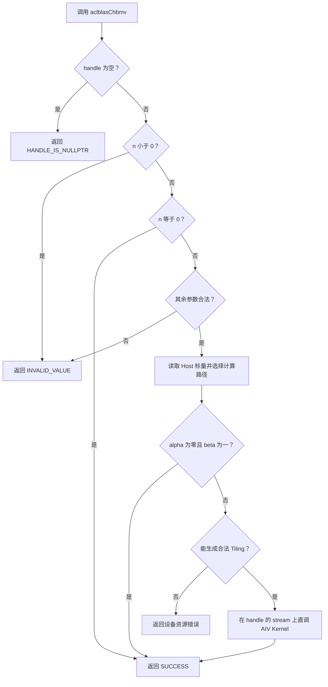
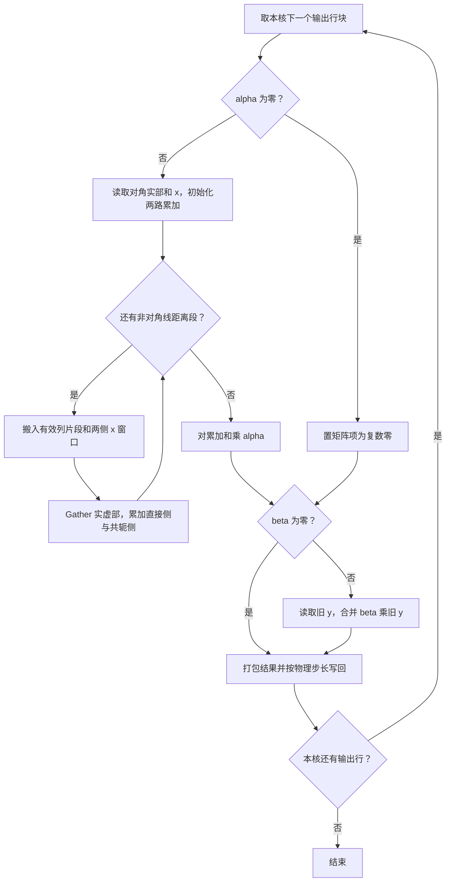

# aclblasChbmv 算子设计

## 需求背景

### 需求来源

11 月 CANN 社区任务要求在 Atlas A2/A3 上补齐 `ops-blas` 的单精度复数 Hermitian 带状矩阵向量乘能力。公共入口为 `aclblasChbmv`，参数顺序与 cuBLAS `cublasChbmv` 对齐，算子采用 Ascend C Kernel 直调方式接入 `ops-blas`。

### 背景介绍

设 $H$ 为 $n \times n$ 的 Hermitian 带状矩阵。调用者通过 `A` 传入一个带形三角，另一侧由 $H_{ij}=\overline{H_{ji}}$ 得到。对角线只使用实部。输入向量 `x` 和输出向量 `y` 各有 $n$ 个逻辑元素，分别由带符号的 `incx` 和 `incy` 描述其物理位置。`y` 在原缓冲区更新。

## 需求分析

### 需求描述

在 handle 绑定的 stream 上计算 $y \leftarrow \alpha Hx + \beta y$。`alpha`、`beta`、`A`、`x` 和 `y` 使用 `aclblasComplex`。标量在 Host 端取值，矩阵和向量在 Device 端按列主序带存储及向量步长访问。

### 需求拆解

1. 在公共头文件声明 API，按任务书顺序完成参数校验、空规模返回、Tiling 和 stream 下发。
2. 从指定带形三角读取有效元素，在核内按输出行累加存储侧与共轭侧的贡献。使用 `lda` 定位列、保留原始 `k` 定位上三角对角线，并支持正负向量步长。
3. 按 `y` 的物理地址划分核间写回范围，分段搬运有效带宽。在 UB 内完成复数 FP32 乘累加，按实际步长和长度写回。
4. 按任务书规划精度、边界和性能验收。精度对 `y` 的实部、虚部分别判定，性能按单算子 task duration 对标随包 GPU 基线。

## 详细设计

### 算子分析

#### 数学公式与带存储

以下下标从 0 开始。`n > 0` 时令 $K=\min(k,n-1)$。第 $i$ 个逻辑输出为

$$
y_i^{\mathrm{new}} = \alpha \sum_{j=\max(0,i-K)}^{\min(n-1,i+K)} H_{ij}x_j + \beta y_i^{\mathrm{old}}.
$$

定义 `A[r + c*lda]` 为带存储数组第 `c` 列第 `r` 行的复数。对非对角线距离 `d = 1 … K`，列 `c` 对应的有效元素和输出贡献如下。

| `uplo` | `c` 的有效范围 | 存储值 `a` | 直接贡献 | 共轭贡献 |
| --- | --- | --- | --- | --- |
| `ACLBLAS_UPPER` | `d <= c < n` | `a = A[k - d + c*lda] = H[c-d,c]` | 第 `c-d` 行加 `a * x[c]` | 第 `c` 行加 `conj(a) * x[c-d]` |
| `ACLBLAS_LOWER` | `0 <= c < n-d` | `a = A[d + c*lda] = H[c+d,c]` | 第 `c+d` 行加 `a * x[c]` | 第 `c` 行加 `conj(a) * x[c+d]` |

对角线每列只贡献一次。上三角取 `A[k + i*lda].real`，下三角取 `A[i*lda].real`。即使 `k >= n`，上三角的对角线位置仍由原始 `k` 决定。列首或列尾的空槽以及 `lda` 引入的填充均跳过。例如 `n=4, k=1, lda=3` 时，上三角的 `H[0,1]` 存于 `A[0 + 1*lda]`。下三角在 `A[1 + 0*lda]` 存 `H[1,0]`，计算 `H[0,1] * x[1]` 时对该值取共轭。

#### 支持数据类型与形状

`aclblasComplex` 复用 `include/cann_ops_blas_common.h` 的定义，按 `real, imag` 两个 float32 分量交错存放，每个元素占 8 字节。`A` 的逻辑形状为 `n × n`，Device 缓冲区按 `lda × n` 分配。`x`、`y` 的逻辑形状均为 `n`，其存储长度分别至少为 `1 + (n-1)*abs(incx)` 和 `1 + (n-1)*abs(incy)` 个复数。

#### 公共接口原型

在 `include/cann_ops_blas.h` 声明以下接口，供产品线共用。

```cpp
aclblasStatus_t aclblasChbmv(
    aclblasHandle_t handle,
    aclblasFillMode_t uplo,
    int n, int k,
    const aclblasComplex* alpha,
    const aclblasComplex* A, int lda,
    const aclblasComplex* x, int incx,
    const aclblasComplex* beta,
    aclblasComplex* y, int incy);
```

| 参数 | 位置与用途 | 约束 |
| --- | --- | --- |
| `handle` | Host，库上下文，持有 stream | 有效且非空 |
| `uplo` | Host，指定 `A` 中存储的带形三角 | `ACLBLAS_UPPER` 或 `ACLBLAS_LOWER` |
| `n` | Host，方阵阶数和向量逻辑长度 | `n >= 0` |
| `k` | Host，半带宽 | `k >= 0`，计算范围按 `K` 截断 |
| `alpha`、`beta` | Host，只读复数标量，分别乘 `Hx` 和旧 `y` | `n > 0` 时均非空 |
| `A`、`lda` | Device 只读带存储矩阵和 Host 前导维度 | `n > 0` 时 `A` 非空，`lda >= k + 1` |
| `x`、`incx` | Device 只读向量和 Host 元素步长 | `n > 0` 时 `x` 非空，步长非零、非 `INT32_MIN` 且跨度可由 int32 表示 |
| `y`、`incy` | Device 原地读写向量和 Host 元素步长 | `n > 0` 时 `y` 非空，步长约束与 `incx` 相同 |

### 算子实现

#### Host 侧设计

按以下顺序校验并准备下发。

1. `handle == nullptr` 返回 `ACLBLAS_STATUS_HANDLE_IS_NULLPTR`。其后，`n < 0` 返回 `ACLBLAS_STATUS_INVALID_VALUE`，`n == 0` 直接返回 `ACLBLAS_STATUS_SUCCESS`。
2. 当 `n > 0` 时，依次校验 `uplo`、`k`、`lda`、`incx`、`incy`、`alpha`、`beta`、`A`、`x`、`y`，失败统一返回 `ACLBLAS_STATUS_INVALID_VALUE`。`int64_t(k) + 1` 用于 `lda` 比较。步长先排除 `0` 与 `INT32_MIN`，再用 int64 计算 `span = (int64_t(n)-1)*abs(int64_t(inc))`，要求 `span <= INT32_MAX`。元素计数 `span+1` 和 GM 元素偏移用 64 位计算。`lda*n` 转字节数前核对可表示范围。
3. 校验通过后读取 `alpha`、`beta`，按值放入 Tiling。复数零按两个分量均等于零判断。`alpha = (0,0)` 时选择只缩放 `y` 的路径，若同时 `beta = (1,0)` 则直接返回成功。其余调用按 `K` 选择对角线或一般带状路径。`beta = (0,0)` 时关闭旧 `y` 的搬入。
4. 读取 `handle` 的 stream，以 `GetAivCoreCount()` 获取可用 AIV 核数，并通过平台能力接口获取 UB 容量。核数获取失败返回 `ACLBLAS_STATUS_EXECUTION_FAILED`。完成分核、分块与缓冲区尺寸校核后，通过仓内直调封装下发一个 AIV Kernel。下发成功返回 `ACLBLAS_STATUS_SUCCESS`，读取 Device 输出前由调用方同步对应 stream。



##### 步长与分核

对任一向量，逻辑元素 `i` 的物理下标为 `first + i*inc`。正步长取 `first=0`，负步长取 `first=span`。以物理升序访问时，逻辑序号为 `i=p`（正步长）或 `i=n-1-p`（负步长），其物理偏移均为 `p*abs(inc)`。

按 `y` 的物理顺序分配输出。`y` 基址 64 B 对齐时，以 8 个逻辑元素为一组，令 `G=ceil(n/8)`，核数取 `C=min(可用 AIV 核数, ceil(n/32))`。前 `G%C` 个核各分配 `floor(G/C)+1` 组，其余核各分配 `floor(G/C)` 组，最后一组截到 `n`。各核的物理起点 `p0` 是 8 的倍数，字节偏移 `p0*abs(incy)*8` 因而是 64 的倍数，相邻核独占各自覆盖的 64 B 输出区间。`y` 基址未达到该对齐条件时采用单核分块。负步长时把核的物理序号区间 `[p0,p1)` 映射为逻辑行区间 `[n-p1,n-p0)`。

每行只由其所属核完成累加和写回。核内将所属行继续切为容量 `R` 的输出块，实际行数 `r` 以本核剩余行数为限。Tiling 按值传递原始 `n/k/lda/uplo`、`K`、两个带符号步长及起点、标量分量、分组参数、`R`、距离分段宽度 `D` 和计算模式。

##### UB 分块与缓冲区

一个输出块在 UB 保留实、虚部累加向量。一般带状路径按非对角线距离分段，每段覆盖最多 `D` 个距离，读取与输出块相交的列片段。令 `W = R+D-1`，任一方向的 `x` 窗口宽度至多为 `W`，相关的带存储列数至多为 `R+W`。单个列槽容量为 `L(8D)`，其中 `L(b)=32*ceil(b/32)` 表示对齐字节数。

| UB 缓冲区 | 容量上界（字节） | 使用方式 |
| --- | --- | --- |
| `A` 列片段 | `(R+W)*L(8D) + 32` | 每列一个对齐槽，末尾 32 B 为零值槽。对角线复用列槽，每列只取一个 float32 |
| `x` 两侧窗口 | `2*(L(8W)+32)` | 逻辑顺序的交错复数数据，每个窗口附加一个零值槽。对角线路径仅用中心窗口 |
| `y` 打包区 | `L(8R)` | 有需要时读入旧 `y`，计算完成后复用为写回缓冲区 |
| FP32 向量与索引 | `10*L(4R) + L(8R)` | 整块两路累加和、分段两路部分和、四路乘数、两路临时值及可复用的 `2R` 个 UB 字节偏移 |
| 非单位步长暂存 | `32*max(R,W)` | 仅 `abs(incx)>1` 或 `abs(incy)>1` 时申请。搬运单个复数时每个 UB 数据块按 32 B 占位，`x` 搬入与 `y` 搬入、搬出复用此区 |

设 `maxRows` 为分核后单核最多处理的行数，`R` 初值为 `min(128, 8*ceil(maxRows/8))`，带状路径的 `D` 初值为 `min(K,64)`。Host 按各缓冲区对齐后的总量与平台 UB 容量校核，预留 4 KiB 用于流水控制和对齐余量。超出预算时先缩小 `D`，再按 8 行粒度缩小 `R`，下限分别为 1 和 8。对角线路径按 `D=1` 规划。只缩放 `y` 的路径分配 `y`、所需计算临时区以及按 `R` 计的步长暂存。平台无法提供最小块资源时返回 `ACLBLAS_STATUS_NOT_SUPPORTED`。

以 `R=128, D=64` 且含非单位步长暂存为例，缓冲区上界为 179,776 B，加上预留共 183,872 B，低于 192 KiB UB 容量。预算与原始 `lda` 解耦，宽带和 `k >= n` 通过同一分段循环完成。GM 工作区需求为 0 字节。

#### Kernel 侧设计

##### 搬入与共轭映射

对核内输出行块 `I=[r0,r1)`，先搬入 `H[i,i].real` 和逻辑 `x[i]`，分别乘 `x[i].real` 和 `x[i].imag` 作为两路初始和。`K=0` 时完成对角计算后直接进入标量合成阶段。

对非对角线距离段 `[d0,d1)`（`1 <= d0 < d1 <= K+1`），两个 `x` 窗口为 `J+ = [r0+d0, r1+d1-1) ∩ [0,n)` 与 `J- = [r0-d1+1, r1-d0) ∩ [0,n)`。上三角的直接贡献读取 `J+` 中的物理列，下三角读取 `J-` 中的物理列，共轭贡献读取 `I` 中的物理列。合并两个相关列区间的重叠部分，每个列槽仅搬入一次。

固定列 `c` 时，上三角距离有效域为 `[1,c+1)`，下三角为 `[1,n-c)`，均与 `[d0,d1)` 相交。若 `c` 在 `I` 外，还需将距离约束到直接贡献落入 `I` 的范围，上三角为 `[c-r1+1,c-r0+1)`，下三角为 `[r0-c,r1-c)`。交集为空时跳过该列。对非空交集 `[lo,hi)`，按物理行号递增搬入对齐槽，上三角从带存储行 `k-hi+1` 开始，下三角从行 `lo` 开始，长度均为 `hi-lo` 个复数。距离 `d` 的槽内字节偏移分别为 `8*(hi-1-d)` 和 `8*(d-lo)`。

完整列片段用带步长的批量 `DataCopyPad` 搬入。边界列按实际长度搬入，搬运参数超过 A2/A3 的步长或块数上限时拆分。GM 间隔以字节计算，UB 间隔以 32 B 数据块计算。完整列的 Gather 偏移随槽号等差变化，边界列使用实际的 `lo/hi` 生成偏移。

对段内固定距离 `d`，下表给出输出行 `i` 的取数方式。仅当 `j` 位于 `[0,n)` 时读取对应带值与 `x[j]`。

| 模式 | 直接贡献 `(A 的列, x 的逻辑下标)` | 共轭贡献 `(A 的列, x 的逻辑下标)` |
| --- | --- | --- |
| `UPPER` | `(i+d, i+d)` | `(i, i-d)` |
| `LOWER` | `(i-d, i-d)` | `(i, i+d)` |

以 UB 槽内字节偏移执行 `Gather`，将交错复数拆成沿输出行排列的实、虚向量。共轭侧将矩阵虚部分量取反。边缘越界 lane 的 `A` 与 `x` 均指向各自的零值槽，避免无效位置出现 `0 * Inf` 或 `0 * NaN` 并进入累加。窗口和距离边界、GM 地址及步长乘积使用 64 位计算，只有 UB 内有界字节偏移写入 `uint32_t` 索引表。

##### 计算与写回

对非对角线项，`a=(ar,ai)` 表示已经按存储侧或共轭侧解释的矩阵值，`x=(xr,xi)`。每段在 FP32 中累加 `ar*xr - ai*xi` 和 `ar*xi + ai*xr`，并在段末合入本输出块的两路和。对角实数乘法与非对角复乘分别计算，忽略的对角虚部不参与任何乘加。

完成所有距离段后，对两路和乘复数 `alpha`，再合并 `beta*y_old`。`alpha` 为零的路径直接计算后者，跳过 `A/x` 搬入。`beta` 为零时直接使用已有结果或复数零；`beta` 为一时直接使用旧 `y`；其余情况先搬入所辖的旧 `y` 再做复乘。最终按物理地址顺序把实、虚部打包回交错布局。

`abs(inc)=1` 时搬运连续区间，负步长通过 UB 索引恢复逻辑顺序。`abs(inc)>1` 时按 8 B 有效负载组织带步长搬运，单次步长无法编码时逐段搬运。写回只使用 `DataCopyPad` 搬出实际元素的 8 B 负载，`y` 的跨步间隙与尾部保护区不写入。旧 `y` 的搬入独立受 `beta` 条件控制，跨步写回无需读取间隙值。

采用单缓冲和定向流水同步。MTE2 完成后由 Vector 或 Scalar 读取 UB，消费者完成后才复用该槽。Scalar 生成的偏移在 Gather 前就绪，Gather 消费完索引后才覆盖偏移表。打包结束后下发 MTE3，写回完成后复用输出缓冲区。核间通过输出区间所有权完成互斥。



##### 搬运与计算开销

有效存储元素数为 `n + K*n - K*(K+1)/2`，对角只访问一次，非对角元素最多被两个输出块各读取一次。同一行块内的两种贡献共享重叠的列槽，同一距离段内复用 `x` 窗口。矩阵元素访问量和复数运算量均为 `O(n*(K+1))`。小带宽尽量在一段内覆盖，宽带复用固定容量 UB。内层按行向量化，尾块按真实行数计算，整次调用只下发一个 Kernel。

#### 工程接入

| 位置 | 设计职责 |
| --- | --- |
| `include/cann_ops_blas.h` | 声明 `aclblasChbmv` 公共入口 |
| `blas/sbmv/arch22/chbmv_host.cpp` | 参数校验、Tiling、读取 handle stream、下发 Kernel |
| `blas/sbmv/arch22/chbmv_tiling_data.h` | Host 与 Kernel 共用的 Tiling 定义和缓冲区尺寸约定 |
| `blas/sbmv/arch22/chbmv_kernel.cpp` | AIV Kernel 及仓内直调封装，完成带索引、复乘累加和步长写回 |
| `blas/sbmv/README.md` | 补充 `aclblasChbmv` 的接口和适配硬件 |
| `test/sbmv/chbmv/arch22/` | 后续接入仓内 CSV 和 GTest 框架的精度、边界及性能用例 |

实现源文件进入 `blas/CMakeLists.txt` 的 `arch22` 源文件收集范围。Host 沿用同族算子的 handle、日志与直调约定，参数行为按本算子任务书。

### 支持硬件

| 产品 | 工程目录 | 执行单元 |
| --- | --- | --- |
| Atlas A2 系列，含 Atlas 800T A2 | `arch22` | AIV |
| Atlas A3 系列，含 Atlas 800T A3 | `arch22` | AIV |

### 算子约束限制

- `A` 和 `x` 为只读输入，其访问区域与 `y` 的输出区域独立。矩阵和向量按 `lda`、`incx`、`incy` 指定的布局传入。
- `uplo` 只接受上三角和下三角两种模式。矩阵维度由运行时 `n`、`k` 指定，输入输出长度按接口形状约定。
- `n=0` 仅校验 `handle` 和 `n`。`n>0` 时标量路径仍执行完整参数校验。`beta=0` 时 `y` 只需提供可写输出缓冲区。

## 可维可测分析

### 精度标准与性能标准

| 验收项 | 判定口径 | 标准来源 |
| --- | --- | --- |
| 精度 | 对全部逻辑 `y` 元素的实、虚部分别应用 FLOAT32 混合容差 | 任务书及生态算子开源精度标准 |
| 性能 | Atlas 800T A2（910B3）单算子平均 task duration 不高于对应 GPU 耗时的 1.25 倍 | 任务书与 `gpu_baseline.csv` |

精度参考按 Netlib CBLAS 列主序 CHBMV 语义生成。将复数输入和标量提升到双精度，由 `cblas_zhbmv` 计算后把输出分量收窄到 float32。分别对实、虚部的有限点检查 `abs(actual-golden) <= 2^-13 + 2^-13*abs(golden)`。每个分量的匹配比例至少为 `0.99`，最大绝对误差不超过 `max(1e-2, 32*ULP(golden_at_max_error))`，其中 ULP 取该点收窄后的 float32 golden。

非有限点单独判定。同为 NaN、同号 Inf，或 NaN 与 Inf 配对均通过；有限值与非有限值配对、异号 Inf 配对均失败。非有限点不参与有限点统计，所有非有限点均须通过。

性能用例按编号及 `uplo/n/k/incx/incy/lda` 对应到随包 GPU 数据。用 `msprof op` 采集 task duration，前 5 次预热后取至少 10 次成功调用的有效样本求算术平均。将 `gpu_ms` 乘 1000 转为微秒后做逐用例比较。随包 `verify_performance.py` 读取的是 GTest 的 `aclrtEvent` 耗时，可用于辅助诊断；验收采用任务书指定的 task duration。

### 验证规划

| 关注点 | 计划覆盖 |
| --- | --- |
| 带存储与共轭 | 两种 `uplo` 表达同一矩阵，选取非零虚部的带内项。用可辨识值覆盖对角虚部、带外空槽与 `lda` 填充，核对其不影响 `y` |
| 规模与边界 | `n=0/1`、非对齐尾块、`k=0/1/n-1` 与 `k>n-1`，覆盖核边界和多段距离分块 |
| 步长 | `incx/incy` 正负交叉，覆盖 `±1/±2/±3`。核对逻辑结果位置和 `y` 间隙保护值 |
| 标量与特殊值 | `alpha/beta` 为零、一、纯虚及一般复数。用非有限旧 `y` 验证 `beta=0`，按任务书单列 `x` 的 Inf/NaN 用例并使用非零 `alpha` |
| 错误码 | 空 handle 叠加 `n=0`，合法 handle 的 `n=0` 叠加无效参数，以及 `n>0` 时的空指针、非法 `uplo`、负维数、非法 `lda`、`k=INT32_MAX`、零步长、`INT32_MIN` 与跨度溢出。越界参数用占位缓冲区核对返回值 |
| 精度与性能 | 使用任务包精度与性能用例；常规随机用例按任务书补齐均匀和正态各 50%，覆盖 `n/k/uplo` 组合 |

### 兼容性分析

新增声明沿用仓内 `aclblasHandle_t`、`aclblasFillMode_t`、`aclblasComplex` 和 `aclblasStatus_t`。调用者可按 cuBLAS CHBMV 的参数顺序迁移，并按本接口传入 Host 标量、Device 矩阵与向量。非法 `uplo` 的返回值采用任务书规定的 `ACLBLAS_STATUS_INVALID_VALUE`。

### 参考资料

- 带存储、实数对角线及步长语义。[Netlib CHBMV](https://www.netlib.org/blas/chbmv.f)
- 对标接口原型。[cuBLAS HBMV](https://docs.nvidia.com/cuda/cublas/index.html#cublas-t-hbmv)
- 仓内同族接口与直调工程结构。[ops-blas 公共头文件](https://gitcode.com/cann/ops-blas/blob/master/include/cann_ops_blas.h) · [sbmv arch22](https://gitcode.com/cann/ops-blas/tree/master/blas/sbmv/arch22)
- 非对齐搬运和 UB 索引取数的 API 约束。[DataCopyPad](https://www.hiascend.com/doc_center/source/en/CANNCommunityEdition/900/API/ascendcopapi/atlasascendc_api_07_0265.html) · [Gather](https://www.hiascend.com/doc_center/source/en/CANNCommunityEdition/900/API/ascendcopapi/atlasascendc_api_07_0092.html)
- FLOAT32 混合容差及 ULP 定义。[生态算子开源精度标准](https://gitcode.com/cann/opbase/blob/28a1ce52ae856353589841226a0002af73314a6b/docs/zh/ops_precision_standard/mixed_tolerance_standard.md)
