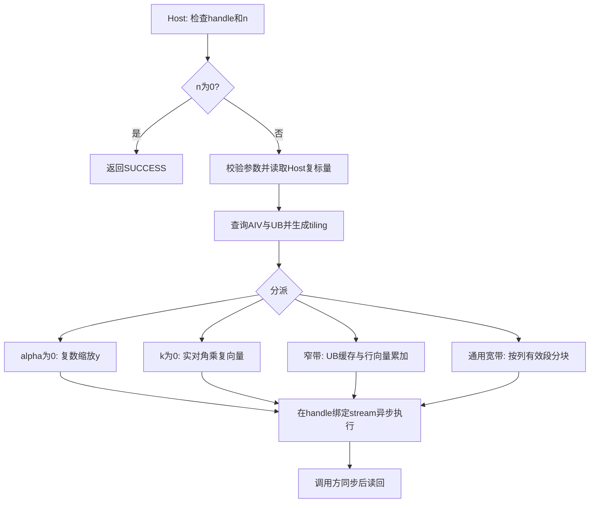

# aclblasChbmv 算子设计文档（Atlas A2/A3）

提交人：PzeYui。设计日期：2026-11-11。

本文按本仓设计模板编写，描述拟实现方案和验证计划。精度、耗时和覆盖数量中的验收门限均来自任务书或随包测试材料；本设计提交尚无对应实现版本的实测结论。

# 需求背景（required）

## 需求来源

11 月社区任务《aclblasChbmv 算子开发任务书》，原始文件为 `aclblasChbmv_AtlasA2_A3_task_doc.md`，发布包标识为 `87d7ffb2d85c4a3eba8727ec14683bec`。任务在 [cann/ops-blas](https://gitcode.com/cann/ops-blas) 中补齐单精度复数 Hermitian 带状矩阵与向量乘法，适配 Atlas A2/A3，采用 CANN 9.1.0 和 Ascend C kernel 直调方式。

设计提交目录为 `04_tasks/01_community-task-2026/tasklist/11月社区任务-aclblasChbmv算子开发（A2A3）/PzeYui/docs/design.md`。任务书中的 `cann/cann-competitions` 链接当前对应本仓 `cann/cann-ops-competitions`。

## 背景介绍

### aclblasChbmv 算子实现

计算 `y = alpha * A * x + beta * y`，其中标量、矩阵和向量均为 COMPLEX64。逻辑矩阵 A 满足 `A = A^H`，仅保存指定三角内的带状部分。利用带状结构将运算量从稠密矩阵的 O(n²) 降为 O(n * min(k+1,n))，避免构造 n×n 稠密矩阵。

本接口是 BLAS Level-2 句柄式接口，不涉及广播或神经网络图注册。语义标杆为 [cuBLAS cublasChbmv](https://docs.nvidia.com/cuda/cublas/index.html#cublas-t-hbmv) 和 [Netlib CHBMV](https://www.netlib.org/blas/chbmv.f)，实现放在 `blas/sbmv/arch22/`。

### 上游实现现状分析

调研基线为 `cann/ops-blas` 的 `5bd95145a9c499e43ebad44a313a1029c63d54bc`。以下为该基线的现状，新增内容在后文明确标记：

| 位置 | 已有能力 | 本任务处理 |
| --- | --- | --- |
| [include/cann_ops_blas.h](https://gitcode.com/cann/ops-blas/blob/5bd95145a9c499e43ebad44a313a1029c63d54bc/include/cann_ops_blas.h) | 含 `aclblasSsbmv`，尚无 `aclblasChbmv` 声明 | 新增公共接口，维数参数为 int |
| [include/cann_ops_blas_common.h](https://gitcode.com/cann/ops-blas/blob/5bd95145a9c499e43ebad44a313a1029c63d54bc/include/cann_ops_blas_common.h) | `aclblasComplex` 为 real/imag 两个 float；定义公共状态码 | 直接复用类型与枚举 |
| [blas/sbmv/arch22/](https://gitcode.com/cann/ops-blas/tree/5bd95145a9c499e43ebad44a313a1029c63d54bc/blas/sbmv/arch22) | Ssbmv 的 Host 校验、按值 tiling、AIV 行块和分块内核 | 参考工程结构和平台查询；新增复数 Hermitian 实现 |
| [blas/symv/arch35/csymv_host.cpp](https://gitcode.com/cann/ops-blas/blob/5bd95145a9c499e43ebad44a313a1029c63d54bc/blas/symv/arch35/csymv_host.cpp) | 复数标量和公共句柄的使用示例，目标为 arch35 | 仅参考公共接口用法；本任务使用 arch22 向量编程 |
| [test/sbmv/ssbmv/](https://gitcode.com/cann/ops-blas/tree/5bd95145a9c499e43ebad44a313a1029c63d54bc/test/sbmv/ssbmv) | CSV、GTest、CBLAS golden、arch22 wrapper | 新增 chbmv 的参数、FP64 golden、测试与性能入口 |
| [blas/CMakeLists.txt](https://gitcode.com/cann/ops-blas/blob/5bd95145a9c499e43ebad44a313a1029c63d54bc/blas/CMakeLists.txt) | 自动收集算子源码，并按算子名称过滤 | 核对 chbmv 单算子构建收集；测试使用 `ops_blas_add_gtest_tests` |

Ssbmv 的实数对称性不能直接替代 Hermitian 共轭；其部分参数放行规则也与本任务不同。例如本任务非法 uplo 返回 INVALID_VALUE、n>0 时 A/x 始终须非空，步长跨度上限为 INT32_MAX。Host 和 golden 都按本任务契约单独实现。

### 算子功能分析

| 对象 | 位置与类型 | 形状/约束 |
| --- | --- | --- |
| handle、uplo、n、k、lda、incx、incy | Host 句柄/属性 | n≥0，k≥0；uplo 为 UPPER/LOWER |
| alpha、beta | Host `const aclblasComplex*` | 单个复数标量；n>0 时非空 |
| A | Device COMPLEX64，只读 | 列主序带存储，容量 lda×n，lda≥k+1 |
| x | Device COMPLEX64，只读 | 逻辑长度 n，容量至少 `1+(n-1)*abs(incx)` |
| y | Device COMPLEX64，原地读写 | 逻辑长度 n，容量至少 `1+(n-1)*abs(incy)`；beta=0 时不读旧值 |

# 需求分析（required）

## 需求描述

在公共头文件新增如下声明，复用各产品线共同 API，不定义私有平行接口：

```cpp
aclblasStatus_t aclblasChbmv(
    aclblasHandle_t handle,
    aclblasFillMode_t uplo,
    int n, int k,
    const aclblasComplex* alpha,
    const aclblasComplex* A, int lda,
    const aclblasComplex* x, int incx,
    const aclblasComplex* beta,
    aclblasComplex* y, int incy);
```

## 需求拆解

| 编号 | 要求及任务书来源 | 设计落点 | 验证方式 |
| --- | --- | --- | --- |
| R1 | COMPLEX64、上下三角、Hermitian 补全；§2.1 | 分量复乘、共轭寻址，对角仅取实部 | 小矩阵手工值及全量 CBLAS golden |
| R2 | 原始 k、有效带宽、lda padding；§2.4 | 地址保留 k；循环使用 `keff=min(k,n-1)` | k=0/1/n-1/>n-1，padding 和未引用区毒化 |
| R3 | 正负步长及溢出；§2.4 | Host int64 检查、Device 全局地址使用64位 | ±1/±2/±3、INT32_MIN、跨度临界值 |
| R4 | handle优先、n=0、空指针、标量退化；§2.5 | 固定校验顺序、beta=0 条件读 | 随包负向用例与补充接口单测 |
| R5 | 句柄、异步 stream、y 原地；§2.2/2.5 | Host 标量按值传入；独占输出行 | 非默认 stream、同步后读回、跨核尾块 |
| R6 | FLOAT32 混合容差及非有限值；§3.2 | FP32 分量计算，分块归约 | Netlib 3.10.0 FP64 真值，全量实虚部分别检查 |
| R7 | 单 case 性能≥0.8×GPU；§3.3 | 小形状降核、窄带缓存、宽带分块 | 200 条性能 case，msprof task duration |
| R8 | A2/A3、CANN9.1.0；§3.1 | arch22，查询实际 AIV 核数和 UB 容量 | 至少一种款型自验；性能设备910B3 |
| R9 | 用例/报告/代码/七文件交付；§3.5/4/5 | GTest、README、逐case日志和固定commit | 交付前逐项复核；内存指标“不涉及” |

# 详细设计（required）

## 算子分析

### 数学公式

以下索引从 0 开始，`B` 表示 Device 中的带状数组，`M` 表示逻辑 Hermitian 矩阵。仅在 `|i-j|≤keff` 的有效带内取元素：

```text
UPPER:
  i <= j: M(i,j) = B[j*lda + k+i-j]
  i >  j: M(i,j) = conj(B[i*lda + k+j-i])
LOWER:
  i >= j: M(i,j) = B[j*lda + i-j]
  i <  j: M(i,j) = conj(B[i*lda + j-i])

M(i,i) = (real(B[diag(i)]), 0)
s(i) = sum_{j=max(0,i-keff)}^{min(n-1,i+keff)} M(i,j)*x(j)
y(i) = alpha*s(i) + beta*y_old(i)
```

必须区分 `k` 与 `keff`：`k>n-1` 时，只缩小参与计算的邻域；UPPER 主对角在原始第 k 行，仍按原始 k 和 lda 寻址。不得把主对角位置改为 keff。

对于向量步长 inc，底层指针表示分配首地址，物理索引为 `start + t*inc`，其中 `start=0`（inc>0）或 `(n-1)*(-inc)`（inc<0）。先升为 int64 再取负或乘法。

普通复乘为 `(ar*xr-ai*xi, ar*xi+ai*xr)`；镜像分支将 ai 取负。对角采用实数乘复向量 `(ar*xr, ar*xi)`，不加载或参与使用对角虚部分量，避免 `0*Inf` 等额外运算改变特殊值结果。带外与未存储三角不参与乘累加。

### 支持数据类型

输入输出和 alpha/beta 仅为 COMPLEX64；外部保持两个 float 相邻的 AoS 布局，UB 计算可拆分为实部/虚部两个 FP32 向量。无 FP16/BF16 降精度中间计算。

### 支持形状

运行时 n/k，A 的逻辑形状 n×n，物理形状 lda×n。支持任务书合法的 padding、正负步长及 k>n-1。随包精度规模至 n=2048，性能规模至 n=4096；这些是测试覆盖上限，不作为新增 API 的 n 上限。

矩阵及全局字节地址乘法使用64位；小于 UB 容量的局部 Gather 偏移可在验证后使用32位。总内存容量由调用方提供，Host 不根据裸 Device 指针推测实际分配长度。

## 算子实现

### 实现方案

新增 `blas/sbmv/arch22/chbmv_host.cpp`、`chbmv_kernel.cpp` 和必要的 `chbmv_tiling_data.h`/入口声明；在公共头文件声明接口；更新同族 README 的产品支持表。测试新增 `test/sbmv/chbmv/` 下的 CMakeLists、参数解析、FP64 golden，以及 `arch22/` 下的 wrapper、GTest 和 CSV。遵守仓库源码自动收集机制，仅调整本算子必需的构建入口。

整体采用 AIV 输出行块独占：每个核负责一个连续输出区间，每行只由一个核写回，避免跨核原子复加。读取 x 和 A，核内完成直接贡献与共轭贡献，最后统一执行 alpha/beta 组合。A/x/y 按任务定义的独立输入输出使用，y 自身原地更新。



#### 3.2.1 host侧设计

固定的参数校验与返回顺序如下：

1. handle 为空返回 `ACLBLAS_STATUS_HANDLE_IS_NULLPTR`。
2. n<0 返回 `ACLBLAS_STATUS_INVALID_VALUE`；n=0 立即返回 SUCCESS，不检查后续参数、不读取标量、不下发 kernel。
3. n>0 时，检查 uplo 属于 UPPER/LOWER、k≥0，使用 int64 计算并比较 `lda≥k+1`。
4. incx/incy 为0或 INT32_MIN 时返回 INVALID_VALUE。先转 int64，再计算 `(n-1)*abs(inc)`；超过 INT32_MAX 则返回 INVALID_VALUE。
5. 检查 alpha、beta、A、x、y 均非空，包括 alpha=0 或 beta=0 场景。非法 uplo 统一返回 INVALID_VALUE。
6. 校验通过后读取 Host alpha/beta，取得 handle 的 stream，构造 tiling 并下发。正常路径不进行每次调用的 Device 临时分配、Host-Device标量拷贝或 stream同步。

alpha=0 时可使用 `y=beta*y` 路径；beta=0 时直接写零且不读旧 y。alpha=0、beta=1 可保留直接返回优化。以上优化均位于完整非零维校验之后，不豁免非空和参数校验。

##### 1. 分核策略

用平台查询取得可用 AIV 核数 C；按输出行数、有效带宽和分块开销选择 `1≤usedCores≤min(C,n)`。每核行区间按复数32B写回边界划分，即通常对齐4个复数；最后一个核独占尾段。小规模、k=0 等场景降低核数，避免固定下发成本；不硬编码910B3核数。

分核由 n、keff、lda、步长和实际硬件容量决定，不使用用例名、用例编号或 golden 内容。每核只写其逻辑 y 元素；非单位 incy 使用精确有效长度的写回，保留物理间隙哨兵，避免相邻核在同一32B块上进行有竞争的读改写。必要时增大核边界对齐或由单核负责边界块。

##### 2. 数据分块和内存优化策略

窄带路径将当前行块依赖的有效列内带段加载到 UB，并构造局部索引。UPPER 从原始 k 对应的位置取有效段，内部紧凑排布可以使用 keff。只搬运合法矩阵元素，未引用三角、lda padding 和UB对齐填充不参与计算。若为对齐建立无效 lane，须将两侧操作数同时设为有限零，并对有效区间使用向量掩码。

设一次处理 R 个输出行，依赖的列窗口宽度 W≤min(n,R+2*keff)。保守的 A 缓存上界为 `8*W*(keff+1)` 字节，x 缓存为 `8*W` 字节；另计累加器、beta*y暂存、分量拆分缓冲、字节偏移表、归约临时量、队列双缓冲和对齐余量。Host 用精确总预算回验每一项，缩小 R 后仍超出预算时转通用分块路径。

通用路径同时对输出行和列内有效段切块，使常驻内存由 R 和固定段长 T 控制，不要求完整 k 或完整 x 驻留UB。所有缓冲大小均从实际 UB 容量推导。初始不引入跨核全局 workspace，也不创建稠密矩阵；后续若采用两阶段归约，须补充 workspace 大小、stream生命周期及总耗时统计设计。

##### 3. 分派参数规划策略

按值 tiling 含原始 n/k/lda、keff、uplo、int64 incx/incy及起点、alpha/beta四个FP32分量、usedCores、每核行区间/分块大小、kernelMode、UB分配参数。拟设置缩放、对角、窄带和通用四类模式；UPPER/LOWER、beta是否为零可用模板分支消除热循环中的判断。阈值由容量约束和910B3实测确定，当前不填写经验耗时常数。

#### 3.2.2 kernel侧设计

Init 完成 GM 映射、核区间计算、TPipe/TQue/TBuf 初始化与偏移表建立；Process 按 CopyIn、Compute、CopyOut 流水推进。

| 路径 | 搬运与计算 | 主要优化点 |
| --- | --- | --- |
| alpha=0 | 仅对逻辑 y 做复数缩放；beta=0 时直接写零 | 避免 A/x 读和带宽循环 |
| keff=0 | 只取实对角，读取x，执行alpha/beta组合 | 直接向量运算，忽略对角虚部 |
| 窄带 | 缓存有效带段和x窗口；按偏移 `e=j-i` 遍历有效行，Gather复分量后累加 | 复用数据、摊薄DMA和同步；镜像侧取共轭 |
| 通用宽带/大padding/任意步长 | 按列搬运有效带段：对落在本行块内的直接贡献做向量累加；对本核拥有的列输出做共轭点积和分块归约 | 连续带段搬运、固定UB段长、分块树形归约 |

通用路径中，存储元素 M(i,j) 对 y(i) 产生 `M(i,j)*x(j)`，对 y(j) 产生 `conj(M(i,j))*x(i)`；两种贡献仅由对应输出行所属核计算。对角只计算一次。UPPER/LOWER 的列有效区间分别是 `[max(0,j-keff),j]` 和 `[j,min(n-1,j+keff)]`。按原始带存储公式形成 GM 地址；不为带外补零项执行复乘。

实部/虚部均以 FP32 累加；长归约使用块内树形归约加块间累加，结合消减用例评估是否需要补偿累加。对角的实数乘法单独处理。alpha与beta在累加结束后按复数乘法施加；beta=0分支不发起旧y的搬运。

同步使用 TPipe/TQue 管理的资源和实际分配的事件ID。MTE2完成后才由向量/标量读UB，向量完成后才由MTE3写GM，写回或计算消费完成后才复用缓冲。FP32分量拆分、Gather表及DMA尾部均预留对齐空间；有效输出使用精确字节数写回，不超出用户容量。

## 支持硬件

| 产品 | 设计支持 | 自验计划 |
| --- | --- | --- |
| Atlas A2（含 Atlas 800T A2，910B3） | 支持，arch22 | 首选精度与性能自验设备 |
| Atlas A3（含 Atlas 800T A3） | 支持，arch22 | 复用平台查询和分块；任务允许自验只覆盖一种款型 |

软件版本按任务书为 CANN 9.1.0；golden 使用 Netlib BLAS 3.10.0。开始构建和测试时核对实际生效的工具链、链接库和设备映射。

## 算子约束限制

仅支持 COMPLEX64、列主序带存储、Host alpha/beta 和规定的 lda/incx/incy 语义；无 trans、batch、广播或额外Tensor视图。y原地输出，结果读回前由调用方同步stream。普通非零维调用所有指针须非空；对角虚部、未引用三角和padding不参与运算。浮点累加顺序可变化，不要求逐位一致。

# 可维可测分析

## 精度标准/性能标准

| 验收项 | 标准与验证方案 | 来源 |
| --- | --- | --- |
| 精度 | y全向量、实虚部分别检查；atol=rtol=2^-13；有限值匹配率≥0.99，最大误差≤1e-2或32×ULP；ULP取最大误差点golden的FP32间距 | 任务书§3.2及其指定精度标准 |
| 非有限值 | 同为NaN、同号Inf、NaN与任一Inf等效；有限与非有限不匹配，异号Inf不匹配；非有限值单独计数且全部等效，有限值另算精度指标 | 任务书§3.2 |
| 性能 | 每case `AvgNpuUs≤1000*gpu_ms/0.8`，即 `GpuTime/NpuTime≥0.8`；910B3上msprof op采集task duration；5次预热后有效样本≥10，算术平均 | 任务书§3.3、随包gpu_baseline.csv |
| 内存 | 无独立性能/峰值门限；仍检查尾部、步长间隙、非法读写及UB容量；按交付模板保留内存报告/日志 | 任务书§3.4/4 |

golden 将已生成的 complex64 输入逐分量升为 double，使用 Netlib 3.10.0 的 `cblas_zhbmv(CblasColMajor,...)` 计算FP64复数真值，再收窄到float。任务书称此为 `cblas_chbmv` 语义的高精度golden；直接调用单精度 `cblas_chbmv` 不满足FP64真值要求。golden的Host校验、负步长、对角实部和beta=0条件读须与任务书一致。

### 测试覆盖与补齐

原样保留随包 `chbmv_test.csv` 的1000条精度用例、200条性能用例，以及200条已填写的A100基线。A100环境为 NVIDIA A100-SXM4-80GB、CUDA12.8、cuBLAS12.8.4。4条典型case的NPU耗时目标分别约为12.352us、19.840us、35.008us、66.283us，仅用于解释门限；最终按原始gpu_ms逐case判定。

补充项目如下，并在自验时记录实际数量及逐条结果：

1. 随包生成器目前仅生成均匀分布，`--dist mixed` 为预留入口。保留原始用例，补充等量普通均匀/正态随机覆盖，使随机部分按50%/50%组织；alpha、beta、A、x、y实虚部独立采样，正态μ∈[-5,5]、σ∈[0.1,2]，支持 `GAUSS_NORM_5_2`。特殊值与负向测试单列统计。
2. handle=nullptr单测；handle为空且n=0仍返回9；有效handle且n=0叠加非法uplo/k/lda/步长/指针返回0；n<0返回3。
3. k=INT32_MAX、lda溢出防护；INT32_MIN步长、跨度刚好INT32_MAX和超限；负向用例使用单元素dummy缓冲，不按非法跨度申请巨量内存。
4. k>n-1时的UPPER原始对角位置；对角虚部设置有限非零/Inf/NaN，未引用三角与padding置毒；检查结果不受其影响。
5. beta=0时旧y填NaN/Inf；带宽0、n=1、尾块、非默认stream、步长间隙哨兵及全组合负步长。Inf/NaN的x不与alpha=0组合。
6. 长带宽消减、纯虚alpha/beta、极值输入和跨tile边界；所有模式与上下三角至少覆盖一个交叉验证集合。

### 计时口径差异与处理

任务书§3.3明确以msprof op的单算子task duration验收；随包README和 `verify_performance.py` 实际解析GTest `[PERF] avg_us`，来自aclrtEvent，包含下发/排队开销。保留随包脚本输出，并独立保留msprof逐调用明细及按任务书计算的逐case结果，分别标明口径，不修改原始脚本阈值。

性能采集按单case隔离，明确预热与有效采样，不重复把GTest内预热当作有效样本。若一个API调用启动多个kernel，按同次调用汇总其task duration，并报告kernel数及整体调用耗时；不得选取最快子kernel。性能测试时核对设备竞争，候选固定源码版本完成全部case回归，临界case重复测量并记录波动。

### 可维护性与交付

公共改动限接口声明、必要构建收集和同族README；寻址、UB预算及模式枚举在Host与Kernel间共享定义，避免公式漂移。测试输出包含case参数、返回值、实部/虚部误差统计、非有限值计数和性能门限。最终测试材料绑定固定commit、环境、构建命令和原始日志；设计PR、实现代码PR和验收交付分别记录状态。

## 兼容性分析

本任务新增统一 `aclblasChbmv` 公共API，不修改现有Ssbmv或Csymv ABI及行为。依照任务书使用INVALID_VALUE、Host标量、int维数和INT32_MAX跨度规则；不继承其他接口的不同返回值或放行条件。A2/A3共用接口和arch22实现，资源参数从平台查询。

## 参考资料

- [本仓官方设计模板](https://gitcode.com/cann/cann-ops-competitions/blob/f90187f2646933961fa7e3c15fca2036f6c6fdc6/04_tasks/01_community-task-2026/resources/design_template.md)。
- [社区任务提交目录说明](https://gitcode.com/cann/cann-ops-competitions/blob/f90187f2646933961fa7e3c15fca2036f6c6fdc6/04_tasks/01_community-task-2026/README.md)。
- [ops-blas贡献指南](https://gitcode.com/cann/ops-blas/blob/5bd95145a9c499e43ebad44a313a1029c63d54bc/CONTRIBUTING.md)。
- [任务指定的混合容差标准](https://gitcode.com/cann/opbase/blob/28a1ce52ae856353589841226a0002af73314a6b/docs/zh/ops_precision_standard/mixed_tolerance_standard.md)。
- [Netlib CHBMV](https://www.netlib.org/blas/chbmv.f) 与 [cuBLAS HBMV](https://docs.nvidia.com/cuda/cublas/index.html#cublas-t-hbmv)。
