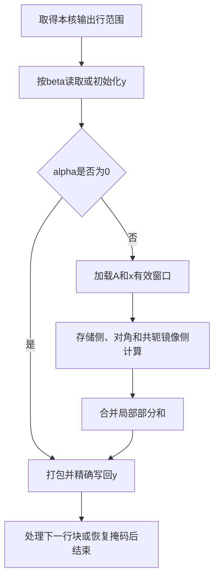

# aclblasChbmv 算子设计（Atlas A2/A3）

# 需求背景

## 需求来源

2026年11月社区任务「aclblasChbmv算子开发（A2A3）」，以随任务发布的
`aclblasChbmv_AtlasA2_A3_task_doc.md` 及测试用例包为接口与验收依据。
算子实现位于 `ops-blas/blas/sbmv/arch22/`，测试位于
`ops-blas/test/sbmv/chbmv/arch22/`，使用 CANN 9.1.0 和 Ascend C。

## 背景介绍

Chbmv 对单精度复数 Hermitian 带状矩阵执行矩阵向量乘加：

```text
y = alpha * A * x + beta * y
```

Hermitian 矩阵满足 `A[i,j] = conj(A[j,i])`，对角元素只取实部。
输入仅保存上三角或下三角的带内元素，通过共轭关系得到另一侧，避免展开为稠密矩阵。

# 需求分析

## 功能范围

| 项目 | 设计要求 |
| --- | --- |
| 输入输出类型 | COMPLEX64，实部和虚部均为 FLOAT32 |
| 存储 | 列主序 Hermitian 带状存储，UPPER/LOWER |
| 形状 | 运行时 n、k；有效带宽 b=min(k,n-1) |
| 标量 | alpha、beta 为 Host 复数指针 |
| Tensor | A、x、y 为 Device 指针；y 原地更新 |
| 步长 | 支持正负 incx/incy 和 lda padding |
| 空输入 | n=0 在句柄与n校验后直接成功 |
| 执行 | 在 handle 绑定的 stream 上异步执行 |
| 产品 | Atlas A2/A3，arch22；自验证选择910B3 |

不增加 batch、转置、广播或额外 workspace 参数，沿用 ops-blas 的公开句柄、状态码及复数类型。

## 接口定义

在 `include/cann_ops_blas.h` 声明公共接口：

```cpp
aclblasStatus_t aclblasChbmv(
    aclblasHandle_t handle, aclblasFillMode_t uplo, int n, int k,
    const aclblasComplex* alpha, const aclblasComplex* A, int lda,
    const aclblasComplex* x, int incx,
    const aclblasComplex* beta, aclblasComplex* y, int incy);
```

| 参数 | 说明与约束 |
| --- | --- |
| handle | 已创建的有效句柄，提供执行stream |
| uplo | ACLBLAS_UPPER 或 ACLBLAS_LOWER |
| n | 矩阵阶数，n>=0 |
| k | 存储带宽，k>=0；k>n-1时多出的带不参与计算 |
| alpha、beta | n>0时非空；Host上读取复数标量 |
| A、lda | A为非空Device地址，至少lda*n个复数；lda>=int64(k)+1 |
| x、incx | x非空；步长非0、非INT32_MIN；(n-1)*abs(incx)<=INT32_MAX |
| y、incy | y非空；步长约束同x，至少1+(n-1)*abs(incy)个复数 |

`beta=0` 表示不读取y旧值，不豁免y非空要求。所有跨度、`k+1`及地址计算先提升为64位。

# 详细设计

## 存储映射与边界语义

设行列为0基下标i、j，矩阵存储基址为AB：

| 模式 | 存储侧 | 镜像侧 |
| --- | --- | --- |
| UPPER | i<=j：AB[k+i-j+j*lda] | i>j：conj(AB[k+j-i+i*lda]) |
| LOWER | i>=j：AB[i-j+j*lda] | i<j：conj(AB[j-i+i*lda]) |

只计算 `abs(i-j)<=b` 的元素。k大于n-1时，UPPER的存储对角行仍为原始k，
不能用b替换。对角虚部、无对应矩阵元素的带区和lda padding均不参与算术。

向量第i个逻辑元素的物理下标为：

```text
inc > 0: i * inc
inc < 0: (1 - n) * inc + i * inc
```

A和x只读。写回仅覆盖y的有效复数元素，保留步长间隙；按复数分量的4字节自然对齐
处理视图，不假设用户地址满足32字节DMA对齐。

## Host侧设计

### 参数校验与返回值

依次执行以下检查，顺序与正式任务契约一致：

1. handle为空，返回 `ACLBLAS_STATUS_HANDLE_IS_NULLPTR`。
2. n<0，返回 `ACLBLAS_STATUS_INVALID_VALUE`。
3. n=0，返回 `ACLBLAS_STATUS_SUCCESS`，不再读取其他参数。
4. 检查uplo、k、lda、incx/incy、跨度及alpha/beta/A/x/y；非法时返回
   `ACLBLAS_STATUS_INVALID_VALUE`。非法uplo也使用该状态码。
5. alpha=0且beta=1时直接成功；其他合法输入进入分派。

检查在读取Device数据或启动kernel之前完成。查询设备或启动kernel失败时返回
`ACLBLAS_STATUS_EXECUTION_FAILED`。通过公开启动接口获取本次调用的返回值，
不把线程遗留的运行时错误当作本次启动失败。

### 分派与分核

Host从当前逻辑设备查询Vector核数及可用UB容量；以设备号为索引缓存不可变容量，
切换设备时刷新。stream和kernel函数句柄仍按当前运行时上下文取得。

每核独占连续输出行，向量lane对应一行；跨核无原子写、归约或共享workspace。
根据n、b、lda和容量选择以下路径：

| 路径 | 使用条件 | 工作方式 |
| --- | --- | --- |
| 标量AIV | 小规模或向量缓存容量/搬运限制不满足 | 每行遍历有效带宽，使用64位地址 |
| 窄带向量 | b<=32且A/x窗口可装入UB，主要用于n>=512 | 缓存行块及相邻带区，按带对角Gather |
| 宽带向量 | n>=128、窄带条件不满足且宽带缓存可装入UB | 分块加载存储侧和镜像侧，拆分实虚计算 |
| 仅缩放y | alpha=0 | 跳过A/x读取，按beta处理y |

向量行块最多64行。中等带宽采用按8行对齐的均衡分核，使每核承担相近工作量；
其余向量分支按64行块分配。标量路径按至少4个复数的行组分核。
块容量与实际有效行数分别记录，最后一块严格按有效行数生成掩码。
分派不依赖测试名称、随机种子或预存输出。

### Tiling信息

Host向Device传递n/k/b/lda/uplo、核数、每核行范围、行块大小、分支标识、
A/x缓存字节数、64位步长与负步长起点，以及alpha/beta的实虚分量。
一次非短路API调用启动一个AIV kernel，不分配中间Device Tensor。

## Kernel侧设计

### 计算流程



`beta=0`时直接将输出累加器置零；`beta=1`时保留旧y，避免无意义的复乘。
alpha=0时不引用A或x。复数乘法按实虚分量拆分；对角项仅使用实数乘法。

### 窄带缓存

缓存本行块与左右带宽覆盖的列窗口。按列主序地址生成Gather索引，逐个带偏移
取出A和x的实虚部，镜像侧对A虚部取反。边界掩码在参与算术前排除无效lane，
不以“无效数值乘零”代替掩码，避免NaN污染。

### 宽带分块

存储侧每次处理最多32个贡献列。连续完整块使用二维DMA搬入；边界块依据每列的
有效行区间单独搬入。跨矩阵列时首地址增量为lda-1个复数，包含带存储行偏移的变化。
整块通过GatherMask拆分实虚部，后续使用对齐向量视图。

镜像侧每次搬入最多64个带元素，再用TransDataTo5HD转置并拆分实虚部，形成按输出行
排列的向量。对单次repeat的转置使用零repeat stride，保证窄尾块遵循arch22接口约束。
x窗口缓存8种32字节对齐位移，减少带循环内的重复Gather。

宽带计算先在x缓存中形成alpha*x，存储侧与镜像侧共同使用，避免对两个大部分和
最后分别缩放产生额外相消误差。每行采用多组独立FP32部分和，再进行树形合并，
缩短连续累加链；初始配置为32组。存储侧使用Axpy，镜像侧使用向量乘加指令。
不使用FP16/HF32降精度计算。

### 极端数值处理

若普通路径得到非有限分量，在该输出行写回前，用Device上的标量路径重新计算该行。
回算用FP32尾数和独立整数指数保存中间数，避免有限输入的单次乘积溢出后，
后续相消本应得到有限结果却形成NaN。最后转换为FLOAT32写回。
NaN/Inf输入保留对应算术语义，不能将非有限值简单截断成有限值。
该路径在Device执行，A/x只读、每核独占输出的原则不变。

### UB布局与同步

令R=64，`align32(z)`表示按32字节向上取整。初始缓存预算如下，实际分配受平台容量约束：

| 路径 | A缓存 | x缓存 | 临时/输出 |
| --- | --- | --- | --- |
| 标量 | 无 | 无 | 32 B |
| 仅缩放y的向量分支 | 32 B | 32 B | 36 KiB |
| 窄带 | align32((R+2b)*lda*8)+32 | align32((R+2b)*8)+32 | 36 KiB |
| 宽带 | 64 KiB，包含搬入和转置空间 | align32((R+2b)*8)+32 | 36 KiB |

临时区包含实虚分量、乘法临时、Gather索引、输出打包区、移位x窗口及部分和。
Host在分派前核对总量，不满足时采用标量路径；块大小与部分和数量可在容量约束内调整。

S、V、MTE2、MTE3之间通过显式事件同步；向量读后写依赖使用PIPE_V屏障。
UB复用前等待消费者完成。无效缓存位置先初始化，计算掩码只覆盖有效数据。
内核返回前恢复向量掩码，避免影响后续调用。

### 输出搬运

实虚分量先打包到对齐UB。连续y按有效长度一次搬出；非单位步长使用精确8字节
block写回，过大搬运stride采用逐元素写回。负步长先调整行内打包顺序及首地址。
不覆盖y间隙，不要求用户缓冲额外预留DMA尾部空间。

# 可维可测分析

## 验证方法

在ops-blas现有GTest框架中加载正式任务CSV，精度与时延验证分别记录。
测试覆盖全部正式用例，并补充以下场景：

- UPPER/LOWER、小尺寸、满带、k>n-1、lda padding与非对齐尾块。
- alpha/beta的零、一、纯虚及一般复数，均匀和正态分布输入。
- 正负步长、INT32_MIN拒绝、int32跨度边界、空指针和校验顺序。
- 对角虚部及未引用区域投毒、A/x不变、y间隙不变、4字节偏移视图及首尾哨兵。
- 极端有限值、中间溢出后相消、NaN/Inf，以及历史运行时错误隔离。

参考值由Netlib BLAS 3.10.0产生：输入与alpha/beta提升为FP64，调用
`cblas_zhbmv(CblasColMajor, ...)`，再把输出收窄为FLOAT32。
实部/虚部分别按任务书的混合容差、最坏误差点ULP和非有限值等效规则判定。
每条随机Tensor用例补充配对分布；负向用例使用单元素dummy或显式空指针，
不按非法跨度分配巨大缓冲。

设备时延按正式任务书及随包测试指导采集，预热、有效调用、数据拷贝与参考计算
分别记录。Event计时窗口内仅连续下发算子调用，profiler记录独立保留并标明计时类型。
最终报告记录源码、CSV、参考库、二进制身份及实际设备，确保结果可复现。

任务书§3.4不要求内存专项验收；开发过程中对搬运边界、初始化及同步变化进行
针对性检测，不以数值比对替代内存访问检查。

## 兼容性分析

复用 `cann_ops_blas.h` 的公共API与既有类型，在arch22注册实现与测试，不增加私有平行接口。
Host读取当前设备容量，不硬编码特定芯片的核数或UB大小。A2/A3使用相同接口契约，
自验证硬件及编译目标按实际设备记录。

实现遵循仓库CANN Open Software License Agreement 2.0，按现有构建系统接入。
用户可通过句柄绑定stream；跨stream的数据依赖由调用方同步。

# 参考资料

1. 正式任务包：`aclblasChbmv_AtlasA2_A3_task_doc.md`及`test_cases/README.md`。
2. [ops-blas](https://gitcode.com/cann/ops-blas)。
3. [社区任务与设计模板](https://gitcode.com/cann/cann-ops-competitions/tree/master/04_tasks/01_community-task-2026)。
4. [Netlib CHBMV](https://www.netlib.org/blas/chbmv.f)。
5. [cuBLAS hbmv接口](https://docs.nvidia.com/cuda/cublas/index.html#cublas-t-hbmv)。
