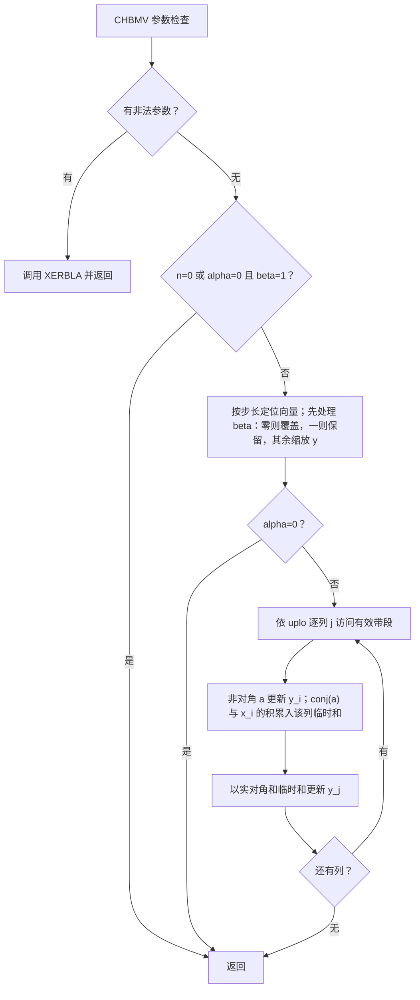
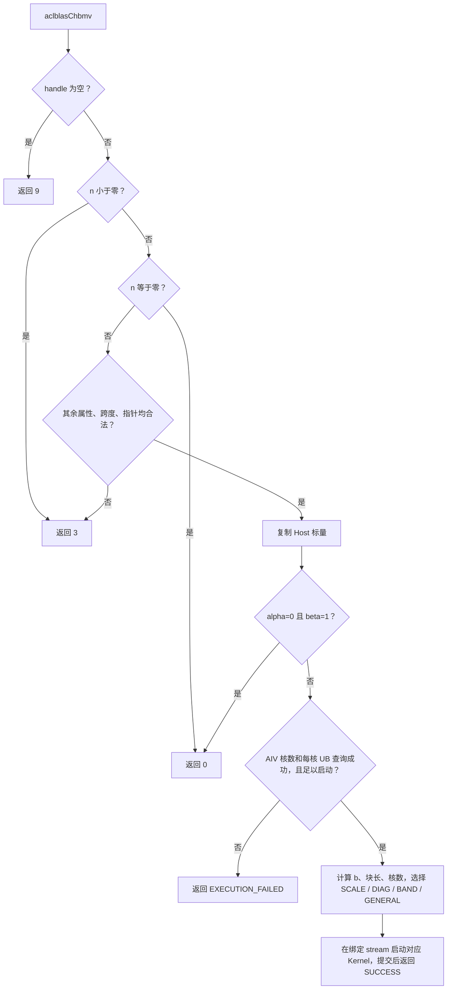
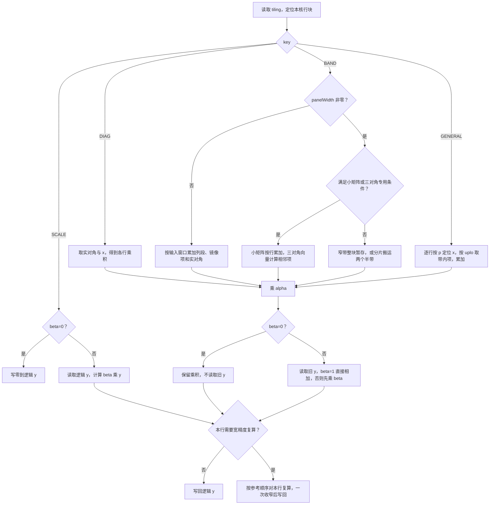

# 需求背景（required）

## 需求来源

**11月社区任务 · aclblasChbmv 算子开发（A2/A3）**。目标是在 `cann/ops-blas` 为 Atlas A2/A3 补齐单精度复数 Hermitian 带状矩阵向量乘。依据 2026-11-11 核对的官方发布包，任务书正文无独立版本号及任务编号。正文 SHA256 为 `E03A2B9997011132A33916B74138E5B3BC6615CFBF47FA280B99B7A1B75D6A3B`。发布包内的任务书和 test_cases/ 目录列出了正式要求、1,200 条用例及其基线。下文引用的随包文件均可从该 ZIP 下载。[任务详情][task] · [官方发布包][zip] · [任务书正文][spec]

设计参考源码固定为 `cann/ops-blas@5bd95145a9c499e43ebad44a313a1029c63d54bc`。这是本次实际查阅版本，任务书指定了仓库及目录，未指定提交号。本次修订依据在 910B3 上完成自验证的实现，更新按带宽选块、片上缓存和异常回退策略。文档结构依据[官方模板][template]及[设计检查表][check]。

## 背景介绍

### aclblasChbmv 实现优化

Netlib 的 `CHBMV` 顺序扫描已存储的一侧，每个非对角元素同时贡献给两个输出。若把这些列直接分给多个核，各核会同时改写同一个 y。本设计将连续的**输出行**分给不同的 Vector 核，每核在本地完成自己所辖行的两侧贡献，最后一次写回。代价是同一个非对角元素可被两个输出块分别读取；收益是无需核间累加、临时整矩阵或额外归并 kernel。[Netlib 3.10.0 CHBMV][netlib]

参考仓中，`blas/sbmv/arch22/ssbmv_host.cpp::aclblasSsbmv` 从 handle 取得 stream，计算分核信息后启动同族实数 kernel；`ssbmv_kernel.cpp` 提供按行分块及带内有效段搬运参考。`blas/gbmv/arch22/cgbmv_host.cpp::aclblasCgbmv` 和 `cgbmv_kernel.cpp` 提供复数标量按值下发、交错复数拆分及搬回的参考。Ssbmv 的镜像无需共轭，Cgbmv 的矩阵不隐含另一侧，两者均需适配。目标是 BLAS 句柄直调，TBE 算子信息库不参与注册或选型。[Ssbmv Host][sshost] · [Ssbmv Kernel][sskernel] · [Cgbmv Host][cghost] · [Cgbmv Kernel][cgkernel]

### aclblasChbmv 现状分析

当前参考版本的公共头中已有 `aclblasSsbmv`，本次新增 `aclblasChbmv` 声明，沿用公共句柄、枚举、状态码和 `aclblasComplex`。下表约束适用于有效 handle、n>0；零维的优先级见 Host 设计。[公共接口][api] · [公共类型][types]

| 参数 | 参数含义 | 数据类型 | 支持数据类型 | 约束 | 形状 |
| --- | --- | --- | --- | --- | --- |
| handle | 绑定 stream 的 Host 句柄 | aclblasHandle_t | 公共句柄 | 已创建、非空 | 标量 |
| uplo | Host 指定已存储三角 | aclblasFillMode_t | ACLBLAS_UPPER、ACLBLAS_LOWER | 二选一 | 标量 |
| n | 方阵阶数 | int | int32 | n≥0 | 标量 |
| k | 一侧带宽 | int | int32 | k≥0，可大于 n−1 | 标量 |
| alpha | 矩阵乘积系数 | const aclblasComplex* | COMPLEX64 | Host 非空，实虚部各为 FLOAT32 | 1 个复数 |
| A | 只读 Device 带状矩阵 | const aclblasComplex* | COMPLEX64、ND | 非空，列主序，仅指定侧有效 | 物理 lda×n，逻辑 n×n |
| lda | A 每列的物理间距 | int | int32 | lda≥k+1 | 标量 |
| x | 只读 Device 输入 | const aclblasComplex* | COMPLEX64、ND | 非空，逻辑间隔 incx | 逻辑 n，物理至少 1+(n−1)×abs(incx) |
| incx | x 的有符号步长 | int | int32 | 非零、非 INT32_MIN，跨度≤INT32_MAX | 标量 |
| beta | 旧 y 的系数 | const aclblasComplex* | COMPLEX64 | Host 非空，实虚部各为 FLOAT32 | 1 个复数 |
| y | Device 输入及原地输出 | aclblasComplex* | COMPLEX64、ND | 非空，beta=0 时直接写结果 | 逻辑 n，物理至少 1+(n−1)×abs(incy) |
| incy | y 的有符号步长 | int | int32 | 非零、非 INT32_MIN，跨度≤INT32_MAX | 标量 |

**图 1　Netlib 3.10.0 语义参考的数据流。** Netlib 先校验参数再做 quick return；本题单独规定了 handle 和 n 的检查顺序。GPU 基线取随包 cuBLAS 实测值，图中描述的是可查阅的 Netlib 源码。[CHBMV 源码][netlib] · [任务书 §2.5、§3.3][spec]



### aclblasChbmv 功能分析

公开功能对齐 cuBLAS 的 `cublasChbmv` 核心语义。调用方提供 A 的上带或下带及两个有符号步长，得到 n 个复数输出；同一逻辑矩阵的两种合法编码应给出相同数学结果。单精度调用对照同一份输入升精度得到的 Netlib 结果，性能对照同参数的 A100 记录。[cuBLAS HBMV][cublas] · [任务书 §2、§3][spec]

# 需求分析（required）

## 需求描述

在 CANN 9.1.0 上通过 Ascend C 直调实现一个共享 ABI。成功路径在 handle 绑定的 stream 上异步执行，调用方同步后读取 y；参数错误在 Host 返回。精度测试覆盖两种三角、步长、标量和异常输入，性能按 200 个官方用例逐例验收。

## 需求拆解

| 需求或对象 | 需实现或保持的行为 | 适用条件、例外与边界 |
|---|---|---|
| R-001～003、016、018～019　入口与环境 | 公共头声明，arch22 Host 在绑定 stream 启动 Kernel，GTest 经同一 API 回读 y | A2/A3 均支持；一种款型可自验，正式性能设备为 910B3。见 V-001、010 |
| R-004～006、011～012　寻址 | Kernel 用原 k、lda 寻址，用有效带宽截取区间；镜像取共轭，对角只取实部 | k=0、k>n−1、补齐列和负步长均有独立对照。见 V-002、003、007 |
| R-007～013、026　参数 | Host 先检查 handle 和 n，零维直接返回，其余校验完成才读标量或启动 Kernel | 空 handle 返回 9，其他非法参数返回 3；精确匹配返回值。见 V-004～007 |
| R-014～015、017　标量、范围 | 零 beta 跳过旧 y，零 alpha 走缩放路径；保留 y 原地写及步长间隙 | 适用于独立 A/x/y，无广播、trans 或额外布局。见 V-008、009 |
| R-020～025　精度 | GTest 加载原 CSV、生成双精度 golden、逐分量比较；另做正态和 API 边界测试 | 有限和非有限分开统计；原用例的编号、分布和种子可追溯。见 V-002～009 |
| R-027～029　性能和内存 | 每个 PF 用例记录两种 NPU 耗时与对应 gpu_ms，分别计算结论 | Q-001 只影响正式计时来源；内存免测但保留两份材料。见 V-010、012 |
| R-030～049　交付与流程 | 设计稿、代码、测试、复现文档、报告及进展沿用拆解稿 D-001～017 和 V-011～014 | 本阶段交付 D-001 的本地稿；方案评审和设备实测有各自的证据。见末章 |

## 外部组件依赖与内部适配模块

| 组件或拟改位置 | 职责与适配 |
|---|---|
| CANN 9.1.0、ACL Runtime、Ascend C | 提供 stream、核资源查询、Vector 运算、GM/UB 搬运、event 和 msprof；选用官方环境（Q-004、Q-009、Q-010） |
| `include/cann_ops_blas.h`、`include/cann_ops_blas_common.h` | 从前者导出唯一签名，从后者取已有类型及状态码 |
| `blas/sbmv/arch22/` | `chbmv_host.cpp` 负责分块，`chbmv_tiling.h` 定义启动参数。`chbmv_kernel.cpp` 为设备入口，`chbmv_kernel.h` 实现调度及基础路径，`chbmv_panel.h`、`chbmv_tridiagonal.h`、`chbmv_wide.h` 分别实现带状分块、三对角运算和宽精度复算 |
| `test/sbmv/chbmv/`、`test/sbmv/chbmv/arch22/` | 参照同族 CMake 注册 `chbmv_test`；arch22 放 GTest、参数装配、golden 与 CSV，从公共头链接算子。架构测试入口命名为 `arch22/chbmv_test.cpp`，由 `ops_blas_add_gtest_tests` 注册，按 case 输出状态、精度或性能记录。[同族测试注册][testcmake] · [测试构建规则][buildtests] |
| Netlib BLAS/CBLAS 3.10.0、官方 GPU CSV | 在测试端用 `cblas_zhbmv` 生成 fp64 golden；逐例读取随包 cuBLAS 基线。两者均不进入设备 Kernel。[CBLAS 包装入口][cblas] · [GPU 文件][gpu] |

## 需求模块设计

```cpp
aclblasStatus_t aclblasChbmv(
    aclblasHandle_t handle,
    aclblasFillMode_t uplo,
    int n, int k,
    const aclblasComplex* alpha,
    const aclblasComplex* A, int lda,
    const aclblasComplex* x, int incx,
    const aclblasComplex* beta,
    aclblasComplex* y, int incy);
```

按此顺序显式传入全部参数。公开接口不增加 workspace、tilingKey、转置或计时参数；计时属于测试程序。Host 将两个标量的实虚部复制到启动参数，Kernel 获取 A、x、y 的设备地址。

# 详细设计（required）

## 算子分析

### 数学公式

下标从 0 开始。对 n>0，令 `b=min(k,n−1)`，物理复数数组记为 S。带内已存元素按下表寻址。

| 模式 | 直接存储的 H(i,j) | 对角位置 | 镜像 |
|---|---|---|---|
| UPPER | i≤j 且 j−i≤b 时，S[j×lda + k+i−j] | S[i×lda+k] 的实部 | i>j 时取 conj(H(j,i)) |
| LOWER | i≥j 且 i−j≤b 时，S[j×lda + i−j] | S[i×lda] 的实部 | i<j 时取 conj(H(j,i)) |

令 `p(t,d)=t×d`（d>0），或 `(n−1−t)×abs(d)`（d<0）。每一行累加
`sᵢ = Σ H(i,j) × x[p(j,incx)]`，其中 `max(0,i−b) ≤ j ≤ min(n−1,i+b)`。写回 `y[p(i,incy)] = alpha × sᵢ + beta × y_old[p(i,incy)]`。对角项直接用实数分别乘 x 的实部与虚部，避免让一个虚构的零虚部参与乘法。对非对角 `a+ic` 与 `u+iv`，直接项为 `(au−cv, av+cu)`，镜像项为 `(au+cv, av−cu)`。零系数按 Host/Kernel 分支处理。

### 支持数据类型

A、x、y、alpha、beta 的实虚部均为 FLOAT32，覆盖有限值、Inf、NaN。Device 复数按实、虚相邻存放，每元素 8 字节。常规行采用 FP32 分量乘加与分段归约。可能发生中间溢出、下溢或含非有限值的行按 Kernel 侧设计单独处理。测试 golden 提升至 FP64 后收窄。句柄和属性沿用公共类型；无缺省标量或隐含步长。

### 支持形状

n=0 可不提供有效数组。n>0 时 A 物理为 lda×n 个复数，向量按各自跨度分配。n、k、lda、incx、incy 独立校验。索引加减、列偏移、`k+1`、`i+b` 及步长乘积先扩至 64 位。上带对角始终位于原 k 行，即使有效带宽已截短。仅寻址合法分配中的元素，不能以 int32 中间值或溢出的带符号字节数构造地址。

## 调用方式

调用方创建 handle，用 `aclblasSetStream` 绑定 stream；在 Host 准备标量，将带数组和向量置于 Device，然后调用上述接口。检查返回值，成功时在同一 stream 同步后按 incy 回读逻辑 y。负步长传物理存储的起始地址，由实现按 n、inc 定位逻辑首元；测试对 CBLAS 亦传物理起始地址。测试端分别记录接口返回及异步同步错误。

## 算子实现

### 实现方案

**图 2　公共入口与调度。** 按输出行归集来自两侧的项，取代图 1 中按列更新多个输出的做法。每个非对角项在指定输出行中恰好计算一次，对角另算一次。缩放和乘积合在一次输出写回，beta=0 可完全跳过 y 输入。



#### Host 侧设计

1. 按图 2 先检查 handle、n。此时不解引用标量、查询设备或访问 A/x/y。
2. n>0 时检查 uplo、k≥0、`int64(lda)≥int64(k)+1`。再分别检查两个步长，先排除 0 和 INT32_MIN，以 int64 计算 `(n−1)×abs(inc)`，超过 INT32_MAX 即失败。检查 alpha、beta、A、x、y 五个指针，任一为空返回 INVALID_VALUE（3），非法 uplo 同样返回 3。
3. 读取复数标量，按实虚部判断零及一。合法的 alpha=0、beta=1 直接成功。其他调用按下面的优先级生成 tiling，其中包含 key、uplo、n、原 k、b、lda、incx、incy、输出行块长 T、带状分块宽度 panelWidth、实际核数 B、两标量的四个 FP32 分量及 beta 是否为零。在任何分核除法前，调用同族的 `GetAivCoreCount()` 并查询 `GetCoreMemSize(UB, …)`。平台不可用、核数为零、UB 查询无有效容量，或连逐元素分支所需空间也不足时，本设计采用仓内的 `ACLBLAS_STATUS_EXECUTION_FAILED`（5），不提交 kernel。资源有效时在 handle 绑定的 stream 调用同族模式的无返回值启动封装，提交后返回 SUCCESS；启动后的执行结果由调用方同步检查。[Ssbmv Host][sshost]

##### 分核策略

先确定 key 和可用的 T，再求 M=ceil(n/T)。下述多核规则只用于向量分支：incx=incy=1 且 y 首地址按 32 字节对齐时，取 `B=min(可用AIV核数,M)`；核 q 负责块号 `[floor(qM/B),floor((q+1)M/B))`，这些块的行区间并集恰好是 [0,n)。块 t 的行区间为 `[tT,min(n,(t+1)T))`。多核时 T 取 4 个复数的倍数，分核公式中的乘积用 64 位计算，使相邻核的写区落在不同的 32 字节块上；只有全局最后一块有短尾。任一向量步长不为 +1或 y 首地址未对齐时使用单核保守写回，仍只改逻辑位置。中间乘积驻留本核，无原子加或跨核同步。

##### 数据分块和内存优化策略

Host 的 `TileSize` 从 64、32、16、8 中选择满足 `4096 + 80T ≤ UB字节数` 的最大 T，均放不下时取 1。这是基础路径的准入条件。BAND 可进一步用 `ConfigurePanel` 选择输出行块 R 和列宽 W，将二者写入 `tile` 和 `panelWidth`。

| 选择 | 行块及带宽 |
|---|---|
| 有效带宽 b≤31 | 若 b≤7 且 n≥768，R=64。其余情况 n≥512 时 R=32，较小时 R=16。原 k=b 时按完整窄带暂存，W 取至少为 8 且能覆盖 2b+1 的最小二次幂。 |
| b>31 或原 k 被截短 | 按半带分片。b>31 时，n≥2048、1024≤n<2048、n<1024 分别取 R=32、16、8。列宽先按 ceil(b/64) 片均分，再向上对齐到 8。若对齐后超过 b，b≥16 时改用 ceil(b/2) 再对齐，其余取 8。 |
| 窗口回退 | 非完整窄带且 b<8、lda 的 DMA 字节步距超限，或分片预算超出 UB 时，保留基础 T，panelWidth=0，由原 BAND 窗口按列段处理。 |

**UB 按实际路径分配。** 令 A8(z) 为元素数向上补齐至 8 的倍数，以下元素均为 4 字节。窄带取 C=R+2b、P=min(lda,A4(b+1))，其中 A4 向上对齐至 4。分片取 C=R+W、P=W。`PackedRows` 的元素数为 `A8(2CP)+A8(2C)+13RW+32+6R`。前两项分别暂存矩阵列段和 x，后续空间存放值、工作区、索引、标志和行累加值。Host 在此基础上另预留 4 KiB，通过容量检查后启用分块。以 TC_PF_1004（n=4096、k=64）为例，R=32、W=64，片上缓冲为 157,312 字节，加预留后的准入门槛为 161,408 字节。各核复用本核缓冲，无全局工作区。

小矩阵与三对角专用路径共用这次准入检查，按各自布局申请缓冲。小矩阵申请 `A8(2n×lda)+A8(2n)+8` 个元素，三对角申请 `62R+32` 个元素。基础路径申请 `17×max(T,8)` 个元素，T=1 时也保留搬运槽。

##### tilingKey 规划

以下四项为内部路径枚举。GENERAL 固定 B=1；若设备可用 UB 放不下最小向量块，但至少有 4 KiB，非零 alpha 降为 GENERAL，缩放采用 SCALE 单核逐元素实现。GENERAL 及逐元素 SCALE 都令 T=1，直接遍历 [0,n)，使用基础搬运槽。

| key | 触发条件（依表序） | Kernel 行为 |
|---|---|---|
| 0 / SCALE | alpha=0，Host 已处理 beta=1；UB 充足时使用向量块，否则按上述规则逐元素执行 | beta=0 时写零；其余乘 beta，按 incy 写回 |
| 1 / DIAG | alpha 非零且 b=0，可用向量块 | 只取主对角实部与逻辑 x；按两步长读写，适用 n=1、k=0 等情形 |
| 2 / BAND | b>0、incx=incy=1、y 按 32 字节对齐，可用向量块 | 按下文顺序选择小矩阵、三对角、完整窄带、半带分片或基础窗口，由 uplo 决定共轭方向 |
| 3 / GENERAL | 其余非零 alpha 调用 | 单核按逻辑行和有符号步长精确取数，逐行归约，点写 y；覆盖短尾及未对齐地址 |

#### Kernel 侧设计

**图 3　每个 AIV 核的计算及访存。** 使用 Vector/标量单元处理带状复数，矩阵不展开，Cube 不参与。SCALE 的零 beta 是独立写零出口。



BAND 先检查 Host 下发的行块和 panelWidth，再按以下顺序处理。表中的“纯乘积”指 alpha=(1,0)、beta=(0,0)。

| 设备路径 | 触发条件及计算 |
|---|---|
| `TinyBand` | 已启用分块、n≤16、k=b、lda=k+1 且为纯乘积。Host 把行块设为 4，每个参与的核将紧凑存储的 A 和 x 各搬入一次，按行访问有效带内元素，交错输出每块至多 4 个复数。 |
| `TridiagonalRows` | 已启用分块、k=1、lda=2 且为纯乘积。连续搬运每列两个复数的存储和相邻 x，再用 Gather 取实对角与有效的相邻系数，按上下带的共轭方向合成两侧贡献。向量检查失败时，对该块逐行调用 ScalarRow。 |
| `PackedRows / NarrowTile` | 已启用分块、k=b≤31。一次暂存一组相邻列及其所需的 x，复用索引表取直接项、镜像项与实对角。普通纯乘积可向量写回，其他系数或异常值进入行级处理。 |
| `PackedRows / PackedHalf` | 其余启用分块的 BAND。对每组 R 行，用二维 DMA 分别搬运两个半带的 W 宽列段，Gather 后计算复乘并按行归约，跨片补偿累加。末片前移时屏蔽已经累计的位置，最后单独加入实对角。 |
| `Band` | panelWidth=0。逐窗复用 x，按 uplo 将直接列段、共轭点乘和实对角的贡献累入各行。 |

计算按逻辑矩阵边界和实际行数裁剪，整列搬入 UB 的存储填充和对角虚部不参与有效结果。块间按输出行划分，连续输出按有效长度写回，有间隙的输出按逻辑位置点写。DIAG 在 k=0、lda=1、两个步长为 +1 且为纯乘积时，还可用 `DiagonalVector` 批量计算实对角乘积。

标量收尾对 beta=(1,0) 直接加旧 y 的两个分量。这样在仅一个分量含 Inf/NaN 时，另一分量不会被多余的零乘法污染。以 n=1、k=0、alpha=beta=1、旧 y=(Inf,2)、A=0、x=1 的单元素例验证，实部应为正无穷，虚部应为 2。

**有限极值及非有限分量。** FP32 中间乘积可能溢出，最终结果却仍可表示。例如 n=1、k=0、A 的实对角为 2¹⁰⁰、x=2⁴⁰、alpha=2⁻²⁰、beta=0，正确实部为 2¹²⁰。设备不能把中间的 2¹⁴⁰ 先收窄。普通路径检查有效输入和结果。零值单独处理，对非零幅值用 FP32 位模式识别 NaN、Inf 及 [2⁻³⁰,2³⁰] 以外的值。批量路径先用向量标志筛查，按分支回到行级处理。宽带分片跨片保留实部和虚部的补偿量。

`Finish` 根据行标志、标量、旧 y（需要时）和结果决定是否调用 `Retry`。拥有该行的核按 Netlib ZHBMV 的列次序处理实对角、镜像及直接项。宽精度乘加用整数表示符号、指数和有效数，采用最近偶数舍入，最终收窄到 FP32。SCALE 只处理缩放项，beta=0 时直接写零。

用上面的溢出例和 A=2⁻¹⁰⁰、x=2⁻⁶⁰、alpha=2¹⁰⁰ 的下溢例作工程补充，后者应得到 2⁻⁶⁰。两例均取纯实输入、核对零虚部，并对异常分支测量实际开销。[Netlib ZHBMV 运算顺序][zhbmv]

## 支持硬件

| 支持的芯片版本 | 涉及勾选 |
| --- | --- |
| Atlas A2 系列（含 Atlas 800T A2） | ☑　arch22，编译目标 ascend910b；性能验收指定 910B3 |
| Atlas A3 系列（含 Atlas 800T A3） | ☑　arch22，编译目标 ascend910_93 |

## 算子约束限制

支持列主序 BLAS 带状格式、lda 补齐及正负向量步长。A、x、y 按任务书的独立矩阵和向量使用，仅 y 原地更新。接口无广播、输出视图或任意张量切片。n、k 为运行时属性，任务未要求额外的动态形状能力或逐位确定性。分核、块长及 UB 预算是实现选择，性能达标需以设备测量为据。

# 特性交叉分析

| 组合 | 最容易出错的位置 | 拟验证的可观察结果 |
|---|---|---|
| UPPER/LOWER × 复数非对角 × lda 补齐 | 镜像共轭方向、对角虚部、填充列 | 下述两种存储应得到同一输出；把无效位置填为 NaN 后结果仍相同 |
| k>n−1 × UPPER；n=1 × k>0 | 用 b 代替原 k 寻址会读错对角 | 与有效逻辑矩阵的 CBLAS 输出一致；在非零 alpha 且向量块可用时，n=1 命中 DIAG；UPPER 仍读第 k 行 |
| 正负步长 × 两种 uplo × 短尾 | 双重调整负步长、覆盖输出间隙 | 按 p 回读等于 golden，用哨兵验证 y 间隙及末尾保护区域未改 |
| 零标量 × 非空/空指针 × 特殊值 | 空指针被缩放短路掩盖；零乘旧 NaN | handle 有效、n>0 且五个数据指针中任一为空须返回 3；TC_ED_243 在 beta=0 时输出与替换旧 y 后一致；alpha=0 时直接缩放 |
| n=0 × 非法属性 × 句柄 | 校验顺序 | 有效 handle 时返回 0；空 handle 时返回 9 |
| b>0 × 多核块边界 × 地址对齐 | 两核覆盖同一尾块、DMA 越界 | 用 n=T−1、T、T+1 和多个块加短尾，令 alpha 非零、incx=incy=1，从 32 字节对齐的 y 基址分别取原地址和偏移一个复数的地址，验证 BAND 与 GENERAL；逐点比较并检查前后哨兵 |

**可手算的核验样例（工程补充）。** 取 n=2、k=1、lda=3、x=(1,i)、alpha=1、beta=0。逻辑矩阵两行分别为 `[2,1+2i]` 和 `[1−2i,3]`。按列写入时 UPPER 两列为 `[*,2,*]`、`[1+2i,3,*]`；LOWER 两列为 `[2,1−2i,*]`、`[3,*,*]`。星号位置填 NaN，两种输入都应得到 `y=(i,1+i)`。再将两个实对角的物理虚部置为 NaN，结果仍相同。将逻辑 x 反向存放并传 incx=−1、将 y 以 incy=−2 写回，逻辑结果相同，物理 y 的中间元素保留原值。

# 可维可测分析

## 精度标准/性能标准

| 验收标准 | 描述(不涉及说明原因) | 标准来源 |
| --- | --- | --- |
| 功能、状态和接口 V-001、004～008 | 在 CANN 9.1.0 的目标设备上经公共 API 调用，按 stream 同步读回。状态码按用例精确匹配，零维无计算，Host 参数校验失败时不写 y | 任务书 §2.2～2.5、§3.1、§3.5 |
| 精度 V-002、003、008、009 | 对成功的数值用例，先收窄 golden，再对各逻辑点的实、虚部分别执行下述有限点和非有限点判据，两分量均通过 | 任务书 §3.2、§3.5；[固定版混合容差标准][precision] |
| 性能 V-010 | Atlas 800T A2（910B3），200 个 PF 逐例平均单次耗时 ≤ 对应 GPU 单次耗时×1.25。等价条件为 GPU_us/NPU_us≥0.8，等号达标 | 任务书 §3.3、§7.4；[GPU CSV][gpu]、[随包性能脚本][perf]；计时来源见 Q-001 |
| 内存 R-029、Q-003 | 任务书 §3.4 免测。保留 4.1 报告和 4.2 日志，分别说明“不涉及”及“未执行内存专项测试”，数值栏留空 | 任务书 §3.4、§4；[验收材料模板][submit] |

### 精度测试与边界复现

装配器先解释 CSV 的字面值，再做数值转换。标量实部列中的 `null` 表示传空 Host 指针，a_fill、x_fill、y_fill 中的 `NULLPTR` 表示传空 Device 指针。非法枚举 `999` 按原值传给接口，保留测试其优先级的机会。TC_ED_238 和 TC_ED_246 都传空 alpha，前者因 n=0 期望 0，后者因 n>0 期望 3。CSV 外另测空 handle。[随包测试指导][readme]

1. 在 ops-blas 的 GTest 中按官方 `chbmv_test.csv` 的 19 列装配参数和种子。对成功数值行，同一批生成的 FP32 输入分别用于 Device 调用和 CPU golden。将所有输入的实虚部精确提升为 double，调用 Netlib 3.10.0 `cblas_zhbmv(CblasColMajor,…)`，沿用原 lda、uplo、incx、incy 和独立的初始 y 副本。按最近偶数舍入将输出的每个分量一次收窄至 FLOAT32。随包提供配置与指导，golden 由测试程序生成（Q-005）。错误码行、零维行先验状态，无需造数或调用 CBLAS。[任务书 §3.2、§3.5][spec] · [随包测试指导][readme]
2. 对某一分量，双方均有限的比较点记为集合 F。用加宽的差值计算 `e=abs(actual−g)`，g 是已收窄的 golden。点匹配条件为 `e≤2⁻¹³+2⁻¹³×abs(g)`；该分量需同时满足匹配数/|F|≥0.99 和 `max(e)≤max(0.01,32×ULP(g_low))`。g_low 取**该分量最大绝对误差点**的 FLOAT32 golden，ULP 依固定版标准。记录最大误差位置及 golden；CSV 保留列 mere_threshold、mare_multiplier 不替代以上门槛。
3. 某点任何一方为非有限值，即单列统计。双方 NaN、同号 Inf、NaN 与任一符号 Inf 均匹配；异号 Inf 或一边有限另一边非有限均失败。每分量记录非有限总数与通过数，必须全部通过。|F|=0 时记录有限点为 0，匹配率和最大误差填“不适用”，仍执行非有限判据。保留逐例种子、返回码、两分量计数、最大误差位置和失败点，能从日志重建报告。

**官方精度用例共 1,000 条**，其中 976 条为 n>0 数值成功行、8 条为零维成功行、16 条为 INVALID_VALUE 行。分类和区间如下，原始逐行参数以 CSV 为准。[官方用例][cases]

| 原始编号区间 | 场景与预期 |
|---|---|
| TC_L0_001～006、TC_SQ_007～096 | 基本矩阵、尺寸/带宽扫描、k>n−1；两种 uplo 均与 golden 比较 |
| TC_AB_097～112、TC_LD_113～124、TC_INC_125～196 | 零、一、负数、纯虚及一般复标量；lda padding；incx/incy 各取 ±1、±2、±3 |
| TC_FL_197～214、TC_CV_215～230 | 零、极值、Inf、NaN 与中等尺寸组合；按实际输出逐分量判定 |
| TC_ED_231～238；239～245、258～259 | 前八条为成功 quick return；后九条为数值成功，含 beta=0 时旧 y 为 NaN、alpha=0 时缩放 |
| TC_ED_246～257、260～263 | 分别覆盖空指针、非法 uplo/lda/n/k、零步长及 INT32_MIN/跨度溢出；每条精确返回 3。用单元素 dummy 或被测空指针，避免测试端提前按非法跨度分配 |
| TC_EX_0264～1000 | 737 条扩展组合，保持官方参数与种子，回读全部 n 个逻辑位置 |

**补充组单列。** 接口单测直接传空 handle，分别用 n>0 和 n=0，均应返回 9。以有效 handle、n=1、合法 uplo 和单位步长，取 k=lda=INT32_MAX，使用非空 dummy 指针，预期返回 3。另在 Host 分核单测注入零 AIV 数或不足 4 KiB 的 UB，预期返回执行失败（5），启动次数为零；正常资源下照常验证四种 key。运行上述手算例和块边界哨兵例。对随机测试按输入分别统计均匀与正态的数量；保留原用例及固定标量，给原有随机均匀输入配同形状、同三角和步长的正态样本，使两种分布各占 50%。固定常数、特殊值和负向场景单列。补充对 alpha、beta 各自也进行两种分布的配对采样；实、虚部独立取样，均匀范围 [−5,5]，正态参数 μ∈[−5,5]、σ∈[0.1,2]，记录种子与参数。A 只生成有效三角，主对角虚部取零；另一侧由共轭决定。含 Inf/NaN 的 x 避开零 alpha。固定版本的 `test/frame/fill.h` 能解析 `GAUSS_NORM_5_2`，但 `GaussGenerator::at` 会把正态样本截到 [−5,5]。本题 §3.5 限定的是正态分布参数。Chbmv 测试端复用框架的 token 解析和均匀填充，在补充正态组按所记录的 μ、σ 使用未截断的 `std::normal_distribution`，实、虚部独立取样。用靠近上界的 μ 和固定种子核对生成值可超过 5，防止误走截断路径。随包生成器的 `--dist mixed` 单独运行仍生成均匀数据。[框架填充实现][fill]报告列出原用例数、实际补充数、各输入分布计数与场景覆盖。[随包生成器][gen] · [任务书 §3.5][spec]

**核实 golden 的实际链接。** 固定仓的 `cmake/test.cmake` 会搜索 `openblas` 或 `blas`。在官方环境指定 Netlib 3.10.0 的 CBLAS 头、CBLAS 库及其 reference BLAS 后端；按实际安装布局链接到 `chbmv_test`。构建时记录解析到的库文件、版本和链接命令；共享链接再核对运行时解析路径，静态链接保留链接映射。仅包含 `cblas.h` 或成功解析 `cblas_zhbmv` 符号不能确定运算后端。[测试构建规则][buildtests] · [Netlib CBLAS 入口][cblas]

### 性能采样与复现

使用官方环境及 200 条 `TC_PF_1001～1200`。按 (uplo,n,k,incx,incy) 与 GPU CSV 匹配并复核 lda，保留 case_name 和基线 id。GPU 为 A100-SXM4-80GB、CUDA 12.8、cuBLAS 12.8.4，直接使用 200 条已回填的正值 gpu_ms；如模板有驱动栏填“官方基线未披露”（Q-002）。前四条可用于复核单位和对应关系。[GPU CSV][gpu] · [测试指导][readme]

| 用例 | GPU ID | uplo / n / k | GPU 单次耗时（ms） |
|---|---|---|---:|
| TC_PF_1001 | chbmv-base-000 | UPPER / 512 / 8 | 0.00988159995 |
| TC_PF_1002 | chbmv-base-001 | UPPER / 1024 / 16 | 0.0158719998 |
| TC_PF_1003 | chbmv-base-002 | LOWER / 2048 / 32 | 0.0280064001 |
| TC_PF_1004 | chbmv-base-003 | LOWER / 4096 / 64 | 0.0530261327 |

实现后的复现入口如下。在官方环境配置 CANN 9.1.0、Netlib 3.10.0 和测试工程，从随包 `test_cases/` 执行；`$OPS_BLAS` 指向相应代码提交的绝对根路径。脚本的构建入口是 `bash build.sh --soc=ascend910b --ops=chbmv`，A3 功能自验可改为 `ascend910_93`。确认测试程序已产出后才复用 `--skip-build`。GTest 按 arch22 源文件位置加载随包安装的 CSV，例如沿用同族的 `GetCasesFromCsv(ReplaceFileExtension2Csv(__FILE__))` 装配方式。[构建入口][build] · [精度脚本][accuracy] · [性能脚本][perf]

```bash
python3 verify_accuracy.py --repo "$OPS_BLAS" --soc ascend910b --csv ./chbmv_test.csv
python3 verify_performance.py --repo "$OPS_BLAS" --soc ascend910b --csv ./chbmv_test.csv --skip-build
```

精度运行筛选 `-*TC_PF*`，对补充正态及接口单测单列统计。两个 Python 脚本都捕获子进程的标准输出，并主要解析带 `/用例名` 的 GTest 结果行。精度脚本只要至少一条通过且没有识别到失败就能显示 `ALL PASS`。让测试程序直接保存本轮逐例明细，并通过 `GTEST_OUTPUT=xml:<绝对文件路径>` 为两次运行分别保存 GTest XML。从 XML、原始明细和官方 CSV 核对 ID 集合：1,000 个官方精度 ID、200 个 PF ID 各执行一次，缺项、重复、跳过、测试进程异常或错误码不符均单列为失败。独立 TEST 和补充用例另行核对，不能用来抵扣官方条目。性能 GTest 用 `*TC_PF*`，预先造数、准备 Device 缓冲和 stream，剔除 H2D/D2H、golden 和 Host 造数开销。分两次运行采集，避免 profiler 改变 event 基准运行条件。

- **msprof op。** 可按测试 README 逐例采集，也可按连续 10 个用例分组采集并逐例核对边界。最终 910B3 批次使用容器逻辑卡 0 和含上游设备号修复的采集库，每组记录 150 次 chbmv_kernel 启动。按 GTest 的 RUN/OK 顺序将每例 15 次启动与原始 CSV 对齐，取各例后 10 次。在该 case 的 `OPPROF_*/OpBasicInfo.csv` 中识别目标 kernel 的 `Task Duration(us)`。按任务书 §3.3(1) 排除 5 次 warmup，用运行日志对齐调用序号；工具已排除的预热不再从有效明细中扣除。归集其后连续至少 10 次成功且同步无异常的单次样本，取算术平均。保留采样明细和调用序号。
- **aclrtEvent。** 预热 5 次，在同一 stream 用 event 包住连续 10 次有效调用，同步结束 event，以总间隔除以调用数并换算成微秒。按随包规范打印 `[PERF] case=<case_name> avg_us=<数值>` 供性能脚本读取。本次区间内出现失败则记录原因并重采完整有效区间；msprof 异常样本同样记录，补足有效采样。
- **原始记录。** 测试程序在计时区间结束后保存原始 event 区间、调用数和未截断的均值；标准输出的 `avg_us` 保留足够有效数字。脚本的输出 CSV 把倍率舍入到三位，用未舍入的原始计时重算边界，逐例与脚本结论对账。
- **判定与证据。** 对每条 case 计算 `limit_us=1.25×1000×gpu_ms`。两种均值分别和 limit_us 比较，保留两列均值、倍率、样本数、结果和原始日志。缺参考标 NO_REF，测试失败、计时非正或缺有效记录均不能报通过；检查 200 个 case 全部出现，避免漏行。耗时取未四舍五入值比较。结论分歧时按 Q-001 处理。

第 04 步在 910B3 上通过 1,000 条官方精度用例和 998 条补测，200 条性能用例在两种口径下全部达标。三对角用例 TC_PF_1076 的 kernel 均值为 5.148 µs，event 均值为 6.162 µs，任务上限为 10.496 µs。A3 已完成 ascend910_93 目标编译。

### 交付证据

精度工作簿及日志（D-008、009）对应每例的参数、两分量结论、非有限计数、正态补充统计和截图；性能工作簿及日志（D-010、011）对应基线 ID、NPU 两种耗时及源文件。记录实测设备、CANN/驱动、工具链、代码提交和测试命令，截图按编号回指明细（Q-008）。按 §4 同步交付 D-007～013 七个指定文件，两个内存文件按 Q-003 填写。[验收材料模板][submit] · [发布包任务书 §4][spec]

V-011～014 的证据按阶段形成。个人参赛按 Q-006 采用 `04_tasks/01_community-task-2026/tasklist/11月社区任务-aclblasChbmv算子开发（A2A3）/zhangqingting/docs/design.md`，设计 PR 标题按 Q-007 使用“【CANN社区任务】aclblasChbmv算子设计文档”。设计评审通过后开发，提交验收前设计 PR 已合入。复现 README、源码及测试目录、私仓权限和验收 commit 对应 D-002～007、014；官方测试通知后按 Q-011 的时点办理需求 issue 与代码 PR（D-015、016）。进展按报名账号在本题帖每 3 个工作日至少更新一次（D-017）。[任务书 §4、§5][spec] · [活动流程](https://www.hiascend.com/developer/activities/cann-community-task#cann-task-all) · [本题截止日期][task]

## 兼容性分析

新增公共声明，与其他产品线共享同一签名，沿用既有 handle、stream、状态枚举和复数内存布局。A2/A3 的目标均已构建。已检查 Chbmv、Ssbmv 和 Cgbmv 的 arch22 源文件发现，并经公共头在 910B3 完成本题 GTest 自验。非法 uplo 按本题返回 3；零维遵循本题优先级。用例跨设备复用同一份输入和 CPU golden，正式性能表只取指定 910B3 环境。

### 待确认事项

**Q-001　正式验收采用哪组 NPU 耗时？** 任务书 §3.3(1)、§7.4 指向 msprof op 的单算子 task duration；随包 README 明定 aclrtEvent 均值参与判定，脚本也实际读取 avg_us。2026-11-11 已在本题官方讨论帖提问，编写时尚未见验收方回复。本设计按正文制作 msprof 自验主表，另存 event 逐例结果。两种结论一致时如实记录；结论不一致时两套数据均保留，注明正式判定待确认。答复后按原文更新 V-010、D-010、D-011 和验收汇总的判定列。接口、Kernel、GPU 基线、逐例门槛及采样计划均可照此实施。[任务书 §3.3、§7.4][spec] · [随包 README][readme] · [性能脚本][perf] · [官方讨论 #81][discussion]

[task]: https://www.hiascend.com/activities/task-center/details/ea8efcc9f98c4d54930f8b8e94a59366
[zip]: https://www.hiascend.com/p/resource/202611/87d7ffb2d85c4a3eba8727ec14683bec.zip
[spec]: https://www.hiascend.com/p/resource/202611/87d7ffb2d85c4a3eba8727ec14683bec.zip "发布包内 aclblasChbmv_AtlasA2_A3_task_doc.md"
[cases]: https://www.hiascend.com/p/resource/202611/87d7ffb2d85c4a3eba8727ec14683bec.zip "发布包内 test_cases/chbmv_test.csv"
[gpu]: https://www.hiascend.com/p/resource/202611/87d7ffb2d85c4a3eba8727ec14683bec.zip "发布包内 test_cases/gpu_baseline.csv"
[readme]: https://www.hiascend.com/p/resource/202611/87d7ffb2d85c4a3eba8727ec14683bec.zip "发布包内 test_cases/README.md"
[perf]: https://www.hiascend.com/p/resource/202611/87d7ffb2d85c4a3eba8727ec14683bec.zip "发布包内 test_cases/verify_performance.py"
[accuracy]: https://www.hiascend.com/p/resource/202611/87d7ffb2d85c4a3eba8727ec14683bec.zip "发布包内 test_cases/verify_accuracy.py"
[gen]: https://www.hiascend.com/p/resource/202611/87d7ffb2d85c4a3eba8727ec14683bec.zip "发布包内 test_cases/gen_csv.py"
[template]: https://gitcode.com/cann/cann-ops-competitions/blob/f90187f2646933961fa7e3c15fca2036f6c6fdc6/04_tasks/01_community-task-2026/resources/design_template.md
[check]: https://docs.qq.com/sheet/DUHVGUFdmSFRjVFFU?tab=000001
[api]: https://gitcode.com/cann/ops-blas/blob/5bd95145a9c499e43ebad44a313a1029c63d54bc/include/cann_ops_blas.h
[types]: https://gitcode.com/cann/ops-blas/blob/5bd95145a9c499e43ebad44a313a1029c63d54bc/include/cann_ops_blas_common.h
[sshost]: https://gitcode.com/cann/ops-blas/blob/5bd95145a9c499e43ebad44a313a1029c63d54bc/blas/sbmv/arch22/ssbmv_host.cpp
[sskernel]: https://gitcode.com/cann/ops-blas/blob/5bd95145a9c499e43ebad44a313a1029c63d54bc/blas/sbmv/arch22/ssbmv_kernel.cpp
[cghost]: https://gitcode.com/cann/ops-blas/blob/5bd95145a9c499e43ebad44a313a1029c63d54bc/blas/gbmv/arch22/cgbmv_host.cpp
[cgkernel]: https://gitcode.com/cann/ops-blas/blob/5bd95145a9c499e43ebad44a313a1029c63d54bc/blas/gbmv/arch22/cgbmv_kernel.cpp
[testcmake]: https://gitcode.com/cann/ops-blas/blob/5bd95145a9c499e43ebad44a313a1029c63d54bc/test/sbmv/ssbmv/CMakeLists.txt
[fill]: https://gitcode.com/cann/ops-blas/blob/5bd95145a9c499e43ebad44a313a1029c63d54bc/test/frame/fill.h
[buildtests]: https://gitcode.com/cann/ops-blas/blob/5bd95145a9c499e43ebad44a313a1029c63d54bc/cmake/test.cmake
[build]: https://gitcode.com/cann/ops-blas/blob/5bd95145a9c499e43ebad44a313a1029c63d54bc/build.sh
[precision]: https://gitcode.com/cann/opbase/blob/28a1ce52ae856353589841226a0002af73314a6b/docs/zh/ops_precision_standard/mixed_tolerance_standard.md
[netlib]: https://github.com/Reference-LAPACK/lapack/blob/v3.10.0/BLAS/SRC/chbmv.f
[zhbmv]: https://github.com/Reference-LAPACK/lapack/blob/v3.10.0/BLAS/SRC/zhbmv.f
[cblas]: https://github.com/Reference-LAPACK/lapack/blob/v3.10.0/CBLAS/src/cblas_zhbmv.c
[cublas]: https://docs.nvidia.com/cuda/cublas/index.html#cublas-t-hbmv
[submit]: https://cann-op.obs.cn-north-4.myhuaweicloud.com/task_submission.zip
[discussion]: https://gitcode.com/cann/ops-blas/discussions/81
