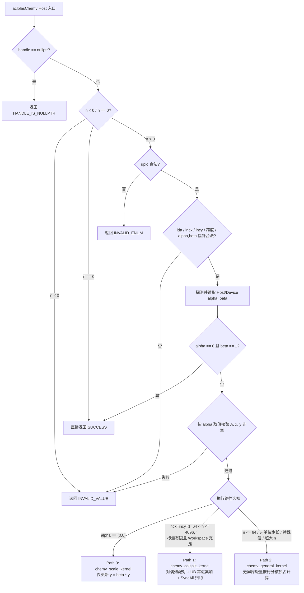

# 需求背景（required）

## 需求来源

本设计面向 CANN 开源社区任务“**11月社区任务-aclblasChemv算子开发（A2A3）**”，依据任务书 `aclblasChemv_AtlasA2_A3_task_doc.md`、随包测试指导与用例集 `test_cases/`（`chemv_test.csv`、`gpu_baseline.csv`、`verify_accuracy.py`、`verify_performance.py`）以及目标开源仓 [`cann/ops-blas`](https://gitcode.com/cann/ops-blas)（基线 commit `5bd95145a9c499e43ebad44a313a1029c63d54bc`）规范编写。

## 背景介绍

### aclblasChemv 算子定位与目标

在昇腾 Atlas A2 / Atlas A3 系列产品（含 Atlas 800T A2 / Atlas 800T A3，对应 `ops-blas` 架构目录 `arch22` / `dav-2201`）上，使用 Ascend C 编程语言采用 **Kernel 直调**方式开发单精度复数（`complex64`）Hermitian 矩阵-向量乘算子 `aclblasChemv`，补齐 `ops-blas` 仓 Level-2 复数 BLAS 能力：

- **公共接口**：在 `include/cann_ops_blas.h` 新增 `aclblasChemv` 声明，与其他产品线共用同一公开 API，不定义架构私有平行接口；
- **算子实现**：位于同族目录 `blas/symv/arch22/`，并在 `blas/symv/README.md` 补充 `aclblasChemv` 接口文档与产品支持矩阵；
- **测试工程**：位于 `test/symv/chemv/arch22/`，并在 `test/symv/chemv/CMakeLists.txt` 的 `arch22` 分支注册 `ops_blas_add_gtest_tests(${OPS_BLAS} chemv_test)`。

### 仓内同族与相关算子现状分析

通过对 `cann/ops-blas` 主干现有实现的调研，相关算子可复用点与差异如下：

| 参考算子 | 可复用工程经验 | 不可直接复用的原因 |
| --- | --- | --- |
| `aclblasSsymv`（`blas/symv/arch22/`） | `handle->stream` 直调框架、`int64` 步长跨度溢出守卫（issue #807）、`ReadScalarFromHostOrDevice` 标量读取 | 1. 实数对称语义（无复数乘加与共轭，无对角虚部置零要求）；<br>2. 采用两阶段双 Kernel 启动 + `SetAtomicAdd<float>()`：在小尺寸（`n=1..16`，A100 基线约 `6.14 μs`）下双 Kernel 下发开销偏高，且 `arch22` 上跨核原子写对非有限值（Inf/NaN）累加顺序及流同步排空存在额外约束 |
| `aclblasCsymv`（`blas/symv/arch35/`） | `ComplexScalarSource` 标量探测思想（issue #869）、参数校验分层结构、GTest 测试组织 | 1. 计算复数**对称**矩阵（`A = A^T`，不取共轭、不忽略对角虚部），与 Hermitian（`A = A^H`）数学定义不同；<br>2. 依赖 `arch35` SIMT/RegBase 特性，不适用于 `arch22`（`dav-2201` AIV SIMD 架构） |
| `aclblasSgbmv`（`blas/gbmv/arch22/`） | `arch22` 单 Kernel 列切分 + UB 累加窗 + `SyncAll()` 跨核屏障 + Workspace 分段折半归约范式，以及将含 `SyncAll` 大矩阵核与小尺寸核分离入口以消除 `~2 μs` 固定屏障开销的实践 | 面向实数带状矩阵，需针对复数 Hermitian 三角列长不均（列长随列号线性变化）、未引用三角禁读与对角虚部置零重新设计 |

因此，`aclblasChemv`（`arch22`）需围绕 Hermitian 复数语义、未引用三角严格禁读、小尺寸低延迟与大尺寸半角带宽上限进行针对性设计。

---

# 需求分析（required）

## 需求描述

实现与 cuBLAS `cublasChemv` 参数序列及 Netlib BLAS `chemv.f` 语义完全一致的单精度复数 Hermitian 矩阵-向量乘接口：

```cpp
aclblasStatus_t aclblasChemv(
    aclblasHandle_t handle,
    aclblasFillMode_t uplo,
    int n,
    const aclblasComplex* alpha,
    const aclblasComplex* A, int lda,
    const aclblasComplex* x, int incx,
    const aclblasComplex* beta,
    aclblasComplex* y, int incy);
```

计算公式：

$$\mathbf{y} \leftarrow \alpha \mathbf{A} \mathbf{x} + \beta \mathbf{y}, \quad \mathbf{A} = \mathbf{A}^H \in \mathbb{C}^{n \times n}$$

### 参数说明与异常行为

| 参数名 | 输入/输出 | 内存位置 | 类型与维度 | 合法范围 | 异常行为 |
| --- | --- | --- | --- | --- | --- |
| `handle` | 输入 | Host | `aclblasHandle_t` | 已创建的有效句柄 | `nullptr` 返回 `ACLBLAS_STATUS_HANDLE_IS_NULLPTR` |
| `uplo` | 输入 | Host | `aclblasFillMode_t` | `{ACLBLAS_UPPER, ACLBLAS_LOWER}` | 非法枚举返回 `ACLBLAS_STATUS_INVALID_ENUM` |
| `n` | 输入 | Host | `int` | `n >= 0`（`n == 0` 为合法 no-op） | `n < 0` 返回 `ACLBLAS_STATUS_INVALID_VALUE` |
| `alpha` | 输入 | Host / Device | `const aclblasComplex*` | 按指针属性运行时探测 | `n > 0` 时 `nullptr` 或属性探测失败返回 `ACLBLAS_STATUS_INVALID_VALUE` |
| `A` | 输入 | Device（只读） | `const aclblasComplex*`，`lda × n` 列主序 | 仅引用 `uplo` 指定三角，对角虚部假定为 0 | `n > 0` 且 `alpha != (0,0)` 时 `nullptr` 返回 `ACLBLAS_STATUS_INVALID_VALUE` |
| `lda` | 输入 | Host | `int` | `lda >= max(1, n)` | 不满足时返回 `ACLBLAS_STATUS_INVALID_VALUE` |
| `x` | 输入 | Device（只读） | `const aclblasComplex*`，长度至少 `1+(n-1)*abs(incx)` | FLOAT32 全集 | `n > 0` 且 `alpha != (0,0)` 时 `nullptr` 返回 `ACLBLAS_STATUS_INVALID_VALUE` |
| `incx` | 输入 | Host | `int` | `incx != 0` 且 `incx != INT32_MIN`，`(n-1)*abs(incx) <= UINT32_MAX` | 不满足时返回 `ACLBLAS_STATUS_INVALID_VALUE` |
| `beta` | 输入 | Host / Device | `const aclblasComplex*` | 按指针属性运行时探测；`beta == (0,0)` 时不读 `y` 旧值 | `n > 0` 时 `nullptr` 或属性探测失败返回 `ACLBLAS_STATUS_INVALID_VALUE` |
| `y` | 输入/输出 | Device（原地覆写） | `aclblasComplex*`，长度至少 `1+(n-1)*abs(incy)` | FLOAT32 全集 | `n > 0` 且非（`alpha == (0,0)` 且 `beta == (1,0)`）时 `nullptr` 返回 `ACLBLAS_STATUS_INVALID_VALUE` |
| `incy` | 输入 | Host | `int` | `incy != 0` 且 `incy != INT32_MIN`，`(n-1)*abs(incy) <= UINT32_MAX` | 不满足时返回 `ACLBLAS_STATUS_INVALID_VALUE` |

## 需求拆解

1. **公共头文件统一声明**：在 `include/cann_ops_blas.h` 声明 `aclblasChemv`，不引入私有接口。
2. **Hermitian 严格访问边界**：仅读取 `uplo` 指定的上三角或下三角；未引用三角与 `lda` 行尾 padding 严禁读取；对角元素虚部假定为 `0` 且不参与计算；输出仅写回 `y` 的逻辑步长位置，不破坏步长间隙元素。
3. **严格参数校验顺序（§2.5）**：`handle` 判空 $\rightarrow$ `n < 0` $\rightarrow$ `n == 0` 直接返回 `SUCCESS` $\rightarrow$ `uplo` / `lda` / `incx` / `incy` / `alpha` / `beta` 校验 $\rightarrow$ 读取标量后判定 `alpha == (0,0) && beta == (1,0)` 直接返回 `SUCCESS` $\rightarrow$ 按标量条件判空 `A` / `x` / `y`。
4. **双位置标量与特殊值语义**：`alpha`、`beta` 同时支持 Host 与 Device 指针；`alpha == (0,0)` 时不读 `A`/`x`（允许为空）；`beta == (0,0)` 时不读 `y` 旧值（允许旧 `y` 含 `NaN`，但 `y` 指针仍须非空）；`beta == (1,0)` 时直接保留旧 `y` 而不做复数乘 `(1,0)`（避免旧 `y` 含 `Inf` 时产生 `0 * Inf = NaN`）。
5. **精度达标**：以 Netlib BLAS 3.10.0 `cblas_chemv`（`CblasColMajor`）为唯一标杆，实部、虚部分别满足 FLOAT32 生态混合容差标准（`atol = rtol = 2^-13`，有限值 `matched_ratio >= 0.99` 且 `max_abs_error <= max(1e-2, 32*ULP)`，非有限值 100% 满足等效规则）。
6. **性能达标**：在 Atlas 800T A2（Ascend 910B3）上，200 条性能用例平均单次耗时 $\le 1.25 \times$ NVIDIA A100 基线耗时（即达到标杆 `0.8x` 及以上性能）。
7. **自测用例补齐**：完整保留随包 1000 条精度 + 200 条性能用例，并基于框架 `GAUSS_NORM_5_2` 补齐正态分布（$\mu \in [-5,5], \sigma \in [0.1,2]$）用例纳入精度自验证。

---

# 详细设计（required）

## 算子分析

### 数学公式

设 $\mathbf{A} \in \mathbb{C}^{n \times n}$ 按列主序存储于前导维为 $\text{lda}$ 的数组中（元素 $(i, j)$ 物理偏移为 $i + j \cdot \text{lda}$）。Hermitian 性质满足：

$$A_{i,j} = \begin{cases} \operatorname{Re}(a_{i + j \cdot \text{lda}}) + 0\mathrm{i}, & i = j \\ a_{i + j \cdot \text{lda}}, & (uplo = \text{UPPER} \land i < j) \lor (uplo = \text{LOWER} \land i > j) \\ \overline{a_{j + i \cdot \text{lda}}}, & (uplo = \text{UPPER} \land i > j) \lor (uplo = \text{LOWER} \land i < j) \end{cases}$$

与 Netlib `chemv.f` 一致，按存储列 $j \in [0, n)$ 单趟遍历已存储三角时，列 $j$ 对输出 $\mathbf{y}$ 的贡献可分解为三部分（记 $t_1 = \alpha x_j$，$d_j = \operatorname{Re}(a_{j + j \cdot \text{lda}})$）：

1. **列内连续矢量乘加（AXPY 项）**：对列 $j$ 内所有严格非对角行 $i \in \mathcal{S}_j$（`UPPER` 为 $[0, j)$，`LOWER` 为 $(j, n)$）：
   $$\Delta y_i^{(j)} = t_1 \cdot a_{i + j \cdot \text{lda}}$$
2. **列内共轭内积（Dot 项）**：同一批已读入 UB 的列元素取共轭后与对应 $x_i$ 做内积：
   $$t_2^{(j)} = \sum_{i \in \mathcal{S}_j} \overline{a_{i + j \cdot \text{lda}}} \cdot x_i = \sum_{i \in \mathcal{S}_j} \left[(a_r x_r + a_i x_i) + \mathrm{i}(a_r x_i - a_i x_r)\right]$$
3. **对角实数项与列归约累加**：
   $$\Delta y_j^{(j)} = t_1 \cdot d_j + \alpha \cdot t_2^{(j)}$$

全体列 $j = 0, \dots, n-1$ 的 $\Delta \mathbf{y}^{(j)}$ 求和再加上 $\beta \mathbf{y}_{\text{old}}$ 即得最终 $\mathbf{y}$。该分解使**存储三角中的每个矩阵元素仅从 HBM 连续读取一次**，同时完成直接项与共轭对称项计算。

### 支持数据类型

- 矩阵 `A`、向量 `x`、`y`、标量 `alpha`、`beta`：`aclblasComplex`（`complex64`，实部 `real` 与虚部 `imag` 各为 `float32`）；
- 维度与步长 `n`、`lda`、`incx`、`incy`：`int`（内部偏移运算统一提升至 `int64_t` / `uint64_t`）；
- 核内累加与标量运算精度：全程 `FP32`。

### 支持形状与步长

- 矩阵 `A`：`n × n` 方阵，`n >= 0`，列主序 `lda >= max(1, n)`（紧凑或带行尾 padding）；
- 向量 `x`、`y`：逻辑长度 `n`，支持任意非零正/负步长（`incx != 0, incy != 0`，负步长从 `(n - 1) * |inc|` 反向索引：逻辑下标 $k$ 对应物理元素偏移 $k \cdot \text{inc}$ 当 $\text{inc} > 0$，或 $(n - 1 - k) \cdot |\text{inc}|$ 当 $\text{inc} < 0$）。

### 硬件特性与带宽屋脊分析（Atlas A2 / A3 `arch22`）

以性能基准设备 Atlas 800T A2（Ascend 910B3，40 个 AIV 核，单 AIV UB 容量 `192 KiB`，FP32 矢量单 repeat 处理 64 个 `float`）分析典型规模：

| 规模 `n` | 全矩阵字节 `8n^2` | 单三角字节 `4n(n+1)` | A100 基线 (`μs`) | 验收上限 `1.25×` (`μs`) | 设计路径与瓶颈特征 |
| --- | --- | --- | --- | --- | --- |
| `1 ~ 64` | `8 B ~ 32 KiB` | `8 B ~ 16.3 KiB` | `6.14 ~ 7.59` | `7.68 ~ 9.49` | **下发延迟主导**：必须采用单次轻量 Kernel（不含 `SyncAll`），消除双阶段启动与跨核屏障开销 |
| `512` | `2.00 MiB` | `1.00 MiB` | `14.64` | `18.30` | L2 Cache / HBM 过渡区：适度分核 + 单趟三角连续读取 |
| `1024` | `8.00 MiB` | `4.00 MiB` | `18.77 ~ 21.11` | `23.47 ~ 26.39` | HBM 带宽与矢量吞吐均衡区：对偶列配对满核并行 |
| `2048` | `32.00 MiB` | `16.01 MiB` | `30.09 ~ 37.48` | `37.61 ~ 46.85` | **HBM 带宽主导**：单趟读半角仅 `16 MiB`（双读则翻倍至 `32 MiB`） |
| `4096` | `128.00 MiB` | `64.02 MiB`（`67.12 MB`） | `65.30 ~ 73.06` | `81.62 ~ 91.33` | **HBM 带宽决胜区**：单趟读半角 `67.12 MB` 按 ~1.25 TB/s 估算约 `53.7 μs`（满足 `< 81.62 μs`）；若按行双读全量元素（`134.2 MB`）仅搬运即超 `105 μs` |

关键洞察：性能用例上限 `n = 4096` 时，整条复数向量 `x` 与单核局部累加向量 `w` 各仅占 `4096 × 8 B = 32 KiB`，两者合计仅 `64 KiB`，可**完整常驻于单 AIV 的 `192 KiB` UB 中**，无需在列循环中途读写 GM。

## 算子实现

### 实现方案



#### 3.2.1 Host 侧设计

##### 1. 参数校验与快速返回顺序

Host 侧严格遵循任务书 §2.4 与 §2.5 规定的先后次序：

1. `handle == nullptr`：返回 `ACLBLAS_STATUS_HANDLE_IS_NULLPTR`（最高优先级，早于 `uplo` 与 `n`）。
2. `n < 0`：返回 `ACLBLAS_STATUS_INVALID_VALUE`。
3. `n == 0`：合法空操作，不检查后续任何枚举、维度、步长或指针，直接返回 `ACLBLAS_STATUS_SUCCESS`。
4. `uplo != ACLBLAS_UPPER && uplo != ACLBLAS_LOWER`：返回 `ACLBLAS_STATUS_INVALID_ENUM`（早于 `alpha`/`beta` 空指针检查）。
5. 维度与步长范围检查：`lda < std::max(1, n)`、`incx == 0`、`incy == 0`、`incx == INT32_MIN`、`incy == INT32_MIN` 时返回 `ACLBLAS_STATUS_INVALID_VALUE`；以 `int64_t` 计算 `spanX = int64_t(n - 1) * |incx|`、`spanY = int64_t(n - 1) * |incy|`，超出 `UINT32_MAX` 时返回 `ACLBLAS_STATUS_INVALID_VALUE`（对齐仓内 `ssymv` issue #780/#807）。
6. `alpha == nullptr || beta == nullptr`：返回 `ACLBLAS_STATUS_INVALID_VALUE`。
7. 标量双位置探测与读取（对齐 issue #869）：通过 `ReadScalarFromHostOrDevice`（内部调用 `aclrtPointerGetAttributes`）判定 `alpha`、`beta` 位于 Host 或 Device；Host 指针直接解引用快照，Device 指针在 `handle->stream` 上异步 D2H 拷贝并流同步取得标量值。
8. 标量级快速返回：若 `alpha == (0,0)` 且 `beta == (1,0)`，无需校验 `A`、`x`、`y` 是否为空，直接返回 `ACLBLAS_STATUS_SUCCESS`。
9. 数据指针条件判空：若 `alpha != (0,0)` 且 `(A == nullptr || x == nullptr)` 返回 `ACLBLAS_STATUS_INVALID_VALUE`；若 `y == nullptr` 返回 `ACLBLAS_STATUS_INVALID_VALUE`（`beta == (0,0)` 不豁免 `y` 非空）。

##### 2. 分核策略与三路径调度

通过 `GetAivCoreCount()` 动态查询当前设备可用 AIV 核数 $C$（不硬编码核数），按输入特征选择最优单次 Kernel 启动路径：

| 路径 | 触发条件 | 核函数入口 | 分核策略 `useCoreNum` | Workspace 需求 |
| --- | --- | --- | --- | --- |
| **Path 0（纯缩放/清零）** | `alpha == (0,0)` 且 `beta != (1,0)` | `chemv_scale_kernel` | `min(C, CeilDiv(n, 256))` | `0 B` |
| **Path 1（连续对偶列快路径）** | `incx == 1 && incy == 1 && 64 < n <= 4096`、`alpha/beta` 有限、有效 Workspace 充足 | `chemv_colsplit_kernel` | 对偶列对数 $P = \lceil n/2 \rceil$：<br>- $64 < n \le 128$: `min(C, 4)`<br>- $128 < n \le 512$: `min(C, CeilDiv(n, 32))`<br>- $512 < n \le 4096$: `min(C, P)` | `useCoreNum * 2 * CeilAlign(n, 64) * 4 B`（`n=4096, K=40` 时仅 `1.31 MiB`，远小于 handle 默认预分配的 `32 MiB`，零运行时 `aclrtMalloc`） |
| **Path 2（轻量通用核）** | `n <= 64`、非单位步长、`alpha/beta` 含非有限值、`n > 4096` 或用户自定义 Workspace 不足 | `chemv_general_kernel` | `n <= 32` 取 `1`（极致压低单核启动延迟）；`n > 32` 取 `min(C, CeilDiv(n, 16))` | `0 B` |

**首尾对偶列均衡配对原理（Path 1）**：
在三角矩阵中，第 $j$ 列的非对角元素数为 $j$（`UPPER`）或 $n - 1 - j$（`LOWER`），单列长度从 $0$ 到 $n-1$ 线性倾斜。若按连续列区间切分，首核与末核负载相差可达数十倍。本方案将列 $j$ 与列 $n - 1 - j$ 组成**对偶列对** $p \in [0, \lfloor n/2 \rfloor)$：每一对的非对角元素总数恒为 $j + (n - 1 - j) = n - 1$（当 $n$ 为奇数时，中心列 $j = \lfloor n/2 \rfloor$ 单独分配给末核）。将 $P$ 个等权列对按商余均匀分配给 $K$ 个 AIV 核，各核处理的矩阵元素数严格均衡于 $\approx \frac{n(n-1)}{2K}$。

##### 3. Tiling 结构设计

```cpp
struct ChemvTilingData {
    uint32_t n;
    uint32_t lda;
    uint32_t useCoreNum;
    uint32_t uplo;          // ACLBLAS_UPPER or ACLBLAS_LOWER
    uint32_t strideFloats;  // Path 1 单核 workspace 平面跨度（CeilAlign(n, 64)）
    uint32_t mode;          // 0: scale-only, 1: colsplit fast, 2: general row-owner
    float alphaReal;
    float alphaImag;
    float betaReal;
    float betaImag;
    int64_t incx;
    int64_t incy;
};
```

#### 3.2.2 Kernel 侧设计

##### 1. UB 内存规划与容量核算（Path 1，`arch22` 单 AIV `192 KiB`）

设 $N_{\text{pad}} = \operatorname{CeilAlign}(n, 64) \le 4096$。Path 1 在单核 UB 内规划如下静态对齐缓冲区：

| 缓冲区名称 | 元素规模（`float`） | 最大字节数（`n=4096`） | 生命周期与复用关系 |
| --- | --- | --- | --- |
| `xRe` / `xIm` | `4096 + 4096` | `32 KiB` | Init 阶段载入 `x` 并奇偶分离后全程只读常驻 |
| `wRe` / `wIm` | `4096 + 4096` | `32 KiB` | 全程常驻累加本核负责列的 $\Delta \mathbf{y}$ 实部与虚部 |
| `aPing` / `aPong` | `8192 + 8192` | `64 KiB` | 列流式阶段作为矩阵列交织数据双缓冲（MTE2 与 V 流水重叠）；`SyncAll` 后复用为多核 Workspace 归约缓冲 |
| `aRe` / `aIm` | `4096 + 4096` | `32 KiB` | 当前列的实部/虚部分离平面；`SyncAll` 后复用为 `y` 搬入与奇偶交织输出缓冲 |
| `scratch`（`t0`/`t1`/`diag`） | `4096 + 4096` | `32 KiB` | Init 阶段暂存交织 `x`；列计算阶段用于共轭内积临时缓冲与 `ReduceSum` workLocal |
| **合计峰值** | **40,960 floats** | **`160 KiB`** | **小于 `arch22` 硬件 UB 上限 `192 KiB`，预留 `32 KiB` 余量** |

##### 2. 未引用三角零读取与 32B 地址对齐设计

`arch22` 矢量指令要求所有 `LocalTensor` 起始地址满足 **32 字节（8 个 `float`）对齐**，且测试会对未引用三角及对角元虚部注入 `NaN`/`Inf` 毒化值。Path 1 对 `UPPER` 与 `LOWER` 分别采用零越界对齐搬运：

- **`ACLBLAS_UPPER`（列 $j$ 有效区间为行 $[0, j-1]$ 及对角实部 $\operatorname{Re}(A_{j,j})$）**：
  - 矩阵第 $j$ 列起始偏移 `colGmOff = j * lda * 2`；
  - 对角实部位于偏移 `(j * lda + j) * 2`（紧邻非对角段末尾，而对角虚部在 `+1` 处）；
  - 使用单次 `DataCopyPad` 精确读取 `(2 * j + 1) * sizeof(float)` 字节至 32B 对齐的 `aSlot[0]`，硬件右侧补零；绝不读取 `A[j,j].imag` 及任何 `row > j` 的下三角内存；
  - 从 `aSlot.GetValue(2 * j)` 取出 `d_j` 后，将 `aSlot[2 * j]` 置零，再用 `GatherMask`（模式 1 与模式 2）将前 `2 * j` 个交织元素分离至 `aRe[0..j-1]`、`aIm[0..j-1]`；此时 `wRe[0]`、`xRe[0]` 天然位于偏移 `0`（32B 对齐）。
- **`ACLBLAS_LOWER`（列 $j$ 有效区间为对角实部 $\operatorname{Re}(A_{j,j})$ 及严格下三角行 $[j+1, n-1]$）**：
  - 对角实部通过 `DataCopyPad`（`blockLen = 4 B`）单独读入 32B 对齐的 `diagSlot`（跳过偏移 `+1` 处的 `A[j,j].imag`）；
  - 对严格下三角行 $[j+1, n-1]$（长度 `len = n - 1 - j` 个复数），令向下 8 对齐基址 `base8 = ((j + 1) / 8) * 8`，前置复数偏移 `headPad = (j + 1) - base8`（取值 `0..7`）；
  - 拆分为块对齐偏移 `slotBlockOff = (headPad >= 4) ? 8 : 0`（32B 对齐）与硬件左补零 `leftPadFloats = 2 * headPad - slotBlockOff`（取值 `{0, 2, 4, 6}`，严格小于单块上限 8）：当 `slotBlockOff == 8` 时先清零 `aSlot[0..7]`，随后 `DataCopyPad` 以 `leftPaddingNum = leftPadFloats` 将 `aGM[(j * lda + j + 1) * 2]` 起的 `2 * len` 个 `float` 搬入 `aSlot[slotBlockOff]` 并右侧补零；
  - 经 `GatherMask` 奇偶分离后，`aRe` 与 `aIm` 前 `headPad` 个元素恒为 `0.0f`，有效数据精确对齐于 `[headPad, headPad + len)`，从而可直接与 **32B 对齐**的 `wRe[base8]`、`wIm[base8]`、`xRe[base8]`、`xIm[base8]` 执行全矢量 `Axpy` 与 `Mul` + `ReduceSum`，既不触碰任何上三角元素，又消除软件移位表开销。
- **非有限值安全守卫**：若运行期检测到输入 `x` 含 `Inf`/`NaN`（避免前置补零 `0.0f * Inf` 产生伪 `NaN`），核内自动切换至精确有效长度逐列标量安全累加分支，严格保持 IEEE 754 传播语义。

##### 3. 双缓冲列流水与 `SyncAll` 并行折半归约

1. **列流式阶段**：预取首个有效列至 `aPing` 后进入主循环——下一列 MTE2 `DataCopyPad` 写入 `aPong` 与当前列 `aPing` 的 `GatherMask` 分离、`Axpy`（更新 `wRe`/`wIm`）、`Mul + ReduceSum`（计算 `temp2`）流水并行，通过 `MTE2_V` / `V_MTE2` 硬件事件同步。
2. **局部结果写出与跨核屏障**：列循环结束后，各核将 `wRe[0..N_pad)` 与 `wIm[0..N_pad)` 连续写入 `workspace` 对应核切片，执行 `PipeBarrier<PIPE_ALL>()` 与 `AscendC::SyncAll()`（`KERNEL_TYPE_AIV_ONLY` 硬件跨核同步）。
3. **多核并行分段归约与 `beta` 融合写回**：将 `[0, n)` 按 `RC = 256` 切分为若干行块并均分给 $K$ 个 AIV 核；每个核用 2D 跨步 `DataCopy` 一次读入全部 $K$ 个核在该行块的局部实部/虚部，在 UB 内做二次幂树形折半 `Add` 归约；随后按 `beta` 三态融合：
   - `beta == (0,0)`：不读取旧 `y`，直接交织写出归约结果；
   - `beta == (1,0)`：读取旧 `y` 直接相加，不做乘法（保护旧 `y` 中的 `Inf` 分量）；
   - 一般 `beta`：读取旧 `y` 计算复数乘积 `beta * y` 后与归约结果相加，经交织合并后 `DataCopyPad` 精确写回 `n` 个输出复数元素。

##### 4. Path 2 轻量通用核设计（`chemv_general_kernel`）

面向小尺寸（`n <= 64`）、任意正负步长（`incx/incy != 0`）、特殊非有限值标量及 `n > 4096` 分块场景：
- 独立 `__global__ __aicore__` 入口，不包含 `SyncAll()`，确保 `n = 1..64` 下发与执行总耗时控制在数微秒级；
- 将逻辑输出行 $[0, n)$ 互不重叠地分配给各活跃 AIV 核，每行由唯一核独占计算并原地写回 `y[YPhysicalPos(row)]`，无需 Workspace 与原子操作；
- 严格按 Netlib `chemv.f` 顺序读取合法三角与对角实部（跳过对角虚部与未引用三角），保证任意负步长、大 `lda` padding 及 `Inf`/`NaN` 场景 100% 精确。

---

## 支持硬件

| 支持的芯片版本 | 涉及勾选 |
| --- | --- |
| Atlas A2 训练系列产品 / Atlas A2 推理系列产品（含 Atlas 800T A2 / Ascend 910B3） | √ |
| Atlas A3 训练系列产品 / Atlas A3 推理系列产品（含 Atlas 800T A3） | √ |

## 算子约束限制

1. 维度与步长：`n >= 0`，`lda >= max(1, n)`，`incx != 0` 且 `incx != INT32_MIN`，`incy != 0` 且 `incy != INT32_MIN`，`(n - 1) * |incx| <= UINT32_MAX`，`(n - 1) * |incy| <= UINT32_MAX`。
2. 三角与对角约束：仅引用 `uplo` 指定的上三角或下三角，未引用部分不读取；对角元素虚部假定为 `0`，不参与计算。
3. 内存别名约束：不支持 `y` 与输入 `A`、`x` 存在内存重叠别名。
4. 异步流语义：Kernel 异步下发至 `handle` 绑定的 `aclrtStream`（当 `alpha` 或 `beta` 为 Device 指针时，Host 侧在该 stream 上同步读取标量后再下发计算 Kernel）；调用方在 Host 读取输出 `y` 前须同步该 stream。

---

# 可维可测分析

## 精度标准/性能标准

| 验收维度 | 判定标准与采集方法 | 标准来源 |
| --- | --- | --- |
| **精度标杆** | Netlib BLAS 3.10.0 `cblas_chemv`（`CblasColMajor`）单标杆比对；输入矩阵对角虚部置 0、仅取 `uplo` 指定三角，输出向量 `y` 全逻辑长度（`n` 元素）实部与虚部分别独立校验 | 任务书 §3.2 |
| **有限值容差** | 按 FLOAT32 标准：`atol = 2^-13 (≈1.2207e-4)`，`rtol = 2^-13 (≈1.2207e-4)`；逐元素满足 `\|actual - golden\| <= atol + rtol * \|golden\|` 的比例 `matched_ratio >= 0.99`，且最大绝对误差 `max_abs_error <= max(1e-2, 32 * ULP)` | 任务书 §3.2、生态算子混合容差标准 |
| **Inf/NaN 规则** | `golden` 与 `actual` 同为 `NaN`、同为同号 `Inf`，或一方为 `NaN` 另一方为 `±Inf` 视为等效通过；一方有限另一方非有限判失败；非有限值不计入 `matched_ratio` 与 `max_abs_error`，须 100% 满足等效规则 | 任务书 §3.2 |
| **性能标准** | 基准设备 Atlas 800T A2 (910B3)，对标 `test_cases/gpu_baseline.csv`（NVIDIA A100 实测基线）；200 条 `TC_PF` 用例每条平均单次耗时 `<= 1.25 × GPU 基线`（即 `ratio = baseline / npu >= 0.8`）。同时满足 `msprof op`（5 次 warmup 后连续 `>= 10` 次有效采样取 `OpBasicInfo.csv` `Task Duration(us)` 均值）与 `verify_performance.py`（GTest `[PERF] avg_us=` 事件均值）双口径验证 | 任务书 §3.3、随包测试指导 |
| **内存标准** | 不涉及（测试工程额外附带输入缓冲只读校验、未引用三角与对角虚部 `NaN` 毒化守卫、输出步长间隙与前后哨兵未改写校验） | 任务书 §3.4 |

## 兼容性分析

- 本任务为补齐 `ops-blas` 仓缺失算子，在 `include/cann_ops_blas.h` 新增标准 `aclblasChemv` C 接口声明，与 `aclblasSsymv` / `aclblasCsymv` 风格一致，不影响存量算子 ABI 与源码兼容性；
- `test/symv/chemv/CMakeLists.txt` 在 `arch22` 与 `arch35` 分支均启用 `ops_blas_add_gtest_tests(${OPS_BLAS} chemv_test)`，兼容单算子构建（`bash build.sh --soc=ascend910b --ops=chemv`）与全仓合并测试 `blas_all_test`。

## 自测与用例覆盖方案

1. **随包基础集（1200 条）**：`chemv_test.csv` 含 1000 条精度用例（`TC_L0` 基础、`TC_SQ` 尺寸扫描、`TC_AB` 复数标量、`TC_LD` padding、`TC_INC` 正负步长全组合、`TC_FL` 零/交替/极值/Inf/NaN、`TC_CV` 中尺寸、`TC_ED` 30 条快速返回与负向错误码边界、`TC_EX` 780 条扩展组合）与 200 条性能用例（`TC_PF`，`n ∈ [1, 4096]`）。
2. **正态分布补充集（`chemv_gauss_supplement.csv`）**：针对任务书 §3.5“随包 `gen_csv.py` 默认仅生成均匀分布 `RANDOM_NORM_5_5`，需补充 `GAUSS_NORM_5_2` 正态分布用例”的要求，复用 `test/frame/fill.h` 原生 `GAUSS_NORM_5_2`（$\mu \in [-5,5], \sigma \in [0.1,2]$），单独构建正态分布补充 CSV 并在 `chemv_test.cpp` 注册独立参数化测试套件，覆盖 `UPPER/LOWER`、尺寸扫描（`1..2048`）、复数标量正态采样、`lda` padding 与正负步长组合。
3. **负向与安全专项测试**：
   - 期望非 `SUCCESS` 或 `n == 0` 的负向/快速返回用例均使用单元素占位缓冲或 `NULLPTR`（防止 `INT32_MIN` 或 `2147483647` 大跨度触发数百 GB 内存分配失败）；
   - 专项单测覆盖 `handle == nullptr` 最先判定、Host/Device 标量异步流读取与快速返回、`beta == (1,0)` 保留 `Inf` 分量、比较器特殊值边界。
