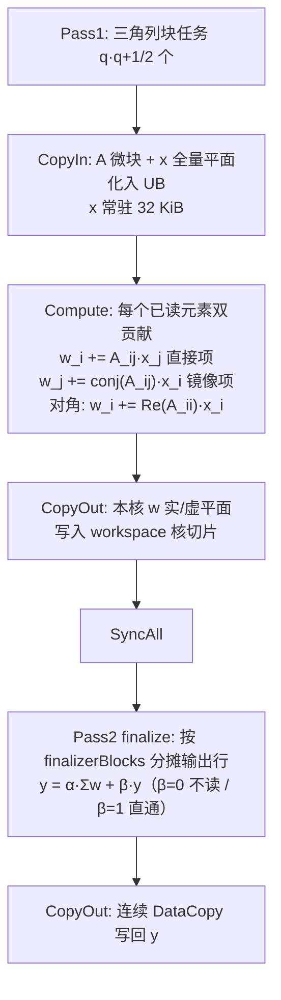

# aclblasChemv 算子设计文档（Atlas A2/A3）

提交位置：`cann/cann-competitions` 的 `04_tasks/01_community-task-2026/tasklist/11月社区任务-aclblasChemv算子开发（A2A3）/Nebulamao/docs/design.md`。

结构遵循社区模板 `04_tasks/01_community-task-2026/resources/design_template.md`，文末附 CheckList 对照。

# 需求背景（required）

## 需求来源

本需求来自 2026 年 11 月 CANN 社区任务《aclblasChemv 算子开发（A2/A3）》。

- 任务名称：11月社区任务-aclblasChemv算子开发（A2/A3）
- 实现仓：https://gitcode.com/cann/ops-blas （调研基线 commit `28de164d1becd69b1ca380e70bf2fbbcc907fec8`，即 aclblasCsymv A2/A3 合入后的主干）
- 设计文档仓：https://gitcode.com/cann/cann-competitions
- 验收依据：随任务发布的任务书 `aclblasChemv_AtlasA2_A3_task_doc.md` 与 `test_cases/` 自测用例包（`chemv_test.csv` 1200 条、`gpu_baseline.csv` 200 条、`gen_csv.py`、`verify_accuracy.py`、`verify_performance.py`）
- 对标接口：cuBLAS `cublasChemv`
- 语义来源：Netlib BLAS `chemv.f`，https://www.netlib.org/blas/chemv.f
- 精度标准：`cann/opbase` 的混合容差标准 `mixed_tolerance_standard.md`

## 背景介绍

### aclblasChemv 算子定位

`aclblasChemv` 完成单精度复数 Hermitian 矩阵-向量乘加：`y = alpha * A * x + beta * y`，A = A^H，按列主序存放于 `lda × n` 数组，只读取 `uplo` 指定的三角；另一三角按共轭对称补全，对角虚部不参与计算。用于复数线性代数计算，补齐 ops-blas 仓 BLAS Level-2 复数能力。

CANN 工具链内置 TBE 目录（`opp/built-in/op_impl/ai_core/tbe/impl`）与 aclnn 算子库中均无本接口；任务书指定形态为 ops-blas 句柄式 kernel 直调（非 TBE/aclnn 原型），标杆为 cuBLAS `cublasChemv` 与 Netlib `chemv.f`。

### 仓内现状与同族算子分析

基线 commit 下，`include/cann_ops_blas.h` 已有 `aclblasSsymv`/`aclblasCsymv` 声明、无 `aclblasChemv`；`blas/symv/arch22/` 已有实数 ssymv 与复对称 csymv；`test/symv/` 下无 chemv 测试目录。

| 参考算子 | 可复用工程经验 | 不能直接复用的原因 |
| --- | --- | --- |
| `aclblasCsymv`（`blas/symv/arch22/`，最新合入） | host 校验分层、`ComplexScalarSource` 标量双读取（issue #869）、路由/tiling 组织、kernel 平面化复数乘加、Gather 步长搬运、β=0/β=1 特判 | 计算复数**对称**矩阵（A = A^T，无共轭），不忽略对角虚部；Hermitian 需镜像共轭 + 对角仅实部 |
| `aclblasSsymv`（`blas/symv/arch22/`） | `int64` 步长跨度溢出守卫（issue #807）、INT32_MIN 拒绝（issue #780） | 实数语义，无复数乘加与共轭 |
| `aclblasCsymv`（`blas/symv/arch35/`） | arch35 的 GTest 测试组织 | 依赖 arch35 特性，arch22 为 DAV_2201 AIV 架构 |

# 需求分析（required）

## 需求描述

在 `cann/ops-blas` 中新增与其他产品线共用的 `aclblasChemv`，使用 Ascend C 在 arch22 覆盖 Atlas A2/A3。参数顺序、列主序、三角引用、共轭对称、对角虚部、正负步长、Host/Device 标量、短路语义与 cuBLAS `cublasChemv` 一致；精度按 FLOAT32 混合容差对实部/虚部分别判定；性能以 Atlas 800T A2（910B3）msprof task duration 不超过 GPU 标杆 1.25 倍为口径。

```cpp
aclblasStatus_t aclblasChemv(
    aclblasHandle_t handle,
    aclblasFillMode_t uplo,
    int n,
    const aclblasComplex* alpha,
    const aclblasComplex* A, int lda,
    const aclblasComplex* x, int incx,
    const aclblasComplex* beta,
    aclblasComplex* y, int incy);
```

### 参数契约

| 参数 | 内存及形状 | 语义与约束 | 异常行为 |
| --- | --- | --- | --- |
| handle | Host 句柄 | 已创建，携带 stream | nullptr → `HANDLE_IS_NULLPTR` |
| uplo | Host 枚举 | `ACLBLAS_UPPER` / `ACLBLAS_LOWER` | 其他 → `INVALID_ENUM` |
| n | Host int | `n ≥ 0`，n=0 合法 no-op | n<0 → `INVALID_VALUE` |
| alpha、beta | Host 或 Device 标量指针 | complex64，按指针属性探测（不假设两者同位置） | n>0 时 nullptr → `INVALID_VALUE` |
| A | Device，列主序 `lda×n`，只读 | 仅引用 uplo 三角，对角虚部假定为 0 | α≠(0,0) 且 n>0 时 nullptr → `INVALID_VALUE` |
| lda | Host int | `lda ≥ max(1,n)` | 不满足 → `INVALID_VALUE` |
| x | Device，逻辑 n 元素 | 物理容量 ≥ 1+(n−1)·\|incx\| | 同 A |
| incx、incy | Host int | ≠0、≠INT32_MIN；(n−1)·\|inc\| 以 int64 校验 | 违反 → `INVALID_VALUE` |
| y | Device，原地覆写 | β=(0,0) 不读旧值但不豁免非空 | n>0 且非（α=(0,0)∧β=(1,0)）时 nullptr → `INVALID_VALUE` |

## 需求拆解

1. **公共头文件声明**：`include/cann_ops_blas.h` 新增唯一声明，禁止私有平行 API。
2. **Hermitian 严格访问边界**：仅读取 uplo 三角与对角实部，未引用三角及对角虚部严禁读取；输出仅写 y 的逻辑步长位置，不破坏步长间隙元素。
3. **校验顺序（任务书 §2.5）与短路**：n=0、α=(0,0)∧β=(1,0) 快速返回；α=(0,0) 退化 y=β·y；β=(1,0) 直通旧 y 避免 0×Inf。
4. **工程落位**：`blas/symv/arch22/` 三个源文件 + arch22 CMake 注册；新建 `test/symv/chemv/`（CMakeLists + arch22 GTest + CSV），补齐 `ops_blas_add_gtest_tests(${OPS_BLAS} chemv_test)`。
5. **精度达标**：`cblas_chemv`（Netlib CBLAS 3.10.0，CblasColMajor）单标杆，实/虚部按 FLOAT32 混合容差（atol=rtol=2⁻¹³，matched_ratio ≥ 0.99，max_abs_error ≤ max(1e-2, 32 ULP)），Inf/NaN 按等效规则。
6. **性能达标**：200 条 TC_PF 用例，msprof op task duration 平均 ≤ 1.25× A100 基线（gpu_baseline.csv）。
7. **自测用例补齐**：保留随包 1200 条，补齐正态分布（μ∈[−5,5]、σ∈[0.1,2]，`GAUSS_NORM_5_2`）用例并纳入精度自验证，补齐方式与数量在自测报告说明。

# 详细设计（required）

## 算子分析

### 数学公式

记列主序地址 `A(i,j) = A[i + j*lda]`，逻辑 Hermitian 矩阵 B 与步长映射：

```text
stored(i,j) = (uplo == UPPER ? i <= j : i >= j)
B(i,i) = real(A(i,i))                                  // 对角仅实部
B(i,j) = stored(i,j) ? A(i,j) : conj(A(j,i))            // i ≠ j，镜像取共轭
pos(k) = inc > 0 ? k*inc : (n-1-k)*(-inc)               // 负步长从物理末端起算
y[pos(i)] = alpha * Σ_j B(i,j) * x[pos(j)] + beta * y_old[pos(i)]
```

非对角有效元素读写规则（0-based）：

| 存储模式 | 条件 | B(i,j) 取值 |
| --- | --- | --- |
| UPPER | i < j | A[i+j·lda]（直接项） |
| UPPER | i > j | conj(A[j+i·lda])（镜像项） |
| LOWER | i > j | A[i+j·lda]（直接项） |
| LOWER | i < j | conj(A[j+i·lda])（镜像项） |
| 两种 | i = j | real(A[i+i·lda]) |

复数乘平面展开（a=(ar,ai)，x=(xr,xi)）：

```text
直接乘：a·x   = (ar·xr − ai·xi,  ar·xi + ai·xr)     // 4 Mul + Sub + Add
共轭乘：ā·x   = (ar·xr + ai·xi,  ar·xi − ai·xr)     // 加减交换即可实现 conj，无需显式取负
```

地址乘加与 `(n−1)·|inc|` 跨度全部提升 int64，避免 32 位先溢出。

### 支持数据类型与形状

- 数据：`aclblasComplex`（complex64，实/虚各 float32，定义见 `cann_ops_blas_common.h`）；核内累加 FP32。
- 形状：A 为 n×n（n 运行时入参，n ≥ 0），列主序 lda×n；x/y 逻辑长度 n，带符号步长；无广播、无视图返回、不要求确定性归约。

### 规模与带宽屋脊分析（性能基准设备 910B3：40 AIV，单核 UB 192 KiB）

| 规模 n | 全矩阵 8n² | 单三角 4n(n+1) | A100 基线 (μs) | 验收上限 1.25× (μs) | 特征 |
| --- | --- | --- | --- | --- | --- |
| 1~64 | ≤32 KiB | ≤16 KiB | 6.14~7.59 | 7.7~9.5 | 下发延迟主导：轻量单 kernel，无 SyncAll |
| 512 | 2.0 MiB | 1.0 MiB | 14.64 | 18.30 | L2/HBM 过渡区：适度分核 |
| 1024 | 8.0 MiB | 4.0 MiB | 21.11 | 26.39 | 均衡区 |
| 2048 | 32.0 MiB | 16.0 MiB | 30.09 | 37.61 | HBM 带宽主导 |
| 4096 | 128.0 MiB | 64.0 MiB | 65.30 | 81.62 | 带宽决胜：单趟读三角约需 0.82 TB/s；若按行双读全量（128 MiB）仅搬运即超限，**必须单趟三角读 + 元素双贡献** |

关键洞察：n=4096 时 x 全量平面仅 2×4096×4B = 32 KiB，可常驻 UB；每个已读入的三角元素同时完成直接项与共轭镜像项两次贡献，矩阵数据只从 HBM 读一次。

## 算子实现

### 实现方案

调用方式为 kernel 直调：`aclblasChemv` 使用 handle 上由 `aclblasSetStream` 绑定的 stream，一次调用启动一个 AIV kernel；读回 Device 结果前由调用者同步 stream。

```mermaid
flowchart TD
    A[aclblasChemv Host 入口] --> B{handle 空?}
    B -- 是 --> E1[HANDLE_IS_NULLPTR]
    B -- 否 --> C{n<0 / n=0?}
    C -- n<0 --> E2[INVALID_VALUE]
    C -- n=0 --> S0[SUCCESS 直接返回]
    C -- n>0 --> D{uplo / lda / inc / 跨度 / 标量指针合法?}
    D -- 否 --> E2 / E3[INVALID_ENUM]
    D -- 是 --> G[探测并读取 Host/Device alpha,beta]
    G --> H{α=0 且 β=1?}
    H -- 是 --> S0
    H -- 否 --> I{按 α 取值判空 A/x/y}
    I -- 失败 --> E2
    I -- 通过 --> J{路由}
    J -- "α=(0,0)" --> K0[缩放核: y = β·y]
    J -- "incx=incy=1, 16≤n≤4096, workspace 足够" --> K1[快速路径: 三角块两遍法]
    J -- "小 n / 带步长 / 超大 n" --> K2[通用路径: 行级两段累积]
```

#### host 侧设计

**1. 参数校验与快速返回（顺序纳入测试）**

1. `handle == nullptr` → `ACLBLAS_STATUS_HANDLE_IS_NULLPTR`（最先）。
2. `n < 0` → `ACLBLAS_STATUS_INVALID_VALUE`。
3. `n == 0` → `SUCCESS`，不再访问其余参数与指针，不启动 kernel。
4. `uplo` 非 UPPER/LOWER → `ACLBLAS_STATUS_INVALID_ENUM`。
5. `lda < max(1,n)`、`incx/incy == 0` 或 `INT32_MIN` → `INVALID_VALUE`。
6. int64 计算 `spanX=(n−1)·|incx|`、`spanY=(n−1)·|incy|`，任一超出 `UINT32_MAX` → `INVALID_VALUE`（大跨度守卫 issue #807，INT32_MIN 对齐 #780）。
7. `alpha` 或 `beta` 为 nullptr → `INVALID_VALUE`。
8. `aclrtPointerGetAttributes` 探测 alpha/beta 位置（issue #869）：Host 直接解引用；Device 指针仅在需要 host 侧感知数值（判空 A/x/y 或短路判定）时，在 handle stream 上 `aclrtMemcpyAsync` D2H + 同步读回，避免无条件同步。
9. `alpha=(0,0)` 且 `beta=(1,0)` → `SUCCESS`，A/x/y 均可为空。
10. `alpha≠(0,0)` 时 A/x 必须非空；除 9 短路外 y 必须非空（`beta=(0,0)` 只表示不必读旧值）。

**2. 分核与路由策略**

AIV 核数经 `aclrtGetDeviceInfo(ACL_DEV_ATTR_VECTOR_CORE_NUM)` 查询并按 device 缓存（不写死；虚拟 NPU 取当前分配可见核数）。按输入特征选择路径：

| 路径 | 触发条件 | kernel 入口 | useCoreNum | workspace 需求 |
| --- | --- | --- | --- | --- |
| P0 纯缩放 | α=(0,0) 且 β≠(1,0) | `chemv_scale_kernel` | min(C, ⌈n/256⌉) | 0 |
| P1 快速路径 | incx=incy=1 且 16≤n≤4096 且 workspace 充足 | `chemv_kernel`（三角块两遍法分支） | min(q(q+1)/2, C)，q=⌈n/T⌉ | 2·n·4B·useCoreNum（n=4096、40 核约 1.25 MiB，取自 handle 预分配 workspace，零运行时 malloc） |
| P2 通用路径 | 其余（小 n / 任意步长 / n>4096 / workspace 不足） | `chemv_kernel`（逐行分支） | min(n, C) | 0 |

P1 将矩阵划为 T×T 列块（T 按 n 自适应：中小规模 64、大 规模 128），只调度指定三角内 q·(q+1)/2 个任务，天然均衡三角列长线性倾斜；`finalizerBlocks = min(⌈n/32⌉, useCoreNum)`。workspace 不足时回退 P2，不启动多遍 kernel。

**3. tiling 结构**

```cpp
enum ChemvKernelRoute : uint32_t { CHEMV_SCALE = 0U, CHEMV_GENERIC = 1U, CHEMV_TRIANGLE = 2U };

struct ChemvTilingData {
    uint32_t route, n, lda, uplo, useCoreNum;
    uint32_t sourceBlocks, finalizerBlocks;   // P1 列块组 / 收尾分核
    int64_t  incx, incy;                      // 带符号，负步长 kernel 内归一
    float    alphaReal, alphaImag, betaReal, betaImag;
    uint32_t alphaIsDevice, betaIsDevice;     // Device 标量由 kernel 从 GM 重读
};
```

Device 地址不写入 tiling；kernel 侧按标志位从 GM `GetValue` 重读 Device 标量，与调用时刻值一致。

#### kernel 侧设计

kernel 为 Init + Process 两阶段，Process 含搬入（CopyIn）、计算（Compute）、写回（CopyOut）。complex64 交错数据在 UB 拆为实/虚两个 float 平面，使 Mul/Sub/Add/ReduceSum 全部向量化；共轭通过加减交换实现（见数学公式），避免显式取负。

**1. P1 快速路径（性能主力）：三角块两遍法**

y 原地覆写存在块间读写相关，一遍法需原子加或保守排序；采用两遍 workspace 法：



- **UB 预算**（n=4096 峰值，单核 192 KiB）：

| 缓冲区 | 规模 | 字节 |
| --- | --- | --- |
| xRe / xIm | 2×n float，Init 载入后全程只读常驻 | 32 KiB |
| wRe / wIm | 2×n float，本核 Δy 累加器 | 32 KiB |
| A 微块双缓冲 | 2 × 64×64 complex，MTE2 与 V 流水重叠 | 64 KiB |
| scratch / 归约 / 输出交织 | 共轭内积临时、ReduceSum、y 交织 | ≈16 KiB |
| **合计** | | **≈144 KiB < 184 KiB 可用上限** |

- **三角零越界读取**：搬运区间精确到列的有效长度（UPPER 列 j 读行 [0,j] 含对角实部，LOWER 列 j 读行 [j,n)），`DataCopyPad` 右侧补零；对角虚部（A[j,j].imag 所在 float）在搬入后、乘加前于 UB 中清零，保证未引用内容不参与计算。
- **流水**：A 微块 ping-pong 双缓冲，MTE2/V 事件同步；Pass2 复用 Pass1 的 UB（SyncAll 后无需重新 InitBuffer）。

**2. P2 通用路径（全语义兜底）**

每核处理若干输出行（`row = GetBlockIdx(); row += useCoreNum`），行内按 CHUNK=256 分块，每行拆两段：

| uplo | 直接段（沿行读，stride=lda） | 镜像段（沿列读，stride=1，共轭乘） |
| --- | --- | --- |
| LOWER | j∈[0,i]，对角仅实部 | j∈(i,n)，读 A(j,i) |
| UPPER | j∈[i,n)，对角仅实部 | j∈[0,i)，读 A(j,i) |

- 步长访存：inc=1 连续 `DataCopy`；带步长复数 DMA 每元素占 32B UB 块，用 `Gather`（offsets 表 i·spacing·4B，虚部 +4B）分离实/虚平面；负步长与超界跨度退化为 `GetValue` 标量读取。
- 写回：incy=1 攒平面批量写；incy≠1 逐元素 8B `DataCopyPad`；负步长经 pos(i) 映射；不触碰步长间隙元素。
- 独立轻量入口（无 SyncAll），保证 n=1..64 下发与执行总耗时在数微秒级。

**3. 特殊值与标量（各路径共用）**

- α=(0,0)：不读 A/x（host 侧已分派 P0 或短路，kernel 内保留防御分支）。
- β=(0,0)：不读旧 y，避免 0×NaN/Inf 污染；β=(1,0)：直通旧值不做乘法，保留旧 y 中的 Inf 分量。
- 乘加全程 FP32（与 golden 的 cblas_chemv FP32 行为一致，含 Inf/NaN 传播路径）。

### 与标杆实现的差异

| 差异 | 原因 |
| --- | --- |
| 标杆按列标量循环；本设计按三角列块/输出行向量化分块 | AIV 以向量乘加为主，UB 需容纳平面与 x 缓存 |
| 共轭以加减交换实现而非显式取负 | 直接项与镜像项统一为同一平面乘加模板 |
| 增加跨度 > UINT32_MAX 拒绝与 INT32_MIN 拒绝 | 对齐仓内 arch22 大跨度守卫（issue #807、#780） |
| Host/Device 标量分源，Device 标量 kernel 重读 | 对齐 csymv `ComplexScalarSource`（issue #869），避免无条件同步 |
| 两遍 workspace 法而非原地单趟 | y 原地覆写消除块间相关，避免原子加的非有限值次序问题 |

## 支持硬件

| 支持的芯片版本 | SoC/build 参数 | NpuArch | 涉及勾选 |
| --- | --- | --- | --- |
| Atlas A2 训练系列产品（含 Atlas 800T A2 / 910B3：AIC 20、AIV 40、单核 UB 192 KiB） | `ascend910b` | DAV_2201 | √ |
| Atlas A3 训练系列产品 | `ascend910_93` | DAV_2201 | √ |

A2 与 A3 共用 `blas/symv/arch22/` 源码；自验证覆盖一种款型即可（精度建议 910B3 或 A3，性能 910B3）。

## 算子约束限制

1. 仅支持 complex64；uplo 仅 UPPER/LOWER。
2. 仅读取指定三角与对角实部；未引用三角与对角虚部不得读入；不破坏步长间隙元素。
3. `n ≥ 0`；`lda ≥ max(1,n)`；incx/incy ≠ 0 且 ≠ INT32_MIN；(n−1)·\|inc\| ≤ UINT32_MAX。
4. n=0 与 α=(0,0)∧β=(1,0) 不写 y；β=(0,0) 不读旧 y 但 y 须非空。
5. 不支持广播、超出 lda/incx/incy 语义的非连续布局、内存别名重叠；不要求确定性归约（验收为混合容差，非逐位复现）。
6. 异步执行依赖 `aclblasSetStream`；调用方读回前须同步 stream。内存专项验收按任务书 §3.4 不涉及；P1 受 handle workspace 容量约束，不足自动回退 P2。

# 可维可测分析

## 精度标准/性能标准

| 验收标准 | 描述 | 标准来源 |
| --- | --- | --- |
| 精度标准 | golden = `cblas_chemv`（Netlib CBLAS 3.10.0，CblasColMajor），y 全逻辑长度实/虚部分别独立校验；FLOAT32 档 atol=rtol=2⁻¹³，逐元素 `\|actual−golden\| ≤ atol + rtol·\|golden\|`，matched_ratio ≥ 0.99 且 max_abs_error ≤ max(1e-2, 32 ULP) | 任务书 §3.2、opbase 混合容差 |
| 非有限值 | 双方同 NaN、同号 Inf 或 NaN 对 ±Inf 记等效通过；一方有限一方非有限判失败；非有限值不计入有限统计、须 100% 等效 | 任务书 §3.2 |
| 性能标准 | Atlas 800T A2 (910B3)，msprof op task duration，warmup 5 后 ≥10 次有效采样取均值，≤ 1.25× A100 基线（gpu_baseline.csv，A100-SXM4-80GB / CUDA 12.8 / cuBLAS 12.8.4） | 任务书 §3.3 |
| 内存标准 | 不涉及 | 任务书 §3.4 |
| 泛化 | uplo、标量特殊值、lda padding、正负步长组合、空指针优先级、Inf/NaN、非默认 stream | 任务书 §3.5 |

CSV 中的 MERE/MARE 阈值列仅供测试工程诊断，不替代上述标准判定。

**测试工程与用例覆盖**：

- 新建 `test/symv/chemv/`（CMakeLists.txt 在 arch22 分支注册 `ops_blas_add_gtest_tests(${OPS_BLAS} chemv_test)`，arch35 分支行为不变；arch22 测试源按仓内惯例 `-O3 -ffp-contract=off`）。
- 随包 `chemv_test.csv` 1200 条全保留：1000 精度（TC_L0 基础 / TC_SQ 尺寸扫描 / TC_AB 标量组合 / TC_LD padding / TC_INC ±1±2±3 步长全组合 / TC_FL 填充含 Inf/NaN / TC_CV 覆盖 / TC_ED 边界负向 30 条 / TC_EX 扩展）+ 200 性能（TC_PF）。
- 正态补充：复用测试框架 `GAUSS_NORM_5_2`（μ∈[−5,5]、σ∈[0.1,2]）生成补充 CSV 并注册独立参数化套件，覆盖 uplo × 尺寸 × 步长。
- 负向用例：期望非 SUCCESS 或 n=0 的用例一律单元素 dummy 缓冲或 nullptr 占位，不按 (n−1)·|inc| 预分配（防 INT32_MIN/大跨度导致测试自身分配失败）。
- 性能：GTest 在预置 device 缓冲直接调接口，warmup 5~10 次后 `aclrtEvent` 夹 ≥10 次取平均，打印 `[PERF] case=... avg_us=...` 供 `verify_performance.py` 解析比对 gpu_baseline.csv；msprof op 交叉验证。

## 兼容性分析

新增 API：`include/cann_ops_blas.h` 仅追加 `aclblasChemv` 声明，不改既有算子签名与行为，其他产品线共用。`blas/symv/arch22/` 新增源文件不影响 ssymv/csymv 构建；`blas/symv/README.md` 产品支持表标注 Atlas A2/A3 系列：支持。测试注册仅在 `test/symv/chemv/CMakeLists.txt` arch22 分支追加，兼容单算子构建（`--ops=chemv`）与全仓 `blas_all_test`。无 aclnn/图模式/PyTorch 适配层，不引入框架行为变化。

# CheckList 对照

| CheckList 条目 | 本文位置 |
| --- | --- |
| 1.1 需求来源 | 需求来源（任务、实现仓、标杆、精度标准链接） |
| 1.2.1 实现目标 | 背景介绍·算子定位 |
| 1.2.2 标杆数据类型/实现/流程 | 背景介绍·算子定位、参数契约、实现方案流程图 |
| 2.1 / 2.2 外部依赖与内部模块 | 需求拆解、仓内现状与同族算子分析 |
| 2.3 算子原型与缺失功能 | 需求描述·接口、算子约束限制 |
| 3.1 调用方式 | 实现方案（kernel 直调、stream 语义） |
| 3.2.1 host 设计（校验/分核/分块/tilingKey） | host 侧设计 1~3 |
| 3.2.2 kernel 设计与流程图 | kernel 侧设计 1~3 及 mermaid 图 |
| 3.2.2.3 与标杆差异 | 与标杆实现的差异 |
| 3.3 支持硬件 | 支持硬件 |
| 3.4 约束限制 | 算子约束限制 |
| 四、特性交叉 | 兼容性分析 |
| 5.1 / 5.2 精度性能与兼容性 | 精度标准/性能标准、兼容性分析 |
