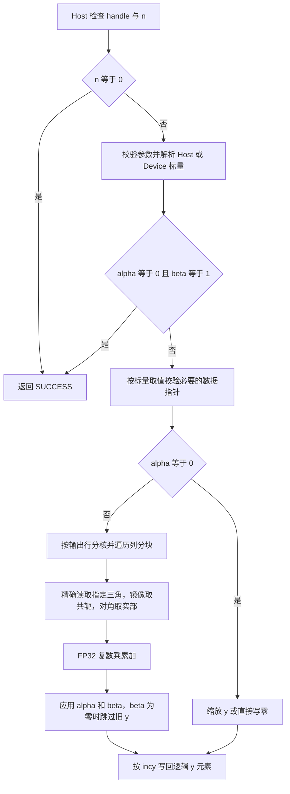

# aclblasChemv 算子设计文档（Atlas A2/A3）

# 需求背景（required）

## 需求来源

昇腾 CANN 社区 aclblasChemv（A2/A3）算子开发任务，任务依据为随附任务书及测试包，目标工程为 ops-blas，目标环境为 CANN 9.1.0。

## 背景介绍

### aclblasChemv 算子功能

Hermitian 矩阵向量乘用于复数线性代数计算。接口完成 y = alpha*A*x + beta*y，利用共轭对称关系从指定三角恢复逻辑矩阵。列主序三角访问、复数乘累加与输出原地写回共同决定实现方式。

### 同族实现参考

工程注册与跨度检查拟复用 ssymv arch22 的组织方式，Host/Device 标量读取拟复用 csymv arch35 的 ComplexScalarSource。上述工程信息依据任务书，实际集成时需核对目标仓提交。

本稿参考本地 aclblasCsymv（A2/A3）设计中的按输出行分核、列段搬运和 UB 预算分析，并参考 aclblasCtrsmBatched（950）设计中的参数契约、校验顺序及工程落点表述。Chemv 的镜像访问执行共轭，对角项按实数参与计算。

# 需求分析（required）

## 需求描述

使用 Ascend C kernel 直调实现公共句柄接口 aclblasChemv，覆盖 UPPER/LOWER、列主序 padding、正负步长、Host/Device 复数标量及快速返回。每次计算由 handle 绑定的 stream 承载。

## 需求拆解

| 要求 | 设计落点 |
| --- | --- |
| complex64 Hermitian 乘法 | FP32 实虚拆分，镜像共轭，对角仅取实部 |
| 指定三角访问 | 严格限制每段 GM 加载范围 |
| lda 与正负步长 | int64 地址计算和逻辑下标映射 |
| 标量与空指针语义 | Host 顺序校验和退化路径分派 |
| 原地输出 | 按输出行独占写回 |
| A2/A3 工程适配 | arch22 入口、kernel 与 GTest 注册 |
| 精度与性能验收 | CBLAS golden、逐分量统计与 msprof 采样 |

# 详细设计（required）

## 算子分析

### 数学公式、支持数据类型与支持形状


计算 y = alpha * A * x + beta * y，全部数据为 complex64。A 为列主序 Hermitian 矩阵，物理布局 lda×n。公共声明新增至 include/cann_ops_blas.h，复数类型复用 cann_ops_blas_common.h。

```cpp
aclblasStatus_t aclblasChemv(
    aclblasHandle_t handle, aclblasFillMode_t uplo, int n,
    const aclblasComplex* alpha, const aclblasComplex* A, int lda,
    const aclblasComplex* x, int incx,
    const aclblasComplex* beta, aclblasComplex* y, int incy);
```

只引用指定三角。对角仅加载实部，虚部直接按零处理。非对角有效元素 H(i,j) 的地址规则如下，索引从零开始。

| 存储模式 | 条件 | H(i,j) |
| --- | --- | --- |
| UPPER | i < j | A[i+j*lda] |
| UPPER | i > j | conj(A[j+i*lda]) |
| LOWER | i > j | A[i+j*lda] |
| LOWER | i < j | conj(A[j+i*lda]) |
| 两种 | i = j | real(A[i+i*lda]) |

负步长使用起始偏移 start=(1-n)*inc，正步长 start=0。逻辑元素 k 对应 start+k*inc。所有地址乘加先提升至 int64，字节范围另作溢出检查。

## 算子实现

### 实现方案

#### 计算流程



参数检查失败时按 Host 侧设计返回对应错误码。kernel 使用 handle 绑定的 stream，x/y 的正负步长通过逻辑下标映射到物理地址。

#### Host 侧设计


依次执行以下检查与调度。

1. handle 为空返回 HANDLE_IS_NULLPTR。
2. n<0 返回 INVALID_VALUE，n=0 直接返回 SUCCESS。
3. 校验 uplo、lda>=max(1,n)、非零步长、步长非 INT32_MIN、alpha/beta 非空。非法枚举返回 INVALID_ENUM，其余返回 INVALID_VALUE。
4. 使用 int64 检查 (n-1)*abs(inc)，具体可表示上限复用主仓 ssymv arch22 的跨度守卫，集成时核实其类型和边界。
5. 复用主仓 ComplexScalarSource 的指针属性探测与 Host/Device 双读取机制。Host 标量可直接解析，Device 标量的读取与 stream 顺序复用仓内实现，避免直接解引用 Device 地址。异步读取涉及的临时内存须保持有效直至操作完成。
6. alpha=0 且 beta=1 返回 SUCCESS，允许 A/x/y 为空。
7. alpha 非零要求 A/x 非空。其余执行路径要求 y 非空。
8. alpha=0 进入缩放路径，beta=0 直接写零。通用路径 beta=0 时跳过旧 y 加载。

返回码及运行时错误映射复用主仓实现。kernel 在 handle 绑定 stream 上执行。标量探测失败必须返回仓内对应错误，不能静默当作 Host 地址。

#### Kernel 侧设计


##### 4.1 首版实现

使用 AIV FP32 向量运算。按输出行分配独占任务，每个任务持有一段输出行，遍历列分块，计算复数点积。每个 y 元素由一个任务完成写回，无跨核原子累加。

设矩阵元素为 a+ib，向量为 c+id，贡献实部为 ac-bd，虚部为 ad+bc。共轭通过虚部变号完成。对角使用实数乘复数独立路径，防止无效对角虚部中的 NaN 进入运算。

列主序下直接三角区域沿行连续搬运，镜像区域按存储三角的连续列片段加载至局部 tile，再进行局部转置和共轭。跨对角 tile 拆成严格三角和对角段，每段精确限定加载范围。禁止先搬运整块跨界矩阵再掩码，以满足未引用三角不得读取的要求。非对齐尾部采用可用的精确长度搬运或标量回退，接口能力随 CANN 9.1.0 编译核实。

##### 4.2 分块与局部内存

初始候选行块 R=16/32、列块 K=64/128，按 UB 实际容量选择。复数矩阵双缓冲占用约 16*R*K 字节，另计拆分实虚部、转置临时量、x 缓冲与累加器。实现前列出全部同时存活缓冲的总和，保证不超过设备查询得到的 UB 容量。tile 参数属于调优候选值。

连续步长使用连续搬运，其他步长将 x 精确收集至 UB，y 仅写逻辑位置，保留间隙。小规模可由单核完成，规模增大时按输出块数与可用 AIV 核数调度。规模分界通过实测决定。

##### 4.3 性能演进

首版行分块会重复读取部分三角元素。若带宽成为瓶颈，评估三角 tile 一次加载同时生成两侧输出局部贡献，再以独立归约 kernel 合并。此路径需显式管理 workspace、归约顺序和并发调用生命周期，并以一次 API 调用内所有 kernel 的总耗时评估收益。首版优先完成单 kernel 通路验证。

计算复杂度 O(n²)，首版 GM workspace 为零，UB 空间 O(R*K)。FP32 累加，全程保留 FP32 实虚分量。大规模精度不足时评估分段归约，不预设低精度转换。

### 工程集成


| 位置 | 修改内容 |
| --- | --- |
| include/cann_ops_blas.h | 公共 API 声明 |
| blas/symv/arch22/ | Host 入口、调度、Ascend C kernel，复用同族构建组织 |
| test/symv/chemv/arch22/ | CSV 驱动 GTest、CBLAS golden、性能采样 |
| test/symv/chemv/CMakeLists.txt | arch22 注册 ops_blas_add_gtest_tests(${OPS_BLAS} chemv_test) |
| 同族算子 README | 参数、示例、A2/A3 支持表 |
| task_submission/ | 按任务模板组织实测交付件 |

以待集成主仓实际文件划分为准。提交前核对最新贡献指南、共享接口、已有 Chemv 入口与标量读取工具，避免重复声明。

## 支持硬件

| 支持的芯片版本 | 涉及勾选 |
| --- | --- |
| Atlas A2 系列，含 Atlas 800T A2（910B3） | √ |
| Atlas A3 系列，含 Atlas 800T A3 | √ |

自验证至少覆盖一种款型，性能验收优先使用 910B3。

## 算子约束限制

n>=0，lda>=max(1,n)，incx/incy 非零且非 INT32_MIN。A/x/y 位于 Device，alpha/beta 支持 Host/Device。物理向量长度至少为 1+(n-1)*abs(inc)。支持 lda/inc 所描述的存储方式，广播和额外视图语义不涉及。调用方保持设备数据有效至 stream 完成。

# 可维可测分析

## 精度标准/性能标准

| 验收标准 | 描述 | 标准来源 |
| --- | --- | --- |
| 精度 | 实部、虚部分别按 FLOAT32 混合容差及非有限值规则验证 | 任务书第 3.2 节 |
| 性能 | 每 case 平均耗时 <= GPU 基线的 1.25 倍 | 任务书第 3.3 节 |
| 环境 | CANN 9.1.0，至少一种 A2/A3 款型自验 | 任务书第 3.1 节 |

已核对附件 CSV，共 1200 条，其中精度 1000 条、性能 200 条。


完整保留附件 CSV，实际用例数量由脚本统计。补充 GAUSS_NORM_5_2 正态输入，使均匀与正态在新增随机测试集合中各占一半，并记录每组均值、标准差与种子。原始固定边界用例继续全部执行。

golden 使用 Netlib BLAS 3.10.0 cblas_chemv，指定 CblasColMajor。实部、虚部分别统计，全向量验证。有限值采用 atol=rtol=2^-13、matched_ratio>=0.99、max_abs_error<=1e-2 的固定门限，额外输出仓内 MERE/MARE 结果。非有限值按任务书规则独立统计，同号 Inf、双方 NaN、NaN 与 Inf 组合可通过，有限与非有限组合失败，异号 Inf 失败。

专项覆盖上下三角、对角虚部 NaN/Inf、未引用三角毒化、lda padding、±1/±2/±3 步长、尾部、alpha/beta 特殊值、beta=0 且旧 y 为 NaN、全部空指针与参数错误顺序。填充值毒化用于发现数值依赖，结合代码访问范围审查与可用内存检查工具验证非法读取。负向用例使用 dummy 缓冲，避免按非法跨度分配。检查 y 间隙与 A/x 输入保持完整。

性能在 910B3 上验证，warmup 5 次，有效样本至少 10 次，Avg_us <= gpu_ms*1000/0.8。200 条性能用例按完整参数与基线关联。若采用多 kernel，计入同次调用的全部计算 task。

附件 README 末段将 aclrtEvent 输出作为最终性能判据，与任务书要求 msprof task duration 存在冲突。本设计暂按任务书采用 msprof 作为验收指标，同时保存 Event 数据供复现，正式验收前需确认统一口径。附件 README 的 CANN 版本描述较宽，开发目标固定采用任务书 9.1.0。

## 兼容性分析

共享 aclblasChemv 公共声明与 aclblasComplex ABI，代码放入 symv/arch22。新增 arch22 测试注册时沿用同族 CMake 分支结构。维度保持 int，内部跨度和字节数使用宽整数。Host 标量读取、Device 标量读取和错误映射复用目标仓能力。
