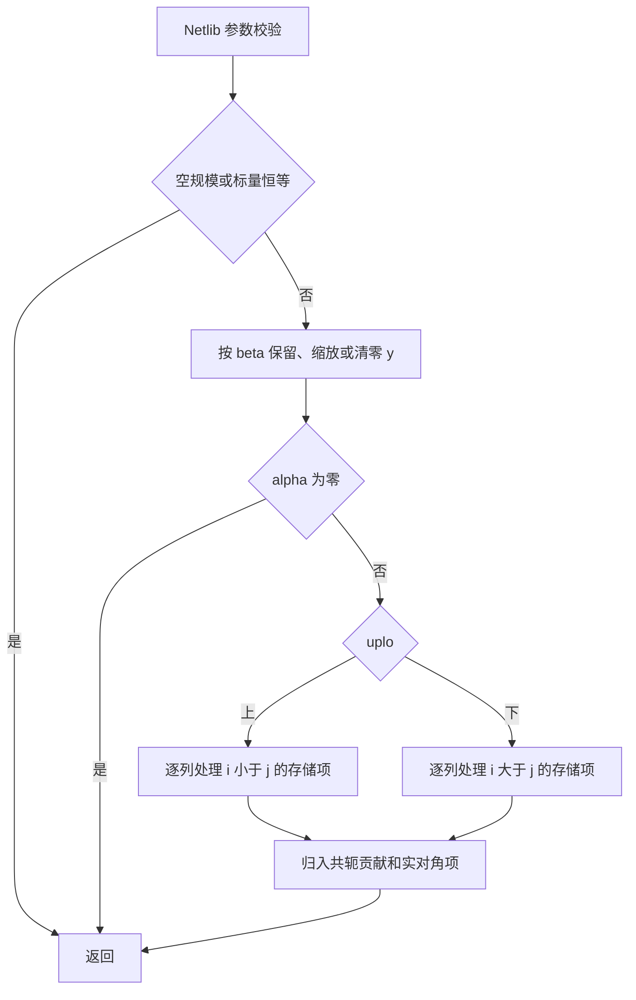
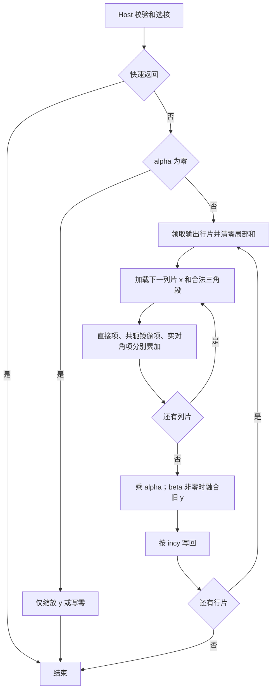

# aclblasChemv 算子设计文档（Atlas A2/A3）

## 一、需求背景

### 1.1 需求来源

11 月社区任务要求在 ops-blas 的 arch22 后端补齐单精度复数 Hermitian 矩阵向量乘。接口对齐 cuBLAS cublasChemv，执行原地更新 `y ← αAx + βy`。验收依据为随任务发布的 `aclblasChemv_AtlasA2_A3_task_doc.md` 和 test_cases 附件。

### 1.2 背景与参考实现

本任务新增句柄式 BLAS 能力，任务书未指定 TBE 实现文件、算子信息库条目或 ACLNN 接口。因此 checklist 中 TBE 的源码、信息库、类型、实现和流程图以如下对应依据说明。公共 ABI 见 ops-blas 的 `include/cann_ops_blas.h`、`include/cann_ops_blas_common.h`。工程参考为 `blas/symv/arch22/ssymv_host.cpp`、`ssymv_kernel.cpp`；复数标量获取参考 `blas/symv/arch35/csymv_host.cpp`。实对称内核不能直接用于复 Hermitian 数据。

语义参考 [Netlib CHEMV 源码](https://www.netlib.org/blas/chemv.f)。该例程接收单精度 COMPLEX、列主序 A 和带符号步长的 X/Y。先校验维数和步长，快速返回后按 β 缩放或清零 Y。若 α 非零，按所选三角逐列扫描。对列 j 内每个非对角存储项 A(i,j)，它向 y(i) 贡献 α·x(j)·A(i,j)，同时向列内临时和贡献 conj(A(i,j))·x(i)。最后将临时和乘 α，与实对角项的贡献合入 y(j)。负步长从向量物理末端起步。



## 二、需求分析

### 2.1 外部依赖与 2.2 内部适配

运行依赖 CANN 9.1.0、Ascend C 和 ACL runtime；测试依赖 Netlib BLAS 3.10.0 的 CBLAS、仓内 GTest、msprof。内部复用 handle/stream、状态码和产品构建分发。实现落在 `blas/symv/arch22/`，测试落在 `test/symv/chemv/arch22/`；在 `test/symv/chemv/CMakeLists.txt` 的 arch22 分支注册 `ops_blas_add_gtest_tests(${OPS_BLAS} chemv_test)`。

### 2.3 接口原型与约束

在公共头文件复用或补齐唯一声明，其他产品线共享同一签名。

```cpp
aclblasStatus_t aclblasChemv(aclblasHandle_t handle, aclblasFillMode_t uplo,
    int n, const aclblasComplex* alpha, const aclblasComplex* A, int lda,
    const aclblasComplex* x, int incx, const aclblasComplex* beta,
    aclblasComplex* y, int incy);
```

| 对象 | 类型、布局与访问约定 |
| --- | --- |
| A | Device complex64（两个 FP32），ND、列主序 lda×n，lda≥max(1,n)。UPPER 使用 i≤j，LOWER 使用 i≥j，忽略对角虚部。 |
| x、y | Device complex64，逻辑长度 n；n>0 时物理跨度为 1+(n−1)·abs(inc)。x 只读，y 原地覆写逻辑位置。 |
| α、β | 各一个 complex64；按指针属性分别读取 Host 或 Device 标量。 |
| 控制参数 | Host handle、uplo 与 int 型 n、lda、incx、incy；步长允许正负，排除 0 和 INT32_MIN。 |

## 三、详细设计

### 3.1 使能方式与参数校验

由调用者通过 aclblasSetStream 绑定 stream，公共 API 在该 stream 下直调 kernel。Host 按以下优先级决定返回值。

1. 空 handle 返回 ACLBLAS_STATUS_HANDLE_IS_NULLPTR。n<0 返回 ACLBLAS_STATUS_INVALID_VALUE；n=0 立即返回 SUCCESS，不解引用其余指针。
2. 校验 uplo，两种合法值为 ACLBLAS_UPPER、ACLBLAS_LOWER，其他值返回 ACLBLAS_STATUS_INVALID_ENUM。检查 lda、步长与 α/β 指针，无效返回 ACLBLAS_STATUS_INVALID_VALUE。先提升到 int64 再取绝对值、乘 n−1；按内核实际索引上限检查跨度，元素偏移转字节时检查可表示范围，避免窄化回绕。
3. Host 标量按值捕获；Device 标量的读取须在绑定 stream 上排在先前写入之后，待拷回完成再作 Host 分支判断。传播 runtime 错误，不能将读取失败解释为零标量。
4. α=0 且 β=1 直接成功，A/x/y 均可为空。其余路径要求 y 非空；α 非零时另要求 A/x 非空。缺少必需指针返回 INVALID_VALUE。β=0 时只写 y。调用者读取结果前同步 stream。

### 3.2.1 Host 分核、分块与 tilingKey

将输出行按每组 4 个 complex64（32 B）划分。设 G=ceil(n/4)，向量核数 P 由平台查询，启动 C=min(G,P) 核；核 k 拥有组区间 [floor(kG/C),floor((k+1)G/C))，行末截断到 n。每个 y 元素只有一个写者。负步长逻辑元素 t 对应物理偏移 (n−1)·abs(inc)+t·inc；正步长对应 t·inc。非对齐和跨步输出按元素精确写入，不以整块读改写相邻核的数据。

行片 R、列片 K 均由 UB 容量约束，令 p(s)=32·ceil(s/32)。拟采用双缓冲矩阵面板和 x 片、两组 FP32 实虚累加器与输出缓冲；若解交织与复乘各需暂存，按 4 个 FP32 面板保守预留。预算为
`2p(8RK)+2p(8K)+2p(4R)+p(8R)+4p(4RK)+S ≤ UB可用字节`，S 为队列、对齐和流水管理预留。优先试 R、K 为 4 的倍数，按可用预算缩小；小 n 只开必要核。尾片按实际长度搬运，UB 内补零，禁止从 GM 读入未引用三角或 lda padding。无需展开完整矩阵或分配 GM 工作区。

拟定 key 0 为 α=0 的缩放或清零；正常乘加取 `1 + 2·lower + strided`，lower 表示 LOWER，strided 表示任一增量不为 +1。β 是否为零随 tiling 参数传入并在读 y 前判断。数据结构携带 n、lda、步长、起点、α/β、R、K 和分组数；传递地址偏移使用宽整数。

### 3.2.2 Kernel 数据流与参考实现差异

对行片 I 和列片 J 的矩形，完全落在存储三角内时按列搬入连续行段；完全落在镜像侧时搬入转置位置的存储段，在 UB 中交换索引并翻转虚部符号。跨对角片按列切成合法子段，对角单独取实部作实数乘复数，避免无效虚部或隐式零乘 Inf 污染结果。分片累计实部 ar·xr−ai·xi、虚部 ar·xi+ai·xr。所有列结束后乘 α，按 β 决定是否融合旧 y，再写回所属行。相比 Netlib 按列同时更新两行，输出行归属策略会重复访问部分三角元素，但消除了核间归约、原子加和写冲突。



### 3.3 支持硬件与 3.4 算子限制

支持 Atlas A2/A3（含 Atlas 800T A2/A3）。n 在调用时给定；范围限于 complex64、方阵、单向量和 BLAS 指定的布局。无广播、批处理、视图输出或额外非连续 Tensor 语义。任务未要求逐位确定性和独立内存指标。

## 四、特性交叉分析

跨产品共享公共头文件，arch22 实现与测试按产品构建分派。回归时检查其他架构的已有符号、GTest 注册及同族 Ssymv 构建。多 stream 并发时标量副本、tiling、UB 与一次调用绑定，各核独占输出行；测试用前序异步写入 Device 标量、连续调用和不同 stream 上的独立输入验证顺序与隔离。对于 y 的步长空洞填哨兵，结束后检查未被覆盖。

## 五、可维可测分析

### 5.1 精度、性能与证据

- 精度使用官方 1000 条功能/边界用例。正向用例以 CblasColMajor 的 cblas_chemv 为唯一 golden，实部、虚部分别检查全部逻辑 y。有限值按 |误差|≤2⁻¹³·(1+|golden|) 统计，匹配率≥0.99，最大绝对误差限 1e−2 或 32 ULP。非有限值另计，同 NaN、同号 Inf、NaN 与任一 Inf 等效，其他组合失败。记录有限/非有限元素数、匹配数及最大误差；CSV 的 MERE/MARE 单列报告。
- 保留官方 CSV，另补 GAUSS_NORM_5_2，使随机输入均匀/正态各占 50%，复数两分量独立采样，并记录种子和补充条数。覆盖两种 uplo、负步长、padding、尾块、Host/Device 标量组合；向未引用三角和对角虚部填毒值，结合搬运边界审查验证访问范围。错误码用例使用 dummy 或空指针，不按无效跨度分配。
- 性能在 Atlas 800T A2（910B3）逐条核对 200 个 TC_PF，用例参数与 gpu_baseline.csv 联合校验。任务书 §3.3 以 msprof op 的 Task Duration(us) 为准，预热 5 次后取至少 10 次 SUCCESS 有效样本的算术平均；每条要求 Avg_us≤1250·gpu_ms。前四个典型规模为 512/1024/2048/4096。异常样本记录原因。附件脚本另从 GTest 的 [PERF] avg_us 解析 event 耗时，含下发开销；保留两套原始数据、分开判定并在报告中说明差异。
- 自验可选一种款型，优先 910B3 同时覆盖精度与性能。逐例归档 CSV ID、源码 SHA、设备、CANN 版本、构建命令、精度实虚统计、profiling 原始样本和日志。真实性能瓶颈按小 n 下发与大 n 镜像搬运分别分析。

### 5.2 兼容性与交付

A2 用 ascend910b、A3 用 ascend910_93 构建。验收按任务书提供设计 PR、含 README 的 CSV/GTest 工程、自测报告及个人代码仓地址；产品支持表标注 A2/A3。代码仓根目录 task_submission 按模板整理步骤、精度和性能报告、原始日志等，记录实际执行的款型和待验范围。

## 设计 CheckList 对照

| 行号 | 核对位置或后续动作 |
| --- | --- |
| 2 | 设计提交至 cann/cann-competitions 的 master，tasklist 对应任务/aufw/docs/design.md；社区阶段创建 PR、核验 CLA、评论 `/compile` 并检查构建结果。 |
| 3 | 设计 PR 标题为「【社区任务】aclblasChemv算子设计文档」。 |
| 4–8 | §1.1 来源；§1.2 依次说明 TBE 适用性、参考文件、类型布局、参考算法及流程图。 |
| 9–12 | §2.1–2.3 外部组件、内部适配、公共原型、接口约束。 |
| 13–16 | §3.1 直调和校验；§3.2.1 分核公式、UB 预算、分支条件。 |
| 17–19 | §3.2.2 三角读取、Kernel 流程图、与逐列参考算法的差异和原因。 |
| 20–22 | §3.3–3.4 产品与限制；第四章分析产品、并发和原地更新。 |
| 23–24 | §5.1 精度与逐例性能判据；§5.2 兼容性及交付。 |
