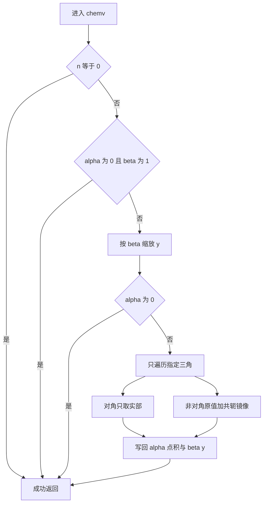
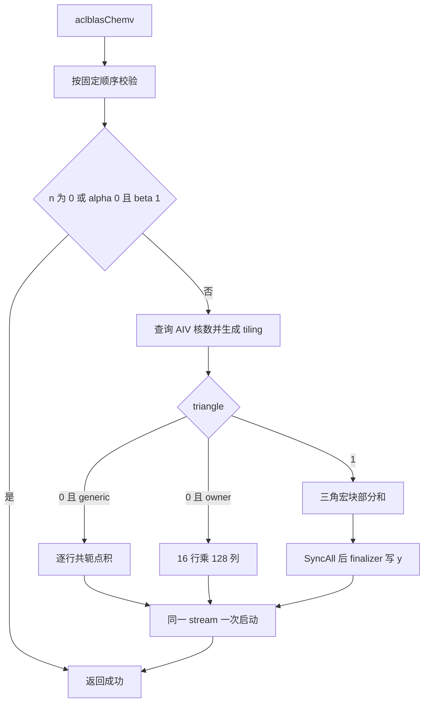

# 【社区任务】aclblasChemv算子设计文档

提交位置：`cann/cann-competitions` 的
`04_tasks/01_community-task-2026/tasklist/11月社区任务-aclblasChemv算子开发（A2A3）/fight2026/docs/design.md`。

任务书中的名称是「11月社区任务-aclblasChemv算子开发（A2/A3）」，社区文档任务编号为 9。
目录名去掉斜杠，与该任务下已有的设计文档目录一致。
结构遵循
`04_tasks/01_community-task-2026/resources/design_template.md`，
并逐项覆盖设计文档 CheckList。

# 需求背景（required）

## 需求来源

本需求来自 2026 年 11 月 CANN 社区任务：在 Atlas A2/A3 上用 Ascend C 开发
`aclblasChemv`，补齐 `cann/ops-blas` 的单精度复数 Hermitian 矩阵-向量乘。
示例来源表述为：通过社区任务完成开源仓算子贡献。

- 任务名称：11月社区任务-aclblasChemv算子开发（A2/A3）。
- 实现仓：https://gitcode.com/cann/ops-blas
- 设计文档仓：https://gitcode.com/cann/cann-competitions
- 模板：`04_tasks/01_community-task-2026/resources/design_template.md`
- 对标接口：cuBLAS `cublasChemv`。
- 语义来源：Netlib BLAS `chemv.f`，https://www.netlib.org/blas/chemv.f
- 精度标准：`cann/opbase` 的 `mixed_tolerance_standard.md`（提交 `28a1ce52`）。

## 背景介绍

### aclblasChemv算子实现目标

`ops-blas` 在本任务开始时的公共头文件没有 `aclblasChemv`。
同族实数接口 `aclblasSsymv` 已在 `blas/symv/arch22/` 提供 Atlas A2/A3 直调实现，
复数对称接口 `aclblasCsymv` 的 arch22 实现可复用工程接入方式。
本算子计算 `y = alpha * A * x + beta * y`。
A 按列主序存放完整 `lda × n` 数组，只读取 `uplo` 指定三角；
另一三角按共轭对称补全，对角元只取实部。

### aclblasChemv标杆与现状

CANN 工具链内置 TBE 目录
`/usr/local/Ascend/ascend-toolkit/latest/opp/built-in/op_impl/ai_core/tbe/impl`
以及 `python/site-packages/tbe/dsl` 中没有本接口。
任务书指定的标杆是 cuBLAS `cublasChemv` 与 Netlib `chemv.f`，
实现形态是 ops-blas 句柄式 kernel 直调，而不是 TBE 或 aclnn 原型。
因此 1.2.2 按该标杆填写数据类型、计算公式和流程。

#### 标杆支持的数据类型和数据格式

与 cuBLAS `cublasChemv`、Netlib `chemv` 保持一致。

| 参数 | 参数含义 | 数据类型 | 支持数据类型 | 约束 | 形状 |
| --- | --- | --- | --- | --- | --- |
| handle | 库上下文，携带 stream | Host 句柄 | - | 非空且已创建 | 标量 |
| uplo | 引用上三角或下三角 | Host 枚举 | `ACLBLAS_UPPER=121`，`ACLBLAS_LOWER=122` | 仅这两个取值 | 标量 |
| n | 矩阵阶数 | Host int | int32 | `n ≥ 0`；`n = 0` 为空操作 | 标量 |
| alpha、beta | 复数标量 | Host 或 Device 指针 | complex64 | `n > 0` 时指针非空 | 标量 |
| A | Hermitian 矩阵，只读 | Device | complex64，ND，列主序 | 只读指定三角 | `lda × n` |
| lda | A 的列主序前导维 | Host int | int32 | `lda ≥ max(1, n)` | 标量 |
| x | 输入向量，只读 | Device | complex64，ND | 物理长度覆盖步长跨度 | n 个逻辑元素 |
| incx、incy | 向量步长 | Host int | int32 | 非 0 且非 `INT32_MIN` | 标量 |
| y | 输入旧值并原地输出 | Device | complex64，ND | 除短路外指针非空 | n 个逻辑元素 |

计算公式：

```text
y = alpha * A * x + beta * y
```

#### 标杆实现描述

Netlib `chemv.f` 的单精度复数语义如下，本实现与之对齐。

1. `n = 0`，或 `alpha = (0,0)` 且 `beta = (1,0)` 时直接返回，不改写 y。
2. `beta ≠ (1,0)` 时先按 `beta` 缩放 y；`beta = (0,0)` 时不读取 y 的旧值。
3. `alpha ≠ (0,0)` 时，只遍历 `uplo` 指定三角。
4. 对角元只用实部。非对角元对当前列贡献原值，对镜像行贡献共轭。
5. 列主序元素地址为 `i + j * lda`。正步长下标为 `k * inc`，负步长从向量另一端起算。
6. 复数乘：`(ar, ai) * (xr, xi) = (ar*xr - ai*xi, ar*xi + ai*xr)`。
   共轭乘把虚部项反号：`(ar*xr + ai*xi, ar*xi - ai*xr)`。

#### 标杆流程图



### aclblasChemv功能分析

功能：单精度复数 Hermitian 矩阵-向量乘加，原地更新 y。

输入：handle、uplo、n、alpha、A、lda、x、incx、beta、incy，以及 y 的旧值。

输出：原地写回的 y，返回 `aclblasStatus_t`。

支持数据类型：complex64。实部与虚部都是 FLOAT32。

形状：方阵阶数 n，列主序前导维 lda，向量步长 incx 与 incy。无广播。

# 需求分析（required）

## 需求描述

在 `cann/ops-blas` 中新增与其他产品线共用的 `aclblasChemv`。
使用 Ascend C，在 arch22 上覆盖 Atlas A2/A3。
参数顺序、列主序、三角引用、共轭对称、对角虚部和对齐短路与 cuBLAS `cublasChemv` 一致。
精度按 FLOAT32 混合容差对实部、虚部分别判定。
性能以 Atlas 800T A2（910B3）上的 msprof task duration 不超过 GPU 标杆的 1.25 倍为正式口径。

## 需求拆解

### 外部组件依赖

运行期依赖 CANN 9.1.0 的 ACL 运行时：句柄、stream、指针属性、Device 到 Host 拷贝和 kernel 启动。
计算核内使用 Ascend C 向量指令，不调用 TBE、aclnn 或外部 BLAS 完成算子本身。
精度测试链接 CBLAS 的 `cblas_chemv`，列主序，作为唯一 golden。
本机自测链接的是 OpenBLAS 提供的 CBLAS 头文件和库；正式验收 golden 仍按任务书记录为 Netlib BLAS 3.10.0。

### 内部适配模块

| 模块 | 职责 | 位置 |
| --- | --- | --- |
| 公共 API | 与其他产品线共用的声明 | `include/cann_ops_blas.h` |
| Host | 校验、标量来源、分核、启动 | `blas/symv/arch22/chemv_host.cpp` |
| Tiling | 路由和启动参数 | `blas/symv/arch22/chemv_tiling_data.h` |
| Kernel | AIV 搬运、共轭乘加、写回 | `blas/symv/arch22/chemv_kernel.cpp` |
| 构建 | arch22 源文件与 `--cce-auto-sync=off` | `blas/symv/arch22/CMakeLists.txt` |
| 说明 | 产品支持表和接口说明 | `blas/symv/README.md`、`docs/zh/api_list.md` |
| 测试 | arch22 GTest、CSV、golden | `test/symv/chemv/` |

仓内 `test/symv/chemv/CMakeLists.txt` 原只在 arch35 注册 GTest。
本任务在 arch22 分支调用 `ops_blas_add_gtest_tests(${OPS_BLAS} chemv_test)`。

### 需求模块设计

#### Ascend C算子原型

本仓没有 aclnn OpDef。对外原型就是下面这个共用 C 接口，参数序列与 `cublasChemv` 相同：

```cpp
aclblasStatus_t aclblasChemv(
    aclblasHandle_t handle, aclblasFillMode_t uplo, int n,
    const aclblasComplex* alpha, const aclblasComplex* A, int lda,
    const aclblasComplex* x, int incx, const aclblasComplex* beta,
    aclblasComplex* y, int incy);
```

除任务书明确不要求的能力外，与标杆对齐的部分包括：complex64、列主序、UPPER/LOWER、
Hermitian 共轭、对角虚部不参与、正负步长、Host/Device 标量、`n = 0` 短路，
以及 `alpha = (0,0)` 且 `beta = (1,0)` 短路。

相对标杆，本批不实现、也不在接口中另造入口的能力：

- 超出 lda、incx、incy 语义的任意非连续 Tensor。
- 广播、动态 rank、视图返回和确定性模式。
- 私有平行 API。其他产品线复用同一声明。
- 实对称 phase-window 路径。Hermitian 调度不进入 `triangle = 2`。

# 详细设计（required）

## 算子分析

### 数学公式

记列主序地址 `A(i, j) = A[i + j * lda]`。指定三角为：

```text
stored(i, j) = uplo == UPPER ? i <= j : i >= j
```

逻辑 Hermitian 矩阵 B：

```text
B(i, i) = real(A(i, i))
B(i, j) = stored(i, j) ? A(i, j) : conj(A(j, i))    当 i != j
```

步长下标：

```text
pos(k, n, inc) = inc > 0 ? k * inc : (n - 1 - k) * (-inc)
```

输出：

```text
y[pos(i)] = alpha * sum_j(B(i, j) * x[pos(j)]) + beta * y_old[pos(i)]
```

直接复数乘的实部、虚部是 `ar*xr - ai*xi` 与 `ar*xi + ai*xr`。
共轭乘的实部、虚部是 `ar*xr + ai*xi` 与 `ar*xi - ai*xr`。
对角虚部先置 0，因此对角乘不再带入调用者写入的虚部。
地址和 `(n - 1) * |inc|` 使用 64 位整数，避免先在 32 位里溢出。

### 支持数据类型

仅 complex64。比较精度时把实部和虚部拆成两条 FLOAT32 向量。

### 支持形状

- n 为运行时标量，`n ≥ 0`。`n = 0` 不启动 kernel。
- A 为列主序 `lda × n`，`lda ≥ max(1, n)`。padding 不参与计算。
- x、y 各有 n 个逻辑元素。物理跨度为 `(n - 1) * |inc|`。
- 无广播。y 原地覆写，不返回新视图。

## 算子实现

### 实现方案

调用方式是 kernel 直调。`aclblasChemv` 使用 handle 上由 `aclblasSetStream` 绑定的 stream，
一次调用最多启动一个 AIV kernel。读回 Device 结果前由调用者同步该 stream。

Host 校验顺序固定为：

1. handle 为空，返回 `ACLBLAS_STATUS_HANDLE_IS_NULLPTR`。
2. `n < 0`，返回 `ACLBLAS_STATUS_INVALID_VALUE`。
3. `n = 0`，返回成功。此时不再访问其余指针，也不启动 kernel。
4. uplo 不是 UPPER 或 LOWER，返回 `ACLBLAS_STATUS_INVALID_ENUM`。
5. `lda < max(1, n)`、incx 或 incy 为 0 或 `INT32_MIN`、alpha 或 beta 为空，返回 `ACLBLAS_STATUS_INVALID_VALUE`。
6. 用 int64 计算 `(n - 1) * |incx|` 和 `(n - 1) * |incy|`。任一跨度大于 `UINT32_MAX` 时返回 `ACLBLAS_STATUS_INVALID_VALUE`。
7. 用 `aclrtPointerGetAttributes` 区分 alpha、beta 位于 Host 还是 Device。
8. A、x、y 之一为空，且标量在 Device 上时，先在 handle 的 stream 上拷回标量并同步，再决定短路或空指针是否合法。
9. `alpha = (0,0)` 且 `beta = (1,0)` 时返回成功。此时 A、x、y 都可以为空。
10. alpha 非 0 时 A 和 x 必须非空。除上述短路外 y 必须非空。`beta = (0,0)` 只表示不必读取 y 的旧值。

标量都在 Host，或已经为了空指针判断完成回读时，Host 直接用数值做短路。
普通 Device 标量路径把指针交给 kernel，在同一 stream 上读取，避免为了读数而无条件同步。

#### 3.2.1 host侧设计

##### 1. 分核策略

AIV 核数来自 `aclrtGetDeviceInfo` 的 `ACL_DEV_ATTR_VECTOR_CORE_NUM`，按设备缓存。
本机查询结果是 48。910B3 的向量核数是 40。代码不把核数写死。

路由由 `ChooseKernelRoute` 决定：

| 条件 | 路由 | 活跃块数 |
| --- | --- | --- |
| `incx != 1`，或 `n < 16`，或 `n > 8192`，或 `lda * 8 > UINT32_MAX` | generic | `min(n, AIV 核数)` |
| 其余，且未选中三角分块 | owner | `min(ceil(n / 16), AIV 核数)` |
| n 落在三角窗口且 workspace 足够 | triangle | `min(q*(q+1)/2, AIV 核数)` |

owner 以 16 行一组划分输出，每组由一个核完成并写回，核间不原子加。
三角路径把矩阵分成 `tile × tile` 的源块，只调度指定三角的
`q * (q + 1) / 2` 个任务，`q = ceil(n / tile)`。
`finalizerBlocks = min(ceil(n / 32), numBlocks)`，由这些块完成 y 的最终缩放写回。
workspace 不足时保持 owner，不启动三角 kernel。

三角窗口：

- n 属于 `[640, 768]` 或 `(1024, 1280]`：tile 为 64，路由值 `CHEMV_TRIANGLE_SMALL`。
- n 属于 `[769, 4096]` 且不在上一窗口：tile 为 128，路由值仍为 `CHEMV_OWNER`，`triangle = 1`。
- 四个性能点因此分别是：n=512 owner，n=1024/2048/4096 为 128 三角块。

`ConfigurePhaseWindowPlan` 保留在源码中，`BuildLaunchPlan` 不调用它。
Hermitian 不设置 `triangle = 2`，phase5 至 phase8 入口不会被本次调度选中。

##### 2. 数据分块和内存优化策略

arch22 每核 UB 为 192 KB，即 196608 字节。向量可用上限按 184 KB 计，
实现里的静态断言都落在这个上限内。

owner 单核布局，单位是 float：

```text
RAW_PITCH = 40
RAW_FLOATS = 40 * 128
平面偏移 = RAW_SLOTS * RAW_FLOATS + 两块 16 * 144 的实虚平面
乘积区 = 4 * 16 * 128
累加区 = 2 * 16 * 128
x 缓存 = 2 * 8192
UB_FLOATS = 上述之和 + 8 * 16 + 16
```

`RAW_SLOTS` 在预取关闭时为 1，开启时为 2。
对应占用 154176 字节和 174656 字节，都小于 `184 * 1024`。
列方向按 128 分块。`64 < n < 640` 且未走三角 kernel 时打开预取双缓冲，用来覆盖下一块矩阵的搬运。

三角 kernel 以 64 为微块。宏块 tile 为 64 或 128 时，UB float 数分别是 43784 和 46152，
字节数是 175136 和 184608。184608 小于 `184 * 1024 = 188416`。
workspace 只在三角路径使用，取自 handle 的有效 workspace：

```text
requiredBytes = 2 * tile * q * q * sizeof(float)
```

代表值：n=1024、tile=128、q=8 时为 65536 字节；
n=2048、q=16 时为 262144 字节；
n=4096、q=32 时为 1048576 字节。
owner 与 generic 不申请这块部分和 workspace。

n=4096 的 msprof PipeUtilization 显示向量单元占用约 0.86，MTE2 约 0.20，
标量约 0.135，MTE3 约 0.021，Cube 为 0。主时间在向量乘加。
三角 kernel 有两处 `SyncAll`，同步没有成为主瓶颈，因此内层循环保持当前分块。

##### 3. tilingkey规划策略

启动参数放在 `ChemvTilingData`，不使用图模式 tilingKey。
分流字段是 `tiled` 与 `triangle`：

| 字段 | 取值 | kernel |
| --- | --- | --- |
| `triangle = 0`，`tiled = GENERIC` | 0 | `chemv_kernel` 的逐行路径 |
| `triangle = 0`，`tiled = OWNER` | 1 | `chemv_kernel`；`64 < n < 640` 时预取模板为真 |
| `triangle = 1` | 三角部分和 | `chemv_triangle_large_fused_kernel` |
| `triangle = 2` | 本算子不设置 | phase-window 入口，当前调度不可达 |

同时下发 n、lda、uplo、带符号 incx/incy、Host 标量值、Device 标量标志、
`useCoreNum`、`sourceBlocks` 和 `finalizerBlocks`。
Device 地址不写入 tiling，避免指向临时 Host 对象。

#### 3.2.2 kernel侧设计

kernel 分 Init 与 Process。Process 包含搬入、计算和写回。

1. generic 按输出行遍历指定三角。对角元在标量写回前把虚部清零。
   镜像段使用共轭乘的加减交换，直接段使用原复数乘。
2. owner 每次处理 16 行、最多 128 列。矩阵以 AoS 搬入后拆成实部平面和虚部平面。
   对角虚部在 MTE2 到标量的事件之后清零，再参加乘加。
   列块累加到该核私有的 16 行累加器，最后乘 alpha、加 beta 并只写本组 y。
3. 三角路径按宏块计算指定三角的部分和，写入 workspace，再由 finalizer 合并到 y。
   对角宏块清零 AoS 对角虚部。镜像贡献在乘之前只翻转对齐微块的奇数虚部 lane。
   该翻转仅用于长度对齐的三角微块。
4. `alpha = (0,0)` 的 kernel 侧分支不读取 A 和 x。
   `beta = (0,0)` 的分支不读取 y 的旧值，避免把 `0 * NaN` 写进结果。
5. 负步长在地址生成时换算到物理元素，步长跨度的合法性已在 Host 用 int64 拒绝。

Ascend C 流程图：



与标杆流程的差异：

| 差异 | 原因 |
| --- | --- |
| 标杆按列做标量循环；这里按行组、列块和三角宏块向量化 | AIV 以向量乘加为主，UB 需装下实部、虚部和 x 缓存 |
| 共轭在 generic/owner 中交换加减，三角微块中翻转奇数 lane | 两种写法都实现 `conj`，并避开奇数长度整段取负 |
| 增加跨度大于 `UINT32_MAX` 的拒绝 | 与同族 arch22 大跨度守卫一致，对应仓内 issue #807 |
| Host/Device 标量分源 | 与 csymv 的 `ComplexScalarSource` 一致，对应 issue #869 |
| 不走实对称 phase-window | 该窗口按实对称形状挑选，Hermitian 共轭语义不使用它 |
| 无 TBE 源码可逐行对照 | 任务书的标杆是 cuBLAS 与 Netlib，仓内此前没有该 API |

## 支持硬件

| 支持的芯片版本 | SoC/build 参数 | NpuArch | 涉及勾选 |
| --- | --- | --- | --- |
| Atlas A2 训练系列产品，含 Atlas 800I/T A2 | `ascend910b` / `ascend910b3` | DAV_2201 | √ |
| Atlas A3 训练系列产品 | `ascend910_93` | DAV_2201 | √ |

A2 与 A3 共用 `blas/symv/arch22/` 源码。正式性能设备是 Atlas 800T A2（910B3）。
自验证机器是一块 Ascend910_9382：AIC 24、AIV 48、每核 UB 192 KB。
910B3 为 AIC 20、AIV 40，UB 同为 192 KB。自测覆盖 A2 这一款型。

## 算子约束限制

- 只支持 complex64。无 float16、bfloat16 或实数重载。
- uplo 只接受 `ACLBLAS_UPPER` 与 `ACLBLAS_LOWER`。
- 只读取指定三角和对角实部。未存储三角里的数值不得被读入。
- 不支持广播，不支持 lda/incx/incy 以外的非连续布局。
- incx、incy 不能为 0 或 `INT32_MIN`。逻辑跨度不能超过 `UINT32_MAX`。
- `n = 0` 成功返回且不写 y。`alpha = (0,0)` 且 `beta = (1,0)` 同样不写 y。
- 不要求确定性归约顺序。验收比较的是混合容差，不是逐位复现。
- 内存专项验收按任务书 3.4 不涉及。三角路径仍受 handle workspace 容量约束。

# 可维可测分析

## 精度标准/性能标准

| 验收标准 | 描述 | 标准来源 |
| --- | --- | --- |
| 精度标准 | 实部、虚部分别按 FLOAT32 混合容差，atol=rtol=2^-13，匹配率 ≥ 0.99 | 任务书 3.2，opbase 混合容差 |
| 非有限值 | 双方 NaN、同号 Inf，或 NaN 对正负 Inf，记为等价且不进入有限统计。有限值对 Inf/NaN 失败 | 任务书 3.2 |
| 性能标准 | msprof op 的 task duration。内置 5 次 warmup 不计。之后至少 10 次成功样本取算术平均，不超过 GPU 标杆的 1.25 倍 | 任务书 3.3 |
| 内存标准 | 不涉及 | 任务书 3.4 |
| 泛化 | uplo、尺度、padding、正负步长、标量特殊值、空指针优先级、Inf/NaN、非默认 stream | 任务书 3.5 |

golden 为 `cblas_chemv(CblasColMajor, ...)`。对角虚部在 golden 中同样忽略。
逐点条件为 `abs(actual-golden) ≤ 2^-13 + 2^-13*abs(golden)`。
最大绝对误差还须 `≤ max(1e-2, 32 ULP)`。
CSV 中的 MERE、MARE 只作诊断，不替代上表。
负向用例使用单元素 dummy 或空指针，不按非法跨度分配缓冲区。

官方 `chemv_test.csv` 保持 1200 条：1000 条精度与边界用例，200 条性能用例。
加载器按这个条数检查，因此没有追加行。
当填充模式是随机正态，且 `randomSeed` 为偶数时，实部和虚部按独立正态采样，
均值取 `[-5, 5]`，标准差取 `[0.1, 2]`。奇数种子仍使用均匀 `[-5, 5]`。
这满足任务书对 `GAUSS_NORM_5_2` 分布范围的补充要求，同时保持官方 1200 条不变。

GPU 标杆取自任务包 `gpu_baseline.csv`，设备 A100，CUDA 12.8，cuBLAS 12.8.4。
下表是本机 msprof Task Duration：每个形状 70 次启动，丢掉前 10 次，
再丢掉剩余 60 次中的 10 个最大值，对 50 次取平均。
该采样严于任务书的「5 次 warmup 后至少 10 次算术平均」。
gtest 内部另一套预热 5 次、采样 100 次的统计也判定这四条通过，两套数字不混合。

| 用例 | uplo | n | 路径 | GPU us | 门槛 us | 本机 NPU us | NPU/GPU |
| --- | --- | --- | --- | --- | --- | --- | --- |
| TC_PF_1001 | UPPER | 512 | owner | 14.6432 | 18.304 | 8.1914 | 0.559 |
| TC_PF_1002 | UPPER | 1024 | triangle 128 | 21.1115 | 26.389 | 11.3834 | 0.539 |
| TC_PF_1003 | LOWER | 2048 | triangle 128 | 30.0885 | 37.611 | 24.8448 | 0.826 |
| TC_PF_1004 | LOWER | 4096 | triangle 128 | 65.2971 | 81.621 | 75.3812 | 1.154 |

四条都低于 1.25 倍门槛。本机是 48 个 AIV 的 9382，正式记录设备是 40 个 AIV 的 910B3。
上表用于设计自检。提交验收时按任务书在 910B3 上用 msprof op 重新采集。

## 兼容性分析

这是新增 API。`include/cann_ops_blas.h` 增加 `aclblasChemv` 声明，不改变已有算子的签名和行为。
arch22 源文件只服务 Atlas A2/A3，与 arch35 的构建分支分开。
测试注册补在 `test/symv/chemv/CMakeLists.txt` 的 arch22 分支，arch35 注册保持原样。

特性交叉限于同族 BLAS：与 `aclblasSsymv`、`aclblasCsymv` 共用 symv 目录、句柄和 stream 约定。
计算语义不同。本算子对未存储三角取共轭，并丢弃对角虚部；实数对称算子没有共轭。
无 aclnn、图模式或 PyTorch 适配层，因此不引入这些框架的行为变化。

# CheckList 对照

| CheckList 条目 | 本文位置 | 核对结果 |
| --- | --- | --- |
| PR 标题 | 文首标题 | 【社区任务】aclblasChemv算子设计文档 |
| 提交位置 | 文首路径 | 11 月 Chemv A2A3 任务目录下 `fight2026/docs/design.md` |
| 1.1 需求来源 | 需求来源 | 11 月社区任务，贡献 ops-blas |
| 1.2.1 实现目标 | 背景介绍 | 补齐 arch22 共用 API |
| 1.2.2.1 数据类型和格式 | 标杆表格 | complex64、列主序、三角引用 |
| 1.2.2.2 标杆实现 | 标杆实现描述 | 按 Netlib `chemv.f` 写明步骤 |
| 1.2.2.3 标杆流程图 | 标杆流程图 | 与上述语义一致 |
| 2.1 外部依赖 | 需求拆解 | CANN ACL；golden 用 CBLAS |
| 2.2 内部模块 | 内部适配模块 | Host、kernel、公共头、arch22 测试 |
| 2.3.1 原型 | 算子原型 | 共用 `aclblasChemv`，对齐 cublasChemv |
| 2.3.1 缺失功能 | 原型末段与约束 | 无广播、无额外非连续、无私有 API |
| 3.1 调用方式 | 实现方案 | handle 绑定 stream 的 kernel 直调 |
| 3.2.1.1 分核 | 分核策略 | 运行时 AIV 核数，输出组或三角任务 |
| 3.2.1.2 分块和内存 | 内存策略 | 给出 UB 与 workspace 公式和字节数 |
| 3.2.1.3 tilingKey | tiling 规划 | `tiled` 与 `triangle` 选择 kernel |
| 3.2.2.1 kernel 描述 | kernel 侧设计 | Init、搬入、共轭乘、写回 |
| 3.2.2.2 Ascend C 流程图 | kernel 流程图 | 覆盖三条实际入口 |
| 3.2.2.3 与标杆差异 | 差异表 | 向量分块、共轭实现、不可达的实对称窗口 |
| 3.3 支持硬件 | 支持硬件 | A2、A3，DAV_2201 |
| 3.4 约束限制 | 算子约束限制 | 数据类型、三角、步长、短路 |
| 四、特性交叉 | 兼容性分析 | 新 API，只与 symv 族共享工程约定 |
| 5.1 精度和性能 | 精度标准/性能标准 | 任务书阈值、四条自检耗时 |
| 5.2 兼容性 | 兼容性分析 | 新算子，既有接口不变 |
