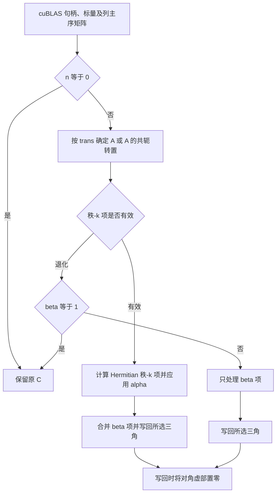
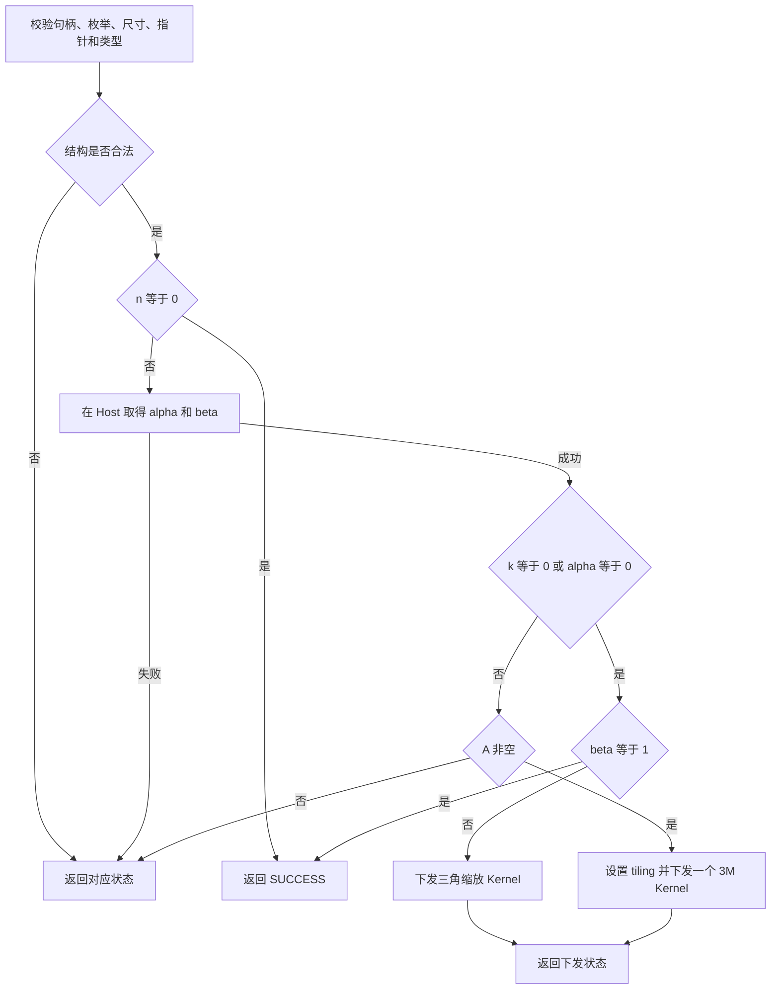
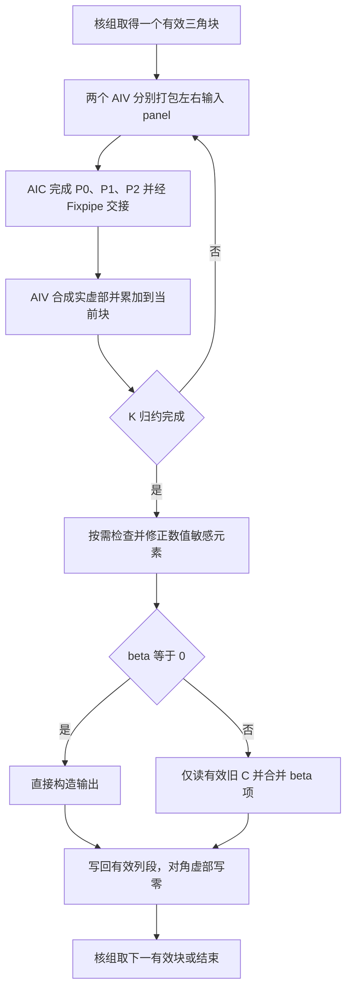

# aclblasCherk3mEx 算子设计文档

## 1. 需求背景

### 1.1 需求来源

11 月 CANN 社区任务要求在 Ascend 950PR（arch35）上为 `ops-blas` 新增 `aclblasCherk3mEx`。该接口用于复数 Gram 矩阵的秩-k 更新，调用方只需存储和更新 Hermitian 矩阵的一侧。开发采用 Ascend C 和现有的 BLAS 句柄式 Kernel 直调入口。

### 1.2 背景介绍

对标接口为 `cublasCherk3mEx`，接口参数顺序、列主序、实数标量和 A/C 类型组合与任务书一致。Netlib CHERK 提供三角访问、对角虚部和零系数分支的参考语义。GPU 内部实现细节以公开接口能够确认的范围为限。 [cuBLAS CHERK3MEx](https://docs.nvidia.com/cuda/cublas/index.html#cublascherk3mex) · [Netlib CHERK](https://netlib.org/blas/cherk.f)

仓内 `aclblasCherk` 提供同类句柄、三角处理和标量读取的实现参考，其 arch35 计算路径采用四次实数乘。新接口在单次 launch 内完成 Hermitian 3M，支持交错的复数 INT8 输入。分块搬运和 Cube/Vector 的片上交接参考仓内 `cgemm_onchip_kernel.h`，索引、共轭和三角写回按本算子单独设计。 [HERK Host](https://gitcode.com/cann/ops-blas/blob/master/blas/herk/arch35/cherk_host.cpp) · [CGEMM 片上内核](https://gitcode.com/cann/ops-blas/blob/master/blas/gemm/arch35/cgemm_onchip_kernel.h)



## 2. 需求分析

| 需求 | 设计落点 |
| --- | --- |
| 原地更新 Hermitian 矩阵 | 每个输出块独占所覆盖的有效 C 元素，且只访问 `uplo` 所指定的列内区间 |
| 两种 A 输入格式 | 按交错 COMPLEX64 或复数 INT8 读入，INT8 分量精确提升至 FP32 |
| N/C 两种运算模式 | 按列主序映射 `X = op(A)`，搬入时应用共轭符号 |
| 单次 Kernel 下发 | 3M 执行、实虚部合成和 C 写回都在同一计算 Kernel 内完成 |
| 退化与非法输入 | Host 按顺序校验，结构合法后选择空操作、缩放或秩-k 计算 |
| 精度与性能 | 精度对比独立的 CBLAS golden，性能对比 GPU 的 Kernel 耗时 |

## 3. 详细设计

### 3.1 算子原型

公开声明放在 `include/cann_ops_blas.h`，复用该头文件的 C 链接声明与 `cann_ops_blas_common.h` 中的类型。

```cpp
aclblasStatus_t aclblasCherk3mEx(
    aclblasHandle_t handle,
    aclblasFillMode_t uplo,
    aclblasOperation_t trans,
    int n, int k,
    const float* alpha,
    const void* A, aclDataType Atype, int lda,
    const float* beta,
    aclblasComplex* C, aclDataType Ctype, int ldc);
```

| 参数 | 语义及约束 |
| --- | --- |
| `handle` | 已创建的 ACL BLAS 句柄。计算下发至其绑定的 stream。 |
| `uplo` | `ACLBLAS_UPPER` 更新 `i ≤ j`，`ACLBLAS_LOWER` 更新 `i ≥ j`。 |
| `trans` | `ACLBLAS_OP_N` 取 A，`ACLBLAS_OP_C` 取 A 的共轭转置。 |
| `n, k` | C 的阶数及收缩维大小，分别为非负整数。 |
| `alpha, beta` | 指向 FP32 实标量的非空指针。沿用 HERK 的位置约定，两者同为 Host 或同为 Device 指针。 |
| `A, Atype` | Device 输入，N 模式逻辑形状为 `n × k`，C 模式为 `k × n`。`ACL_COMPLEX64` 每个复元素含两个 FP32 分量，占 8 字节。此接口的 `ACL_INT8` 每个复元素含有符号 `(real, imag)` 两个 INT8 分量，占 2 字节，无缩放因子或零点。 |
| `lda` | 以复元素计的列步长。N 模式至少为 `max(1, n)`，C 模式至少为 `max(1, k)`。 |
| `C, Ctype` | Device 上原地读写的逻辑 `n × n` 矩阵，固定为 `ACL_COMPLEX64`。所选三角和对角线构成有效区域。 |
| `ldc` | 以复元素计的列步长，至少为 `max(1, n)`。 |

### 3.2 数学公式与布局

令 `X = op(A) = R + iI`。对目标三角内的下标 `(i,j)`，计算 `C_new[i,j] = alpha · (X Xᴴ)[i,j] + beta · C_old[i,j]`。三个实数矩阵乘及其合成关系如下。

```text
P0 = R · Rᵀ
P1 = I · Iᵀ
P2 = (R + I) · (R − I)ᵀ

Re(X Xᴴ) = P0 + P1
Im(X Xᴴ) = (P2 − P0) + P1 = I · Rᵀ − R · Iᵀ
```

从零开始编号。对逻辑项 `X[i,t]`，N 模式读 `A[t*lda+i]`。C 模式读 `A[i*lda+t]` 并对虚部取负。两侧输入都先映射到这套 X 坐标，再分别打包左侧的 `R, I, R+I` 和右侧的 `R, I, R−I`，右侧按收缩维转置布置。INT8 在 FP32 域取负，因此虚部 `−128` 的共轭可精确得到 `+128`。

C 的复元素偏移为 `j*ldc+i`。例如 `n=2, k=1` 时，若 X 两行为 `1+2i` 和 `3+4i`，则乘积上三角非对角值为 `11+2i`，下三角对应值为 `11−2i`。这个符号关系同时适用于 N 和 C 两种布局。对角实部只需要同一行的 `P0+P1`，写回虚部固定为 `+0.0f`，旧 C 的对角虚部不参与计算。

### 3.3 Host 侧设计

按下表顺序返回第一个错误。与 cuBLAS 的状态码差异按项目任务书定义。

| 顺序 | 检查 | 返回状态 |
| --- | --- | --- |
| 1 | handle 为空 | `ACLBLAS_STATUS_HANDLE_IS_NULLPTR` |
| 2 | uplo 或 trans 不属于支持集，包括 `ACLBLAS_OP_T` | `ACLBLAS_STATUS_INVALID_ENUM` |
| 3 | n 或 k 为负，或 lda/ldc 低于各自下界 | `ACLBLAS_STATUS_INVALID_VALUE` |
| 4 | alpha 或 beta 为空 | `ACLBLAS_STATUS_INVALID_VALUE` |
| 5 | Atype/Ctype 不属于 `(ACL_COMPLEX64, ACL_COMPLEX64)` 或 `(ACL_INT8, ACL_COMPLEX64)` | `ACLBLAS_STATUS_NOT_SUPPORTED` |
| 6 | `n > 0` 时 C 为空 | `ACLBLAS_STATUS_INVALID_VALUE` |
| 7 | `n > 0` 时标量位置不可识别或 Host/Device 混用 | `ACLBLAS_STATUS_INVALID_VALUE` |
| 8 | `n > 0 && k > 0 && alpha != 0` 时 A 为空 | `ACLBLAS_STATUS_INVALID_VALUE` |

结构校验通过且 `n=0` 时立即返回 `ACLBLAS_STATUS_SUCCESS`。其余情况在 Host 取标量快照。Host 标量直接读值。Device 标量借鉴仓内 HERK 辅助函数，在绑定 stream 中按序做 D2H，再同步该次读值，以便正确处理 stream 上先前排入的标量写入。拷贝目标在已排队的操作完成前保持有效。标量读取失败时返回仓内对应错误状态，计算 Kernel 仍按该 stream 异步下发，读回 C 由调用方等待 stream 完成。



`alpha=0` 或 `k=0` 时，A 可以为空。若此时 `beta=1`，C 的存储逐字节保持原样，包括已有的对角虚部。只有实际写回 C 时才强制对角虚部清零。`beta=0` 时直接形成输出，不读取旧 C，即使旧值含 NaN 也不会带入结果。

内部 tiling 随 kernel 参数按值下发，包含 `n/k/lda/ldc`（复元素）、`uplo/trans/Atype`、`alphaVal/betaVal`、M/N/K 物理块尺寸和有效核组数。Host 根据平台核数、有效块数和片上容量选择 AIV 缩放、AIV 小矩阵或 MIX。用 64 位计算列偏移、字节偏移及任务总数。若搬运接口的 stride 字段容纳不下列跨度，则逐列发起合法长度的搬运。

内部 Kernel 入口原型如下。缩放入口只接收 C 及 tiling。小矩阵入口使用 AIV 完成 3M。MIX 入口以核组数为下发维度，workspace 仅用于同步协议约束下的标记存储。

```cpp
extern "C" __global__ __aicore__ void cherk3m_ex_scale_kernel(
    GM_ADDR c, Cherk3mExTilingData tiling);
extern "C" __global__ __aicore__ void cherk3m_ex_small_kernel(
    GM_ADDR a, GM_ADDR c, Cherk3mExTilingData tiling);
extern "C" __global__ __aicore__ void cherk3m_ex_mix_kernel(
    GM_ADDR a, GM_ADDR c, GM_ADDR workspace, Cherk3mExTilingData tiling);
```

### 3.4 Kernel 侧设计

**输出分块与分核。** 令方块边长为 `B`，`T=ceil(n/B)`。按块列枚举所选三角的 `T(T+1)/2` 个块。上三角块列 `bj` 的起始序号为 `bj(bj+1)/2`，块行为 `0…bj`。下三角起始序号为 `bj(2T−bj+1)/2`，块行为 `bj…T−1`。用 64 位前缀和反解序号。在 `G` 个核组中，第 `g` 组处理序号 `g, g+G, …`。每组完成所属块的全部 K 归约，独占该块的写回，无跨组归约或对 C 的原子累加。

**三角边界。** 只调度与目标三角相交的块。在对角块中，每列 `j` 的读写区间取块行区间与 `[0,j+1)`（上三角）或 `[j,n)`（下三角）的交集。非对角块直接使用裁剪到 `n` 的有效行区间。整段满足搬运要求时批量读写，非对齐首尾按精确的元素地址读写。对角单独读取旧实部并写回新实部和零虚部。列填充和另一三角均无 GM 读写。

**缩放及小矩阵。** 缩放使用 AIV 按同一三角区间处理 C，`beta=0` 直接填零，其他缩放只读取有效旧值。小矩阵初步以 `n ≤ 32 && k ≤ 64` 为分界，采用单次 AIV 下发，以列内有效元素为线程任务，在本地完成同样的三个实数内积和尾处理。开发时结合 950PR 的下发与执行耗时确定分界。

**MIX 计算。** 大形状采用一组 AIC 与两个 AIV。每个 K panel 的有效 A 元素从 GM 搬入，两个 AIV 分别准备左右输入，拆分交错元素、应用共轭、生成三路 FP32 数据并按 Cube 布局写入 L1。AIC 在同一次下发中按 `P0/P1/P2` 做 FP32 MMAD，片上交接采用仓内 arch35 的 UB↔L1 和 L0C→UB 路径，关闭 HF32 截断。两个 AIV 各接收输出块中不重叠的列范围，按顺序合成每个 panel 的实部和虚部，在 UB 内累加，最后乘 alpha、按需读取并合并旧 C，再写回。使用实际 `n/k` 限制 GM 读写，Cube 块尾部在片上补零。



**流水与容量。** 每组先按单槽实现双向交接。AIV 各自发布 input-ready，AIC 等待两个操作数均写完并读完 L1 后归还输入槽。AIC 在 Fixpipe 实际完成后发布 output-ready，两个 AIV 各自归还结果槽后 AIC 才能覆盖。空尾段仍参加交接。双槽仅在事件配对、尾轮排空和空间检查通过后启用，无需全核栅栏。

以 `B=64` 和 `BK=64` 作为 MIX 的初始候选。记 `W=4×B×BK`、`Q=4×B×B`，单位为字节。实际选块按平台、Cube 对齐和 Fixpipe 传输合法性核算物理尺寸。

| 位置 | 单槽主要开销 | 64×64×64 的主要开销 |
| --- | --- | --- |
| L1 | 左右各三路，合计 `6W`，输入双槽为 `12W` | 96 KiB，输入双槽 192 KiB |
| L0A / L0B | 每侧当前一路 `W` | 各 16 KiB |
| L0C | 当前 panel 三个累加块 `3Q` | 48 KiB |
| 每个 AIV 的 UB | 原始输入 `2W`、打包 `3W`、半块三路结果 `3Q/2`、实虚累加和补偿 `2Q`、C 搬运及输出缓冲 `Q` | 共 152 KiB，另计对齐和控制开销 |

同一面板输入缓冲可在后继面板复用，C 的输入与输出使用同一片上缓冲。MIX 路径仅通过句柄 workspace 共享两侧的异常标记，无需在 GM 暂存三路乘积或预转换整块 A。每个核组、每个槽给左右 AIV 分配各一条对齐的标记记录，记录有效输入是否含 NaN/Inf 或预加减溢出。两个 AIV 在发布 input-ready 前写入各自的记录，并在接收 output-ready 后读取两侧记录。槽在两侧读取完毕后才复用记录。workspace 所需字节数为 `2×核组数×槽数×对齐后记录大小`，按绑定 stream 排序复用。若需扩容，沿用句柄对已有在途操作和用户 workspace 的管理规则。

### 3.5 数值处理、工程落点与约束

- **有限输入。** 3M 合式中的 FP32 舍入会放大虚部抵消。每个 K panel 先合成复数分量，再对分量做补偿求和。非对角元素以 `abs(Im_partial) / (abs(P0)+abs(P1)+abs(P2))` 作为抵消筛选指标，分母为零时跳过。分段筛选标记保留至写回前，同时检查分段累加后产生的抵消。命中时在同一 Kernel 的 AIV 上按原始 A 重算虚部。重算以 FP32 的误差拆分保留 `R±I` 低位，并用 FMA 提取乘法舍入残差，维持三项分解。筛选阈值与 K panel 的粒度按精度和性能用例定标。
- **非有限分量及中间溢出。** 有效秩-k 路径检查面板标记和三路结果。触发后 AIV 复查对应原始行对。对全有限行对，中间溢出由分段幂次缩放后的 3M 重算处理，按指数恢复后再合并 alpha/beta 项。对含 NaN/Inf 的行对按 CHERK 的直接分量规则处理，以保留参照语义。此修正在同一次下发内完成，遵守零系数的不读分支和对角规则。
- **工程位置。** `blas/herk/arch35/` 规划新增 `cherk3m_ex_host.cpp`、`cherk3m_ex_kernel.cpp` 及两侧共用的 tiling 声明。后续测试目标挂在 `test/herk/cherk3m_ex/arch35/`，算子说明补充到 `blas/herk/README.md`。算子入口独立于 `aclblasCherkEx`。
- **支持范围。** 本设计面向 Ascend 950PR（arch35）的 BLAS 直调。A/C 均为带前导维度的列主序 ND；调用方保证 C 的可写区与 A 的可读区不重叠。n、k 在运行时参与 tiling。输入无广播或视图语义，结果按精度容差验收，浮点归约顺序无逐位一致性保证。

## 4. 可维可测分析

### 4.1 精度与性能标准

| 项目 | 后续验收口径 |
| --- | --- |
| 精度 | CBLAS `cblas_cherk` 作 golden。INT8 实虚分量精确提升后送入 golden。对所选三角实虚分量应用 `abs(actual−golden) ≤ atol+rtol×abs(golden)`，取 `atol=rtol=2^-13`，匹配比例至少 0.99。最大绝对误差按任务书的 `1e-2` 或 `32×ULP` 上限判定。 |
| 性能 | `msprof op` 读取 `Task Duration(us)`，先预热 5 次，再取 10 次有效样本的均值并换算成 ms。以 `gpu_ms / npu_ms` 为倍率，单例至少 0.4，全部性能用例倍率的算术平均至少 0.5。COMPLEX64 使用同参基线，补充的复数 INT8 用例沿用同参 COMPLEX64 的基线。 |
| 内存 | 任务书无独立内存验收项。实现时检查实际片上预算、workspace 容量及缓冲生命周期。 |

后续覆盖任务包中的 1000 条精度用例（包括 4 条 `TC_3M_*`）及 200 条性能用例。精度额外检查上/下三角与 N/C 的全部组合、复数 INT8 的 `−128/127`、非法枚举及参数、非整块 n/k 和带 padding 的 lda/ldc。以哨兵检查另一三角及填充区，分别覆盖退化 quick return、`alpha=0` 时 A 为空或含 NaN、`beta=0` 时旧 C 含 NaN、对角旧虚部含特殊值和 Device 标量的 stream 顺序。在 NaN/Inf 用例中先按 golden 匹配分量分类和 Inf 符号，有限分量采用上述容差。 [混合容差标准](https://gitcode.com/cann/opbase/blob/master/docs/zh/ops_precision_standard/mixed_tolerance_standard.md)

### 4.2 兼容性分析

通过公共头文件新增接口，复用既有句柄和类型。原有 HERK 接口的调用路径与 ABI 保持不变。新接口沿用 BLAS 的列主序和实标量约定，并按任务书对非法 uplo/trans 返回 `ACLBLAS_STATUS_INVALID_ENUM`。FP32 3M 的舍入次序与直接复数乘法存在差异，比较以任务书规定的容差为准。
