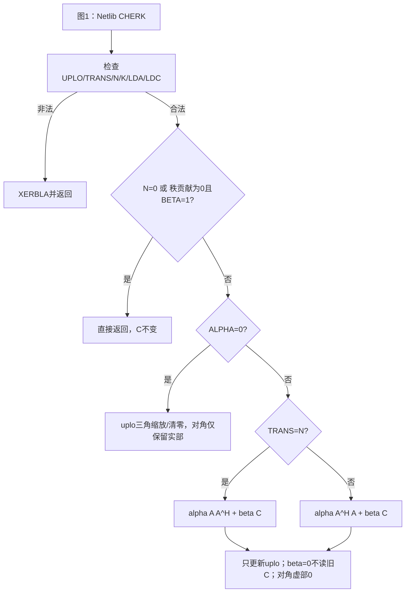
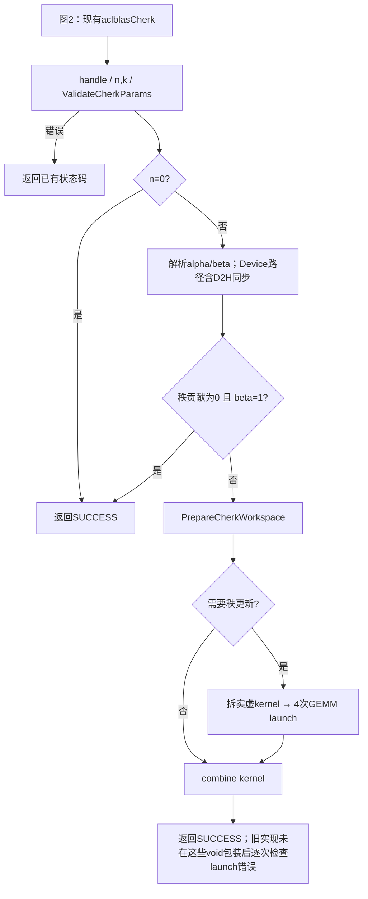
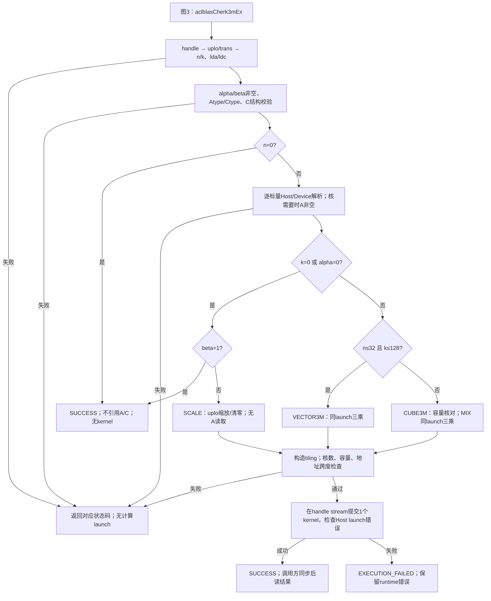
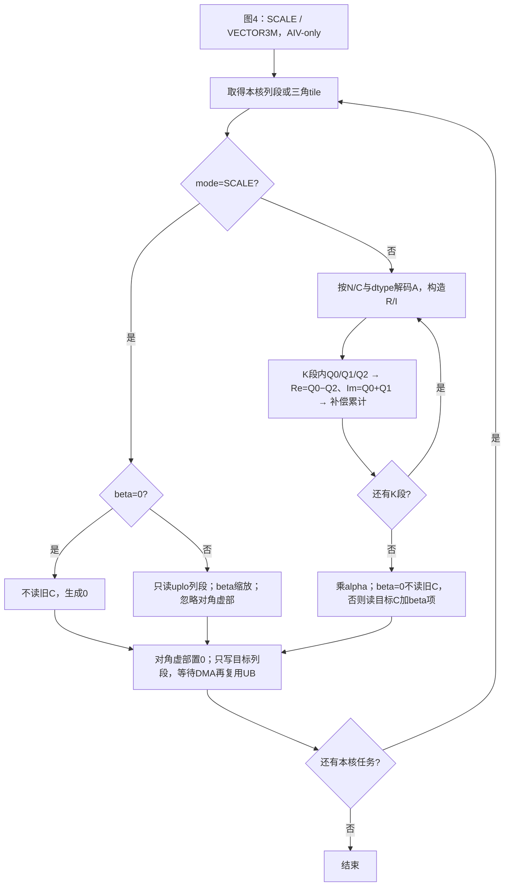
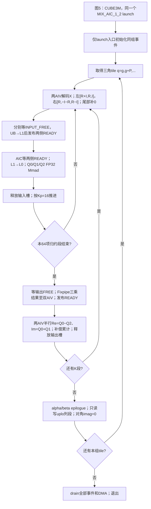

# 需求背景（required）

## 需求来源

本文为“11月社区任务-aclblasCherk3mEx算子开发（950）”的设计文档，面向950PR架构、CANN 9.1.0及以上版本。编制日期：2026-11-25（北京时间）。本文描述已获用户允许修订的等价三实乘算法、约束及验证计划；本版内部复核不代表NPU精度性能通过、官方评审通过或设计合入。已核对本题报名、2026-12-10截止日期及[本题官方任务指南](https://gitcode.com/cann/ops-blas/discussions/89)。公开任务材料未提供单独编号，目录使用官方任务完整名称和提交者GitCode用户名zhangwei0402，目录命名及BLAS完成阶段通用结构适配在Q-007中请官方确认。

| 设计依据 | 固定版本或核对内容 | 用途及边界 |
| --- | --- | --- |
| 本地任务书 | 正文（档案T）；ZIP SHA256 `7bc8aefd57e14374c2e981f64e53e2d4e448b2de38b7ac55d4718298456d9659`；正文 SHA256 `8f1e957e44b6ba8d0d41351d8e54c7b9682046167d54ab3873ec315759f577fe` | 正文无正式版本号；ZIP时间2026-11-24只作来源标识；技术契约优先于模板范例 |
| 已有拆解 | 任务书拆解（档案BREAK），SHA256 `162f89457ffbd942b754691c8b539844c80fec3099388799e7c12536d74b167f` | 沿用R-001—R-057、V-001—V-029、D-001—D-016、Q-001—Q-012；不把资料缺口改成已确认 |
| 官方设计模板 | [固定模板][DT]，提交 `72ca53083296fb2cc81c80e9cf4cf14bddbdaa20` | 保留四个原主章和规定表头，按指南增设特性交叉分析；模板中的示例算子、设备、公式不适用 |
| 官方设计检查表 | [设计文档CheckList][CK]；已读取公开正文 | 已从公开HTML内的画布文本读取内容：标杆与新实现流程图、差异、LocalMemory公式、tilingKey、交叉分析等均落实；PR/CLA/构建按实际提交版本另行检查 |
| 官方参考源码 | [ops-blas固定树][TREE]，`ab8e0f9098a8af77e7ed7b8c506db84d5fda3260` | 从官方cherk文件最后修改提交选取的设计参考，不是官方指定基线，也不声称是当前master HEAD；以下源码路径均相对于此固定树，可据提交号回查 |
| 精度/性能依据 | [固定提交精度标准][S]、[Netlib CHERK][NET]、[cuBLAS Cherk3mEx][CUDA]、原CSV与gpu_baseline.csv | 精度阈值与性能公式见本文可维可测分析；GPU基线重复键仍待Q-003，不能用脚本字典覆盖代替确认 |

## 背景介绍

### aclblasCherk3mEx算子实现优化

本题新增独立Ex接口，目标是在950PR上以三个实数矩阵乘完成Hermitian秩-k更新，并支持complex64和complex-int8两类A输入。正式实现仓为ops-blas；新增实现位于`blas/herk/arch35/`，测试位于`test/herk/cherk3m_ex/arch35/`，公共声明位于`include/cann_ops_blas.h`，说明位于`blas/herk/README.md`。本题不使用TBE或ACLNN调用链，TBE源码路径、算子信息库文件路径均不涉及，不能用模板中的TBE目录代替本BLAS依据。

参考版本公共头只查到非Ex的`aclblasCherk`、`aclblasCherkx`，未找到`aclblasCherkEx`或`aclblasCherk3mEx`声明。本设计增加后者，保持存量接口签名不变，不调用独立任务`aclblasCherkEx`。参考版本中的已有行为与本任务新契约存在差异，下面逐项登记；“可参考”不等于整段复用。

| 参考模块及入口 | 已核实的现有行为 | 本题采用或调整 |
| --- | --- | --- |
| `blas/herk/arch35/cherk_host.cpp`：aclblasCherk、ValidateCherkParams、LaunchCherkKernel | handle后先检查n/k；非法uplo/trans返回INVALID_VALUE；A的空指针检查早于读alpha；普通路径先拆A，再4次gemm_kernel_do，最后合并 | 新入口按任务书重新校验，非法枚举返回INVALID_ENUM，alpha=0允许空A；重新组织成单launch的Hermitian 3M，不复用四次GEMM管线 |
| 同文件：PrepareCherkParams；`blas/common/helper/host_utils.h` | Host/Device标量可通过指针属性识别；已有cherk拒绝alpha/beta混合位置；Device标量通过D2H及stream同步取值 | 新入口分别解析两个标量，支持两者同为Host/Device；混合位置也由同一逐指针方法处理，作为工程补充，不引入任务书未写的混合位置禁令；明确标量准备可能同步，最终计算launch仍异步 |
| `blas/herk/arch35/cherk_kernel.cpp`：ProcessBlock、InterleaveAndStore | beta=0也会LoadCOld，部分LOWER对角块会恢复并整段写回非目标区域 | 本题不复制这一行为：beta=0不读取旧C；读写只覆盖真正的uplo列段，未引用三角不做读改写 |
| `blas/gemm/arch35/cgemm3m_host.cpp`及gemm_host_common.h | 3m公开入口转入LaunchComplexGemm(...,true)，共用复杂GEMM调度 | 只参考三实乘及FP32处理思想，不调用通用GEMM公开入口代替本题实现 |
| `blas/gemm/arch35/cgemm_compute_kernel.cpp`及cgemm_onchip_kernel.h | 已有MIX_AIC_1_2管线、FP32 Mmad、HF32禁用、UB↔L1输入与双AIV输出同步，三乘可在同一kernel完成 | 参考同步和搬运机制，自行实现X·X^H、int8解码、三角枚举和实数alpha/beta；不搬用通用全矩阵写回、非有限修复或舍入专用选择路径 |
| `test/herk/cherk/arch35/cherk_test.cpp` | 三角比较/非目标区域保护可参考；MakeTriangleVerifyConfig中另有max(limit,1e-4*k)放宽，对角检查仅在beta=0进行 | 新测试不继承该k相关放宽；所有实际计算/缩放分支检查对角虚部；按本题2^-13、0.99与ULP联合标准判定 |
| `blas/CMakeLists.txt`、`test/CMakeLists.txt`、`cmake/test.cmake` | 实现递归收集；--ops按目录/文件前缀过滤；测试可发现family/interface路径并按架构检查源码 | 使用cherk3m_ex_前缀，新增本题测试CMake注册；不额外引入三次GEMM依赖或无用实现CMake文件 |

上述文件均指固定树版本；可在[固定源码目录][SRC]回查。硬件头和cgemm专用头的L1容量常量不一致，列为新增Q-013；分块按32KiB保守上界并核运行时容量，不能把512KiB写成本题已证实硬件事实。

### aclblasCherk3mEx现状分析

cuBLAS是公开语义和性能对标，未取得其内部GPU kernel源码，不推测它的内部调度。下表为本题新增接口的完整参数面；参考非Ex cherk没有Atype/Ctype参数，不能据非Ex签名遗漏这两个新属性。

| 参数 | 参数含义 | 数据类型 | 支持数据类型 | 约束 | 形状 |
| --- | --- | --- | --- | --- | --- |
| handle | 输入，上下文与stream | aclblasHandle_t | 仓内共享句柄 | 已创建且非空；空为HANDLE_IS_NULLPTR | scalar |
| uplo | C的读写三角 | aclblasFillMode_t | UPPER、LOWER | 非法值为INVALID_ENUM | attr |
| trans | 构造X=op(A) | aclblasOperation_t | OP_N、OP_C | OP_T及其他值为INVALID_ENUM | attr |
| n | C阶数 | int | 非负整数 | n=0合法；负值INVALID_VALUE | C逻辑n×n |
| k | 秩更新归约长度 | int | 非负整数 | k=0按beta分支；负值INVALID_VALUE | X逻辑n×k |
| alpha | 输入实数乘数 | const float* | FLOAT32实数 | 有效Host或Device指针；空为INVALID_VALUE；无缺省值 | scalar |
| A | 输入矩阵 | const void* | COMPLEX64或交错complex-int8 | Device列主序；需要秩更新时非空；两实分量独立 | N：n×k，C：k×n |
| Atype | A解释方式 | aclDataType | ACL_COMPLEX64、ACL_INT8 | 不支持类型/组合为NOT_SUPPORTED | attr |
| lda | A前导维度 | int | 正整数 | N≥max(1,n)，C≥max(1,k) | 列跨度，单位复元素 |
| beta | 输入实数乘数 | const float* | FLOAT32实数 | 有效Host或Device指针；空为INVALID_VALUE；无缺省值 | scalar |
| C | 输入/原地输出 | aclblasComplex* | COMPLEX64 | Device可写；n>0必需；仅uplo；不与A有效读区重叠 | 分配ldc×n，逻辑n×n |
| Ctype | C解释方式 | aclDataType | ACL_COMPLEX64 | 其他值为NOT_SUPPORTED | attr |
| ldc | C前导维度 | int | 正整数 | ≥max(1,n)，包括退化分支 | 列跨度，单位复元素 |

为给出可核对的标杆流程，图1采用任务书直接引用的[Netlib CHERK][NET]实际源码：参数检查、quick return、alpha=0缩放、N/C两公式、beta=0不读旧C及对角实数处理。它是CPU数学参考，不是cuBLAS内部GPU实现图。



图2按固定版本非Ex `cherk_host.cpp`实际调用路径画出，便于识别本题必须替换的多launch实现。



### aclblasCherk3mEx功能分析

令X=R+iI=op(A)，输出`C=alpha·X·X^H+beta·C`。trans=N直接取A；trans=C读取k×n存储并对虚部取负。只更新uplo指定三角，另一三角由Hermitian对称性隐含。实际更新/缩放时对角虚部写0；结构合法的quick return完全保持C，包括原对角虚部。n=0不引用A/C且不启动kernel。alpha=0或k=0时不引用A；beta=0不读取旧C。

# 需求分析（required）

## 需求描述

新增共享签名`aclblasCherk3mEx`和arch35实现，使用Ascend C直接launch、950PR、CANN≥9.1.0。支持两种A/C有效组合，CPU golden采用Netlib BLAS3.10.0。正常路径在一个融合launch内完成输入解码、Hermitian 3M、结果合并和三角写回；不经全矩阵GM预处理或独立GEMM API，不依赖CherkEx。

设计参数T、Kp、分段归约长度和小尺寸分派阈值是本方案的工程选择，需按V项在设备上验证，不是官方验收阈值。本文不预先宣称精度或性能已达标。

## 需求拆解

每行沿用原R编号，写出模块/入口、拟处理和观察方式；纯流程或交付要求写其后续执行位置，不伪造代码模块。验证编号的完整输入、判据和证据见末章。

| 需求或对象 | 需实现或保持的行为 | 适用条件、例外与边界 |
| --- | --- | --- |
| R-001（必须） | **契约：**适配 950PR（arch35），自验覆盖此一种款型；CANN ≥9.1.0。**落点：**环境/Build入口：仅注册arch35路径，执行前记录950PR与CANN；观察设备信息和构建结果。 **观察：**V-001 | 不把 §8 中 A2/A3 示例当作本题验收款型；来源：〔T〕 §1、§3.1 |
| R-002（必须） | **契约：**使用 Ascend C、ops-blas 句柄式 BLAS 工程，handle 绑定 stream 直调 NPU kernel。**落点：**Host公共入口→句柄stream→独立私有kernel；新文件放herk/arch35，不调ACLNN。 **观察：**V-001、V-013、V-027 | 使用 `blas/herk/arch35/` 实现与 `test/herk/cherk3m_ex/arch35/` 测试路径；来源：〔T〕 §1、§2.2 |
| R-003（必须） | **契约：**在 `include/cann_ops_blas.h` 新增 §2.3 的 13 参数签名及 `aclblasStatus_t` 返回值。**落点：**公共头增加原型，Host导出extern C入口；编译/符号与参数顺序核对。 **观察：**V-001、V-002 | 与其他产品线共用；禁止私有平行 API；参数顺序与 cuBLAS 对应，无需额外映射说明；来源：〔T〕 §2.3、§3.5、§7.3 |
| R-004（必须） | **契约：**`aclblasComplex`、状态码及句柄沿用 `include/cann_ops_blas_common.h`。**落点：**直接使用共享common头，结构/枚举不重新声明；静态与ABI检查。 **观察：**V-002 | 复数实/虚各 float32；后续以受测仓版本核对真实定义；来源：〔T〕 §2.1、§2.3 |
| R-005（必须） | **契约：**计算 `C = alpha*X*X^H + beta*C`，X=op(A)。**落点：**Math/Kernel用Hermitian三乘，按目标元素取值；CPU golden比较。 **观察：**V-003、V-014、V-017 | Hermitian 秩-k，不得把共轭转置乘积写成 X·X^T；来源：〔T〕 §2.1 |
| R-006（必须） | **契约：**trans=N 时 A 为 n×k、X=A；trans=C 时 A 为 k×n、X=A^H；列主序。**落点：**Kernel输入解码按N/C地址公式与共轭符号构造X，不改变逻辑n×k。 **观察：**V-003、V-006 | op(A) 的逻辑形状两分支均 n×k；〔A〕 行 17 的 k×n 指存储 A，不能当作 op(A) 的输出形状（Q-010）；来源：〔T〕 §2.1、§2.4 |
| R-007（必须） | **契约：**仅 uplo 指定的 C 上/下三角被引用和写回；另一三角隐含共轭对称。**落点：**Kernel按uplo三角tile/列段处理；只读写有效目标区，哨兵及读路径检查。 **观察：**V-004、V-027 | C padding 与另一三角保持不变；张量 Hermitian 合法性由调用方保证，不扫描数据；来源：〔T〕 §2.1、§2.5；〔A〕 验证策略 |
| R-008（必须） | **契约：**忽略输入对角虚部，计算后将 C 对角虚部置 0。**落点：**Epilogue实际计算/缩放后写对角imag=0；Host quick return不进入Epilogue。 **观察：**V-005、V-010 | quick return 明确 C 不变，是一般置零规则的例外；附件检查容差 abs(imag)≤atol 不降低实现置零义务；来源：〔T〕 §2.1、§3.5；〔A〕 验证策略 |
| R-009（必须） | **契约：**alpha/beta 为实数 FLOAT32 标量；同时支持 Host 与 Device 指针位置。**落点：**Host分别调用逐标量Host/Device解析，传绑定stream；标量传值进tiling。 **观察：**V-002、V-008、V-013 | 标量空指针按 R-017；不得引入复数标量接口；来源：〔T〕 §2.4、§2.5 |
| R-010（必须） | **契约：**支持 A=ACL_COMPLEX64 或 ACL_INT8，C=ACL_COMPLEX64；其他组合返回 NOT_SUPPORTED。**落点：**Host支持集检查后分派typeBit；其他组合立即NOT_SUPPORTED。 **观察：**V-003、V-007、V-015 | ACL_INT8 表示 complex-int8；不把 ACL_FLOAT 负向用例变成支持能力；来源：〔T〕 §2.1、§2.4 |
| R-011（必须） | **契约：**int8 A 每元素 `(int8 real,int8 imag)` 交错 2 字节；计算/golden 各分量精确提升为 float。**落点：**输入Pack按2字节复元素解码int8，转FP32后生成R/I/和差；golden同样提升。 **观察：**V-003、V-016 | 对应 cuBLAS CUDA_C_8I；不能按实数 int8 单字节矩阵处理；来源：〔T〕 §2.1、§2.4、§3.2 |
| R-012（必须） | **契约：**n≥0、k≥0；非法 n/k 返回 INVALID_VALUE。**落点：**Host int合法性检查先于调度；零维/零k转专门分支。 **观察：**V-006、V-010、V-011 | n=0/k=0 的行为按 R-019—R-021，不能一概报错；来源：〔T〕 §2.4 |
| R-013（必须） | **契约：**lda≥max(1,n)（N）或 max(1,k)（C）；支持合法 padding。**落点：**Host按trans检查lda；Kernel按复元素步长计算A字节地址。 **观察：**V-006、V-009 | 低于对应下界、0、负数返回 INVALID_VALUE；退化前先结构校验；来源：〔T〕 §2.1、§2.4—§2.5、§3.5 |
| R-014（必须） | **契约：**ldc≥max(1,n)，支持紧凑及 +1/+8/+64 padding。**落点：**Host检查ldc；Epilogue逐列裁剪输出，不外扩到padding。 **观察：**V-004、V-006、V-009 | 低于下界返回 INVALID_VALUE，不能改写 padding；来源：〔T〕 §2.4、§3.5 |
| R-015（必须） | **契约：**handle=nullptr 返回 HANDLE_IS_NULLPTR。**落点：**Host第一步拒绝空handle；测试装配层另加空handle测试。 **观察：**V-008、V-009、V-015 | 单独在测试参数装配层覆盖；CSV 没有 handle 列；来源：〔T〕 §2.4、§3.5；〔A〕 最后一条 |
| R-016（必须） | **契约：**uplo 非 UPPER/LOWER、trans 为 OP_T 或非 N/C 返回 INVALID_ENUM。**落点：**Host枚举检查输出INVALID_ENUM；保留OP_T与cuBLAS的有意差异。 **观察：**V-002、V-007 | OP_T 收窄和非法枚举状态码与 cuBLAS 有意不同；不得改成 cuBLAS INVALID_VALUE；来源：〔T〕 §2.1、§2.3—§2.4 |
| R-017（必须） | **契约：**alpha/beta=nullptr 返回 INVALID_VALUE；需要引用的 A/C 不能为空。**落点：**Host结构与解析阶段按rankZero决定A必需性，n>0 C始终必需。 **观察：**V-008、V-009、V-010、V-011 | n=0 允许 A/C=NULL；k=0 或 alpha=0 允许 A=NULL；n>0 时即使 quick return，C 仍须非空；§2.5 覆盖 §2.4 A 行的一般表述（Q-010）；来源：〔T〕 §2.4、§2.5 校验顺序 |
| R-018（必须） | **契约：**校验顺序：handle → uplo/trans → n/k、lda/ldc → alpha/beta、Atype/Ctype、A/C 等结构参数 → quick return。**落点：**Host按规定四层检查，再做quick return；组内次序仅作为本实现选择。 **观察：**V-009 | 最后结构组内部的更细优先级正文未规定；不得自行承诺某一状态优先；来源：〔T〕 §2.5 引用块 |
| R-019（必须） | **契约：**结构合法的 n=0 返回 SUCCESS，不引用 A/C，不启动 kernel。**落点：**Host n0出口在结构检查后，直接返回，不触发标量值读取或kernel。 **观察：**V-009、V-010 | 标量指针、枚举、前导维等不能因 n=0 而绕过先行校验；来源：〔T〕 §2.5 |
| R-020（必须） | **契约：**n>0 时，k=0 或 alpha=0 且 beta=1：quick return，C 不变，不引用 A。**落点：**Host rankZero且beta1直接返回，测试按C字节不变及launch trace观察。 **观察：**V-010 | 不强制修正此分支原 C 的对角虚部；不能错误归纳成所有 k=0 均 no-op；来源：〔T〕 §2.1、§2.5；[Netlib](https://www.netlib.org/blas/cherk.f) quick return |
| R-021（必须） | **契约：**k=0 或 alpha=0 且 beta≠1：只做 C 的指定三角 beta 缩放，不引用 A。**落点：**SCALE入口仅接触C的uplo列段，beta0零写，其他值缩放并置对角imag0。 **观察：**V-005、V-011 | 对角虚部置零；beta=0 为清零路径；n>0 时 C 非空；来源：〔T〕 §2.1、§2.5、§3.5 |
| R-022（必须） | **契约：**beta=0 时不读取旧 C，C 为 NaN 的输入也须覆盖。**落点：**三条实际写出路径均将betaZero作为加载Cold的分支，beta0完全跳过。 **观察：**V-012、V-018 | 这是“不读旧值”，不是允许 n>0 时 C 指针为空；来源：〔T〕 §3.5 补充特殊场景 |
| R-023（必须） | **契约：**Hermitian 3M：P0=Xr·Xr^T，P1=Xi·Xi^T，P2=(Xr+Xi)(Xr−Xi)^T；实部=P0+P1，虚部=P2−P0+P1。**落点：**Cube/Vector每K段采用等价Q0=(R_i+I_i)R_j^T、Q1=R_i(−I_j−R_j)^T、Q2=I_i(R_j−I_j)^T，Re=Q0−Q2、Im=Q0+Q1。 **观察：**V-003、V-014 | 允许等价融合；正确虚部为 Xi·Xr^T−Xr·Xi^T；按实际形状与片上容量分派；来源：〔T〕 §2.1 第7条、§2.5 |
| R-024（必须） | **契约：**三次实数乘在同一次 kernel launch 内完成；基于非 Ex cherk 和 cgemm3m 参考自行实现。**落点：**正常调用只提交一个本题3M kernel；没有GEMM/CherkEx API依赖。 **观察：**V-014 | 禁止三次独立 GEMM 拼接；禁止依赖尚未合入的 aclblasCherkEx；不要求与非3M逐位相同；来源：〔T〕 §2.1、§2.2 |
| R-025（必须） | **契约：**C 原地覆写；调用方保证 C 可写区域与 A 可读区域不重叠。**落点：**Kernel只写入参C，无视图/新输出；不为非法A/C重叠加复制路径。 **观察：**V-004、V-027 | 不返回视图；不要求为调用方违反别名约束定义结果；来源：〔T〕 §2.5 |
| R-026（必须） | **契约：**kernel 在 handle 绑定 stream 上异步执行；Host 读回结果前同步对应 stream。**落点：**Host沿handle stream提交，GTest同步再读回；明确Device标量准备可能同步。 **观察：**V-013 | 接口返回不代表设备计算完成；来源：〔T〕 §2.5 |
| R-027（不涉及） | **契约：**任意非连续内存布局、AutoContiguous/ViewCopy、广播、0维Tensor、随机算子精度策略不涉及。**落点：**公开文档写明排除项，不增加广播/任意view临时区；仍支持ld padding。 **观察：**V-027 | 仍须支持 lda/ldc 带 padding；标量用指针传递；来源：〔T〕 §2.5、§3.2 |
| R-028（允许） | **契约：**不要求专门 dynamic shape 和逐位确定性；Host 按运行时 n/k tiling/launch。**落点：**真实n/k与容量决定key；禁用HF32，K段补偿；不按测试名或种子分派。 **观察：**V-014、V-017、V-027 | 不得按测试编号或随机种子分派；每次结果仍须满足精度阈值；来源：〔T〕 §2.5 |
| R-029（不涉及） | **契约：**内存验收指标与内存 case 不涉及。**落点：**不生成内存验收阈值；资源预算是工程正确性；组包按Q-006决定占位。 **观察：**V-028 | 附件生成预算不变成硬件限制；交付树中内存文件的占位策略待核（Q-006）；来源：〔T〕 §3.4、§4 |
| R-030（必须） | **契约：**golden 用 CPU Netlib BLAS 3.10.0 非3M cblas_cherk；int8 先精确提升。**落点：**测试golden头连接Netlib CBLAS非3M，dtype解码独立于NPU实现。 **观察：**V-016、V-017 | 允许 float64 cblas_zherk 后收窄 complex64；只比较指定三角实/虚分量，不要求逐位相等；来源：〔T〕 §3.1—§3.2、§3.5 |
| R-031（必须） | **契约：**精度用混合容差：rtol=atol=2^-13，matched_ratio≥0.99，并满足最大绝对误差上限。**落点：**新测试使用混合容差及动态ULP，不照搬MERE/MARE或旧cherk按k放宽。 **观察：**V-017、V-018 | 引用标准给出上限 max(1e-2,32×ULP(g_low))，锚点为最大有限误差点 golden 收窄至输出 dtype 后值；MERE/MARE 不替代正式标准（Q-001）。NaN 待核（Q-002）；来源：〔T〕 §3.2；[S] §2.1.2—§2.3 |
| R-032（必须） | **契约：**自验精度全量1000条，含4条TC_3M；性能200条，按dtype×规模档覆盖。**落点：**测试加载原1200行并逐条清点，补充清单独立；性能/精度分开执行。 **观察：**V-015、V-019、V-021 | 不因分组减少覆盖；handle空指针须单独覆盖；int8性能补充与分层待核（Q-004）；来源：〔T〕 §3.5；〔C〕 |
| R-033（必须） | **契约：**COMPLEX64常规A/C输入均匀[-5,5] 50%、正态N(0,1) 50%，实/虚独立；int8独立均匀[-128,127]及-128/127边界。**落点：**测试Fill实现全部token和两类分布，数据/种子留档，特殊输入另列。 **观察：**V-015、V-016 | 特殊值独立覆盖；比例适用于生成分布，不要求算子随机；生成器约50/50不等于全部CSV严格各半；来源：〔T〕 §3.5；〔A〕 补充说明 |
| R-034（必须） | **契约：**n/k、uplo/trans、dtype、lda/ldc、标量与特殊场景按§3.5逐项覆盖。**落点：**验证计划逐项枚举特殊/非法与边界交叉；原有case之外另补DX。 **观察：**V-005、V-006、V-007、V-008、V-010、V-011、V-012、V-015、V-018 | 详见第4节输入清单；包括±1e4、空指针、OP_T、Inf/NaN、无效前导维、对角虚部和不读A/C分支；来源：〔T〕 §3.5 参数表与补充项 |
| R-035（必须） | **契约：**使用ops-blas test框架（正文称ATK工具），CSV驱动C++ GTest调用真实API；新增cherk3m_ex子目录并注册构建目标。**落点：**新GTest目标/CMake/param/golden/wrapper负责CSV到公共API全链路。 **观察：**V-001、V-015、V-016 | 测试工程实现RANDOM_GAUSS_0_1、RANDOM_INT8、VALUE_INT8_EXTREME、RANDOM_DIAG_IMAG等附件token；Python脚本不等于C++测试工程；测试目录CMakeLists.txt按贡献指南调用ops_blas_add_gtest_tests()注册，实现目录由上层自动收集，无需增加无用CMake文件；来源：〔T〕 §2.2、§3.5；〔A〕 |
| R-036（必须） | **契约：**编译入口 `bash build.sh --ops=cherk3m_ex --soc=ascend950`。**落点：**沿任务构建命令验证文件前缀筛选及链接；本地设计阶段不宣称已编译。 **观察：**V-001、V-015 | 附件目前只提供CSV和Python，不能宣称已构建成功；工具再生缺陷见Q-011；来源：〔T〕 §2.2；〔VA〕、〔G〕 |
| R-037（必须） | **契约：**性能正式口径为GPU/NPU kernel-to-kernel；NPU用msprof op的Task Duration(us)逐case采集。**落点：**逐case msprof核对整个融合kernel duration，和事件计时分栏保存。 **观察：**V-019、V-020 | GPU gpu_ms是nsys/profiling的kernel-only；us/1000→ms；不得拿[PERF]事件计时代替；来源：〔T〕 §3.3、§3.3.1 |
| R-038（必须） | **契约：**单case NPU_ms≤gpu_ms/0.4，全部性能case加速比算术平均≥0.5，两项同时满足。**落点：**正式统计逐case≤2.5倍延迟且200身份的平均加速比≥0.5；Q-003不静默合键。 **观察：**V-020 | ratio=gpu_ms/NPU_ms；保留200条case身份，不把198唯一key当成200个不同组合；重复key归属待核Q-003；来源：〔T〕 §3.3 |
| R-039（必须） | **契约：**正式采样先warmup5次，后取10个有效样本算术平均；非SUCCESS样本剔除并说明。**落点：**测试循环warmup5、有效10，失败采样剔除补足并记原因。 **观察：**V-019 | §7要求有效采样≥10；须确保剔除后仍足量，不能以失败采样补齐数量；来源：〔T〕 §3.3.1、§7.4 |
| R-040（必须） | **契约：**开发者补采int8路径性能，并沿用同形状COMPLEX64 gpu_ms基线比较。**落点：**额外int8性能拟DX-005六条，数量/分档/平均归属等待Q-004，不更改原200。 **观察：**V-021 | 本包200性能条均COMPLEX64；补采条数、规模覆盖及纳入均值范围待核Q-004；来源：〔T〕 §3.3.6；〔A〕 性能验收 |
| R-041（必须） | **契约：**快速性能回归预置device缓冲；aclrtEvent夹住10次调用，warmup5次；逐case打印[PERF] case=... avg_us=...。**落点：**GTest输出PERF avg_us，附脚本快测；默认缺参考失败，不冒充正式profiling。 **观察：**V-022 | 含下发、不含H2D/D2H/造数/golden；缺PERF不回退GTest整数ms；NO_REF默认失败，--allow-noref只允许开发阶段采集，不是正式通过；来源：〔T〕 §3.3.2；〔A〕；〔VP〕 |
| R-042（必须） | **契约：**算子说明补充blas/herk/README.md中的aclblasCherk3mEx章节与产品支持。**落点：**后续补blas/herk/README.md对应章节与产品支持/参数/约束。 **观察：**V-023、V-026 | 遵循ops-blas规范，说明接口、使用和本题支持范围；来源：〔T〕 §2.2、§4 |
| R-043（必须） | **契约：**按官方模板提交设计文档PR，评审通过并合入设计仓；设计审核通过后进行开发，验收申请前须已合入。**落点：**本design.md为D-001设计稿；实际PR评审与合入状态另行登记。 **观察：**V-023 | 模板Addcdiv/A2/广播仅范例；实际设计路径、任务号与团队名待核Q-007；来源：〔T〕 §4；验收流程图（档案P）；[设计仓README][DR] |
| R-044（必须） | **契约：**交付repo-task-case-gen生成的测试包，含cases.json、perf/、inputs/、golden/、facts.json；区分精度/性能列表并提供readme复现步骤。**落点：**冻结包由正式生成器契约生成，等Q-005补齐入口；当前只定义证据对应。 **观察：**V-024 | 正文还引用aclblasCherk3mEx-自验包/readme.md，本ZIP缺失；冻结包格式/入口待核Q-005，不用现有CSV冒充；来源：〔T〕 §3.5、§4表第2项 |
| R-045（必须） | **契约：**自测报告含用例参数、实部/虚部分别的精度结果及截图、性能数据及截图。**落点：**设计给出实虚误差和逐case profiling证据字段，后续报告用真实测量与截图。 **观察：**V-025 | 正式kernel数据逐case入报告；3M舍入和OP_T有意差异须说明；外部表格细节Q-008待核，已核本地模板字段见D项；来源：〔T〕 §3.2—§3.3、§4；〔A〕 补充说明 |
| R-046（必须） | **契约：**交付件按模板提交IT系统，并同步到私仓新建task_submission目录。**落点：**后续task_submission依7个点名文件组包；本阶段不填报告结果。 **观察：**V-025、V-028 | 文件名按第5节；内存文件Q-006、在线模板Q-008待核；不填本题测试结果占位成通过；来源：〔T〕 §4 |
| R-047（必须） | **契约：**提供个人验收仓链接、分支、算子目录，邀请Ascend-CANN为开发者；IT【说明】填验收代码commit链接。**落点：**后续提供固定commit/分支/目录并核开发者权限。 **观察：**V-025 | 如特殊字符/字数限制，允许描述以.txt附件上传；必须指到实际验收版本，不只给可变分支；来源：〔T〕 §4；邀请图（档案I） |
| R-048（必须） | **契约：**测试通过后向ops-blas提交代码PR，合入规定实现和测试目录。**落点：**后续测试通过后提交实现/测试PR，控制模块/文件职责和代码冗余。 **观察：**V-026 | PR代码应清晰、合理、可维护，无明显冗余代码/文件；反例的文件个数不是固定数量门槛；来源：〔T〕 §5 |
| R-049（必须） | **契约：**遵守所引社区流程及ops-blas贡献指南：阅读流程、CLA、需求讨论/评审、PR模板、验收前code review、安装pre-commit、编译测试及CI/检视。**落点：**后续执行CLA、需求/SIG、pre-commit、code review和各仓CI；本设计保留相应检查。 **观察：**V-023、V-026 | 任务专用路径优先保留，不能把通用op_api/op_host模板目录直接套入本BLAS工程；细节见Q-007。通知与检视按对应阶段的实际记录核对；来源：〔T〕 §5、§7.2；[贡献指南][CG]；[流程][FL] |
| R-050（必须） | **契约：**所有交付件在验收申请前完成自验证并符合标准，readme步骤能复现。**落点：**每次验收材料与受测版本绑定；步骤可复现，缺项/无法执行不能计通过。 **观察：**V-024、V-025 | 无法照步骤执行按测试不通过处理；实际条数、golden冻结结果及已知工具缺陷留在自验包，不回填任务书；来源：〔T〕 §3.5、§7.1；本地模板步骤（档案TS） |
| R-051（允许） | **契约：**特殊生成case造成标杆异常、测试无意义时可按实际场景过滤或修改并说明。**落点：**原case不静默删；遇异常golden先存证并按允许条件说明，数量影响保持可见。 **观察：**V-015、V-018、V-024 | 不能默默删case、降低数量或把失败算通过；对数量与覆盖影响留记录，必要时确认；来源：〔A〕 补充说明行172 |
| R-052（建议） | **契约：**交付版本等信息自行核查，不依赖脚本判断；及时提交备份。**落点：**后续报告独立记录实际版本/哈希；备份属于建议，非新增性能门槛。 **观察：**V-025 | 自行核查是正文建议，不误写成额外硬性版本阈值；来源：〔T〕 §4末、§8.2 |
| R-053（必须） | **契约：**使用提供的免费算力时及时关闭闲置环境、时长用尽前保存资料。**落点：**环境使用阶段按实际云配额管理，关闭闲置并保存资料；非Kernel功能。 **观察：**— | 正文称100小时免费额度；实时额度/入口不等于已获950PR环境，Q-009；现成合规环境可继续自验；来源：〔T〕 §8.2 |
| R-054（允许） | **契约：**可通过hidevlab webIDE/CANNLab申请环境，额外资源联系CANN小助手。**落点：**云申请选项按本题950PR填写，旧任务/账号只是示例；当前不代发申请。 **观察：**— | yolo、7月aclnnRoll、A2/A3是填写范例，不是本题身份/任务/设备；本次不代发申请或消息；来源：〔T〕 §8及申请图片 |
| R-055（建议） | **契约：**实现文件可新建cherk3m_ex_host.cpp / cherk3m_ex_kernel.cpp，或按仓规范扩展现有host/kernel。**落点：**本方案选三个本题私有实现文件，各有单一职责；最终遵循仓内文件规范。 **观察：**V-027 | 路径和入口强制；这两个文件名不是强制交付名称；来源：〔T〕 §2.2目录表 |
| R-056（必须） | **契约：**设计PR提交后在IT【更新进展】登记设计文档PR链接，【代码链接】在设计阶段填“暂无”；进展/疑问可在任务指南讨论区留言。**落点：**设计提交阶段在IT登记PR与暂无代码链接，核报名账号，不重复提交设计正文。 **观察：**V-029 | 图示要求登记账号与报名社区任务的AtomGit账号一致；设计内容修改在PR中进行，无需重复更新进展；图中ZIP≤100M是界面显示，实际限制待Q-009核对；来源：〔T〕 §4引验收流程图（档案P）“提交设计文档”及注意 |
| R-057（必须） | **契约：**按要求设置设计/代码贡献PR及需求issue标题、通知评审并处理意见；设计修订后重新请对应审核人复核。**落点：**设计标题依据当前检查表并保留Q-012名单差异；通知/答复在后续授权阶段执行。 **观察：**V-029 | 图片与所引在线流程的设计PR前缀和评审名单有差异，见Q-012，不自行断言唯一名单；[FL]要求代码PR/需求issue前缀【社区任务】、需求issue负责人guomin36，提交后关注检视并逐项答复；当前不发送通知；来源：〔P〕；[FL]设计文档审核、算子贡献 |

## 外部组件依赖与内部适配模块

| 组件或模块 | 版本/位置 | 职责与依赖边界 |
| --- | --- | --- |
| CANN、驱动/固件与Ascend C | 任务要求CANN≥9.1.0；实际设备配套版本执行时记录 | 950PR编译运行、MIX_AIC_1_2、Mmad、DMA、事件和profiling；系统/编译器版本正文未规定 |
| CBLAS | Netlib BLAS3.10.0 | CPU非3M golden；cblas_cherk，允许zherk后收窄；不作为NPU实现依赖 |
| Python3、CSV加载、GTest | 与实际ops-blas版本构建依赖相容；参考固定树CMake最低3.20.0 | Python编排，C++加载原CSV并调用真实API；CMake3.20.0是所查仓版本要求，不升级成任务书通用规定 |
| msprof op、GPU基线 | 950PR兼容工具；原gpu_baseline.csv | 正式kernel耗时与GPU kernel-only比较；已有200基线，不要求设计阶段另租GPU |
| 公共头与句柄 | include/cann_ops_blas*.h，blas/common/helper/host_utils.h | 公共ABI、类型、状态、stream、逐标量位置探测与解析；不修改共享helper的存量语义 |
| 新Host/Kernel | blas/herk/arch35/cherk3m_ex_host.cpp、cherk3m_ex_kernel.cpp、cherk3m_ex_kernel.h | Host校验与调度；私有头传递tiling；Kernel含scale、Vector3M和融合Cube3M三个私有分支；拟定文件名是实现计划 |
| 新测试 | test/herk/cherk3m_ex/CMakeLists.txt、cherk3m_ex_param.h、cherk3m_ex_golden.h、arch35/cherk3m_ex_test.cpp、cherk3m_ex_npu_wrapper.h、cherk3m_ex_test.csv | 单一GTest目标cherk3m_ex_test，区分TC_PF与精度；补充测试与原1000/200分开；headers按实际include路径适配 |
| 文档与自验契约 | blas/herk/README.md；后续task_submission和冻结包 | 原R/D格式；repo-task-case-gen入口仍缺Q-005，设计不臆造生成命令 |

不修改非Ex cherk、cgemm3m的算法与测试放宽规则；只复用已存在的公共类型及安全helper，Cube/Vector实现采用本题独立私有代码。由于文件前缀`cherk3m_ex_`符合固定树筛选，预计不需要向现有GEMM依赖白名单添加条目；V-001仍要实际核配置与链接，不能把预计当成编译通过。

## 需求模块设计

```cpp
aclblasStatus_t aclblasCherk3mEx(
    aclblasHandle_t handle,
    aclblasFillMode_t uplo,
    aclblasOperation_t trans,
    int n, int k,
    const float* alpha,
    const void* A, aclDataType Atype, int lda,
    const float* beta,
    aclblasComplex* C, aclDataType Ctype, int ldc);
```

共享`aclblasComplex={float real; float imag;}`，复用`aclblasStatus_t`，不得另定义平行公开API。所有13参均必填，无默认uplo/trans/dtype/标量。与cuBLAS数学语义和参数顺序对齐；有意差异是OP_T按本题返回INVALID_ENUM、非法uplo/trans按ops-blas枚举错误返回INVALID_ENUM，dtype不支持返回NOT_SUPPORTED。不承诺与非3M或cuBLAS逐位相等。跨产品共用同一声明，本题只实现/实测arch35；没有把A2/A3列为本题运行支持。

# 详细设计（required）

<a id="math"></a>
## 算子分析

### 数学公式

对每个目标元素(i,j)，`Z(i,j)=Σ_t X(i,t)·conj(X(j,t))`。采用已获用户明确允许的等价Hermitian三实乘分解：

- `Q0=(R_i+I_i)·R_j^T`；`Q1=R_i·(−I_j−R_j)^T`；`Q2=I_i·(R_j−I_j)^T`。
- `Re(Z)=Q0−Q2=R_i·R_j^T+I_i·I_j^T`；`Im(Z)=Q0+Q1=I_i·R_j^T−R_i·I_j^T`。
- `Cnew.real=alpha·Re(Z)+beta·Cold.real`，`Cnew.imag=alpha·Im(Z)+beta·Cold.imag`；对角输入虚部不参与，实际更新/缩放后强制写`+0.0f`。
- K方向按64个元素分段，每段仍计算上述三实乘。先在FP32中合并该段实/虚，再用FP32补偿求和累计段结果，最后只应用一次alpha/beta。它改变舍入顺序，属于3M允许的K归约方案；是否达标由V-017决定，不通过不能放宽阈值。

Atype=INT8先逐实分量精确转FP32，再做trans=C的共轭取负，尤其imag=−128须得到FP32的+128，不能先在int8中取负。R±I及−I−R也可能超出int8范围，故在FP32中做加减，不能先用int8相加。对角虚部显式置0，不靠三乘抵消自行得到0。beta=0分支不执行“0*Cold”，避免把NaN带入；alpha=0分支不执行“0*A”。

### 等价分解修订与复验范围

原任务书R-023所列P0/P1/P2契约原文保留，其允许等价融合。本稿采用上式Q0/Q1/Q2，三次实乘仍在同一launch内，展开后与X·X^H相同；不按case名、随机种子或期望输出选择分解。

调整依据是旧式在TC_3M_301 canonical交替输入中出现单项FP32乘积舍入损失，例如Ri=16129、Ii=−16130、Rj=16383、Ij=−16384时，精确虚部为−254，旧式FP32合成为−256；该误差已发生在乘积，缩短K段或累计补偿不能恢复丢失位。用户明确回复“允许调整并同步设计PR、实现和复验”后同步此修订。新式对该类相消的预期改善仍需NPU验证，代数等价和单项算术对照不等于官方全量精度或性能通过。

修订只涉及三输入面打包、三积合成及对应公式/流程图/复核模型。K64分段及补偿、T32/Kp16、Tv16/Kv32、片上预算、同步协议、尾部/三角写回、API/Host/SCALE与验收判据均保持原约束。所有依赖旧分解的Cube/Vector数值与精度性能证据标为待复验，保留旧版日志及固定源码；修订后重新构建，覆盖相消专项、两dtype×N/C×uplo、尾部/退化保护及官方1000精度/200性能，不把旧结果计作本版本通过。一般非有限判据仍按Q-002待判。

### 支持数据类型

| Atype | Ctype | 单复元素布局 | 计算与异常 |
| --- | --- | --- | --- |
| ACL_COMPLEX64 | ACL_COMPLEX64 | A/C分别8字节，实虚各float32 | FP32输入、FP32乘加/归约/输出，HF32禁用；C原地 |
| ACL_INT8 | ACL_COMPLEX64 | A为相邻int8实/虚共2字节；C为8字节 | int8精确提升，后续同FP32三乘 |
| 其他组合 | 任意 | 不解码 | Host返回NOT_SUPPORTED，包含ACL_FLOAT负向 |

Device张量不做元素级合法性扫描。有限常规输入、Inf/NaN特殊输入按自验计划覆盖；一般NaN的正式判定仍待Q-002，不在实现中按随机种子或测试编号特殊处理。

### 支持形状

API的n/k为非负int，正文未规定4096是API上限；4096是本包测试尺寸范围的一部分。N分支`A(i,t)=A_base[i+t*lda]`；C分支`X(i,t)=conj(A_base[t+i*lda])`。`C(i,j)=C_base[i+j*ldc]`。A步长单位为复元素，地址字节乘数分别2或8，C为8；不能把int8的lda当字节数。

lda约束按N/C取max(1,n)/max(1,k)，ldc≥max(1,n)；支持紧凑及+1/+8/+64填充。所有地址、tile数量及字节跨度计算用溢出检查的uint64_t/size_t，在合法int范围内不先做32位乘法。若字节地址跨度不可表示，拟返回INVALID_VALUE，属工程结构防护，正文未给单独超大地址错误码。不探测调用方实际分配长度。广播、任意非连续布局、0维Tensor和视图不涉及；n=0矩阵为空不等于接受0维Tensor。

<a id="call"></a>
## 调用方式

调用方创建ops-blas句柄，用`aclblasSetStream`绑定stream，准备Device A/C及Host或Device实数alpha/beta，调用公共入口。API完成结构校验、必要的Device标量读回和Host调度后，在同一stream提交一个私有计算kernel；调用者读回结果前同步该stream。n=0和标量quick return不提交计算kernel，scale分支提交一个AIV-only kernel，3M分支提交一个AIV-only或MIX kernel。

本方案不使用handle工作区、不分配整幅n×n结果或拆分矩阵，所需GM工作区为0，不扩容/覆盖用户工作区。tiling按值传入launch，Host栈对象在launch封装完成后不再被Device引用。Device标量解析沿已有helper使用该handle stream的D2H和同步；因此Device指针模式在准备阶段可能阻塞，不能宣传成全程无同步API。同步后新提交的矩阵计算仍异步，返回SUCCESS不表示它完成，也不屏蔽调用方同步时的异步错误。

<a id="implementation"></a>
## 算子实现

### 实现方案

图3为拟实现的Host流程；图4/图5为Vector和Cube分支。三张图与后文tilingKey采用同一组模式，未解决的验收来源差异不改变数学定义。



**与图1/图2的差异及依据：**新增两dtype；重写错误顺序和OP_T状态；GPU闭源只作语义/性能对标；四乘多launch变为同launch三乘；不读取/恢复非目标C三角；beta=0不读旧C；按三角tile减少计算；有限精度由任务阈值判定。归约采用FP32分段补偿而不是追求参考程序逐位顺序。这些差异分别由R-003—R-024及R-030—R-041约束，通过V-002—V-022观察。

<a id="host"></a>
#### Host 侧设计

Host私有入口`ValidateCherk3mEx/ResolveScalars/BuildCherk3mExTiling/LaunchCherk3mEx`写在`cherk3m_ex_host.cpp`，公开入口只封装这四步。不得直接复用参考ValidateCherkParams，因为其状态、顺序和空A行为不满足新任务。

1. 检查handle；检查uplo/trans（OP_T也为INVALID_ENUM）；检查n/k、lda/ldc（INVALID_VALUE）。
2. 检查alpha/beta非空，Atype/Ctype组合，n>0时C非空。此组内部具体优先级为上述拟定实现顺序，正文只规定组间顺序；测试多重非法参数不能把组内顺序冒充官方规则。
3. n=0返回SUCCESS，A/C不引用且不launch；仍已完成必要结构检查。
4. n>0时分别用共享`ReadScalarFromHostOrDevice<float>`解析alpha/beta，传handle stream；两者不同位置也按每个指针解析，不继承参考cherk混合位置禁令。每次helper调用的查询/拷贝失败按helper现有INVALID_VALUE/INTERNAL_ERROR返回，不吞错。
5. 若k>0且alpha!=0，要求A非空；k=0或alpha=0允许A为空。rankZero且beta=1直接SUCCESS，C不改；其余rankZero选择SCALE。
6. 正常更新选择VECTOR3M或CUBE3M；核对内存/核数，使用溢出检查计算地址跨度和三角tile数。容量查询0或失败按实际平台初始化错误处理，不把未知容量当作已足够；设备补核前Q-013使用两份源码容量中的保守界限。
7. launch前按仓内runtime错误处理约定清理本次调用线程的旧launch状态并留诊断，launch后用`aclrtGetLastError(ACL_RT_THREAD_LEVEL)`取得本次Host下发错误；错误映射EXECUTION_FAILED。此检查不替代设备同步；设备异步故障由调用者/GTest同步时判失败。[Runtime错误说明][RUNTIME]

```text
validate_handle_enum_dims_ld()
validate_scalar_pointers_and_types_and_required_C()
if n == 0: return SUCCESS
alphaValue = read_scalar(alpha, handle.stream)
betaValue  = read_scalar(beta,  handle.stream)
rankZero = (k == 0 or alphaValue == 0)
if not rankZero and A == NULL: return INVALID_VALUE
if rankZero and betaValue == 1: return SUCCESS
mode = SCALE if rankZero else (VECTOR3M if n<=32 and k<=128 else CUBE3M)
tiling = build_checked_tiling(mode, n,k,lda,ldc,uplo,trans,Atype,alphaValue,betaValue)
launch_one_kernel_on_bound_stream(tiling)
return checked_host_launch_status   // 结果读回前仍须同步
```

##### 分核策略

SCALE按列分配：列j仅处理`[0,j]`（UPPER）或`[j,n-1]`（LOWER），每列再分成最多256复元素的短段；核p处理`j=p,p+P,...`，段边界不跨列。P=min(n,实际AIV核数)，n>0保证至少1；不分配A、不处理另一三角。

3M采用三角tile枚举，令Q=ceil(n/T)，总tile数`Ntri=Q*(Q+1)/2`。UPPER按tile列J枚举`I=0..J`，该列前缀`J*(J+1)/2`；LOWER按tile行I枚举`J=0..I`，前缀`I*(I+1)/2`。由64位整数前缀反查tile坐标，使用整数二分/修正，避免浮点sqrt在大编号舍入造成漏块。每组g处理`q=g,g+P,...<Ntri`，各q唯一；m=min(T,n−I*T)、s=min(T,n−J*T)。非对角tile全在指定三角；对角tile逐列掩码，只读写有效目标元素。

VECTOR3M用T_v=16，P=min(Ntri,AIV核数)。CUBE3M用T=32、Kp=16，P=min(Ntri,AIC核数,floor(AIV核数/2))，每组1个AIC+2个AIV；AIV按`GetTaskRation`和`GetSubBlockIdx`映射到同组g，两者分别生产左/右输入面，输出时分别负责tile上/下半行。即使某个AIV的尾块有效行数为0，也完成对应握手，禁止单边return导致另一侧等待。无跨组归约、无全局原子累加；各组不会写同一个C元素。

##### 数据分块和内存优化策略

默认CUBE3M：T=32、Kp=16、分段归约S_K=64，L1输入双缓冲s_in=2，输出UB双缓冲s_out=2。Kp向16对齐（同时满足FP32 K0=8的整数倍），M/N在本地向16补齐。DMA只取实际合法A元素，缺失M/N/K填0；lda/ldc的padding不作实际矩阵参与。每个Mmad使用完整T×T和Kp=16本地补零面，Fixpipe固定mSize=nSize=T、stride=T；actual m/s只控制合法GM装载和写回。这样双AIV始终各对应T/2行，不随尾部m向16补齐后的尺寸改变。C写回不按分形外扩。

以下所有数值单位为**字节**。`a32(x)=ceil(x/32)*32`、`a512/a1024`类似；`E=T*Kp`，`H=T*T/2`为每AIV输出元素槽数，`L=ceil(Kp/64)*64`是UB中为完整FP32向量访问保留的行槽，64来自256B寄存器/4B。使用L保证尾块向量加载仍在已分配UB内，不把逻辑Kp=16误当宽加载存储空间。

| 存储 | 预算公式 | T=32,Kp=16的结果 | 对齐/生存期 |
| --- | --- | --- | --- |
| L1 | `2*6*a512(4E)` | 24576B＝24KiB | 两侧各3个FP32面×2阶段，512B起点；消费后INPUT_FREE才复用 |
| L0A | `2*a512(4E)` | 4096B | 两槽交替，等待M_MTE1后覆盖 |
| L0B | `2*a512(4E)` | 4096B | 同L0A，FP32布局与转置由搬入描述 |
| L0C | `3*a1024(4T*T)` | 12288B | 三个独立积累面；FIX完成后才能复用 |
| 每AIV输入UB | `2*a32(8*T*L)+3*a32(4E)` | 38912B | 原始复数槽、解码R/I槽、三个NZ面；int8也按较大槽预算，不依赖读取越界 |
| 每AIV输出UB | `2*3*a32(4H)+4*a32(4H)+2*a32(8H)` | 28672B | 两阶段三乘结果；实/虚累计+补偿四面；旧/新复数C两面 |
| 每AIV合计UB | 输入+输出+2048B预留 | 69632B＝68KiB | 2048B内明确保留三个256B对齐短段槽（原生A列、旧C列、新C列）及1280B掩码/元数据；编译资源报告核实际临时空间 |
| GM工作区 | 0 | 0B | 没有拆分全A、全C或三乘中间矩阵；不使用handle用户工作区 |

参考树`HardwareInfo<ASCEND_V350>`列L1=32KiB、L0A/B=64KiB、L0C=256KiB、UB=248KiB；cgemm专用头却写L1=512KiB、UB保守192KiB。Q-013未核前，本方案L1按32KiB扣2KiB预留后的30KiB核对，24KiB可放；UB按min(运行时容量,192KiB)核对，68KiB可放。它是保守设计计算，不是对实机容量的实测结论。若已知容量不足或查询失败，不继续越界launch；改分块属于方案变更，应先同步设计评审。

VECTOR3M取T_v=16、K_v=32、L_v=64。输入两侧原始/解码/和差按`40*T_v*L_v`预算，三积累面、复数结果/补偿及C双缓冲合计`44*T_v*T_v`，加2048B预留，共54272B＝53KiB/核；不使用L1/L0。SCALE使用256复元素旧/新缓冲，`2*a32(8*256)+2048=6144B`，beta=0省略旧值加载但不依赖省略后的容量。

**短段搬运与对齐。** DataCopyPad允许非对齐GM地址/长度，但LocalTensor起点仍须32B对齐（[API语义][DMA]，950PR使用例见固定源码StoreConsumedPart）。不能直接从输出tile中任意8B偏移发DMA。每个AIV在2048B预留中划出32B对齐的原生A列、旧C列、新C列三个256B槽：N输入按原生列取合法m行后转置散入已清零的UB逻辑行，C输入按原生列取合法Kp段；INT8/COMPLEX64采用各自2B/8B元素宽度。常规lda下可合并为2D搬运，若描述符stride不能表示则逐原生列以blockCount=1搬运，地址仍用64位算术。C的每个目标列段先把所需Cold或最终交错复数结果收集到对齐短槽，`blockLen=8*validRows`（字节）、blockCount=1，src/dst stride取0后拷到准确GM位置；beta=0不搬入Cold。槽内补齐只发生在UB，不扩展GM写区；上一DMA结束后方可复用短槽。SCALE的256复元素缓冲本身对齐，按同样精确字节长度处理尾段。此措施属于设计正确性，不能用读改写非目标三角替代。

K分段只为控制三乘抵消和归约舍入：每64项合成一次实/虚部分，以Kahan形式更新`sum/compensation`（分别两分量）；最后一个分段只包含剩余有效项，不因补零增加数学项。有限分量的补偿更新明确定义为`y=partial−comp; next=sum+y; comp=(next−sum)−y; sum=next`；若partial、sum或next非有限，则该分量改用普通IEEE FP32加法并把comp清0，避免Inf参与Kahan误差项自身生成无意义NaN。此判断只针对已经计算出的局部归约分量，不作Device输入预扫描，也不切换为四乘或额外kernel。一般非有限输出的正式判据仍依Q-002，不因此默认通过。这个参数只依赖真实k与本地容量；不能按case_name、固定种子、期望golden或性能编号切换算法。形状/容量范围之外不悄悄切成四次乘或外部GEMM。

##### tilingKey 规划

不用独立ACLNN tiling框架，私有`Cherk3mExTilingData`按值传给直调kernel。模式mode为SCALE=0、VECTOR3M=1、CUBE3M=2；typeBit为COMPLEX64=0、INT8=1；transBit为N=0、C=1。`tilingKey=mode+4*typeBit+8*transBit`，得到12种合法私有键；uplo和betaZero作为显式字段，不复用位造成混淆。

| mode/合法key | 触发条件（结构与指针已合法） | Kernel入口与参数 | 观察及退出 |
| --- | --- | --- | --- |
| 不生成key | n=0；或n>0且(k=0或alpha=0)、beta=1 | Host直接返回；不提交计算kernel | SUCCESS、C不变；n=0不引用A/C |
| SCALE / 0,4,8,12 | n>0且(k=0或alpha=0)、beta≠1 | cherk3m_ex_scale_kernel；A不传有效访问路径，使用n/ldc/uplo/beta | beta=0零写，否则只缩放目标三角；对角虚部0；1个AIV-only launch |
| VECTOR3M / 1,5,9,13 | 非退化，n≤32且k≤128 | cherk3m_ex_vector_kernel；Tv16/Kv32，真实类型/转置/alpha/beta | 同launch三实乘，掩码写回；1个AIV-only launch |
| CUBE3M / 2,6,10,14 | 其余非退化，容量/核数核对通过 | cherk3m_ex_fused_kernel；T32/Kp16/S_K64、组数、三角tile数及所有布局字段 | 同launch MIX_AIC_1_2完成打包/三乘/合并/写回；1个launch |

私有tiling字段：`n,k,lda,ldc`、64位`ntri`、`mode/typeBit/transBit/uplo/betaZero`、`alphaValue,betaValue`、`T,Kp,reductionSpan`、`usedAic/usedAiv`及各本地buffer偏移；A/C以GM参数传入。所有分支只按真实属性解码，Ctype在Host已限定complex64；SCALE即使typeBit保留也不引用A。无效私有key属内部错误，不外露为第二套公共API。

<a id="kernel"></a>
#### Kernel 侧设计

VECTOR3M的处理范围由三角tile分配，每核在局部遍历目标(i,j)，向量化K方向的R_i/R_j/I_i/I_j加载和三乘，尾K补0。向量归约产生该段Q0/Q1/Q2，以Re=Q0−Q2、Im=Q0+Q1合成，跨段做实/虚补偿累加；只在结束时应用alpha/beta并写C。没有Cube、Mmad或其他kernel调用，仍保持三实乘分解；它是小尺寸降低调度成本的工程方案，性能以V-020实测。



CUBE3M以固定组内流水实现，不分配全矩阵GM缓冲。正常路径是**同一launch内**的以下四阶段，不是四个launch：

1. **Init/输入生产。** 所有组成员按相同q枚举三角tile。AIV0依次装左侧R_i+I_i、R_i、I_i；AIV1依次装右侧R_j、−I_j−R_j、R_j−I_j。C分支先将读取虚部取负，K/M/N尾部在本地补0；int8先提升FP32。各AIV将三个面打包到本组L1 ping/pong指定区，MTE3完成后发布自己的INPUT_READY。
2. **三实乘。** AIC等待两个AIV的READY，L1→L0A/L0B进行布局变换，右矩阵按转置参与。每次使用完整T×T、Kp=16的本地补零尺寸，尾块不改变双AIV固定半行映射。显式`SetHF32Mode(HF32Mode::DISABLE)`，依次Mmad到三个不同L0C区。每64项段的第一个Kpanel置初始0，其余panel累加；同一launch包含全K的三组乘积。L0搬入/计算用MTE1_M及M_MTE1握手，消费后向两个AIV发布INPUT_FREE，不能提前覆盖仍参与Mmad的槽。
3. **结果发布与合并。** 段末M_FIX/FIX_M对应事件保证Cube结果可搬出；参考固定源码中已有的`FixpipeParamsC310`双目的方式将三结果拆给两个AIV，配置`quantPre=NoQuant, dualDstCtl=1`及ROW_MAJOR UB布局，mSize/nSize/srcStride/dstStride均为T，每个AIV视为[T/2,T]，各负责固定半行。AIC等待两侧OUTPUT_FREE后写其UB，Fixpipe完成发OUTPUT_READY。AIV按Re=Q0−Q2、Im=Q0+Q1合成并补偿累计，之后释放OUTPUT_FREE。事件库区分输入/输出、ping/pong和两个AIV，参考源码的mode-4与peer偏移机制；最终逐一drain，不用跨组全局barrier。
4. **Epilogue/CopyOut。** 最后K段完成后只应用一次alpha和beta；beta=0完全不加载旧C，否则仅加载合法uplo列段，对角只用real。非对角tile输出全部有效行；对角tile逐列裁剪行区间。将对角imag写0，按合法复元素字节长度DMA回C，既不读也不整块恢复另一三角，不外扩写padding。MTE3结束后才能复用输出UB。



图中“仅launch入口初始化同组事件”每次launch执行一次，后续tile重用已经归还的事件状态；tile切换不重复无条件置FREE，防止覆盖未完成阶段。末尾无有效输出的AIV仍参加归还事件。首次实现按明确依赖执行，验证通过后才允许在相同资源与数学方案内重叠下一panel准备；不能为追求重叠取消等待或改变目标区域。

<a id="hardware"></a>
## 支持硬件

| 支持的芯片版本 | 涉及勾选 |
| --- | --- |
| 昇腾950PR（arch35） | √：任务要求支持且正式自验需覆盖 |
| 950DT、Atlas A2/A3及其他产品 | 不涉及本题适配与自验；不能据通用库或示例推定本题支持 |

本题只需950PR一种款型自验。MIX/FP32原语与启动方式有固定参考源码依据，实际安装CANN/驱动/固件/核数/本地内存容量仍在V-001记录；没有实机数据时不把容量计算或源代码常量写成实测。

<a id="constraints"></a>
## 算子约束限制

C为列主序原地输出，仅uplo被引用更新；A/C有效区域不能重叠，调用方保证矩阵内容的Hermitian契约；不扫描元素。OP_T不支持，非法返回遵循任务书。只支持A/C两种组合，不支持广播、任意非连续布局、0维Tensor或输出视图，不引入AutoContiguous/ViewCopy。n/k运行时取值，Host必须正确tiling；不要求专门dynamic shape或逐位确定性，但每次结果均须满足精度标准。

n=0必须完成结构校验后无kernel；k=0或alpha=0不读A，beta=1 C不变，否则只缩放；beta=0不读旧C；quick return不强制改变对角imag。内存验收不涉及，附带512MiB host造数预算不是设备或API内存上限。上面68KiB/53KiB是本设计局部资源预算，不是官方验收指标。

# 特性交叉分析

| 条件交叉 | 拟执行分支及可观察行为 | 验证/依据 |
| --- | --- | --- |
| 两Atype × N/C × UPPER/LOWER | 共8种有效属性组合，逻辑X一致，只有读取地址/共轭符号/输出三角不同 | R-005—R-011；V-003、V-015 |
| 非法枚举/负维度/ld不足 × n=0 | 按Host顺序报对应错误，不能因空矩阵跳过结构校验 | V-006—V-010 |
| n=0 × A/C=NULL × 标量/type结构合法 | SUCCESS、0个计算launch、不读A/C | V-008—V-010 |
| k=0或alpha=0 × beta=1 × 非零对角imag | SUCCESS，C逐字节不变；有效C仍必需，A可NULL | V-010；Q-010 |
| k=0或alpha=0 × beta≠1 × A=NULL/NaN | SCALE，不读A；beta0清零，其他值只缩放uplo，imag对角0 | V-011 |
| beta=0 × Cold=NaN × 正常A | 不读旧C，有限结果由alpha·X·X^H给出；不做0*NaN | V-012 |
| 对角imag=NaN/非零 × beta≠0 × 非quick | 只使用对角real，输出imag=0；普通非有限非对角的正式判定仍待Q-002 | V-005、V-018 |
| 紧凑/padding × N/C × 尾M/N/K | 精确GM读写区间，本地补0；另一三角和padding完全不改 | V-004、V-006 |
| 小尺寸阈值两侧 × 同一数据子集 | n32/k128走Vector，n33或k129走Cube；均三乘同launch、同一数学结果 | V-014、V-017；工程补充DX-003 |
| int8极值 × R±I超出int8 × 长K | 先提升FP32再加减；分段3M及补偿，不能int8中间溢出 | TC_ED_299/300、TC_3M_303；V-003、V-014 |
| 核数多于tile数 × tile尾部AIV无输出 | 缩减组数；无效半行仍握手、无死锁，无重复或漏写 | V-014、V-027；DX-004 |
| Host/Device及混合标量位置 × 非默认stream | 逐标量读取，Device读值遵守stream前序；最终计算在绑定stream，读回前同步 | V-013；混合位置为工程补充DX-002 |
| 容量查询/初始化错误 × 正常更新 | 不越界launch；保留错误诊断；Q-013容量冲突用保守预算 | V-001、V-014；DX-004 |

# 可维可测分析

<a id="criteria"></a>
## 精度标准/性能标准

| 验收标准 | 描述(不涉及说明原因) | 标准来源 |
| --- | --- | --- |
| 精度标准 | 仅uplo含对角的实/虚分量比较；rtol=atol=2^-13=0.0001220703125；逐分量abs(actual−golden)≤atol+rtol*abs(golden)计matched；matched_ratio≥0.99且最大有限绝对误差≤max(0.01,32*ULP(g_low))同时满足，g_low为最大有限误差点golden收窄FLOAT32的值。CPU cblas_cherk，int8先精确提升；允许zherk后收窄；3M不逐位比较 | 〔T〕 §3.1—§3.2；[S] §2.1.2—§2.3；R-030/R-031、V-016/V-017 |
| 非有限值 | inf/NaN不参与最大有限误差；标准给出RNE收窄后同号inf匹配规则；一般NaN、全非有限及matched计数仍待Q-002。明确“不读A/C”的退化用例照任务语义判定，不把NaN传播算通过 | 〔T〕 §3.5；[S]；V-018 |
| 性能标准 | 950PR，msprof op的kernel Task Duration(us)；先warmup5次，再取10个有效样本算术平均（§7要求≥10）；非SUCCESS剔除并补足、报告说明。NPU_ms=平均us/1000；单case NPU_ms≤gpu_ms/0.4；全部性能case mean(gpu_ms/NPU_ms)≥0.5，二者同时满足。原200条都计身份，不能只剩198个不同key | 〔T〕 §3.3、§7.4；R-037—R-040、V-019—V-021 |
| 性能辅助 | aclrtEvent夹连续10次调用、warmup5，打印[PERF] case=... avg_us=...；只作快速趋势，缺PERF/漏跑失败，NO_REF默认失败，--allow-noref仅开发采集；不得与正式kernel基线混为一类 | 〔T〕 §3.3.2；附件VP；V-022 |
| 内存标准 | 不涉及；本设计资源/溢出/越界检查是实现正确性与工程验证。模板内存报告/日志是否保留“不涉及”占位待Q-006 | 〔T〕 §3.4、§4；R-029、V-028 |
| 结构、返回值及交付 | 非法句柄HANDLE_IS_NULLPTR；非法uplo/trans含OP_T为INVALID_ENUM；n/k/ld/必需指针错误INVALID_VALUE；不支持dtype组合NOT_SUPPORTED。其余执行/准备错误按共享状态与具体阶段记录；适用D项必须能复现、证据绑定实际受测commit | 〔T〕 §2.3—§2.5、§4—§5；V-002、V-006—V-009、V-023—V-029 |

<a id="validation"></a>
### 官方用例清单、执行覆盖与判定计划

保持原1000精度+200性能的文件、case_name、description、18字段、种子和分组，不运行生成器覆盖原件。完整1200条核对清单（档案CASES）保留每条原行号、全部输入及基线候选；原CSV（档案C）是实际输入权威。负向19条用期望状态判定，n=0/quick-return验证状态与不变性，不能一律当数值精度用例。

| 原类别 | 原编号闭区间 | 原 CSV 行号 | 条数 | 原分组含义 |
| --- | --- | --- | --- | --- |
| L0 基础 | TC_L0_001—TC_L0_008 | 2—9 | 8 | uplo/trans 全组合，小尺寸 4/8 |
| L1 尺寸 | TC_SQ_009—TC_SQ_144 | 10—145 | 136 | 34 尺寸 × 4 属性组合 |
| L2 标量 | TC_AB_145—TC_AB_176 | 146—177 | 32 | 8 组 alpha/beta × 4 属性组合 |
| L3 小 k | TC_TK_177—TC_TK_188 | 178—189 | 12 | k≪n，trans=N |
| L3 大 k | TC_BK_189—TC_BK_200 | 190—201 | 12 | k≫n，trans=C |
| L4 前导维 | TC_LD_201—TC_LD_218 | 202—219 | 18 | padding +1/+8/+64 |
| L5 填充 | TC_FL_219—TC_FL_230 | 220—231 | 12 | A/C 分别零、随机、交替、极值、Inf、NaN |
| L5b 覆盖 | TC_CV_231—TC_CV_262 | 232—263 | 32 | 8 个中等尺寸 × 4 属性组合 |
| L6 边界 | TC_ED_263—TC_ED_300 | 264—301 | 38 | 退化、空指针、非法参数、标量极值等，详见第 4 节 |
| 3M 专项 | TC_3M_301—TC_3M_304 | 302—305 | 4 | 抵消、int8 极值、对角虚部 |
| EX 扩展 | TC_EX_0305—TC_EX_1000 | 306—1001 | 696 | 确定性采样，保留原四位编号格式 |
| PF 性能 | TC_PF_1001—TC_PF_1200 | 1002—1201 | 200 | 典型、重复典型、小尺寸、方阵、k 网格、混合 |


精度全量1000（981 SUCCESS、13 INVALID_VALUE、3 INVALID_ENUM、3 NOT_SUPPORTED），包含TC_3M_301—304四专项；Atype为507 COMPLEX64、491 INT8、2 ACL_FLOAT负向；Ctype为998 COMPLEX64、2 ACL_FLOAT负向。性能200条均COMPLEX64，基线200行/198个唯一key；两处重复值不相同，Q-003未解决前保留两个候选，不发整体通过结论。不会为追求唯一key而删掉重复的官方case。

输入覆盖n=`0,1,2,3,5,7,16,31,32,33,63,64,65,127,128,129,255,256,511,512,1023,1024,2047,2048,4095,4096`；k=`0,1,2,3,5,7,16,31,32,33,63,64,65,127,128,129,255,256,511,512,1023,1024,2047,2048`及各自负值。alpha特殊0/1/−1/±1e4及随机值，beta0/1及随机值；lda/ldc紧凑、+1/+8/+64及非法下界/0/负数。COMPLEX64常规A/C按均匀[-5,5]与正态N(0,1)各50%、实虚独立；INT8独立均匀[-128,127]并含−128/127边界。特殊填充、对角非零、Inf/NaN和3M抵消用例保留，不把理论单值覆盖误认为每dtype/属性的全部组合都已覆盖。

测试程序实现RANDOM_GAUSS_0_1、RANDOM_INT8、VALUE_INT8_EXTREME、RANDOM_DIAG_IMAG以及CSV中其他token；先按expect_result检查返回，成功才按分支比对。仅数值比较目标三角，实/虚分别输出误差明细，matched分母为全部被比对分量；另做另一三角/padding字节保护和真实计算分支对角检查。原测试中的MERE/MARE列仅保留原始信息，不用来覆盖正式混合容差，也不继承参考cherk的1e-4*k放宽。

### V验证项与证据去向

下表逐项保留29个原V，方法和判据可在本设计独立读取。它们都是计划，执行时必须绑定受测commit、设备、实际环境与原始输出；源码/数学复验不等于NPU测试通过。

| 编号 | 关联要求 | 验证对象与输入 | 方法、环境及基线 | 通过标准及例外 | 出处 | 计划证据 |
| --- | --- | --- | --- | --- | --- | --- |
| V-001 | R-001、R-002、R-003、R-035、R-036 | 950PR/arch35环境、公共头声明、实现与测试构建注册 | 记录实际设备、CANN/编译依赖和受测commit；运行bash build.sh --ops=cherk3m_ex --soc=ascend950 | CANN≥9.1.0；正确目标编译成功并找到可执行GTest。操作系统/编译器硬性版本正文未规定，不能虚构 | 〔T〕 §2.2、§3.1；〔VA〕 build/find_binary | 构建/接口/静态核对记录；D-002/D-003/D-006 |
| V-002 | R-003、R-004、R-009、R-016 | 公共接口13参、类型和状态枚举 | 对照§2.3及受测仓include/cann_ops_blas.h、common头；编译调用检查 | 签名一致，共享类型与状态定义，无私有平行API；有意的cuBLAS状态差异保留 | 〔T〕 §2.3、§7.3 | 构建/接口/静态核对记录；D-002/D-003/D-006 |
| V-003 | R-005、R-006、R-010、R-011、R-023 | 所有有效dtype×uplo×trans，尺寸/标量/非对称k；原CSV成功case | 950PR；CPU CBLAS golden；保留第2节完整case_name与输入字段 | 数学结果为X·X^H，int8按交错复数提升；数值按V-017，特殊非有限值按V-018待判，不要求逐位一致 | 〔T〕 §2.1、§3.2、§3.5；〔C〕 | D-007/D-008：原输入、golden、状态/分量误差、保护检查与截图；D-003/D-004用例身份 |
| V-004 | R-007、R-014、R-025 | 上/下三角、padding、同一C缓冲原地写回；TC_LD_201—218及补充哨兵场景 | 调用前对未引用三角/padding写哨兵，调用后检查；A/C按契约不重叠 | 仅指定三角改变；其他区域不改写；C仍是原入参缓冲。未引用区域不得被读入计算；写哨兵只能直接证明写保护，读路径另核实现 | 〔T〕 §2.5；〔A〕 验证策略 | D-007/D-008：原输入、golden、状态/分量误差、保护检查与截图；D-003/D-004用例身份 |
| V-005 | R-008、R-021、R-034 | TC_ED_291、TC_3M_304及其他非quick-return成功case，对角初始虚部非零 | 对照CPU golden并单独检查对角；缩放路径也检查 | 实现显式置0，测试附加检查abs(imag)≤2^-13；忽略输入对角虚部。quick return C不变，按V-010例外 | 〔T〕 §2.1、§3.5；〔A〕 行131、135 | D-007/D-008：原输入、golden、状态/分量误差、保护检查与截图；D-003/D-004用例身份 |
| V-006 | R-006、R-012、R-013、R-014、R-034 | TC_ED_281/282/283、284/285、293—296及TC_LD全组 | N/C分别校验lda下界；ldc下界；n/k负值；合法padding正向 | n<0/k<0/非法lda/ldc均INVALID_VALUE；合法padding成功且保护其他区域；退化时lda/ldc仍按max(1,...)校验 | 〔T〕 §2.4—§2.5；〔C〕 | D-007/D-008：原输入、golden、状态/分量误差、保护检查与截图；D-003/D-004用例身份 |
| V-007 | R-010、R-016、R-034 | TC_ED_275 invalid_uplo、276 invalid_trans、277 trans_T_unsupported、278—280不支持类型 | 逐项对原CSV expect_result；其他参数合法 | 前3条INVALID_ENUM；后3条NOT_SUPPORTED；不得因cuBLAS接口文字把OP_T当正向 | 〔T〕 §2.3—§2.4；〔C〕 | D-007/D-008：原输入、golden、状态/分量误差、保护检查与截图；D-003/D-004用例身份 |
| V-008 | R-009、R-015、R-017、R-034 | TC_ED_271—274标量/A/C空指针；测试层另补handle=nullptr；退化允许空A/C场景 | 正向有效句柄；单独装配空handle；Host与Device标量位置分别覆盖有效值 | handle空→HANDLE_IS_NULLPTR；必需标量/A/C空→INVALID_VALUE；n=0 A/C可空，k=0或alpha=0 A可空，n>0 C始终必需 | 〔T〕 §2.4、§2.5、§3.5；〔A〕 末条 | D-007/D-008：原输入、golden、状态/分量误差、保护检查与截图；D-003/D-004用例身份 |
| V-009 | R-013、R-014、R-015、R-017、R-018、R-019 | 补充多重非法参数及退化+非法结构组合（原CSV未单独穷尽） | 按handle→枚举→维度/ld→其余结构→quick return核实现及API返回 | 较前层错误先返回；n=0不能绕过不合法枚举、ld、标量/type。最后结构组内冲突优先级正文未规定，不作额外断言 | 〔T〕 §2.5校验顺序 | D-007/D-008：原输入、golden、状态/分量误差、保护检查与截图；D-003/D-004用例身份 |
| V-010 | R-008、R-012、R-017、R-019、R-020、R-034 | TC_ED_263 n0、264 k0_beta1、265 k0_transC、266 alpha0_beta1、292 alpha0_A_NaN；补空A及对角非零quick return | 比对调用前后C并核查launch/读路径；n=0结构合法 | SUCCESS；n=0不引用A/C且无kernel；(k=0或alpha=0)&beta=1的C完全不变，不读A；不对quick return额外置零 | 〔T〕 §2.1、§2.5、§3.5；〔C〕 | D-007/D-008：原输入、golden、状态/分量误差、保护检查与截图；D-003/D-004用例身份 |
| V-011 | R-012、R-017、R-021、R-034 | TC_ED_267/268 alpha0缩放/清零、288/289 k0缩放/清零；补alpha0、beta≠1、A=NaN/NULL | CPU参考只缩放指定三角；N/C、两dtype及uplo补足覆盖 | SUCCESS，不引用A，指定三角按beta缩放/清零，非目标区不变，对角虚部0；C指针必须有效 | 〔T〕 §2.1、§2.5、§3.5；〔C〕 | D-007/D-008：原输入、golden、状态/分量误差、保护检查与截图；D-003/D-004用例身份 |
| V-012 | R-022、R-034 | TC_ED_290 beta0_c_nan及其他beta=0 case | 给旧C NaN，A有限；跟踪beta=0读路径及golden | 不读旧C；输出由alpha·X·X^H决定，有限结果按V-017；不得把NaN传播当合理误差 | 〔T〕 §3.5；〔C〕 | D-007/D-008：原输入、golden、状态/分量误差、保护检查与截图；D-003/D-004用例身份 |
| V-013 | R-002、R-009、R-026 | 补充Host/Device两种标量指针、非默认绑定stream和读回同步 | handle绑定stream；提交真实API，读回前同步该stream；记录两种pointer mode | 两种位置均可正确计算；kernel运行于绑定stream，接口按异步语义工作；不以返回时间代替设备完成 | 〔T〕 §2.5 | D-007/D-008：原输入、golden、状态/分量误差、保护检查与截图；D-003/D-004用例身份 |
| V-014 | R-005、R-023、R-024、R-028 | 3M实现与dispatch；TC_3M_301—304；参考cherk、cgemm3m | 静态核公式与调用依赖，结合launch trace验证三次实乘位于同一launch；分派依据实际shape/片上容量 | Hermitian共轭符号正确，三次实乘同launch，无三次独立GEMM或CherkEx依赖，不按case/seed分派；精度按V-017 | 〔T〕 §2.1第7条、§2.2、§2.5 | D-007/D-008：原输入、golden、状态/分量误差、保护检查与截图；D-003/D-004用例身份 |
| V-015 | R-010、R-015、R-032、R-033、R-034、R-035、R-036、R-051 | 官方1000精度+200性能完整清单、19负向、4专项；所有输入token与补充场景 | 对照〔C〕逐条核case_name/实际执行/expect_result；精度过滤排除TC_PF，性能过滤*TC_PF*；handle负向另列 | 无漏跑/重复抵数；1000/200分开统计；负向按预期错误算通过；未测待测不能计通过；过滤/改case要说明。int8性能和分档Q-004；再生缺陷Q-011 | 〔T〕 §3.5；〔A〕；〔VA〕 expected_cases；完整清单（见来源档案〔CASES〕） | D-007/D-008：原输入、golden、状态/分量误差、保护检查与截图；D-003/D-004用例身份 |
| V-016 | R-011、R-030、R-033、R-035 | golden与输入生成；COMPLEX64/INT8、特殊token | Netlib BLAS3.10.0 CBLAS，cblas_cherk；可cblas_zherk后收窄；固定输入/种子留记录 | 类型解释、分布、列主序、共轭语义正确；实/虚分量独立；golden非3M，不能用待测实现生成golden | 〔T〕 §3.1—§3.2、§3.5 | D-007/D-008：原输入、golden、状态/分量误差、保护检查与截图；D-003/D-004用例身份 |
| V-017 | R-005、R-028、R-030、R-031 | 所有需数值比对的官方成功case，指定三角含对角的实/虚分量 | abs(actual−golden)≤2^-13+2^-13×abs(golden)计matched；记录分量结果与matched统计，不含未引用三角/padding | matched_ratio≥0.99且最大有限误差≤max(0.01,32×ULP(g_low))同时满足；g_low=最大绝对误差点golden按FLOAT32收窄值；3M不逐位比。matched_ratio分母为全部被比对分量数，报告记录实/虚明细、matched数/总分量数和最大误差锚点；Q-001需统一测试工程 | 〔T〕 §3.2；[S] §2.1.2—§2.3；〔A〕 验证策略 | D-007/D-008：原输入、golden、状态/分量误差、保护检查与截图；D-003/D-004用例身份 |
| V-018 | R-022、R-031、R-034、R-051 | TC_FL_227/228 Inf、229/230 NaN；TC_ED_290/292及其他将来非有限输出 | 根据路径先判断是否应读该输入；有限值正常比较；标准规定golden按RNE收窄后同号inf可判该点匹配，inf/NaN不纳入最大有限误差 | 不读A/C的退化场景要求仍明确；一般NaN相等规则、非有限分量计入matched比例方式等待核（Q-002），不能直接套有限数abs式或默认为通过；过滤/修改须说明 | 〔T〕 §3.2、§3.5；[S] §2.1.2、§2.3；〔A〕 行172 | D-007/D-008：原输入、golden、状态/分量误差、保护检查与截图；D-003/D-004用例身份 |
| V-019 | R-032、R-037、R-039 | 原200性能case逐case；补充int8另列 | 950PR；msprof op --application="./build/test/herk/cherk3m_ex/cherk3m_ex_test --gtest_filter=*TC_PF*" --output=./prof_cherk3m_ex；建议单case收敛过滤；OPPROF_*/OpBasicInfo.csv按kernel统计Task Duration(us) | warmup5不计；后续10个有效样本算术平均，非SUCCESS剔除且说明、补足有效数；逐case原始数据/统计写报告；多case输出须能准确归属，不能混均值 | 〔T〕 §3.3.1、§7.4；〔A〕 性能验收 | D-009/D-010：逐case原始profiling、PERF辅助、基线候选与统计 |
| V-020 | R-037、R-038 | TC_PF_1001—1200，对应〔B〕六字段key和保留id | NPU_ms=mean(Task Duration(us))/1000；ratio=gpu_ms/NPU_ms；正式数据只用kernel-only | 每case NPU_ms≤gpu_ms/0.4且全部性能case mean(ratio)≥0.5；两条件同时。重复key的4个case基线分配Q-003，不能按字典后值静默覆盖；缺基线/缺正式样本待判，不缩小分母冒充全量 | 〔T〕 §3.3；〔B〕；〔VP〕 load_baseline | D-009/D-010：逐case原始profiling、PERF辅助、基线候选与统计 |
| V-021 | R-032、R-040 | 开发者补充INT8性能路径、dtype×small/medium/large | 同uplo/trans/n/k/Ctype，按正文使用COMPLEX64 gpu_ms；950PR msprof 5+10 | 单case/整体阈值同§3.3；补充条数、分档字节口径、是否计入200与平均倍率待核Q-004；可先采样，确认前保留待判 | 〔T〕 §3.3.6、§3.5 | D-009/D-010：逐case原始profiling、PERF辅助、基线候选与统计 |
| V-022 | R-041 | verify_performance.py快速回归，*TC_PF*、avg_us输出 | aclrtEvent夹10次下发，warmup5；脚本只解析PERF字段，单位us/1000；原输出列是npu_ms、baseline_ms、ratio、verdict | 缺case/FAIL/无有效PERF均FAIL；NO_REF默认FAIL，开发阶段可--allow-noref。此脚本结论不能代替V-020；正文npu_event_ms为语义说明，不伪称脚本实际列名 | 〔T〕 §3.3.2；〔VP〕 | D-009/D-010：逐case原始profiling、PERF辅助、基线候选与统计 |
| V-023 | R-042、R-043、R-049 | 设计模板、设计PR/合入、API与算子文档 | 对照[设计模板][DT]的需求背景、需求分析、详细设计、硬件、约束、可维可测/精度性能、兼容性等栏目；核官方实际PR状态 | 设计符合本题；评审通过后开发，验收前合入；提交到任务目录/团队docs/design.md，具体任务号/目录Q-007；范例Addcdiv、A2、广播不能成为本题需求；标题/评审通知另见V-029 | 〔T〕 §4；〔P〕；[DT]、[DR]、[FL] | 对应D项清点/复现/评审记录，未决Q不记通过 |
| V-024 | R-044、R-050、R-051 | 冻结测试包、readme、输入/golden/facts与实际用例 | 按包中readme完整执行，核冻结内容与数量、工具缺陷、过滤修改记录 | 包含正文点名5类内容、精度1000/性能200口径、步骤可执行且能复现；缺原自验包/generator入口Q-005，不能宣布现有CSV已满足冻结交付 | 〔T〕 §3.5、§4；〔TS〕 | 对应D项清点/复现/评审记录，未决Q不记通过 |
| V-025 | R-045、R-046、R-047、R-050、R-052 | IT材料、私仓task_submission、commit链接、分支/目录、权限与报告/日志/截图 | 逐D项核文件名、证据来源、版本绑定、实际权限；报告记录kernel精度性能而非模板示例结果 | 所有适用D项完整可访问；实/虚精度分别、正式性能逐case；Ascend-CANN开发者权限；说明为commit链接；在线模板Q-008、内存文件Q-006；版本自行核查为建议 | 〔T〕 §4、§7.1；〔I〕；〔TS〕 | 对应D项清点/复现/评审记录，未决Q不记通过 |
| V-026 | R-042、R-048、R-049 | ops-blas代码/测试PR、README、贡献流程和CI | 测试通过后核规定目标目录、CLA、需求Issue及Ops-linear-algebra SIG评审、PR模板、验收前code review和pre-commit；按[CG]编译/运行测试/静态检查，通过评论compile触发仓库CI并处理检视意见 | 无明显冗余；代码清晰可维护；遵循仓库门禁与实际评审；不把“反例文件过多”编成固定文件数；通用模板目录适配Q-007 | 〔T〕 §5；[CG]、[FL] | 对应D项清点/复现/评审记录，未决Q不记通过 |
| V-027 | R-002、R-007、R-025、R-027、R-028、R-055 | 工程模式、路径、shape/别名及不涉及能力；host/kernel文件组织 | 对照受测源码与公开文档做静态核对；实际shape由Host tiling | 规定路径正确、指针/矩阵契约一致；无需实现广播、任意非连续、输出视图、0维tensor或逐位确定性；建议文件名不是硬要求 | 〔T〕 §2.2、§2.5 | 构建/接口/静态核对记录；D-002/D-003/D-006 |
| V-028 | R-029、R-046 | 内存要求与模板文件处理 | 正文§3.4“不涉及”，对照本地模板工作表“内存（如需要）” | 不新增内存指标、不伪造实测内存；task_submission是否保留4.1/4.2并注明不涉及待Q-006确认 | 〔T〕 §3.4、§4；已取得的模板字段（见来源档案〔TS〕） | 对应D项清点/复现/评审记录，未决Q不记通过 |
| V-029 | R-056、R-057 | 设计阶段IT进度登记、账号、PR标题与评审过程；贡献PR/需求issue | 核实际页面记录、PR标题和评审评论；设计修改后通知实际提出意见者复核；登记与报名账号一致 | 设计链接指PR、设计阶段代码链接为暂无；设计内容在PR更新，无需反复报进度。标题前缀/设计通知名单差异Q-012须在发送前核对；代码贡献按[FL]标题/负责人要求，等待实际审核结论 | 〔P〕；[FL] | 对应D项清点/复现/评审记录，未决Q不记通过 |

### 工程补充用例（不计作官方规定条数）

| 补充编号 | 输入与执行 | 预期结果及依据 | 原V及记录 |
| --- | --- | --- | --- |
| DX-001 | n0及rankZero下A/C允许空与必须非空组合；同时非法handle/enum/n/ld；对角imag非零quick return | 按Host校验层级；n>0 C必需；quick return C逐字节不变、无计算kernel；alpha0且beta≠1即使A=NaN/NULL也只缩放 | V-008—V-011；独立追加清单和日志，不挤占原1000 |
| DX-002 | 两标量均Host、均Device及一Host一Device；绑定非默认stream，前序任务在该stream产生Device标量 | 两种规定位置正确；混合位置按本设计逐指针补充支持；前序写入值可见，计算launch不被当完成；同步后比golden | V-013；记录pointer位置、stream、状态和结果 |
| DX-003 | n=31/32/33、k=127/128/129；T=32和Kp16尾数，S_K=64上下邻值；两dtype/两trans/两uplo | 根据真实形状落正确key，无test id/seed分派；每分支都以三乘完成并按同阈值；数值误差不允许因切分支突然失控 | V-014、V-017；dispatch key、trace、误差指标 |
| DX-004 | n=1与n<T/2；tile数少于核数；m/n尾块0行AIV；可注入的容量/核数查询失败；大int地址乘法 | 无重复/漏写/死锁，尾部仍归还事件；已知不足不launch；地址算术不溢出。故障注入为工程测试，不伪装成官方设备容量 | V-001、V-004、V-014、V-027；短规模资源/地址核对及设备trace |
| DX-005 | int8性能先拟补6条：(n,k)=(32,32),(256,128),(1024,512)，各N/C；N用UPPER、C用LOWER，alpha1/beta0、紧凑ld | 工程分层先定义W=2nk+8n²（逻辑A+C字节）得到10240、589824、9437184B，分别落≤64KiB、(64KiB,2MiB]、>2MiB；沿用原200中同参COMPLEX64基线，无匹配则另待核，不自行填GPU耗时 | V-021；6条只是工程方案，不是官方最小数；Q-004确认分档、条数/纳入整体平均后再形成正式覆盖结论 |
| DX-006 | 多个不同随机种子和重复同输入，恒等/纯实/纯虚、强抵消；int8边界与大alpha | 不要求逐位确定性，每次符合既定公式/阈值；来源分布和测试编号不影响算法选择 | V-003、V-014、V-017；原输入、golden、key及误差 |

原PF清单中不一定存在DX-005全部六字段同参基线；选择这些规模是工程分层示例，实际可采NPU结果并留NO_REF/待核，不能因此替换原200或把NO_REF判正式通过。int8沿用COMPLEX64基线是正文规定，补充数量、统计口径仍待Q-004。

### 构建与执行入口（计划）

在后续开发完成后，从正式实现仓运行：

```bash
bash build.sh --ops=cherk3m_ex --soc=ascend950
```

测试目标注册`ops_blas_add_gtest_tests(${OPS_BLAS} cherk3m_ex_test)`。用附件verify_accuracy.py加载原CSV，精度执行排除`TC_PF`；性能`--gtest_filter=*TC_PF*`，正式采样建议收敛单case并保留case_name→每次kernel任务→有效样本映射。二进制输出路径以构建产物核实；任务书示例为`build/test/herk/cherk3m_ex/cherk3m_ex_test`，不能在文档中把尚未生成路径说成已存在。

msprof按任务书`msprof op --application="<实际GTest路径> --gtest_filter=<单case过滤>" --output=<该case目录>`采集，解析`OPPROF_*/OpBasicInfo.csv`的Task Duration(us)。本设计每个正常调用只有1个融合计算launch，采样不能只取Cube内部Mmad时间或漏掉Vector打包/合并；若实际profiling把混合核任务拆多行，必须按一次调用正确关联它们，不能把并发AIC/AIV行盲目相加或只挑最快行。此导出格式需在V-019实机核对，未核清时正式性能保持待判；这是后续性能采集计划，不预先指定未见过的导出行聚合规则。

每case去掉5次warmup后取10个成功的计算kernel样本；剔除失败样本须补足并说明。将GPU ms转同单位或将NPU us/1000后求ratio；不把xlsx模板rato示例的NPU/GPU方向带入正式gpu/NPU公式。原PERF行另外记录为事件计时，不能充当正式数据。

<a id="delivery"></a>
### D交付证据计划

| 编号 | 关联要求 | 计划交付物与位置 | 设计落实/证据要求 |
| --- | --- | --- | --- |
| D-001 | R-043、R-049 | 算子设计文档；设计仓tasklist/{任务编号}-{算子名称}/{TeamName}/docs/design.md；正式编号/团队与目录待核Q-007，标题/通知口径Q-012 | 按[DT]栏目；本题功能、参数、3M共轭分解、Host/Kernel、性能优化、硬件、约束、精度性能、兼容性；PR评审通过并合入。模板范例只示范结构；来源：〔T〕 §4第1项；[DT]、[DR]；〔P〕 |
| D-002 | R-002、R-003、R-004、R-024、R-048 | Host/3M Kernel实现与公开API；ops-blas仓blas/herk/arch35/及include/cann_ops_blas.h；文件扩展名依仓规范，正文只建议.cpp命名 | 公共签名、参数校验、单launch三实乘、两dtype、三角/退化/stream等满足R；不提交无用编译或代码文件；来源：〔T〕 §2.2、§5、§7 |
| D-003 | R-032、R-035、R-048 | 自测用例及C++测试代码；ops-blas仓test/herk/cherk3m_ex/arch35/；注册测试构建，附测试readme；CSV cherk3m_ex_test.csv | 清晰区分1000精度/200性能，另列补充用例；保留原编号、预期错误、覆盖、token、CPU golden；能复现，不仅交Python；来源：〔T〕 §2.2、§3.5、§4第2项 |
| D-004 | R-044、R-050、R-051 | repo-task-case-gen冻结测试包；包内cases.json、perf/、inputs/、golden/、facts.json；具体根路径/入口待核Q-005 | 精度全量、性能子集、冻结输入/golden、事实与实际条数、已知工具缺陷、修改过滤说明留在包中；不是本次任务书拆解资料；来源：〔T〕 §3.5、§4第2项 |
| D-005 | R-042、R-047 | 算子README；ops-blas仓blas/herk/README.md中aclblasCherk3mEx章节 | 依ops-blas规范写算子说明与产品支持情况；[CG]说明README必选；来源：〔T〕 §2.2、§4第4项；[CG] |
| D-006 | R-046、R-050 | `1 自验证步骤说明.md`；私仓task_submission/1 自验证步骤说明.md，并按模板交IT系统 | 已核模板：算子编译安装、测试程序编译安装、功能执行、性能执行；若测试脚本已含编译可省具体编译命令但须说明；完整可执行，失败即不通过。模板csymm/910b3及不被本题脚本支持的参数只是范例；来源：〔T〕 §4目录树；〔TS〕 |
| D-007 | R-045、R-046 | `2.1 精度自验证报告.xlsx`；私仓task_submission/2.1 精度自验证报告.xlsx，并交IT | 已核本地模板工作表“精度”：A1环境/条数/覆盖/要求总结，A3:E3=shape、dtype、精度是否通过、Ascend截图、解释说明；正文另要求用例参数、实/虚分别精度对比及截图。模板允许单用例或全执行通过截图，但必须可对应实际case；在线模板其余细节Q-008；来源：〔T〕 §4第3项、目录树；已取得的模板字段（见来源档案〔TS〕） |
| D-008 | R-045、R-046、R-050 | `2.2 精度自验证日志.log`；私仓task_submission/2.2 精度自验证日志.log，并交IT | 真实精度执行证据，能对应1000条与补充场景、返回码、失败/过滤、实虚比对及报告；正文点名.log，没有规定可用日志替代截图；来源：〔T〕 §4目录树、第3项 |
| D-009 | R-037、R-038、R-039、R-040、R-045、R-046 | `3.1 性能自验证报告.xlsx`；私仓task_submission/3.1 性能自验证报告.xlsx，并交IT | 已核本地表“性能”：环境/条数/未过说明/要求总结；列shape、dtype、是否通过、Ascend截图、标杆性能(us)、Ascend C性能(us)、rato、解释说明。逐case附msprof正式均值、gpu基线id/值、单位和有效样本；ratio正式方向gpu/NPU，模板示例rato数值不能替代定义；Q-003/Q-004/Q-008；来源：〔T〕 §3.3、§4；已取得的模板字段（见来源档案〔TS〕） |
| D-010 | R-037、R-039、R-041、R-046 | `3.2 性能自验证日志.log`及正式profiler证据；点名日志位于私仓task_submission/3.2 性能自验证日志.log，并交IT；profiling目录/CSV保存位置正文未固定命名 | 逐case原始Task Duration(us)、warmup/采样/剔除与统计可追溯；保留OPPROF_*/OpBasicInfo.csv或可追溯其实际位置；PERF事件计时单独标为快速回归，不能替代正式数据或截图；来源：〔T〕 §3.3.1—§3.3.2、§4 |
| D-011 | R-029、R-046 | `4.1 内存自验证报告.xlsx`；正文目录列私仓task_submission/4.1 内存自验证报告.xlsx | 内存验收不涉及；本地模板工作表叫“内存（如需要）”，字段shape/dtype/通过/截图/标杆GB/Ascend C GB/rato/说明。是否保留不涉及占位或免交待核Q-006，不填虚假内存结果；来源：〔T〕 §3.4、§4；已取得的模板字段（见来源档案〔TS〕） |
| D-012 | R-029、R-046 | `4.2 内存自验证日志.log`；正文目录列私仓task_submission/4.2 内存自验证日志.log | 是否保留不涉及说明或免交待核Q-006；不因模板有文件就创造内存测试；来源：〔T〕 §3.4、§4 |
| D-013 | R-047 | 待验收代码地址、权限和提交说明；IT系统【说明】填写验收代码commit链接，另提供个人仓链接、分支、算子目录；私仓成员Ascend-CANN为开发者 | 可访问实际固定版本；特殊字符/字数限制时描述可用.txt上传（仅此为允许的替代格式）；图示进度页附件限制ZIP且≤100M，是否适用于最终验收以实际系统核对（Q-009）；来源：〔T〕 §4；〔I〕；〔P〕 |
| D-014 | R-048、R-049 | 代码贡献PR；ops-blas目标实现blas/herk/arch35/和测试test/herk/cherk3m_ex/arch35/，附公共声明与README变更 | 测试通过后申请；遵循CLA、需求/评审、PR/CI及检视，设计仓PR和实现仓PR不能混淆；来源：〔T〕 §5；[CG]、[FL] |
| D-015 | R-043、R-049 | 通用设计仓文档要求的本题适配记录；[DR]通用完成目录点名API文档docs/aclnn{OpName}.md、examples/、op_host/、op_kernel/、CMakeLists.txt、README.md；适用本BLAS任务的实际落点待核Q-007 | 原样登记通用来源，不擅自在ops-blas增设ACLNN或平行工程。本题公开声明/实现/测试/README路径已明确，API文档内容含原型、参数、返回、约束、示例；需确认设计仓完成阶段是否还需独立副本；来源：〔T〕 §4引用的[DR]“提交规范”；〔T〕 §2.2、§7.3 |
| D-016 | R-056、R-057 | 设计阶段进度登记与评审记录；IT更新进展的说明、设计文档PR链接、代码链接暂无；官方PR标题/审核评论 | 登记账号与报名账号一致；设计修订在PR内，按实际评审意见复核；图示设计PR标题/评审名单与在线流程差异Q-012，发送通知前核对；本阶段只登记要求；来源：〔P〕；[FL] |

报告保留实/虚精度结果与截图、逐case正式性能及截图。通用模板允许单case或全部执行通过截图，但须能追溯到本题实际用例和受测版本；日志不能擅自替代正文要求的截图。冻结包必须有cases.json、perf/、inputs/、golden/、facts.json，实际条数、冻结结果和工具缺陷留在包中；Q-005未补齐前不编造repo-task-case-gen参数。

后续验收材料放私仓新建task_submission，并按IT系统要求提交；准备7个点名文件时4.1/4.2是否留“不涉及”由Q-006决定，不生成虚假内存实测。代码地址给个人仓/分支/目录及固定commit链接，Ascend-CANN开发者权限在后续授权阶段落实。代码测试通过后才申请代码合入。CLA、需求/SIG讨论评审、pre-commit、CI和实际检视照官方流程；设计PR按当前设计检查表在评论中触发`/compile`，ops-blas贡献指南的构建触发文字为`compile`，两仓要求分别核对。

<a id="compatibility"></a>
## 兼容性分析

本题是新增公共接口，不改变已有Cherk/Cgemm3m签名、已有CSV、公共复数布局、句柄stream或workspace所有权。新符号在公共头使用仓内共享类型，arch35实现和测试按架构收集；不宣称其他产品已具备实现。兼容性检查包括公共头跨产品编译、符号/链接检查及存量cherk/cgemm3m测试在同一受测提交的回归；失败需对照原参考/受测基线定位，不能把原有测试的放宽移入新测试。

同一handle上的并发调用遵守仓库既有线程/stream契约，不新增共享可写缓存；每次tiling按值传递，各组仅拥有自身C tile，本地buffer和同步旗标均属本次kernel。Host/Device标量准备同步明确记录，不增加计算完成后的强制同步。A/C别名违规不属于支持场景，不以“尝试修复别名”改变合法路径。

设计冻结后实现必须与本图表、内存公式和key一致；若实机证据要求改变分块、同步或Cube/Vector方案，先更新设计并按后续阶段规则取得变更放行，再用最终代码反查，不把试验路径默认为已评审方案。本设计修订的内部复验只检查文档、公式、枚举、映射与来源；旧分解实测保留历史，新分解精度性能待实际复验，无官方设计评审通过结论。

### 遗留问题与可继续工作

原Q编号沿用；Q-013是本阶段发现的源码资源常量问题，不修改01历史稿假装其已知。以下待核允许完成本地设计，但相关验收结论、远端发布或最终组包仍按实际依赖等待。

| 编号 | 本设计采用的口径/状态 | 可继续工作 | 仍须等待或后续动作 |
| --- | --- | --- | --- |
| Q-001 | 正式混合容差已确定，测试工程还须统一 | 设计/测试比较器按本文标准写 | 实际GTest不得只报MERE/MARE通过，V-017须验证实际断言 |
| Q-002 | 一般NaN/全非有限与matched计数待确认 | 有限常规与不读A/C语义场景照已知规则推进 | 一般非有限case先采输出待判，等待官方判据/过滤依据 |
| Q-003 | 原200行仅198唯一key，两组gpu_ms不同 | NPU原200逐条采样、记录所有基线候选 | 正式4个受影响case归属与整体mean须确认；不按字典后值覆盖 |
| Q-004 | 原200无INT8；补充/分层/均值口径待确认 | 先按DX-005独立补采6条工程case，保留NO_REF | 6非官方最小数；同参COMPLEX64基线缺失及最终统计范围须确认 |
| Q-005 | 冻结包与repo-task-case-gen入口/版本缺失 | 先完成算子/CSV GTest设计和原输入留档 | 冻结格式、facts/readme与实际生成命令取得前，不交伪冻结包 |
| Q-006 | 正文内存不涉及，目录仍列4.1/4.2 | 无需内存性能测试；可准备不涉及说明 | 最终保留两个占位文件或免交，组包时确认 |
| Q-007 | 正式代码仓/实现路径已明确；公开材料无单独编号；本稿目录用官方任务全名/zhangwei0402，通用完成目录适配待核 | 提交本设计供评审；不增设ACLNN平行工程 | 请官方确认目录命名及BLAS任务通用副本要求 |
| Q-008 | 报告在线模板具体单元格仍未核；设计检查表是另一个链接且本轮已读 | 按正文和已取得本地xlsx字段设计证据 | 交付阶段补核腾讯报告模板，不把本轮设计CheckList误作自测报告 |
| Q-009 | 旧开发文档/课程/活动/云入口读取问题沿用；本轮核心参考源码已固定取得 | 按本文固定源码与数学依据继续；现成950PR可开发自验 | 若依赖云算力，登录确认950PR/CANN/配额及IT上传限制 |
| Q-010 | 已核清：正文特例优先并已应用所有分支 | n0/k0/alpha0、对角quick return、op(A)形状按本文 | 保留来源与例外，不再把k0全部称no-op；不需要额外确认 |
| Q-011 | 生成器按id继承gpu_ms、seed列实际行为已识别 | 使用未改写原CSV和基线；新输入独立留档 | 重生成前修核key与耗时来源及冻结种子规则，不覆盖原件 |
| Q-012 | 新读取CheckList和在线流程均用【社区任务】前缀；图示为【CANN社区任务】且名单不同 | 本地设计内容不受影响，保留两来源；后续标题优先参照当前检查表 | 发布前核实际任务要求与评审名单；未发送PR评论或通知 |
| Q-013 | 新增：固定源码硬件头L1=32KiB，cgemm头L1=512KiB；两份源码常量存在冲突 | 本设计L1仅24KiB并留2KiB余量；UB68KiB，按较小常量与实际查询核对；可继续实现 | 950PR查询与编译资源报告核对真实容量；容量不明/不足不launch；涉及R-023/R-024/R-028、V-001/V-014 |

### 复核与证据边界

本稿保留57项R需求、29项V验证、16项D交付与13项Q记录。已完成文档结构、三角枚举覆盖、Hermitian 3M精确整数恒等式、资源预算和5幅Mermaid图语法的内部复核。上述复核不替代NPU编译运行、精度/性能实测、官方设计评审或合入。单文件设计PR不携带任务书附件、本地审计日志及自验包；下列档案标识用于回查原始材料，不能当作本PR新增文件链接。

### 来源档案标识

任务详情：[aclblasCherk3mEx算子开发（950）](https://www.hiascend.com/activities/task-center/details/5f0045789d554794aca26d146e93d6b7?menu=tasks)。任务书来源：[官方任务附件ZIP](https://www.hiascend.com/p/resource/202611/81ebf8cdaf4f42ea838d68821eb60e9b.zip)。下表SHA256标识本文编制时实际读取的原件；正式来源换版时需另行比对，不能仅凭名称相同替换。

| 标识 | 档案名称 | SHA256 |
| --- | --- | --- |
| 〔T〕 | `aclblasCherk3mEx_Atlas950PR_task_doc.md` | `8f1e957e44b6ba8d0d41351d8e54c7b9682046167d54ab3873ec315759f577fe` |
| 〔A〕 | `README.md` | `9ae45c1a02e4486a30875544683c22a7e6b194774dc8b6bd7223dcd6baaf9b31` |
| 〔C〕 | `cherk3m_ex_test.csv` | `e20fdda7f5148196db0e133aae41319fc243321ad8eed5673bc42b1109e14676` |
| 〔B〕 | `gpu_baseline.csv` | `dabc9f54c4bc8b02425e9a90d6f60ad2310057e52408b457b4995289eb37e991` |
| 〔G〕 | `gen_csv.py` | `b93164a847ee392233a53a601268c362a5e052d2097ee7adb7b078a6b80c6867` |
| 〔VA〕 | `verify_accuracy.py` | `b1e21205cdd81f71632464e6895aad5923304ed7662bf24fe79b1ba2119c66bf` |
| 〔VP〕 | `verify_performance.py` | `8a964bb5f2735448c90979d74c4efac32df4eb948d939d585dbc08b52bef083b` |
| 〔P〕 | `taskAcceptance.png` | `9854d5a869fcf3ec140038b9921afc3f2ee9cadfa9de616e6c80ba45338fcc41` |
| 〔I〕 | `invite.jpeg` | `d58ead96688955ead5ca5f93324c0eccd1e9190ca2e4b71a0f079dc86eacd13f` |
| 〔BREAK〕 | `任务书拆解.md` | `162f89457ffbd942b754691c8b539844c80fec3099388799e7c12536d74b167f` |
| 〔CASES〕 | `完整用例核对清单.csv` | `0dba02e0a59f313937cd9145c36413ae66b4a56be5002d0c1a922a66d55400b0` |
| 〔TS〕 | `1 自验证步骤说明.md` | `3ccc502bcd89b9a8152a68bb1211ab4e3f1ff830f8b36668d2f85faa2e0afdd5` |

[DT]: https://gitcode.com/cann/cann-ops-competitions/blob/72ca53083296fb2cc81c80e9cf4cf14bddbdaa20/04_tasks/01_community-task-2026/resources/design_template.md
[CK]: https://docs.qq.com/sheet/DUHVGUFdmSFRjVFFU?tab=000001
[TREE]: https://gitcode.com/cann/ops-blas/tree/ab8e0f9098a8af77e7ed7b8c506db84d5fda3260
[SRC]: https://gitcode.com/cann/ops-blas/tree/ab8e0f9098a8af77e7ed7b8c506db84d5fda3260
[S]: https://gitcode.com/cann/opbase/blob/28a1ce52ae856353589841226a0002af73314a6b/docs/zh/ops_precision_standard/mixed_tolerance_standard.md
[NET]: https://www.netlib.org/blas/cherk.f
[CUDA]: https://docs.nvidia.com/cuda/cublas/index.html#cublascherk3mex
[DMA]: https://www.hiascend.com/doc_center/source/en/CANNCommunityEdition/850/API/ascendcopapi/atlasascendc_api_07_0265.html
[RUNTIME]: https://www.hiascend.com/document/detail/en/CANNCommunityEdition/910/others/acldevg/runtime_doc_dev_0042.html
[CG]: https://gitcode.com/cann/ops-blas/blob/ab8e0f9098a8af77e7ed7b8c506db84d5fda3260/CONTRIBUTING.md
[FL]: https://gitcode.com/org/cann/discussions/39
[DR]: https://gitcode.com/cann/cann-ops-competitions/blob/master/04_tasks/01_community-task-2026/README.md
