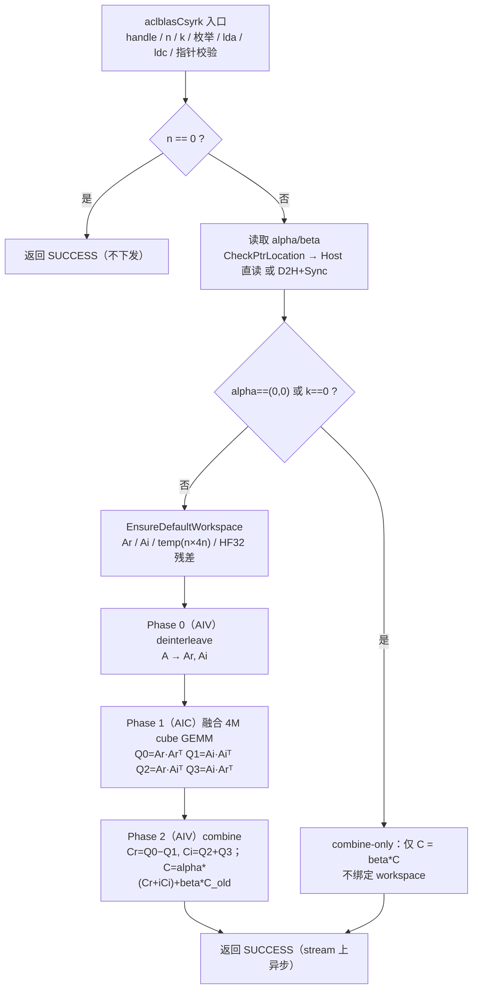
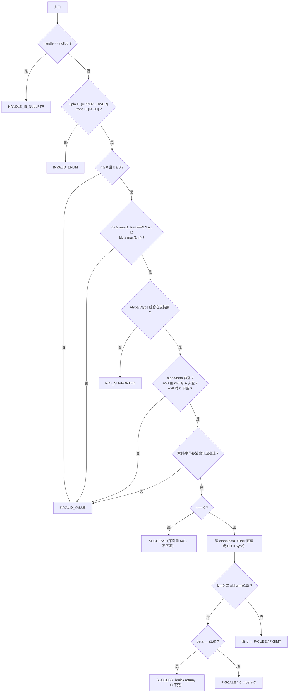
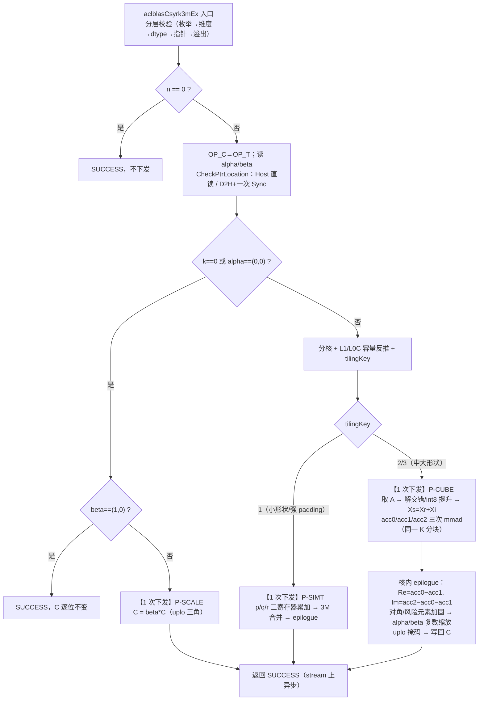

# aclblasCsyrk3mEx 算子设计文档

> 任务：11月社区任务-aclblasCsyrk3mEx算子开发（950）
> 目标仓：`cann/ops-blas`　实现目录：`blas/syrk/arch35/`　测试目录：`test/syrk/csyrk3m_ex/arch35/`
> 适配硬件：Ascend 950PR（arch35 / DAV_3510）　CANN：9.1.0 及以上（asc-devkit ≥ 9.1）

## 需求背景（required）

### 需求来源

CANN 社区任务 2026「11月社区任务-aclblasCsyrk3mEx算子开发（950）」，任务书《aclblasCsyrk3mEx 算子开发任务书》。

| 项 | 内容 |
| --- | --- |
| 任务书 | `aclblasCsyrk3mEx_Atlas950PR_task_doc.md`（随任务包下发） |
| 目标开源仓 | https://gitcode.com/cann/ops-blas |
| 实现合入目录 | https://gitcode.com/cann/ops-blas/tree/master/blas/syrk/arch35 |
| 测试合入目录 | `test/syrk/csyrk3m_ex/arch35`（任务书 §5 指定，当前仓内尚不存在，本次新建） |
| 对标接口 | cuBLAS `cublasCsyrk3mEx`（https://docs.nvidia.com/cuda/cublas/index.html §2.8.17） |
| 语义参考 | Netlib `csyrk.f`（https://www.netlib.org/blas/csyrk.f） |
| 精度标准 | 生态算子开源精度标准 `mixed_tolerance_standard.md`（任务书 §3.2 引用的 opbase 定版 commit `28a1ce5`） |
| 编译/测试入口 | `bash build.sh --ops=csyrk3m_ex --soc=ascend950` |

任务书规定的验收指标原文摘要（本设计的判定基线，逐条对应「可维可测分析」章节）：

- 精度：golden 由 CPU 侧 **非 3M** 的 `cblas_csyrk`（Netlib BLAS 3.10.0/CBLAS）生成；COMPLEX64 实部/虚部分别按 FLOAT32 判定，`rtol = atol = 2^-13`、`required_matched_ratio = 0.99`、`max_abs_error_limit = 1e-2 或 32×ULP`。
- 性能：**kernel-to-kernel** 口径。NPU 侧 `msprof op` 采集 kernel `Task Duration(us)`（warmup 5 + 有效采样 10 取平均），与 `gpu_baseline.csv` 的 `gpu_ms`（GPU cuBLAS kernel-only）比较；单 case ≤ `gpu_ms`/0.4，全部性能 case 加速比算术平均 ≥ 0.5，两者同时满足。
- 内存：任务书 §3.4「不涉及」。
- 用例口径：精度全量 1000 条（含 `TC_3M_*` 专项 4 条）、性能子集 200 条（含 2 条 `Atype=ACL_INT8`）。

### 背景介绍

#### 算子定位

`aclblasCsyrk3mEx` 是 Level-3 BLAS 对称秩-k 更新的扩展（Ex）版本，计算

```text
C = alpha * op(A) * op(A)^T + beta * C
```

其中 `C` 为 n×n **对称**复数矩阵（列主序，仅 `uplo` 三角被读写），`op(A)` 为 n×k。与仓内已有 `aclblasCsyrk` 的差别有两点：

1. **3M（Gauss 复杂度缩减）算法**：把一次复数矩阵乘拆成 **三次实数矩阵乘**，用加法换乘法。cuBLAS 文档明确该接口「implemented using the Gauss complexity reduction algorithm which can lead to an increase in performance up to 25%」。
2. **混合输入类型**：`Atype` 可为 `ACL_COMPLEX64` 或 `ACL_INT8`（complex-int8，`(int8 real, int8 imag)` 交错 2 字节，对应 cuBLAS `CUDA_C_8I`），`Ctype` 固定 `ACL_COMPLEX64`；计算在复数 FP32 域完成。

**对称 ≠ Hermitian**：本算子乘积是 `X·X^T` 而非 `X·X^H`，因此 `ACLBLAS_OP_C` 与 `ACLBLAS_OP_T` 等价（不共轭），且对角元 `C(i,i)` 的虚部是**有效数据，不置 0**。这两条是与 `aclblasCherk`/`aclblasCherk3mEx` 族的根本分界，也是本设计的首要正确性约束。

#### 仓内现状分析（1:1 对齐同族算子）

本任务不是从零发明，而是复用仓内两条已合入的成熟路径：**非 Ex `csyrk` 的对称语义/参数契约** + **`cgemm3m` 的 3M 分解**。下表为实际源码位置（`cann/ops-blas` master，本次调研 HEAD `55ef791`）。

| 参考对象 | 源码路径 | 本设计复用点 |
| --- | --- | --- |
| 复数对称秩-k（非 Ex） | `blas/syrk/arch35/csyrk_host.cpp` | 参数校验顺序与状态码；`uplo` 三角处理；`OP_C→OP_T`；对角虚部保留；`alpha/beta` 的 Host/Device 指针契约；workspace 溢出守卫 |
| 同上 | `blas/syrk/arch35/csyrk_kernel.cpp`、`csyrk_kernel.h` | deinterleave / combine 两阶段的 AIV 组织方式；`beta`-only 轻量缩放分支；padding 与未引用三角的写保护 |
| 同上（融合乘加驱动） | `blas/syrk/arch35/csyrk_gemm_fused.h` | **同一次 launch 内多路实数乘融合**的既有范式：BM=BN=64 单归属 tile、L0C 双 acc-set ping-pong、K-chunk L1/L0 流水、`SetFlag/WaitFlag` 配对 |
| 同上（tiling 契约） | `blas/syrk/arch35/csyrk_tiling_data.h`、`ssyrk_tiling_data.h` | arch35 片上容量与分块常量；`useDirectDiag` 对角抵消加固门控 |
| 实数对称秩-k | `blas/syrk/arch35/ssyrk_host.cpp`、`ssyrk_kernel.cpp` | 单精度 cube GEMM 的 tiling 反推与 fixpipe 对齐 |
| 3M 复数 GEMM | `blas/gemm/arch35/cgemm3m_host.cpp` → `LaunchComplexGemm(..., true)` | 3M 入口与 host 组织方式 |
| 3M 融合核（**核心参考**） | `blas/gemm/arch35/cgemm3m_strided_batched_kernel.cpp` | 三平面累加器 `p/q/r` 的寄存器融合写法与 `{p-q, (r-p)-q}` 合并式；`PLANES=3`、`ROWS=4`、`COLS=64` 面板常量 |
| 3M 舍入加固 | `blas/gemm/arch35/cgemm3m_rounding_kernel.cpp` | 「按输入能量筛选风险元素 → 稀疏 FP32 重算」的既有加固范式（不使用参考数据） |
| 公共契约 | `include/cann_ops_blas.h`、`include/cann_ops_blas_common.h` | 接口声明位置；`aclblasComplex{float real; float imag;}`；状态码与枚举取值 |
| 平台/内存 helper | `blas/common/helper/host_utils.h`、`syrk_host_utils.h`、`aclblas_handle_internal.h`、`kernel_constant.h` | `GetAivCoreCount()/GetAicCoreCount()`、`CheckPtrLocation()`、`EnsureDefaultWorkspace()/GetEffectiveWorkspace()`、`ACLBLAS_MAX_WORKSPACE_SIZE = 2 GiB`、`UB_SIZE = 248 KiB`、`BUFFER_NUM = 2` |
| 构建注册 | `cmake/asc_devkit_version.cmake`（`TENSOR_API_OPS`）、`cmake/test.cmake`、`test/CMakeLists.txt` | tensor_api 算子的 devkit≥9.1 门控与测试目标自动注册 |
| 贡献规范 | `CONTRIBUTING.md` 附录「项目标准算子交付件」 | 文件划分与命名、`blas/` 免 CMakeLists、`test/` 必须 CMakeLists |

**现状能力边界（调研结论）**：

- `include/cann_ops_blas.h` 中**不存在** `aclblasCsyrk3mEx`，也**不存在** `aclblasCsyrkEx`；存在 `aclblasCsyrk`（第 799 行）与 `aclblasCsyrkx`（第 782 行）。
- `blas/syrk/arch35/` 现有 13 个文件，均为非 Ex 的 `csyrk`/`ssyrk`；`test/syrk/` 仅有 `csyrk`、`ssyrk` 两个子目录，`test/syrk/csyrk3m_ex/arch35` 不存在。
- 因此本任务的 3M 路径必须**自行实现**：以非 Ex `csyrk` 的参数校验/三角处理为骨架，以 `cgemm3m` 的 3M 分解为算法内核；**不得**调用尚未合入的 `aclblasCsyrkEx`，**不得**用三次独立 GEMM 调用拼接。

#### 现状实现流程（非 Ex `aclblasCsyrk`，arch35）



现状路径的三条可继承结论与一条不适配点：

| 项 | 现状 | 对 3M 的影响 |
| --- | --- | --- |
| 多路实数乘融合 | 4 个 quad 在**一个** AIC kernel 内背靠背完成 | 3M 可直接沿用该范式，改为 3 个 quad，天然满足「同一次 launch」硬约束 |
| 复数标量契约 | Host/Device 均支持，混合位置拒绝；Device 走一次 D2H + 一次 `aclrtSynchronizeStream` | 原样继承（任务书 §2.5 要求两种指针位置均支持） |
| 特值兜底 | 小规模（≤128×128 元素）host 扫描 A，遇 inf/nan/超阈值走 Netlib 顺序参考 | 3M 的 inf/nan 传播位置与逐元素参考不同，必须保留同类兜底 |
| **不适配点** | 主路径为 **3 次 kernel 下发**（deint / cube / combine），小形状固定开销占比高，故仓内另建 `csyrk_direct_kernel` 单核 SIMT 快路 | 3M 的性能预算在小形状上只有百微秒量级（见「性能达标可行性分析」），**本设计把单 kernel 融合作为主路径**，而非先照搬三段式再补快路 |

## 需求分析（required）

### 需求描述

在 Ascend 950PR（arch35）上，基于 ops-blas 句柄式 BLAS 工程，用 Ascend C 新增 `aclblasCsyrk3mEx` 接口与实现：通过 handle 绑定的 stream 直调 NPU kernel，在**同一次 kernel launch 内**融合完成 3M 的三次实数矩阵乘，支持 `Atype ∈ {ACL_COMPLEX64, ACL_INT8}`、`Ctype = ACL_COMPLEX64`，仅读写 `uplo` 三角并保留对角虚部，参数语义与 `cublasCsyrk3mEx` 逐参数对齐，精度与性能满足任务书 §3.2/§3.3。

### 需求拆解

| 编号 | 需求 | 设计落点 | 验收方式 |
| --- | --- | --- | --- |
| R1 | `include/cann_ops_blas.h` 新增 `aclblasCsyrk3mEx` 声明，13 参与 cuBLAS 逐一对应，不定义私有平行 API | 「接口定义」 | 头文件比对 + 代码检视 |
| R2 | 对称语义 `C = alpha·op(A)·op(A)ᵀ + beta·C`；`OP_C ≡ OP_T` 不共轭；对角虚部保留 | 「数学公式」「Kernel 侧设计」 | 手算探针用例 + `diag_imag_kept` 专项 + golden 比对 |
| R3 | 3M 三次实数乘在**同一次 launch** 内完成，禁止三次独立 GEMM 拼接，禁止套用 `X·X^H` 分解 | 「3M 融合方案」 | 代码检视 + `msprof` 单 case kernel 计数 |
| R4 | `Atype=ACL_INT8` 按交错 `(int8 real, int8 imag)` 解释并**精确**提升为 FP32 | 「int8 输入路径」 | int8 专项 + 边界值（−128/127）用例 |
| R5 | 仅 `uplo` 三角被读写；另一三角与 `lda/ldc` padding 逐位不变 | 「写保护与三角掩码」 | 哨兵字节级 `memcmp` |
| R6 | 边界：`n=0` no-op；`k=0` 或 `alpha=(0,0)` 时 `beta=(1,0)` quick return、`beta≠(1,0)` 仅 `C=beta·C` 且不引用 A | 「Host 侧设计」 | 边界用例（含 A=NaN 不引用验证） |
| R7 | 参数校验分层与状态码：枚举非法→`INVALID_ENUM`，阶数/秩/前导维非法→`INVALID_VALUE`，dtype 不在支持集→`NOT_SUPPORTED`，handle 空→`HANDLE_IS_NULLPTR` | 「参数校验顺序」 | 负向用例逐状态码断言 |
| R8 | `alpha/beta` 支持 Host 与 Device 两种指针位置 | 「复数标量读取」 | `alphaOnDevice`/`betaOnDevice` 用例 |
| R9 | 精度：实/虚分量按 FLOAT32 混合容差判定，golden 为 `cblas_csyrk` | 「精度标准」 | 1000 条精度用例 + 自验报告 |
| R10 | 性能：`msprof op` kernel-to-kernel，单 case ≤ `gpu_ms`/0.4 且均值 ≥ 0.5 | 「性能标准」「性能达标可行性分析」 | 200 条性能用例逐 case 采集 |
| R11 | 工程合规：文件划分/命名、构建注册、README、CodeCheck | 「工程落地与文件划分」 | `build.sh --ops=csyrk3m_ex --soc=ascend950` + CI |

## 详细设计（required）

### 算子分析

#### 数学公式

记 `X = op(A) = Xr + i·Xi`（`Atype=ACL_INT8` 时先按 §「int8 输入路径」精确提升为 FP32）：

- `trans = ACLBLAS_OP_N`：`X = A`，逻辑 n×k，物理 `lda × k`，`lda ≥ max(1, n)`；
- `trans = ACLBLAS_OP_T` 或 `ACLBLAS_OP_C`：`X = Aᵀ`，A 物理为 `lda × n`（逻辑 k×n），`lda ≥ max(1, k)`；`OP_C` **不共轭**。

**3M 对称分解**（本算子乘积为 `X·Xᵀ`）：

```text
P0 = Xr·Xrᵀ
P1 = Xi·Xiᵀ
P2 = (Xr+Xi)·(Xr+Xi)ᵀ
Re(X·Xᵀ) = P0 − P1
Im(X·Xᵀ) = P2 − P0 − P1
```

正确性推导（逐元素，`s` 为 k 方向下标）：

```text
P2(i,j) = Σ (Xr(i,s)+Xi(i,s))·(Xr(j,s)+Xi(j,s))
        = P0(i,j) + P1(i,j) + Σ[Xr(i,s)Xi(j,s) + Xi(i,s)Xr(j,s)]
⇒ P2 − P0 − P1 = Σ[Xr(i,s)Xi(j,s) + Xi(i,s)Xr(j,s)] = Im(X·Xᵀ)(i,j)
```

**与 Hermitian 分解的分界（必须区分）**：`X·X^H` 的虚部是 `Xi·Xrᵀ − Xr·Xiᵀ`（两项**相减**），而本算子是 `Xi·Xrᵀ + Xr·Xiᵀ`（两项**相加**）。若误用 Hermitian 分解，非对角元虚部符号整体反向，而对角元恰好为 0——随机对拍在 `Xr≈Xi` 的数据上可能掩盖该错误，因此必须有手算探针。

最终写回：`C(i,j) ← alpha·(Re + i·Im) + beta·C_old(i,j)`，仅对 `uplo` 三角（含对角）生效，复数乘加按 FP32 展开：

```text
out.real = (ar·Re − ai·Im) + (br·Cr_old − bi·Ci_old)
out.imag = (ar·Im + ai·Re) + (br·Ci_old + bi·Cr_old)
```

`beta = (0,0)` 时**不读**旧 C（避免旧 C 中的 NaN/Inf 污染结果）。

**手算探针（写入测试工程，硬编码期望值）**：`LOWER`、`trans=N`、`n=2, k=1`、`lda=ldc=2`、`alpha=(1,0)`、`beta=(0,0)`、`A = [1+2i, 3−1i]ᵀ`：

| 元素 | 3M 中间量 | 期望值 |
| --- | --- | --- |
| `C(0,0)` | P0=1, P1=4, P2=9 | `−3 + 4i` |
| `C(1,0)` | P0=3, P1=−2, P2=6 | `5 + 5i` |
| `C(1,1)` | P0=9, P1=1, P2=4 | `8 − 6i` |

交叉验证（直接复数乘，不经 3M）：`(1+2i)² = −3+4i`、`(3−i)(1+2i) = 5+5i`、`(3−i)² = 8−6i`，与上表逐项一致。

同一组数据在 `trans=T`（A 物理 1×2、`lda=1`）下必须给出**完全相同**的结果；`OP_C` 亦同。两个错误指纹：

- 若 `C(1,0)` 得到 `1 − 7i`（即 `(3−i)·conj(1+2i)`），说明误用了 Hermitian 的 `X·X^H` 分解；
- 若 `C(0,0)`、`C(1,1)` 的虚部被置 0（得到 `−3`、`8`），说明误用了 Hermitian 的对角虚部清零约束。

这两类错误在随机数据对拍中可能被容差掩盖（尤其 `Xr ≈ Xi` 时），故必须保留该硬编码探针。

#### 支持数据类型

| 操作数 | 存储 dtype | 计算 dtype | 说明 |
| --- | --- | --- | --- |
| A（`Atype=ACL_COMPLEX64`） | COMPLEX64（`real:float32, imag:float32`，8 B/元素） | FP32 | 直接使用 |
| A（`Atype=ACL_INT8`） | complex-int8（`real:int8, imag:int8`，2 B/元素，交错） | FP32 | **精确**提升：int8 → float32 无舍入 |
| alpha / beta | COMPLEX64 标量 | FP32 | Host 或 Device 指针 |
| C（`Ctype=ACL_COMPLEX64`） | COMPLEX64 | FP32 累加 | 原地覆写 |

支持组合与 cuBLAS 一致，仅两种：`(A=ACL_INT8, C=ACL_COMPLEX64)`、`(A=ACL_COMPLEX64, C=ACL_COMPLEX64)`。其余组合（含 `Atype` 或 `Ctype` 取合法 `aclDataType` 但不在支持集，如 `ACL_FLOAT`）返回 `ACLBLAS_STATUS_NOT_SUPPORTED`。

**int8 数值域分析（设计期结论，非实测）**：int8 分量取值 `[-128, 127]`，故 `|Xr|,|Xi| ≤ 128`、`|Xr+Xi| ≤ 255`。单项乘积上界 `127² = 16129`、`255² = 65025`，均为 FP32 可精确表示的整数；k 方向累加保持精确的充分条件是累加值不超过 `2^24 = 16777216`，即 `P0/P1` 在 `k ≤ 1028`、`P2` 在 `k ≤ 257` 时逐项精确。超过该规模后 FP32 累加引入舍入，与非 3M golden 的差异按 §「精度标准」阈值判定，不声称逐位一致。该分析给出 int8 路径的强校验锚点：中小 k 的 int8 用例应与 golden 高度一致，可作为分解式正确性的第一道闸门。

#### 支持形状与布局

| 维度 | 支持情况 | 说明 |
| --- | --- | --- |
| 矩阵阶数 n | `n ≥ 0`，`n = 0` 合法 no-op | 上限由 workspace/索引守卫决定，不设硬编码形状白名单 |
| 秩 k | `k ≥ 0`，`k = 0` 时秩-k 贡献为 0 | 支持 `k ≫ n`（宽）与 `n ≫ k`（窄） |
| 数据排布 | ND（列主序二维矩阵） | 由 `指针 + n/k/lda/ldc` 描述 |
| 前导维 padding | 支持 `lda/ldc` 大于下界（+1/+8/+64 等） | padding 区不被读写 |
| 非连续 Tensor | **不支持**超出前导维语义的任意非连续布局 | 不使用 AutoContiguous/ViewCopy，不产生相关临时空间 |
| broadcast | **不支持** | A 与 C 为独立操作数，shape 之间不做广播 |
| dynamic shape | 不要求编译期形状 | n/k 为运行时入参，Host 侧按实际取值 tiling 与下发 |
| 0 维 Tensor | 不涉及 | 本接口不接受 0 维 Tensor 入参 |
| 空 Tensor | `n = 0` 合法；`k = 0` 时 A 可无效 | 见「边界与退化语义」 |
| 原地/视图 | C 原地覆写，不返回视图 | 调用方须保证 C 可写区与 A 可读区不重叠 |

#### 特殊值与边界语义

Netlib `csyrk.f` 原文的两条结构性语义（已逐行核对）：

1. **quick return**：`IF ((N.EQ.0) .OR. (((ALPHA.EQ.ZERO).OR.(K.EQ.0)).AND.(BETA.EQ.ONE))) RETURN`。
2. **trans=N 为外积形式且含零列跳过**：`DO L=1,K; IF (A(J,L).NE.ZERO) THEN TEMP = ALPHA*A(J,L); C(I,J) += TEMP*A(I,L)`。即 `A(J,L)` 精确为 `(0,0)` 时**整列跳过**（连对角累加也跳过）。`trans=T/C` 为内积形式（`TEMP = Σ_L A(L,I)*A(L,J)`），**无**零列跳过。

由此得到本设计的特殊值策略：

| 场景 | 语义要求 | 设计处理 |
| --- | --- | --- |
| `alpha=(0,0)` 且 `beta=(1,0)` | C 逐位不变 | Host quick return，不下发、不读 A/C |
| `alpha=(0,0)` 或 `k=0`，`beta≠(1,0)` | 仅 `C = beta·C`（uplo 三角），**不引用 A** | 走轻量 scale kernel；A 允许为 nullptr 或全 NaN |
| `beta=(0,0)` | **不读**旧 C | epilogue 跳过旧 C 读取，旧 C 为 NaN 也不污染 |
| `n=0` | no-op | 校验通过后直接返回 SUCCESS，A/C 可为 nullptr |
| 对角虚部 | 有效数据，原样保留 | epilogue 不做任何虚部清零；`RANDOM_DIAG_IMAG` 用例专项覆盖 |
| A 含 Inf/NaN，或 `|分量| > 1e19`（平方溢出 FP32） | 3M 的 inf/nan 生成位置与逐元素参考不同 | **特值兜底**：小规模（元素数 ≤ 128×128）Host 扫描 A，命中则按 Netlib 顺序参考逐元素计算并写回（含零列跳过），大规模按 IEEE 自然传播并在自验报告中说明差异 |
| `Xr ≈ Xi` 或交替/极值填充导致 `P0−P1`、`P2−P0−P1` 灾难性抵消 | 相对误差被放大 | 对角元与高风险元素走「直接复数逐项归约」加固（见「精度加固」） |
| 有符号零 | `-0.0 == 0.0` 数值相等但位不同 | 写保护一律用**字节级** `memcmp`，不用数值相等 |
| 前导维/阶数乘积溢出 | `lda*n`、`n*ldc` 可能超 32 位 | 索引与字节数一律 `int64/uint64`，并做溢出前置判定 |

**确定性说明**：本算子为确定性浮点乘加，不含随机数生成。任务书 §2.5 明确「不要求确定性计算」——3M 路径（融合形态、K 方向归约顺序）由形状与片上容量决定，不按测试编号或随机种子分派；同一输入两次执行不保证逐位一致，验收按阈值判定。

### 接口定义

在 `include/cann_ops_blas.h` 的 `aclblasCsyrk` 声明之后新增（保持同族相邻，签名与任务书 §2.3 逐字一致）：

```cpp
/** Column-major complex64 symmetric rank-k update, 3M (Gauss) path.
 * OP_C is equivalent to OP_T (no conjugation). The diagonal imaginary part is
 * valid data and is preserved. Atype: ACL_COMPLEX64 or ACL_INT8 (complex-int8,
 * interleaved int8 real/imag); Ctype: ACL_COMPLEX64. The three real products of
 * the 3M decomposition are fused inside one kernel launch.
 * Scalars may reside on host or device. Only the selected triangle is read/written.
 */
aclblasStatus_t aclblasCsyrk3mEx(
    aclblasHandle_t handle,
    aclblasFillMode_t uplo,
    aclblasOperation_t trans,
    int n, int k,
    const aclblasComplex* alpha,
    const void* A, aclDataType Atype, int lda,
    const aclblasComplex* beta,
    aclblasComplex* C, aclDataType Ctype, int ldc);
```

参数语义、值域与异常行为完全按任务书 §2.4 表格实现，此处不重复；枚举与状态码取值以仓内 `include/cann_ops_blas_common.h` 为准（实测：`ACLBLAS_UPPER=121`、`ACLBLAS_LOWER=122`、`ACLBLAS_OP_N=111`、`OP_T=112`、`OP_C=113`；`SUCCESS=0`、`INVALID_VALUE=3`、`NOT_SUPPORTED=7`、`HANDLE_IS_NULLPTR=9`、`INVALID_ENUM=10`、`ALLOC_FAILED=2`、`INTERNAL_ERROR=5`）。

> **有意差异声明**：cuBLAS 对非法 `uplo/trans` 返回 `CUBLAS_STATUS_INVALID_VALUE`，本接口按 ops-blas 约定返回 `ACLBLAS_STATUS_INVALID_ENUM`。这是仓内既有契约（非 Ex `csyrk` 同样如此），不是缺陷。

### 算子实现

#### 实现方案总览

采用**单 kernel 融合**为主路径：一次下发内完成「取 A → 解交错/提升 → 三路实数乘累加 → 3M 合并与 alpha/beta 缩放 → uplo 掩码写回」。按形状分两条核内路径，由 Host 侧 tilingKey 选择：

| 路径 | 适用形状 | 计算单元 | 融合形态 |
| --- | --- | --- | --- |
| **P-CUBE**（主路径） | 中大形状（`n` 超过小形状门限） | AIC（Cube）+ 核内 epilogue | 每个归属 tile 内三个 mmad 累加器背靠背推进 K 分块，L0C 双 acc-set ping-pong |
| **P-SIMT**（小形状/兜底） | 小形状、强 padding、特值兜底 | AIV（SIMT/SIMD） | 每输出元素三个寄存器累加器 `p/q/r` 同步推进 k，无中间 GM 往返 |
| **P-SCALE** | `alpha=(0,0)` 或 `k=0` 且 `beta≠(1,0)` | AIV | 仅 `C = beta·C`，不引用 A、不申请 workspace |

选择单 kernel 而非「deinterleave + GEMM + combine」三段式的理由：

1. 任务书硬约束是「三次实数乘同一次 launch」，单 kernel 天然满足且无歧义；
2. 小形状性能预算仅百微秒量级（见「性能达标可行性分析」），三次下发的固定开销会直接吃掉预算；
3. 三路操作数 `Xr/Xi/(Xr+Xi)` 中前两者来自同一次 A 读取，第三者可由加法在片上生成，**无需**把解交错结果落 GM，主路径因此**零额外 workspace**（与任务书 §3.4「内存不涉及」相容）。

代价与回退见「风险与回退」。

#### Host 侧设计

##### 1. 参数校验顺序（严格按任务书 §2.5 校验顺序）



校验层级要点：整型与枚举由 Host 校验；`Atype/Ctype` 按支持集校验；**不对 Device 张量做元素级扫描**（特值兜底的 Host 扫描仅作用于小规模且为实现内部行为，不改变接口契约）；张量数据本身是否满足对称约束由调用方保证，计算按公式自然进行。

##### 2. 复数标量读取（Host / Device 双位置）

复用仓内 `CheckPtrLocation()` 契约：先分别探测 `alpha`、`beta` 的指针位置；**混合位置直接拒绝**（`INVALID_VALUE`）；同为 Host 则直接解引用；同为 Device 则在 handle stream 上发起两次 `aclrtMemcpyAsync(D2H)` 后**一次** `aclrtSynchronizeStream`，再读 Host 副本。不使用 `aclrtSynchronizeDevice`（会掩盖其它 stream 的错误）。

`n=0` 与 quick return 分支**不读**标量值，避免对空指针解引用；`k=0`/`alpha=0` 判定在标量读取之后。

##### 3. 分核策略

```text
aivCoreNum = GetAivCoreCount()        // 为 0 → INTERNAL_ERROR
aicCoreNum = GetAicCoreCount()        // 为 0 → INTERNAL_ERROR
usedAiv    = max(1, min(n, aivCoreNum))
coreDim    = CeilDiv(n, aicCoreNum)
singleCore = max(coreDim, BASE_M)                       // BASE_M = 16
tileCount  = CeilDiv(n, singleCore)²                    // 三角模式下仅计归属 tile
usedAic    = max(1, min(tileCount, aicCoreNum))
```

- **满核优先**：`n` 足够大时用满 AIC 核；核间不能均分时，余出的 tile 分配给前若干核（大小核），尾核/尾块由 `curM/curN` 钳制。
- **三角负载均衡**：`uplo` 三角只计算约一半 tile，按「保留 tile 线性编号 → 核区间划分」分派（沿用 `csyrk_gemm_fused.h` 的 kept-index 单归属方案），避免按整矩阵均分导致近半数核空转。
- AIV 侧（epilogue / P-SIMT / P-SCALE）按行带切分：`rowsPerCore = CeilDiv(n, usedAiv)`，尾核行数由 `n − rowStart` 钳制。

##### 4. 片上切分与容量反推（arch35）

仓内 arch35 常量（`ssyrk_tiling_data.h` / `syrk_gemm_arch35.h` / `kernel_constant.h`）：

| 常量 | 值 | 用途 |
| --- | --- | --- |
| `BASE_M / BASE_N / BASE_K` | 16 / 16 / 8 | cube 分形对齐粒度 |
| `FIXPIPE_N_ALIGN` | 8 | 输出列对齐 |
| `DEFAULT_TILE_M / N` | 128 / 128 | 默认 tile 上限 |
| `DEFAULT_TILE_K_CHUNK` | 256 | 默认 K 分块 |
| `L1_SIZE_BYTES` | 512 KiB | L1 容量 |
| `L1_BUF_NUM` | 2 | L1 双缓冲 |
| `L1_USAGE_RATIO` | 9/10 | L1 可用比例 |
| `L0A_SIZE / L0C_SIZE` | 64 KiB / 256 KiB | L0 容量 |
| `FP32_C0 / FRACTAL` | 8 / 16 | NZ/ZN 布局常量 |
| `UB_SIZE`（仓内预算） | 248 KiB | AIV 侧 UB 预算 |
| `ELEMENTS_PER_BLOCK` | 8 | 32 B / sizeof(float) |

**L1 K 分块反推**（沿用仓内公式，3M 只需常驻 `Xr/Xi` 两路，`Xs = Xr+Xi` 在搬入 L0 时由加法生成，不额外占 L1）：

```text
l1Budget   = L1_SIZE_BYTES × 9 / 10
alignedM   = CeilAlign(tileM, BASE_M)
alignedN   = CeilAlign(tileN, BASE_N)
denom      = L1_BUF_NUM × sizeof(float) × (alignedM + alignedN)
maxAlignedK= l1Budget / denom
maxKChunk  = max(BASE_K, (maxAlignedK / BASE_K) × BASE_K)
tileKChunk = min(DEFAULT_TILE_K_CHUNK, maxKChunk)
```

**L0C 累加器预算（3M 的关键差异）**：3M 需 **3 个** 累加器集合（P0/P1/P2），非 Ex `csyrk` 的 4M 需 4 个。双 acc-set ping-pong 下

```text
L0C_used = 2 × 3 × tileM × tileN × sizeof(float) ≤ L0C_SIZE (256 KiB)
⇒ tileM × tileN ≤ 10922
```

取 `tileM = tileN = 64`（与仓内融合驱动 BM=BN=64 一致）：`2×3×64×64×4 = 96 KiB ≤ 256 KiB`，余量充足；若 profiling 指向更大 tile 更优，`128×64` 需 `192 KiB`，仍在预算内，由上式在线判定而非硬编码。`tileM/tileN` 先按 `min(DEFAULT_TILE_*, singleCore*)` 取值，再受上式与 L1 公式共同钳制；`n` 小于默认 tile 时按 `CeilAlign(n, BASE_*)` 收缩，避免小形状搬运空转。

**AIV 侧 UB 预算**（P-SIMT / epilogue）：按 `UB_SIZE / BUFFER_NUM` 分配输入/输出双缓冲，面板规模参照仓内 3M 面板常量 `ROWS=4, COLS=64`（`PLANES=3`）：单面板累加器 `3×4×64×4 = 3 KiB`，A/B 操作数面板 `2×(ROWS或COLS)×DEPTH×4`，`DEPTH` 由剩余 UB 反推并向下取整到搬运对齐粒度。

##### 5. tilingKey 规划

`tilingKey` 仅用于让 kernel 侧走不同分支，取值由 **形状与布局** 决定（不按用例编号/随机种子分派）：

| tilingKey | 触发条件 | kernel 分支 |
| --- | --- | --- |
| 0 | `alpha=(0,0)` 或 `k=0`，且 `beta≠(1,0)` | P-SCALE（仅缩放） |
| 1 | 小形状门限内（`n ≤ 64` 且 `k ≤ 256`）或强 padding 布局 | P-SIMT 直接复数逐项 |
| 2 | 其余，`Atype=ACL_COMPLEX64` | P-CUBE，FP32 输入 |
| 3 | 其余，`Atype=ACL_INT8` | P-CUBE，int8 解交错 + 精确提升 |

小形状门限与仓内 `csyrk` direct 快路的门限一致（`n≤64 && k≤256`），便于同族对照；门限为可调设计参数，最终以真机 A/B 确定。

##### 6. workspace 与溢出守卫

- **主路径零额外 workspace**：三路操作数在片上生成，中间量不落 GM。
- **回退路径**（见「风险与回退」）若启用「解交错落 GM」变体，则按 `Ar/Ai` 两块 + 可选 `Xs` 块申请 handle 默认 workspace，字节数 `align32(arLdc × arCols × 4 × slabCount)`，经 `EnsureDefaultWorkspace()`；上限 `ACLBLAS_MAX_WORKSPACE_SIZE = 2 GiB`，超限返回 `ALLOC_FAILED`。
- 所有字节数与索引运算走 `uint64/int64`，并使用仓内 `SyrkMulU64/SyrkAddU64` 同款**溢出前置判定**（先判 `b > UINT64_MAX/a` 再乘），防止 wrap 后绕过 2 GiB 上限。
- `lda*n`、`n*ldc` 的**元素跨度**同样做 `int64` 守卫，超限返回 `INVALID_VALUE`。
- P-SCALE 分支**不绑定**任何 workspace（否则大 n 的合法 `alpha=0` 调用会因 2 GiB 上限误失败）。

##### 7. int8 输入路径

`Atype=ACL_INT8` 时 A 的每个复元素为 2 字节 `(int8 real, int8 imag)`，**前导维 `lda` 仍以复元素计**（与 COMPLEX64 一致），因此字节步长为 `2·lda` 而非 `8·lda`。搬入片上后按交错字节解出实/虚部，`int8 → float32` 为精确转换（无舍入），随后与 COMPLEX64 路径共用同一 3M 累加与 epilogue。设计要点：

- 解交错在**搬运/寄存器**层完成，不额外落 GM；
- int8 与 FP32 两条路径共用 tiling 与 epilogue，仅输入适配层不同（避免两套并行实现）；
- `VALUE_INT8_EXTREME`（−128/127）与 `RANDOM_INT8` 用例覆盖边界。

#### Kernel 侧设计

##### 1. 3M 融合方案（同一次 launch 内完成三次实数乘）

**P-CUBE**（主路径）：每个核按 kept-index 领取归属的 `tileM×tileN` C tile，在 K 方向分块推进，每个 K 子块内对同一对操作数面板背靠背发起三次 mmad：

```text
for kChunk in 0 .. k step tileKChunk:
    载入 Xr(i-block, kChunk), Xi(i-block, kChunk)   → L1 → L0（左）
    载入 Xr(j-block, kChunk), Xi(j-block, kChunk)   → L1 → L0（右）
    Xs = Xr + Xi                                    （片上加法生成）
    acc0 += Xr_left · Xr_rightᵀ                     （mmad 1）
    acc1 += Xi_left · Xi_rightᵀ                     （mmad 2）
    acc2 += Xs_left · Xs_rightᵀ                     （mmad 3）
epilogue:
    Re = acc0 − acc1
    Im = (acc2 − acc0) − acc1
    读旧 C（beta≠0 时）→ 复数 alpha/beta 缩放 → uplo 掩码 → 写回 C
```

三次 mmad 共享同一份 L1/L0 操作数与同一套流水事件，**不产生三次 kernel 下发**，也不调用任何 GEMM 接口。`trans=T/C` 时把左右操作数的取址改为「A 的第 i 列 / 第 j 列」，累加式不变（`X = Aᵀ`）。

同步纪律：`SetFlag/WaitFlag` 按 `MTE1_MTE2 / M_MTE1 / FIX_M` 成对预置与排空，flagId 按 acc-set 与 L0 slot 分配不冲突；沿用仓内融合驱动的 init/drain 配对函数结构，避免出现缺失/错序同步。

**P-SIMT**（小形状/兜底）：每线程负责一个（或一小组）`uplo` 元素，三个寄存器累加器同步推进 k：

```text
p = q = r = 0
for s in 0 .. k-1:
    av = X(i, s); bv = X(j, s)          // 对称：同一矩阵 X 的两个位置
    p += av.real * bv.real
    q += av.imag * bv.imag
    r += (av.real + av.imag) * (bv.real + bv.imag)
Re = p − q;  Im = (r − p) − q
```

该写法与仓内 `cgemm3m_strided_batched_kernel.cpp` 的 `Product()` 同构（本算子把 B 操作数换成 X 自身），因此可直接沿用其寄存器/面板组织与 `MicroAPI::MulAddDst` 三平面 SIMD 版本；差别仅在于**不共轭**且只遍历 `uplo` 元素。

##### 2. 三角掩码与写保护

- 元素级归属判定：`UPPER` 保留 `i ≤ j`，`LOWER` 保留 `i ≥ j`（列主序下 `C(i,j)` 地址为 `C + j·ldc + i`）；对角 `i == j` 始终属于被更新三角。
- tile 级剪枝：完全落在未引用三角的 tile 直接跳过（不读 A、不写 C）；跨界 tile 在 epilogue 用掩码逐元素判定。
- **写保护范围**：未引用三角、`ldc` padding 行（`i ∈ [n, ldc)`）、`lda` padding 区一律不写；测试侧以哨兵字节 + 字节级 `memcmp` 校验。
- 对角元虚部按普通复数元素写出，**不做任何清零**。

##### 3. 精度加固（3M 抵消风险）

3M 的 `Re = P0 − P1` 与 `Im = P2 − P0 − P1` 在 `Xr ≈ Xi` 或交替/极值填充下会出现大数相消，相对误差被放大；对角元 `C(i,i) = Σ(Xr² − Xi²)` 尤其敏感。设计三层加固：

| 层 | 手段 | 触发条件 |
| --- | --- | --- |
| L1 | **对角直接归约**：对角元不走三平面相减，改为逐项 `Σ(Xr−Xi)(Xr+Xi)` 或直接复数逐项累加 | 沿用仓内 `useDirectDiag` 门控思路：`k > 512`，或 `n ≤ 64 且 k > 128` |
| L2 | **风险元素稀疏重算**：按输入能量（`|Xr|,|Xi|` 的平方和）与部分和量级筛选可能抵消的元素，仅对这些元素用直接复数逐项归约重算 | 参照仓内 `cgemm3m_rounding_kernel.cpp` 的「能量筛选 + 稀疏 FP32 修正」范式；筛选只用输入与已算部分和，**不使用参考数据** |
| L3 | **特值兜底**：小规模 Host 扫描命中 inf/nan/`|v|>1e19` 时整体走 Netlib 顺序参考（含零列跳过） | 元素数 ≤ 128×128 |

`TC_3M_*` 专项（交替/极值填充下的实/虚部抵消、int8 极值、对角虚部保留）即为这三层的验收锚点。若 L1+L2 仍不足以覆盖某类形状，回退策略见「风险与回退」。

##### 4. 优化后实现流程



##### 5. 现状流程 vs 优化后流程差异

| 维度 | 非 Ex `csyrk`（现状） | `csyrk3mEx`（本设计） |
| --- | --- | --- |
| 实数乘路数 | 4（Q0/Q1/Q2/Q3） | **3**（P0/P1/P2），乘法量降 25% |
| 虚部合成 | `Q2 + Q3`（两个独立 GEMM 相加） | `P2 − P0 − P1`（复用已有两路，无需第四路） |
| kernel 下发次数（主路径） | 3（deint / cube / combine），小形状另设 direct 快路 | **1**（取数、三路乘、epilogue 全在核内） |
| 中间量落 GM | Ar/Ai + `temp(n×4n)` + HF32 残差 | 主路径**不落 GM**，零额外 workspace |
| 输入类型 | 仅 COMPLEX64 | COMPLEX64 + **complex-int8**（精确提升） |
| L0C acc-set 数 | 4 | 3（同 tile 下 L0C 占用降 25%，可支持更大 tile） |
| 对角处理 | `useDirectDiag` 大 k 加固 | 继承 + 风险元素稀疏重算（3M 抵消更敏感） |
| 对角虚部 | 保留（对称） | 保留（对称），与 Hermitian 族严格区分 |

#### 工程落地与文件划分

按 `CONTRIBUTING.md` 附录「项目标准算子交付件」的文件划分（`${op}=syrk`、`${interface}=csyrk3m_ex`、`${arch_dir}=arch35`）：

```text
include/cann_ops_blas.h                        # 修改：新增 aclblasCsyrk3mEx 声明
blas/syrk/README.md                            # 修改：新增 aclblasCsyrk3mEx 章节（产品支持/接口/约束/示例）
blas/syrk/arch35/
├── csyrk3m_ex_host.cpp                        # 新增：校验、标量读取、tiling、下发
├── csyrk3m_ex_kernel.cpp                      # 新增：P-CUBE / P-SIMT / P-SCALE 核函数与 launcher
├── csyrk3m_ex_kernel.h                        # 新增：launcher 声明（host/kernel 共享）
├── csyrk3m_ex_tiling_data.h                   # 新增：tiling 结构体与 arch35 常量复用
└── csyrk3m_ex_gemm_fused.h                    # 新增：融合 3M cube 驱动（tile 归属/流水/同步）
test/syrk/csyrk3m_ex/
├── CMakeLists.txt                             # 新增：ops_blas_add_gtest_tests() 注册
├── csyrk3m_ex_param.h                         # 新增：CSV 列 → 参数结构体
├── csyrk3m_ex_golden.h                        # 新增：CPU golden（cblas_csyrk 封装 + int8 提升）
└── arch35/
    ├── csyrk3m_ex_npu_wrapper.h               # 新增：NPU 调用封装
    ├── csyrk3m_ex_test.cpp                    # 新增：GTest 主文件（精度/性能/负向）
    └── csyrk3m_ex_test.csv                    # 新增：任务包 1200 条用例（1000 精度 + 200 性能）
cmake/asc_devkit_version.cmake                 # 修改：TENSOR_API_OPS 增一条目
```

构建注册依据（实测机制，非猜测）：

- `blas/` 侧源码由 `cmake/test.cmake` 的 `blas/*/${arch_dir}/${op_name}_*.cpp` 通配自动收集，**无需**新增 CMakeLists；文件名前缀 `csyrk3m_ex_` 即被 `--ops=csyrk3m_ex` 命中。
- `test/CMakeLists.txt` 支持「家族嵌套」布局：`TEST_NAME=csyrk3m_ex` 会搜索到 `test/syrk/csyrk3m_ex`，并在 `${TEST_DIR}/${arch_dir}/${TEST_NAME}_test.cpp` 找到测试主文件；`test/` 下**必须**提供 CMakeLists 调用 `ops_blas_add_gtest_tests()`。
- tensor_api 算子需在 `TENSOR_API_OPS` 增一行 `CSYRK3M_EX|/syrk/arch35/csyrk3m_ex_|csyrk3m_ex`（三段式，正则段内**不得**出现 `|`），即可获得 asc-devkit ≥ 9.1 门控与低版本自动 skip；四个文件的 foreach 自动生效。
- 编译与测试入口：`bash build.sh --ops=csyrk3m_ex --soc=ascend950`（加 `--run` 跑测试）。

编码合规（提前对齐，避免 CI 返工）：文件头统一仓内 CANN Open Software License 2.0 版权头；单函数非空非注释行数 ≤ 50（超限拆 helper）；形参过多用结构体打包；Python 辅助脚本版权头置于 `shebang`/`coding` 之后、输出用 `logging` 而非 `print`；避免 `-Wc++11-narrowing`（`uint32` 表达式窄化到 `int32` 的聚合初始化）。

### 支持硬件

| 支持的芯片版本 | 涉及勾选 | 说明 |
| --- | --- | --- |
| Ascend 950PR（arch35 / DAV_3510） | √ | 本任务唯一适配款型，自验只覆盖 950PR |
| Ascend 950DT | ✗ | 本任务不涉及（README 产品支持表按实测填写，不外推） |
| Atlas A2 训练/推理系列（arch22） | ✗ | 本任务不新增 arch22 实现 |
| Atlas A3 训练/推理系列 | ✗ | 同上 |

依赖：CANN 9.1.0 及以上；arch35 tensor_api 路径要求 asc-devkit ≥ 9.1，低版本由 `TENSOR_API_OPS` 门控在编译期跳过并给出 skip reason。

### 算子约束限制

| 约束项 | 内容 |
| --- | --- |
| 数据类型 | 仅 `(A=ACL_COMPLEX64, C=ACL_COMPLEX64)` 与 `(A=ACL_INT8, C=ACL_COMPLEX64)`；其余 `NOT_SUPPORTED` |
| trans | 仅 `OP_N/OP_T/OP_C`，`OP_C ≡ OP_T`（不共轭） |
| 三角语义 | 仅 `uplo` 指定三角被读写；另一三角由 `C = Cᵀ` 隐含，不写入；对角虚部保留 |
| 3M 融合 | 三次实数乘必须在同一次 kernel launch 内完成；禁止三次独立 GEMM 拼接；禁止 Hermitian `X·X^H` 分解 |
| broadcast | 不支持 |
| 非连续布局 | 不支持超出 `lda/ldc` 语义的任意非连续内存；不使用 AutoContiguous/ViewCopy |
| dynamic shape | 不要求编译期形状；n/k 运行时决定 tiling |
| 内存重叠 | 调用方须保证 C 可写区与 A 可读区不重叠 |
| 标量位置 | `alpha`、`beta` 必须同为 Host 或同为 Device 指针，混合位置 `INVALID_VALUE` |
| 确定性 | 不保证同一输入两次执行逐位一致；不保证与 `aclblasCsyrk`/`cublasCsyrk` 逐位一致 |
| 异步 | kernel 在 handle 绑定 stream 上异步执行；接口返回不代表计算完成，Host 读回前须同步该 stream |
| 规模上限 | 由 `int64` 索引守卫与（回退路径的）2 GiB workspace 上限决定，超限返回 `INVALID_VALUE`/`ALLOC_FAILED`；不设形状白名单 |
| 特值 | 大规模 A 含 Inf/NaN 或超 FP32 平方阈值时按 IEEE 自然传播，与逐元素参考的 inf/nan 位置可能不同，按精度标准收窄规则判定并在自验报告说明 |

## 可维可测分析

### 精度标准/性能标准

| 验收标准 | 描述 | 标准来源 |
| --- | --- | --- |
| 精度 golden | CPU 侧 **非 3M** `cblas_csyrk`（Netlib BLAS 3.10.0 / CBLAS，`CblasColMajor`）；`Atype=ACL_INT8` 时 int8 实/虚部各自精确提升为 float 后调用；需 float64 参考时用 `cblas_zsyrk` 后收窄到 complex64 | 任务书 §3.1/§3.2 |
| 精度阈值 | 实部/虚部**分别**按 FLOAT32 判定：`rtol = atol = 2^-13 ≈ 1.2207e-4`；`matched_ratio ≥ 0.99`；`max_abs_error ≤ max(1e-2, 32×ULP(g_low))` | 任务书 §3.2 + opbase `mixed_tolerance_standard.md` §2.1/2.2 |
| 逐元素判定 | `|actual − golden| ≤ atol + rtol·|golden|` 计入 matched；`max_abs_error` 只取双方均为有限值的比对点 | 同上 §2.1.1/2.1.2 |
| 非有限值 | actual 为 ±inf 而 golden 为有限值时，先把 golden 按输出 dtype 以 round-to-nearest-even 收窄，收窄后同为同号 ±inf 即该点通过；NaN 与 NaN 视为等价，有限 vs 非有限判失败 | 同上 §2.3 |
| 比对范围 | 仅 `uplo` 三角（含对角）；未引用三角与 `lda/ldc` padding 用哨兵**字节级**比对未被改写 | 任务书 §3.5 + 测试包 README |
| 性能口径 | **kernel-to-kernel**：`msprof op` 采集单算子 kernel `Task Duration(us)`，warmup 5 不计入、后续 10 次有效样本算术平均，执行返回非 SUCCESS 的样本剔除并说明；除以 1000 转 ms 后与 `gpu_ms`（GPU cuBLAS kernel-only，nsys）比较 | 任务书 §3.3/§3.3.1 |
| 性能判据 | 单 case `npu_ms ≤ gpu_ms / 0.4`；全部性能 case 加速比算术平均 ≥ 0.5；两者同时满足 | 任务书 §3.3 |
| 性能采集命令 | `msprof op --application="./build/test/syrk/csyrk3m_ex/csyrk3m_ex_test --gtest_filter=*TC_PF*" --output=./prof_csyrk3m_ex`，在 `OPPROF_*/OpBasicInfo.csv` 按 kernel 名统计 | 任务书 §3.3.1 |
| 交叉验证 | `verify_performance.py` 解析 GTest `[PERF] case=<name> ... avg_us=<值>`（warmup 5 + `aclrtEvent` 夹住 10 次下发），仅作快速回归与趋势判断，**不作为正式判据**，不与 `msprof` 数值混用 | 任务书 §3.3.2 |
| int8 性能 | `Atype=ACL_INT8` 路径性能由开发者补充采集，沿用 COMPLEX64 的 `gpu_ms` 基线 | 任务书 §3.3 第 6 条 |
| 内存标准 | 任务书 §3.4「不涉及」，无内存门禁；主路径零额外 workspace，回退路径 workspace 公式与上限见 Host 设计 | 任务书 §3.4 |

### 性能达标可行性分析（设计期核算）

判据可改写为「NPU 有效实数吞吐 ≥ 0.4 × GPU 有效实数吞吐」。3M 的实数乘法量为 `3n²k`（三角只写一半，但乘法量按全矩阵 tile 计），故

```text
required_TFLOPS = 0.4 × 3n²k / (gpu_ms × 1e9)
npu_budget_ms   = 2.5 × gpu_ms
```

代入任务包 `gpu_baseline.csv` 的 GPU 基线（**仅用于设计期算力预算反推，不是本算子实测数据**）：

| 典型 case（uplo/trans/n/k） | `gpu_ms` | NPU 单 case 预算 | 所需实数吞吐 |
| --- | --- | --- | --- |
| UPPER/N/512/512 | 0.045306 | 0.113 ms | ≈ 1.39 TFLOPS |
| UPPER/N/1024/1024 | 0.2543576 | 0.636 ms | ≈ 1.98 TFLOPS |
| UPPER/N/2048/2048 | 1.4173186 | 3.543 ms | ≈ 3.64 TFLOPS |
| LOWER/T/2048/2048 | 1.270021 | 3.175 ms | ≈ 4.06 TFLOPS |
| UPPER/C/1024/256 | 0.063767 | 0.159 ms | ≈ 0.66 TFLOPS |

两条设计结论：

1. **中大形状必须走 Cube**：TFLOPS 级实数吞吐需求超出纯 Vector 路径的合理区间，故 P-CUBE 为主路径；同时访存量（A 读 `8nk` + C 三角读写 `8n(n+1)`，n=k=2048 约 64 MiB）远低于同期 HBM 能力，说明该规模是**计算受限**而非带宽受限，优化重点是 mmad 利用率与 K 分块流水，而非搬运合并。
2. **小形状是固定开销受限**：n=512 的预算仅 113 µs，任何多余 kernel 下发、Host 侧 D2H 同步或 workspace 申请都会显著侵蚀预算。这直接支撑「单 kernel 融合 + 主路径零 workspace + 小形状 SIMT 快路」的设计选择。

上述核算只用于确定路径与分块策略；实际达标结论一律以真机 `msprof op` 逐 case 数据为准，写入自验报告，不在本设计文档中给出实测值。

### 测试范围与验证方法

使用 ops-blas 仓 `test/` 的 ATK/GTest 框架，CSV 驱动，golden 由 CPU 侧 CBLAS 生成。用例来源为任务包 `test_cases/csyrk3m_ex_test.csv`（1200 条）与 `gpu_baseline.csv`（200 条基线），生成器 `gen_csv.py` 固定种子可复现。

| 类别 | 前缀 | 条数 | 覆盖点 |
| --- | --- | --- | --- |
| L0 基础 | `TC_L0` | 12 | 6 组 uplo×trans × 小尺寸 |
| L1 尺寸 | `TC_SQ` | 204 | 1→4096（含 2 的幂 ±1、非对齐 33/65/127/1025）× 6 组 |
| L2 标量 | `TC_AB` | 48 | 8 组复数 alpha/beta（含 (0,0)/(1,0)/(0,1)/±1e4）× 6 组 |
| L3 矩形 | `TC_WS/TH` | 24 | `k≫n`（trans=N）与 `n≫k`（trans=T） |
| L4 前导维 | `TC_LD` | 27 | 紧凑 + padding（+1/+8/+64）× 3 组 |
| L5 填充 | `TC_FL` | 12 | 均匀/全零/交替/极值/Inf/NaN（A、C 分别） |
| L5b 覆盖 | `TC_CV` | 48 | 中等尺寸 × 6 组 |
| L6 边界 | `TC_ED` | 38 | 零维、`k=0` 缩放、`alpha=0` 退化、A=NaN 不引用、`beta=0` 且 C=NaN、对角虚部、空指针、非法枚举、不支持 dtype、非法前导维、负维度、int8 边界 |
| 3M 专项 | `TC_3M` | 4 | 实/虚部抵消、int8 极值、对角虚部保留 |
| EX 扩展 | `TC_EX` | 583 | 尺寸池 × 枚举 × 标量 × padding 确定性采样 |
| PF 性能 | `TC_PF` | 200 | 5 条典型 + 小尺寸 + 方阵扫描 + 宽窄网格 + 2 条 int8 |

验证方法要点：

- **精度**：仅比对 `uplo` 三角，实/虚部分列统计 `matched_ratio` 与 `max_abs_error`；对角虚部按普通复数元素比对，**不得**断言为 0。
- **手算探针**：内置「手算探针」小节的硬编码期望值用例（LOWER/N 与 T/C 三态一致性），防守恒等式级错误。
- **写保护**：调用前写哨兵，调用后对未引用三角与 padding 做字节级 `memcmp`。
- **负向**：逐状态码断言；`handle=nullptr` 无法用 CSV 列表达，由测试工程在参数装配层固定注入。
- **性能**：GTest 在预置 device 缓冲上 warmup 5 + `aclrtEvent` 夹 10 次下发，按用例打印 `[PERF] ... avg_us=`；正式数据另用 `msprof op` 逐 case 采集，两套口径分列记录不混用。
- **稳定性**：每个用例独立装配，避免单例崩溃后设备进入错误态导致后续用例级联失败；流同步用 `aclrtSynchronizeStream`。
- **自检脚本**：用例总数断言 + 精度/性能条数与基线 key 匹配自检（沿用任务包 `gen_csv.py` 的 `[自检]` 契约）。

### 兼容性分析

| 维度 | 分析 |
| --- | --- |
| 公共 ABI | 仅在 `include/cann_ops_blas.h` **新增**一个 `extern "C"` 声明，不修改任何既有声明、枚举、结构体布局，既有符号 ABI 不变 |
| 既有算子行为 | 非 Ex `csyrk`/`ssyrk`/`csyrkx` 源码不改动；新增文件前缀独立，不共享可写全局状态 |
| 与 `aclblasCsyrkEx` 的关系 | 两者均为 1125 新增独立接口，**互不依赖**；本实现不调用、不等待其合入 |
| 头文件插入冲突 | 同族新算子均插在 `aclblasCsyrk` 附近，上游并行新增易在同一插入点冲突；同步上游时保留双方声明并按仓内顺序排列 |
| 多产品线共用 | 签名与 cuBLAS 逐参数对应，`aclblasComplex`/`aclDataType`/状态码全部取自公共头，不定义私有平行类型 |
| 低版本 CANN | tensor_api 路径经 `TENSOR_API_OPS` 门控，asc-devkit < 9.1 时编译期跳过并输出 skip reason，不影响其它算子构建 |
| 构建系统 | `blas/` 通配收集 + `test/` 显式注册，新增算子不影响既有 `--ops` 目标；`--ops=csyrk3m_ex` 之外的构建路径不变 |
| 图模式/视图 | 本接口为句柄式 BLAS 直调，不入 GE 图、不返回视图，无图模式兼容性诉求 |
| workspace 语义 | 使用 handle 默认 workspace（回退路径），不改变 `EnsureDefaultWorkspace` 既有增长/上限策略 |

### 特性交叉分析

| 交叉组合 | 是否需回归 | 说明 |
| --- | --- | --- |
| `Atype=INT8` × `trans=T/C` × padding | 是 | 字节步长 `2·lda` 与转置取址叠加，最易错 |
| `Atype=INT8` × 极值（−128/127）× 大 k | 是 | FP32 精确域上界（见 int8 数值域分析） |
| 复数 `alpha/beta` × `beta=(0,0)` × C=NaN | 是 | 不读旧 C 分支 |
| `alpha=(0,0)` × A=NaN × `beta≠(1,0)` | 是 | 不引用 A 分支 |
| `k=0` × `beta≠(1,0)` × padding | 是 | 仅缩放且不得越界写 |
| Device 标量 × 小形状 SIMT 快路 | 是 | 只有 Device 标量才可作为 GM 地址下传 |
| `uplo` × 三角 tile 剪枝 × 尾块 | 是 | 跨界 tile 掩码与非对齐尾块叠加 |
| 对角虚部非零 × 大 k 抵消加固 | 是 | 加固路径不得清零虚部 |
| 大 n × workspace 上限（回退路径） | 是 | 溢出守卫与 2 GiB 上限 |
| 多 stream 并发 × handle 复用 | 是 | workspace 与 stream 绑定，不得跨 stream 复用中间缓冲 |

### 风险与回退

| 编号 | 风险 | 触发信号 | 回退/应对 |
| --- | --- | --- | --- |
| RK1 | 单 kernel 内 A 被多 tile 重复读取，GM 流量放大 | `msprof` 显示大形状带宽受限、mmad 利用率低 | 启用 L2 复用/共享操作数模板；仍不足则回退「解交错落 GM + 融合 3M GEMM + combine」三段式（三次实数乘仍在同一 launch，合规），代价为 workspace 与两次额外下发 |
| RK2 | 3M 抵消导致个别用例 `matched_ratio < 0.99` | 精度失败集中在 `Xr≈Xi`/交替极值/对角元 | 扩大 L1 对角直接归约门控 → 启用 L2 风险元素稀疏重算 → 对该形状类整体切 P-SIMT 逐项归约 |
| RK3 | Cube 输入精度不足（arch35 cube 低精度尾数） | 中大形状精度系统性偏差 | 沿用仓内补偿乘（残差拆分）思路增加补偿项；或对该形状类切 P-SIMT FP32 逐项 |
| RK4 | 小形状固定开销超预算 | 小 case `npu_ms > gpu_ms/0.4` | 收紧 SIMT 门限、减少 Host 侧分支与同步、tiling 结构体瘦身、避免对象内构造 TPipe |
| RK5 | L0C/L1 容量估算与实际不符导致编译或运行期失败 | 编译期 buffer 超限 / 运行期同步挂死 | 容量公式在线钳制（不硬编码 tile）；同步 flag 配对审计；先用最小形状冒烟再放大 |
| RK6 | `int64` 跨度/字节溢出 | 超大 n/lda 调用 | 前置溢出判定返回 `INVALID_VALUE`/`ALLOC_FAILED`，不进入下发 |
| RK7 | 特值 inf/nan 位置与 golden 不一致 | Inf/NaN 用例失败 | 小规模走 Netlib 顺序兜底（含零列跳过）；大规模按标准收窄规则判定并在报告披露 |
| RK8 | 上游头文件并行新增造成 PR 冲突 | PR 显示冲突且仅 `cann_ops_blas.h` | 同步上游后保留双方声明；合并提交显式使用本人提交身份，避免 CLA 失效 |
| RK9 | 公共头/构建注册遗漏导致目标被静默 skip | `skipped_tests.list` 出现本算子 | 以 `--ops=csyrk3m_ex --soc=ascend950` 构建产物与测试目标存在性为准，逐项核对注册四处 |

### 参考资料

| 编号 | 资料 | 用途 |
| --- | --- | --- |
| 1 | 任务书 `aclblasCsyrk3mEx_Atlas950PR_task_doc.md` | 需求与验收口径唯一来源 |
| 2 | https://gitcode.com/cann/ops-blas | 目标仓；同族实现与公共契约 |
| 3 | https://www.netlib.org/blas/csyrk.f | 对称语义、quick return、零列跳过原文 |
| 4 | https://docs.nvidia.com/cuda/cublas/index.html | `cublasCsyrk3mEx` 签名、类型组合、3M 说明 |
| 5 | https://gitcode.com/cann/opbase/blob/28a1ce52ae856353589841226a0002af73314a6b/docs/zh/ops_precision_standard/mixed_tolerance_standard.md | 混合容差阈值与非有限值收窄规则 |
| 6 | https://gitcode.com/cann/ops-blas/blob/master/CONTRIBUTING.md | 文件划分、构建注册、CI 门禁 |
| 7 | https://www.hiascend.com/document/detail/zh/CANNCommunityEdition/850/opdevg/Ascendcopdevg/atlas_ascendc_map_10_0002.html | Ascend C 编程模型与调优指南 |
| 8 | https://www.hiascend.com/document/detail/zh/canncommercial/850/API/ascendcopapi/atlasascendc_api_07_0003.html | Ascend C API 列表（含平台信息获取） |
| 9 | https://gitcode.com/org/cann/discussions/39 | 社区任务流程与检视要求 |
| 10 | 任务包 `test_cases/README.md`、`gen_csv.py`、`csyrk3m_ex_test.csv`、`gpu_baseline.csv` | 用例契约、生成规则、GPU 基线 |