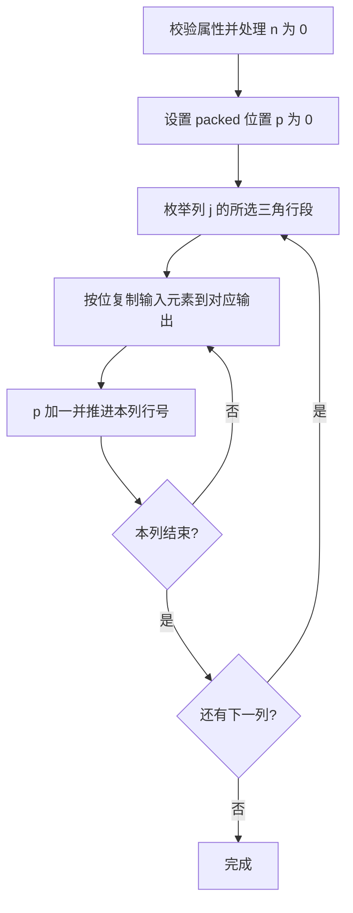
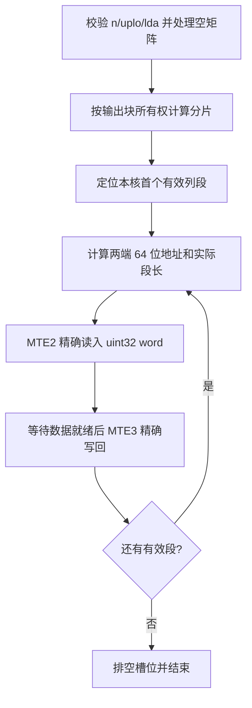

# 一、需求背景

## 1.1 需求来源

承接“11月社区任务-aclblasCtpttr算子开发（950）”，开发 Ascend 950PR 上 COMPLEX64 三角矩阵解包能力。依据独立任务包 `aclblasCtpttr_Atlas950PR_task_doc.md`、`test_cases/ctpttr_test.csv` 及 `gpu_baseline.csv`，按[设计模板](../../../../resources/design_template.md)编写。当前 tasklist 尚未给出本任务编号，暂以完整任务名创建目录，后续以官方映射为准。

## 1.2 背景介绍

### 1.2.1 aclblasCtpttr 算子实现优化

本算子在 packed 三角存储与列主序矩阵之间执行解包，只复制原始位模式，不做浮点计算。设计重点为 64 位列起点、三角工作量均衡、输出块独占、精确尾段和 MTE 流水；无需 Cube 或归约，也不通过浮点运算搬运数据。

这是 BLAS Kernel 直调接口，无对应 TBE Python 源码、TBE 算子信息库和 ACLNN 两段 API。核对 ops-blas 提交 `25e4a371df3f08150975893b97e692e7a6a472fc`：

| 用途 | 文件与处理 |
| --- | --- |
| 同族实数参考 | `blas/tpttr/arch35/stpttr_host.cpp`、`stpttr_kernel.cpp`、`stpttr_tiling_data.h` |
| 新增实现 | `blas/tpttr/arch35/ctpttr_host.cpp`、`ctpttr_kernel.cpp`、`ctpttr_tiling_data.h` |
| 公共声明 | `include/cann_ops_blas.h` 当前无复数声明，新增 `aclblasCtpttr` |
| 复数类型 | `include/cann_ops_blas_common.h` 中 `aclblasComplex` |
| 独立测试 | 新增 `test/tpttr/ctpttr/arch35/ctpttr_test.cpp`、`ctpttr_npu_wrapper.h`、`ctpttr_test.csv` 及 CPU golden |
| 构建及文档 | 新增 `test/tpttr/ctpttr/CMakeLists.txt`，更新 `blas/tpttr/README.md`、`docs/zh/api_list.md` |

### 1.2.2 aclblasCtpttr 算子现状分析

#### 1.2.2.1 标杆算子支持的数据类型和数据格式

| 参数 | 类型与内存 | 约束 |
| --- | --- | --- |
| handle | Host `aclblasHandle_t` | 有效句柄及 stream |
| uplo | Host `aclblasFillMode_t` | `ACLBLAS_UPPER` 或 `ACLBLAS_LOWER` |
| n | Host int | 非负矩阵阶数 |
| A | Device COMPLEX64 | 列主序 `A[i+j*lda]`，物理长度 `lda*n` |
| AP | Device COMPLEX64 | 按列 packed 连续数组，长度 `K=n*(n+1)/2` |
| lda | Host int | `lda>=max(1,n)`，以复数元素为单位 |

AP 为只读输入，A 为独立输出；每个复数由两个 FLOAT32 分量组成，共 8 Byte。A 的另一三角与 lda padding 行保持调用前的内容，不能先清零整个 A。 A 与 AP 的存储不能重叠。

#### 1.2.2.2 标杆算子实现描述

功能与性能对标 cuBLAS `cublasCtpttr`；数值参考采用 [LAPACK 3.12.0 CTPTTR](https://github.com/Reference-LAPACK/lapack/blob/v3.12.0/SRC/ctpttr.f) 或任务允许的独立 CPU 列循环。CBLAS 没有 `cblas_ctpttr`。LAPACK 3.12.0 的 `ctpttr_` 在参数检查后按列枚举所选三角，顺序推进 packed 下标并复制元素。

定义零基列 j 的 packed 起点 S、有效行起点及长度：

```text
UPPER: S(j)=uint64(j)*(j+1)/2;           rowBegin(j)=0; len(j)=j+1
LOWER: S(j)=uint64(j)*(2*uint64(n)-j+1)/2; rowBegin(j)=j; len(j)=n-j
S(n)=K
A[i+j*lda] = AP[S(j)+i-rowBegin(j)]
```

UPPER 的有效行是 `[0,j]`，LOWER 是 `[j,n)`，含对角。对 n=3，UPPER 的 packed 顺序为 `(0,0),(0,1),(1,1),(0,2),(1,2),(2,2)`；LOWER 为 `(0,0),(1,0),(2,0),(1,1),(2,1),(2,2)`。

已有实数实现采用 64 位 packed/矩阵偏移，但固定 UB chunk 和按列均分需要按复数大小及工作量重算。 同族 Host 当前在 lda 校验前处理 n=0，本任务必须修正顺序，不能沿用该边界行为。

#### 1.2.2.3 标杆算子实现流程图



该图表示 CPU 参考的逐元素复制。cuBLAS 内部实现不公开，不能将其性能数据解释为使用了本设计的调度方式。

# 二、需求分析

## 2.1 外部组件依赖

使用 CANN 9.1.0 的 ACL Runtime、Ascend C 数据搬运与事件 API，编译目标为 Ascend 950PR。沿用 ops-blas CMake/GTest/CSV 框架。精度可链接 LAPACK 3.12.0 的 `ctpttr_`；调用时核对 Fortran ABI、整数宽度和 complex64 内存布局，记录库路径与版本。也可使用独立 CPU 参考，直接按 uint32 位模式拷贝。

## 2.2 内部适配模块

新增公共声明和 arch35 Host/tiling/kernel，在独立测试目录注册 `ctpttr_test`，不能只复制实数测试而未注册新 target。复用 handle/stream、平台查询、错误日志和启动封装。更新族 README 与 API 支持列表，保留现有实数接口。CPU golden、输入构造、位级校验和性能驱动在本算子测试中完整提供。

## 2.3 需求模块设计

### 2.3.1 Ascend C 算子原型

```cpp
aclblasStatus_t aclblasCtpttr(
    aclblasHandle_t handle, aclblasFillMode_t uplo, const int n,
    const aclblasComplex* AP, aclblasComplex* A, const int lda);
```

Tiling 包含 uplo、n、lda、uint64 packed 长度、分片边界、有效核数、每槽元素数和槽数。源/目的地址计算从乘法开始使用 uint64/size_t；先提升 n，再计算 `n+1` 和 `2*n`，避免 int 中间量溢出。不增加私有平行 API。

### 2.3.2 Ascend C 算子相关约束

固定顺序：handle 判空 → n<0 → uplo 合法性 → `lda>=max(1,n)` → n=0 成功早返回 → 正常路径检查 A/AP 非空。空 handle 返回 `ACLBLAS_STATUS_HANDLE_IS_NULLPTR`，其他列举的非法参数返回 `ACLBLAS_STATUS_INVALID_VALUE`；非法 uplo 不返回 INVALID_ENUM。

n=0、lda=0 必须报错；n=0、lda>=1 且 uplo 合法时允许空数据指针，不启动 kernel、不写输出。有效路径检查宽整数尺寸与字节地址是否可表示，不能将超大跨度截断为 32 位。输入值不扫描；Inf、NaN、正负零和 subnormal 均按原始位模式传递。

# 三、需求详细设计

## 3.1 调用方式

创建 ACL context、stream 和 BLAS handle，设置 stream，分配互不重叠的 A/AP，按输入布局准备数据并预填输出保护值；调用接口后同步 stream 再读回。性能计时排除分配、H2D 初始化、CPU golden 和比对过程；返回码、同步结果和保护区分别验证。

## 3.2 需求总体设计

逻辑元素数 K=n(n+1)/2，无浮点算术，理想有效搬运量为读 `8K`、写 `8K`，共 `16K Byte=8n(n+1) Byte`。n=8192 时 K=33,558,528；packed 占 268,468,224 Byte，读写有效量为 536,936,448 Byte。物理矩阵容量为 `8*lda*n`，不等于每次都要搬运这个容量。

采用列内连续段 MTE2→UB→MTE3 复制，按输出所有权划分任务，不需要 GM 中间矩阵、全局同步或原子更新。小输入降低核数与槽数，大输入候选使用双槽流水。带宽、段调度和短尾部的成本须实测区分，不根据数据量直接宣称已经达到硬件带宽上限。

### 3.2.1 host 侧设计

#### 3.2.1.1 分核策略

根据实际可用 AIV 核数 C 和最小每核有效元素数 G 选择 `P=min(C,ceil(K/G))`，G 由上板标定，不固定为其他算子的阈值。

标准 32 Byte 对齐的 A 基址采用输出物理块所有权分核。先按有效元素秩 `r_b=floor(b*K/P)` 生成切点，以整数二分查找满足 `S(j)<=r_b<S(j+1)` 的列，再求 `i=rowBegin(j)+r_b-S(j)`、`q=j*lda+i`。内部 q 向下对齐 4 个复数，首尾取 0、`lda*n`，去除重复边界。

核 b 遍历输出物理区间 `[q_b,q_(b+1))` 涉及的列，仅处理该区间与列三角有效段的交集。由有效元素秩均衡工作量，再以物理边界避免核间共享 32 Byte 写块；即使 lda 不是 4 的倍数、相邻列间只有少量 padding，也不会由不同核写同一块。被对齐切点移动的少量元素归到相邻核，不能丢弃。

小规模或非标准对齐的 A 基址先采用单核精确搬运。后续多核扩展必须按绝对输出地址证明块所有权，不能直接把 packed 连续区间等分后散写 A。

#### 3.2.1.2 数据分块和内存优化策略

每个复数按两个 uint32 word 搬运，避免浮点载入后的算术或类型转换改变 NaN 载荷。令 T 为每槽最多复数数，B 为槽数（1 或 2），H 为事件/对齐开销，U 为查询到的可用 UB：`B*align_up(8T,32)+H<=U`。T=4096、B=2 时两槽占 64 KiB，仅作候选；不照搬实数 MAX_CHUNK_SIZE 常量。

每次 DMA 只请求真实段长 `8*count` Byte。输入 UB 尾部可补齐，目的 GM 只写实际长度；不能将对齐扩展变成输入额外读取或输出覆盖。不同源/目的列首偏移分别计算，不假定它们具有相同对齐余数。DataCopyPad 的字节数、块数、stride 上限以 CANN 9.1.0 arch35 定义为准，超上限拆分。

单槽基线在 MTE2→MTE3 事件完成后写回，再等待 MTE3→MTE2 才复用。双槽为每槽独立管理在用状态、事件和排空，只有下一槽可用时才预取；声明两个 buffer 并不代表已经实现重叠。连续列段无需额外向量运算，也不为拼接短段引入不必要的 FP32 变换。

#### 3.2.1.3 tilingKey 规划策略

| Key | 选择条件 | 路径 |
| --- | --- | --- |
| 0 | UPPER，工作量较小 | 单核、单槽精确复制 |
| 1 | LOWER，工作量较小 | 单核、单槽精确复制 |
| 2 | UPPER，多核条件成立 | 输出独占分片、候选双槽 |
| 3 | LOWER，多核条件成立 | 输出独占分片、候选双槽 |

基址回退、T 和槽数由 tiling 控制；n=0 不启动 kernel。两种 uplo 的 S、行起点、段长分别计算，不把下三角套用上三角的列起点。

### 3.2.2 kernel 侧设计

#### 3.2.2.1 kernel 侧实现描述

1. 获取本核 A 物理区间并找到涉及的首列；对每列求三角有效范围与本核区间的交集，空交集直接跳过。
2. 对有效行段 `[i0,i1)`，源地址为 `AP[S(j)+i0-rowBegin(j)]`，目的地址为 `A[j*lda+i0]`，段长为 `i1-i0` 个复数。
3. 将段拆为不超过 T 的 chunk，按两倍 uint32 word 数搬入 UB；等待 MTE2 完成后以精确 `8*chunk` Byte 写到 A。
4. 当前槽的 MTE3 完成后才能再次用于搬入；仅在另一槽独立可用时预取后续 chunk。不同核的写块由 Host 分片保证独占，同核短段按序写回。
5. 最后等待全部搬出完成。输入 AP 保持原始位模式，输出 A 的未选三角和 padding 从未成为目的区间。

设备不做共轭、加零、乘一、dtype 收窄或浮点 NaN 比较，整个路径只有地址计算与原始 word 搬运。同一 kernel 路径的结果不依赖核执行顺序，满足任务确定性要求。

#### 3.2.2.2 Ascend C 实现流程图



#### 3.2.2.3 Ascend C 实现流程图与标杆算子流程图存在的差异点和原因

CPU 按列逐元素复制，设备把连续有效段交给 DMA，按有效工作量和物理输出块分核。改变的是任务切分和传输粒度，元素映射与位模式完全一致。显式尾段与事件生命周期保证保护区和异步复用安全；不会复制整个方阵后再掩码，从而避免触碰不属于本次操作的数据。

## 3.3 支持硬件

目标为 Ascend 950PR（arch35/DAV_3510），CANN 9.1.0。核数和可用 UB 由平台查询，不假设所有 950 款型一致；950DT、A2/A3 不在本次已验证范围。自测报告记录实际型号、SoC、驱动、编译器、CANN 和源码提交号。

## 3.4 算子约束限制

只支持 COMPLEX64、列主序矩阵与按列 packed 存储，n>=0、lda>=max(1,n)。无广播、批量、任意 stride、共轭或转置，A/AP 不重叠。任务将重叠列为测试场景但同时明确其行为未定义：测试框架应识别并拒绝启动该不受支持的输入，不能假定生产接口必须返回某个未约定错误码，也不能以结果正确宣称支持原地执行。

# 四、特性交叉分析

| 交叉项 | 风险与措施 |
| --- | --- |
| UPPER/LOWER × packed 地址 | 独立列起点，n=1/2/3/5 穷举映射 |
| 工作量均衡 × 输出写块 | 每个物理输出块归属唯一核，短段不能跨核争写 |
| 尾部 × 三角保护 | 按真实段长访问，只操作合法源/目的交集 |
| 复数 × 特殊值 | uint32 word 按位传输，保留 NaN 载荷、Inf 符号及正负零 |
| 空矩阵 × 前导维 | lda 校验先于 n=0 返回 |
| 大规模 × 中间整数 | n+1、2n、乘法和字节偏移从起点使用宽整数 |
| 双槽 × 异步复用 | 每槽单独确认读/写完成，末尾排空全部搬出 |

# 五、可维可测分析

## 5.1 精度标准/性能标准

严格要求已选三角与 AP 源元素逐位相同，未选三角/padding 与调用前快照逐字节相同。实、虚各比较 uint32 位模式，不能用 `actual==golden` 的浮点比较替代位比较：NaN 不等于自身，正负零数值相等但位模式不同。混合容差的通用 0.99 档位不适用；本任务匹配率必须 1.0、位差异为零，NaN 与 Inf 也不能相互视为等效。

独立 CPU 参考用逐列递增 packed 位置的循环实现，设备用闭式 S 公式与分片，两者不共用同一地址 helper，以便检出公式错误；可另用 LAPACK 3.12.0 交叉核对普通数据。对 NaN payload、sNaN、±Inf、±0、subnormal 使用直接构造的 uint32 模式，避免宿主浮点操作先改变输入。

附件共有 1200 行：1000 条非 PF、200 条 PF，12 条期望 INVALID_VALUE；200 个 PF `(n,uplo,lda)` 组合均唯一，与 GPU 基线一一匹配。精度输入含 406 条 `GAUSS_NORM_5_2`，PF 为固定均匀分布。需按有效随机子集审计均匀/正态配额及 uplo 比例，保留边界用例，记录 μ/σ、截断范围和随机种子，不能把 token 中 NORM 误认为已经使用标准正态。

独立补充：空 handle；n=0 与非法 uplo/lda/空指针组合；负 n；n=1/2/3/5 映射穷举；32 Byte 边界与非标准基址；tile/核切点；lda=n、n+1、n+3、2n；n=8192；宽整数大尺寸地址模型；反复执行确定性。针对 A 的未选三角及 padding 采用非零、互不相同的位级哨兵，逐字节对照调用前快照；不能只检查“未变成零”。AP 前后加保护区并核对输入未改写。 非法尺寸用最小 dummy 缓冲，不按非法值分配；地址模型检查不代替实际 NPU 执行。

性能在 950PR 上 warmup 5 次，再取得至少 10 次成功执行的 msprof op task duration，取算术平均。H100 标杆环境为任务包注明的 H100 80GB、CUDA 13.2、cuBLAS 13.3、驱动 580.65 及以上。每条 `r_i=GPU_ms*1000/NPU_avg_us>=0.4`，且全部 200 个 r 的算术平均 `>=0.5`；两项同时通过，不能换成总耗时比或删除慢用例。

随包 `verify_performance.py` 解析 GTest 整体测试时间（整数 ms），包含准备和比对，不能代替正式 task duration；NO_REF 也可能被脚本视作零退出码。正式报告必须核实全部 200 条均有基线和有效样本、无失败/缺失，另保存核数、T、槽数、完整原始日志。按 `16K/耗时` 计算的是有效搬运带宽，不是实测 HBM 事务带宽。

当前提交为设计文档，未声称完成 NPU 精度或性能验收。后续实现按[社区流程](../../../../README.md)提交独立测试工程、构建运行步骤、自测报告和源代码；单槽/双槽及分核参数仅在位级正确性全部通过后进行性能比较。

## 5.2 兼容性分析

新增公共复数接口和独立 arch35 实现，保留现有实数接口及其他产品线构建。以任务书校验顺序为准，接口能力表说明仅支持 950PR。本文已包含本算子的输入契约、映射公式、分核、内存预算、golden 和测试方案，可单独实现与评审，不依赖其他任务文档、实现或提交。
