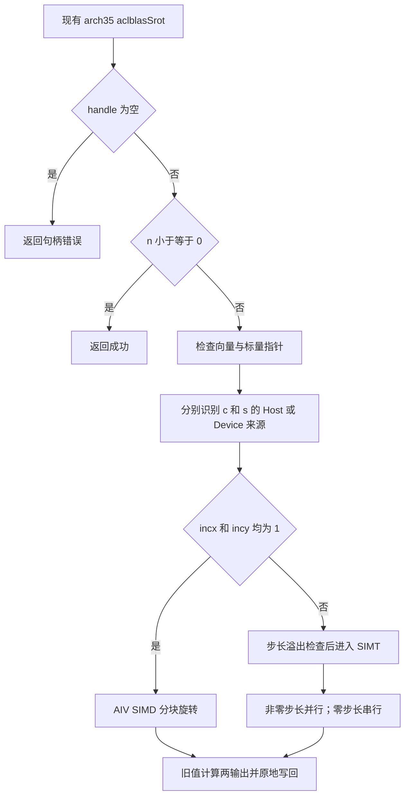
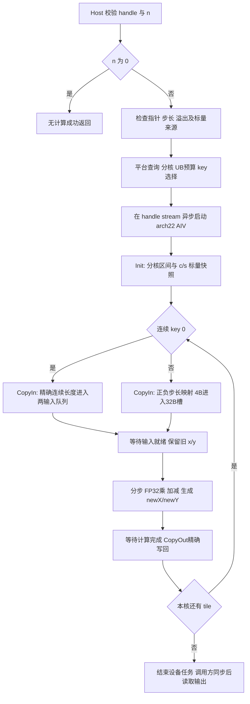

# aclblasSrot（Atlas A2/A3）算子设计文档

| 项目 | 内容 |
| --- | --- |
| 任务 | 11月社区任务-aclblasSrot算子开发（A2A3） |
| 贡献者 / 团队目录 | xiaoyux1 |
| 日期与阶段 | 2026-11-11；设计送审，尚未进行 NPU 编译、精度或性能自验 |
| 任务书 | `aclblasSrot_AtlasA2_A3_task_doc.md`；SHA256：`f0915818e47af712babcedef827f25c224ca19104ee64fe5f337f59998a31d37` |
| 实现目标 | `cann/ops-blas` 的 master，`blas/rot/arch22/` 与 `test/rot/srot/arch22/` |
| 源码分析基线 | ops-blas：`5bd95145a9c499e43ebad44a313a1029c63d54bc` |
| 模板与提交布局基线 | cann-ops-competitions：`f90187f2646933961fa7e3c15fca2036f6c6fdc6` |

## 1 需求背景（required）

### 1.1 需求来源与价值

根据任务书，为 Atlas A2/A3 的 arch22 补齐 FLOAT32 BLAS-1 平面旋转能力，复用公共 `aclblasSrot` 接口。该操作用于 Givens 旋转及相关线性代数算法，对两个向量原地更新。接口和数学标杆为 cuBLAS `cublasSrot`，有效输入的数值与负步长索引参考 Netlib BLAS 3.10.0 的 `srot.f` / `cblas_srot`。

本任务采用 Ascend C kernel 直调；不经过图算子注册、ACLNN 两段式执行器或 TBE。因而无对应 TBE `.py` 文件、TBE 算子信息库条目和手写 ACLNN 实现可复用，不能把通用 TBE 安装目录作为本算子的标杆路径。

### 1.2 现有实现与标杆分析

以下路径均相对于上述 ops-blas 完整基线 SHA，链接固定到该版本：

| 分析对象 | 路径与结论 |
| --- | --- |
| 公共 API | [include/cann_ops_blas.h](https://gitcode.com/cann/ops-blas/blob/5bd95145a9c499e43ebad44a313a1029c63d54bc/include/cann_ops_blas.h)，已有同签名声明，当前位于 459 行起；任务书行号是旧定位 |
| 950 Host | [blas/rot/arch35/srot_host.cpp](https://gitcode.com/cann/ops-blas/blob/5bd95145a9c499e43ebad44a313a1029c63d54bc/blas/rot/arch35/srot_host.cpp)，校验句柄，n≤0 返回成功；独立判定 c/s 所在位置；按连续性分派 |
| 950 Kernel / Tiling | `blas/rot/arch35/srot_kernel.cpp`、`srot_kernel.h`、`srot_tiling_data.h`；连续路径为五块 UB 的 AIV SIMD，跨步路径为 SIMT，零步长采用串行循环 |
| A2/A3 同族 | [blas/rot/arch22/csrot_host.cpp](https://gitcode.com/cann/ops-blas/blob/5bd95145a9c499e43ebad44a313a1029c63d54bc/blas/rot/arch22/csrot_host.cpp)、`csrot_kernel.cpp`；n=0 成功、负 n 和 0/INT_MIN 步长非法，跨步支持尾端起算。现实现读取 Device 标量到 Host 并同步，不直接照搬其同步和分配逻辑 |
| A2/A3 工程参考 | `blas/axpy/arch22/caxpy_{host,kernel}.cpp`、`caxpy_tiling_data.h`；参考 arch22 独立 Host/Kernel 和直接启动方式，不复制其复数布局和庞大偏移表 |
| 测试参考 | `test/rot/srot/srot_param.h`、`srot_golden.h`、`arch35/srot_test.cpp`、`arch35/srot_npu_wrapper.h`；CPU 参考调用 `cblas_srot` |
| 现状说明 | `blas/rot/README.md` 的 Srot 产品表：950 支持，A2/A3 尚不支持；`blas/rot/arch22/` 尚无 Srot 文件 |

950 连续路径先保存 x/y 旧值，独立生成两份输出后写回；其 x 更新使用 Muls+Axpy，y 更新使用分步乘加以控制抵消误差。本设计两路统一采用 FP32 分步乘、加/减，避免将 950 的 SIMT 指令、固定 UB 常数或复数分量数移植到 A2/A3。



### 1.3 来源差异及本设计采用的契约

任务书中的具体参数表和 §2.5 作为本次 arch22 设计要求；以下差异保留给正式评审确认，不宣称原始附件或 arch35 已符合该契约。

| 差异 | 已核对事实 | 本设计处理 |
| --- | --- | --- |
| 负 n、零步长 | arch35 与附件 README/CSV 采用 n≤0 成功、零步长合法；任务书要求 n<0、n>0 时零步长非法 | arch22 按任务书返回 INVALID_VALUE；只对合法计算调用 Netlib golden |
| 错误码出处 | cuBLAS 在线 §2.5.8 给出公式和 Host/Device 标量，返回码表未列出任务书这些 n/stride 校验 | 将细化校验标为任务书的 arch22 契约，不能说是对 cuBLAS 错误返回逐项验证的结果 |
| 测试分配 | 任务书末段称 inc≤0 quick return；前文又明确支持负步长 | 负步长 n>0 是正常计算，必须分配完整物理 span；只有 no-op 和预期错误用 dummy |
| GTest 注册 | 任务书称当前只在 arch35 分支注册；本基线 `test/rot/srot/CMakeLists.txt` 已无条件调用 `ops_blas_add_gtest_tests` | 保留现有注册，补 arch22 测试源并验证实际 GTest 发现，不重复加分支或退回整数毫秒 runner |
| 性能计时 | 附件脚本解析 event 的 avg_us，README 称 msprof 仅供分析；任务书 §3.3 要求 msprof task duration | 正式判定以任务书为准；event 只作调试，不能替换正式数据 |
| 正态分布 | 原始 CSV 没有 GAUSS token；生成器已有 `--dist mixed` 选项 | 在测试实现阶段修正语义并生成有明确分布计数的矩阵，不仅以选项名称推断覆盖率 |

## 2 需求分析（required）

### 2.1 Ascend C 算子原型

```cpp
aclblasStatus_t aclblasSrot(aclblasHandle_t handle, int n,
                          float* x, int incx, float* y, int incy,
                          const float* c, const float* s);
```

参数无默认值；不新增私有平行接口或 pointer-mode 设置接口。

| 参数 | 方向 / 存放位置 | 类型、格式与形状 | 约束和返回行为 |
| --- | --- | --- | --- |
| handle | 输入，Host | aclblasHandle_t | 非空有效句柄，携带 stream；空返回 HANDLE_IS_NULLPTR，优先于 n=0 |
| n | 属性，Host | int32 | n<0 返回 INVALID_VALUE；n=0 在句柄检查后直接成功，不访问其他参数 |
| x | 输入/原地输出，Device | FLOAT32，ND，一维 | n>0 非空；物理长度至少 `1+(n-1)*abs(incx)` |
| incx | 属性，Host | int32，元素为单位 | n>0 时非零且非 INT_MIN；`(n-1)*abs(incx)≤INT32_MAX` |
| y | 输入/原地输出，Device | FLOAT32，ND，一维 | n>0 非空；物理长度至少 `1+(n-1)*abs(incy)` |
| incy | 属性，Host | int32，元素为单位 | 校验同 incx |
| c / s | 输入，各自可为 Host 或 Device | const float*，各一个 FLOAT32 | n>0 时非空；独立查询地址属性，支持 HH、HD、DH、DD；值不校验 |

x/y 原始元素及 c/s 均允许有限值、Inf、NaN。不要求 `c*c+s*s=1`，不把任意 c/s 改写成三角函数。n/stride 等无效参数只做返回码判定，不进入数值计算。

### 2.2 数学与索引

零基逻辑下标 i∈[0,n)：

```text
px(i) = incx > 0 ? i*incx : (n-1-i)*abs(incx)
py(i) = incy > 0 ? i*incy : (n-1-i)*abs(incy)
x_new[px(i)] = c*x_old[px(i)] + s*y_old[py(i)]
y_new[py(i)] = c*y_old[py(i)] - s*x_old[px(i)]
G = [[c,s],[-s,c]]
```

指针指向物理 span 的低地址基址，负步长由内核从尾端起算。例：n=3、incx=-3，则 x 的物理访问顺序为 6、3、0，所需长度 7；调用方不再额外偏移 x。所有索引、span、字节偏移在 Host 和 Kernel 中以 64 位计算；校验元素偏移后也不能将 `4*px` 存入 int32。

每对元素必须读取两个旧值再覆盖；不参与访问的间隔元素保持原样。n=0 不启动 kernel。即使 c=1/s=0，也执行公式，因为跳过 `0*Inf` 会改变特殊值传播。

### 2.3 需求拆解与依赖

| 编号 | 需求 | 设计落点 / 验证 |
| --- | --- | --- |
| R1 | 公共接口、FLOAT32 原地旋转 | §2.1、§3.4；两个输出分别对拍 |
| R2 | 正负步长、间隔元素不变、索引溢出守卫 | §2.2、§3.2、§3.4；跨度与哨兵检查 |
| R3 | handle、n、指针、stride 错误与 no-op 顺序 | §3.2；独立 API 负向 GTest |
| R4 | c/s 四种位置组合及异步 stream | §3.2、§3.4；同 stream 前序生成 Device 标量 |
| R5 | arch22 构建、Tiling、UB 及尾块正确 | §3.1～§3.4；A2/A3 编译，910B3 边界实测 |
| R6 | 1000 精度用例、混合容差与输入分布 | §4.1、§4.2 |
| R7 | 200 性能用例，910B3 每例达到 GPU 的 0.8 倍性能 | §4.3；NPU us≤1.25×GPU us |
| R8 | 约束逐项核对、已知限制及后续交付 | §3.6、§5、§6 |

依赖 CANN 9.1.0、Ascend C arch22 编译工具链、ACL Runtime、ops-blas 句柄/平台查询/构建设施、GTest 和 CPU Netlib BLAS 3.10.0 CBLAS。生产 kernel 不依赖 CPU BLAS。无归约、类型提升、广播、图动态 shape 或外部 workspace 协议；运行时 n/stride 直接参与 tiling。

## 3 详细设计（required）

### 3.1 工程与构建接入

拟新增 `blas/rot/arch22/srot_host.cpp`、`srot_kernel.cpp`、`srot_kernel.h`、`srot_tiling_data.h`。Host 与 Kernel 共用结构体头，Kernel 计算和启动包装保持在同一设备翻译单元，沿用 kernel 直调，不引入私有 op_api/op_host 图工程。

`blas/CMakeLists.txt` 已递归收集选定架构的源文件，因此不另建算子源码 CMakeLists。使用现有 `--ops=srot` 过滤逻辑，确认最终动态库仅包含所选架构的一个 `aclblasSrot` 定义。

拟新增 `test/rot/srot/arch22/srot_test.cpp`、`srot_npu_wrapper.h`、`srot_test.csv`。保留公共参数解析和 CPU golden，arch22 的返回码、分布、比较器在专用测试中处理；不改变 arch35 测试的历史契约。更新 `blas/rot/README.md` 的 A2/A3 支持表、每架构行为和调用说明，后续代码 PR 随附本设计。

### 3.2 Host 侧设计

#### 3.2.1 校验顺序和异步标量传递

1. handle==nullptr → HANDLE_IS_NULLPTR。
2. n<0 → INVALID_VALUE；n==0 → SUCCESS，既不访问 x/y/c/s，也不查询平台、指针属性或分配内存。
3. n>0 检查 x/y/c/s 均非空；检查 incx/incy 非 0 且非 INT_MIN。
4. 先提升 stride 到 int64，再求绝对值、计算 last=`int64(n-1)*absInc`；任一 last>INT32_MAX → INVALID_VALUE。n=1 仍拒绝 0/INT_MIN，不因乘积为 0 放行。
5. c/s 各自调用 `aclrtPointerGetAttributes`。查询失败返回 INVALID_VALUE 并记录 ACL 错误；Host 来源读一次并按值放入 tiling；Device 来源保留 GM 指针，不在 Host 解引用或 D2H 同步。
6. 通过 `GetAivCoreCount()` / `PlatformAscendC` 查询 AIV 数与可用 UB。平台为空、AIV=0、UB 不足最小 tile 时返回 INTERNAL_ERROR，不进行除零或零核启动。
7. 计算分核和 tile，将小 tiling 结构按值传给启动包装，使用 handle 的 stream 异步下发。无每次调用的 GM tiling/workspace 分配，不依赖栈地址在返回后继续有效。

Device c/s 在 kernel 开始时各读取一次，遵守同 stream 前序写入的顺序。Host 标量在 API 返回前完成取值；Device 标量和向量在 stream 完成前必须保持有效，调用方不得并发修改。标量与输出存储重叠不在已定义任务语义内，见 §6。可检测到的启动错误按仓库接口返回 EXECUTION_FAILED，平台等内部错误返回 INTERNAL_ERROR；异步设备错误由调用方的同步检查报告，不把返回 SUCCESS 当作设备完成。

#### 3.2.2 分核与覆盖证明

初始策略按 32B 粒度（8 个 FP32）分逻辑区间；连续路径减少共享边界，跨步路径复用相同逻辑分区。设 N=n>0，C 为查询所得 AIV 核数，U=`(uint64(N)+7)/8`。初始目标每核至少 G=4096 个逻辑元素：

```text
A = min(C, max(1, ceilDiv(N,G)), U)
q = U / A, r = U % A
unitBegin(b) = b*q + min(b,r)
unitCount(b) = q + (b<r ? 1 : 0)
begin(b) = 8*unitBegin(b)
end(b) = min(N, 8*(unitBegin(b)+unitCount(b)))
```

A∈[1,C] 且 q≥1。相邻核的 unitBegin 与前一核终点相等；首核从 0 开始，末核终点截断为 N，所以逻辑区间无遗漏、无重叠。合法非零 stride 下 px/py 分别为单射，且 x/y 独立存储时不同核不存在写地址冲突。G=4096 是待实测调整的启动策略参数，不是性能结论；n≤G 启动一核。

例：N=3 → U=1、A=1、区间[0,3)。示例平台 C=40（仅用于演算，实际查询）时，N=1048577 → U=131073、A=40、q=3276、r=33；前33核各3277单元，其余各3276，最后一个核处理末尾不足8元素的部分。所有 ceilDiv 使用 64 位运算避免 N+G-1 在 int32 上溢出。

### 3.3 Tiling 与 UB / Workspace 预算

结构体拟包含：`uint32_t tilingKey,totalN,activeBlocks,baseUnits,extraUnits,tileElems,cIsDevice,sIsDevice`，`int32_t incx,incy`，`float cosValue,sinValue`。负步长映射使用 `totalN`；GM 基址与两个 Device 标量指针作为独立 kernel 参数传入。字段由 Host 初始化为零后填写，两侧校验布局，避免重复定义。

| tilingKey | 条件 | 数据路径 |
| --- | --- | --- |
| 0 | incx=1 且 incy=1 | 连续 DMA → AIV SIMD → 连续精确写回 |
| 1 | 其他所有合法非零步长 | 每个逻辑元素独立 4B DMA 到 32B UB 槽 → SIMD → 4B 精确写回 |

不使用 arch35 `asc_simt` / `asc_vf_call`。两 key 均处理四种 c/s 来源，不为标量位置或长度增加 kernel 二进制组合。

设 B 为查询得到的 UB 字节数，R=8192B 为初始预留（标量暂存、队列与对齐等），必须以编译资源报告核对并在需要时增大。五个 tile 分别是原 x、原 y、newX、newY、work；输入/输出队列深度均为1，无 double buffer。

| 路径 | 每 tile 容量 | 总预算与 tile 推导 |
| --- | --- | --- |
| 连续 | T 个 FP32，每块4T字节 | `20*T+R≤B`；`T=8*floor((B-R)/160)`，小输入实际使用 min(剩余,T) |
| 跨步 | P 个元素，每元素一个32B槽，即8P个FP32 | `160*P+R≤B`；`P=min(512,floor((B-R)/160))` |

B≤R 或向下取整得到0时返回内部错误。单次 DMA 长度与 Vector count 还需满足 CANN 9.1.0 API 字段限制；本设计以 UB 容量约束每次调用，不对 n 直接做窄化计数。

资源演算：若查询 B=192KiB，则连续 T=9408，五块占188160B，加8192B为196352B≤196608B；跨步 P=512，占81920B，加预留为90112B。N=1048576、示例 C=40、A=40 时，每核约26208/26216元素，连续分成2个9408满 tile 和7392/7400尾 tile。N=3 只搬入、计算和搬出3个有效元素。上述为预算演算，实际芯片 B/C 和资源占用仍需设备验证。

Workspace=0，无归约、全向量临时 GM 或二次 pack kernel。tile 长度只决定单核循环次数，不限制合法总 n；测试缓冲分配受真实设备容量约束，不能据此缩小 API 参数域。

### 3.4 Kernel 侧设计



**Init。** 根据 GetBlockIdx 和 §3.2.2 计算 `[begin,end)`，建立 x/y 的 GlobalTensor，Host 来源使用 tiling 标量，Device 来源从 GM 读取4B并完成必要同步后用于计算；每核固定该次调用的 c/s。向量仍只计算 FLOAT32，不转 FP16/BF16。

**CopyIn。** key0 用 arch22 支持的 `DataCopyPad` / 仓库对应搬运包装，将有效 len 个元素读入独立的 x/y 输入队列；GM 长度为4×len，不向上取整读取调用方没有分配的尾部。key1 对 tile 中每个 i 根据 px/py 计算64位偏移，用4B DataCopyPad 将一个实数放入32B对齐 UB 槽（槽索引8×localI），UB 其余7个 float 补零。两路输入都完成后才开始计算。

**Compute。** 队列 DeQue 等待 MTE2；按以下依赖执行，复用唯一 work，必要时对 Vector 依赖设置 pipe barrier。key0 的 count=len；key1 的 count=8×len，只有各槽首元素有效，填充计算结果不写回。

```text
newX = Muls(oldX, c)
work = Muls(oldY, s)
newX = Add(newX, work)
newY = Muls(oldY, c)
work = Muls(oldX, s)
newY = Sub(newY, work)
```

六步使用 FP32；保持每步舍入，避免编译器将标量表达式隐式融合成 FMA。两输出均完成后才释放旧 x/y，work 的覆盖发生在前一个 Add 消费完成后。c=0/s=0/单位旋转不短路；不夹断或清理 NaN/Inf。

**CopyOut。** 输出入队/出队建立 Vector→MTE3 依赖。key0 按4×len字节写回；key1 对每个槽仅写回首4B到 px/py，绝不做覆盖间隔元素的完整物理 span 回写。输出队列释放/复用须等待 MTE3 完成。每次访问只落在已验证 span 内；GM 步长为负也转换为非负物理下标，不把 GM 指针移到基址之前。

对于 key1，逐元素 DMA 是首先保证全步长正确性的实现路径，可能较慢；任务包200条 GPU 性能基线均为 incx=incy=1。后续如引入批量 gather/scatter，须保留间隔哨兵、极大合法步长和负步长回归，并以实际数据证明收益。

### 3.5 支持硬件与优化方向

| 项目 | 支持与计划 |
| --- | --- |
| Atlas A2 / Atlas A3，arch22 | 目标支持；分别以 ascend910b / ascend910_93 构建 |
| Atlas 800T A2 910B3 | 任务要求的精度和性能自验证设备 |
| Ascend 950，arch35 | 保持现有实现，不能以其构建结果替代 arch22 验证 |
| CANN | 任务指定9.1.0；实际仓库依赖与安装版本须在实现阶段核对 |

连续大向量每元素读取8B、写回8B，理想向量访存16N字节，计算约6 FLOP/元素，主要关注带宽和下发成本。优化顺序为去除每次分配/同步、连续 DMA、适量分核，再用实测比较 G 与 tile；double buffer 仅在收益明确时引入，同时重新计算九块 tile（四组输入/输出双缓冲加一块 work）的预算 `36*T+R≤B` 和事件生命周期。当前无设备数据，不承诺预算推导即已满足性能门槛。

### 3.6 任务书 §2.5 约束逐项核对

| 约束 | 设计结论 | 验证 |
| --- | --- | --- |
| 参数合法性与层级 | §3.2.1 明确 handle→n→指针/步长/溢出→位置查询→启动 | API 错误码与组合优先级测试 |
| 非连续 Tensor | 以非零正负 BLAS stride 支持；间隔不写 | 正负/混合步长、间隔哨兵 |
| broadcast | 不涉及，两个向量同为 n 个逻辑元素 | 不生成广播规则或 shape 扩张 |
| dynamic shape | n/stride 是运行时参数；不要求图动态 shape | 多规模同一入口运行 |
| 原地与视图 | 两输入旧值保留到两输出计算完成；无新视图 | x/y 都对拍，另验未选位置 |
| 确定性 | 无归约/原子加；固定输入同步长同二进制执行应 bit 一致 | 重置输入后重复执行逐位比较 |
| 空 Tensor | n=0 仅检句柄，成功且无 kernel/分配/属性查询 | nullptr及非法步长叠加，输出不变 |
| 0维 Tensor | 无 tensor描述符；c/s是指针标量，不是0维图输入 | 标量指针四种位置测试 |
| 异步执行 | 使用 handle stream，无 Host 侧计算完成同步 | 前序 Device 标量写入、后序结果检查 |

## 4 可维可测分析

### 4.1 测试矩阵、附件修正与独立 golden

2026-11-11 静态检查原始 `srot_test.csv`：1200行，其中非 TC_PF 的精度行1000条、TC_PF 性能行200条；精度行中 n<0 有7条，n>0 且至少一个零步长有385条，x/y 的 GAUSS token 为0。原始包须保留哈希/副本并记录逐行修订，不直接拿该包的历史 SUCCESS 作为 arch22 合同。

实现阶段保留1000条精度矩阵和200条性能矩阵：负 n、零步长、INT_MIN、偏移溢出改为预期错误并在调用前走 dummy 分配；从其余冗余组合中安排足量合法向量计算，另增加必要边界/接口 GTest。正常随机输入的 x/y 各按50%均匀[-5,5]、50%正态分配，并在报告分别给出实际计数和分布参数；特殊填充、no-op、负向用例单列，不计入随机分布分母。记录固定种子、每条输入或可复现生成参数，正态 μ∈[-5,5]、σ∈[0.1,2]，不得裁剪成均匀分布。

| 维度 | 必须覆盖 |
| --- | --- |
| 规模 | n={0,1,2,3,1024,16384,262144,1048576}；8/64边界±1、tile边界±1、分核边界±1；性能包含2097152/4194304 |
| stride | {1,2,7,-1,-3} 双向组合；单负、双负；n=1配极大合法stride；合法上界与越界两侧 |
| 溢出 | n=1048577/incx=4096；n=65537/incy=65536；INT_MIN；精确 INT32_MAX 合法偏移的 Host tiling 检查（大缓冲设备执行按实际容量记录） |
| 标量 | c/s各覆盖{0.6,1,0,-0.5}，并含0.8、相消、极小/大值、NaN、±Inf、±0 |
| 内存位置 | HH、HD、DH、DD；原包 mixed 只表示HD，DH用额外接口测试补足 |
| 负向 | 空handle、负n、x/y/c/s分别为空、stride=0/INT_MIN、偏移溢出、可模拟的位置查询失败 |
| 原地与越界 | 两输出独立比对；间隔与首尾哨兵逐位不变，尾部不要求调用方额外32B空间 |
| 异步与确定性 | 同 stream 前序产生Device c/s；非默认stream；相同初值重复执行 |

错误/no-op测试先确定预期行为，再决定是否分配：n=0无需 Device 向量；期望错误用1个元素dummy或nullptr，不能对 INT_MIN 调 abs 或分配数十亿元素。合法负步长必须按完整span分配。handle/c/s空指针等CSV不能表达的情况使用专用GTest。

CPU golden独立调用 Netlib BLAS 3.10.0 的 `cblas_srot`，使用原始FP32输入副本和相同步长，保存更新后的x/y。不得把NPU输出当参考，不以FP64计算后统一cast替代任务要求的FP32参考；记录库版本和CPU编译浮点选项。负向用例直接判断API返回码，避免Netlib的负n/零stride语义覆盖Host契约。

### 4.2 精度标准

按任务书 §3.2，x、y分别判定，不能合并后稀释单个向量错误：

```text
atol = rtol = 2^-13
有限值元素匹配：abs(actual-golden) <= atol + rtol*abs(golden)
matched_ratio >= 0.99
最大绝对误差上限：1e-2 或 32 ULP（按任务指定标准记录分支）
```

首次实现采用固定 `max_abs_error≤1e-2` 判据，不自动把阈值放宽到有利的ULP分支；如需使用32ULP，应明确ULP计算、对应元素和适用标准，取得评审确认并对全部用例采用一致口径。

非有限元素单独判定：NaN/NaN、同号Inf/Inf、NaN与任意Inf视为通过；异号Inf不等效；有限值与非有限值不等效。非有限元素不参加有限值ratio与max统计，且必须全部通过。无有限元素时ratio/max记N/A，仅以非有限分类全部通过判定；空输入按no-op验证。记录 finite_count、matched_count、ratio、max_abs_error、nonfinite_count、nonfinite_matched 和两个向量各自结论。

同时保留未命中地址与哨兵检查；数值容差不能豁免越界写。发现精度失败时保存最小输入、seed、输出和golden，按算法、舍入、golden版本或脚本原因分类，不删除失败行或修改任务阈值。

### 4.3 性能标准与计时口径

性能正式环境为Atlas 800T A2 910B3、CANN9.1.0，FLOAT32，200条case逐条判定。GPU基线来源为任务附件 `gpu_baseline.csv`，README标注NVIDIA A100-SXM4-80GB、CUDA12.8、cuBLAS12.8.4；本设计未重新实测GPU。

将 `gpu_ms` 乘1000转成us，按 `(n,incx,incy,c,s)` 联合匹配，禁止按行序关联。基线key重复时必须核对是否数值一致，否则报告歧义；缺基线记NO_REF，不能算PASS。

```text
GPU_us = 1000 * gpu_ms
NPU_Avg_us = sum(valid_task_duration_us) / valid_count
通过：NPU_Avg_us <= 1.25 * GPU_us
性能比：GPU_us / NPU_Avg_us >= 0.8
```

| 附件基线ID / n | GPU us | NPU上限us（×1.25） |
| --- | --- | --- |
| srot-base-000 / 1048576 | 16.5717334 | 20.71466675 |
| srot-base-001 / 2097152 | 25.0709335 | 31.338666875 |
| srot-base-002 / 4194304 | 48.8277345 | 61.034668125 |

正式采样使用msprof op，预热5次不计入，之后每例连续有效样本≥10取算术平均。测试runner须核对本机msprof是否自动安排预热/重复，按实际执行日志只标记一组5次预热，避免重复剔除。每条case独立采集，关联kernel名、stream、调用序号和task duration；本设计每调用一个计算kernel，不能把warmup、golden、reset copy或其他用例的task混入。

向量预先分配；原地算子每次测量使用相同初值，在计时范围之外恢复，保证GPU/NPU工作等价。仅API返回SUCCESS且最终stream同步无错、profiling记录完整的执行计入有效样本；异常样本保留原因，并补足有效数。排除Host造数、H2D/D2H、golden和同步等待开销；不得以整数ms、event均值或端到端耗时代替任务duration。平均值非有限/≤0、样本不足、缺case、进程失败或空报告均不能判通过。

### 4.4 构建、自验和可维护性

实现阶段按目标仓当前命令执行，例如：

```bash
bash build.sh --ops=srot --soc=ascend910b
bash build.sh --ops=srot --soc=ascend910b --run
bash build.sh --ops=srot --soc=ascend910_93
```

核对生成的 `srot_test` 为GTest目标，使用 `--gtest_list_tests` 清点arch22用例。任务附件verify_accuracy脚本的过滤/输出解析也须校正为实际GTest格式，既检查进程退出又检查完整1000条case清单；性能脚本另接入msprof结果。原verify脚本不能因为出现至少一条PASS就宣告全量通过。

证据绑定代码完整SHA、未提交改动快照、CANN/驱动/固件、设备型号、构建命令、实际加载库、CSV哈希、样本数和日志路径。每次更改tiling、算术、同步或公共设施后补对应回归；正式提交执行全矩阵和仓库门禁。内存验收按任务书§3.4不涉及，仍需检查越界、资源预算和异步对象生命周期；不伪造内存测试PASS。

## 5 兼容性与特性交互

| 方面 | 分析与处理 |
| --- | --- |
| API/ABI | 复用现有声明与状态枚举；不改变参数顺序、类型或创建/销毁/stream接口 |
| 跨架构 | 仅新增arch22源，arch35行为保留；README明确n/stride差异，不能给公共测试强套arch22返回码 |
| 格式与形状 | 一维BLAS逻辑向量，物理span由stride决定；无tensor descriptor/infer shape/广播 |
| 类型 | 仅FP32；无隐式类型提升、复数或多dtype分摊，1000/200均归于唯一dtype |
| 原地+负stride | 先保留旧值、非负物理索引和精确4B写回，保持间隔与尾部完整 |
| 标量+异步 | Host按值捕获；Device在stream内消费，HD/DH独立；无Host侧Device解引用和隐含同步 |
| 确定性+多核 | 非零stride、独立向量时元素间无依赖；固定运算序列，无归约或原子操作 |
| 软件版本 | 目标CANN9.1.0；设备指令与DataCopyPad用法须由A2/A3编译和910B3实测确认，不能只凭950代码可编译推断 |

## 6 已知限制、评审确认项与设计自查

| 项目 | 状态 / 规避或后续动作 |
| --- | --- |
| 任务包与arch35语义冲突 | 已在§1.3逐项列出；拟按任务书明确的arch22参数表开发，正式评审确认后固化测试，不静默修改标准 |
| x/y以及c/s与输出别名 | 任务书未定义跨向量重叠/标量别名语义；本分核证明适用于x/y独立存储、标量不与输出重叠。调用方使用独立缓冲；评审若要求重叠支持，须先明确同时输出冲突和跨元素顺序，再设计串行/快照路径，不能宣称当前覆盖 |
| 泛化stride性能 | key1保正确性，逐元素DMA可能限制吞吐；当前GPU性能矩阵为连续路径，非连续性能需另列实测，不能以连续结果代替 |
| 合法极大span | API以int32元素偏移边界校验，实际缓冲可能超过设备容量；用Host边界测试验证判定，设备未运行项显式记录 |
| 官方精度标准细节 | 任务链接固定修订的正文与设计检查表在线读取受限；本版按任务书原文写出判据、固定1e-2分支，未宣称已逐格核验最新在线清单 |
| 编译与自验 | 本PR为设计文档，尚无NPU编译、1000精度、200性能或官方审核通过结论；UB与性能表为推导/基线，不能当作NPU实测 |

设计自查：接口/数学/原型见§2，标杆文件及版本和流程图见§1，依赖与范围见§2.3，Host分核/溢出/异步见§3.2，UB/Tiling/尾块见§3.3，CopyIn/Compute/CopyOut与生命周期见§3.4，硬件及任务约束逐项见§3.5～§3.6，可测性/精度/性能/日志见§4，兼容性见§5，未知语义及规避见本节。

后续实现与验收交付按任务书分别准备Host/Kernel、arch22测试、README、自测报告和task_submission材料。本次只送设计审查；PR创建、CI通过、官方设计通过和最终算子验收是不同状态。

## 7 参考资料

1. 用户提供的《aclblasSrot算子开发任务书》（文件版本与哈希见文首），重点§2.4、§2.5、§3.2、§3.3、§3.5及任务测试附件。
2. [cuBLAS §2.5.8 cublas rot](https://docs.nvidia.com/cuda/cublas/index.html#cublas-t-rot)，用于接口和数学分析；在线读取日期2026-11-11，页面版本13.5，GPU基线版本以附件为准。
3. [Netlib srot.f](https://netlib.org/blas/srot.f)，用于有效计算与负stride映射；交付golden固定Netlib BLAS3.10.0版本，不直接把网页最新文件当作已安装库版本。
4. [ops-blas贡献指南](https://gitcode.com/cann/ops-blas/blob/5bd95145a9c499e43ebad44a313a1029c63d54bc/CONTRIBUTING.md)及同修订的rot源码、公共头、构建与测试设施。
5. [社区任务布局说明](https://gitcode.com/cann/cann-ops-competitions/blob/f90187f2646933961fa7e3c15fca2036f6c6fdc6/04_tasks/01_community-task-2026/README.md)、[设计模板](https://gitcode.com/cann/cann-ops-competitions/blob/f90187f2646933961fa7e3c15fca2036f6c6fdc6/04_tasks/01_community-task-2026/resources/design_template.md)。
6. [任务引用的mixed_tolerance标准](https://gitcode.com/cann/opbase/blob/28a1ce52ae856353589841226a0002af73314a6b/docs/zh/ops_precision_standard/mixed_tolerance_standard.md)、[设计文档检查表](https://docs.qq.com/sheet/DUHVGUFdmSFRjVFFU?tab=000001)，访问边界见§6。
