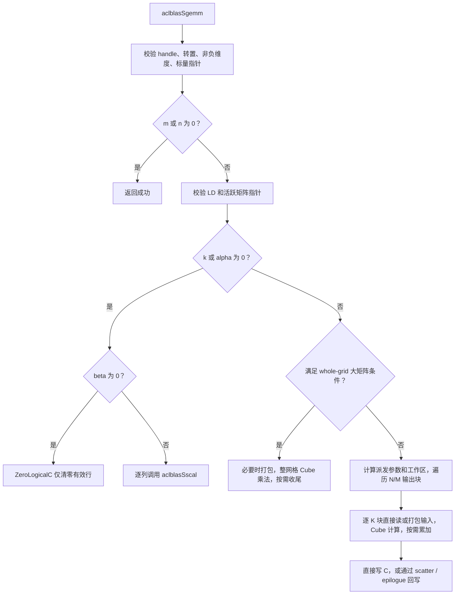
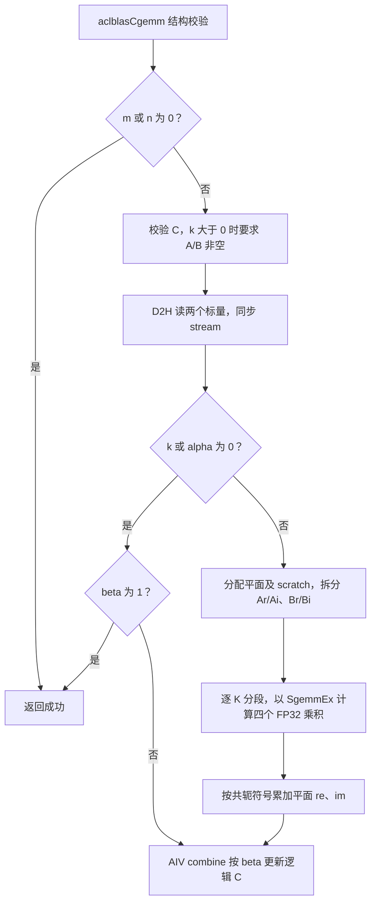
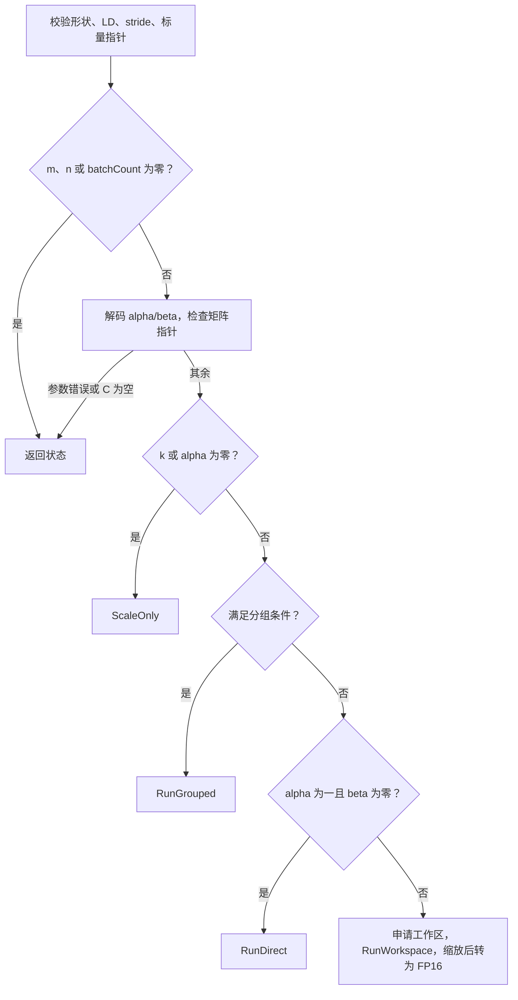
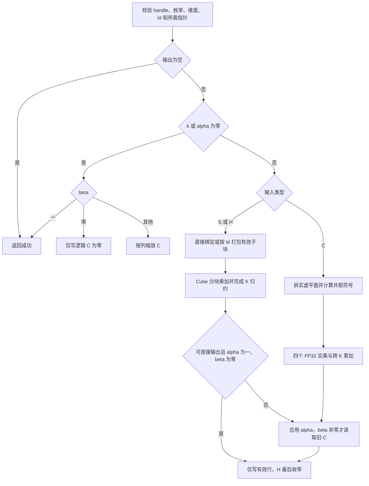

# Atlas A2/A3 上 aclblasSgemm、aclblasCgemm 与 aclblasHgemm 开发方案

| 承接人 | 设计版本 | 实现仓库 | 适配范围 |
| --- | --- | --- | --- |
| CyndiZ | R1 · 2026-11-25 | cann/ops-blas，arch22 | CANN 9.1.0，Atlas A2 / A3 |

三个接口完成同一个列主序矩阵更新。Sgemm 沿用 FP32 实现，调整空输出校验并验证长 K 归约。Cgemm 复用已合入的四实乘实现，补齐 Host 标量和零乘积语义。Hgemm 新增单矩阵公开入口，以 FP32 累加并在写回时舍入到 FP16。三个接口通过同一测试工程验证，精度与性能按各自的类型和标杆逐例判定。

## 1 需求背景

### 1.1 需求来源

根据 11 月社区任务《aclblasSgemm / aclblasCgemm / aclblasHgemm 类算子开发任务书》，在 CANN 9.1.0 的 Atlas A2/A3 产品上补齐单矩阵 GEMM。三个接口共用列主序 BLAS 调用约定，分别对应 cuBLAS 的 Sgemm、Cgemm、Hgemm。使用方传入句柄、Host 标量和 Device 矩阵，在绑定的 stream 上原地更新 C。

### 1.2 现有实现与差距

下表按设计时核对的官方 ops-blas master 提交 `55ef791b` 记录。任务书编写后，上游已合入 arch22 Cgemm。此次在既有 S/C 入口上对齐任务契约，并新增单矩阵 Hgemm。接口通过 C 符号直调，任务未指定同名 TBE 算子、OPP 信息库条目或 ACLNN 接口。核对接口和支持范围时，以公共头、arch22 的 Host/Kernel 源文件和产品 README 为准。

| 模块 | 源文件及现状 | 对 arch22 开发的意义 |
| --- | --- | --- |
| 公共接口和类型 | `include/cann_ops_blas.h` 已有 S/C 声明（快照中为第 575、579 行），尚缺单矩阵 H。`include/cann_ops_blas_common.h` 定义操作枚举、返回码、FP32 双分量结构体及 FP16 位模式类型 | 沿用 `aclblasComplex{real,imag}` 和 `aclblasHalf`。与 S/C 同一头文件新增 H。 [公共接口](https://gitcode.com/cann/ops-blas/blob/55ef791b77f3677b45da3468b0a8b17941424f84/include/cann_ops_blas.h) · [公共类型](https://gitcode.com/cann/ops-blas/blob/55ef791b77f3677b45da3468b0a8b17941424f84/include/cann_ops_blas_common.h) |
| arch22 Sgemm | `blas/gemm/arch22/gemm_host.cpp` 仅导出 Sgemm，kernel 与描述符分别在同目录 `gemm_kernel.cpp`、`gemm_kernel.h`。支持列主序 FP32、T/C 等价、前导维度和分块计算 | 复用已有 S 的直接乘法、打包和收尾实现。修正空输出时 LD 校验顺序，复测长 K 及转置边界。 [Host](https://gitcode.com/cann/ops-blas/blob/55ef791b77f3677b45da3468b0a8b17941424f84/blas/gemm/arch22/gemm_host.cpp) · [Kernel](https://gitcode.com/cann/ops-blas/blob/55ef791b77f3677b45da3468b0a8b17941424f84/blas/gemm/arch22/gemm_kernel.cpp) |
| arch22 Cgemm | `blas/gemm/arch22/cgemm_host.cpp` 已导出 Cgemm，配套 `cgemm_kernel.cpp/.h` 及 `cgemm_tiling_data.h`。现有 AIV 拆分输入和合并输出，四个实数乘积通过子句柄调用 FP32 后端 | 沿用这一 C 符号及四乘积实现。在该 Host 修正标量来源及 alpha 为零时的指针判定。 [Host](https://gitcode.com/cann/ops-blas/blob/55ef791b77f3677b45da3468b0a8b17941424f84/blas/gemm/arch22/cgemm_host.cpp) · [Kernel](https://gitcode.com/cann/ops-blas/blob/55ef791b77f3677b45da3468b0a8b17941424f84/blas/gemm/arch22/cgemm_kernel.cpp) |
| arch35 S/C 参考 | `blas/gemm/arch35/gemm_host.cpp`、`cgemm_host.cpp` 分别给出实数派发与复数分量、共轭、复标量收尾。后者含多条实现路径 | 可复用逻辑映射。此次 Cgemm 固定四个实乘积，避免迁入三乘积分支或 `cgemm3m_host.cpp` 的专用路径。 [arch35 Cgemm](https://gitcode.com/cann/ops-blas/blob/55ef791b77f3677b45da3468b0a8b17941424f84/blas/gemm/arch35/cgemm_host.cpp) |
| arch35 H 参考 | `blas/gemm/arch35/hgemmStridedBatched_host.cpp` 与 `hgemmStridedBatched_kernel.cpp` 实现有步长的批量 FP16 乘法，包括 FP32 中间结果及写回转换 | 借鉴类型转换和缩放。新 H 接口只处理一个矩阵乘积，使用 arch22 兼容的指令，按单矩阵契约重新判断空指针。 [arch35 HgemmStridedBatched](https://gitcode.com/cann/ops-blas/blob/55ef791b77f3677b45da3468b0a8b17941424f84/blas/gemm/arch35/hgemmStridedBatched_host.cpp) |

**现有 arch22 Sgemm 流程**

源函数 `ValidateSgemm` 在空输出时跳过 LD 检查。常规乘法以列主序到内部矩阵的映射驱动 Cube，必要时由 Vector 打包并合并缩放结果。下图描述该快照可走的分支。



**现有 arch22 Cgemm 流程**

公共 Cgemm 入口校验结构参数并处理空输出，然后只依 k 判断 A/B 指针。`LaunchCgemmKernel` 调用 `CBlas3ReadScalarsFromDevice`，依次从 Device 拷回 alpha、beta 并同步 stream。当前实现与任务要求的 Host 标量和 alpha=0 允许空 A/B 有差距。现有 arch22 专用测试包装器也会先把两标量上传到设备。在 Cgemm 入口修正读取和校验顺序，保留专用包装器作为旧调用回归，见 §4。



设 `sA/sB` 在对应 OP_C 时为 −1，其他情况为 +1。四个实数乘积按 `re = Ar·Br − sA·sB·Ai·Bi`、`im = sB·Ar·Bi + sA·Ai·Br` 合并，各实平面仍按 N/T 读取。实际子调用是 `RunOneCgemmProduct → aclblasSgemmEx(ACL_FLOAT)`。当前每段 K 至多 1024，特定转置对齐场景还会缩短该段。沿用此限制直至 S 的长 K 和转置偏移有正确性证据，重点回归 `512×512×1536`、`transb=T/C` 及非对齐尾块。公共 README 的 C 标量参数表已写 Host，共用测试入口使用 Host 标量，已有 Device 标量由指针位置识别后走兼容路径。 [公共 Host 助手](https://gitcode.com/cann/ops-blas/blob/55ef791b77f3677b45da3468b0a8b17941424f84/blas/common/helper/complex_blas3_host_utils.h) · [当前 Cgemm 测试包装器](https://gitcode.com/cann/ops-blas/blob/55ef791b77f3677b45da3468b0a8b17941424f84/test/gemm/cgemm/arch22/cgemm_npu_wrapper.h)

**Hgemm 的 FP16 参考流程**

arch22 尚无单矩阵 H 的历史入口。arch35 的 `aclblasHgemmStridedBatched` 可作为 FP16 参考。其 `Run()` 用 Host 解码后的半精度标量选择缩放、分组、直接输出或 FP32 工作区路径。新接口借用最后一次舍入的做法，移除参考中的批次与 stride 条件，空指针规则按 §3.1 执行。



## 2 需求分析

### 2.1 外部组件依赖

运行依赖 CANN 9.1.0 的 Ascend C、ACL Runtime 与 A2/A3 的 arch22 编译环境。测试侧使用仓内 ATK/GTest、Netlib BLAS 3.10.0 的 S/C 参考计算、H 的高精度 golden，以及 `msprof op` 的 NPU kernel 用时。GPU 的 `cublasSgemm/Cgemm/Hgemm` 提供同参性能标杆。CPU/GPU 参考库仅用于测试。 [Sgemm 参考](https://www.netlib.org/blas/sgemm.f) · [Cgemm 参考](https://www.netlib.org/blas/cgemm.f) · [cuBLAS GEMM](https://docs.nvidia.com/cuda/cublas/index.html#cublas-t-gemm)

### 2.2 内部适配模块

沿用 `blas/common/helper/aclblas_handle_internal.h` 提供的句柄、stream 和工作区，按 `blas/common/helper/host_utils.h` 获取可用核心数。在 `blas/gemm/arch22/` 为 S/C/H 对齐参数校验与边界分派，保留各数据类型的计算路径。沿用 `cgemm_host.cpp` 中的 Cgemm 定义，在同一实现目录新增 Hgemm 的唯一导出，Host 沿用同族接口风格，Kernel 复用实数切块并实例化 FP16 输入路径。在 `test/gemm/arch22/gemm_test.cpp` 与 `gemm_test.csv` 的通用测试入口扩展三类用例，并保留、回归 `test/gemm/cgemm/arch22/cgemm_test.cpp` 既有测试，参考 `test/gemm/arch35/gemm_test.cpp` 和 `test/gemm/cgemm/arch35/cgemm_test.cpp`。检查 `build.sh` 及测试 CMake 对 `--ops=sgemm,cgemm,hgemm` 的目标解析，将三个选项接入统一 runner，枚举并实际执行各自的用例。更新 `blas/gemm/README.md` 的产品、参数、返回码和约束。

### 2.3 公开原型、布局和异常行为

```cpp
aclblasStatus_t aclblasSgemm(
    aclblasHandle_t handle, aclblasOperation_t transa, aclblasOperation_t transb,
    int m, int n, int k, const float* alpha, const float* A, int lda,
    const float* B, int ldb, const float* beta, float* C, int ldc);

aclblasStatus_t aclblasCgemm(
    aclblasHandle_t handle, aclblasOperation_t transa, aclblasOperation_t transb,
    int m, int n, int k, const aclblasComplex* alpha, const aclblasComplex* A, int lda,
    const aclblasComplex* B, int ldb, const aclblasComplex* beta, aclblasComplex* C, int ldc);

aclblasStatus_t aclblasHgemm(
    aclblasHandle_t handle, aclblasOperation_t transa, aclblasOperation_t transb,
    int m, int n, int k, const aclblasHalf* alpha, const aclblasHalf* A, int lda,
    const aclblasHalf* B, int ldb, const aclblasHalf* beta, aclblasHalf* C, int ldc);
```

`C[i,j] = alpha × Σₚ op(A)[i,p] × op(B)[p,j] + beta × C_old[i,j]`，其中 `0 ≤ i < m`、`0 ≤ j < n`、`0 ≤ p < k`。alpha、beta、A、B、C 使用同一接口的数据类型。S 为 FP32（4 字节），C 为相邻两个 FP32（8 字节，实部在前），H 为 IEEE binary16（2 字节，1.0 的位模式为 `0x3c00`）。Cgemm 的标量乘法也按复数计算。H 的乘积累加与缩放保留 FP32 中间结果，在最终写回时舍入为 FP16。

| 参数 | 存储及范围 | 访问规则 |
| --- | --- | --- |
| `handle, transa, transb` | 已创建的 Host 句柄，两项操作分别取 `ACLBLAS_OP_N/T/C` | S/H 将 C 映射到 T，Cgemm 在 OP_C 的对应操作数上额外取共轭，OP_T 保留虚部符号 |
| `m,n,k` | 非负 `int`，运行时传入 | 逻辑形状依次为 `op(A):m×k`、`op(B):k×n`、`C:m×n` |
| `alpha,beta` | 非空 Host 标量指针 | 按接口类型在 Host 取值后随 launch 参数传给设备，复数零为两分量均为零，复数一为 `(1,0)` |
| `A,lda` | 只读 Device，N 时物理为 `lda×k`，T/C 时为 `lda×m` | 以元素为单位，N 偏移 `i+p*lda`，T/C 偏移 `p+i*lda`。`lda ≥ max(1, N 时 m 否则 k)` |
| `B,ldb` | 只读 Device，N 时物理为 `ldb×n`，T/C 时为 `ldb×k` | N 偏移 `p+j*ldb`，T/C 偏移 `j+p*ldb`。`ldb ≥ max(1, N 时 k 否则 n)` |
| `C,ldc` | Device 原地读写，物理为 `ldc×n` | 偏移 `i+j*ldc`，`ldc ≥ max(1,m)`。每列行号 `m..ldc-1` 的填充值保持原样 |

所有矩阵采用 ND 列主序、列内连续的存储。调用方保证 C 的可写区域与 A/B 的可读区域互不重叠。该接口仅描述由 LD 表示的二维矩阵，未包含批次、广播、任意 stride/view 或图模式的动态 shape 协议。运行时尺寸参与 Host 分派。浮点规约顺序可以随分块变化，精度以逐用例标准判断。

## 3 详细设计

### 3.1 使能方式与 Host 校验入口

调用方创建 `aclblasHandle_t` 并以 `aclblasSetStream` 绑定有效 stream，再调用对应公开函数。Host 只检查结构参数与当前分支需要的指针，直接在该 stream 上排入 kernel。读取输出或回收正在使用的缓冲前，调用方执行 `aclrtSynchronizeStream` 并检查返回状态。接口返回值描述本次参数检查和下发状态。

| 校验或分支（从上到下） | 状态及允许的访问 |
| --- | --- |
| 空 handle，非法 transa/transb | 前者返回 `ACLBLAS_STATUS_HANDLE_IS_NULLPTR`，后者返回 `ACLBLAS_STATUS_INVALID_ENUM`。后者是 ops-blas 与 cuBLAS 非法枚举返回码的有意差异 |
| m/n/k 为负，任一 LD 低于对应下界，alpha/beta 空 | 返回 `ACLBLAS_STATUS_INVALID_VALUE`。LD 和标量指针在 quick return 前检查，包括空输出遇非法 LD 的组合 |
| 结构合法，m=0 或 n=0 | 返回 `ACLBLAS_STATUS_SUCCESS`，A/B/C 均可为空，零矩阵访问、零 kernel 下发 |
| 非空输出 | C 必须非空。仅当 k>0 且 alpha≠0 才要求 A/B 非空，所需指针为空均返回 `ACLBLAS_STATUS_INVALID_VALUE` |
| k=0 或 alpha=0 | 跳过 A/B。beta=1 直接成功，beta=0 向 C 有效区写零，其他 beta 只缩放 C 有效区 |
| 乘法路径 | beta=0 时旧 C 可未初始化，计算只写 C，beta≠0 时加载旧 C 并合并。所有地址换算使用扩展整数并检查字节数、工作区和偏移溢出 |

### 3.2 Host 与 Kernel 总体设计

#### 3.2.1 Host 分核、分块与内存预算

Host 按接口契约完成校验和退化分派，按值捕获 Host 标量，再把矩阵地址、原始转置枚举、`m/n/k`、三个前导维、块起点、有效长度及 workspace 偏移送入 handle 的 stream。S、H 的 `OP_C` 在选路时归一为 T，C 保留两个独立共轭位。矩阵元素偏移、总任务数和字节数用检查溢出的 64 位运算，缩窄为 SDK 的块长或步长前检查上限。

**分核与输出所有权**

矩阵分为若干输出面板，每个面板分成 `BM × BN` 块。令 `TM=ceil(mPanel/BM)`、`TN=ceil(nPanel/BN)`。新内核用 `blockDim=min(TM×TN, 可用 AIC 数)`，核 `b` 按 `t=b,b+blockDim,…` 领取块，在面板中的起点为 `((t%TM)×BM, floor(t/TM)×BN)`。块的两轴分别与剩余有效长度取最小值。每个块只有一个乘积写者，沿 K 顺序累加。已有 S whole-grid 内核采用“一块一 tile”的映射，此入口仍按 tile 总数 launch。拆包、缩放和回写按连续列段交给 AIV，块数由待处理段数与设备 AIV 数取小。非对齐写回使用有效字节数，多个段若共享写入粒度，将相邻边界交给同一核或同 stream 的串行尾段处理。分别从运行时取得 A2、A3 的核数。

**列主序与数据分块**

设输出位置为 `(i,j)`、归约下标为 `p`。N 取 `A[i+p×lda]`、`B[p+j×ldb]`，对应操作数转置后分别取 `A[p+i×lda]`、`B[j+p×ldb]`，输出为 `C[i+j×ldc]`。紧凑且地址、形状均满足所选内核约束时，以 `P=op(A)×op(B)` 表示未缩放的乘积，沿用 S 的行主序映射计算 `Pᵀ=op(B)ᵀ×op(A)ᵀ`。通用路径按上述地址打包各有效区间，物理填充只影响跨列步长。每段 K 的末尾向硬件块长取整，A/B 超出逻辑 K 的位置均填零。按 `ldc` 回写每列的有效行，保留 padding。

| 存储层 | 以字节计的预算和选择依据 |
| --- | --- |
| L1、L0A、L0B、L0C | 以下按一次实数 GEMM 估算有效载荷。`M′/N′/K′` 为基块三轴按当前 dtype 和 Cube 分形格式向上对齐后的长度，`s=4`（S 或 C 的 FP32 分量）或 `2`（H 的半精度输入）。设 `a=s×M′×K′`、`b=s×K′×N′`、`r=4×M′×N′`。一个 K 面板驻留且对 A/B 双缓冲时，L1 载荷 `2(a+b)`，L0A、L0B 分别为 `2a`、`2b`，单缓冲的 FP32 L0C 为 `r`。以已满足对齐的 `64×64×64` 基块为例，H 分别需要 32、16、16、16 KiB，FP32 分别需要 64、32、32、16 KiB。每层独立加上实际布局对齐、深度和 SDK 保留量，与目标 SoC 容量比较，结合 Matmul tiling 配置及平台容量逐层核验并避免重复计数，超限时减小块长、深度或改用单缓冲。 |
| UB | 打包与尾处理分阶段复用本核缓冲，按阶段取峰值。S/H 缩放 `u` 个元素时至少核算 `4u` 字节乘积、启用 beta 时 `s×u` 字节旧 C、`s×u` 字节输出，以及 H 提精、类型转换的 FP32 临时区。各缓冲分别向 32 字节对齐并乘各自队列深度。现有 C `InitCombineCtx` 为 `u` 个复数分配 4 个单长、5 个双长的 4 字节缓冲，即 `56u` 字节，`u=1024` 时占 56 KiB。`cr/ci` 是同一双长缓冲的两个视图。 |
| GM workspace | 紧凑、对齐的 S 且 `alpha=1,beta=0` 可直接写 C。H 需要缩放或处理尾块时，每个输出面板预留 `4×Mₚ×Nₚ` 字节 FP32 乘积，若两输入均 pack，再加 `2×(Mₚ×Kₚ+Kₚ×Nₚ)` 字节，跨 K 段另核算同时存活的 FP32 累加面板。`Mₚ/Nₚ/Kₚ` 为当前面板的对齐尺寸，各段起址独立对齐。退化分支不申请乘积 workspace。 |

C 复用 `PlanCgemmWorkspace`。设 `PA`、`PB` 为 A、B 物理行数向上对齐到 16 个 float 后分别乘物理列数，`PR=align16(m)×n`。当前实现以 float 为单位，持久区为 `2PA+2PB+4PR`，子调用 scratch 为 `2×(PA+PB+4PR)+4×2²⁰`，两者相加再乘 4 得总字节数。当 m=n=k=4096 时，八个持久平面占 512 MiB，scratch 占 784 MiB，共 1296 MiB。先核算可用 workspace，大矩阵或用户 workspace 受限时采用 M/N 面板并按需分 K，按当前面板重算所有偏移，跨 K 段保留实、虚累加面，只在最后一次施加 alpha/beta。在首个 kernel 提交前完成容量检查。复用库的 workspace 生命周期，同 stream 有序复用，更换 stream 或扩容时沿用 handle 的同步与所有权约束。

#### 3.2.2 tilingKey 的分派条件

此处的 `tilingKey` 表示 Host 直调时选择的 kernel 入口或模板组合。复用 S/C 已有分派，H 增加相应精度的特化。下表为语义优先顺序，结构参数错误均在分派前返回。

| 条件 | 选择 | 数据访问 |
| --- | --- | --- |
| `m=0` 或 `n=0` | 直接返回成功 | A、B、C 均不访问 |
| `k=0` 或 `alpha=0` | beta 为 1 直接返回，为 0 清零，其余按 dtype 缩放 | 非空输出先验证 C。清零只写 C，缩放只读写 C。复数的 0/1 以两个分量判定 |
| S/H，布局、地址、形状适配紧凑直算 | FP32 / FP16 输入 Cube 路径，S/H 各有两位转置选择 | `alpha=1,beta=0` 且能按正确类型、有效范围直接写 C 时省掉后处理。H 只允许在最终输出处收窄一次 |
| S/H，其余合法输入 | 分块 pack → Cube → 按需缩放/回写 | 原始 ld、逻辑尾长和 beta 是否为零随描述符传递 |
| C，一般乘积 | 复用分面、四个 FP32 实矩阵乘和复数合并 | `transA/transB` 各决定索引，`conjA/conjB` 各决定符号。子 GEMM 使用 FP32 乘加，C 旧值仅在 beta 非零时读取 |

S 的选路以现有 `gemm_host.cpp` 为起点。例如，`CanUseDirectTransposeMatmul` 仅考虑整题 m/n/k 各自不超过 1024、m/n 为 16 的倍数、k 为 8 的倍数且 A/B 的 LD 均等于物理行数的输入。已有 whole-grid 候选要求三轴均在 [2048,8192] 内、m/n 对齐 16、k 对齐 32，由打包和输出谓词进一步选择读写方式。H 的首版紧凑直写候选限定为输入与 C 均紧凑、GM 基址和列起点满足 32 字节对齐、m/n/k 均为 16 的倍数、单输出块完成整个 K、alpha=1 且 beta=0。其他合法 H 输入使用通用内核。两类阈值均用于物理合法性或已验证的计算路径，分派不依赖 case 名称或随机种子。

#### 3.2.3 Kernel 计算、流水和精度

- **Sgemm** 沿用 arch22 的 FP32 Cube 路径，关闭 HF32。AIC 经 L1、L0A/L0B 取得输入，L0C 按 FP32 累加，通用路径在所有 K 段完成后由 AIV 在 FP32 域完成缩放。保留原来的直接输出及按块打包入口，回归转置、未对齐和长 K。
- **Cgemm** 沿用 `cgemm_split_kernel` 按物理行列将交错的实虚值拆成四个 FP32 平面。令 `sA/sB` 在相应输入为 `OP_C` 时取 −1，否则取 +1，子乘法仅传 N 或 T。积的实部为 `ArBr−sA×sB×AiBi`，虚部为 `sB×ArBi+sA×AiBr`。现有 `RunCgemmRealProducts` 逐 K 段发起四个 `aclblasSgemmEx(ACL_FLOAT)`，复用 `cgemm_accum_kernel` 合并部分积，`cgemm_combine_kernel` 完成复数 alpha、beta 缩放并交错写回。保留现有最长 1024 的委托 K 段和转置对齐规避条件，改动这些条件时先验证长 K 和跨段累加的精度。四个子乘积顺序复用同一实数后端，L0C 按单个实数积计量。
- **Hgemm** 将 `aclblasHalf` 的位模式解码为 FP16，Cube 用 FP16×FP16、FP32 累加。alpha、beta 及必要的旧 C 提升到 FP32，把全部 K 的乘积与标量项合并后按最近偶数舍入一次写回 FP16。清零走独立写路径。用次正规、舍入中点、溢出到 Inf、NaN 样例核验 A2/A3 的转换行为，若硬件转换会饱和或冲零，在对应平台以 IEEE 位级编解码和保留次正规值的 FP32 计算路径补足语义。



AIV 的搬入、计算、搬出之间使用队列或对应的流水事件，缓冲由 DMA 读完才可复用。C 的 split、实乘、accum、combine 等跨核阶段在同一 stream 依次提交。非整块搬运按所选 `DataCopyPad` 原型的长度和对齐约束处理，LocalTensor 起点 32 字节对齐，`DataCopyExtParams.blockLen` 以字节计，超出原型长度或步长时拆段。每次调用的性能统计应覆盖它实际下发的所有 kernel。

#### 3.2.4 与参考流程的差异

Netlib 的参考计算给出逐列的 BLAS 数学语义。Ascend C 按输出块并行并沿 K 分段，浮点加法的结合顺序可变，按任务精度判据验证。S/C 使用 FP32 精度，H 的中间累加和舍入位置另按 H 的 golden 验证。TBE 源码和 TBE 基准在本任务中不适用。与现有 arch22 C 算法相比，本次保留拆平面、四实乘及合并，重点修正 Host 标量和空输入的处理，在工作区无法容纳整题时缩小面板，并按分阶段 profile 评估合并 kernel 的收益。arch35 H 的 FP16/FP32 数据流可供对照，A2/A3 的 Matmul 与尾处理使用 arch22 支持的原型。

API 核对依据为《Ascend C 算子开发接口参考》9.1.0-beta.1 的 2.3.1.2（DataCopyPad）、2.3.2.2.6（SetHF32Mode）、2.3.3.5.1（基础 Cast）、2.4.2.1（Matmul）与 2.4.2.2（Tiling 和临时空间）。A2/A3 在上述选用接口的产品支持表中均有对应原型。编译、数据类型组合、舍入行为与容量以任务指定的 CANN 9.1.0 和实际目标 SoC 复核。

### 3.3 支持硬件

| 产品 | 编译与验收安排 |
| --- | --- |
| Atlas A2 系列，含 Atlas 800T A2 | 以 `ascend910b4` 选中 arch22。按照本次交付约定，精度、正式性能及辅助测量均在 910B4 设备上执行。 |
| Atlas A3 系列，含 Atlas 800T A3 | 以设备实际的 `ascend910_93*` 型号选中 arch22，核数、可用片上空间及指令约束按该平台查询。按实机型号记录编译和执行结果。 |

### 3.4 算子约束

调用者传入同类型的二维矩阵，列内相邻元素连续，列间间距由各自 LD 给出。m、n 均大于零时，C 必须非空且可写，且其有效区域与本次读取的 A/B 互不重叠。矩阵数据留在 Device，任务接口使用 Host 标量。接口不接受 batch、广播、任意步长视图、设备端形状张量或混合 dtype。实现只写每列前 m 个元素，无需调用方为尾块额外分配可写 padding。0 维张量与本接口无关，零阶数按 §3.1 处理。浮点累加顺序可随切块变化。

## 4 特性交叉分析

| 交叉特性 | 实现边界 | 集成回归 |
| --- | --- | --- |
| 新 H 符号与既有 S/C、Batched、Ex 和 3M 符号 | 在现有公开头中增加一个 H 声明。arch22 的每个公开入口只有一个定义。C 的四个实数乘积复用其已链接的 FP32 后端。arch35 继续按原目录选源。 | 分别构建 arch22 目标、全库和受公共头影响的 arch35 目标，检查导出表和最小调用程序的链接结果。 |
| 句柄、stream 与工作区 | 将 Host 标量按值送入本次 launch。多阶段在同一 stream 串行复用工作区，各次 launch 的参数和指针在消费前保持有效。并发 stream 使用独立句柄和工作区。 | 在非默认 stream 串联初始化、GEMM 和结果读回，再用两组独立句柄和缓冲并发验证。检查 workspace 边界和不足时的返回码。 |
| Cgemm 的已有设备标量调用 | arch22 既有专用测试会上传 alpha、beta。Cgemm 侧复用 `blas/common/helper/host_utils.h` 的 `ReadScalarFromHostOrDevice` 分别识别两个指针。Host 路径直接取值，旧 Device 路径保留原 stream 上的读取行为。公共 helper 的其他算子调用者保持原协议。 | 共用测试入口用普通 Host 标量验证任务契约，保留专用 wrapper 的旧 Device 用例。在工作区充足时，验证 Host 标量读取不触发 D2H 或 stream 同步。另测零输出、零乘积和工作区扩容。 |
| LD、转置与短路 | 地址按原始 LD 计算。临时打包只写内部缓冲，尾块写回按每列逻辑长度截断。S/H 折叠 T/C，C 的共轭符号仅应用一次。 | 组合覆盖两侧 OP_C、非对称复数、非零虚部的 alpha/beta、非对齐行数与 LD padding。将旧 C 或未使用的 A/B 置为 NaN，检查分支访问。 |
| 测试目标与附件脚本 | `build.sh` 和 `blas/CMakeLists.txt` 负责裁剪目标。将任务要求的三个选项映射到通用 `gemm_test` 及其所需源文件，保留既有独立 `cgemm_test` 和所依赖的 `gemm_ex/arch22`。附件脚本默认向同一 `test/gemm/arch22/gemm_test.csv` 安装不同表。 | 在 `test/CMakeLists.txt` 明确映射共享目标。当前按算子名查找的 `sgemm_test.cpp`、`hgemm_test.cpp` 与现有 `gemm_test.cpp` 文件名不同，C 另有专用目录。核对 `built_tests.list`、`skipped_tests.list`、GTest 枚举和实际调用符号。附件原版分步运行时隔离工作目录，防止 S/H 同列格式误分派或覆盖彼此数据。 |

## 5 可维可测分析

### 5.1 精度与性能标准

以任务书 §3 和附件 `test_cases/{sgemm,cgemm,hgemm}/` 的三份用例表为输入。三个算子统一复用 ops-blas 的 `test/gemm/arch22/` ATK/GTest 入口。按算子加载对应 CSV，以 **(算子, case_name)** 唯一标识记录。附件脚本中的 OP 尚未传入 GTest。包装器须向 runner 显式传入算子和 CSV 路径，S/H 映射同名 alpha/beta 列及 null/NULLPTR，C 映射实虚分量列及独立空指针标记。仓内旧 S 用例沿用原解析方式。三个表内重用同名用例，需分别运行、分别保存日志，并与所加载用例文件的摘要绑定。

| 算子 | 精度用例（含负向） | 其中状态码负向 | 性能用例 | small / medium / large | 非默认性能标量 | 可匹配的 GPU 基线 |
| --- | ---: | ---: | ---: | --- | ---: | ---: |
| Sgemm | 334 | 22 | 67 | 19 / 23 / 25 | 8 | 67 |
| Cgemm | 333 | 22 | 67 | 16 / 24 / 27 | 8 | 67 |
| Hgemm | 333 | 22 | 66 | 19 / 35 / 12 | 8 | 66 |
| 合计 | 1000 | 66 | 200 | 54 / 82 / 64 | 24 | 200 |

以上为附件行数。性能分档按 `max(m*k, k*n, m*n) × 元素字节数` 计算，small ≤64 KiB，medium >64 KiB 且 ≤2 MiB，large >2 MiB，排除零维。这批性能用例均为紧凑布局。三份 `gpu_baseline.csv` 的 200 个 `gpu_ms` 均为正数，按算子、两项转置、m/n/k、推导后的 lda/ldb/ldc、alpha/beta（复数含实虚分量）与性能用例一一匹配，包括 24 个非默认标量。附件 README 对部分基线的待回填说明与 CSV 现状有出入，正式报告应记录使用的 CSV 版本，以及对应 A100 数据的采集来源。

**精度**

在 CANN 9.1.0 上按列主序生成 golden。S/C 采用 Netlib BLAS 3.10.0 的 `cblas_sgemm` / `cblas_cgemm`，或用测试工程的 FP64 分量累加后收窄到 FP32 的等价参考，报告注明采用的实现。H 先将输入和标量按真实 FP16 位模式解码，提升到 FP64 完成求和和缩放，先收窄到 FP32，再按 IEEE 最近偶数舍入到 FP16。golden 与 kernel 分别实现对 `alpha=0`、`k=0`、`beta=0` 的短路，避免表达式读取被忽略的输入。

| 被测输出 | 逐元素阈值 atol = rtol | 每用例的匹配比例 | 每用例的最大误差界 |
| --- | --- | --- | --- |
| S 的 FP32，C 的实部与虚部各自按 FP32 | 2⁻¹³ | ≥0.99 | 绝对误差 ≤1e−2，或满足 32 ULP 界 |
| H 的最终 FP16 | 2⁻¹⁰ | ≥0.99 | 绝对误差 ≤1e−1，或满足 32 ULP 界 |

对于有限数，元素匹配条件为 `abs(actual − golden) ≤ atol + rtol × abs(golden)`。另对每个有限 golden 分量 `g` 检查硬界 `abs(actual−g) ≤ max(固定绝对界, 32×ULP(g))`，任何分量越界即失败。ULP 使用该分量输出类型的间距，零及次正规值取 FP32 的 2⁻¹⁴⁹ 或 FP16 的 2⁻²⁴。每个数值用例须同时满足匹配比例与硬界。C 的实部、虚部分别输出两项指标，两部分均须通过。NaN 对 NaN、同号无穷对同号无穷分别核验，单边非有限值或无穷符号错误记失败。零逻辑元素检查状态和零下发。每个算子的 22 条负向用例分别断言 18 个 INVALID_VALUE、3 个 INVALID_ENUM、1 个 HANDLE_IS_NULLPTR。测试工程保留 CSV 的 MERE/MARE 诊断字段，最终依任务书的混合容差判定。[任务书指定的精度标准](https://gitcode.com/cann/opbase/blob/28a1ce52ae856353589841226a0002af73314a6b/docs/zh/ops_precision_standard/mixed_tolerance_standard.md) · [ops-blas 逐元素判定](https://gitcode.com/cann/ops-blas/blob/55ef791b77f3677b45da3468b0a8b17941424f84/test/frame/verify.h)

覆盖九种 N/T/C 组合、瘦长矩阵、奇数尾块和 4095³ / 4096³。一般输入依任务书按 50% 的 [−5,5] 均匀分布和 50% 的标准正态分布生成，C 实虚部分量独立采样，对特殊输入单独构造数据，覆盖非零虚部下的共轭、H 的 ±65504、次正规数、溢出及 Inf/NaN。用 A/B 为空或含 NaN 检查零乘积分支，以 C 初值为 NaN 检查 `beta=0`。在 C 各列末尾写入哨兵并逐位核查，覆盖无效 LD 和 m/n 为零时标量仍需合法的顺序。附件正向用例的显式 LD 增量为 +4 或 +8，另加最小合法 LD 的 +1 和 +64，以满足任务书 §3.5 对 lda、ldb、ldc 的要求，补测与附件的 1000/200 条分别列账。

**性能**

正式采集设备为 Ascend 910B4。每个用例在预置 device 缓冲和绑定 stream 上预热 5 次，再连续取 10 个成功调用。用 `msprof op` 采集 `OPPROF_*/OpBasicInfo.csv` 的 `Task Duration(us)`，按单次调用归集实际执行的所有算子阶段。若有独立打包、计算、回写等串行 kernel，每次先将其耗时相加，保留逐 kernel 明细。记单次归集值为 `t_i`，则 `npu_ms = sum(t_i) / (10 × 1000)`。同参数 A100 同名 cuBLAS 的 kernel-only 时间为 `gpu_ms`。每例需满足 `gpu_ms / npu_ms ≥ 0.8`（即 `npu_ms ≤ 1.25 × gpu_ms`），报告全部可比用例倍率的算术平均并校验 ≥0.8。为 beta 非零的用例预置相同初值的独立 C 缓冲，让各次调用看到同一输入。初始化、复位和拷贝置于采样区间外。异常样本记录原因并补足连续有效样本。

现有 arch22 S 测试输出 `PERFORMANCE_SUMMARY_JSON`。为性能用例补上附件脚本要求的输出，显式启用 5+10 采样。GTest 在相同 stream 上用 `aclrtEvent` 夹住连续 10 次下发的平均时间，打印 `[PERF] case=<case_name> ... avg_us=<数值>`。此数据含下发影响，排除造数、H2D/D2H 和 golden 比对，供 `verify_performance.py` 交叉核查。正式判定只取 profiler。每条保留源码 commit、构建产物摘要、板卡和 CANN 版本、命令、随机种子、golden 路径、精度指标或 10 个原始耗时、返回码及日志索引。超时或漏跑的用例不能计通过。缺少 `[PERF]` 时该用例在辅助校验中判 FAIL。出现 `NO_REF` 时基线校验失败。缺少完整 profiler 样本或可匹配基线的用例无法判定正式性能达标，须保留失败记录并补采。任务书 §3.4 将内存验收列为不涉及，测试包的 512 MB 单例数据生成预算仅用于控制测试数据规模。

### 5.2 兼容性分析

目标为 Atlas A2 与 Atlas A3 两系列，任务书允许自验覆盖一种款型。本次使用 910B4 完成精度、正式性能和辅助采集。分别按 A2/A3 的 SoC 选择 arch22 构建，记录另一款型实际完成的编译或运行级别。共享头文件保留 S/C 的 ABI，H 与同族共用公开类型和参数顺序。分别以 Host 与旧 Device 标量运行 Cgemm 的相应用例。回归已有 arch22 Sgemm、`test/gemm/cgemm/arch22/` 专用 Cgemm 测试、旧版 CSV、handle/stream 异步行为（同步后才读回）、alpha/beta 为 Host 指针、负向状态码和 C 的原地覆写。检查 arch35 现有 S/C 和批处理 FP16 的构建与符号解析，本任务的验收结果按算子及被测硬件单列。

### 5.3 开发顺序与交付依据

| 阶段 | 工作与完成依据 |
| --- | --- |
| 对齐工程和接口 | 以 §1.2 的代码基线核对构建选择和已有符号。先跑现有 S/C 回归，记录基线，再修改校验与标量入口，加入 H 声明、注册和最小调用。检查本次自验命令 `bash build.sh --ops=sgemm,cgemm,hgemm --soc=ascend910b4` 能选出三个目标，A3 使用实机 SoC。 |
| 接通各计算分支 | 先用可手算的矩形数据验证列主序、复数共轭、复标量与 FP16 输出，再接入尾块、长 K 和 fast path。对每条直接路径与通用路径做同输入交叉比对，检查 C padding。 |
| 精度与性能 | 执行 §5.1 的全量账本。先解决状态码和数值差异，再按 profiler 区分打包、Cube、归约及写回开销。结合矩阵形状、工作区和实测耗时调整选路，对变更影响的路径重跑精度与性能。 |
| 验收材料 | 按任务书 §4 归档设计 PR、可复现用例包、带截图的自测报告和个人代码仓的分支、目录及 commit。附件现有 CSV、生成器和校验脚本，开发阶段还需生成并冻结 `cases.json`、`perf/`、`inputs/`、`golden/` 和 `facts.json`。按 `task_submission` 模板整理说明、精度/性能报告和原始日志。内存报告与日志位置注明任务书 §3.4 的“不涉及”及原因。 |

## 附录　设计 CheckList 对照

行号沿用社区设计文档 CheckList。第 2、3 行列出发起设计 PR 时的办理要求，其余各行指向可直接评审的正文。

| 原行号 | 审核项 | 本方案对应内容或办理条件 |
| ---: | --- | --- |
| 2 | PR 位置、CLA、构建 | 向 `cann/cann-competitions:master` 提交设计 PR，文件位于 `04_tasks/01_community-task-2026/tasklist/11月社区任务-gemm类3个算子开发（A2A3）/CyndiZ/docs/design.md`。核验 CyndiZ 的 CLA，在 PR 评论 `/compile` 并核对构建结果。以 PR 检查和评审记录确认状态。 |
| 3 | PR 标题 | `【社区任务】aclblasSgemm、aclblasCgemm、aclblasHgemm 算子设计文档`。 |
| 4 | 需求来源 | §1.1，11 月社区任务及三类 cuBLAS 对标接口。 |
| 5 | 历史源码和信息库路径 | §1.2，列出 arch22/arch35 的具体文件、公开声明和类型来源。句柄直调 BLAS 无对应 TBE 信息库条目。 |
| 6 | 现有类型和格式 | §1.2、§2.3，区分上游已支持的 S/C、新增的 H 及各自物理布局。 |
| 7 | 历史实现逻辑 | §1.2，按当前提交说明 S 的选路、C 的四实乘流程和 H 的批量参考流程。 |
| 8 | 历史实现流程图 | §1.2，给出 arch22 S/C 和 arch35 FP16 批量参考的源码流程，标明新增 H 的适用边界。 |
| 9 | 外部依赖 | §2.1，区分部署依赖和 golden、profiling、GPU 基线工具。 |
| 10 | 内部适配模块 | §2.2、§4，列出公共头、句柄、Host、Kernel、测试、构建与 README。 |
| 11 | 原型 | §2.3，三个完整 C 原型、参数顺序、数据位置、类型及地址映射。 |
| 12 | 原型约束与差距 | §1.2、§2.3、§3.4，按 BLAS 契约说明单矩阵、Host 标量和带 LD 的列主序布局。 |
| 13 | 使能方式 | §3.1，调用方绑定 stream，经 ops-blas 直接下发及同步读回。 |
| 14 | 分核策略 | §3.2，输出块归属、尾块与 Cube/Vector 并行度。 |
| 15 | 分块与 LocalMemory | §3.2，M/N/K 切分、各级存储的字节预算与工作区生命周期。 |
| 16 | tilingKey | §3.2，直调实现内部的选路条件及向 kernel 传递的信息。 |
| 17 | Kernel 实现 | §3.2，S/H 实乘、C 四实乘、缩放和受限写回。 |
| 18 | Ascend C 流程图 | §3.2，从入口校验、快捷分支到乘积与写回的目标流程。 |
| 19 | 流程差异与原因 | §1.2、§3.2，分别对照已有 arch22 实现和 arch35 批量参考。 |
| 20 | 支持硬件 | §3.3、§5.2，A2/A3 适配、910B4 性能采集与实际自验范围。 |
| 21 | 算子约束 | §2.3、§3.1、§3.4，类型、LD、重叠、视图、空矩阵、确定性与异步。 |
| 22 | 特性交叉 | §4，符号、标量兼容、stream、工作区、转置与用例入口。 |
| 23 | 精度与性能 | §5.1，分类型 golden、逐元素与逐例判据、完整 kernel 链及辅助 Event 计时。 |
| 24 | 兼容性 | §4、§5.2，ABI、专用与通用测试、两代产品编译及回归路径。 |

目录结构、设计模板和评审步骤以社区仓说明为准。[设计模板](https://gitcode.com/cann/cann-competitions/blob/master/04_tasks/01_community-task-2026/resources/design_template.md) · [社区任务流程](https://gitcode.com/org/cann/discussions/39)
