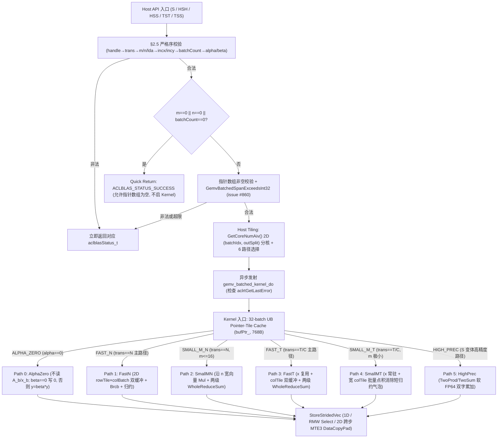

# 需求背景（required）

## 需求来源

- **任务来源**：CANN 社区任务 2026 —— [11月社区任务-gemvBatched类5算子开发（A2A3）](https://www.hiascend.com/activities/task-center/details/d82eff6522c34a1a89710f93bb8926b7)（任务 ID：`d82eff6522c34a1a89710f93bb8926b7`）。
- **对标基线**：NVIDIA cuBLAS `cublasSgemvBatched` / `cublasHSHgemvBatched` / `cublasHSSgemvBatched` / `cublasTSTgemvBatched` / `cublasTSSgemvBatched`；数学语义对齐 Netlib `sgemv.f`。
- **目标平台**：昇腾 Atlas A2 / A3 系列产品（`arch22` / `dav-2201`），目标验证环境 Atlas A2（`Atlas 910B2`）、CANN `9.2.1`（兼容任务书基线 CANN `9.1.0` 与 Atlas A3 `--soc=ascend910_93`），基于 [ops-blas](https://gitcode.com/cann/ops-blas) 开源仓使用 Ascend C kernel 直调模式实现并合入。

> **文档状态说明**：本文按官方 `design_template.md` 与任务书（含 2026-11-24 修订口径）编写，当前处于**设计评审阶段**，尚未在 Atlas A2（`Atlas 910B2`，CANN `9.2.1`）或 Atlas A3 真机完成编译、built-in UT、5000 条官方精度回归与 1000 条 `msprof op` 性能实测；文中分块参数、32-batch 指针缓存与 6 路径核函数策略为面向 Atlas A2/A3 硬件的设计方案，待真机实测后按实测结果修订与回填。

## 背景介绍

### aclblasSgemvBatched 类算子工程与路径

基线代码仓：`https://gitcode.com/cann/ops-blas`。算子采用 ops-blas 句柄式 BLAS 接口工程模式，通过 `aclblasHandle_t` 绑定的 stream 异步直调 NPU kernel。

| 组成 | 仓内路径 | 说明 |
| --- | --- | --- |
| 公开接口声明 | `include/cann_ops_blas.h`（约 L287-308） | 5 个接口声明均已存在，**不修改**，禁止定义私有平行接口 |
| Host 侧实现 | `blas/gemv_batched/arch22/gemv_batched_host.cpp` | 严格 §2.5 序参数校验、合法 Quick Return、跨度溢出守卫、2D Tiling 与 kernel 发射 |
| 公共跨度守卫 | `blas/common/helper/gemv_batched_span_check.h` | 复用 `GemvBatchedSpanExceedsInt32`（issue `#860`），拦截单批下标或总输出超 `INT32_MAX` |
| Kernel 侧实现 | `blas/gemv_batched/arch22/gemv_batched_kernel.cpp` | `arch22` 设备侧**单一编译单元**（AIV-only），含 5 变体模板实例化、32-batch 指针缓存与 6 路专用计算路径 |
| Tiling 与发射声明 | `blas/gemv_batched/arch22/gemv_batched_tiling_data.h`<br>`blas/gemv_batched/arch22/gemv_batched_kernel.h` | 纯 POD Tiling 结构体（按值下发）及返回 `aclError` 的 kernel 发射封装声明 |
| 算子文档 | `blas/gemv_batched/README.md` | 同步核对并完善 Atlas A2/A3 产品支持、约束与调用说明 |
| 测试工程 | `test/gemv_batched/arch22/`<br>`test/gemv_batched/CMakeLists.txt` | GTest + CSV 测试工程，支持 built-in UT、5 变体全量精度（5000 条）与性能子集（1000 条）验证 |
| 架构与同族参考 | `blas/gemv_batched/arch35/gemv_batched_host.cpp`<br>`blas/gemv_batched/arch22/cgemv_batched_*`<br>`test/gemv_batched/arch35/` | `arch35` 提供 5 变体分派参考；`arch22` 现有 `cgemv_batched_*`（复数）与 `test/gemv_batched/arch35/` 提供工程组织参考 |

> 注：`blas/CMakeLists.txt` 明确 `arch22` 设备代码不支持跨 TU 链接，因此设备侧入口、32-batch 指针缓存、6 路计算内核与 `gemv_batched_kernel_do` 统一收敛在单一 `.cpp` 编译单元内，Host 侧仅包含纯 C++ 声明头 `gemv_batched_kernel.h`。

### 仓内现状与差距分析

对 `ops-blas` 仓内现状及任务书要求进行梳理，明确如下关键现状与核心技术挑战：

1. **`arch22` 实数 `gemv_batched` 实现完全缺失**：`blas/gemv_batched/arch22/` 当前仅有复数版本 `cgemv_batched_*`，尚未实现 `aclblasSgemvBatched` / `HSH` / `HSS` / `TST` / `TSS` 共 5 个实数变体；`blas/gemv_batched/arch35/` 面向 Ascend 950PR/950DT（`DAV_3510`），依赖 SIMT 与 RegBase 接口，不兼容 `arch22`（`dav-2201`），不可直接复用。
2. **指针数组间接寻址开销与高 `batchCount` 延迟放大**：与 `GemvStridedBatched` 的等步长计算地址不同，`GemvBatched` 通过 Device 侧指针数组 `Aarray[i]`、`xarray[i]`、`yarray[i]` 描述各 batch 基址。若每处理一个 batch 就发 3 次标量 GM 读，在高 `batchCount`（如 64~256+）和小矩阵场景下将引入大量串行 `MTE2_S`/`S` 等候气泡。本设计引入 **32-batch UB 指针块缓存（`bufPtr_`，`3 × 32 × 8 B = 768 B`）**，通过 `DataCopyPad` 批量预取指针表，摊薄 GM 访存延迟。
3. **严格参数校验顺序、2026-11-24 布局修订与 32 位跨度守卫**：
   - 任务书 §2.5 明确校验顺序：`handle → trans → m/n → lda → incx/incy → batchCount → alpha/beta → quick return → Aarray/xarray/yarray`，仅在全部结构与标量指针合法后才执行 `m==0 || n==0 || batchCount==0` quick return（此时允许指针数组为空），且 `lda >= max(1, m)` 与 `trans` 取值无关；
   - 须接入 `blas/common/helper/gemv_batched_span_check.h` 中的 `GemvBatchedSpanExceedsInt32`（issue `#860`），在非空执行分支前拦截超出 `INT32_MAX` 的单批下标或总输出规模。
4. **多核并行度、非单位步长吞吐与高精度长归约需求**：
   - 小 `batchCount`（如 `bc = 1..16`）仅按 batch 分核会导致 48 核 AIV 严重闲置，需采用 2D `(batchIdx, outSplit)` 分核打满带宽并保证跨核写 32B 互斥；
   - 大量性能与边界用例含非单位/负步长 `incx`/`incy`（最大至 `±127`）及极小 `m` 形状，需通过跨步 `DataCopyPad + Gather`、`RMW Select` 掩码写回、`Brcb` 广播与 `SMALL_M_N`/`SMALL_M_T` 专用路径消除标量循环；
   - 对长维高精度敏感场景（如大维 FP32 累加或正负相消输入），增加 `HIGH_PREC` 软 FP64（Double-Double 无误差变换）专用路径保障数值精度。

### 算子功能分析

`GemvBatched` 对 `batchCount` 组由指针数组独立寻址的矩阵-向量对执行批量矩阵-向量乘加，原地更新 `y_i`：

```text
y_i = alpha * op(A_i) * x_i + beta * y_i,  i = 0, 1, ..., batchCount - 1
其中 A_i = Aarray[i], x_i = xarray[i], y_i = yarray[i]
```

五个精度变体的数据类型映射如下（`alpha`、`beta` 始终为 Host 侧 `FLOAT32` 标量；FP16/BF16 以 `uint16_t` 承载原始位模式，计算域统一为 FP32（`HIGH_PREC` 路径使用 FP32 对承载软 FP64），写回时按输出 `y` 的 dtype 收窄）：

| 变体 | 接口名 | A dtype | x dtype | y dtype（原地） | alpha / beta | 计算精度域 |
| --- | --- | --- | --- | --- | --- | --- |
| S | `aclblasSgemvBatched` | FP32 (`float`) | FP32 (`float`) | FP32 (`float`) | FP32 | FP32（`HIGH_PREC` 路径为软 FP64） |
| HSH | `aclblasHSHgemvBatched` | FP16 (`uint16_t`) | FP16 (`uint16_t`) | FP16 (`uint16_t`) | FP32 | FP32 |
| HSS | `aclblasHSSgemvBatched` | FP16 (`uint16_t`) | FP16 (`uint16_t`) | FP32 (`float`) | FP32 | FP32 |
| TST | `aclblasTSTgemvBatched` | BF16 (`uint16_t`) | BF16 (`uint16_t`) | BF16 (`uint16_t`) | FP32 | FP32 |
| TSS | `aclblasTSSgemvBatched` | BF16 (`uint16_t`) | BF16 (`uint16_t`) | FP32 (`float`) | FP32 | FP32 |

参数定义与约束（对齐任务书 §2.4 及 2026-11-24 修订口径）：

| 参数名 | 输入/输出 | 类型 | 布局/形状与值域约束 | 异常返回码 |
| --- | --- | --- | --- | --- |
| `handle` | 输入 | `aclblasHandle_t` | Host，有效库句柄，绑定执行 stream | `nullptr` → `ACLBLAS_STATUS_HANDLE_IS_NULLPTR` |
| `trans` | 输入（属性） | `aclblasOperation_t` | `{ACLBLAS_OP_N, ACLBLAS_OP_T, ACLBLAS_OP_C}`；实数域 `OP_C == OP_T` | 非法枚举 → `ACLBLAS_STATUS_INVALID_ENUM` |
| `m` | 输入（属性） | `int` | `A_i` 的物理行数，`m >= 0` | `m < 0` → `ACLBLAS_STATUS_INVALID_VALUE` |
| `n` | 输入（属性） | `int` | `A_i` 的物理列数，`n >= 0` | `n < 0` → `ACLBLAS_STATUS_INVALID_VALUE` |
| `alpha` | 输入（标量） | `const float*` | Host 侧 FLOAT32 标量指针；`alpha == 0` 时不读取 `A_i`/`x_i` | `nullptr` → `ACLBLAS_STATUS_INVALID_VALUE` |
| `Aarray` | 输入（指针数组） | 按变体 `const T *const []` | Device 侧指针数组（长 `batchCount`），每个 `A_i` 列主序恒为 `lda × n` | `batchCount > 0 && m > 0 && n > 0` 且为空 → `INVALID_VALUE` |
| `lda` | 输入（属性） | `int` | `A_i` 的列主维，恒满足 `lda >= max(1, m)`（与 `trans` 无关） | `lda < max(1, m)` → `ACLBLAS_STATUS_INVALID_VALUE` |
| `xarray` | 输入（指针数组） | 按变体 `const T *const []` | Device 侧指针数组（长 `batchCount`），`lenx = (trans == N) ? n : m` | `batchCount > 0 && m > 0 && n > 0` 且为空 → `INVALID_VALUE` |
| `incx` | 输入（属性） | `int` | `x_i` 元素步长，`incx != 0 && incx != INT32_MIN`（支持负步长） | `0` 或 `INT32_MIN` → `ACLBLAS_STATUS_INVALID_VALUE` |
| `beta` | 输入（标量） | `const float*` | Host 侧 FLOAT32 标量指针；`beta == 0` 时不读取 `y_i` 旧值 | `nullptr` → `ACLBLAS_STATUS_INVALID_VALUE` |
| `yarray` | 输出（原地，指针数组） | 按变体 `T *const []` | Device 侧指针数组（长 `batchCount`），`leny = (trans == N) ? m : n`；各 `y_i` 互不重叠 | `batchCount > 0 && m > 0 && n > 0` 且为空 → `INVALID_VALUE` |
| `incy` | 输入（属性） | `int` | `y_i` 元素步长，`incy != 0 && incy != INT32_MIN`（支持负步长） | `0` 或 `INT32_MIN` → `ACLBLAS_STATUS_INVALID_VALUE` |
| `batchCount` | 输入（属性） | `int` | batch 数，`batchCount >= 0` | `< 0` → `ACLBLAS_STATUS_INVALID_VALUE` |

---

# 需求分析（required）

## 需求描述

在昇腾 Atlas A2 / A3（`arch22` / `dav-2201`）平台上，基于 `ops-blas` 仓复用 `include/cann_ops_blas.h`（约 L287-308）既有接口原型，完整实现并优化 5 个指针数组批量矩阵-向量乘算子：

```cpp
aclblasStatus_t aclblasSgemvBatched(
    aclblasHandle_t handle, aclblasOperation_t trans, int m, int n,
    const float* alpha, const float *const Aarray[], int lda,
    const float *const xarray[], int incx,
    const float* beta, float *const yarray[], int incy, int batchCount);

aclblasStatus_t aclblasHSHgemvBatched(
    aclblasHandle_t handle, aclblasOperation_t trans, int m, int n,
    const float* alpha, const uint16_t *const Aarray[], int lda,
    const uint16_t *const xarray[], int incx,
    const float* beta, uint16_t *const yarray[], int incy, int batchCount);

aclblasStatus_t aclblasHSSgemvBatched(
    aclblasHandle_t handle, aclblasOperation_t trans, int m, int n,
    const float* alpha, const uint16_t *const Aarray[], int lda,
    const uint16_t *const xarray[], int incx,
    const float* beta, float *const yarray[], int incy, int batchCount);

aclblasStatus_t aclblasTSTgemvBatched(
    aclblasHandle_t handle, aclblasOperation_t trans, int m, int n,
    const float* alpha, const uint16_t *const Aarray[], int lda,
    const uint16_t *const xarray[], int incx,
    const float* beta, uint16_t *const yarray[], int incy, int batchCount);

aclblasStatus_t aclblasTSSgemvBatched(
    aclblasHandle_t handle, aclblasOperation_t trans, int m, int n,
    const float* alpha, const uint16_t *const Aarray[], int lda,
    const uint16_t *const xarray[], int incx,
    const float* beta, float *const yarray[], int incy, int batchCount);
```

核心需求涵盖：功能与指针数组参数语义完全对齐 cuBLAS 与任务书、严格按 §2.5 顺序校验与 quick return、接入 `GemvBatchedSpanExceedsInt32` 跨度守卫（issue `#860`）、全 5000 条精度用例达标生态开源混合容差标准、全 1000 条性能用例在 Atlas A2 上达到 A100 cuBLAS kernel 标杆性能的 **0.8 倍及以上**（即 `NPU kernel Avg Time <= gpu_ms / 0.8`）。

## 需求拆解

| 序号 | 需求模块 | 具体要求 |
| --- | --- | --- |
| 1 | 5 精度变体统一支持 | 模板化支持 S / HSH / HSS / TST / TSS，输入 FP16/BF16 转 FP32 计算，输出按目标 dtype 收窄 |
| 2 | 严格 §2.5 参数校验与跨度守卫 | 按 `handle → trans → m/n/lda → incx/incy (0/INT_MIN) → batchCount < 0 → alpha/beta → quick return → Aarray/xarray/yarray == nullptr → GemvBatchedSpanExceedsInt32 (#860)` 顺序校验 |
| 3 | 快速返回与未读分支 | `m==0 || n==0 || batchCount==0` 在结构与标量指针合法后不启 kernel 直接返回 `SUCCESS`（允许指针数组为 `null`）；`alpha==0` 绝不读 `A_i`/`x_i`；`beta==0` 绝不读 `y_i` 旧值 |
| 4 | 指针数组与跨步布局语义 | Device 侧 `Aarray[]`/`xarray[]`/`yarray[]` 独立寻址；列主序 `A_i` 恒为 `lda × n`、`lda >= max(1, m)`；`OP_C == OP_T`；支持负步长 `incx`/`incy` 反向起始偏移映射 |
| 5 | 2D 多核满载调度 | 动态查询 AIV 核数（Atlas A2 `910B2` 48 核，兼容 A3），按 `(batchIdx, outSplit)` 联合切分，32B 写对齐互斥 |
| 6 | 32-batch 指针缓存与 6 路特化内核 | UB `bufPtr_`（`3 × 32 × 8B = 768B`）通过 `DataCopyPad` 摊薄 GM 指针表读取；提供 `FAST_N` / `SMALL_M_N` / `FAST_T` / `SMALL_M_T` / `HIGH_PREC` / `ALPHA_ZERO` 六条专路 |
| 7 | 跨步 DMA 与写保护 | 集成 `DataCopyPad` + Vector `Gather`、`Brcb` 广播及 `RMW Select` / 2D `DataCopyPad` 写回，严格不覆写 `y_i` 跨步间隙元素 |
| 8 | 编译期 UB 预算与异步发射 | 编译期 `static_assert` 保证全路径 UB 总占用 `< 192 KiB`；经 `handle->stream` 异步发射并校验 `aclrtGetLastError` |
| 9 | 精度鲁棒性与长归约保护 | 覆盖 Inf/NaN 传播、±1e4 大标量、4095/4096 奇数大尺寸，结合 `HIGH_PREC` 软 FP64 保障 S/HSS/TSS（`2^-13`）、HSH（`2^-10`）、TST（`2^-7`）达标 |
| 10 | 全量测试与文档计划 | 规划在 Atlas A2（`Atlas 910B2`，CANN `9.2.1`）完成 built-in UT、5000 条官方精度与 1000 条 `msprof op` 性能验收，并检查 Atlas A3 `--soc=ascend910_93` 兼容性 |

---

# 详细设计（required）

## 算子分析

### 数学公式

对每个 batch `b = 0, 1, ..., batchCount - 1`，首先从 Device 指针数组取得该 batch 的基址指针：`A_b = Aarray[b]`、`x_b = xarray[b]`、`y_b = yarray[b]`。向量逻辑索引 `k`（逻辑长度 `L`，非零步长 `inc`）到物理偏移的 64 位映射（负步长从高地址端反向递减起始）为：

```text
PhysIdx(k, L, inc) = k * inc                                   (inc > 0)
                   = (L - 1 - k) * (-inc)                      (inc < 0)
                   = (L - 1) * (-inc) + k * inc                (负步长起始偏移 + k * inc)
```

即物理起始偏移 `startOffset = (inc >= 0) ? 0 : (L - 1) * (-inc)`，随后第 `k` 个逻辑元素位于 `startOffset + k * inc`（与 Netlib `sgemv.f` 中 `KX`/`KY` 负步长定位完全一致）。记：

```text
A_b(r, c) = A_b[r + c * lda]                                   (0 <= r < m, 0 <= c < n)
x_b[k]    = x_b[PhysIdx(k, lenx, incx)]
y_b[k]    = y_b[PhysIdx(k, leny, incy)]
```

- 当 `trans == ACLBLAS_OP_N` 时，`lenx = n`，`leny = m`：

```text
y_b[i] = Cast_TOut(alpha * sum_{j=0..n-1}(fp32(A_b(i, j)) * fp32(x_b[j])) + beta_term(y_b[i])),  i = 0..m-1
```

- 当 `trans == ACLBLAS_OP_T` 或 `ACLBLAS_OP_C` 时，`lenx = m`，`leny = n`（实数域 `OP_C == OP_T`，不做共轭）：

```text
y_b[j] = Cast_TOut(alpha * sum_{i=0..m-1}(fp32(A_b(i, j)) * fp32(x_b[i])) + beta_term(y_b[j])),  j = 0..n-1
```

标量分支语义严格遵循：
- `beta == 0` 时 `beta_term(y_b[·]) = 0`，**不读取** GM 中旧 `y_b` 值（容忍 `y_b` 含 `NaN`/`Inf`）；`beta != 0` 时 `beta_term(y_b[·]) = beta * fp32(y_b[·])`；
- `alpha == 0` 时跳过矩阵-向量乘积项，**不读取** GM 中 `A_b` 和 `x_b`（容忍 `A_b`/`x_b` 含 `NaN`/`Inf`），仅计算 `y_b[·] = Cast_TOut(beta_term(y_b[·]))`（`alpha == 0 && beta == 0` 时直接写 `0`）。

### 支持数据类型

| 变体编号 (`dtype`) | 接口变体 | 输入 `TIn` (A, x) | 输出 `TOut` (y) | 标量 (alpha, beta) | UB 提升方式 | 写回收窄方式 |
| --- | --- | --- | --- | --- | --- | --- |
| `0` | HSH | `half` (FP16, 2B) | `half` (FP16, 2B) | `float` (FP32) | `Cast(CAST_NONE)` → FP32 | `Cast(CAST_RINT)` → FP16 |
| `1` | S | `float` (FP32, 4B) | `float` (FP32, 4B) | `float` (FP32) | 原地直用（`HIGH_PREC` 转软 FP64 对） | 原地直用（`HIGH_PREC` hi+lo 合成为 FP32） |
| `2` | HSS | `half` (FP16, 2B) | `float` (FP32, 4B) | `float` (FP32) | `Cast(CAST_NONE)` → FP32 | 原地直用（FP32） |
| `3` | TST | `bfloat16_t` (BF16, 2B) | `bfloat16_t` (BF16, 2B) | `float` (FP32) | `Cast(CAST_NONE)` → FP32 | `Cast(CAST_RINT)` → BF16 |
| `4` | TSS | `bfloat16_t` (BF16, 2B) | `float` (FP32, 4B) | `float` (FP32) | `Cast(CAST_NONE)` → FP32 | 原地直用（FP32） |

Host 与 Device 侧指针表元素均按 64 位无符号地址 `uint64_t` 解析，单 batch 内所有偏移（`c * lda`、`startOffset + k * inc`）使用 `int64_t` 运算，并在 Host 侧通过 `GemvBatchedSpanExceedsInt32` 提前校核 32 位索引边界。

### 支持形状

| 对象 | 形状与指针寻址约定 |
| --- | --- |
| `Aarray` / `A_b` | Device 侧长 `batchCount` 的 `uint64_t` 指针数组；每个 `A_b` 独立存放列主序矩阵，物理占用 `lda × n` 元素（`lda >= max(1, m)`，与 `trans` 无关）；`lda > m` 时列间填充区只跳过不参与计算；各 batch 无需等步长或连续排布 |
| `xarray` / `x_b` | Device 侧长 `batchCount` 的 `uint64_t` 指针数组；每个 `x_b` 逻辑长度 `lenx = (trans==N ? n : m)`，物理跨度 `1 + (lenx - 1) * |incx|` |
| `yarray` / `y_b` | Device 侧长 `batchCount` 的 `uint64_t` 指针数组；每个 `y_b` 原地输出，逻辑长度 `leny = (trans==N ? m : n)`，物理跨度 `1 + (leny - 1) * |incy|`；各 `y_b` 之间及与 `A_b`/`x_b` 之间由调用方保证互不重叠 |
| 规模与边界 | 运行时动态传参，覆盖 `m, n ∈ [0, 4096+]`（含奇数、素数、非 2 的幂与 4095/4096）、`batchCount ∈ [0, 256+]`、`|incx|, |incy| ∈ [1, 127+]`；无广播、无 0 维张量、无图模式 dynamic shape 依赖 |

## 算子实现

### 实现方案

整体采用 **Host 严格校验 + 自适应 2D `(batchIdx, outSplit)` 分核 + 单一 AIV-only 多路径 Ascend C Kernel 直调** 架构，结合 **32-batch UB 指针块缓存（`bufPtr_`）** 与 **6 条计算专用路径**，全程**零动态内存申请、零 GM Workspace、零原子操作、零跨核同步**。



#### 3.2.1 host侧设计

##### 1. 严格 §2.5 参数校验顺序、Quick Return 与跨度守卫

在 `GemvBatchedImpl<TIn, TOut>` 中严格按任务书 §2.5 规定的顺序执行校验，确保任何结构或标量指针错误均在 quick return 之前被捕获，且合法空计算不误拒空的指针数组：

1. **句柄校验**：`handle == nullptr` → 返回 `ACLBLAS_STATUS_HANDLE_IS_NULLPTR`。
2. **枚举校验**：`trans != ACLBLAS_OP_N && trans != ACLBLAS_OP_T && trans != ACLBLAS_OP_C` → 返回 `ACLBLAS_STATUS_INVALID_ENUM`。
3. **矩阵维度与前导维校验**：
   - `m < 0 || n < 0` → 返回 `ACLBLAS_STATUS_INVALID_VALUE`；
   - `lda < std::max(1, m)` → 返回 `ACLBLAS_STATUS_INVALID_VALUE`（所有 `trans` 均按物理行数 `m` 判定，落实 2026-11-24 修订口径）。
4. **向量步长校验**：`incx == 0 || incx == INT32_MIN || incy == 0 || incy == INT32_MIN` → 返回 `ACLBLAS_STATUS_INVALID_VALUE`（拒绝 `INT32_MIN` 防止 `llabs` 边界或负步长取反溢出）。
5. **batch 数校验**：`batchCount < 0` → 返回 `ACLBLAS_STATUS_INVALID_VALUE`。
6. **标量指针校验**：`alpha == nullptr || beta == nullptr` → 返回 `ACLBLAS_STATUS_INVALID_VALUE`。
7. **合法 Quick Return**：上述全部结构与标量指针校验通过后，若 `m == 0 || n == 0 || batchCount == 0`，立即返回 `ACLBLAS_STATUS_SUCCESS`（不启动 kernel，此时允许 `Aarray`/`xarray`/`yarray` 为 `nullptr`）。
8. **指针数组非空校验**：进入非空执行路径后，检查 `Aarray == nullptr || xarray == nullptr || yarray == nullptr` → 返回 `ACLBLAS_STATUS_INVALID_VALUE`（当 `alpha == 0` 且 `m, n, batchCount > 0` 时，由 Host 侧统一按 §2.4 规则要求指针数组本身非空；Kernel 侧在 `ALPHA_ZERO` 路径下绝不解引用 `A_b`/`x_b`）。
9. **32 位跨度上界守卫（issue `#860`）**：调用仓内公共辅助函数 `GemvBatchedSpanExceedsInt32(trans == ACLBLAS_OP_N, 1, m, n, lda, incx, incy, batchCount)`（位于 `blas/common/helper/gemv_batched_span_check.h`），检查：
   - `aSpan = (n - 1) * lda + m > INT32_MAX`
   - `xSpan = (dotDim - 1) * |incx| + 1 > INT32_MAX`
   - `ySpan = (outDim - 1) * |incy| + 1 > INT32_MAX`
   - `totalOutputs = batchCount * outDim > INT32_MAX`
   任一超限即记录 `OP_LOGE` 并拒绝下发 kernel，返回 `ACLBLAS_STATUS_INVALID_VALUE`。

> **标量读取与发射检查**：`alpha`/`beta` 为 Host `const float*` 时直接解引用写入 Tiling 结构体，保证正常路径 100% 异步无主机同步；kernel 发射封装 `gemv_batched_kernel_do` 在发射前调用 `(void)aclrtGetLastError(ACL_RT_THREAD_LEVEL)` 清空线程残留错误，发射后检查 `aclrtGetLastError(ACL_RT_THREAD_LEVEL)`，非 `ACL_SUCCESS` 时记录 `OP_LOGE` 并返回 `ACLBLAS_STATUS_EXECUTION_FAILED`。

##### 2. 2D `(batchIdx, outSplit)` 多核调度策略

通过 `PlatformAscendCManager::GetCoreNumAiv()` 动态获取当前硬件 AIV 核心数（如 Atlas 910B2 上为 48 核 AIV，Atlas A3 `--soc=ascend910_93` 与 910B3 自动适配，绝不硬编码）；若返回 0 则返回 `ACLBLAS_STATUS_INTERNAL_ERROR`。

针对小 `batchCount`（如 `bc = 1..16`）与大 `batchCount`（如 `bc >= 48`）两类典型负载，采用 **2D `(batchIdx, outSplit)` 联合分核**：

1. **输出 32B 写安全对齐粒度计算**：
   ```text
   alignElems = 32 / sizeof(TOut)                     // FP32: 8, FP16/BF16: 16
   yUnit      = alignElems / gcd(|incy|, alignElems)  // 保证 yUnit * |incy| * sizeof(TOut) 为 32B 整数倍
   ```
   按 `yUnit` 整数倍切分单 batch 的输出维 `outDim = (trans == N) ? m : n`，确保同一 batch 内分属不同核的输出写区间在物理地址上落于互斥的 32B sector，无需原子操作与跨核同步。

2. **2D `(batchIdx, outSplit)` 切分规则**：
   - **Batch 并行区间**（`batchCount >= coreNum`）：`outSplit = 1`，`totalTasks = batchCount`，`usedCoreNum = coreNum`；每核负责一段连续 batch，连续复用 32-batch UB 指针缓存。
   - **2D `(batchIdx, outSplit)` 联合区间**（`batchCount < coreNum`）：
     - 计算 `maxOutGroups = ceil(outDim / yUnit)` 与目标分片数 `targetSplit = ceil(coreNum / batchCount)`；
     - 结合最小单任务有效输出门槛 `minOutPerTask`（`FAST_N` 取 `max(yUnit, 32)`，`FAST_T` 取 `max(yUnit, 16)`，`SMALL_M_N` / `SMALL_M_T` 按路径阈值收敛）限制过度碎片化；
     - 得到 `outSplit = clamp(targetSplit, 1, maxOutGroups)`，按 `yUnit` 对齐每片输出长度 `outPerSplit = AlignUp(ceil(outDim / outSplit), yUnit)`，并反算实际 `outSplit = ceil(outDim / outPerSplit)`；
     - 总任务数 `totalTasks = batchCount * outSplit`，`usedCoreNum = min(coreNum, totalTasks)`；每个任务 `taskId ∈ [0, totalTasks)` 映射到 `(batchIdx = taskId / outSplit, splitIdx = taskId % outSplit)`。

##### 3. 数据分块、32-batch 指针缓存与内存优化策略

Atlas A2 / A3 单 AIV 核片上 UB 总容量为 **192 KiB（196,608 B）**，最小访问对齐为 32 B。本设计在统一 UB 布局框架下引入 **32-batch UB 指针块缓存（`bufPtr_`）**，并在编译期通过 `static_assert` 严格校验每条路径 UB 总用量 `< 192 KiB`：

- **32-batch UB Pointer-Tile Cache（`bufPtr_`）**：
  - 在 UB 头部固定保留 `bufPtr_`：`3 × 32 × 8 B = 768 B`（分别对应 `bufPtrA[32]`、`bufPtrX[32]`、`bufPtrY[32]`，各 256 B，严格 32B 对齐）；
  - 当核内遍历的 `batchIdx` 落入新的 32-batch 窗口 `winIdx = batchIdx / 32` 时，一次性从 GM 指针数组 `Aarray[winIdx * 32]`、`xarray[winIdx * 32]`、`yarray[winIdx * 32]` 通过 `DataCopyPad` 批量加载 `min(32, batchCount - winIdx * 32) × 8 B` 到 `bufPtr_`（`ALPHA_ZERO` 路径仅加载 `yarray`），后续同窗口内的至多 32 个 batch 直接从 UB 读取基址，将 GM 指针读取次数最高降低 **32 倍**。

- **各路径 UB 静态预算表（全部通过编译期 `static_assert(totalBytes < 196608)` 校验）**：

| 路径 | 关键 Tile 参数 | `bufPtr_` | `bufA` (Ping-Pong) + `bufA32` | `bufWork` / `bufReduceTmp` | `bufX` / `bufY` / `Gather` / 累加器 | 合计 UB 用量（对比 192 KiB） |
| --- | --- | --- | --- | --- | --- | --- |
| `FAST_N` | `rowTile=128, colBatch=64` | `768 B` | FP32: `64 KiB + 0`<br>FP16/BF16: `32 KiB + 32 KiB` | `32 KiB` (`Brcb` 展开区) | `2,304 B` (X) + `512 B` (Acc) + `5 KiB` (Y/Gather) = `7,936 B` | **104.50 KiB**（`107,008 B < 192 KiB`） |
| `SMALL_M_N` | `m<=16, colTile<=512` (m<=8: 1024) | `768 B` | FP32: `64 KiB + 0`<br>FP16/BF16: `32 KiB + 32 KiB` | `2 KiB` (`bufReduceTmp`) | `4 KiB` (RowVec) + `12 KiB` (X) + `2 KiB` (Acc/Y/Idx) = `18 KiB` | **84.75 KiB**（`86,784 B < 192 KiB`） |
| `FAST_T` | `rowTile=1024, colTile=16` | `768 B` | FP32: `128 KiB + 0`<br>FP16/BF16: `64 KiB + 64 KiB` | `4 KiB` (`bufReduceTmp`) | `4 KiB` (X32) + `8 KiB` (XWin) + `4 KiB` (Acc/Y/Idx) = `16 KiB` | **148.75 KiB**（`152,320 B < 192 KiB`） |
| `SMALL_M_T` | `m<=64, rowStride=64, colTile<=64` | `768 B` | FP32: `32 KiB + 0`<br>FP16/BF16: `16 KiB + 16 KiB` | `4 KiB` (`bufReduceTmp`) | `256 B` (X32) + `2 KiB` (XWin) + `4 KiB` (Acc/Y/Idx) = `6,400 B` | **43.00 KiB**（`44,032 B < 192 KiB`） |
| `HIGH_PREC` | `S` 变体软 FP64（N:`64×32` / T:`512×8`） | `768 B` | `16 KiB` (`bufA[0/1]`, FP32) | `32 KiB` (hi/lo 工作区 + `Brcb`/归约) | `6 KiB` (X/Y/Idx/`accHi`/`accLo`) | **54.75 KiB**（`56,064 B < 192 KiB`） |
| `ALPHA_ZERO` | `tile=1024`（仅读写 `y`） | `768 B` | `0 B` | `0 B` | `4 KiB` (YInOut) + `4 KiB` (Y32) + `32 KiB` (YSpread) + `4 KiB` (Idx) = `44 KiB` | **44.75 KiB**（`45,824 B < 192 KiB`） |

- **非单位步长向量化 DMA + `Gather` / `RMW Select` / `Brcb` 协同优化**：
  - **`LoadStridedVec`（加载 `cnt` 个 `x` 或 `y` 元素）**：
    1. `inc == 1`：单次 1D `DataCopyPad` 连续搬入 UB；
    2. `inc == -1`：单次 1D `DataCopyPad` 从物理最低端搬入 `cnt` 元素，再经预计算逆序偏移表执行一次 Vector `Gather` 翻转；
    3. `1 < |inc| <= 8` 且物理跨度 `span <= bufWinCap`：单次 1D `DataCopyPad` 搬入连续跨度窗（合并 HBM cache line 事务），再由单次 Vector `Gather` 按步长（负步长逆序）抽取紧致向量；
    4. `|inc| > 8`（且 `(|inc| - 1) * sizeof(T) <= UINT32_MAX`）：按 `256` 元素分段，单次 **2D 跨步 `DataCopyPad`**（`blockCount = segCnt, blockLen = sizeof(T), srcStride = (|inc| - 1) * sizeof(T), dstStride = 0`）搬入 32B 槽位，再由 Vector `Gather` 压紧；超 32 位步长时自动降级分段 `DataCopyPad(blockCount=1)` 兜底。
  - **`StoreStridedVec`（写回 `cnt` 个 `y` 元素）**：
    1. `incy == 1`：单次 1D MTE3 `DataCopyPad` 连续写回 GM；
    2. `incy == -1`：UB 内一次 Vector `Gather` 翻转后单次 1D MTE3 `DataCopyPad` 写回物理最低端；
    3. **紧凑跨步 `1 < |incy| <= 8`（`RMW Select` 合并写回）**：当待写区间经 `yUnit` 切分后首尾严格对齐 32B 且跨度适配 UB 窗口时，先将 32B 对齐的 GM 原区间搬入 UB，构造步长掩码并使用 Vector `Select` 将计算结果槽位与原间隙槽位合并（Read-Modify-Write），再以**单次连续 1D MTE3 `DataCopy` / `DataCopyPad`** 写回，合并 HBM 写事务且严格保留间隙原始值（当 `batchCount > 1` 跨核共享非 32B 边界时由分核对齐与 2D 字节掩码保护兜底）；
    4. **大跨步 `|incy| > 8`（或非 32B 边界段）**：在 UB 内按物理地址升序展开至 32B 槽位 `bufYSpread`（负步长逆序展开），随后发射**单次 2D 跨步 MTE3 `DataCopyPad`**（`blockCount = cnt, blockLen = sizeof(TOut), srcStride = 0, dstStride = (|incy| - 1) * sizeof(TOut)`）一次性写回，不触碰任何间隙元素。

##### 4. Tiling 数据结构与 6 路径分派策略

`arch22` 直调按值向 kernel 传递纯 POD `GemvBatchedTilingData`（无需 GM TilingKey 框架），通过 `dtype` 与 `pathMode` 分派至 6 条专用核路径：

```cpp
enum class GemvBatchedPath : uint32_t {
    ALPHA_ZERO = 0U,  // alpha == 0：不读 A_b/x_b；beta == 0 写 0，否则 y_b = beta * y_b
    FAST_N     = 1U,  // trans == N 主路径：2D rowTile×colBatch 双缓冲 + Brcb + 向量累加
    SMALL_M_N  = 2U,  // trans == N 且 m <= 16：沿 n 宽向量 Mul + 两级 WholeReduceSum
    FAST_T     = 3U,  // trans == T/C 主路径：x 复用 + colTile 双缓冲 + 两级 WholeReduceSum
    SMALL_M_T  = 4U,  // trans == T/C 且 m 极小 (m <= 64)：x 常驻 + 宽 colTile 批量点积
    HIGH_PREC  = 5U,  // S 变体高精度路径：TwoProd / TwoSum 软 FP64 双字累加
};

struct GemvBatchedTilingData {
    uint32_t dtype;        // 0=HSH, 1=S, 2=HSS, 3=TST, 4=TSS
    uint32_t trans;        // 0=N, 1=T/C
    uint32_t pathMode;     // GemvBatchedPath (0..5)
    uint32_t m;
    uint32_t n;
    uint32_t batchCount;
    uint32_t outDim;       // N: m, T/C: n
    uint32_t outSplit;     // 单 batch 输出维切分数（batch 并行时为 1）
    uint32_t outPerSplit;  // 每片输出元素数（yUnit 对齐）
    uint32_t totalTasks;   // batchCount * outSplit
    uint32_t usedCoreNum;  // 实际发射 AIV 核数（动态查询后收敛）
    float alpha;
    float beta;
    int32_t lda;
    int32_t incx;
    int32_t incy;
};
```

> **路径选择规则**：`alpha == 0.0f` 时优先进入 `ALPHA_ZERO`；否则对于 `S` 变体，当内积归约维 `dotDim` 超过高精度阈值（如 `dotDim >= 1024` 或存在明显大小数累加误差风险，阈值将结合真机 5000 条全量精度实测标定）时择优进入 `HIGH_PREC` 软 FP64 路径；常规情形下 `trans == N` 按 `m <= 16` 选择 `SMALL_M_N` 或 `FAST_N`，`trans == T/C` 按 `m <= 64` 选择 `SMALL_M_T` 或 `FAST_T`。

#### 3.2.2 kernel侧设计

设备侧入口声明 `KERNEL_TASK_TYPE_DEFAULT(KERNEL_TYPE_AIV_ONLY)`，由 `dtype` 分发至 5 个模板实例 `ProcessTyped<TIn, TOut>()`。每核根据 `blockIdx = GetBlockIdx()` 分配连续任务区间 `[taskBegin, taskEnd)`，并在核内维护当前缓存的指针窗口号 `cachedPtrWin = UINT32_MAX`：

```text
for taskId in [taskBegin, taskEnd):
    batchIdx = taskId / outSplit
    splitIdx = taskId % outSplit
    winIdx   = batchIdx / 32
    if winIdx != cachedPtrWin:
        DataCopyPad 加载 [winIdx*32, min(batchCount, (winIdx+1)*32)) 的指针至 bufPtr_
        cachedPtrWin = winIdx
    ptrIdx   = batchIdx % 32
    gmA      = reinterpret_cast<__gm__ TIn*>(bufPtrA[ptrIdx])
    gmX      = reinterpret_cast<__gm__ TIn*>(bufPtrX[ptrIdx])
    gmY      = reinterpret_cast<__gm__ TOut*>(bufPtrY[ptrIdx])
    outStart = splitIdx * outPerSplit
    outEnd   = min(outDim, outStart + outPerSplit)
```

##### 1. 公共 2D 矩阵搬运封装（`CopyMatrixTile<TIn>`）

列主序矩阵 `A_b` 的任意子块 `(rows × cols)` 在内存中为 `cols` 段连续列、列间距为 `lda` 元素：
- 当 `rows * sizeof(TIn)` 与 `lda * sizeof(TIn)` 均 32B 对齐且列间跨度在 `DataCopy` 16 位 stride 范围内时，调用零填充高速 2D `DataCopy`；
- 常规场景（含非对齐奇数 `rows`、`lda > m` padding，`cols <= 4095` 且 `(lda - rows) * sizeof(TIn) <= UINT32_MAX`）调用单次 2D `DataCopyPad`（`blockCount = cols, blockLen = rows * sizeof(TIn), srcStride = (lda - rows) * sizeof(TIn), dstStride = (dstRowStride - rowsAligned) * sizeof(TIn) / 32`），尾部硬件自动补 `0`；
- 超出 32 位字节步长或 `cols > 4095` 时自动切分循环调用 `DataCopyPad`，保证全参数空间安全。

##### 2. Path 0：`ProcessAlphaZero`（`alpha == 0` 专用路径）

严格**不加载也不解引用 `A_b` 与 `x_b`**（`bufPtr_` 仅预取 `yarray`）：
- 若 `beta == 0.0f`：UB `Duplicate(yOut, static_cast<TOut>(0), cnt)`，**亦不读取 `y_b` 旧值**，直接经 `StoreStridedVec` 写回 `0`；
- 若 `beta != 0.0f`：按 `tile = 1024` 分段 `LoadStridedVec(gmY)` → `CastToFloat` → `Muls(acc, acc, beta)` → `CastFromFloat`（`CAST_RINT`）→ `StoreStridedVec(gmY)`。

##### 3. Path 1：`ProcessFastN`（`trans == N` 主路径，`m > 16`）

以 `rowTile = 128` 切分 `[outStart, outEnd)`：
1. **初始化 `acc[0..rowsAligned)`**：`beta == 0` 时 `Duplicate(acc, 0.0f)`（不读 `y_b`）；`beta != 0` 时 `LoadStridedVec(gmY)` → `CastToFloat` → `Muls(acc, y32, beta)`。
2. **沿列维 `n` 以 `colBatch = 64` 双缓冲迭代**：
   - Ping-Pong `bufA[0]/bufA[1]` 预取与流水重叠；
   - `LoadStridedVec(gmX, colStart, cols)` → `CastToFloat` → `Muls(x32, x32, alpha, cols)`；
   - `cols` 为 8 的倍数时使用 `Brcb` 将 `x32` 广播为 `rowsAligned × cols` 的 `bufWork`，全宽 `Mul` 后执行通用折半归约并累加至 `acc`；非 8 倍数尾块通过 `Axpy` 逐列乘加。
3. **写回**：`CastFromFloat`（`CAST_RINT`）→ `StoreStridedVec(gmY)`。

##### 4. Path 2：`ProcessSmallMN`（`trans == N` 且 `m <= 16` 极小行数路径）

针对如 `m=1, n=4096`、`m=3, n=2049` 等短列高宽比矩阵，沿列维 `n` 按 `colTile = 1024`（`m <= 8`）或 `512`（`m <= 16`）分块：
- 特例 `m == 1 && lda == 1`：单行在 GM 中连续，直接 1D `DataCopyPad` 搬入（尾部至 64 对齐预清零），零 `Gather` 重排；
- 一般 `m <= 16`：2D `CopyMatrixTile` 搬入后按行步长用 Vector `Gather` 抽取连续行向量，与预清零的 `x32` 执行宽向量 `Mul` + 两级 `WholeReduceSum` 累加至 `rowAcc[r]`；
- 最终统一合并 `alpha * rowAcc[r] + (beta == 0 ? 0 : beta * yOld[r])`，收窄并经 `StoreStridedVec` 写回。

##### 5. Path 3：`ProcessFastT`（`trans == T / C` 主路径）

以 `colTile = 16` 切分 `[outStart, outEnd)`，外层沿 `m` 以 `rowTile = 1024` 分块（`m <= 1024` 时单趟使 `x` 全量常驻 UB）：
- 对 `[rows, rowStride = AlignUp(rows, 64))` 尾槽预先 `Duplicate(0.0f)` 清零（消除 `[32B, 256B)` 区间残余脏数据与 `Inf`/`NaN`）；
- `x32` 在当前 `colTile` 的 16 列上完全复用，`bufA[0]/bufA[1]` 双缓冲搬入 `A_b` 列块；
- 宽向量 `Mul` 后执行**批量两级 `WholeReduceSum`**，单指令产出一批列的点积部分和并累加至 `acc[0..cols)`，随后 `Muls(acc, acc, alpha)` 并按 `beta != 0` 累加 `y_b` 后经 `StoreStridedVec` 写回。

##### 6. Path 4：`ProcessSmallMT`（`trans == T / C` 且 `m <= 64` 短归约维路径）

当 `trans != N` 且内积维 `m <= 64` 时，常规 `FAST_T`（`rowTile=1024, colTile=16`）单次仅利用 1/16 的行深，列循环切换频率高且 `WholeReduceSum` 阶段数固定浪费流水。`SMALL_M_T` 专路针对该形态优化：
- 固定 `rowStride = 64`，在 batch 开始时**一次性加载整个 `x_b[0..m)`** 至 `x32` 并对 `[m, 64)` 清零（全程驻留 UB，不再重复加载 `x`）；
- 将 `colTile` 放宽至 `64`（2D 搬运 `m × 64` 矩阵块至 `bufA[0]/bufA[1]`，UB 仅需 `43 KiB`），单轮覆盖 4 倍输出列数；
- 借助仅 1 级 64-lane `WholeReduceSum`（`repeat = cols`，单指令直接产出全部 `cols` 个列的完整点积结果，省去第二级 `WholeReduceSum` 归约阶段），再统一执行 `alpha`、`beta` 合并与 `StoreStridedVec` 写回。

##### 7. Path 5：`ProcessHighPrec`（`S` 变体高精度软 FP64 累加路径）

针对 `aclblasSgemvBatched`（输出 `rtol = atol = 2^-13`、`max_abs_error <= max(1e-2, 32 * ULP)`）在长维归约（如 `4096` 维正负相消分布或大小数混合输入）中普通 FP32 累加易出现舍入漂移的问题，在 UB 内使用基于 **Error-Free Transformation（无误差变换）的软 FP64（Double-Double）向量累加**（不依赖 AIV 硬件 FP64 指令）：
- **Veltkamp/Dekker `TwoProd(a, b)`**：将每个 `float` 拆分为高 12 位与低 11 位有效尾数（乘数 `SPLIT = 4097.0f`），在向量流水线上以纯 FP32 `Mul`/`Sub`/`Add` 精确计算乘积的高位 `p_hi` 与误差补偿项 `p_lo`；
- **Knuth `TwoSum(s_hi, s_lo, p_hi, p_lo)`**：在 UB `accHi` 与 `accLo` 双缓冲寄存器对中维护约 48-bit 有效尾数精度（接近 IEEE FP64 精度），完成 `alpha * dot(A_b, x_b) + beta * y_b` 全流程高精度累加；
- 写回前按 `res = accHi + accLo` 一次舍入回标准 FP32 并经 `StoreStridedVec` 写回，彻底消除长向量累加与正负相消带来的 ULP 超限风险。

##### 8. 尾块处理、同步与特殊值保护

| 尾块/边界场景 | 处理策略 |
| --- | --- |
| `outDim % outPerSplit` | 末片 `outEnd = min(outDim, outStart + outPerSplit)`，`StoreStridedVec` 仅写有效元素字节 |
| 尾槽补零与 `Inf`/`NaN` 传播 | N/T/SmallMN/SmallMT/HighPrec 所有 64-lane 归约在 `[validLen, alignedLen)` 对 `A` 与 `x` 同步显式 `Duplicate(0.0f)`，杜绝 `0 * Inf` 或跨块残留脏数据产生伪 `NaN` |
| 32-batch 指针缓存边界 | 末窗口按 `min(32, batchCount - winIdx * 32) * 8 B` 调用 `DataCopyPad`，不越界读取指针数组 |
| 流水同步策略 | 使用 `TPipe` 预分配成对 `HardEvent`（`MTE2_V`、`V_MTE2`、`V_MTE3`、`MTE3_V`、`MTE2_S`、`S_V`、`V_S`）与 `PipeBarrier<PIPE_V>`；全程无 `SyncAll`、无跨核屏障 |

---

## 支持硬件

| 支持的芯片版本 | 涉及勾选 | 说明 |
| --- | --- | --- |
| Atlas A2 训练/推理系列产品（`arch22`, `dav-2201`） | √ | 覆盖 `--soc=ascend910b2` / `--soc=ascend910b3`（目标测试环境 Atlas A2 `Atlas 910B2`，CANN `9.2.1`；48 核 AIV 动态查询适配） |
| Atlas A3 训练/推理系列产品（`arch22`, `dav-2201`） | √ | 编译参数 `--soc=ascend910_93`，与 Atlas A2 共用同一套 `arch22` 实现并计划同步校验编译与兼容性 |
| Ascend 950PR / Ascend 950DT（`arch35`, `DAV_3510`） | 既有实现 | 保持仓内 `blas/gemv_batched/arch35/` 不改动 |

---

## 算子约束限制

1. **接口与内存约定**：仅支持列主序 `A_i`（物理形状恒为 `lda × n`）、一维跨步向量 `x_i`/`y_i` 与 5 种实数/混合精度组合（复数由既有 `cgemv_batched_*` 负责，不在本任务范围）；调用方须保证各 `y_i` 之间互不重叠、与 `A_i`/`x_i` 不重叠，且指针数组及指向的 Device 内存生命周期覆盖 stream 同步点。
2. **标量指针约定**：`alpha`/`beta` 为 Host 侧 `FLOAT32` 指针（任务书 §2.4 规定），正常路径直接解引用实现纯异步发射。
3. **非连续与跨度约束**：`incx`/`incy` 须非 0 且非 `INT32_MIN`；当 `m > 0 && n > 0 && batchCount > 0` 时，单批元素跨度与总输出元素数须在 `INT32_MAX` 以内（`GemvBatchedSpanExceedsInt32`，issue `#860`）。
4. **任务书 §2.5 约束逐项核对**：

| 约束项 | 任务书要求 | 本设计落实方式 |
| --- | --- | --- |
| 参数合法性与校验顺序 | `handle → trans → m/n → lda → incx/incy → batchCount → alpha/beta → Aarray/xarray/yarray → quick return` | Host 侧 `GemvBatchedImpl` 严格先完成 `handle→trans→m/n/lda→incx/incy→batchCount→alpha/beta` 校验，再于合法后执行 quick return，非空路径再校验指针数组与 `GemvBatchedSpanExceedsInt32` |
| 非连续 Tensor 支持 | 列主序 `lda` padding、任意非零正负 `incx/incy`、独立指针数组 `Aarray/xarray/yarray` | `bufPtr_` 32-batch 缓存 + 2D `CopyMatrixTile` + `LoadStridedVec`/`StoreStridedVec`（`DataCopyPad` + `Gather` / `RMW Select`） |
| broadcast 规则 | 不支持 | 无广播逻辑，每个 batch 由指针数组独立寻址 |
| dynamic shape 要求 | 不要求，运行时参数按实际取值完成 tiling 与 launch | 单一入口 + 运行时 Host Tiling，适配任意合法尺寸与 `batchCount` |
| 原地与视图语义 | `y_i` 原地覆写，不返回视图；`beta=0` 不读旧 `y_i` | `beta==0` 走 `Duplicate(0)`，不发 `y_i` 读事务 |
| 确定性计算要求 | 不要求逐位确定性 | 单次执行内部固定任务划分与固定树形归约序 |
| 空 Tensor 处理 | `batchCount=0`、`m=0` 或 `n=0` 合法 quick return，允许指针数组为空 | 结构与标量指针校验通过后直接返回 `ACLBLAS_STATUS_SUCCESS`，不启 kernel |
| 0 维 Tensor 处理 | 不涉及 | BLAS 指针数组+维度接口，无 0 维 Tensor 入参 |
| 异步执行 | 经 `handle->stream` 异步发射 | 正常路径无 `aclrtSynchronizeStream` 与动态 `aclrtMalloc` |

---

# 可维可测分析

## 精度标准/性能标准

| 验收维度 | 指标要求 | 标准来源 |
| --- | --- | --- |
| **精度 Golden** | CPU 侧 Netlib BLAS 3.10.0 `cblas_sgemv` 逐 batch 独立计算（测试工程按 FP64 累加后按输出 `y` dtype 收窄落盘，亦对照 FP32 `cblas_sgemv` 并在自测报告说明差异） | 任务书 §3.1 / §3.2 |
| **FP32 精度（S / HSS / TSS）** | `rtol = atol = 2^-13`（`1.2207e-4`），`matched_ratio >= 0.99`，`max_abs_error <= max(1e-2, 32 * ULP)` | 任务书 §3.2；生态算子开源精度标准 |
| **FP16 精度（HSH）** | `rtol = atol = 2^-10`（`9.7656e-4`），`matched_ratio >= 0.99`，`max_abs_error <= max(1e-1, 32 * ULP)` | 任务书 §3.2；生态算子开源精度标准 |
| **BF16 精度（TST）** | `rtol = atol = 2^-7`（`7.8125e-3`），`matched_ratio >= 0.99`，`max_abs_error <= max(1e-1, 32 * ULP)` | 任务书 §3.2；生态算子开源精度标准 |
| **逐元素与非有限值判定** | 有限值满足 `|actual - golden| <= atol + rtol * |golden|` 计入 matched；Inf/NaN 按等效规则严格比对；`alpha=0`（A/x 含 NaN）与 `beta=0`（y 含 NaN）均须产出预期有限值；`y_i` 跨步间隙与 padding 区域不得被篡改 | 任务书 §3.2 / §3.5 |
| **性能正式判据（kernel-to-kernel）** | 目标性能验证设备 Atlas A2（`Atlas 910B2`，CANN `9.2.1`；按任务书口径亦兼容 910B3）；使用 `msprof op` 采集 kernel `Task Duration(us)`，warmup 5 次不计入，后续 10 次有效样本取算术平均；要求单 case `npu_ms <= gpu_ms / 0.8`（达到 A100 cuBLAS `gpu_ms` 0.8× 以上） | 任务书 §3.3 |
| **性能辅助交叉验证** | GTest 在预置 Device 缓冲上 warmup 5 次 + `aclrtEvent` 连续 10 次下发取均值并打印 `[PERF] case=<case_name> ... avg_us=<数值>`，由 `verify_performance.py` 对照 `gpu_baseline.csv` 交叉验证（**不替代 `msprof op` 正式判据**） | 任务书 §3.3；测试包 README |
| **内存要求** | 不涉及（本设计额外保证 kernel 零 GM workspace 申请，UB 由编译期 `static_assert < 192 KiB` 静态守护） | 任务书 §3.4 |

### 自测用例覆盖与测试工程规划

测试代码置于 `test/gemv_batched/arch22/`（在 `test/gemv_batched/CMakeLists.txt` 注册 `arch22` 目标，复用 `test/gemv_batched/arch35/` 与 `test/gemv_batched/cgemv_batched/arch22/` 工程结构），计划在 **Atlas A2（`Atlas 910B2`，CANN `9.2.1`）** 执行以下三层全量验证，并同步验证 **Atlas A3（`--soc=ascend910_93`）** 的编译与兼容性：

| 验证层级 | 计划覆盖规模 | 覆盖重点与判据 |
| --- | --- | --- |
| **Built-in UT（仓内门禁单测）** | 仓内既有与新增 `arch22` GTest 套件 | 覆盖 S / HSH / HSS / TST / TSS 五变体、§2.5 全顺序负向返回码（含 `handle==nullptr`、`trans=999`、`lda < max(1,m)`、`inc==0/INT_MIN`、`batchCount < 0`、`GemvBatchedSpanExceedsInt32` `#860`）、quick return 指针数组为空以及 `cgemv_batched` 回归 |
| **官方全量精度回归** | **5000 条**（5 变体 × 1000 条） | 覆盖 `N/T/C`、0~4096 奇数与素数尺寸、`±1/±2/±3/±7/±8/±16/±31/±64/±127` 步长、`lda` padding、`batchCount ∈ [0, 256]`、`RANDOM_NORM_5_5` / `GAUSS_NORM_0_1` / `Inf/NaN`、成员 `y[i]` 重叠负向与 `alpha=0`/`beta=0` 含 NaN 场景，逐条对照 Netlib `cblas_sgemv` golden 满足分层容差 |
| **官方 `msprof` 正式性能回归** | **1000 条**（5 变体 × 200 条） | 在 Atlas A2（`Atlas 910B2`，CANN `9.2.1`）上先完成 `[PERF] avg_us` 端到端交叉验证，再逐条通过 `msprof op`（warmup 5 + 采样 10）采集 kernel `Task Duration(us)` 对标 A100 `gpu_baseline.csv` 的 `gpu_ms`，目标全量达到 `>= 0.8×` A100 标杆 |

> **当前自验状态**：本文档处于设计评审阶段，上述 Atlas A2（`Atlas 910B2`，CANN `9.2.1`）上的 built-in UT、5000 条精度回归、1000 条 `msprof` kernel 性能采集与 Atlas A3（`--soc=ascend910_93`）兼容性编译尚未实际执行；待设计评审合入并启动算子开发后按计划执行并回填实测数据。

## 兼容性分析

- **公共接口与 ABI 兼容**：完全复用 `include/cann_ops_blas.h`（约 L287-308）既有 5 个 C 接口声明，不修改函数签名与枚举定义，不新增任何产品私有平行 API；与 `arch35`（Ascend 950PR/950DT）及仓内已有 `cgemv_batched`（复数版本）保持完全一致的接口契约。
- **跨架构构建兼容**：`blas/CMakeLists.txt` 按 `SOC_ARCH_DIRS` 自动隔离收集源码（`ascend910b*` / `ascend910_93*` 收集 `arch22`，`ascend950*` 收集 `arch35`），本任务仅在 `blas/gemv_batched/arch22/`、`test/gemv_batched/arch22/`（及 `test/gemv_batched/CMakeLists.txt` 注册目标）和 `blas/gemv_batched/README.md` 增量开发，复用 `blas/common/helper/gemv_batched_span_check.h`，**零侵入 `arch35` 实现与 `cgemv_batched` 复数逻辑**。
- **可维护性**：Host 侧 §2.5 校验与跨度守卫集中单一函数、2D 分核策略参数化、32-batch 指针缓存统一封装、6 条计算路径模块化且由编译期 `static_assert < 192 KiB` 守护 UB 边界，5 个精度变体共享同一套模板化 Kernel 框架，便于后续在 Atlas A2/A3 上持续调优与维护。
