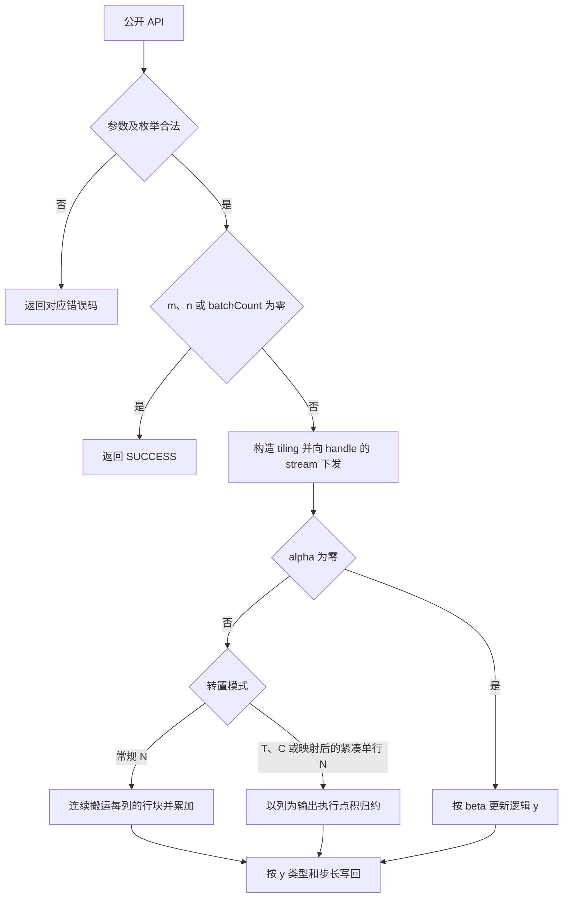

# gemvBatched 五个实数接口的 Atlas A2/A3 设计文档

## 需求背景

每个批次的矩阵、输入向量、输出向量都由各自的 Device 指针数组指定，批次之间可以独立分配内存。任务要求通过 handle 绑定的 stream 异步计算各批次的矩阵向量乘，原地更新输出。任务书为 2026-11-24 修订版，目标软件为 CANN 9.1.0。[官方任务书](https://www.hiascend.com/p/resource/202611/bb2f8dd22ceb4ff18fe7f38694cce557.zip)

上游在 11 月 23 日已提交五个 arch22 实数接口和 GTest。以 master 的 `55ef791b77f3677b45da3468b0a8b17941424f84` 为基线，在已有公共入口补齐约定并逐项实测。此增量范围待主办方确认。[上游实现提交](https://gitcode.com/cann/ops-blas/commit/feb4f9c4c737ee5987781d4fb560872ad4dd9e09) · [当前 Host 实现](https://gitcode.com/cann/ops-blas/blob/55ef791b77f3677b45da3468b0a8b17941424f84/blas/gemv_batched/arch22/gemv_batched_host.cpp)

在上述基线使用 A3、CANN 9.2.0 核对了两个最小输入。S 接口取 1×1 矩阵 A=[3]、x=[2]、alpha=1、beta=0 时，N 返回 SUCCESS 且 y=6，实数 C 返回 INVALID_ENUM。同一版本的五个接口在 m=n=lda=16、batchCount=0、空设备指针数组且其余参数合法时，均返回 INVALID_VALUE。任务书要求这两类输入均返回 SUCCESS。后面的验收设计使用任务书指定的软件版本和硬件口径。

## 需求分析

第 i 批计算 `yᵢ ← alpha × op(Aᵢ) × xᵢ + beta × yᵢ`。A 始终按列主序存储，地址按 `col × lda + row` 取，物理形状始终为 `lda × n`。当 `trans=N`，x、y 的逻辑长度分别为 n、m。当 `trans=T/C`，长度分别为 m、n。比如 m=2、n=3、lda=3，物理存储为 `[1,4,pad,2,5,pad,3,6,pad]`，在 T 和 C 两种模式下，输入 `[1,2]`、alpha=1、beta=0 应同得 `[9,12,15]`。

## 详细设计

### 算子原型和参数

五个入口共用以下参数次序与返回类型。下表将占位符逐一对应到已声明的 API；半精度类型按位存入 uint16_t。无默认参数。[公共头文件](https://gitcode.com/cann/ops-blas/blob/55ef791b77f3677b45da3468b0a8b17941424f84/include/cann_ops_blas.h)

```cpp
aclblasStatus_t API(aclblasHandle_t handle, aclblasOperation_t trans, int m, int n,
                    const float* alpha, const In* const Aarray[], int lda,
                    const In* const xarray[], int incx,
                    const float* beta, Out* const yarray[], int incy, int batchCount);
```

| API | In（A、x） | Out（y） |
| --- | --- | --- |
| aclblasSgemvBatched | float | float |
| aclblasHSHgemvBatched | uint16_t，FP16 | uint16_t，FP16 |
| aclblasHSSgemvBatched | uint16_t，FP16 | float |
| aclblasTSTgemvBatched | uint16_t，BF16 | uint16_t，BF16 |
| aclblasTSSgemvBatched | uint16_t，BF16 | float |

alpha、beta 均为 Host FP32 标量。Aarray、xarray、yarray 均为 Device 指针数组；不同 batch 的输出互不重叠。每个向量步长可正可负，负步长起点用 64 位有符号运算计算 `(1 - len) × inc`。FP16/BF16 输入先扩展到 FP32，结果按 y 类型写回。lda 对 N/T/C 均须满足 `lda ≥ max(1,m)`。

### Host 和 Kernel

1. 在五个 API 共用的 Host 实现按任务书顺序检查 handle、trans、m/n、lda、incx/incy、batchCount、alpha/beta、设备数组。空 handle 返回 HANDLE_IS_NULLPTR，非法转置枚举返回 INVALID_ENUM，其他非法结构参数返回 INVALID_VALUE。零长或零批次允许空设备数组，在参数合法后直接返回 SUCCESS。该返回位于查询核数和构造 tiling 前。跨度检查仅对非空计算执行，保持宽整数检查，避免有符号溢出。
2. 在校验后将实数 C 与 T 映射到同一条设备路径。N 模式沿 A 的行方向连续搬入一列的输出分块，用对应的 x 元素做向量累加。T/C 模式分块读入各列和 x，再沿行归约。保留按批次的独立指针寻址；alpha 为零时只需要 y 的缩放路径，beta 为零时从零初始化，分别用 NaN 输入验证未读语义。
3. 对 `trans=N, m=1, lda=1, n>1`，一批矩阵沿列连续，元素地址为 `A[k]`。Host 将这一布局视为 n×1 矩阵的转置，复用设备端已有的连续点积。x 仍有 n 个逻辑元素，y 仍只有一个，原有 batch 指针和正负步长继续有效。单行带填充（lda>1）沿原布局计算。
4. 现有分核仅按批次分配。先在 batchCount 为 1、8、64 的 N 及 T/C 输入上采集 kernel 时间。若低批次数限制并行度，评估在独立输出行块（N）或列块（T/C）之间分核。每个输出只由一个核负责，窄类型和非单位步长先验证回写边界，再比较完整 API 的耗时。

### 大标量、相消与非有限值

原始官方输入 `SGEMV / TC_EX_018` 在 alpha 放大时出现设备结果 834.99670、FP64 参考 835.02509，绝对误差 0.02838 超过该元素的 0.01 上限。为保留相消后的小量，当 `abs(alpha)>1` 时先求内积，保存浮点加法的舍入残差，再做 alpha 缩放并合入 beta·y。FP32 输入拆分有效位以恢复乘法残差，FP16、BF16 输入先准确扩展到 FP32。流水按向量读写、标量取值和下一次搬运的先后关系同步复用同一块 UB。

有限乘积也可能在 FP32 中间溢出，随后相消或缩放。基线在 `SGEMV / TC_L5_023` 的一个输出出现 NaN，而两种 Netlib 参考均为正无穷。设计在输出块的非有限检查触发后，仅对其中非有限的输出重新读取对应的矩阵行或列和 x，以分开保存的有效数与指数重算，并在 beta 非零时纳入原有 y。验证同时覆盖真实 NaN 和有符号无穷、有限源乘积溢出、alpha=0 及 beta=0 的未读语义。

### 依赖、分块与兼容性

外部依赖为 CANN 的 ACL runtime 和 Ascend C 编译工具。内部沿用 ops-blas 的 handle、设备核数查询、`GemvBatchedTilingData` 和绑在 handle 上的 stream。CPU 参考路径只用于 GTest。标杆的公开依据是 cuBLAS 参数语义和 Netlib 矩阵向量乘；A2/A3 采用指针数组与 Ascend C 流水实现。[Netlib SGEMV](https://www.netlib.org/blas/sgemv.f) · [cuBLAS GEMV Batched](https://docs.nvidia.com/cuda/cublas/index.html#cublas-t-gemvbatched)



基线把批次数 B 分给 P 个可用向量核，每核最多处理 `ceil(B/P)` 批，实际核数为 `ceil(B / ceil(B/P))`。计算 tile 宽 2,048 个元素，非单位步长窗口最多 4,096 个元素。按基线 `TPipe::InitBuffer` 的显式申请，每核普通路径为 `7×2048×4 + 64×(4+8+4) = 58,368` 字节；启用跨步窗口时再加 16,384 字节。当前数值路径为舍入残差增加一个 2,048 元素的 FP32 缓冲，普通和跨步两种配置的显式申请分别为 66,560 与 82,944 字节。分派字段为 `dtype`、`trans` 与有符号步长，依现有 BLAS 直调入口传递。[Kernel 缓冲区与分派](https://gitcode.com/cann/ops-blas/blob/55ef791b77f3677b45da3468b0a8b17941424f84/blas/gemv_batched/arch22/gemv_batched_kernel.cpp)

接口签名与 ABI 继续使用现有公共头文件；改动范围为 arch22 实数族及其测试。将现有 N/T、单批和多批、混合输出、负步长作为兼容性回归，同时用相邻复数入口及公共头文件编译检查共享构建配置。错误优先级、C 和空操作的预期变化有各自用例，跨步输出保护区与非重叠的批次地址另行检查。

### 测试工程

官方五份 CSV 用子目录区分变体，部分用例名跨文件重复。现有共用测试从 `dtype` 列取类型，缺列时默认为 S，并读取 `a/x/y` 字段；附件提供 `aarray_fill/xarray_fill/yarray_fill`。按变体显式配置入口和实际类型，映射字段，保留每份原件和种子，结果以“变体、case_name”为键。异常用例也调用该变体。验证器以输出 dtype 选门限，HSS 与 TSS 使用 FP32。现有 GTest 在这两项分别选择 FP16、BF16，需要修正。[参数解析](https://gitcode.com/cann/ops-blas/blob/55ef791b77f3677b45da3468b0a8b17941424f84/test/gemv_batched/gemv_batched_param.h) · [现有 GTest](https://gitcode.com/cann/ops-blas/blob/55ef791b77f3677b45da3468b0a8b17941424f84/test/gemv_batched/arch22/gemv_batched_test.cpp)

## 可维可测分析

| 验证项 | 用例和判据 |
| --- | --- |
| 参数和边界 | 五接口逐一检验 N/T/C、非法枚举与非法维数组合的优先级、合法空数组 quick return、零步长、空标量及填充哨兵。有效空操作不提交 kernel；非空例要显式同步绑定的 stream 后回读。 |
| 布局和未读语义 | 使用不同大小间隔的批次地址、带填充的非方阵和正负非单位步长。检查逻辑 y 与步长间隙。alpha=0 时给 A/x 放入 NaN，beta=0 时给旧 y 放入 NaN。 |
| 精度 | 每个变体 1,000 例。按 §3.2 逐 batch 生成独立参考，记录采用 Netlib cblas FP32 或 FP64 累加后按 y 类型收窄的参考路径。逐元素检查混合相对/绝对误差，匹配率至少 0.99，并同时满足最大绝对误差或 32 ULP 条款。FP32、FP16、BF16 的 atol/rtol 分别为 2^-13、2^-10、2^-7，绝对误差上限分别为 1e-2、1e-1、1e-1。 |
| 性能 | 每变体 200 例。Atlas 800T A2（910B3）、CANN 9.1.0，预热 5 次，再取 10 次成功执行的 msprof op Task Duration 算术平均值。逐例要求平均微秒数 ≤ 1,250 × 对应 A100 基线毫秒数。另用 aclrtEvent 记录 10 次调用的 avg_us，保存到辅助列。基线按变体、trans、m/n/lda、incx/incy、batchCount、alpha/beta 完整匹配。 |
| 基线版本 | 附件 1,000 个性能键均有正数。任务书修订记录要求 T/C 的旧值在 lda 键变化后重测，附件说明另标记非默认标量待复测。保存原数值与出处，待主办方确认有效版本后填写受影响行的正式结论。 |

### 开发验证与正式性能环境

采用同一张 Atlas A3 开发卡，CANN 9.1.0 编译目标为 dav-2201。加载器记录显示进程使用 9.1.0 版 libascendcl、libruntime 以及设备所在机器的驱动，Netlib BLAS 3.10.0 负责参考计算。该环境先运行题包每个接口的 L0、L6，各通过 34 条，共 170 条。另在同卡 CANN 9.2.0 下，数值修订版 `69277be` 使用五份原始 CSV、原始随机种子与 FP64 Netlib 参考，五个接口各通过 1,000 条。合计 4,890 条数值用例和 110 条 API 契约用例，整例汇总和逐批独立检查均为 5,000/5,000。

同卡 CANN 9.2.0 的开发对照选用官方 SGEMV 用例 `TC_PF_019`（N，1×2049，lda=1，batchCount=16，单位步长，alpha=1、beta=0）。对同一输入预热 5 次，取后 10 次成功调用的 msprof op Task Duration 平均值，单行布局优化前为 281.45 µs，优化后为 7.75 µs。任务书 §3.3 的正式性能需另在 Atlas 800T A2（910B3）、CANN 9.1.0 上逐例采集。交付时绑定源码提交、SDK、卡型、输入和两套计时原件。任务书 §3.4 无专项内存指标。
