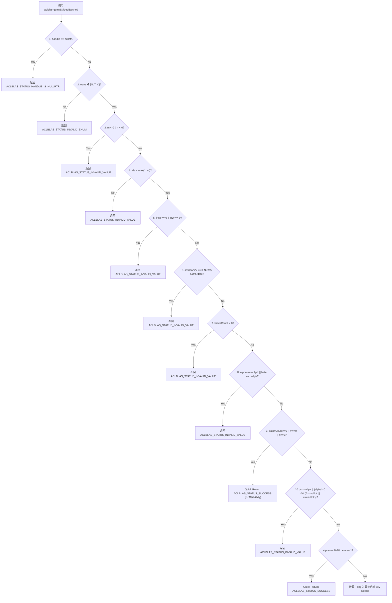

# aclblasSgemvStridedBatched 类 5 算子（Atlas A2 / A3）算子设计文档

| 项目 | 内容 |
| :--- | :--- |
| **社区任务** | `11月社区任务-gemvStridedBatched类5算子开发（A2A3）` |
| **贡献者 / 团队** | QianYiPan |
| **文档版本** | v1.0，设计评审稿 |
| **编写日期** | 2026-11-26 |
| **目标产品** | Atlas A2 系列、Atlas A3 系列（Atlas 800T A2 / Atlas 800I A2 / Atlas 800T A3） |
| **指定性能设备** | Atlas 800T A2（`ascend910b3`，兼容 `ascend910_93`；架构标识 `DAV_2201`，仓内目录 `arch22`） |
| **开发环境** | CANN 9.1.0、Ascend C、Netlib BLAS 3.10.0（CPU Golden 参考实现） |
| **目标代码仓** | [cann/ops-blas](https://gitcode.com/cann/ops-blas) |
| **目标代码路径** | 实现：`blas/gemv_strided_batched/arch22/`；测试：`test/gemv_strided_batched/arch22/` |

---

# 需求背景（required）

## 需求来源

- **任务页面**：CANN 社区任务 2026（2026 年 11 月）——`11月社区任务-gemvStridedBatched类5算子开发（A2A3）`
- **任务目标**：在 Atlas A2 / A3 系列产品（Ascend 910B3 / 910_93，`arch22`，`DAV_2201`）上，基于 [ops-blas](https://gitcode.com/cann/ops-blas) 开源仓工程框架，使用 Ascend C 编程语言开发单精度/半精度实数跨步批量矩阵-向量乘算子族，包含 `aclblasSgemvStridedBatched` 及 `HSH` / `HSS` / `TST` / `TSS` 四个精度变体（共 5 个 API），分别对标 cuBLAS 同名接口，完成设计、开发、测试全流程工作，验收通过后合入昇腾算子开源仓。
- **适配硬件**：Atlas 800I/T A2、Atlas 800I/T A3（架构标识 `DAV_2201`，仓内目录 `arch22`，纯 Vector Core `KERNEL_TYPE_AIV_ONLY`）
- **软件栈版本**：CANN 9.1.0，Ascend C 基础 API
- **目标代码仓**：https://gitcode.com/cann/ops-blas
- **提交团队/账号**：QianYiPan

## 背景介绍

### aclblasSgemvStridedBatched 类 5 算子实现优化

`aclblasSgemvStridedBatched` 类算子是 BLAS Level-2 跨步批量矩阵-向量乘加（Strided Batched General Matrix-Vector Multiplication）标准算子族，涵盖 5 个精度组合接口：
- `aclblasSgemvStridedBatched`（S：FP32 输入、FP32 输出）
- `aclblasHSHgemvStridedBatched`（HSH：FP16 输入、FP16 输出）
- `aclblasHSSgemvStridedBatched`（HSS：FP16 输入、FP32 输出）
- `aclblasTSTgemvStridedBatched`（TST：BF16 输入、BF16 输出）
- `aclblasTSSgemvStridedBatched`（TSS：BF16 输入、FP32 输出）

对 `i = 0, 1, ..., batchCount - 1`，每个 batch 独立执行：

$$y_i \leftarrow \alpha \cdot \operatorname{op}(A_i) \cdot x_i + \beta \cdot y_i$$

其中 $A_i = A + i \cdot \text{strideA}$，$x_i = x + i \cdot \text{stridex}$，$y_i = y + i \cdot \text{stridey}$；所有 5 个变体的标量 $\alpha, \beta$ 均为 `FLOAT32`，中间计算在 FP32 精度域完成，写回时按目标输出 dtype 收窄。

GEMV 属于典型的访存密集型（Memory-Bound）算子。若在 Host 侧循环调用单次 GEMV，会导致大量串行 Kernel Launch 调度开销且无法打满多核 HBM 带宽。在 Atlas A2 / A3（40/48 个 AIV Core）上，本方案采用**单次纯 AIV Kernel 下发 + 二维自适应分核（Batch 维与输出维联合切分）+ 列主序连续 DMA 双缓冲流水 + 零额外 Workspace**，充分压榨 HBM 带宽并兼顾小 batch 与大 batch 场景。

### aclblasSgemvStridedBatched 类算子实现路径和相关API路径

- **接口声明路径**：`include/cann_ops_blas.h`（约 L311-337，5 个接口声明均已存在，本任务无需修改公共头文件）
- **Host 侧实现路径**：`blas/gemv_strided_batched/arch22/gemv_strided_batched_host.cpp`、`blas/gemv_strided_batched/arch22/gemv_strided_batched_tiling_data.h`
- **Kernel 侧实现路径**：`blas/gemv_strided_batched/arch22/gemv_strided_batched_kernel.cpp`、`blas/gemv_strided_batched/arch22/gemv_strided_batched_kernel.h`
- **算子说明文档**：`blas/gemv_strided_batched/README.md`（补充 Atlas A2/A3 产品支持说明）
- **测试工程路径**：`test/gemv_strided_batched/arch22/` 及 `test/gemv_strided_batched/CMakeLists.txt`（注册 `arch22` 目标）
- **相关 API 路径**：Ascend C 原生向量与搬运 API（`DataCopyPad`、`Cast`、`Axpy`、`Mul`、`MulAddDst`、`Muls`、`Adds`、`ReduceSum`、`Duplicate`、`SetFlag` / `WaitFlag` 等）

### aclblasSgemvStridedBatched 类算子现状分析

通过对 BLAS Level-2 规范与 ops-blas 仓现有实现的分析，5 个变体统一参数契约如下：

| 参数 | 参数含义 | 方向 | 内存位置 | 数据类型 | 约束条件 | 形状 |
| :--- | :--- | :---: | :---: | :--- | :--- | :--- |
| `handle` | ops-blas 库上下文句柄，携带 stream | 输入 | Host | `aclblasHandle_t` | 非空指针，内部包含有效 `aclrtStream` | scalar |
| `trans` | $\operatorname{op}(A_i)$ 运算类型 | 属性 | Host 值 | `aclblasOperation_t` | `ACLBLAS_OP_N / T / C`（实数算子 `C ≡ T`） | attr |
| `m` | 矩阵 $A_i$ 的物理行数 | 属性 | Host 值 | `int` | $m \ge 0$；$m == 0$ 为合法 quick return | attr |
| `n` | 矩阵 $A_i$ 的物理列数 | 属性 | Host 值 | `int` | $n \ge 0$；$n == 0$ 为合法 quick return | attr |
| `alpha` | 乘法标量 | 输入 | Host | `const float*` | 非空指针，恒为 FLOAT32 | scalar |
| `A` | 第 0 个 batch 矩阵基址（列主序） | 输入 | Device | `const float*` / `const uint16_t*` | 恒为 `lda × n`（与 `trans` 无关） | $A_i \in \mathbb{R}^{\text{lda} \times n}$ |
| `lda` | 矩阵 $A_i$ 的前导维度 | 属性 | Host 值 | `int` | $\text{lda} \ge \max(1, m)$（与 `trans` 无关） | attr |
| `strideA` | 相邻 batch $A$ 的元素偏移 | 属性 | Host 值 | `int64_t` | $\text{strideA} > 0$ 且 $\text{strideA} \ge \text{lda} \times n$（不重叠） | attr |
| `x` | 第 0 个 batch 输入向量基址 | 输入 | Device | `const float*` / `const uint16_t*` | 逻辑长度 `lenX = (trans==N) ? n : m` | $x_i \in \mathbb{R}^{\text{lenX}}$ |
| `incx` | 向量 $x_i$ 的元素步长 | 属性 | Host 值 | `int` | 非零 `int`（支持负步长反向遍历） | attr |
| `stridex` | 相邻 batch $x$ 的元素偏移 | 属性 | Host 值 | `int64_t` | $\text{stridex} > 0$ 且相邻 batch 不重叠 | attr |
| `beta` | 累加标量 | 输入 | Host | `const float*` | 非空指针，恒为 FLOAT32；$\beta == 0$ 不读 $y$ 旧值 | scalar |
| `y` | 第 0 个 batch 输出向量基址 | 输入/输出 | Device | `float*` / `uint16_t*` | 逻辑长度 `lenY = (trans==N) ? m : n`，原地覆写 | $y_i \in \mathbb{R}^{\text{lenY}}$ |
| `incy` | 向量 $y_i$ 的元素步长 | 属性 | Host 值 | `int` | 非零 `int`（支持负步长反向遍历） | attr |
| `stridey` | 相邻 batch $y$ 的元素偏移 | 属性 | Host 值 | `int64_t` | $\text{stridey} > 0$ 且相邻 batch 不重叠 | attr |
| `batchCount` | 批次数 | 属性 | Host 值 | `int` | $\text{batchCount} \ge 0$；`0` 为合法 no-op | attr |

仓内现状：
- `include/cann_ops_blas.h` 已包含 5 个接口的完整公开声明；
- `blas/gemv_strided_batched/arch35/` 已实现 Ascend 950PR 版本，但 `arch22/`（Atlas A2/A3）当前为空白，需按本方案补齐实现与测试。

### aclblasSgemvStridedBatched 类算子功能分析

- **算子功能**：对 `batchCount` 组独立矩阵与向量执行跨步批量矩阵-向量乘加运算；
- **变体 dtype 映射**：

| 变体接口 | 矩阵 $A$ | 向量 $x$ | 向量 $y$（输出） | 标量 $\alpha, \beta$ | 中间计算精度 |
| :--- | :---: | :---: | :---: | :---: | :---: |
| `aclblasSgemvStridedBatched`（S） | FP32 | FP32 | FP32 | FLOAT32 | FP32 |
| `aclblasHSHgemvStridedBatched`（HSH） | FP16 (`uint16_t`) | FP16 (`uint16_t`) | FP16 (`uint16_t`) | FLOAT32 | FP32 |
| `aclblasHSSgemvStridedBatched`（HSS） | FP16 (`uint16_t`) | FP16 (`uint16_t`) | FP32 (`float`) | FLOAT32 | FP32 |
| `aclblasTSTgemvStridedBatched`（TST） | BF16 (`uint16_t`) | BF16 (`uint16_t`) | BF16 (`uint16_t`) | FLOAT32 | FP32 |
| `aclblasTSSgemvStridedBatched`（TSS） | BF16 (`uint16_t`) | BF16 (`uint16_t`) | FP32 (`float`) | FLOAT32 | FP32 |

- **支持广播**：不支持广播（各 batch 严格独立，且相邻 batch 内存区域不重叠）；
- **核心优化方向**：
  1. **模板化五变体统一内核**：以 `<InType, OutType>` 模板统一覆盖 S / HSH / HSS / TST / TSS，输入端向量化 `Cast` 至 FP32 计算，输出端按 `OutType` 向量化 RNE 舍入写回，消除重复代码；
  2. **列主序连续突发搬运**：无论 `OP_N`（按列 Axpy 累加）还是 `OP_T/OP_C`（按列 Dot 归约），均沿矩阵 $A$ 的列方向连续读取，实现 100% 顺序 HBM 访存；
  3. **Batch 维与输出维二级联合分核**：大 batch 按 batch 均分，小 batch（如 `batchCount = 1 / 8`）沿输出向量维切分至全部 40/48 AIV 核，全程 **0 核间同步、0 原子操作、0 Workspace**。

---

# 需求分析（required）

## 需求描述

使用 Ascend C 编程语言在 Atlas A2 / A3（`arch22`，Ascend 910B3 / 910_93）硬件上开发高性能句柄式算子族 `aclblasSgemvStridedBatched`、`aclblasHSHgemvStridedBatched`、`aclblasHSSgemvStridedBatched`、`aclblasTSTgemvStridedBatched`、`aclblasTSSgemvStridedBatched`，通过 `handle` 绑定的 `aclrtStream` 异步下发 NPU kernel，计算行为与精度严格对标 cuBLAS 同名接口及 Netlib BLAS `cblas_sgemv`。

## 需求拆解

1. **严格 10 步参数校验与防重叠检查**：严格按 `handle` $\rightarrow$ `trans` $\rightarrow$ `m/n` $\rightarrow$ `lda >= max(1, m)` $\rightarrow$ `incx/incy != 0` $\rightarrow$ `strideA/stridex/stridey > 0` 且相邻 batch 不重叠 $\rightarrow$ `batchCount >= 0` $\rightarrow$ `alpha/beta != nullptr` $\rightarrow$ `A/x/y` 非空 $\rightarrow$ quick return 顺序校验；
2. **五精度变体 FP32 域高精度计算**：FP16/BF16 输入经 `uint16_t` 位模式载入并转 FP32 乘加累加，标量 $\alpha/\beta$ 始终以 FP32 参与运算，写回时按输出 dtype 收窄；
3. **列主序 `OP_N` 与 `OP_T/OP_C` 双路径向量化流水**：`OP_N` 采用列向 `Axpy` 累加，`OP_T/OP_C` 采用列向 `Mul` + `ReduceSum` 归约，支持任意 `lda` padding 及正/负/大步长 `incx/incy`；
4. **全规模满核调度与零额外显存**：结合 `batchCount` 与 $(m, n)$ 自适应选择 Batch 并行或 `(batch, outTile)` 二维并行，Workspace 恒为 0 Bytes；
5. **特殊值与边界保护**：`batchCount=0 / m=0 / n=0` 直接 quick return；`alpha=0` 不读 $A/x$；`beta=0` 不读旧 $y$（防止旧 $y$ 中 `NaN` 污染）；
6. **双百达标验收**：5 变体合计 5000 条精度用例 100% PASS，1000 条性能用例 100% 达标（$\ge 0.80\times$ GPU Baseline，内控 $\ge 0.84\times$）。

---

# 详细设计（required）

## 算子分析

### 数学公式

对 $i \in \{0, 1, \dots, \text{batchCount} - 1\}$，令 $A_i = A + i \cdot \text{strideA} \in \mathbb{R}^{m \times n}$（列主序存储，物理跨度 `lda`），$x_i = x + i \cdot \text{stridex}$，$y_i = y + i \cdot \text{stridey}$。

BLAS 步长寻址函数（支持负步长反向遍历）：

$$\text{idx}(k, \text{inc}, L) = \begin{cases} k \cdot \text{inc}, & \text{inc} > 0 \\ (L - 1 - k) \cdot (-\text{inc}), & \text{inc} < 0 \end{cases}$$

1. **当 `trans == ACLBLAS_OP_N` 时**（$\text{lenX} = n, \text{lenY} = m$）：
   $$y_i[\text{idx}(r, \text{incy}, m)] \leftarrow \alpha \sum_{c=0}^{n-1} A_i[r + c \cdot \text{lda}] \cdot x_i[\text{idx}(c, \text{incx}, n)] + \beta \cdot y_i[\text{idx}(r, \text{incy}, m)]$$

2. **当 `trans ∈ {ACLBLAS_OP_T, ACLBLAS_OP_C}` 时**（实数算子 `OP_C ≡ OP_T`，$\text{lenX} = m, \text{lenY} = n$）：
   $$y_i[\text{idx}(c, \text{incy}, n)] \leftarrow \alpha \sum_{r=0}^{m-1} A_i[r + c \cdot \text{lda}] \cdot x_i[\text{idx}(r, \text{incx}, m)] + \beta \cdot y_i[\text{idx}(c, \text{incy}, n)]$$

当 $\alpha = 0$ 时跳过 $A_i, x_i$ 读取，仅执行 $y_i \leftarrow \beta y_i$；当 $\beta = 0$ 时跳过旧 $y_i$ 读取，直接覆写新值。

### 支持数据类型

- **S**：`A, x, y` 为 `FLOAT32`（`float`）；
- **HSH / HSS**：`A, x` 为 `FLOAT16`（以 `uint16_t` 承载位模式），`y` 分别为 `FLOAT16` / `FLOAT32`；
- **TST / TSS**：`A, x` 为 `BFLOAT16`（以 `uint16_t` 承载位模式），`y` 分别为 `BFLOAT16` / `FLOAT32`；
- **标量 $\alpha, \beta$**：5 个变体均为 Host 侧 `const float*`。

### 支持形状

- $m \ge 0, n \ge 0, \text{batchCount} \ge 0$ 运行时任意维度（覆盖 $0, 1 \dots 4096$ 及以上）；
- $A_i$ 物理存储恒为 $\text{lda} \times n$，$\text{lda} \ge \max(1, m)$（与 `trans` 无关）；
- 步长 $\text{incx} \ne 0, \text{incy} \ne 0$（支持 $\pm 1$、小步长及大步长）；
- 跨步偏移满足 $\text{strideA} \ge \text{lda} \cdot n$，$\text{stridex} \ge (\text{lenX} - 1) \cdot |\text{incx}| + 1$，$\text{stridey} \ge (\text{lenY} - 1) \cdot |\text{incy}| + 1$，且三者均严格大于 0。

---

## 算子实现

### 实现方案

#### 3.2.1 host侧设计：

##### tiling策略：

Host 侧根据 `alpha`、`batchCount`、`trans` 及 $(m, n)$ 推导 `GemvStridedBatchedTilingData` 并静态分派执行路径：

| 路径枚举 (`mode`) | 判定条件 | 核间切分方式 | 同步与写回 | 设计目标 |
| :--- | :--- | :--- | :--- | :--- |
| **`MODE_SCALE_Y` (`0`)** | $\alpha == 0.0\text{f}$（且 $\beta \ne 1.0\text{f}$） | 按 `(batch, yTile)` 均匀分配给 AIV 核 | 0 同步、0 原子 | 不读 $A/x$，极速完成 $y \leftarrow \beta y$（$\beta=0$ 直接清零） |
| **`MODE_BATCH_PARALLEL` (`1`)** | $\text{batchCount} \ge \text{aivCores}$ 或单 batch 极小 | 每个 AIV 核负责若干完整 batch | 0 同步、0 原子 | 大 batch 场景最大化局部性与指令效率 |
| **`MODE_2D_SPLIT` (`2`)** | $\text{batchCount} < \text{aivCores}$ 且 $(m, n)$ 较大 | 将每个 batch 的输出维 `lenY` 切分为若干 `outTile`，按 `(batch, outTile)` 联合展平分配给全部 AIV 核 | 0 同步、0 原子（各核输出区间互斥） | 小 batch（如 `batchCount=1/8`）打满 40/48 个 AIV 核 |

##### Tiling 数据结构定义（`gemv_strided_batched_tiling_data.h`）：

```cpp
#pragma once
#include <cstdint>

enum GemvSbExecMode : uint32_t {
    GEMV_SB_MODE_SCALE_Y = 0U,
    GEMV_SB_MODE_BATCH_PARALLEL = 1U,
    GEMV_SB_MODE_2D_SPLIT = 2U,
};

struct GemvStridedBatchedTilingData {
    uint32_t m;
    uint32_t n;
    uint32_t lda;
    uint32_t batchCount;
    uint32_t isTrans;       // 0: OP_N, 1: OP_T / OP_C
    uint32_t mode;          // GemvSbExecMode
    uint32_t tileM;         // 沿 m 维分块大小（32B 对齐）
    uint32_t tileN;         // 沿 n 维分块大小
    uint32_t outTilesPerBatch;
    uint32_t useCoreNum;
    int64_t incx;
    int64_t incy;
    int64_t strideA;
    int64_t stridex;
    int64_t stridey;
    float alpha;
    float beta;
    uint32_t betaZero;
};
```

##### 任务均分：

- **`MODE_BATCH_PARALLEL`**：总任务数 $T = \text{batchCount}$，核 `blockIdx` 处理满足 `b % useCoreNum == blockIdx` 的 batch；
- **`MODE_2D_SPLIT`**：根据 `outTileSize`（对齐 32B，默认 256/512 元素）计算每 batch 输出块数 `outTilesPerBatch = ceil(lenY / outTileSize)`，总任务数 $T = \text{batchCount} \times \text{outTilesPerBatch}$，核 `blockIdx` 轮转领取 `taskId`，解码 `batchIdx = taskId / outTilesPerBatch` 与 `outTileIdx = taskId % outTilesPerBatch`。各核负责的输出区间完全互斥，无需任何跨核同步或原子写回。

##### 批量搬运：

- 矩阵 $A_i$ 按列主序存储，沿列方向使用 `DataCopyPad` 双缓冲（Ping-Pong）批量搬入 UB；
- 单位步长（`incx == 1` / `incy == 1`）时向量 $x_i, y_i$ 通过单条 `DataCopyPad` 突发搬运；非单位步长或负步长时在 UB 内按 BLAS 步长公式完成紧凑收集/分散写回，保护步长间隙数据不被篡改。

##### 1. 分核策略：

- 优先满核原则：`useCoreNum = min(GetAivCoreCount(), totalTasks)`（A2 上限 40 核，A3 上限 48 核）；
- 极小尺寸按 `totalTasks` 缩减核数，消除空核启动开销。

##### 2. 数据分块和内存优化策略：

UB 空间预算表（Atlas A2/A3 `DAV_2201` 单核 UB 上限 = 192 KiB，以 `tileM = 4096` float 或 `tileM = 2048` 双缓冲为例）：

| Buffer 名称 | 用途 | 字节大小 | 生命周期 |
| :--- | :--- | :---: | :--- |
| `aInQueue`（Ping-Pong） | 双缓冲搬入当前列段 $A_i[r_0..r_0+\text{tileM}, c]$ | `64 KiB` | 列循环双缓冲 |
| `aFp32Buf` | FP16/BF16 转 FP32 计算缓冲（S 变体复用 `aInQueue`） | `32 KiB` | 列循环内复用 |
| `xFp32Buf` | 输入向量 $x_i$ 分段缓存（已转为 FP32） | `32 KiB` | 块内常驻 |
| `accFp32Buf` | 当前输出块 FP32 累加器 | `32 KiB` | 块内常驻 |
| `yInOutBuf` | 旧 $y_i$ 读取与输出类型转换写回缓冲 | `16 KiB` | 块尾复用 |
| **合计** | — | **`176 KiB`** | **满足 $\le 192\text{ KiB}$，预留 16 KiB 安全余量** |

> **零额外 Workspace（Zero-Workspace）**：所有计算均在片上 UB 完成，Host 侧 **0 Bytes** 额外 Device Workspace 分配，无 OOM 风险。

##### 3. tilingkey规划策略：

5 个变体在 Host 侧通过 C++ 模板静态实例化 `<InType, OutType>` 核函数入口，`GemvStridedBatchedTilingData` 以纯 POD 按值传递至 Device 侧，无需额外的动态 tilingkey 注册。

##### 数据检测：

严格按任务书 §2.5 规定的 10 步顺序执行 Host 侧参数校验：



---

#### 3.2.2 kernel侧设计：

采用纯 AIV 核函数（`KERNEL_TASK_TYPE_DEFAULT(KERNEL_TYPE_AIV_ONLY)`），以模板 `GemvStridedBatchedKernel<InType, OutType>` 统一实现 5 个变体：

##### 1. `OP_N` 路径（列向连续读取 + 向量 `Axpy` 累加）

1. 按 `tileM` 遍历本核负责的行区间 $[r_0, r_0 + \text{curM})$，使用 `Duplicate` 将 `accFp32[0..curM-1]` 清零；
2. 沿列 $c \in [0, n)$ 循环：
   - 读取标量 $x_c$（若 `InType` 为 `half`/`bfloat16_t` 则转为 `float`）；
   - 通过双缓冲 `DataCopyPad` 连续搬入列段 $A_i[r_0..r_0+\text{curM}, c]$；
   - 若 `InType != float`，执行向量 `Cast<float, InType, RoundMode::CAST_NONE>`；
   - 执行向量 `Axpy(accFp32, aFp32, x_c, curM)` 累加至 `accFp32`；
3. 列循环结束后执行 `Muls(accFp32, accFp32, alpha, curM)`；若 `betaZero == 0`，搬入旧 $y_i$ 并转为 FP32 执行 `Axpy(accFp32, yOldFp32, beta, curM)`；
4. 若 `OutType != float`，执行 `Cast<OutType, float, RoundMode::CAST_RINT>`，写回 $y_i$ 的对应位置。

##### 2. `OP_T / OP_C` 路径（列向连续读取 + 向量 `Mul` / `ReduceSum` 归约）

1. 按本核负责的列区间 $[c_0, c_1)$ 遍历，对每个输出列 $c$：
   - 沿行维按 `tileM` 分段：将 $x_i$ 对应分段载入 `xFp32Buf`，双缓冲连续搬入列段 $A_i[r_0..r_0+\text{curM}, c]$ 并转为 FP32；
   - 执行向量 `Mul(tmpFp32, aFp32, xFp32, curM)` 并累加至部分和缓冲，段末通过 `ReduceSum` 得到列内积标量 `dot`；
2. 在 FP32 域计算 `res = alpha * dot + (betaZero ? 0.0f : beta * yOldFp32)`；
3. 按 `OutType` 舍入并写回 $y_i[\text{idx}(c, \text{incy}, n)]$。

##### 3. 特殊值与边界保护

- **尾部车道屏蔽**：所有向量指令严格传入实际有效长度 `curM`，避免越界车道中的 `Inf`/`NaN` 污染有效结果；
- **`beta == 0` 强保护**：严格跳过旧 $y_i$ 读取，防止旧 $y_i$ 含 `NaN` 时产生 `0 * NaN = NaN`；
- **`alpha == 0` 强保护**：直接进入 `MODE_SCALE_Y`，绝不读取 $A_i$ 与 $x_i$；
- **步长间隙与 Padding 保护**：非单位步长仅写回逻辑下标位置，步长间隙与 `lda > m` 区域绝对不被修改。

---

## 支持硬件

| 支持的芯片版本 | 涉及勾选 |
| :--- | :---: |
| Atlas 800I/T A2（`ascend910b3`） | √ |
| Atlas 800I/T A3（`ascend910_93`） | √ |

---

## 算子约束限制

1. **数据类型**：5 个接口分别严格对应 S（FP32）、HSH（FP16→FP16）、HSS（FP16→FP32）、TST（BF16→BF16）、TSS（BF16→FP32），标量 `alpha/beta` 均为 Host `FLOAT32`；
2. **矩阵存储格式**：$A_i$ 恒按列主序存储为 `lda × n`，$\text{lda} \ge \max(1, m)$（与 `trans` 无关）；
3. **步长与跨步限制**：`incx != 0`、`incy != 0`；`strideA > 0`、`stridex > 0`、`stridey > 0` 且相邻 batch 区域不得重叠；
4. **内存重叠**：输出 $y$ 可写区域与 $A/x$ 可读区域不得重叠，各 batch 的 $y$ 区域之间不得重叠；
5. **广播限制**：不支持跨 batch 广播或维度广播。

---

# 可维可测分析

## 精度标准/性能标准

| 验收标准 | 描述(不涉及说明原因) | 标准来源 |
| :--- | :--- | :--- |
| **精度标准** | 1. 采用生态算子 **Mixed Tolerance（混合容差）** 标准：<br>   - `S / HSS / TSS`（FLOAT32 输出）：$\text{rtol} = \text{atol} = 2^{-13} \approx 1.22 \times 10^{-4}$，$\text{matched\_ratio} \ge 0.99$，$\text{max\_abs\_error} \le \max(10^{-2}, 32 \cdot \text{ULP})$；<br>   - `HSH`（FLOAT16 输出）：$\text{rtol} = \text{atol} = 2^{-10} \approx 10^{-3}$，$\text{matched\_ratio} \ge 0.99$，$\text{max\_abs\_error} \le \max(10^{-1}, 32 \cdot \text{ULP})$；<br>   - `TST`（BFLOAT16 输出）：$\text{rtol} = \text{atol} = 2^{-7} \approx 7.8 \times 10^{-3}$，$\text{matched\_ratio} \ge 0.99$，$\text{max\_abs\_error} \le \max(10^{-1}, 32 \cdot \text{ULP})$；<br>2. Golden 口径：由 CPU 侧 Netlib `cblas_sgemv` 逐 batch 生成（FP64 累加后按输出 dtype 收窄）；<br>3. 全量 5000 条精度用例（5 变体各 1000 条）100% PASS（0 FAIL / 0 SKIP）。 | 任务书 §3.2 验收规范 |
| **性能标准** | 1. 全量 1000 条性能基准用例（5 变体各 200 条）100% 达标（0 FAIL / 0 SKIP）；<br>2. 正式判据（kernel-to-kernel）：`msprof op` 采集 NPU kernel Task Duration（warmup 5 次 + 有效采样 $\ge 10$ 次取平均），逐例达到 `gpu_baseline.csv`（`gpu_ms`）的 $\ge 0.80\times$ 性能（`NPU_us <= GPU_us * 1.25`），内部自测预留 5% 安全余量（$\ge 0.84\times$）；<br>3. 辅助交叉验证：同步输出 GTest `[PERF] avg_us` 端到端事件计时，不替代正式判据。 | 任务书 §3.3 验收规范 |

## 兼容性分析

1. **接口兼容性**：严格按照 `include/cann_ops_blas.h`（约 L311-337）既有 5 个函数原型实现，零头文件改动，与 `arch35`（Ascend 950PR）版本保持完全一致的签名、状态码与语义；
2. **工程与构建兼容性**：实现代码独立收敛于 `blas/gemv_strided_batched/arch22/`，测试代码注册于 `test/gemv_strided_batched/arch22/`，支持 `bash build.sh --ops=sgemv_strided_batched --soc=ascend910b3` 单算子与全量构建；
3. **生态对标兼容性**：参数顺序、`A` 恒为 `lda × n`（`lda >= max(1, m)`）存储布局、`OP_C ≡ OP_T` 实数转置语义、负步长反向遍历及跨步不重叠校验均与 cuBLAS 对应接口及 Netlib BLAS `sgemv` 保持完全一致。
