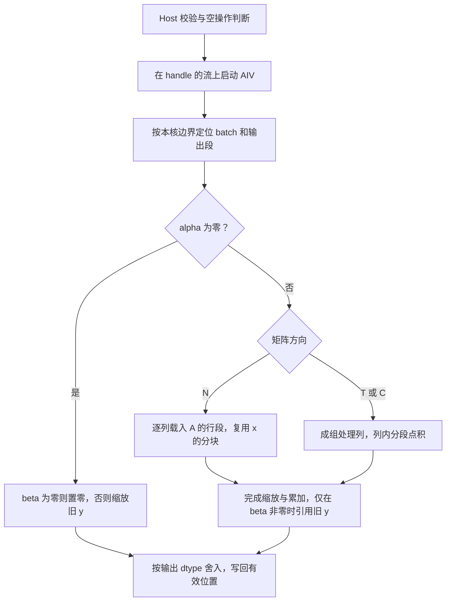

# gemvStridedBatched 类 5 个算子设计（Atlas A2/A3）

团队 `gcw_HNGPtE0T` · 任务 ID `404250b6e18c4c3b853c73526ed0570f` · 设计送审稿

## 1. 需求背景

同一流上的一组小矩阵往往有相同形状，且在设备内存中等距排列。给出第一个矩阵、向量的地址及相邻批次的间距，即可一次下发整组 GEMV，省去地址表和逐批下发。11 月社区任务要求用 CANN 9.1.0 和 Ascend C 在 Atlas A2/A3 上支持五个实数接口，以对应的 cuBLAS 接口作 GPU 性能标杆。本文采用 2026-11-24 修订的物理布局。[任务详情](https://www.hiascend.com/activities/task-center/details/404250b6e18c4c3b853c73526ed0570f) · [任务书与用例包](https://www.hiascend.com/p/resource/202611/a828ff4efc46426bac03f2bbeff728bd.zip)

### 1.1 标杆与工程起点

对每个批次，Netlib SGEMV 先确定输入、输出长度和负步长起点，再缩放旧 y。若需要矩阵乘，N 模式逐列对输出行做乘加，T/C 模式按列与 x 求内积。cuBLAS 用三个以元素计的批间距扩展这一运算，并提供混合精度入口。数学行为以公开 BLAS 规范为依据，GPU 耗时由对应 cuBLAS 入口实测。[Netlib SGEMV](https://netlib.org/blas/sgemv.f) · [cuBLAS GEMV Strided Batched](https://docs.nvidia.com/cuda/cublas/index.html#cublas-t-gemvstridedbatched)

设计对照的 `ops-blas` 版本为 `55ef791b77f3677b45da3468b0a8b17941424f84`。主干已合入五个 arch22 入口、内核和测试，且已修复发射错误回传。本任务在该版本上补齐任务契约并验证性能。[arch22 实现 PR !1066](https://gitcode.com/cann/ops-blas/merge_requests/1066) · [发射状态修复 PR !1338](https://gitcode.com/cann/ops-blas/merge_requests/1338)

| 起点 | 已有实现 | 本次设计取舍 |
| --- | --- | --- |
| [arch22 Host](https://gitcode.com/cann/ops-blas/blob/55ef791b77f3677b45da3468b0a8b17941424f84/blas/gemv_strided_batched/arch22/gemv_strided_batched_host.cpp) | 五个入口共用 `GemvStridedBatchedImpl`，通过 `handle->stream` 下发；当前在完整校验前判断空操作，只检查 stride 为正 | 沿用 ABI、流与发射错误回传，重排校验并增加批间占用和地址溢出检查 |
| [arch22 Kernel](https://gitcode.com/cann/ops-blas/blob/55ef791b77f3677b45da3468b0a8b17941424f84/blas/gemv_strided_batched/arch22/gemv_strided_batched_kernel.cpp) | `ProcessNormalBatch` 按行块累加，`ComputeColumnDot` 分段点积；按 batch 分核，单 batch 只使用一个核 | 保留 AIV 向量计算、步长搬运和单核内归约，增加按输出划分工作的路径 |
| [arch35 同族实现](https://gitcode.com/cann/ops-blas/tree/55ef791b77f3677b45da3468b0a8b17941424f84/blas/gemv_strided_batched/arch35) | 五种精度分派及缩放分支；含 SIMT 和寄存器级指令路径 | 用于核对语义；设备实现选用 arch22 原生指令 |
| [通用测试与 arch22 GTest](https://gitcode.com/cann/ops-blas/tree/55ef791b77f3677b45da3468b0a8b17941424f84/test/gemv_strided_batched) | 已有 CMake 目标、列主序逐批 CPU 参考和按输出类型选择容差的校验器 | 扩展 CSV 到五个入口的映射、负向分派、空洞保护与两种计时 |

## 2. 需求分析

### 2.1 接口和数据类型

以下入口共用参数序列 `(handle, trans, m, n, alpha, A, lda, strideA, x, incx, stridex, beta, y, incy, stridey, batchCount)`，返回 `aclblasStatus_t`。所有参数显式传入，A/x 只读，y 原地更新。A/x/y 位于 Device，alpha/beta 均为指向有限 FP32 值的 Host 指针。16 位参数在公开 C 接口中以 `uint16_t` 承载原始位模式。[公开声明](https://gitcode.com/cann/ops-blas/blob/55ef791b77f3677b45da3468b0a8b17941424f84/include/cann_ops_blas.h)

| ops-blas 入口 | cuBLAS 对应入口 | A / x | 乘加与缩放 | y |
| --- | --- | --- | --- | --- |
| `aclblasSgemvStridedBatched` | `cublasSgemvStridedBatched` | FP32 | FP32 | FP32 |
| `aclblasHSHgemvStridedBatched` | `cublasHSHgemvStridedBatched` | FP16 | FP32 | FP16 |
| `aclblasHSSgemvStridedBatched` | `cublasHSSgemvStridedBatched` | FP16 | FP32 | FP32 |
| `aclblasTSTgemvStridedBatched` | `cublasTSTgemvStridedBatched` | BF16 | FP32 | BF16 |
| `aclblasTSSgemvStridedBatched` | `cublasTSSgemvStridedBatched` | BF16 | FP32 | FP32 |

### 2.2 数学定义与寻址

设 `B=batchCount`。对批次 `b∈[0,B)`，矩阵元素地址为 `A + b*strideA + c*lda + r`，其中 `0≤r<m`、`0≤c<n`。A 恒按列主序占用 `lda*n` 个元素，`lda≥max(1,m)`。转置改变归约方向，物理列距保持为 lda。

| trans | 输入长度 Lx | 输出长度 Ly | 第 j 个逻辑输出 |
| --- | ---: | ---: | --- |
| N | n | m | `alpha * Σ[k=0..n-1] A_b(j,k)*x_b(k) + beta*y_b(j)` |
| T、C | m | n | `alpha * Σ[k=0..m-1] A_b(k,j)*x_b(k) + beta*y_b(j)`；实数 C 与 T 等价 |

对 `v∈{x,y}`，令 `s=incv`，`L` 为相应逻辑长度。`L>0` 时，首个逻辑元素的批内偏移为 `start=(s<0 ? (L-1)*abs64(s) : 0)`，第 j 项地址为 `v+b*stridev+start+j*s`。非空向量占用区间长 `1+(L-1)*abs64(s)`。三个 stride 均以各自 dtype 的元素数计。每批使用独立操作数，调用方保证可写 y 与 A/x 无别名；列填充、向量空洞、批间间隙都不属于输出。

**矩形算例。** 取 `m=2,n=3,lda=4,trans=T,incx=-2,incy=2`，令三列有效值分别为 `(1,2)、(3,4)、(5,6)`。x 的物理内容为 `[10,*,20]`，逻辑顺序为 `[20,10]`。取 `alpha=1,beta=0`，y 的物理槽位 0、2、4 应分别得到 40、100、160，槽位 1、3 保持原值。再设 `strideA=13,stridex=4,stridey=6`，第二批的三项结果写入槽位 6、8、10。该例同时区分转置布局、负步长起点和批间偏移。

## 3. 详细设计

### 3.1 Host 校验、标量分支与流

在共用入口按下表顺序处理。尺寸、lda、inc 和 B 的公开类型为 `int`，三个 stride 为 `int64_t`。Host 只读标量和地址描述，张量内容留在设备上。

| 顺序 | 检查或动作 | 结果 |
| ---: | --- | --- |
| 1 | handle 有效；随后检查 trans 为 N/T/C | 空句柄返回 `ACLBLAS_STATUS_HANDLE_IS_NULLPTR`，非法枚举返回 `ACLBLAS_STATUS_INVALID_ENUM` |
| 2 | `m,n≥0` → `lda≥max(1,m)` → `incx,incy≠0` | 首个失败返回 `ACLBLAS_STATUS_INVALID_VALUE` |
| 3 | 三个 stride 均大于零。有实际相邻的非空批次时，依次要求 `strideA≥lda*n`、`stridex≥spanX`、`stridey≥spanY` | 间距不足返回 `ACLBLAS_STATUS_INVALID_VALUE`。单批仍检查 stride 为正 |
| 4 | `B≥0` → alpha/beta 指针非空 → 非空计算的 A/x/y 指针非空 | 失败返回 `ACLBLAS_STATUS_INVALID_VALUE`；`alpha=0` 同样执行非空计算的指针检查 |
| 5 | `B=0` 或 `m=0` 或 `n=0` | 返回 `ACLBLAS_STATUS_SUCCESS`，允许 A/x/y 为空，无张量访问和 kernel 发射 |
| 6 | 非空计算校验末批元素和字节偏移；按值封装标量与 tiling，在绑定流异步下发 | 成功下发返回 `ACLBLAS_STATUS_SUCCESS`，发射失败沿用 `ACLBLAS_STATUS_EXECUTION_FAILED`；读回前由调用者同步 |

跨度运算先将 inc 扩为有符号 64 位再取绝对值。分别对 `(B-1)*stride+span-1`、元素到字节的乘法及与基址的加法做受检运算，越出对应索引或地址表示范围时返回 `INVALID_VALUE`。合法长度为 1 时，首元素偏移为 0，即使 `inc=INT_MIN` 也可访问。随包 `TC_ED_212/213` 及现有仓库契约将此值列为非法，与任务书“任意非零 int”有差异。设计采用任务书语义，两种原始期望及用例编号在自验报告中分列，保留原始数据供评审。

通过校验后，`alpha=0` 时走纯缩放路径，跳过 A/x 的搬运；`beta=0` 时直接初始化输出累加器，跳过旧 y；两者同时为零时只写逻辑 y 元素的零值。`alpha=0,beta=1` 可直接成功返回。其余路径在 FP32 域计算，HSH/TST 写回时只做一次目标精度舍入（最近偶数）。覆盖 NaN/Inf 传播及被零标量屏蔽的输入。

### 3.2 输出归属与分核

一个核负责其输出区间内每个元素的完整归约，因而 y 只写一次，无跨核累加或全局 workspace。Host 用 `GetAivCoreCount()` 获取可用 AIV 核数 C。对于非空输入，先选择以下逻辑分片，再按实际工作量限制 `blockDim`。

- 批次充足（`B≥C`）时，以完整 batch 为首选分配单位，复用同批的 x；小 batch 时，将 `B*Ly` 个输出按批次、批内物理地址递增的顺序展平，N 切行段，T/C 切列组。负 incy 时把该批的物理序号 u 还原为逻辑序号 `Ly-1-u`。
- 设所选单位总数为 J，使用 `P=min(C,J)` 个候选核，`q=J/P` 取整，`r=J%P`。第 h 个边界为 `h*q+min(h,r)`，两端为 0、J。整批边界乘 Ly 即可得输出序号。Host 与 Kernel 均在 64 位域中计算 `B*Ly`、分界及全局输出序号，只对已经限于单个 tile 的元素计数窄化。实际数据量小时可以只启动一个核。
- 非对齐 y 可能让相邻输出共享一个 32 字节搬运块。按实际 y 基址、dtype、stridey 和 incy 计算每个分界两侧的物理块号。若同块，将边界向高地址移动到该块的最后一个有效输出之后，跨批边界同样处理。合并重合边界或让空区间直接退出。修正后的边界单调且覆盖首尾，每个物理块只有一个写核；写回长度仍限于有效元素。例：32 字节对齐的 FP16 y、两个批次、每批 7 项、`incy=1,stridey=7`，14 项同属一块，由一个核写回。

### 3.3 Tiling、UB 与 Kernel

沿用 `GemvStridedBatchedTilingData` 传递 dtype、归一化后的 trans、m/n、lda、inc、三个 stride、B 及两个标量。在 arch22 专用结构内增加输出分片方式、分界计算所需参数、tile 长度 T 和步长窗口 W。核入口据此分派精度、N/T 和连续/跨步路径；标量短路复用同一入口。Host 和 Kernel 共享该结构；对外接口无新增参数。

现有单缓冲为 A 原始块、A FP32 块、x 原始块、x FP32 块、y 原始块、FP32 累加块和乘积/归约工作块各一份，每份按每槽 4 字节计；另有归约结果与标量暂存各 64 个 FP32。设 `align(z)=ceil(z/32)*32`。预算上界为 `7*align(4*T)+2*align(4*64)+align(4*W)≤U`，U 为平台查询的单核 UB 扣除运行时预留后的可分配容量。连续路径令 `W=0`，跨步路径可缩小窗口直至退回逐项搬运。以已有 `T=2048` 核算，连续路径显式分配 57,856 B，`W=4096` 时为 74,240 B。若预算不足，先缩 W，再选预算内最大的、至多 2048 且为 8 的倍数的 T。维度小于 T 时仍只计算有效元素。预留量与编译器资源报告在 A2/A3 构建时核对；该预算按单缓冲设计。



| 路径 | 搬运和计算 | 尾块与同步 |
| --- | --- | --- |
| N | 在 UB 保留一个行段的 FP32 输出。沿 n 分块装载 x；每列连续搬入当前行段并实施向量乘加。分核后仍按 `b*strideA+c*lda+rowStart` 取列段 | 每段取 `min(T,remaining)`，A 搬运长度不含列填充 |
| T/C | 沿 m 把物理列切成连续段，x 对应段升为 FP32，和同组各列相乘。用 `ReduceSum` 求段内和，在 acc 中为每列保留一项 FP32 部分和，组宽不超过 T。全部段完成后应用 alpha；仅当 beta 非零时加载旧 y，复用已释放的 A32 槽位将其提升为 FP32 并合入结果 | 只在核内归约。先复用同一 x 段再换段；最后一段按真实长度参与乘法与归约 |
| 跨步和非对齐地址 | 单位正步长直接使用 `DataCopyPad`；非单位或负步长按物理上下界载入可容纳的窗口再依逻辑顺序取值，超出 W 的窗口分段或逐项采样 | 连续输出只写有效字节，跨步 y 逐有效位置写回，避免覆盖间隙。通过现有 MTE/Vector 事件或屏障等待搬入完成、计算结束及写回完成后再复用 UB |

性能验证先区分瓶颈。单 batch 大输出对比按批分核与按输出分核；长归约、小列组检查 x 是否重复搬入；大步长检查窗口内有效字节比例。按 shape 记录核利用率、搬运量和 kernel 耗时，用实测选择分片粒度与列组大小。基线和候选使用同一设备、用例与计时范围。

### 3.4 硬件、工程与兼容性

目标为 Atlas A2/A3（arch22），正式性能设备为 Atlas 800T A2（910B3）。Host、Kernel 及 tiling 位于 `blas/gemv_strided_batched/arch22/`，GTest 位于 `test/gemv_strided_batched/arch22/`。现有构建键为 `gemv_strided_batched`，A2 构建及运行仓内测试的入口如下；A3 换用实机对应的完整 `ascend910_93*` 型号。算子 README 已列出两类产品，开发时同步 arch22 的实际约束与指令路径。[构建脚本](https://gitcode.com/cann/ops-blas/blob/55ef791b77f3677b45da3468b0a8b17941424f84/build.sh)

```bash
bash build.sh --ops=gemv_strided_batched --soc=ascend910b3 --run
```

五个句柄式 BLAS API 直接调用设备内核，shape 和间距在运行时传入。此调用链无 TBE、ACLNN、图模式 shape 推导或广播注册依赖。变更限于 arch22 分派和测试适配；共用测试工具如有改动，应回归 arch35 的原有用例。影响既有调用者的两处行为是更严格的非法结构参数校验，以及可表示范围内的 `INT_MIN` 步长处理。精度按容差验收，运行间不要求逐位一致。

## 4. 可维可测分析

### 4.1 精度、错误路径与覆盖

在 CANN 9.1.0 上执行任务包五份 CSV，每变体 1,000 条功能/精度用例和 200 条性能用例，共 5,000 + 1,000 条。按“变体 + case_name”标识用例，按目录绑定实际 API 和 y 的 dtype，将 `aarray_fill/xarray_fill/yarray_fill` 映射到测试输入。负向用例也调用各自入口，并保留空指针及非法枚举的原始值。非法大步长、超限维度用最小缓冲做 Host 状态验证，避免测试驱动先按非法参数分配大块内存。

独立 golden 复用 Netlib BLAS 3.10.0 的 `cblas_sgemv`。先按输入 dtype 量化，再以各批物理基址和原始 inc 调用列主序 FP32 参考。现有 arch22 GTest 对输入和旧 y 做了量化，CBLAS 的 FP32 输出直接进入比较器。HSH/TST 须补上结果到 FP16/BF16 的最近偶数舍入，再升回 FP32 交给比较器，涵盖舍入后成为 Inf 的值。负步长起点由 CBLAS 校正，适配器只加一次批偏移。记录 FP32 参考与任务允许的 FP64 累加参考之间的舍入差异。对仅长度为 1 的 `INT_MIN` 检查使用可手算的参考，避免旧版 CPU 参数检查先行拒绝。[仓库 golden](https://gitcode.com/cann/ops-blas/blob/55ef791b77f3677b45da3468b0a8b17941424f84/test/gemv_strided_batched/gemv_strided_batched_golden.h)

仓库 CMake 默认在 OpenBLAS 和系统 BLAS 中查找参考库。自验构建时将 `REFBLAS_INCLUDE_DIR` 和 `REFBLAS_LIB` 指向 Netlib 3.10.0 对应的头文件及含 CBLAS 接口的库，记录配置缓存、实际加载库路径和版本，供复现实验使用。[参考库查找逻辑](https://gitcode.com/cann/ops-blas/blob/55ef791b77f3677b45da3468b0a8b17941424f84/cmake/test.cmake)

| 输出 dtype | atol 与 rtol | 最低匹配率 | 逐元素绝对误差上限 |
| --- | --- | ---: | --- |
| FP32（S/HSS/TSS） | 均为 2⁻¹³ | 0.99 | max(1e−2, 32 ULP) |
| FP16（HSH） | 均为 2⁻¹⁰ | 0.99 | max(1e−1, 32 ULP) |
| BF16（TST） | 均为 2⁻⁷ | 0.99 | max(1e−1, 32 ULP) |

遍历每批的逻辑 y。对有限值按 `abs(actual-golden)≤atol+rtol*abs(golden)` 计入匹配；每例须同时满足匹配率及每一项在该参考值处的 ULP 上限。NaN 要求位置对应，Inf 要求同号。负例核对状态码，合法空操作检查无发射和缓冲区原样保留。[生态精度标准](https://gitcode.com/cann/opbase/blob/28a1ce52ae856353589841226a0002af73314a6b/docs/zh/ops_precision_standard/mixed_tolerance_standard.md) · [逐元素判定实现](https://gitcode.com/cann/ops-blas/blob/55ef791b77f3677b45da3468b0a8b17941424f84/test/frame/verify.h)

覆盖 N/T/C、矩形及方阵、0/1 和 32/64/128/2048 等分块边界两侧、4095/4096、正负 inc、lda 填充及批间间隙。随机用例按任务约定等比覆盖均匀分布 [-5,5] 和标准正态分布。仓库通用高斯生成器会随机选均值和方差并截断结果，因此在本任务适配层将 CSV 的 `GAUSS_NORM_0_1` 显式映射为固定种子、均值 0、方差 1 的未截断正态分布。另设独立探针检查以下交互。[仓库填充器](https://gitcode.com/cann/ops-blas/blob/55ef791b77f3677b45da3468b0a8b17941424f84/test/frame/fill.h)

- 在 A/x 注入 NaN 后取 `alpha=0`，在旧 y 注入 NaN 后取 `beta=0`。在相同位置开启相应标量，核对传播。
- 在 y 空洞及批间间隙写入位模式哨兵，运行后逐字节比较；结合负 incy、相邻未对齐批次、非整块尾长及多核重复运行，检查误写和核间竞争。
- CSV 缺少 handle 列，将现有仅调用 S 入口的 NullHandle GTest 扩展至五个入口。对 `m=0` 同时给非法 trans、零 stride 或空标量，分别核对优先级。对 stride 等于最小间距和小一元素的情况成对测试；构造末批偏移溢出的输入并确认在下发前返回。

### 4.2 性能与复现

正式对比按五变体逐例进行。GPU 使用对应 cuBLAS 入口，完整比对键含变体、trans、m/n/lda、incx/incy、三个 stride、batchCount 和 alpha/beta。任务包每变体 200 个性能键与基线行对应，其中 66 个 T、58 个 C；11 月 24 日布局修订后，这两组须按修订参数重采。每变体另有 25 个非默认标量用例，按随包说明核实并重采尚无对应实测记录的基线。两类可能重合，按完整键去重；保留 GPU 型号、cuBLAS 版本、采集记录及单位。

| 指标 | 采集方式 | 判定或用途 |
| --- | --- | --- |
| Kernel 耗时 | 910B3 上 `msprof op` 采集目标 kernel 的 `Task Duration(us)`。每例预热 5 次，连续执行 10 次，核对返回状态、流同步及对应的 10 个有效样本 | `sum(duration_us)/10 ≤ 1.25*gpu_ms*1000`。缺失任务或发射/执行失败时标记该例，保留日志并整组复测 |
| 端到端辅助耗时 | 预置 Device 缓冲，预热 5 次，`aclrtEvent` 包围同流连续 10 次调用。同步后输出 `[PERF] case=<case_name> ... avg_us=<数值>`。造数、H2D/D2H 与 golden 比对在计时段外 | 用随包 `verify_performance.py` 交叉检查下发开销及键匹配。正式结论取自上行 |

旧 y 参与计算时，性能轮次使用等价初始数据（如预置独立 y 槽位），GPU/NPU 采用同一方案。精度、kernel 性能和端到端耗时分别记录代码 SHA、CANN/驱动版本、设备、用例键、随机种子、原始样本及失败原因。任务未设独立内存验收阈值；UB 预算、地址边界和哨兵仍纳入实现验证。本文提交设计方案，设备精度与性能结论待实现自验后给出。
