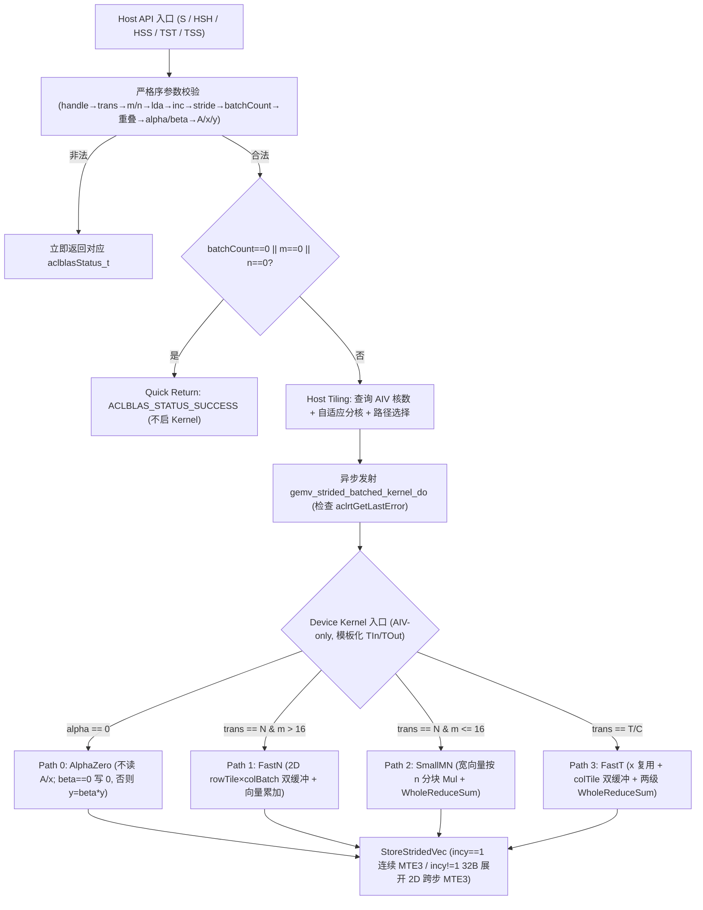

# 需求背景（required）

## 需求来源

- **任务来源**：CANN 社区任务 2026 —— [11月社区任务-gemvStridedBatched类5个算子开发（A2/A3）](https://www.hiascend.com/activities/task-center/details/404250b6e18c4c3b853c73526ed0570f)，任务讨论帖见 [cann/ops-blas#91](https://gitcode.com/cann/ops-blas/discussions/91)。
- **对标基线**：NVIDIA cuBLAS `cublasSgemvStridedBatched` / `cublasHSHgemvStridedBatched` / `cublasHSSgemvStridedBatched` / `cublasTSTgemvStridedBatched` / `cublasTSSgemvStridedBatched`；数学语义对齐 Netlib `sgemv.f`。
- **目标平台**：昇腾 Atlas A2 / A3 系列产品（`arch22`，DAV_2201），CANN 9.1.0，基于 [ops-blas](https://gitcode.com/cann/ops-blas) 开源仓使用 Ascend C kernel 直调模式实现并合入。

> **文档状态说明**：本文按官方 `design_template.md` 与任务书（含 2026-11-24 修订口径）编写，当前处于**设计评审阶段**，尚未在 Atlas A2/A3 真机完成编译、全量精度回归与 `msprof op` 性能实测；文中分块参数与多路径策略为面向 Atlas A2/A3 硬件的设计方案，待真机实测后按实测结果修订与回填。

## 背景介绍

### aclblasSgemvStridedBatched 类算子工程与路径

基线代码仓：`https://gitcode.com/cann/ops-blas`（当前参考 `master` 分支 `55ef791b`）。算子采用 ops-blas 句柄式 BLAS 接口工程模式，通过 `aclblasHandle_t` 绑定的 stream 异步直调 NPU kernel。

| 组成 | 仓内路径 | 说明 |
| --- | --- | --- |
| 公开接口声明 | `include/cann_ops_blas.h`（L271-295） | 5 个接口声明均已存在，**不修改**，禁止定义私有平行接口 |
| Host 侧实现 | `blas/gemv_strided_batched/arch22/gemv_strided_batched_host.cpp` | 参数合法性与顺序校验、快速返回、标量解析、Tiling 计算与 kernel 发射 |
| Kernel 侧实现 | `blas/gemv_strided_batched/arch22/gemv_strided_batched_kernel.cpp` | arch22 设备侧**单一编译单元**（AIV-only），含 5 变体模板实例化与多路径核心计算 |
| Tiling 与发射声明 | `blas/gemv_strided_batched/arch22/gemv_strided_batched_tiling_data.h`<br>`blas/gemv_strided_batched/arch22/gemv_strided_batched_kernel.h` | 纯 POD Tiling 结构体（按值下发）及返回 `aclError` 的 kernel 发射封装声明 |
| 算子文档 | `blas/gemv_strided_batched/README.md` | 同步核对并完善 Atlas A2/A3 产品支持、约束与调用说明 |
| 测试工程 | `test/gemv_strided_batched/arch22/`<br>`test/gemv_strided_batched/CMakeLists.txt` | GTest + CSV 测试工程，支持 5 变体精度全量（5000 条）与性能子集（1000 条）验证 |
| 架构参考 | `blas/gemv_strided_batched/arch35/`<br>`blas/gemv/arch22/sgemv_*` | `arch35` 提供变体分派语义参考；`gemv/arch22` 提供 DAV_2201 2D 搬运、向量归约与高精度实现范式 |

> 注：`blas/CMakeLists.txt` 明确 `arch22` 设备代码不支持跨 TU 链接，因此设备侧入口、各计算路径与 `gemv_strided_batched_kernel_do` 统一收敛在单一 `.cpp` 编译单元内，Host 侧仅包含纯 C++ 声明头 `gemv_strided_batched_kernel.h`。

### 仓内现状与差距分析

对 `ops-blas` 仓内现状进行排查，得到以下关键事实与待改进点：

1. **`arch35` 参考实现不可直接复用**：`blas/gemv_strided_batched/arch35/` 面向 Ascend 950PR/950DT（DAV_3510），依赖 SIMT 与 RegBase 接口，不兼容 `arch22`（DAV_2201）。
2. **`arch22` 既有初版与本次任务书（含 2026-11-24 修订口径）的 4 项核心差距**：仓内 `master` 已有初版 `blas/gemv_strided_batched/arch22/`（`!1066` 合入基础功能、`!1338` 修复发射返回码，存量仅 119 条基础 UT），逐项对照本次任务书与 6000 条自验包存在如下差距，本设计将全面重构升级：
   - **参数校验与 quick return 顺序不符**：既有实现先判断 `m == 0 || n == 0 || batchCount == 0` 直接返回 `SUCCESS`，跳过了 `trans`/`lda`/`incx`/`incy`/`stride`/`alpha`/`beta` 校验；任务书 §2.5 明确要求**所有结构参数合法后才允许执行 quick return**。
   - **缺失相邻 batch 跨步重叠校验**：既有实现仅校验 `strideA/stridex/stridey > 0`，未校验 `batchCount > 1` 时的相邻 batch 重叠（`strideA < lda * n`、`stridex < 1 + (lenx - 1) * |incx|`、`stridey < 1 + (leny - 1) * |incy|`），无法通过 `TC_ED` 重叠负向用例。
   - **多核并行度与内存吞吐远低于 0.8× A100 标杆**：
     - 既有实现仅沿 `batchCount` 分核，而任务性能子集 `TC_PF`（200 条/变体）中 **75%（150/200）用例 `batchCount < 40`**（如 `4096×4096, bc=1` 仅使用 1/40 核，A100 标杆耗时仅 52.4 us / FP16 约 29.5 us）；
     - 既有 `trans=N` 路径逐列单次 DMA 且每列均做全流水等待，FP32 存在冗余 `Muls(..., 1.0f)` 拷贝；`trans=T/C` 路径逐列标量循环并触发 `V_S` 同步；
     - 任务性能子集 `TC_PF` 中 **79%（158/200）用例含非单位步长 `incx != 1` 或 `incy != 1`**（最大至 `±127`），既有实现在 `incy != 1` 或跨度超窗口时回退为逐元素 `S_MTE3/MTE3_S` 标量 DMA 循环，性能严重受限。
   - **测试工程与 5 变体自验脚本尚未对齐**：既有 `test/gemv_strided_batched/arch22/` 仅覆盖 119 条合并 CSV 用例，未适配自验包 5 变体独立 CSV 列格式（`aarray_fill`/`xarray_fill`/`yarray_fill`、`null`/`NULLPTR`、`GAUSS_NORM_0_1` 等）、混合容差判定及 `[PERF] case=... avg_us=...` 计时输出。

### 算子功能分析

`GemvStridedBatched` 对 `batchCount` 组独立矩阵-向量对执行跨步批量矩阵-向量乘加，原地更新 `y`：

```text
y + i * stridey = alpha * op(A + i * strideA) * (x + i * stridex) + beta * (y + i * stridey),
i = 0, 1, ..., batchCount - 1
```

五个精度变体的数据类型映射如下（`alpha`、`beta` 始终为 Host 侧 `FLOAT32` 标量；FP16/BF16 以 `uint16_t` 承载原始位模式，计算域统一为 FP32，写回时按输出 `y` 的 dtype 收窄）：

| 变体 | 接口名 | A dtype | x dtype | y dtype（原地） | alpha / beta | 计算精度域 |
| --- | --- | --- | --- | --- | --- | --- |
| S | `aclblasSgemvStridedBatched` | FP32 (`float`) | FP32 (`float`) | FP32 (`float`) | FP32 | FP32 |
| HSH | `aclblasHSHgemvStridedBatched` | FP16 (`uint16_t`) | FP16 (`uint16_t`) | FP16 (`uint16_t`) | FP32 | FP32 |
| HSS | `aclblasHSSgemvStridedBatched` | FP16 (`uint16_t`) | FP16 (`uint16_t`) | FP32 (`float`) | FP32 | FP32 |
| TST | `aclblasTSTgemvStridedBatched` | BF16 (`uint16_t`) | BF16 (`uint16_t`) | BF16 (`uint16_t`) | FP32 | FP32 |
| TSS | `aclblasTSSgemvStridedBatched` | BF16 (`uint16_t`) | BF16 (`uint16_t`) | FP32 (`float`) | FP32 | FP32 |

参数定义与约束（对齐任务书 §2.4 及 2026-11-24 修订口径）：

| 参数名 | 输入/输出 | 类型 | 布局/形状与值域约束 | 异常返回码 |
| --- | --- | --- | --- | --- |
| `handle` | 输入 | `aclblasHandle_t` | Host，有效库句柄，绑定执行 stream | `nullptr` → `ACLBLAS_STATUS_HANDLE_IS_NULLPTR` |
| `trans` | 输入（属性） | `aclblasOperation_t` | `{ACLBLAS_OP_N, ACLBLAS_OP_T, ACLBLAS_OP_C}`；实数域 `OP_C ≡ OP_T` | 非法枚举 → `ACLBLAS_STATUS_INVALID_ENUM` |
| `m` | 输入（属性） | `int` | `A[i]` 的物理行数，`m >= 0` | `m < 0` → `ACLBLAS_STATUS_INVALID_VALUE` |
| `n` | 输入（属性） | `int` | `A[i]` 的物理列数，`n >= 0` | `n < 0` → `ACLBLAS_STATUS_INVALID_VALUE` |
| `alpha` | 输入（标量） | `const float*` | Host 侧 FLOAT32 标量指针；`alpha == 0` 时不读取 A/x | `nullptr` → `ACLBLAS_STATUS_INVALID_VALUE` |
| `A` | 输入（张量） | 按变体 | Device，ND，列主序；无论 `trans` 取值，物理形状恒为 `lda × n` | `batchCount > 0 && m > 0 && n > 0` 且为空 → `INVALID_VALUE` |
| `lda` | 输入（属性） | `int` | `A[i]` 的列主维，恒满足 `lda >= max(1, m)`（与 `trans` 无关） | `lda < max(1, m)` → `INVALID_VALUE` |
| `strideA` | 输入（属性） | `int64_t` | 相邻 batch 的 A 元素偏移，`strideA > 0`；相邻 batch 不重叠（`>= lda * n`） | `<= 0` 或重叠 → `INVALID_VALUE` |
| `x` | 输入（张量） | 按变体 | Device，ND；逻辑长度 `lenx = (trans == N) ? n : m` | `batchCount > 0 && lenx > 0` 且为空 → `INVALID_VALUE` |
| `incx` | 输入（属性） | `int` | `x[i]` 元素步长，`incx != 0 && incx != INT32_MIN`（支持负步长） | `0` 或 `INT32_MIN` → `INVALID_VALUE` |
| `stridex` | 输入（属性） | `int64_t` | 相邻 batch 的 x 元素偏移，`stridex > 0` 且不重叠 | `<= 0` 或重叠 → `INVALID_VALUE` |
| `beta` | 输入（标量） | `const float*` | Host 侧 FLOAT32 标量指针；`beta == 0` 时不读取 y 旧值 | `nullptr` → `INVALID_VALUE` |
| `y` | 输入/输出 | 按变体 | Device，ND，原地覆写；逻辑长度 `leny = (trans == N) ? m : n` | `batchCount > 0 && leny > 0` 且为空 → `INVALID_VALUE` |
| `incy` | 输入（属性） | `int` | `y[i]` 元素步长，`incy != 0 && incy != INT32_MIN`（支持负步长） | `0` 或 `INT32_MIN` → `INVALID_VALUE` |
| `stridey` | 输入（属性） | `int64_t` | 相邻 batch 的 y 元素偏移，`stridey > 0` 且不重叠 | `<= 0` 或重叠 → `INVALID_VALUE` |
| `batchCount` | 输入（属性） | `int` | batch 数，`batchCount >= 0` | `< 0` → `INVALID_VALUE` |

---

# 需求分析（required）

## 需求描述

在昇腾 Atlas A2 / A3（`arch22`）平台上，基于 `ops-blas` 仓复用 `include/cann_ops_blas.h`（L271-295）既有接口原型，完整实现并优化 5 个跨步批量矩阵-向量乘算子：

```cpp
aclblasStatus_t aclblasSgemvStridedBatched(
    aclblasHandle_t handle, aclblasOperation_t trans, int m, int n, const float* alpha, const float* A, int lda,
    int64_t strideA, const float* x, int incx, int64_t stridex, const float* beta, float* y, int incy, int64_t stridey,
    int batchCount);

aclblasStatus_t aclblasHSHgemvStridedBatched(
    aclblasHandle_t handle, aclblasOperation_t trans, int m, int n, const float* alpha, const uint16_t* A, int lda,
    int64_t strideA, const uint16_t* x, int incx, int64_t stridex, const float* beta, uint16_t* y, int incy,
    int64_t stridey, int batchCount);

aclblasStatus_t aclblasHSSgemvStridedBatched(
    aclblasHandle_t handle, aclblasOperation_t trans, int m, int n, const float* alpha, const uint16_t* A, int lda,
    int64_t strideA, const uint16_t* x, int incx, int64_t stridex, const float* beta, float* y, int incy,
    int64_t stridey, int batchCount);

aclblasStatus_t aclblasTSTgemvStridedBatched(
    aclblasHandle_t handle, aclblasOperation_t trans, int m, int n, const float* alpha, const uint16_t* A, int lda,
    int64_t strideA, const uint16_t* x, int incx, int64_t stridex, const float* beta, uint16_t* y, int incy,
    int64_t stridey, int batchCount);

aclblasStatus_t aclblasTSSgemvStridedBatched(
    aclblasHandle_t handle, aclblasOperation_t trans, int m, int n, const float* alpha, const uint16_t* A, int lda,
    int64_t strideA, const uint16_t* x, int incx, int64_t stridex, const float* beta, float* y, int incy,
    int64_t stridey, int batchCount);
```

核心需求涵盖：功能与参数语义完全对齐 cuBLAS 与任务书、严格参数校验顺序与 quick return、全 5000 条精度用例达标生态开源混合容差标准、全 1000 条性能用例在 Atlas 800T A2（910B3）上达到 A100 cuBLAS kernel 标杆性能的 **0.8 倍及以上**（即 `NPU kernel Avg Time <= gpu_ms / 0.8`）。

## 需求拆解

| 序号 | 需求模块 | 具体要求 |
| --- | --- | --- |
| 1 | 5 精度变体统一支持 | 模板化支持 S / HSH / HSS / TST / TSS，输入 FP16/BF16 转 FP32 计算，输出按目标 dtype 收窄 |
| 2 | 严格参数校验与顺序 | 固定按 `handle → trans → m/n → lda → incx/incy → strideA/x/y → batchCount → stride重叠 → alpha/beta → A/x/y → quick return` 校验；区分 `HANDLE_IS_NULLPTR` / `INVALID_ENUM` / `INVALID_VALUE` |
| 3 | 快速返回与未读分支 | `batchCount=0` / `m=0` / `n=0` 在结构合法后不启 kernel 直接返回 `SUCCESS`（允许 A/x/y 为空）；`alpha=0` 绝不读 A/x（容忍 A/x 含 NaN）；`beta=0` 绝不读 y 旧值（容忍 y 含 NaN） |
| 4 | 矩阵与跨步布局语义 | 列主序 A 恒为 `lda × n`、`lda >= max(1, m)`；`OP_C ≡ OP_T`；支持任意非零 `incx`/`incy`（含负步长反向遍历与大步长 `±127`）及带间隙 `strideA/stridex/stridey`；不覆写 `y` 跨步间隙元素 |
| 5 | 2D 多核满载调度 | 动态获取 AIV 核数，小 `batchCount`（1~39）联合切分 `(batch, outDim)`，大 `batchCount`（≥40）按 batch 均分，全核带宽打满且写区间 32B 对齐互斥 |
| 6 | 高带宽向量化与双缓冲 | 2D 矩阵块搬运 + 双缓冲流水重叠 + 跨步 DMA+Gather 向量化，确保单/多 batch、转置/非转置、单位/非单位步长均达到 ≥0.8× A100 性能 |
| 7 | 异步执行与发射检查 | 经 `handle->stream` 异步发射，正常 Host 标量路径无主机同步；检查 kernel 发射状态，失败返回 `ACLBLAS_STATUS_EXECUTION_FAILED` |
| 8 | 精度与特殊值鲁棒性 | 覆盖 Inf/NaN 传播、±1e4 大标量、4095/4096 奇数大尺寸，满足 S/HSS/TSS（`2^-13`）、HSH（`2^-10`）、TST（`2^-7`）混合容差标准 |
| 9 | 全量自验工程适配 | `test/gemv_strided_batched/arch22/` 完整对接 5 变体 CSV（5000 精度 + 1000 性能）、Netlib `cblas_sgemv` golden、`[PERF] avg_us` 打印与 `msprof op` 采集 |
| 10 | 代码规范与文档同步 | 遵循 `ops-blas` 编码规范与单 TU 约束，同步更新 `blas/gemv_strided_batched/README.md` |

---

# 详细设计（required）

## 算子分析

### 数学公式

对每个 batch `b = 0, 1, ..., batchCount - 1`，矩阵基址偏移为 `b * strideA`，向量逻辑索引 `k`（逻辑长度 `L`，非零步长 `inc`）到物理偏移的 64 位映射为：

```text
PhysIdx(k, L, inc) = k * inc                                   (inc > 0)
                   = (L - 1 - k) * (-inc)                      (inc < 0)
                   = (L - 1) * (-inc) + k * inc                (负步长起始偏移 + k * inc)
```

记：

```text
A_b(r, c) = A[b * strideA + r + c * lda]                       (0 <= r < m, 0 <= c < n)
x_b[k]    = x[b * stridex + PhysIdx(k, lenx, incx)]
y_b[k]    = y[b * stridey + PhysIdx(k, leny, incy)]
```

- 当 `trans == ACLBLAS_OP_N` 时，`lenx = n`，`leny = m`：

```text
y_b[i] = Cast_TOut(alpha * sum_{j=0..n-1}(fp32(A_b(i, j)) * fp32(x_b[j])) + beta_term(y_b[i])),  i = 0..m-1
```

- 当 `trans == ACLBLAS_OP_T` 或 `ACLBLAS_OP_C` 时，`lenx = m`，`leny = n`（实数域 `OP_C == OP_T`）：

```text
y_b[j] = Cast_TOut(alpha * sum_{i=0..m-1}(fp32(A_b(i, j)) * fp32(x_b[i])) + beta_term(y_b[j])),  j = 0..n-1
```

其中标量分支语义严格遵循：
- `beta == 0` 时 `beta_term(y_b[·]) = 0`，**不读取** GM 中旧 `y` 值；`beta != 0` 时 `beta_term(y_b[·]) = beta * fp32(y_b[·])`；
- `alpha == 0` 时跳过矩阵-向量乘积项，**不读取** GM 中 `A` 和 `x`，仅计算 `y_b[·] = Cast_TOut(beta_term(y_b[·]))`（当 `alpha == 0 && beta == 0` 时直接写 `0`）。

### 支持数据类型

| 变体编号 (`dtype`) | 接口变体 | 输入 `TIn` (A, x) | 输出 `TOut` (y) | 标量 (alpha, beta) | UB 提升方式 | 写回收窄方式 |
| --- | --- | --- | --- | --- | --- | --- |
| `0` | HSH | `half` (FP16, 2B) | `half` (FP16, 2B) | `float` (FP32) | `Cast(CAST_NONE)` → FP32 | `Cast(CAST_RINT)` → FP16 |
| `1` | S | `float` (FP32, 4B) | `float` (FP32, 4B) | `float` (FP32) | 原地直用（零拷贝） | 原地直用（零拷贝） |
| `2` | HSS | `half` (FP16, 2B) | `float` (FP32, 4B) | `float` (FP32) | `Cast(CAST_NONE)` → FP32 | 原地直用（FP32） |
| `3` | TST | `bfloat16_t` (BF16, 2B) | `bfloat16_t` (BF16, 2B) | `float` (FP32) | `Cast(CAST_NONE)` → FP32 | `Cast(CAST_RINT)` → BF16 |
| `4` | TSS | `bfloat16_t` (BF16, 2B) | `float` (FP32, 4B) | `float` (FP32) | `Cast(CAST_NONE)` → FP32 | 原地直用（FP32） |

所有跨地址计算（`b * strideA`、`b * stridex`、`b * stridey`、`col * lda`、`k * inc`）在 Host 与 Device 侧统一使用 `int64_t` / `uint64_t`，避免大 `batchCount × stride` 发生 32 位整型溢出。

### 支持形状

| 对象 | 形状与跨度约定 |
| --- | --- |
| `A` | 批量列主序矩阵；单 batch 物理占用 `lda × n` 元素（`lda >= max(1, m)`，与 `trans` 无关）；`lda > m` 时列间填充区只跳过不参与计算；batch 间步长 `strideA >= (m>0 && n>0 ? lda*n : 1)` |
| `x` | 批量一维向量；单 batch 逻辑长度 `lenx = (trans==N ? n : m)`，物理跨度 `span(lenx, incx) = (lenx==0 ? 0 : 1 + (lenx-1)*|incx|)`；batch 间步长 `stridex >= max(1, span)` |
| `y` | 批量一维原地输出向量；单 batch 逻辑长度 `leny = (trans==N ? m : n)`，物理跨度 `span(leny, incy) = (leny==0 ? 0 : 1 + (leny-1)*|incy|)`；batch 间步长 `stridey >= max(1, span)` |
| 规模与边界 | 运行时动态传参，覆盖 `m, n ∈ [0, 4096+]`（含奇数、素数、非 2 的幂与 4095/4096）、`batchCount ∈ [0, 256+]`、`|incx|, |incy| ∈ [1, 127+]`；无广播、无 0 维张量、无图模式 dynamic shape 依赖 |

## 算子实现

### 实现方案

整体采用 **Host 校验/自适应 2D 分核 + 单一 AIV-only 多路径 Ascend C Kernel 直调** 架构，全程**零动态内存申请、零 GM Workspace、零原子操作、零跨核同步**。



#### 3.2.1 host侧设计

##### 1. 严格参数校验与发射检查

在 `GemvStridedBatchedImpl<TIn, TOut>` 中按任务书 §2.5 固定顺序执行校验，确保任意结构参数非法均先报错，绝不被 quick return 掩盖：

1. **句柄校验**：`handle == nullptr` → 返回 `ACLBLAS_STATUS_HANDLE_IS_NULLPTR`。
2. **枚举校验**：`trans != ACLBLAS_OP_N && trans != ACLBLAS_OP_T && trans != ACLBLAS_OP_C` → 返回 `ACLBLAS_STATUS_INVALID_ENUM`。
3. **矩阵维度校验**：`m < 0 || n < 0` → 返回 `ACLBLAS_STATUS_INVALID_VALUE`。
4. **前导维校验**：`lda < std::max(1, m)` → 返回 `ACLBLAS_STATUS_INVALID_VALUE`（所有 `trans` 均按物理行数 `m` 判定，严格落实 2026-11-24 修订口径）。
5. **向量步长校验**：`incx == 0 || incx == INT32_MIN || incy == 0 || incy == INT32_MIN` → 返回 `ACLBLAS_STATUS_INVALID_VALUE`（拒绝 `INT32_MIN` 防止取绝对值溢出）。
6. **batch 跨步正性校验**：`strideA <= 0 || stridex <= 0 || stridey <= 0` → 返回 `ACLBLAS_STATUS_INVALID_VALUE`。
7. **batch 数校验**：`batchCount < 0` → 返回 `ACLBLAS_STATUS_INVALID_VALUE`。
8. **相邻 batch 跨步重叠与 64 位寻址守卫**：计算 `lenx = (trans == ACLBLAS_OP_N) ? n : m`、`leny = (trans == ACLBLAS_OP_N) ? m : n`；利用 64 位无溢出算术计算单 batch 物理占用：
   - `aMinStride = (m > 0 && n > 0) ? (int64_t)lda * (int64_t)n : 1LL`
   - `xMinStride = (lenx > 0) ? 1LL + (int64_t)(lenx - 1) * std::llabs((int64_t)incx) : 1LL`
   - `yMinStride = (leny > 0) ? 1LL + (int64_t)(leny - 1) * std::llabs((int64_t)incy) : 1LL`
   - 若 `batchCount > 1` 且对应尺寸非空，检查 `strideA < aMinStride || stridex < xMinStride || stridey < yMinStride`，任一成立即判定相邻 batch 重叠，返回 `ACLBLAS_STATUS_INVALID_VALUE`。
9. **标量指针校验**：`alpha == nullptr || beta == nullptr` → 返回 `ACLBLAS_STATUS_INVALID_VALUE`。
10. **数据基址校验**：仅当 `batchCount > 0 && m > 0 && n > 0` 时要求 `A != nullptr && x != nullptr && y != nullptr`，否则返回 `ACLBLAS_STATUS_INVALID_VALUE`。
11. **合法 Quick Return**：全部校验通过后，若 `batchCount == 0 || m == 0 || n == 0`，直接返回 `ACLBLAS_STATUS_SUCCESS`（不引用 A/x/y、不启动 kernel）。

> **标量读取与发射检查**：`alpha`/`beta` 为 Host `const float*` 时直接解引用写入 Tiling 结构体，保证正常路径 100% 异步无主机同步；kernel 发射封装 `gemv_strided_batched_kernel_do` 沿用仓内 `!1338` 规范，发射前调用 `(void)aclrtGetLastError(ACL_RT_THREAD_LEVEL)` 清空线程残留错误，发射后检查 `aclrtGetLastError(ACL_RT_THREAD_LEVEL)`，非 `ACL_SUCCESS` 时记录 `OP_LOGE` 并返回 `ACLBLAS_STATUS_EXECUTION_FAILED`。

##### 2. 分核策略

通过 `GetAivCoreCount()`（内部调用 `PlatformAscendCManager::GetCoreNumAiv()`）动态获取当前硬件 AIV 核心数（Atlas 800T A2 910B3 为 40 核，A3 自动适配，绝不硬编码）；若返回 0 则返回 `ACLBLAS_STATUS_INTERNAL_ERROR`。

统计任务性能子集 `TC_PF`（200 条/变体）分布发现：`batchCount < 40` 占 **75%**（150/200），`batchCount >= 40` 占 **25%**（50/200）。为在所有 `batchCount` 区间均打满多核 HBM 带宽，同时杜绝多核写同一 32B sector 的竞争隐患，设计**两级自适应 2D 分核策略**：

1. **输出 32B 写安全对齐粒度计算**：
   ```text
   alignElems = 32 / sizeof(TOut)                     // FP32: 8, FP16/BF16: 16
   yUnit      = alignElems / gcd(|incy|, alignElems)  // 保证 yUnit * |incy| * sizeof(TOut) 为 32B 整数倍
   ```
   按 `yUnit` 整数倍切分单 batch 的输出维 `outDim = (trans == N) ? m : n`，可保证任意两核对同一 batch `y` 的写区间在物理字节地址上严格落于互斥的 32B sector，无需原子操作或锁。

2. **分核模式决策**：
   - **Batch 并行模式**（`batchCount >= coreNum`）：
     - `outSplit = 1`，总任务数 `totalTasks = batchCount`，`usedCoreNum = coreNum`。
     - 第 `blk` 核负责连续 batch 区间，完整拥有各自 batch 的全部输出写回权限。
   - **2D `(Batch × Output)` 联合并行模式**（`batchCount < coreNum`）：
     - 计算单 batch 最大可用输出切分数 `maxOutGroups = ceil(outDim / yUnit)`；
     - 为避免切分过碎导致小块 DMA 效率下降，设置合理最小单块输出阈值 `minOutPerTask`（如 N 路径 `>= 32` 行或 `yUnit`，T 路径 `>= 16` 列或 `yUnit`，当总计算量较小时适当收敛 `usedCoreNum` 降低空核开销）；
     - 取目标 `targetSplit = ceil(coreNum / batchCount)`，实际 `outSplit = clamp(targetSplit, 1, maxOutGroups)`，对 `outDim` 按 `yUnit` 向上对齐求得每片大小 `outPerSplit = AlignUp(ceil(outDim / outSplit), yUnit)`，修正实际片数 `outSplit = ceil(outDim / outPerSplit)`；
     - 总任务数 `totalTasks = batchCount * outSplit`，`usedCoreNum = min(coreNum, totalTasks)`；
     - 每个逻辑任务编号 `taskId ∈ [0, totalTasks)` 唯一映射到 `(b = taskId / outSplit, s = taskId % outSplit)`，处理第 `b` 个 batch 的输出区间 `[s * outPerSplit, min(outDim, (s + 1) * outPerSplit))`。
   - **极小输出维特化**（`trans == N && m <= 16`）：
     - 如 `TC_PF_005`（`m=1, n=4096, bc=1`，A 仅 16 KB），输出维切分上限为 1，直接由 1 核进入 `SMALL_M_N` 宽向量归约路径（总数据搬运 < 20 KB，单核单次发射耗时约数微秒，避免引入第二次归约 kernel 发射开销）。

> **跨 batch 32B 对齐说明**：当 `batchCount > 1` 且 `stridey * sizeof(TOut)` 非 32B 整数倍（如奇数 `m=15, stridey=15`）时，不同核的 MTE3 `DataCopyPad` 在 arch22 上受硬件字节写掩码保护（不会覆盖相邻字节），且全路径禁止对 GM 使用标量写（规避 D-Cache 伪共享丢写）；真机实测时将重点验证高 `batchCount` 奇数 `stridey` 用例的并发写回一致性，必要时可按 `batchGroup` 将共享 32B 边界的极小 batch 合并至同核。

##### 3. 数据分块和内存优化策略

Atlas A2 / A3 单 AIV 核片上 Unified Buffer（UB）容量为 **192 KiB（196,608 B）**，最小访问对齐为 32 B（8 个 FP32 或 16 个 FP16/BF16）。为兼顾高 HBM 带宽利用率与 5 变体混合精度（FP16/BF16 → FP32 提升），采用**分路径静态 UB 布局 + Ping-Pong 双缓冲 + 编译期 `static_assert` 预算校验**，消除冗余拷贝。

**（1）N 路径（`FAST_N`：`rowTile = 128`，`colBatch = 64`，双缓冲）UB 预算：**

| UB 缓冲区 | 用途 | FP32 (S) 大小 | FP16/BF16 (HSH/HSS/TST/TSS) 大小 |
| --- | --- | --- | --- |
| `bufA[0]`, `bufA[1]` | A 面板双缓冲（`128 × 64` 元素） | `2 × 32 KiB = 64 KiB` | `2 × 16 KiB = 32 KiB` |
| `bufA32` | FP16/BF16 面板 Cast 至 FP32 工作区 | `0 B`（原地直用 `bufA[slot]`） | `128 × 64 × 4 B = 32 KiB` |
| `bufWork` | `Brcb` 广播 `x` 与树形归约临时区（`128 × 64 × 4 B`） | `32 KiB` | `32 KiB` |
| `bufXIn` / `bufXWin` | `x` 搬入与跨步 Gather 窗口（`64 × 32 B`） | `2 KiB` | `2 KiB` |
| `bufX32` | FP32 `x` 片段（64 个 float，32B 对齐） | `256 B` | `256 B` |
| `bufAcc` | FP32 行累加器（`128 × 4 B`） | `512 B` | `512 B` |
| `bufYInOut` + `bufYSpread` | `y` 搬入/收窄区 + 跨步写回 32B 展开区（`128 × 32 B`） | `4.5 KiB` | `4.5 KiB` |
| `bufGatherIdx` | Vector `Gather` 字节偏移表（`128 × 4 B`） | `512 B` | `512 B` |
| **合计** | **< 192 KiB（留余量 ~88 KiB，支持实测扩至 `rowTile=256`）** | **103.75 KiB** | **103.75 KiB** |

**（2）T/C 路径（`FAST_T`：`rowTile = 1024`，`colTile = 16`，双缓冲）UB 预算：**

| UB 缓冲区 | 用途 | FP32 (S) 大小 | FP16/BF16 (HSH/HSS/TST/TSS) 大小 |
| --- | --- | --- | --- |
| `bufA[0]`, `bufA[1]` | A 列块双缓冲（`16 × 1024` 元素） | `2 × 64 KiB = 128 KiB` | `2 × 32 KiB = 64 KiB` |
| `bufA32` | FP16/BF16 列块 Cast 至 FP32 工作区 | `0 B`（原地直用 `bufA[slot]`） | `16 × 1024 × 4 B = 64 KiB` |
| `bufX32` | 当前 `rowTile` 复用的 FP32 `x`（`1024 × 4 B`） | `4 KiB` | `4 KiB` |
| `bufXWin` | `x` 分段（256 元素/段）跨步 DMA + Gather 窗口（`256 × 32 B`） | `8 KiB` | `8 KiB` |
| `bufReduceTmp` | 第一级 `WholeReduceSum` 中间结果（`16 × 16 × 4 B` 扩至 4 KiB） | `4 KiB` | `4 KiB` |
| `bufAcc` + `bufYInOut` + `bufYSpread` + `bufGatherIdx` | `16` 列累加器、`y` 搬入/展开区与 Gather 索引表（`256 × 4 B`） | `4 KiB` | `4 KiB` |
| **合计** | **< 192 KiB（双缓冲全覆盖，零 UB 溢出）** | **148 KiB** | **148 KiB** |

> 注：对于 `m <= 4096` 且 `rowTile = AlignUp(m, 64)` 时，可根据实际 `m` 在 Host/Kernel 侧自适应收缩 `colTile = floor(65536 / (rowTile * 4))`（至少 1 列），实现单趟读取整个 `x` 向量并常驻 UB，彻底消除沿 `m` 方向重复读 `x` 与多趟归约。

**（3）非单位步长向量化 DMA + Gather 优化（覆盖 79% `TC_PF` 用例）：**

任务性能子集包含大量 `incx`/`incy ∈ {±2, ±3, ±7, ±8, ±16, ±31, ±64, ±127}` 用例（如 `base-152` `inc=(-127, 64)`、`base-159` `inc=(3, 2)`、`base-067` `inc=(-7, 8)`）。本设计将非单位步长全部纳入高速向量/DMA 通路：
- **`LoadStridedVec`（加载 `cnt` 个 `x` 或 `y` 元素）**：
  1. `inc == 1`：单次 1D `DataCopyPad` 连续搬入 UB。
  2. `inc == -1`：单次 1D `DataCopyPad` 从物理最低端搬入 `cnt` 元素，再经预计算逆序偏移表执行一次 Vector `Gather` 翻转。
  3. `1 < |inc| <= 8` 且物理跨度 `span <= bufWinCap`：单次 1D `DataCopyPad` 搬入连续跨度窗（合并 HBM cache line 事务），再由单次 Vector `Gather` 按步长（负步长逆序）抽取为紧致向量。
  4. `|inc| > 8`（且 `(|inc| - 1) * sizeof(T) <= UINT32_MAX`）：按 `256` 元素分段，单次 **2D 跨步 `DataCopyPad`**（`blockCount = segCnt, blockLen = sizeof(T), srcStride = (|inc| - 1) * sizeof(T), dstStride = 0`）将离散元素一次性搬入 32B 槽位 `bufXWin`，再由单次 Vector `Gather`（偏移步长 32B，负步长逆序）压紧为连续向量；彻底避免逐元素标量 GM 读。
  5. 极端大步长兜底（`(|inc| - 1) * sizeof(T) > UINT32_MAX`，超出 `DataCopyExtParams` 的 `uint32_t` 字节步长上限）：降级为分段 `DataCopyPad(blockCount=1)` 搬运，保证任意合法 `int32` 步长不溢出。
- **`StoreStridedVec`（写回 `cnt` 个 `y` 元素）**：
  1. `incy == 1`：单次 1D MTE3 `DataCopyPad` 连续写回 GM。
  2. `incy == -1`：UB 内一次 Vector `Gather` 翻转，再单次 1D MTE3 `DataCopyPad` 写入物理最低端。
  3. `|incy| > 1`（且 `(|incy| - 1) * sizeof(TOut) <= UINT32_MAX`）：在 UB 内将紧致结果按物理地址升序展开至 32B 槽位 `bufYSpread`（负步长展开时逆序），随后发射**单次 2D 跨步 MTE3 `DataCopyPad`**（`blockCount = cnt, blockLen = sizeof(TOut), srcStride = 0, dstStride = (|incy| - 1) * sizeof(TOut)`）一次性写回 GM；既比逐元素 `S_MTE3/MTE3_S` 循环快数十倍，又保证跨步间隙元素不被触碰且无 D-Cache 伪共享丢写。

##### 4. Tiling 数据结构与路径分派策略

`arch22` 直调按值向 kernel 传递纯 POD `GemvStridedBatchedTilingData`（无需 GM TilingKey 框架），通过结构体字段 `dtype` 与 `pathMode` 完成清晰分派：

```cpp
enum class GemvSbPath : uint32_t {
    ALPHA_ZERO = 0U,  // alpha == 0：不读 A/x；beta == 0 写 0，否则 y = beta * y
    FAST_N     = 1U,  // trans == N 且 m > 16：2D 行列面板双缓冲 + 向量累加
    SMALL_M_N  = 2U,  // trans == N 且 m <= 16：沿 n 宽向量 Mul + WholeReduceSum
    FAST_T     = 3U,  // trans == T/C：x 复用 + 多列双缓冲 + 两级 WholeReduceSum
};

struct GemvStridedBatchedTilingData {
    uint32_t dtype;        // 0=HSH, 1=S, 2=HSS, 3=TST, 4=TSS
    uint32_t trans;        // 0=N, 1=T/C
    uint32_t pathMode;     // GemvSbPath
    uint32_t m;
    uint32_t n;
    uint32_t batchCount;
    uint32_t outDim;       // N: m, T/C: n
    uint32_t outSplit;     // 单 batch 输出维切分数（batch 并行时为 1）
    uint32_t outPerSplit;  // 每片输出元素数（yUnit 对齐）
    uint32_t totalTasks;   // batchCount * outSplit
    uint32_t usedCoreNum;  // 实际发射核数
    float alpha;
    float beta;
    int32_t lda;
    int32_t incx;
    int32_t incy;
    int64_t strideA;
    int64_t stridex;
    int64_t stridey;
};
```

> **可扩展高性能预留（Cube / MatmulImpl 加速口）**：参考同仓 `blas/gemv/arch22/sgemv_kernel.cpp`，对于极小 `batchCount`（如 `bc = 1..4`）且大尺寸密集矩阵（`m, n >= 1024, trans == N, incx == incy == 1`），尤其 FP16/BF16（原生支持 FP32 累加），待 Atlas 800T A2（910B3）环境就绪后，将以 `msprof op` 实测 AIV 双缓冲路径与 A100 基线的比值；若特定大尺寸仍有带宽/算力差距，可按需增设 `MatmulImpl`（Cube）专路并在精度全量达标前提下择优启用。

#### 3.2.2 kernel侧设计

设备侧入口声明 `KERNEL_TASK_TYPE_DEFAULT(KERNEL_TYPE_AIV_ONLY)`，由 `dtype` 分发至 5 个模板实例 `ProcessTyped<TIn, TOut>()`，每核根据 `blockIdx = GetBlockIdx()` 领取连续任务区间 `[taskBegin, taskEnd)`：

```text
base = totalTasks / usedCoreNum
rem  = totalTasks % usedCoreNum
taskBegin = blockIdx * base + min(blockIdx, rem)
taskEnd   = taskBegin + base + (blockIdx < rem ? 1 : 0)
对每个 taskId ∈ [taskBegin, taskEnd):
    b        = taskId / outSplit
    s        = taskId % outSplit
    outStart = s * outPerSplit
    outEnd   = min(outDim, outStart + outPerSplit)
```

##### 1. 公共 2D 矩阵搬运封装（`CopyMatrixTile<TIn>`）

列主序矩阵 `A` 的任意子块 `(rows × cols)` 在内存中为 `cols` 段连续列、列间距为 `lda` 元素：
- 当 `rows * sizeof(TIn)` 与 `lda * sizeof(TIn)` 均 32B 对齐且列间跨度在 `DataCopy` 16 位 stride 范围内时，调用零填充高速 2D `DataCopy`；
- 常规场景（含非对齐奇数 `rows`、`lda > m` padding，`cols <= 4095` 且 `(lda - rows) * sizeof(TIn) <= UINT32_MAX`）调用单次 2D `DataCopyPad`（`blockCount = cols, blockLen = rows * sizeof(TIn), srcStride = (lda - rows) * sizeof(TIn), dstStride = (dstRowStride - rowsAligned) * sizeof(TIn) / 32`），尾部硬件自动补 `0`；
- 极端 `lda` 跨度超出 32 位字节步长或 `cols > 4095` 时，循环按列或分块调用 `DataCopyPad`，确保全参数空间安全。

##### 2. Path 0：`ProcessAlphaZero`（`alpha == 0` 专用路径）

严格**不构造或访问任何 `A`、`x` 的 GM 读事务**（彻底满足 `TC_ED_198` `A=NaN`、`TC_ED_199` `x=NaN` 未读要求）：
- 若 `beta == 0.0f`：UB `Duplicate(yOut, static_cast<TOut>(0), cnt)`，**亦不读取 `y` 旧值**，直接经 `StoreStridedVec` 写回 `0`；
- 若 `beta != 0.0f`：按 `tile = 1024` 分段 `LoadStridedVec(y)` → `CastToFloat` → `Muls(acc, acc, beta)` → `CastFromFloat`（`CAST_RINT`）→ `StoreStridedVec(y)`。

##### 3. Path 1：`ProcessFastN`（`trans == N` 主路径，`m > 16`）

以 `rowTile = 128` 切分当前核负责的 `[outStart, outEnd)`，对每个行块执行：
1. **初始化累加器 `acc[0..rowsAligned)`**：
   - `beta == 0.0f`：`Duplicate(acc, 0.0f, rowsAligned)`（**不读 `y`**，满足 `TC_ED_197` `y=NaN` 未读要求）；
   - `beta != 0.0f`：`LoadStridedVec(y, rowStart, rows)` → `CastToFloat` → `Muls(acc, y32, beta)`（合并乘 `beta` 一次完成）。
2. **沿列维 `n` 以 `colBatch = 64` 双缓冲迭代**：
   - 预取第 0 个列块到 `bufA[0]`；循环中先向 `bufA[1 - slot]` 发射下一列块的 2D `CopyMatrixTile`（MTE2），再并行计算当前 `bufA[slot]`（Vector）；
   - `LoadStridedVec(x, colStart, cols)` → `CastToFloat`（若 FP16/BF16）→ `Muls(x32, x32, alpha, cols)`（仅做一次 `alpha * x` 标量向量乘）；
   - `bufA[slot]` 若为 FP16/BF16 则向量 `Cast(..., CAST_NONE)` 至 `bufA32`；
   - **向量面板累加**：
     - 当 `cols` 为 8 的倍数（含主块 `cols = 64` 及任意 8 倍数尾块 `8/16/24/32/40/48/56`）：使用 `Brcb` 将 `x32[0..cols)` 广播展开为 `rowsAligned × cols` 的 `bufWork`，执行全宽 SIMD `Mul(a32, a32, bufWork, cols * rowsAligned)`，再执行**通用折半归约**（`while (active > 1) { half = active / 2; Add(a32, a32, a32[(active - half) * rowsAligned], half * rowsAligned); active -= half; }`，对非 2 次幂 `cols` 亦无列遗漏）归约至 `a32[0..rowsAligned)`，最后 `Add(acc, acc, a32, rowsAligned)`；
     - 非 8 倍数尾块（`cols % 8 != 0`）：使用 `Axpy(acc, a32[c * rowsAligned], x32.GetValue(c), rowsAligned)` 逐列向量乘加。
3. **收窄与写回**：若 `TOut` 为 FP16/BF16，执行 `Cast(yOut, acc, RoundMode::CAST_RINT, rowsAligned)`；通过 `StoreStridedVec` 写回 `y` 的 `[rowStart, rowStart + rows)`。

##### 4. Path 2：`ProcessSmallMN`（`trans == N` 且 `m <= 16` 极小行数路径）

针对如 `m=1, n=4096`、`m=3, n=2049`、`m=5, n=256` 等短列高宽比矩阵：
- 若沿行向量化（仅 1~16 元素）向量单元利用率极低。改为沿列维 `n` 按 `colTile = 1024`（`m <= 8`）或 `512`（`m <= 16`）分块：
- **特例 `m == 1 && lda == 1`**：列主序单行矩阵在 GM 中完全连续，直接一次 1D `DataCopyPad` 搬入 `cols` 个元素（尾部至 64 对齐预清零），零 `Gather` 重排开销；
- **一般 `m <= 16`**：一次 2D `CopyMatrixTile` 将 `m × cols` 搬入 UB，在 UB 中对每行 `r ∈ [0, m)` 按列步长 `rowsAligned` 用 Vector `Gather` 重排为连续长向量 `rowVec[0..cols)`（`[cols, AlignUp(cols, 64))` 预清零）；
- 与已搬入的 `x32[0..cols)`（尾部同步清零）执行宽向量 `Mul`，随后单次两级 `WholeReduceSum` 得到该行部分和并累加进 `rowAcc[r]`；
- 最终统一计算 `alpha * rowAcc[r] + (beta == 0 ? 0 : beta * yOld[r])`，收窄并经 `StoreStridedVec` 写回。

##### 5. Path 3：`ProcessFastT`（`trans == T / C` 主路径）

按 `colTile = 16`（或 `m` 较小时按 UB 容量自适应扩大 `colTile`）切分当前核负责的输出列 `[outStart, outEnd)`：
1. **外层沿行维 `m` 分块（`rowTile = 1024`；当 `m <= 1024` 时仅 1 趟，`x` 全量常驻 UB）**：
   - 计算 `rowStride = AlignUp(rows, 64)`；当 `rows < rowStride` 时，**先用 `Duplicate(0.0f)` 对 `x32` 与目标 `bufA`（或 `bufA32`）的 `[rows, rowStride)` 区域显式清零**（避免 `DataCopyPad` 仅补零至 32B 而在 `[32B, 256B)` 区间残留上一块脏数据或 Inf/NaN）；
   - 搬入当前 `x` 块 `LoadStridedVec(x, rowStart, rows)` → `CastToFloat` 到 `x32`，该 `x32` 在当前 `colTile` 的所有列上**完全复用**；
   - `A` 的 `rows × cols` 子块经 `bufA[0]/bufA[1]` 双缓冲 2D `CopyMatrixTile` 搬入 UB（列间距 `dstRowStride = rowStride`）；
   - FP16/BF16 时向量 `Cast` 至 `a32`；对当前 `cols` 列逐列执行宽向量 `Mul(a32[c * rowStride], a32[c * rowStride], x32, rowStride)`；
   - **批量两级 `WholeReduceSum`**：
     - 第一级：以 `lanes = 64`、总 repeat `cols * (rowStride / 64)`（超 248 repeat 时分段发射）批量将所有 `cols` 列归约至 `bufReduceTmp`；
     - 第二级：对 `bufReduceTmp` 执行 `WholeReduceSum`（`segments = rowStride / 64 <= 16`），单条指令同时产出 `cols` 个列的完整点积部分和并累加进 `acc[0..cols)`，**全程零标量循环、零每列 `V_S` 同步气泡**。
2. **标量合并与写回**：
   - `Muls(acc, acc, alpha, colsAligned)`；
   - 若 `beta != 0.0f`：`LoadStridedVec(y, colStart, cols)` → `CastToFloat` → `Axpy(acc, y32, beta, colsAligned)`（`beta == 0` 时不读 `y`）；
   - `CastFromFloat`（`CAST_RINT`）→ `StoreStridedVec(y, colStart, cols)`。

##### 6. 尾块处理与同步设计

| 尾块来源 | 处理策略 |
| --- | --- |
| `outDim % outPerSplit` | 末片 `outEnd = min(outDim, outStart + outPerSplit)`，`StoreStridedVec` 仅写实际有效字节数 |
| `rows % alignElems` / `rows % 64`（N/T 行尾） | N 路径经 `DataCopyPad` 硬件右补 `0` 至 32B；T/SmallMN 路径对超出 32B 至 256B（64 FP32）的尾槽显式 `Duplicate(0.0f)` 清零，杜绝脏数据残留 |
| `n % colBatch`（N 路径列尾） | `cols = min(64, n - colStart)`；8 倍数走 `Brcb + 通用折半归约`，非 8 倍数走 `Axpy` |
| `m % rowTile` / `n % colTile`（T 路径） | 尾块动态收缩 `rows`/`cols`，`DataCopyPad` 按实际字节搬运 |
| `x` / `y` 跨步分段尾块 | 分段 `segCnt = min(256, rem)`，Gather 仅抽取前 `segCnt` 个有效元素 |

- **特殊值与补零交互保护**：当输入 `A` 或 `x` 含 `Inf` / `NaN`（如 `TC_L5` `fill_inf_propagation`），因 `A` 与 `x` 仅在完全相同的无效尾槽 `[validLen, alignedLen)` 同步填 `0.0f`，有效元素 `[0, validLen)` 绝不与补零位相乘，尾槽运算恒为 `0.0f * 0.0f = 0.0f`，不会产生伪 `NaN`。
- **同步策略**：使用 `TPipe` 预分配的成对 `HardEvent`（`MTE2_V`、`V_MTE2`、`V_MTE3`、`MTE3_V`、`MTE2_S`、`S_V`、`V_S`）配合 `PipeBarrier<PIPE_V>` 精确保护双缓冲 slot 读写依赖；全程无 `SyncAll`、无跨核屏障。

##### 7. 精度保障策略

- **全 FP32 累加域**：HSH / HSS / TST / TSS 全部在搬入 UB 后无损提升至 FP32（`RoundMode::CAST_NONE`）执行乘加与树形/`WholeReduceSum` 归约，避免半精度累加下溢与大数吃小数；写回 FP16/BF16 时统一使用 `RoundMode::CAST_RINT`（向最近偶数舍入），对齐 IEEE 754 与 CPU/cuBLAS 收窄行为。
- **长归约误差抑制**：N 路径采用二叉树归约（`log2(64)=6` 级），T 路径采用 64-lane 两级 `WholeReduceSum`，显著降低 `4096` 维长向量累加的顺序误差积累，确保 S/HSS/TSS 满足 `rtol = atol = 2^-13`、`max_abs_error <= max(1e-2, 32*ULP)`。若真机实测发现个别极端正态/病态长归约用例（FP32）存在 ULP 边界压力，可在 `S` 变体高误差敏感分支引入 Kahan 补偿或标量融合累加校验。

---

## 支持硬件

| 支持的芯片版本 | 涉及勾选 | 说明 |
| --- | --- | --- |
| Atlas A2 训练/推理系列产品（`arch22`, DAV_2201） | √ | 编译参数 `--soc=ascend910b3`（主性能实测设备：Atlas 800T A2 910B3） |
| Atlas A3 训练/推理系列产品（`arch22`, DAV_2201） | √ | 编译参数 `--soc=ascend910_93`，与 Atlas A2 共用同一套 `arch22` 实现 |
| Ascend 950PR / Ascend 950DT（`arch35`, DAV_3510） | 既有实现 | 保持仓内 `blas/gemv_strided_batched/arch35/` 不改动 |

---

## 算子约束限制

1. **接口与内存约定**：仅支持列主序 `A`（恒为 `lda × n`）、一维跨步向量 `x`/`y` 与 5 种实数/混合精度组合（复数不在本任务范围）；`A`/`x` 只读、`y` 原地覆写，调用方需保证各 batch 的 `A`/`x`/`y` 区域互不重叠且生命周期覆盖 stream 同步点。
2. **标量指针约定**：`alpha`/`beta` 为 Host 侧 `FLOAT32` 指针（任务书 §2.4 规定），正常路径直接解引用实现纯异步发射。
3. **非连续与跨步约束**：`incx`/`incy` 须非 0 且非 `INT32_MIN`；`strideA/stridex/stridey` 须严格大于 0 且在 `batchCount > 1` 时满足相邻 batch 不重叠。
4. **任务书 §2.5 约束逐项核对**：

| 约束项 | 任务书要求 | 本设计落实方式 |
| --- | --- | --- |
| 参数合法性与校验顺序 | `handle → trans → m/n → lda → incx/incy → strideA/x/y → batchCount → alpha/beta → A/x/y → quick return` | Host 侧 `GemvStridedBatchedImpl` 按序短路校验，结构非法绝不提前 quick return |
| `stride` 合法性 | `stride > 0` 且相邻 batch 不重叠（`strideA >= lda * n` 等） | Host 侧 64 位计算各操作数最小跨度并校验，非法返回 `INVALID_VALUE` |
| 非连续 Tensor 支持 | 列主序 `lda` padding、任意非零正负 `incx/incy`、带间隙 `stride` | 2D `CopyMatrixTile` + `LoadStridedVec`/`StoreStridedVec` 向量化支持，极端超 32B 步长有标量分段兜底 |
| broadcast 规则 | 不支持 | 无广播逻辑，每个 batch 独立寻址 |
| dynamic shape 要求 | 不要求，运行时参数按实际取值完成 tiling 与 launch | 单一入口 + 运行时 Host Tiling，适配任意合法尺寸与 batchCount |
| 原地与视图语义 | `y` 原地覆写，不返回视图；`beta=0` 不读旧 `y` | `beta==0` 走 `Duplicate(0)`，不发 `y` 读事务 |
| 确定性计算要求 | 不要求逐位确定性 | 单次执行内部固定任务划分与固定树形归约序 |
| 空 Tensor 处理 | `batchCount=0`、`m=0` 或 `n=0` 合法 quick return，允许 A/x/y 为空 | 全部结构校验通过后直接返回 `SUCCESS`，不启 kernel |
| 0 维 Tensor 处理 | 不涉及 | BLAS 指针+维度接口，无 0 维 Tensor 入参 |
| 异步执行 | 经 `handle->stream` 异步发射 | 正常路径无 `aclrtSynchronizeStream` 与动态 `aclrtMalloc` |

---

# 可维可测分析

## 精度标准/性能标准

| 验收维度 | 指标要求 | 标准来源 |
| --- | --- | --- |
| **精度 Golden** | CPU 侧 Netlib BLAS 3.10.0 `cblas_sgemv` 逐 batch 独立计算（测试工程按 FP64 累加后按输出 `y` dtype 收窄落盘，亦对照 FP32 `cblas_sgemv` 并在自测报告说明差异） | 任务书 §3.1 / §3.2 |
| **FP32 精度（S / HSS / TSS）** | `rtol = atol = 2^-13`（`1.2207e-4`），`matched_ratio >= 0.99`，`max_abs_error <= max(1e-2, 32 * ULP)` | 任务书 §3.2；生态算子开源精度标准 |
| **FP16 精度（HSH）** | `rtol = atol = 2^-10`（`9.7656e-4`），`matched_ratio >= 0.99`，`max_abs_error <= max(1e-1, 32 * ULP)` | 任务书 §3.2；生态算子开源精度标准 |
| **BF16 精度（TST）** | `rtol = atol = 2^-7`（`7.8125e-3`），`matched_ratio >= 0.99`，`max_abs_error <= max(1e-1, 32 * ULP)` | 任务书 §3.2；生态算子开源精度标准 |
| **逐元素与非有限值判定** | 有限值满足 `|actual - golden| <= atol + rtol * |golden|` 计入 matched；Inf/NaN 按等效规则严格比对；`alpha=0`（A/x 含 NaN）与 `beta=0`（y 含 NaN）均须产出预期有限值；`y` 跨步间隙与 padding 区域不得被篡改 | 任务书 §3.2 / §3.5 |
| **性能正式判据（kernel-to-kernel）** | 测试设备 Atlas 800T A2（910B3）；使用 `msprof op` 采集 `OPPROF_*/OpBasicInfo.csv` 中 kernel `Task Duration(us)`，warmup 5 次不计入，后续 10 次有效样本取算术平均；要求单 case `npu_ms <= gpu_ms / 0.8`（达到 A100 cuBLAS `gpu_ms` 0.8× 以上）且全可比 case 平均倍率 `>= 0.8` | 任务书 §3.3 |
| **性能辅助交叉验证** | GTest 在预置 Device 缓冲上 warmup 5 次 + `aclrtEvent` 连续 10 次下发取均值并打印 `[PERF] case=<case_name> ... avg_us=<数值>`，由 `verify_performance.py` 对照 `gpu_baseline.csv` 交叉验证（**不替代 `msprof op` 正式判据**） | 任务书 §3.3；测试包 README |
| **内存要求** | 不涉及（本设计额外保证 kernel 零 GM workspace 申请） | 任务书 §3.4 |

### 自测用例覆盖与测试工程规划

测试代码置于 `test/gemv_strided_batched/arch22/`，加载 5 个变体各自配套的 1200 条确定性 CSV 用例（固定种子 `20261125`，总计 **5000 条精度 + 1000 条性能 = 6000 条**），并补充 `handle == nullptr` 空句柄 GTest 用例：

| 分层 | 前缀 | 单变体条数 | 5 变体合计 | 覆盖重点 |
| --- | --- | --- | --- | --- |
| L0 基础 | `TC_L0` | 6 | 30 | `trans` N/T/C × 4/8 小方阵 |
| L1 尺寸扫描 | `TC_L1` | 62 | 310 | 28 档尺寸（0~2049 含奇数/非 2 的幂）× N/T + 6 条 4095/4096 大尺寸 |
| L2 标量组合 | `TC_L2` | 36 | 180 | 0、±1、±1e4、0/0 与随机 `(alpha, beta)` × N/T/C |
| L3 布局组合 | `TC_L3` | 28 | 140 | `inc` ±1/±2/±3/±7/±8/±16/±31/±64/±127、`lda` padding (+1/+8/+64)、`stride` 间隙 (+7/+64/+1024) |
| L4 批量扫描 | `TC_L4` | 14 | 70 | `batchCount` 1/2/3/8/16/64/256 × N/T |
| L5 分布与特殊值 | `TC_L5` | 10 | 50 | `RANDOM_NORM_5_5`、`GAUSS_NORM_0_1`、`VALUE_NORM_0`、`RANDOM_ALTER`、`RANDOM_EXTREME`、`VALUE_NORM_INF` 传播 |
| L6 边界与负向 | `TC_ED` | 39 | 195 | quick return、`alpha=0`/`beta=0` 含 NaN 未读、25 条负向（负维度/负 batchCount/非法 lda/零步长/`INT_MIN`/非正 stride/相邻 batch 重叠/空指针/非法枚举 `999`） |
| EX 扩展覆盖 | `TC_EX` | 805 | 4025 | 尺寸 × trans × inc × padding × gap 组合确定性采样 |
| PF 性能子集 | `TC_PF` | 200 | 1000 | 4095/4096 大尺寸、高 batchCount（至 256）、84% 奇数形状、79% 非单位步长、12% 非默认标量；200 条/变体 `gpu_ms` 已全部回填（范围 8.3 us ~ 324.5 us） |

> **当前自验状态**：目前尚未获取 Atlas A2/A3 真机环境，代码实现、5000 条全量精度回归与 1000 条 `msprof op` 性能采集将在真机环境就绪后立即执行并补充完整自验报告。

## 兼容性分析

- **公共接口与 ABI 兼容**：完全复用 `include/cann_ops_blas.h`（L271-295）既有 5 个 C 接口声明，不修改函数签名与枚举定义，不新增任何产品私有平行 API；与 `arch35`（Ascend 950PR/950DT）保持完全一致的接口契约。
- **跨架构构建兼容**：`blas/CMakeLists.txt` 按 `SOC_ARCH_DIRS` 自动隔离收集源码（`ascend910b*` / `ascend910_93*` 收集 `arch22`，`ascend950*` 收集 `arch35`），本任务仅改动 `blas/gemv_strided_batched/arch22/`、`test/gemv_strided_batched/arch22/`（及测试入口按需适配 `--ops=sgemv_strided_batched` 等 5 变体构建名）和 `blas/gemv_strided_batched/README.md`，**零侵入 `arch35` 实现**。
- **与存量 UT 行为差异说明**：仓内既有 `test/gemv_strided_batched/arch22/gemv_strided_batched_test.csv` 中个别早期用例（如 `TC_L0_04`: `n=0, strideA=0, stridex=0`）依赖“先 quick return 后校验 stride”的旧逻辑；按本次任务书 §2.5（严格先校验结构参数后 quick return），此类用例的 `stride` 须为合法正值（对齐本次自验包 `TC_ED_190~193`）。代码合入时将同步核对仓内 UT 并确保全量门禁与任务自验包双通过。
- **可维护性**：Host 侧校验集中单一函数、分核策略参数化、UB 内存布局由编译期 `static_assert` 守护、5 个精度变体共享同一套模板化 Kernel 代码路径（避免 5 份重复实现），便于后续在 Atlas A2/A3 上持续调优与维护。
