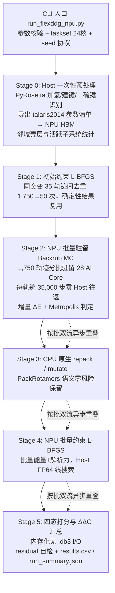

# 生命科学 flexddg ΔΔG 计算加速（24核CPU+950PR）方案设计文档

> 版本 v1.1（2026-11-25）｜状态：五问门禁已过（独立审计结论：有条件开工），本文档为开工许可条件之设计交付件
> 数字纪律：全部基线数字来自任务包实测（bd623_reference.csv / 任务书 §3 / verify_bd623.py 原文）；平台规格来自 2026-11-25 网关实机侦察；外部参照数字注明出处（TMol 论文 arXiv:2611.21857 / tmol-mutscan README / RosettaDDGPrediction 仓）；推导数字标「计算」；未经实测的 NPU 侧数字一律标【待 Day1 实测回填】，零预编。

# 一、需求背景（required）

## 1.1 需求来源

承接 2026 年 11 月社区任务《Rosetta Flex ddG 端到端加速开发（Ascend 950PR）》（任务书：`Rosetta_Flex_ddG_Atlas950_task_doc.md`，对应社区任务显示名「生命科学flexddg ΔΔG 计算加速（24核CPU+950）」）。要求基于 **24 核 CPU + 单卡 Ascend 950PR**，使用 Ascend C / Triton Ascend / CANN 软件栈结合 C++/Python 异构调度，对开源 Rosetta Flex ddG 计算流程做**整模块端到端异构加速**（本任务为整模块工程，非单一 aclnn/torch 算子），完成设计、开发、测试全流程。

验收依据：任务包 `test_cases/verify_bd623.py`（精度 + 性能一键验收）+ `bd623_reference.csv`（48 核开源 Rosetta 实测参考真值）。设计文档按 [cann-competitions design_template](../../../../resources/design_template.md) 四章节组织。当前任务列表尚未给出本任务编号，暂在完整任务名目录下提交，后续以官方目录映射为准。

## 1.2 背景介绍

### 1.2.1 Flex ddG 协议与 ΔΔG 科普（评审自包含，先读这节）

**ΔΔG 是什么**：蛋白质-蛋白质复合物发生一个氨基酸突变后，结合亲和力变化的度量。ΔΔG = 突变体结合自由能 − 野生型结合自由能；ΔΔG < 0 表示突变后结合更强。Rosetta 用经验能量函数（力场）给每个三维构象打分，单位 REU（Rosetta Energy Unit，1 REU ≈ 1 kcal/mol 量级但非标定自由能）。

**Flex ddG 协议做什么**（Barlow et al., J. Phys. Chem. B 2018；Kortemme 实验室，任务书 §2.1 指定官方实现）——对一个突变位点：

1. **结构准备与初始最小化**：加载抗体-抗原复合物 PDB，在突变位点周围按 CB 原子 8 Å 画邻域气泡（bubble），对气泡前后相邻残基（neighbor_shell）施加 CA 距离约束，做一次 L-BFGS 约束最小化松弛结构；
2. **Backrub 蒙特卡洛采样**：以 neighbor_shell 内残基为支点做骨干段旋转（backrub 移动），每步用 Metropolis 准则（kT=1.2）判定接受或拒绝，每条轨迹 35,000 步。backrub 是对蛋白质局部骨干柔性物理动机明确的扰动方式（相邻残基骨架协同旋转）；
3. **WT/MUT 后处理**：轨迹采样完成后，对终点构象分别做野生型侧链重排（repack，即从旋转异构体库中组合优化侧链构象）+ 约束最小化，以及突变体变异（mutate = 换氨基酸后重排）+ 约束最小化；
4. **四态接口打分**：按 talaris2014 力场对四个状态打分——结合态野生型（bound_wt）、解离态野生型（unbound_wt，把 A 链沿界面平移分开）、结合态突变体（bound_mut）、解离态突变体（unbound_mut），双差求 ΔΔG：

   ```text
   ΔΔG = (E_bound_mut + E_unbound_wt) − (E_bound_wt + E_unbound_mut)
   ```

   双差后分子内能量项精确抵消，仅剩 7 个分子间能量项（fa_atr/fa_rep/fa_sol/fa_elec/hbond_sc/hbond_bb_sc/hbond_lr_bb）非零——这正是输出 CSV 的 7 个逐项列；

5. **系综统计**：每个突变独立跑 35 条轨迹（nstruct=35），取 35 条 ΔΔG 的均值/标准差作为预测值；再对 7 个分子间项逐项过 ZEMu GAM 重加权（sigmoid 型经验校正，参数取自官方 analyze_flex_d01_dG.py），得到实验口径的 kcal/mol 值。

**为什么计算贵**：50 个突变 × 35 条轨迹 × 35,000 步 = 61.25M 蒙特卡洛步的力场评分，加上每轨迹结尾 4 个状态的 repack + 最小化 + 打分。**talaris2014 力场**是 Rosetta 2014 年代全原子经验力场（LJ 范德华 + LK 隐式溶剂 + 距离依赖介电静电 + 氢键多项式势 + Dunbrack 旋转异构体统计势 + 骨架二面角统计势等约 20 个能量项），Flex ddG 的协议参数（步数、GAM 拟合系数）与该力场配套标定，**换力场整套数据失效**——这是任务红线一的物理背景。

### 1.2.2 量纲与基线（实测）

评测对象：SARS-CoV-2 RBD 与抗体 BD-623 复合物（PDB 7E7Y，420 残基，3,217 重原子，链 A=抗原 / H+L=抗体），50 个抗原侧单点突变（清单 `bd623_mutations.csv`）。

| 量纲项 | 数值 | 来源 |
| --- | --- | --- |
| 突变 × 轨迹 × 步数 | 50 × 35 × 35,000 = 1,750 条轨迹 / 61.25M MC 步 | 任务书 §2.1/§3.3 |
| 基线总核时 | 2,671,363.3 CPU·s（742.05 CPU·h） | bd623_reference.csv 逐行求和（实测） |
| 基线 48 核墙钟 | 55,653.4 s（15.46 h，2×Xeon Platinum 8360Y，48 进程，Rosetta 2026.29 commit 80a0635615） | 任务书 §3.3（实测） |
| 单轨迹均摊 | 1,526.5 CPU·s ≈ 43.6 ms/MC 步 | 基线核时 ÷ 1,750 轨迹（计算） |
| **性能达标线** | 端到端墙钟 ≤ **5,565.3 s**（≥10× vs 48 核基线） | 任务书 §3.3 |
| 精度判据 | 大效应组（\|ref 均值\|>1.0 REU，15 个）中位相对误差 <5%；小效应组（35 个）全部 \|偏差\| < std_ref；完整性 50/50、residual ≤0.01、无 NaN/Inf | 任务书 §3.2 + verify_bd623.py 原文（判据真源） |

### 1.2.3 开源基线热点结构（baseline 三脚本 + ddG-backrub.xml 逐行核实）

对任务包 `test_cases/baseline/`（ddG_flex_lib.py 358 行 / flexddg_lib.py 131 行 / 06b_ddG_flex_antigen.py）与官方协议 `ddG-backrub.xml`（114 行）逐行核实：

1. **单轨迹结构**：初始约束 L-BFGS（1 次）→ 35,000 步 backrub MC（Metropolis 判定）→ 结尾 `finish_ddg_post_backrub` 恰好 1 次（baseline 将 `backrub_trajectory_stride` 传成与 trials 相同的 35000，ddG_flex_lib.py L171-172，故轨迹中途不落盘、只在终点执行一次 finish 链：WT repack+min → 恢复 backrub 构象 → MUT mutate+min → InterfaceDdGMover 四态打分）。注意 RosettaDDGPrediction 官方教程 YAML 中 stride=7000 为多次检查点口径，本任务基线口径以任务包 baseline 为准（只在终点 finish 一次）。
2. **初始最小化只在同突变 35 轨迹间去重（1,750→50 次）**（bubble 按突变位点构造，50 位点 50 套邻域约束，互相不等价；同一突变位点的 35 条轨迹共享同一 WT PDB、确定性 L-BFGS、相同约束——「完全重复」仅发生在同突变 35 轨迹间）——结果确定性一致。
3. **MC 步为几何扰动 + 增量重评分，不含逐步 repack**（算术佐证：若每步含一次 ~15 残基 repack（秒级），35,000 步远超单轨迹 1,526.5 s 实测）。43.6 ms/步为全轨迹摊销值（含初始最小化与 finish 链），纯 MC 步占比估算 45–55%（估算，Day1 profiler 拆分回填）。
4. **轨迹间完全独立**（逐轨迹独立 resfile/db3/工作目录，ddG_flex_lib.py 核实）——批并行的正确层级是轨迹级，无隐藏同步障碍。
5. 每轨迹写 2 个 SQLite（ddG.db3 + struct.db3），全量 GB 级随机 I/O——内存化可消除。
6. 精度判据以 48 核参考 35 条轨迹均值为真值做分层统计检验。对 bd623_reference.csv 全部 50 突变 × 35 轨迹做系综统计与 8,000 次 bootstrap：同分布独立重实现的双判据通过率 ≈97.2%；大效应组最紧绝对容差 5%×|mean| = **0.055 REU（G476Q）**，8/15 个突变的容差小于 1 个标准误——**系统偏差预算 ~0.1 REU 量级**，这是数值一致性设计的精度预算来源（计算，审计报告附表）。

### 1.2.4 同类 GPU 实现先例与力场边界（TMol / tmol-mutscan / RosettaDDGPrediction）

**先例取证结论：Rosetta 能量函数在 NPU 上无先例，最近的方法论参照是 RosettaCommons 官方 GPU 重实现 TMol。**

| 参照 | 是什么 | 可迁移的（加分项） | 不可直接搬用的（边界声明） |
| --- | --- | --- | --- |
| **TMol**（RosettaCommons 官方，arXiv:2611.21857，开源 62MB 源码已本地核读） | PyTorch 张量化重实现的 Rosetta 能量函数 + FastRelax，GPU（CUDA/Metal） | ① **block-pair→CTA 映射**：残基对交互分块计算、32 线程 shared memory 复用原子数据（直接映射到 Ascend C 的 AI Core 分核 + Unified Buffer 复用）；② **PoseStack 批量构象张量**：`coords [n_poses, max_atoms, 3]` + 共享残基类型表（1,750 轨迹批化的现成数据结构范式，源码 `tmol/pose/_pose_stack.py` 核实）；③ 分段扫描做逐残基归约 | **力场不符**：TMol 实现 beta2016/RosettaGenFF，本任务红线是 talaris2014（项集、参数、count-pair 语义均不同）；且 PyTorch/CUDA 栈不能直接跑 950PR。性能参照仅作量级上界：H200 NVL 上 score+gradient 达 **233–362× 单核 PyRosetta**（B100 批量、800 残基，论文实测数字，引用）——注意其负载含梯度、我们的只需 score，方向有利 |
| **tmol-mutscan**（GPU 系综突变扫描，README 已核读） | 与本任务同构的 ΔΔG 计算流水线：batched fast_relax → batched pack_rotamers → `calculate_block_pair_ddg` 直接求 cross-partner 能量差 → 系综统计机器（mean/SD/SEM/CI/显著性检验） | 系综统计输出结构、paired wt-control 设计、批量化编排手法（一次调用打包 N 个构象） | 同上力场边界（beta2016）；**关键教训**：TMol 0.2.0→1.0.0 版本间实现细节变动导致 ΔΔG 绝对值平均漂移 **1.19 REU（max 6.72）**、7/15 个差异超出 2×SEM 非采样噪声（README「Does this transfer to TMol 1.0.0」节，引用）——而本任务最紧容差 0.055 REU，**相差约 20 倍**。结论：「函数形式相同」不能自证数值一致，必须逐项对拍并锁参数版本，对拍门禁是本设计精度根基（见 §4.3） |
| **RosettaDDGPrediction**（⭐98 学术开源包，本地核读） | 含 `Flex_ddG.xml` + `flexddg_talaris2014.yaml`，与本任务同款协议-力场组合的 CPU 编排参照 | talaris2014 协议参数权威写法交叉验证：`nstruct=35`、`-corrections::restore_talaris_behavior`、`-ex1 -ex2`、MultiCoolAnnealer states=6、最小化参数——与任务书 §2.1 逐项吻合（源码对照） | 纯 CPU 编排，无加速设计；其 stride=7000 检查点口径与本任务基线（stride=trials）不同，已识别 |

### 1.2.5 目标平台规格（2026-11-25 网关实机侦察，非文档转抄）

Ascend 950PR = **Ascend950PR V100（A310-50-C00MM304A1）**：28 AI Core @1650MHz，HBM 128GB @3200MHz，CANN 9.2.1（ccec/bisheng 编译工具链在位），Python 3.11.6；宿主 EPYC 9575F（任务严格绑 24 核，宿主规格仅环境参考）。B=1/8/35/70 批量 score 扩展曲线、空 kernel 发射/同步开销、HBM 有效带宽：**【待 Day1 实测回填】**（Day1 微基准清单，见 §4.2 L0 前置项）。

# 二、需求分析（required）

## 2.1 需求描述

在 24 核 CPU（`taskset -c 0-23`）+ 单卡 Ascend 950PR 上，交付与开源 Rosetta Flex ddG **语义等价**的端到端实现：

- **功能**：完整覆盖 ddG-backrub.xml 全部协议阶段（结构准备/初始最小化/backrub MC/WT-MUT 后处理/四态打分），CLI 参数序列与输出 CSV 22 列逐字对齐任务书 §2.3/§2.4；
- **性能**：端到端墙钟 ≤ 5,565.3 s（≥10× vs 48 核基线）；
- **精度**：verify_bd623.py 分层统计全过（大组中位 rel_err <5%、小组全过、完整性 50/50）；
- **交付**：源码 + 一键复现 + 自测报告 + task_submission 目录（任务书 §4）。

## 2.2 吞吐不变量与达标数学结构（计算）

**核心不变量**：61.25M pose-步 ÷ 5,565.3 s = **11,004 pose-步/s 系统级持续吞吐**。相对单核 Xeon 8360Y（22.9 步/s，由 43.6 ms/步实测推得）= **480× 单核当量**；每 pose-步有效预算恒为 **91 μs**。批内并行层级（B=35 还是 B=1,750）不改变该不变量，只改变时延/利用率权衡。

**缺口分解**：
- 24 核 CPU 纯重组上限 ≈ 0.5–1×（核数比 24/48，计算）——纯 CPU 物理不可达；
- GPU 重实现已论证上界参照 233–362×（TMol 论文，H200、score+gradient、引用）——需求超过已论证上界 1.3–2.1 倍；
- 缺口由**三个乘法因子**补足（每个有反例风险，对应假设家族 §4.4）：
  1. **score-only 免梯度**：Metropolis 判定只需能量不需梯度（源码核实 MC 步无梯度消费）——相比 TMol 的 score+gradient 负载省一半以上算力；
  2. **增量重评分**：每 MC 步仅重评「变动残基 × 邻域壳层」原子对子集（估算单步 250–1,200 对，估算待 Day1 实测），不做全结构评分；
  3. **1,750 轨迹全批驻留**：全部轨迹坐标常驻 HBM（67.6 MB 坐标 + 参数表，占 128GB <0.1%，实测计算），消除 host-NPU 往返与访存冷启动。

结论（继承审计口径）：10× 处于已论证 GPU frontier 的**上沿**，可达但无宽松余量——需三因子同时成立，Day1 实测闭环后确认（假设 2/6 的证伪点）。

## 2.3 双轨策略：主轨与副轨

- **主轨（达标路径）**：全量 NPU 下沉——talaris2014 能量评估（MC 步增量评分 + finish 链批量最小化能量/力 + 四态打分）全部下沉 950PR，CPU 保留 repack 决策、FP64 线搜索与调度。目标 10×。
- **副轨（保底交付形态）**：分层降级方案（§3.9），对应止损判据触发后的交付形态——部分加速（0.5–1.4× 区间，审计估算），CLI/CSV 契约与精度判据不变、性能如实申报。
- 两轨共用同一 CPU 骨架与契约层；副轨是主轨的真子集裁剪，不是另起炉灶——降级时已完成的组件全部保留复用。

## 2.4 外部组件依赖

| 组件 | 版本 | 用途 | 风险 |
| --- | --- | --- | --- |
| Rosetta / PyRosetta | 2026.29（commit 80a0635615，开源） | 基线语义真源、逐项对拍 oracle、CPU 侧 repack/mutate 原生执行 | 版本一致性须锁定（对拍与参考同版本） |
| CANN toolkit | 9.2.1 实机在位（满足任务书 ≥9.0.0） | Ascend C 编译（ccec/bisheng 在位） | 低 |
| Ascend 950PR | V100 / 28 AI Core / HBM 128GB（实测） | 批量能量计算承载 | 批量扩展性与同步开销待 Day1 微基准 |
| hidevlab 算力 | 100h 免费时长（任务书 §8） | 开发与实测 | 预算约束（止损 4） |

## 2.5 刚性约束（需求红线，任务书 §2.1.3/§7）

1. **力场保持 talaris2014**（`-corrections::restore_talaris_behavior` 语义），不得替换为 REF2015 或删减能量项；
2. **采样与收敛预算不得调低**：nstruct=35、backrub_trials=35000、8 Å 邻域、max_minimization_iter=5000、abs_score_convergence_thresh=1.0 固定；
3. **不得删减 ddG-backrub.xml 核心阶段**（初始最小化/采样步数/WT-MUT 双侧重排与后处理最小化）；
4. **24 核约束真实生效**（`taskset -c 0-23`，禁止后台超核进程池）；
5. 端到端计时含输入解析/参数导出/算子加载/采样/后处理/落盘全程（任务书 §7.5）；大文件（.db3）不入库（§7.6）。

# 三、详细设计（required）

## 3.1 总体架构：端到端异构流水线



设计总原则：**CPU 做语义敏感且占比小的环节（保精度零风险），NPU 做计算密集可批量的环节（扛吞吐）**；双流（计算流+搬运流）异步流水消除批间空转。主轨的能量评估环节全部 NPU 化；副轨按 §3.9 梯度逐级回收 NPU 成分。

## 3.2 Host 侧设计（24 核 CPU 调度、校验与负载均衡）

1. **参数校验与快速失败**：按任务书 §2.4.1 逐项校验（文件存在性、CSV 列完整性、wt_aa 与 PDB 实际残基一致性——沿用 baseline `locate()` 的链+编号+插入码三段定位逻辑、nstruct/trials/cpu-cores 值域、device-id 有效性），任一失败明确报错 + 非零退出码；负向场景全覆盖（缺失 PDB/缺列/wt 不匹配/cpu-cores>24/nstruct≤0 等，任务书 §3.5.3）。
2. **24 核负载均衡**：CPU 侧可并行工作（repack/mutate、结果汇总）按进程池 + 核亲和绑定；调度单元 = 「单突变 35 轨迹的 finish 链」，动态领取（work-stealing）避免 50 突变位点间异构耗时的尾延迟（基线实测位点差异 ±10%，任务书 §3.3 表）。负载分配矩阵【待 Day1 实测回填】（依热点占比定型）。
3. **RNG 与可复现协议**：`--seed` → 确定性派生每轨迹独立种子 `seed_traj = f(master, mutation_id, traj_id)`（派生函数在实现阶段固化写入自验报告）；MC 判定随机流在 kernel 侧由 counter-based RNG 生成，每轨迹独立计数器空间。RNG 语义依据按三层顺序取用（2026-11-25）：**第一层·任务书 §2.1.4 原文**：「本任务为蒙特卡洛随机系综算法，不要求不同运行间逐比特确定性，以第 3.2 节统计精度标准验收（建议支持 `--seed` 以便复现和排查）」——即统计等价口径为任务书明文；**第二层·书面提问**：与 Rosetta 原生 RNG 的复现语义（逐位复刻 vs 统计等价）已在任务专属讨论帖书面提问（atomgit cann/community/discussions/2 问题 1/2，2026-11-25 已发布），按答复口径执行；**第三层·兜底声明**：5 个工作日无答复按「相对参考均值偏差」口径推进并在自验报告声明（该口径下 bootstrap 通过率 97.2%，计算）。
4. **异步流水线**：NPU MC 批次 k 完成即移交 CPU finish 链批次 k，同时 NPU 启动批次 k+1；流水深度与批大小 B 由 Day1 扩展曲线定（B ∈ {8, 28, 35, 70} 微基准）。拓扑/PDB/参数表全程只读共享、解析一次（1,750 轨迹共享只读结构）。
5. **结果汇总与校验**：四态双差公式与 baseline flexddg_lib.py 逐字一致（`STATE_SIGN` 四态符号表 + 7 项分子间项 + GAM 重加权参数逐字移植）；`ddG_residual` = ddG_mean − 7 项之和自检（任务书要求 ≤0.01）；大数组求和分段归约 + Kahan 补偿。

## 3.3 Kernel 侧设计（Ascend C，ccec/bisheng 9.2.1）

三族 kernel：

### 3.3.1 talaris2014 势能设备库（纯能量 + 解析力两套接口）

**参数真源策略——不手写硬编码参数**：Day1 用 PyRosetta 2026.29 从实机运行时导出 talaris2014 全量参数形成机器可读「参数清单基线」（JSON），作为 NPU 设备库单一参数真源（消除「抄错一个表」类的 1.19 REU 漂移风险——见 §1.2.4 tmol-mutscan 教训）：

- 二体项：`fa_atr / fa_rep / fa_sol / fa_intra_rep / fa_elec`（Etable 成对参数解析导出 + LK 溶剂 + 距离相关介电静电查表）；
- 氢键项：`hbond_sr_bb / lr_bb / bb_sc / sc`（sp2 多项式势 + 环境依赖权重）；
- 单体/几何项：`fa_dun`（Dunbrack 样条）、`rama / p_aa_pp`（36×36 双三次样条）、`omega / yhh_planarity / pro_close / mm_bend / dslf_fa13 / ref`；
- 约束项：`atom_pair_constraint`（初始约束最小化用）；
- MC 权重组与打分权重组（`fa_talaris2014` / `fa_talaris2014_cst`）随导出逐项记录权重差异。

**计算映射**（借鉴 TMol 三手法，适配 Ascend C）：

| TMol 手法（源码出处） | 本设计映射 |
| --- | --- |
| block-pair → CTA 分块 + 32 线程 shared memory 复用原子数据 | 残基对分块 → AI Core 分核；原子坐标/类型在 Unified Buffer 复用，减少 HBM 重读 |
| PoseStack `[n_poses, max_atoms, 3]` 共享残基类型表 | 同构张量布局：1,750 轨迹批驻留 HBM，共享只读参数表（占用 <0.1% HBM，计算） |
| 分段扫描（segmented scan）逐残基归约 | 逐残基部分和 → 分段归约树，配合 Kahan 补偿控制 fp32 求和误差 |

- CountPair 排除（1-2/1-3/1-4 权重与二硫键/肽键特殊对）由静态稀疏表驱动（拓扑一次构建，轨迹共享）；
- 静电 fa_elec 1D 查表插值（表随参数清单导出）；氢键仅在极性 H/受体索引子集遍历；
- 数值口径：单构象逐项对拍 diff < 1e-3 REU 为合入门禁（§4.3）。

### 3.3.2 驻留式批量 Backrub MC kernel（吞吐主体）

- **映射**：AI Core 承载 1–2 条轨迹（批内并行 B 条），轨迹内 35,000 步循环全程驻留片上完成，消除 61.25M 次 kernel 启动/同步往返；
- **背景缓存 + 变动段增量重评**：邻域壳层背景能量缓存一次；每步仅重评「变动段 × 邻域壳层」原子对（估算单步 250–1,200 对，估算——邻域 8 Å 壳层规模 Day1 脚本化统计 50 位点后回填）；
- **移动类型语义**：按 baseline 协议实际行为实现（ddG-backrub.xml 的 BackrubProtocol 未配置 sidechain 分支参数，源码核实默认纯 backrub 段旋转；kernel 预置 sidechain 扰动分支以覆盖协议全集——Day1 以轨迹级行为比对确认 MC 步构成，分歧点列入假设家族 §4.4-4）；
- **Metropolis 判定**：ΔE ≤ 0 直接受理，否则 u < exp(−ΔE/kt)（kt=1.2，XML 原文）；接受/拒绝回滚仅触碰变动残基坐标缓存；轨迹终态按 `recover_low` 语义回写（XML 原文 recover_low="0"——即取最终态而非最低态，按协议语义实现并以源码为准）；
- RNG：kernel 侧 counter-based RNG，每轨迹独立计数器空间（§3.2-3 协议）；实现锚点：Philox/Threefry 为纯位运算结构，Ascend C 标量位运算可移植（无外部依赖）；备选路线 Host 预生成随机数流批量驻留 HBM（带宽占用 Day1 核算）。

### 3.3.3 批量约束 L-BFGS 最小化（finish 链主体）

- NPU 批量计算全蛋白 `fa_talaris2014_cst` 能量 + 全原子解析力（邻域列表周期刷新），逐残基链式法则映射扭转梯度；
- Host FP64 执行 L-BFGS 双循环与线搜索（950PR 无原生 double；L-BFGS 曲率递推对舍入敏感，此拆分为该问题域的自然分工）；
- 收敛判据（max_iter=5000 / abs_score_convergence_thresh=1.0）逐参数对齐导出清单；批间回传数据量 ≈ B × n_degrees × 4B【待 Day1 实测回填】。

### 3.3.4 批量 pack_rotamers（Day1 剖析条件触发的主线升级项）

若 Day1 profiler 显示 finish 链占比超预期（MC 链 <30%，止损 3 触发），14,000 次 repack/minimize（计算：1,750 轨迹 × finish 链与 InterfaceDdGMover 四态的 repack+min 序列）成为第二战场：参照 tmol-mutscan 的 batched `pack_rotamers` 手法（一次调用打包 N 个构象的旋转异构体组合优化，模拟退火在设备侧并行多轨迹）将 repack 下沉 NPU。该组件为主轨的可选扩展，不在初版必达范围。

## 3.4 数据布局与内存规划（实测 + 计算）

- 坐标驻留：3,217 重原子 × 3 × 4B × 1,750 pose = **67.6 MB**（计算），对 128GB HBM 占比 <0.1%——**批量全驻留无容量风险**（2026-11-25 实测 HBM 128GB）。含氢与表项构成明细（估算上界，分项）：① 含氢坐标 6,300 原子/pose（含氢估算）× 3 × 4B × 1,750 pose ≈ **132 MB**（计算）；② rotamer 库（Dunbrack + `-ex1 -ex2` 扩展采样，全量缓存口径）≤ **2 GB**（估算上界，Day1 随活跃子集统计回填）；③ 力场参数表（Etable 成对参数 / fa_elec 查表 / 样条 / Dunbrack 统计势）≤ **1 GB**（估算上界，Day1 随参数清单导出量化回填）。合计 ≤ **3.2 GB**（≈128GB 的 2.5%），仍为 GB 级以下，容量维度不构成约束；
- 邻域壳层（10 Å）活跃子系统残基/原子数分布：50 位点脚本化统计【待 Day1 实测回填】；
- 力场常量表规模（Etable 成对参数/fa_elec 查表/样条/Dunbrack 活跃子集）：随参数清单导出量化【待 Day1 实测回填】；
- Unified Buffer 分配、双缓冲槽位数、每核 tile 预算：随 kernel 原型微基准定型【待 Day1 实测回填】。

## 3.5 与开源标杆差异及等价性说明

| 维度 | 开源基线 | 本方案 | 等价性约束 |
| --- | --- | --- | --- |
| 初始最小化 | 同突变 35 轨迹间重复（50 位点各 35 次） | 每位点 1 次并缓存 50 个起点 Pose | 确定性 L-BFGS + 相同输入 → 结果确定性一致（去重仅限同突变轨迹间，跨位点 bubble/约束不同不构成重复） |
| Backrub MC | 单核串行 35,000 步 × 1,750 | NPU 批量驻留增量 ΔE | 力场项集/权重/步数/判定语义逐项对齐；随机流统计等价（口径随任务方答复，§3.2-3） |
| WT repack / MUT mutate | PyRosetta 逐条 | **保留 CPU 原生 Rosetta** | 语义零风险（Proline 环拓扑/rotamer 库/annealer 语义复杂，不重实现；占比小） |
| 后处理最小化 | 单核逐条 | NPU 能量/力批量 + Host FP64 线搜索 | 项集与收敛判据逐参数对齐 |
| 中间持久化 | 每轨迹 2 个 .db3 | 内存化 | 四态双差公式逐字一致；消除 GB 级 I/O |
| 四态打分 | PyRosetta 逐条 | 批量打分 + 终态原生复核选项 | 终态可选回退 PyRosetta 原生打分复核（单次耗时【待 Day1 实测回填】），兜底零系统偏移 |

## 3.6 支持硬件

| 芯片版本 | 勾选 | 说明 |
| --- | --- | --- |
| Ascend 950PR（Ascend950PR V100 / arch35） | √ | 正式目标平台；CANN 9.2.1（≥9.0.0 兼容）+ 24 核 Host 绑定 |
| Atlas 800I/T A2 / A3（arch22） | × | 不在本次范围 |
| Ascend 310P（arch20） | × | 不在本次范围 |

## 3.7 约束限制

1. `--cpu-cores` 允许 [1,24]，验收固定 24 且 `taskset -c 0-23`；
2. 输入限定标准全原子蛋白复合物 PDB（20 标准氨基酸、CYD 二硫键、Kabat 插入编号——定位逻辑含链+编号+插入码三段匹配，Kabat 为抗体编号惯例，BC-strand 常见插入残基如 A52a/A82a；BD-623 输入 icode 列为空，三段匹配为语义完整性保留，非本任务负载）与 baseline 输入域一致；
3. 固定 `--seed` 时可复现统计分布；系综统计按轨迹 id 定序求和，与批大小 B 无关；B 不进入结果语义，仅影响吞吐/时延权衡（验收以任务书 §3.2 分层统计为准，不要求逐比特确定性，任务书 §2.1.4）；
4. `.db3` 轨迹与临时工作目录不入库（任务书 §7.6）。

## 3.8 工程交付目录结构（对齐任务书 §5）

```text
rosetta_flex_ddg/
├── README.md                  # 环境依赖、编译构建与一键复现说明
├── build.sh                   # 一键构建（CMakeLists.txt 等）
├── env/                       # 运行环境激活与依赖配置
├── pipeline/                  # run_flexddg_npu.py 入口、输入校验、CPU/NPU 调度与结果汇总
├── kernels/                   # NPU 算子源码（talaris2014 设备库 / 驻留 MC / 批量最小化）
└── tests/                     # 单元测试与端到端自验脚本
```

## 3.9 副轨：分层降级方案（保底交付形态，对应止损判据触发）

副轨与主轨共用 CPU 骨架、CLI/CSV 契约层与全部已通过的对拍资产；降级只回收 NPU 计算成分，精度判据始终不变（CPU 原生路径保语义），性能按实测如实申报。梯度设计：

| 梯度 | 触发止损（§4.5） | NPU 保留成分 | CPU 承担 | 预期收益（来源） | 交付口径 |
| --- | --- | --- | --- | --- | --- |
| **G0 主轨** | —（全因子成立） | MC 驻留 + 批量最小化 + 四态打分 | repack/线搜索/调度 | ≥10×（目标） | 全判据验收 |
| **G1 协处理器模式** | 止损 2（B 扩展不足），或止损 3 升级失败后（§4.5 止损 3 决策序：先 §3.3.4 升级 + mini-audit 重估，不达标才落 G1） | 批量评分接口（35–70 批一次调用） | MC 移动生成 + 判定 + repack + finish 全链 | 收益区间【待 Day1 实测回填】（受每步 host-NPU 往返同步开销约束，空 kernel 发射开销为下界锚点） | 判据全跑，性能如实申报 |
| **G2 CPU 编排优化** | 止损 1（对拍失败）或止损 7（原型收益不足） | 无（能量计算全回 CPU 原生） | 全链 CPU + 工程优化三件套：初始最小化同突变 35 轨迹间去重（1,750→50 次，去重倍数按 50 计）、拓扑/PDB/参数一次解析 1,750 轨迹共享、异步流水线 | 0.5–1.4×（计算+估算：24/48 核数比 0.5× 为地板，编排优化 1.2–1.4× 为审计估算——合计不超过基线同水平） | 部分加速如实申报；设计与对拍资产（L0-L2）仍然交付 |
| **G3 设计交付** | 止损 4（资源不足）或止损 5（口径恶化后放弃冲奖金） | — | — | — | 交设计文档 + 已完成阶段的实测数据与结论 |

降级决策点：每个止损触发即冻结当级状态、产出当级实测报告，再决定是否继续降级——不允许跳级直接弃赛（沉没成本纪律，止损 6 独立把关）。

# 四、可维可测分析（required）

## 4.1 精度标准/性能标准

| 验收标准 | 描述 | 标准来源 |
| --- | --- | --- |
| 精度（大效应组） | 15 个 \|ref 均值\|>1.0 REU 突变：median(\|ddG_i − ddG_ref,i\| / \|ddG_ref,i\|) < 0.05 | 任务书 §3.2 表 + verify_bd623.py L207（判据真源） |
| 精度（小效应组） | 35 个 \|ref 均值\|≤1.0 REU 突变：全部 \|ddG_i − ddG_ref,i\| < 1.0 × std_ref,i（max σ < 1.0） | 同上 |
| 精度（完整性） | 50/50 全覆盖；nstruct_done==35；backrub_trials==35000；ddG_all 含 35 个有限值；\|ddG_residual\| ≤ 0.01；无 NaN/Inf | 同上 |
| 性能 | 端到端 wall_time_s ≤ 5,565.3 s（≥10.0×），计时含全程（§7.5 口径） | 任务书 §3.3 + verify_bd623.py 性能分支 |

**run_summary.json 字段全清单**（与任务书 §2.4.1 逐字对齐，8 个必含字段）：

| 字段 | 必含/扩展 | 来源 |
| --- | --- | --- |
| `wall_time_s` | 必含 | 任务书 §2.4.1 |
| `mutations_completed` | 必含 | 任务书 §2.4.1 |
| `cpu_cores_limit` | 必含 | 任务书 §2.4.1 |
| `npu_device` | 必含 | 任务书 §2.4.1 |
| `cann_version` | 必含 | 任务书 §2.4.1 |
| `seed` | 必含 | 任务书 §2.4.1 |
| `git_commit` | 必含 | 任务书 §2.4.1 |
| `command` | 必含 | 任务书 §2.4.1 |
| `cpu_time_by_mutation`（逐突变 cpu_time 双计时） | **扩展，非必含**（我方扩展字段，用于 wall_time 与 sum(cpu_time)/48/10 双口径对账，§4.1 末段） | 本设计扩展 |

性能计时真源的口径衔接（任务书 §7.5 墙钟 vs verify_bd623.py `sum(cpu_time)/48/10`）已在任务专属讨论帖提问（discussions/2 问题 3），按答复执行；run_summary.json 双字段（wall_time_s + 逐突变 cpu_time）同时记录兜底两种口径。

**results.csv 22 列字段规范（附录，对齐任务书 §2.4.2）**：

| 列序 | 字段组 | 校验要点 |
| --- | --- | --- |
| 1–6 | `pdb_id,chain,pdb_position,icode,wt_aa,mut_aa` | 与输入 `bd623_mutations.csv` 逐行精确匹配 |
| 7–9 | `ddG_mean(REU),ddG_std(REU),ddG_all(REU)` | 35 条轨迹均值/样本标准差（ddof=1）/分号分隔全值；有限实数无 NaN/Inf |
| 10–16 | `ddG_fa_atr / fa_rep / fa_sol / fa_elec / hbond_sc / hbond_bb_sc / hbond_lr_bb (REU)` | 7 个分子间能量项双差均值 |
| 17 | `ddG_residual(REU)` | `ddG_mean − sum(7 项)`，验收 \|residual\| ≤ 0.01 |
| 18–19 | `ddG_gam_mean(kcal/mol),ddG_gam_std(kcal/mol)` | ZEMu GAM 重加权均值/标准差 |
| 20–22 | `nstruct_done,backrub_trials,cpu_time(s)` | 严格等于 35 / 严格等于 35000 / 非负有限 |

## 4.2 分层测试与验证策略

| 层 | 内容 | 门禁 |
| --- | --- | --- |
| L0（Day1 前置） | 950PR 微基准：B=1/8/35/70 score 扩展曲线、空 kernel 发射/同步开销、HBM 有效带宽；参数清单导出件 vs PyRosetta 运行时逐项 diff | 扩展曲线与开销数据落盘；参数逐字段一致 |
| L1 逐项能量对拍 | talaris2014 全部分能量项 ×（BD-623 初始构象 + 随机扰动构象集）vs PyRosetta 2026.29 | 逐项 diff < 1e-3 REU |
| L2 梯度对拍 | kernel 解析力 vs 中心差分 | 相对误差 < 1e-3 |
| L3 单轨迹等价 | 固定 seed 下 NPU 轨迹 vs CPU 轨迹能量曲线 | 分布统计 + 终态能量差（阈值随口径答复定） |
| L4 单突变端到端 | 1 突变 × 35 轨迹 vs 参考系综（含小效应位 Y369C 与大效应位 G476Q 各一） | 过该突变分层判据 |
| L5 全量端到端 | 50 突变 + verify_bd623.py + 墙钟 | 双判据全过 + wall_time_s 达标 |

自验命令与负向用例按任务书 §3.5 与 test_cases/README.md 执行（verify_bd623.py 一键验收 + 5 类负向场景非零退出码）。

## 4.3 talaris2014 数值一致性保障（精度根基，预算 0.1 REU）

1. **逐项 Oracle 对拍门禁（L1）**：全部能量项对拍 PyRosetta 2026.29，单构象逐项 diff < 1e-3 REU、解析梯度 < 1e-3 相对误差。任一核心项（fa_atr/fa_rep/fa_sol/fa_elec/hbond_*）超限 48h 未定位 → 触发止损 1。依据：tmol-mutscan 版本间 1.19 REU 漂移教训（§1.2.4）——最紧容差 0.055 REU（G476Q，实测）只有「逐项对拍 + 参数运行时导出」双保险能守住；
2. **参数运行时导出**：所有力场参数从 PyRosetta 运行时导出（§3.3.1），零手工抄录；导出件进版本库锁定（含 Rosetta commit 号）；
3. **FP32 防护**：分段归约 + Kahan 补偿；L-BFGS 历史/四态双差/GAM 重加权全部 Host FP64。FP32 数值演算（演算为设计预算，Day1 L1 实测校准）：朴素求和误差上界 ≈ 原子对数 n（单步增量 250–1,200 对，估算）× FP32 eps（1.19e-7）× 项量级（fa_atr 单构象 ~10²–10³ REU，估算量级）；Kahan 补偿后误差 bound 收紧为 ≈ eps·|sum|（|sum| 取量级上沿 ~1.7×10³ REU）≈ 1.19e-7 × 1.7e3 ≈ **2e-4 REU**，vs 逐项对拍门禁 1e-3 REU 的余量比 ≈ **5×**——预算成立但无宽松余量，门禁值以 Day1 L1 实测回填为准；
4. **高危位点专项单测**：二硫键（CYD 特殊对）与 4 个脯氨酸突变（N440P/N481P/F486P/N501P，任务书 §3.5）——脯氨酸几何敏感，但实测判据定位：3 个在小效应组（容差宽松）、F486P 在大效应组且容差/sem=3.12 为全组前列（最宽为 F486G 3.25，实测 CSV 计算）——不构成判据雷区，仍作为 pro_close/dslf_fa13 语义正确性哨兵；
5. **终态原生复核选项**：全部轨迹终态四态打分可回退 PyRosetta 原生复核，保证 |ddG_residual| 收敛到 0（成本【待 Day1 实测回填】）。

## 4.4 关键风险与假设家族（可证伪）

### 三大风险（按发生概率 × 损失排序）

| # | 风险 | 依据 | 缓解 |
| --- | --- | --- | --- |
| R1 | **talaris2014 逐项一致性不达标**：最紧容差 0.055 REU（实测）vs 同类 GPU 重实现版本间漂移 1.19 REU（tmol-mutscan 实测教训，引用）——相差 20 倍，重实现的数值一致性工程量大于 TMol（其验收是 1000 链 Pearson r，我们是逐项一致） | 审计报告问 4/问 5 | L1 逐项对拍门禁 + 参数运行时导出 + 48h 定位止损（止损 1 → 副轨 G2） |
| R2 | **950PR 批量扩展性未知**：28 AI Core 上 B=35/70/1,750 的 score 扩展曲线未实测；若 B=35/B=1 <10× 则单卡吞吐数学不成立（10× 达标线崩塌） | 审计报告问 2 | Day1 L0 微基准前置（开工条件 1）；不成立 → 止损 2 → 副轨 G1 |
| R3 | **5% 口径两种解读**：口径 A（与参考均值比较，bootstrap 通过率 97.2%）vs 口径 B（独立系综涨落，大组中位 rel ≈7%，通过率 ~50%）——验收方解释权问题 | 审计报告问 1（8,000 次 bootstrap 计算） | 已书面提问（discussions/2 问题 1）；5 工作日无答复按口径 A 推进并声明；口径 B 答复 → 止损 5 重估；若答复要求逐位复刻 Rosetta RNG，备选路线为「CPU 逐位复刻 mt19937 随机流 + NPU 评分下沉」（随机流语义保真，仅能量计算下沉） |

### 六条关键假设与证伪方法

| # | 假设 | 证伪方法 |
| --- | --- | --- |
| 1 | talaris2014 数值可复现到单构象逐项 diff <1e-3 REU | L1 对拍任一核心项超限且 48h 无法定位 → 假设崩塌，触发止损 1 |
| 2 | B=35/70/1,750 批量 score 在 950PR 上近线性扩展 | Day1 扩展曲线 B=35/B=1 <10× → 假设不成立，触发止损 2 |
| 3 | 大组 5% 判据为「相对参考均值偏差」口径 | 任务方书面答复为独立系综口径（discussions/2）→ 假设修正，触发止损 5 |
| 4 | MC 步构成为纯 backrub 段旋转（XML 未配置 sidechain 分支，源码核实） | Day1 轨迹级行为比对发现 sidechain 分支 → kernel 预置分支启用（无架构变更，仅参数对齐） |
| 5 | 1,750 pose 批驻留不触顶（HBM 128GB，坐标驻留 <0.1%） | **已实测支持（2026-11-25）**；剩余风险收窄为算力利用率与带宽（并入假设 2 证伪） |
| 6 | CPU 侧 43.6 ms/步中 MC 链占比 ≥45% | Day1 profiler 拆分 <30% → 收益模型重估，finish 链批量化升主线（§3.3.4），触发止损 3 |

## 4.5 止损与降级判据（满足任一即触发对应处置）

| # | 止损触发 | 处置（副轨梯度见 §3.9） |
| --- | --- | --- |
| 1 | L1 对拍核心项 diff >0.01 REU 且 48h 未定位 | 放弃全量 NPU 下沉 → G2（CPU 能量 + 编排优化，如实申报部分加速） |
| 2 | 950PR B=35/B=1 扩展 <10× | 批量化收益重估 → G1 协处理器模式或继续降级 |
| 3 | profiler 实测 MC 链占比 <30% | **决策序：先触发 §3.3.4 升级（finish 链批量化升主线）+ mini-audit 重估，升级后仍不达标才落 G1**；直接落 G1 视为跳级（降级决策点纪律见 §3.9） |
| 4 | hidevlab 100h 内无法完成校准+冒烟+3 次全量端到端 | 缩减实验矩阵，保 L0/L1/L5 最小闭环 → 不足则 G3 |
| 5 | 验收方确认 5% 为独立系综口径 | 重估投入产出（¥82,240 激励，来源：hiascend 任务详情页《生命科学flexddg ΔΔG 计算加速（24核CPU+950）》，2026-11-25 查看 vs 4–5 人月估算），不友好则 G3 |
| 6 | 累计投入 >预算 50% 且性能 <5× | 沉没成本止损 → 当级降级交付 |
| 7 | 代表用例上 NPU 原型收益 <预期 30% | 回假设家族逐条排查 → 定位后按对应止损走 |

## 4.6 兼容性分析

- **接口兼容**：CLI 参数序列、results.csv 22 列、run_summary.json 字段与任务书 §2.3/§2.4 逐字对齐（含 baseline 的链+编号+插入码三段残基定位语义）；verify_bd623.py 无改动可跑；
- **上游不动**：不修改 Rosetta / CANN 上游；NPU kernel 独立目录组织（§3.8）；CPU 路径完整保留为回退（`--backend cpu` 全流程可跑，作为验收兜底与回归基准）；
- **环境依赖声明**：README 记录 CANN 9.2.1 / 驱动 / PyRosetta 2026.29 commit / 代码 commit 与完整执行命令（任务书 §3.1 版本记录要求）。

## 4.7 修订记录

| 日期 | 版本 | 说明 |
| --- | --- | --- |
| 2026-11-25 | v0.1 | 初稿（内部草稿） |
| 2026-11-25 | v1.0 | 按评审要求重写：自包含协议科普、TMol 先例与力场边界声明、双轨结构（主轨+副轨 G0–G3 梯度）、三大风险+六条假设证伪表、止损判据表；全部数字补来源标注，NPU 侧未测数字标【待 Day1 实测回填】 |
| 2026-11-25 | v1.1 | 按评审预演四人格意见修复：必改项——位点错名更正（G476Q×3、N481P，以 bd623_mutations.csv 与任务书 §3.5 为准）；初始最小化去重语义修正（同突变 35 轨迹间去重 1,750→50，倍数按 50 计）；止损 3 决策序（先 §3.3.4 升级 + mini-audit，不达标才落 G1）与 §3.9 G1 触发条件双表对齐；§4.3 补 FP32 Kahan 误差预算演算（≈2e-4 REU vs 门禁 1e-3，余量 5×，Day1 校准）。建议项——F486P 容差表述改「全组前列（最宽 F486G 3.25）」；¥82,240 补来源；章名对齐模板「三、详细设计」；HBM 容量构成分项明细（≤3.2 GB）；§3.7-3 删「与相同批大小」改按轨迹 id 定序求和；§4.1 补 run_summary.json 8 必含字段全清单+扩展字段标注；RNG 三层依据（任务书 §2.1.4 原文→书面提问→兜底）与逐位复刻备选路线；§3.3.2 补 counter-based RNG 实现锚点（Philox/Threefry） |
