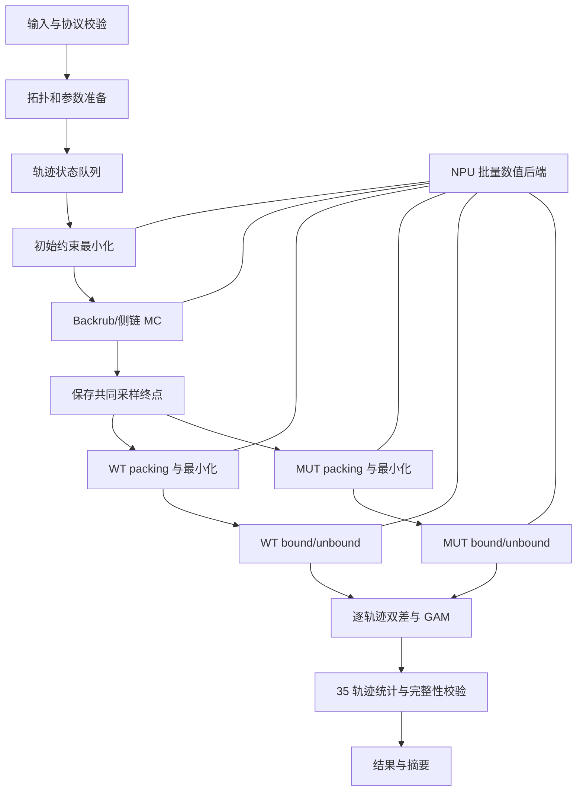

# 生命科学 Flex ddG ΔΔG 端到端加速设计（24 核 CPU + Ascend 950PR）

> 文档状态：公开评审稿，2026-11-25。
>
> 当前已完成精确参考环境、两次单轨迹 CPU 完整协议运行，以及 NPU 上的独立 Coulomb 原子对数值探针。尚未完成完整力场、梯度、Monte Carlo、packing、最小化的 NPU 集成，也未完成 35 轨迹精度验收、全量端到端性能验收或 10 倍加速证明。

# 1. 需求背景

## 1.1 目标

Flex ddG 通过构象采样和野生型/突变型后处理估算蛋白结合自由能变化。本项目拟在 24 核 CPU 与单卡 Ascend 950PR 上实现端到端异构加速，同时保持参考协议的科学语义、输出统计口径和失败语义。

交付目标不是孤立的数学算子，而是可复现的协议执行模块，包括输入和协议检查、多轨迹状态管理、初始最小化、Backrub/侧链 Monte Carlo、WT/MUT packing 与约束最小化、bound/unbound 四态打分、聚合、诊断和恢复。任务固定BD-623全部50个突变，每个突变35条轨迹，每条轨迹35000个采样步骤，共1750条轨迹、6125万次轨迹级采样提议。正式验收必须使用任务规定的完整输入和参数，开发子集只能作为诊断证据。

目标环境为单卡Ascend 950PR、实际绑定24核CPU、CANN 9.0.0及以上和匹配驱动。当前实验使用CANN 9.1.0、驱动25.7.rc1.10、AMD EPYC 9575F/x86_64；容器Host内存上限32GiB，设备HBM为128GiB。CPU参考实验采用单核用于协议和阶段定位，通用设备微基准采用 `taskset -c 0-23`。完整候选的24核吞吐与全量任务性能仍待验证。

## 1.2 参考协议与当前状态

参考实现采用 PyRosetta/RosettaScripts 组织协议。当前已在任务配套的 x86_64 环境安装并验证精确版本 `PyRosetta 2026.29+releasequarterly.80a0635615`。两次单核、单轨迹、35000 步完整协议均正常结束，总墙钟时间均约 472 秒。

第二次运行的可见阶段区间为：初始最小化 111.713 秒，Backrub 起点至终点回调边界 258.914 秒，WT 最小化 40.335 秒，MUT 最小化 55.483 秒，WT/MUT packing 分别为 0.2295/0.2274 秒，四态阶段 0.1496 秒。这些区间按相邻可见边界定义；原生 profiler 标签可能嵌套或重叠，不能将标签值直接相加为总耗时。

上述结果证明精确参考协议可以运行，并提供了单轨迹热点依据，但不构成 35 条轨迹的正式精度结果，也不能直接外推 24 核吞吐。

NPU 侧目前只有一个独立 Coulomb 原子对探针：3469 个真实原子对和 64 个边界样例均通过既定误差判据，最大绝对误差分别为 `1.88e-7` 和 `8.23e-7`。该探针未覆盖完整 `fa_elec`、力场加权、邻居/排除规则、梯度、Monte Carlo 或端到端协议。

## 1.3 范围与合规边界

设计文档目标仓已确认为 `cann/cann-ops-competitions`，拟提交到 `04_tasks/01_community-task-2026/tasklist/11月社区任务-生命科学flexddg ΔΔG 计算加速（24核CPU+950)/PeipeiZHU/docs/design.md`。设计文档仓与最终代码仓是两个独立决定：该设计路径的确认不表示最终实现仓、贡献方式或许可证已经确定。公开验证摘要作为提交 ZIP 的配套材料，不作为该设计 PR 的第二个文件。

实现会区分自有调度代码、外部依赖接口和可能受第三方许可约束的代码或数据。当前不宣称已获得额外授权，也不把内部开展参考实验等同于任何机构的许可。公开交付前应确认目标代码仓、许可证兼容性、外部依赖的使用和再分发条件。设计与验证材料不包含 Rosetta 源码、参数资产或结构输入数据。

# 2. 需求分析

## 2.1 协议不变量

实现必须保持以下行为：

1. 使用任务锁定的Rosetta/PyRosetta版本及 `talaris2014`，保持 `-corrections::restore_talaris_behavior true`；不得换为REF2015或删减能量项。以随包 `ddG-backrub.xml` 原件及baseline脚本为协议和统计基线。
2. 每条轨迹保持独立随机流和完整 35000 步采样；正式运行保持 35 条轨迹，不筛选随机种子或结果。
3. 初始最小化、采样、WT 后处理和 MUT 后处理均按参考顺序执行。WT 与 MUT 从同一采样终点派生，后处理不得回写采样链。
4. 保持8Å邻域及其序列前后各1位扩展、`mc_kt=1.2`、`-ex1 -ex2`、`extrachi_cutoff=0`、`UseMultiCoolAnnealer states=6`。初始/WT/MUT三次显式最小化保持bb/chi自由度、`lbfgs_armijo_nonmonotone`、容差1e-6、最大迭代5000和绝对分数收敛阈值1.0；不能缩小预算或删减阶段。最大迭代数不是固定执行次数，提前收敛和异常终止必须区分。
5. 四态使用显式状态标识，不依赖数据库行序；bound/unbound 的构造和打分上下文与参考一致。
6. 所有正式轨迹成功并通过完整性检查后才输出成功结果。设备不可用、输入非法、非有限值或轨迹失败均返回非零状态，不能静默回退为纯 CPU 并标为 NPU 结果。

## 2.2 输入、输出与统计

公开入口拟提供以下能力：

```text
run_flexddg_npu.py --selected <CSV> --pdb-dir <DIR> --xml <XML>
  --out <results.csv> --summary <run_summary.json> --work <DIR>
  --move-chain A --cpu-cores 24 --device-id 0 --nstruct 35 --trials 35000 --seed <SEED>
```

输入检查覆盖必选列、空值、重复键、链和残基编号、野生型匹配、结构/XML 存在性、参数范围、设备和 CPU affinity。带插入码的残基编号必须作为稳定键的一部分。

每条轨迹保存四态能量，按每个能量项计算 `ΔE = E_bound_mut + E_unbound_wt - E_bound_wt - E_unbound_mut`，再计算逐轨迹raw ddG与GAM，最后对35条轨迹求均值和样本标准差（ddof=1）。GAM按任务包执行 `gam(x,t)=-exp(a_t)+2exp(a_t)/(1+exp(-x*exp(b_t)))`，每轨迹先变换七个分项再求和，不能与先跨轨迹平均再变换交换顺序。

输出固定为任务书22列：6个标识列，`ddG_mean/ddG_std/ddG_all`，七个分子间项（`fa_atr/fa_rep/fa_sol/fa_elec/hbond_sc/hbond_bb_sc/hbond_lr_bb`），`ddG_residual`，GAM mean/std，`nstruct_done`、`backrub_trials`、`cpu_time(s)`，列名及单位与任务书一致。`total_score`不能与其组成项重复累计，已经加权的能量不能重复乘权重。raw ddG保留全部分项双差，不强制清零非七项的未抵消部分；`residual = mean(raw ddG) - sum(mean(七项双差))`。

运行摘要至少记录墙钟时间、完成/失败数、CPU 核限制和实际 affinity、设备类型、软件版本、随机种子策略、实现 revision、运行模式、输入与协议指纹。公开摘要不得包含凭据、私有地址或本地绝对路径。

## 2.3 性能口径

性能只使用完整运行的单调墙钟时间，包括输入准备、运行时初始化、协议全部阶段、同步和最终落盘。编译可以按任务规则排除，但运行时参数准备、图/算子加载和数据转换不能移出计时区间。

```text
T_total = T_prepare + T_initial_min + T_sampling
          + T_wt_mut_postprocess + T_four_state + T_write
```

打分、梯度、传输和调度是这些阶段的子项。异步阶段可能重叠，性能报告必须同时保留顶层墙钟、阶段关键路径和设备事件，禁止把重叠标签相加后当作总耗时。

单核参考运行显示初始最小化、Backrub 和 WT/MUT 最小化占据主要可见时间，因此仅迁移最终四态打分没有充分的 10 倍加速依据。最终方案需要覆盖采样和最小化中的高频能量/梯度路径，并控制 Host/NPU 往返与小 kernel 调度成本。

## 2.4 正式验收判据

| 项目 | 必须达到的要求 |
| --- | --- |
| 完整性 | 全50个突变；每项 `nstruct_done==35`、`backrub_trials==35000`、ddG_all含35个有限值；输出字段有限、`abs(ddG_residual)<=0.01` |
| 大效应精度 | 参考 `abs(ddG_mean)>1.0 REU` 的15项，相对误差中位数严格 `<0.05` |
| 小效应精度 | 其余35项，每一项均须 `abs(pred_mean-ref_mean)<std_ref` |
| 性能 | 24核CPU＋单卡950PR全部50项完整墙钟 `<=5565.3 s`，相对48核参考55653.4s至少10× |
| 真实计时 | 入口读取输入至结果落盘，包含运行时准备、参数导出、加载、采样、后处理和同步；正式运行不复用旧轨迹 |

正式验证使用随包 `verify_bd623.py` 和锁定参考文件，并补充全部字段自洽、summary、真实硬件/affinity和外部墙钟检查。性能SKIP、调试用minimal CSV或仅一条轨迹PASS均不能计为通过。脚本由参考CSV计算门槛约5565.340208s，项目按任务书更严格的5565.3s判定。

## 2.5 正确性风险

主要风险包括：PyRosetta 构建后的完整原子和拓扑不能由输入文本坐标简单替代；Backrub 的实际 scoring context、提议分布和缓存失效规则需要逐项锁定；FP32 能量误差可能改变 Monte Carlo 临界接受判定；packing 的 rotamer 图和最小化的 L-BFGS 历史可能成为显著内存项；动态 batch 重排可能改变随机数消费；随机系综的统计误差不能用单轨迹对照代替。

# 3. 详细设计

## 3.1 总体架构

采用“可对照协议执行器 + 可替换批量数值后端”。Host 负责协议语义、输入、任务图、异常和聚合；NPU 逐步承接可批量的打分、梯度、几何提议、能量表和状态更新。首个正确性版本允许 Host 控制，但最终性能版本应让高频工作集和接受状态尽量驻留设备。



每个可迁移阶段先定义契约：输入/输出状态、scoring context、随机数消费、接受或回滚、缓存失效、终止顺序、异常和可对照中间量。只有契约测试通过后，才决定迁移单次能量求值、内层迭代或完整阶段。

## 3.2 状态与数据布局

每条轨迹包含稳定的突变键、轨迹编号、派生 seed、阶段、步号、拓扑版本、坐标/自由度、当前接受态、候选态、能量缓存、约束、邻接表、packing 状态、最小化历史和 RNG 状态。

设备数据拟采用批量坐标、有效原子 mask、残基/原子类型索引、键连接和排除表、chain 标识、能量项固定顺序。拓扑只在原子类型和连接完全一致时共享；突变导致的类型或原子变化使用独立描述。布局在真实 kernel profiling 后决定，不预设 AoS 或 SoA 必然最优。

阶段队列将相同计算类型和相近规模的轨迹组成 microbatch。batch 大小由 HBM、片上资源、分支发散和队列可用性共同决定，不要求全部轨迹同时驻留。最小化使用 active mask 或活动队列保存各轨迹独立迭代状态；压缩和重排必须保持轨迹 ID、RNG 流和轨迹内部事件顺序。

## 3.3 打分与梯度后端

后端接口输入拓扑、参数、坐标、有效 mask 和 scoring context，按需返回逐项能量、总能量和坐标或自由度梯度。实现按能量家族逐步扩展，并与参考实现逐项对照。

当前 Coulomb 原子对探针只验证了一个最小数值切片。完整静电路径仍需加入参考中的权重、距离分支、排除规则、邻居生成、归约与梯度；完整力场还需要覆盖非键、氢键、构象统计项、Backrub 相关项和约束项。最终项清单必须从锁定参考运行导出，不能由设计文档中的示例列表替代。

邻域选择与数值邻居表分开维护。前者属于协议选择语义，后者随坐标、突变和缓存条件更新。首版采用完整重算建立对照；局部增量只在完整影响集合、拒绝回滚和周期性全量校验均证明正确后启用。

正式能量路径以 FP32 为候选，关键归约是否需要更高精度由逐项误差、梯度方向导数和 MC 接受翻转实验决定。若精度只能依赖高频 Host 回退且性能预算无法容纳，应停止该路径而不是放宽科学语义。

## 3.4 Backrub 与 Monte Carlo

实现保留参考提议类型、概率、几何准备和 Metropolis 接受语义。每一步执行生成候选、更新必要能量、接受或拒绝、完整提交或回滚状态。拒绝时必须恢复坐标、能量、邻接和全部派生缓存。

生产 RNG 使用轨迹级、与调度无关的流，记录算法、版本、全局 seed 到轨迹 seed 的派生方式。固定提议和固定随机阈值用于 CPU/NPU 对照；正式运行不要求与未知参考 seed 逐比特一致，但同一实现应支持固定 seed 复现。

性能版本避免每轨迹每步 Host 同步。候选方案是按阶段聚合轨迹、设备内执行一段提议/打分/接受循环，再批量返回诊断。融合长度需同时满足缓存一致性、异常可定位和长期数值稳定性。

## 3.5 Packing 与最小化

WT和MUT从同一保存终点构建，初版保留WT→MUT执行顺序。packing由Host生成合法rotamer/task定义，NPU批量计算可分解的一体和二体能量表；退火状态机只有在参考状态、温度计划、随机数和选择规则均锁定后才迁移。`states=6`控制MultiCool保留历史状态容量，不能替换成六次普通退火。

协议邻域在初始最小化前保存，与随坐标变化重建的数值邻居表区分。每次addcst以当前构象重新生成约束中心；XML中 `bound_width=0,cst_weight=0` 选择HarmonicFunc，并非关闭约束。Backrub的终点回调处理采样构象副本，`recover_low=0`不允许换成挑选最低分态。

最小化保持参考的内坐标自由度、梯度变换、L-BFGS 历史、线搜索与终止顺序。每条轨迹独立维护活动状态和终止原因。设备后端先提供能量/梯度，随后根据真实 Host 控制开销决定是否迁移线搜索和迭代状态。

内存预算分别统计常驻拓扑/参数、accepted/candidate 坐标、梯度、邻接表、RNG/MC 状态、L-BFGS 历史、rotamer 图、workspace、双缓冲和异步在途对象。packing 与最小化可以使用不同 batch。

## 3.6 四态、聚合与恢复

四态使用 `BWT/UWT/BMUT/UMUT` 显式标识，并采用同一最终无约束scoring context。对本任务非对称结构，参考InterfaceDdGMover将指定A链沿x方向平移1000长度单位形成unbound，本身不额外执行repack/minimize。逐项确认能量是否已经加权，再进行双差。内存聚合与参考中间结果通过后，才考虑减少数据库或结构快照I/O。

首版恢复单位为完整轨迹。检查点记录输入、协议、实现、backend、seed 和输出指纹，以及已完成轨迹集合。指纹不匹配时拒绝复用；未完成轨迹从派生 seed 重新开始。正式性能运行使用全新工作目录，不从历史检查点缩短计时。

一个调度进程拥有设备上下文和有界 stream；CPU 工作池负责准备、诊断和聚合。启动时核验进程 affinity 和第三方线程池限制。退出时等待设备事件，原子提交结果并释放本进程资源。

# 4. 可维可测分析

## 4.1 分阶段验证

| 阶段 | 主要证据 | 进入下一阶段条件 |
| --- | --- | --- |
| 精确 CPU 参考 | 完整单轨迹、阶段边界、输出完整性 | 已完成；仅作热点和协议参考 |
| 固定构象能量 | 完整 term、权重、总分、有限值 | 逐项误差预算冻结并通过 |
| 梯度与最小化 | 中心差分、方向导数、收敛轨迹 | 自由度和终止语义对齐 |
| MC 状态机 | 固定提议、接受翻转、回滚、缓存 | 无系统偏向，调度不改变随机流 |
| Packing | rotamer 覆盖、能量表、退火状态 | 与参考选择和能量一致 |
| 小规模集成 | 多轨迹、不同 batch、故障注入 | 输出、恢复和资源生命周期通过 |
| 正式候选 | 完整输入、35/35000、24 核、单卡 | 精度、完整性和端到端性能同时通过 |

固定构象测试覆盖典型距离、cutoff 两侧、排除关系、氢键几何、约束边界和突变拓扑。梯度测试避开不可微点，并对边界分支单独验证。MC 测试记录距接受阈值的余量、翻转率、接受率和能量分布，不能只比较最终均值。

## 4.2 性能观测

顶层记录完整墙钟、Host CPU 时间、峰值 Host/HBM 内存和完成轨迹数。阶段层记录 batch、active 比例、队列等待、传输、同步、kernel 事件及失败重试。设备事件用于定位，端到端结论仍以完整墙钟为准。

当前参考结果表明应优先研究 Backrub 与三次最小化的打分/梯度批处理。四态和 packing 在单轨迹可见区间中很短，但批量规模、I/O 和未来实现结构可能改变占比，因此仍保留测量，不预先删除协议步骤。

## 4.3 可维护性

模块按职责划分为输入/协议、调度、数值后端、聚合、检查点和测试。协议层不依赖某个 kernel 的布局；后端通过版本化契约暴露能力。每次协议或外部依赖升级都重新生成固定参考并运行逐项回归。

错误信息包含阶段、轨迹和稳定错误码，不输出结构内容或受限参数。诊断级别可配置，正式摘要只保留可公开字段。构建脚本锁定编译器和运行时要求，但不捆绑第三方受限资产。

## 4.4 未验证项与停止条件

尚未验证：完整 `fa_elec`、完整力场和梯度、真实 Backrub/MC 设备状态机、packing 退火、最小化集成、35 轨迹统计精度、24 核扩展性、全量端到端时间、长期稳定性、OOM 恢复和 10 倍目标。

如果关键能量项无法对齐、FP32 导致不可控的 MC 系统偏差、最小有效 batch 无法持续形成、Host 回退或通信超过性能预算，或第三方许可/目标仓规则不允许计划中的交付方式，应停止扩大实现范围并回到设计评审。

## 4.5 交付规划

本PR仅提交设计文档。后续模块拟包含 `rosetta_flex_ddg/{README.md,build.sh,env/,pipeline/,kernels/,tests/}`，提供可复现入口及完整异常处理；最终实现仓由维护者指定。

正式交付按任务书准备 `task_submission/` 五个文件：`1 自验证步骤说明.md`、`2.1 精度自验证报告.xlsx`、`2.2 精度自验证日志.log`、`3.1 性能自验证报告.xlsx`、`3.2 性能自验证日志.log`。内存项“不涉及”，不添加4.1/4.2报告；工程测试仍检查越界、内存峰值和释放。另附实际results.csv、run_summary.json、验收报告与截图、运行日志和阶段profiling。全部指标应绑定同一候选revision，不能把不同版本结果拼成一次达标结论。

## 4.6 公开参考资料

- [Ascend 社区任务页面](https://www.hiascend.com/activities/task-center/details/4373d1139dfe4ba7b448a8ef5cc3596b)
- [Flex ddG 教程](https://github.com/Kortemme-Lab/flex_ddG_tutorial)
- [Rosetta BackrubProtocol](https://github.com/RosettaCommons/rosetta/blob/80a0635615099e1b918474a63acba7b1de6fd107/source/src/protocols/backrub/BackrubProtocol.cc)
- [Rosetta InterfaceDdGMover](https://github.com/RosettaCommons/rosetta/blob/80a0635615099e1b918474a63acba7b1de6fd107/source/src/protocols/features/InterfaceDdGMover.cc)
- [Rosetta 许可证](https://github.com/RosettaCommons/rosetta/blob/main/LICENSE.md)
- [TMol 项目](https://github.com/RosettaCommons/tmol)
