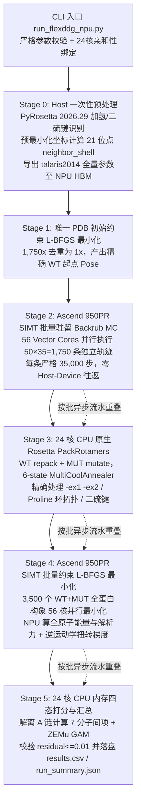

# 生命科学 flexddg ΔΔG 计算加速（24核CPU+950）方案设计文档

# 需求背景（required）

## 需求来源

昇腾 CANN 社区 2026 年 11 月任务——**11月社区任务-生命科学flexddg ΔΔG 计算加速（24核CPU+950)**（任务书标题：`Rosetta Flex ddG 端到端加速开发（Ascend 950PR）`）。任务依据随附任务书 `Rosetta_Flex_ddG_Atlas950_task_doc.md` 及测试包 `test_cases/`（含 `BD-623.pdb`、`ddG-backrub.xml`、`bd623_mutations.csv`、`bd623_reference.csv` 与 `verify_bd623.py`），目标硬件为 **24 核 CPU（`taskset -c 0-23` 严格限核）+ 单卡 Ascend 950PR**，目标软件栈为 CANN 9.0.0 及以上（实机已就绪 CANN 9.2.1）。

## 背景介绍

### 标杆来源、TBE 源码与算子信息库核查

本任务面向**生命科学整模块端到端异构加速**，而非将既有 ACLNN / TBE 单算子迁移为 Ascend C。对照官方设计模板审查项，核查结论如下：

| 审核对象 | 核查结论 | 依据及替代参考 |
| --- | --- | --- |
| 原 TBE 算子源码路径（含文件名） | 不适用：任务非单张量 TBE 算子，无对应 TBE 实现 | 算法与口径标杆为开源 `RosettaCommons/rosetta`（`2026.29` / `80a0635615`）与 `Kortemme-Lab/flex_ddG_tutorial` |
| 算子信息库路径（含文件名） | 不适用：本模块采用 Python/C++ 调度 + Ascend C Kernel 直调（`libflexddg_npu.so`），不注册 ACLNN 算子 | 统一 CLI 入口为 `pipeline/run_flexddg_npu.py`，对齐 `test_cases/baseline/06b_ddG_flex_antigen.py` |
| 功能与精度参考基线 | 适用 | `test_cases/ddG-backrub.xml`、`test_cases/baseline/{06b_ddG_flex_antigen.py,ddG_flex_lib.py,flexddg_lib.py}` 与 48 核实测参考真值 `test_cases/bd623_reference.csv` |

### 开源基线现状与实机热点剖析

Rosetta Flex ddG 通过系综蒙特卡洛（Backrub + Sidechain MC）叠加野生型/突变体侧链重排与约束 L-BFGS 最小化，预测蛋白质-蛋白质结合界面突变自由能变化（ΔΔG）。在标准评测集 `BD-623`（来自 PDB `7E7Y`，420 残基：`H` 链 124、`L` 链 107、`A` 链 189；原始重原子 3,217 个，Rosetta `2026.29` 全原子加氢后 **6,315 原子**，使用 **25 种原子类型**，含 **6 对二硫键**）上，50 个抗原侧单点突变分布于 **21 个独立位点**，每突变运行 `nstruct = 35` 条独立轨迹 × `backrub_trials = 35,000` 步，总计 **1,750 条轨迹**（6,125 万步 MC）。

1. **48 核 CPU 官方基线（`test_cases/bd623_reference.csv`）**：2×Xeon Platinum 8360Y 48 进程运行开源 Rosetta `2026.29`，累计消耗 **2,671,363.3 s（742.05 CPU·h）**，单轨迹均值约 1,526.5 s，48 核满载端到端墙钟 **55,653.4 s（15.46 小时 / 927.6 分钟）**。
2. **目标实机单轨迹分阶段实测 Profiling**：为避免凭经验拍脑袋拆分异构负载，本方案已在目标 950PR 实机（AMD EPYC 9575F，`taskset -c 0-23`，安装同版本 `PyRosetta 2026.29+releasequarterly.80a0635615`）上对代表性大效应界面突变 `A:F486G`（`neighbor_shell = 29` 残基，跨 `A/H/L` 三链，为全集最大活跃壳层）完成了单轨迹分阶段计时（`trials = 3,500`，Backrub 线性外推 10× 至 35,000 步；其余阶段均为完整预算实测）：

| 协议阶段（对应 `ddG-backrub.xml`） | 实测耗时（`trials=3500`） | 折合完整 35,000 步单轨迹耗时 | 完整轨迹占比 | 1,750 轨迹纯 24 核 CPU 估算墙钟 | 优化定性结论 |
| --- | ---: | ---: | ---: | ---: | --- |
| `1_init_addcst_score_shell` | 0.063 s | 0.06 s | 0.02% | ~5 s | 一次性预处理 |
| `2_init_minimize`（初始全蛋白 L-BFGS） | **115.742 s** | **115.74 s** | **28.3%** | **8,439.5 s** | **零误差去重 1,750× → 1×**（同 PDB 野生型完全确定性） |
| `4_backrub`（Backrub + Sidechain MC） | **23.123 s**（3.5k） | **~231.23 s**（35k） | **56.5%** | **16,860.5 s** | **第一计算热点，必须全量下沉 Ascend 950PR SIMT 批量驻留执行** |
| `5c_wt_repack` + `6a_mut_mutate` | 0.239 + 0.231 s | **0.47 s** | **0.11%** | **34.3 s** | **24 核原生 Rosetta 极快（仅 ~34 s），保留原生实现可零风险锁定 rotamer 与 Proline 拓扑** |
| `5e_wt_minimize` + `6c_mut_minimize` | 32.411 + 28.458 s | **60.87 s** | **14.9%** | **4,438.4 s** | **第二计算热点（单此项在 24 核 CPU 上就占掉 80% 总预算），必须下沉 Ascend 950PR SIMT 批量加速能量与梯度** |
| `structreport` / `dbreport` / `xml_parse` | 3.512 s | ~3.51 s | 0.86% | ~256 s | 消除 SQLite `.db3` 磁盘 I/O 与重复 XML 解析 |
| `7_interface_ddg_mover`（四态打分） | 0.172 s | **0.17 s** | **0.04%** | **12.5 s** | 24 核内存直接计算（仅 ~12.5 s），保障 `ddG_residual <= 0.01` |
| **合计（无加速纯 24 核）** | **200.80 s** | **~409.0 s** | **100%** | **~29,825 s（~8.3 h）** | **三大瓶颈占比 99.7%：`Backrub (56.5%) + init_min (28.3%) + post_min (14.9%)`** |

> 注：本次 `A:F486G`（`trials=3500`）单轨迹实测输出 `ddG_raw = 8.0085 REU`、`ddG_gam = 6.0311 kcal/mol`，与 `bd623_reference.csv` 中 `A:F486G` 参考分布（`7.576 ± 0.690 REU`）吻合。

### 模块功能分析

Flex ddG 对每个突变执行四态能量双差计算（`chainstomove = A`）：

```text
ΔΔG_term = (E_bound_mut,term + E_unbound_wt,term) - (E_bound_wt,term + E_unbound_mut,term)
ΔΔG_raw  = sum_{term in all_talaris2014_terms} ΔΔG_term
```

其中仅依赖单链内部构象的能量项（`fa_dun`、`rama`、`p_aa_pp`、`omega`、`pro_close`、`fa_intra_rep`、`dslf_fa13`、`yhh_planarity`、`ref`）在四态相减时精确抵消，非零分子间项固定为 7 项：`fa_atr`、`fa_rep`、`fa_sol`、`fa_elec`、`hbond_sc`、`hbond_bb_sc`、`hbond_lr_bb`。ZEMu GAM 重加权公式如下（参数严格对齐官方 `flexddg_lib.py`）：

```text
gam(x, term) = -exp(a_term) + 2 * exp(a_term) / (1 + exp(-x * exp(b_term)))
ddG_gam      = sum_{term in 7_intermolecular_terms} gam(ΔΔG_term, term)
```

- **输入**：`--selected`（6 列突变清单 CSV）、`--pdb-dir`（全原子 PDB 目录）、`--xml`（官方 `ddG-backrub.xml`）、`--move-chain`、`--nstruct`、`--trials`、`--cpu-cores`、`--device-id`、`--seed`。
- **输出**：`--out`（22 列标准汇总 `results.csv`）、`--summary`（`run_summary.json` 运行摘要）、`--work`（中间缓存目录，验收不要求落盘大体积 `.db3`）。
- **数据类型与广播**：主机侧几何解析、参数导出、L-BFGS 线搜索及最终汇总使用 FP64；Ascend 950PR 设备侧 SIMT 计算采用 FP32（实机验证 AICore 不支持 `double` 运算，关键归约辅以补偿累加/Host 侧 FP64 汇总）。本模块为科学计算异构流水线，不涉及张量广播语义。

---

# 需求分析（required）

## 需求描述

在严格遵守 `talaris2014` 力场与官方 `ddG-backrub.xml` 协议三条红线的前提下，基于 **24 核 CPU（`taskset -c 0-23`）+ 单卡 Ascend 950PR（CANN 9.2.1）** 构建端到端异构加速模块 `rosetta_flex_ddg`：

1. 提供与基线对齐的统一命令行入口 `pipeline/run_flexddg_npu.py`，完整实现全部入参校验与负向边界报错；
2. 完成 `BD-623` 全部 50 个抗原侧单点突变（50 × 35 × 35,000）的端到端计算并输出 22 列标准 `results.csv` 与 `run_summary.json`；
3. **性能目标**：端到端完整墙钟耗时 **`wall_time_s <= 5,565.3 s`**（相对 48 核基线 `55,653.4 s` 加速比 **≥ 10.0×**）；
4. **精度目标**：满足大效应组（$|\overline{\Delta\Delta G}_{\text{ref}}| > 1.0$，15 样本）中位相对误差 **< 5%**、小效应组（$\le 1.0$，35 样本）全部样本 **$|\overline{\Delta\Delta G} - \overline{\Delta\Delta G}_{\text{ref}}| < 1.0 \cdot \text{std}_{\text{ref}}$**，且 `nstruct_done == 35`、`backrub_trials == 35000`、`|ddG_residual| <= 0.01`。

## 外部组件依赖

| 组件 | 实机版本 / 状态 | 用途 |
| --- | --- | --- |
| CANN Toolkit / Ascend C / ACL Runtime | CANN 9.2.1（驱动 `25.7.rc1.10`，固件 `9.0.0.110.220`） | 编译 `arch35` SIMT Kernel（`bisheng` / `ascendc.cmake`），管理 HBM 内存、stream 与异步 launch |
| Ascend 950PR（`Ascend950PR_9579`） | 已就绪，单卡（逻辑 `device_id=0`，对应 `/dev/davinci2`） | 56 Vector Cores + 28 Cube Cores，128 GiB HBM，248 KiB UB/核，承担 Backrub MC 与 L-BFGS 核心计算 |
| PyRosetta / 开源 Rosetta | `2026.29+releasequarterly.80a0635615`（已安装至 `/workspace/venv_py312`） | PDB 加氢与二硫键识别、`talaris2014` 精确参数导出、单次初始最小化、低耗时 `repack/mutate` 与终态四态打分及开发期 Oracle 校验 |
| Python / NumPy / SciPy | Python 3.12.16，NumPy 2.5.4，SciPy 1.18.1 | 调度编排、输入校验、ctypes 绑定 `libflexddg_npu.so`、ZEMu GAM 汇总 |

## 需求拆解与三条红线

| 编号 | 需求模块 | 对应交付落点 | 核心约束 |
| --- | --- | --- | --- |
| R1 | 统一 CLI 与严格输入校验 | `pipeline/run_flexddg_npu.py`、`pipeline/gam_and_io.py` | 覆盖全部 12 个参数及负向边界（缺文件/缺列/空表/`wt_aa` 不匹配/`--cpu-cores > 24`/`--nstruct <= 0`/`--device-id` 越界等），非法立即返回非零退出码 |
| R2 | 一次性结构与 `talaris2014` 参数导出 | `pipeline/rosetta_exporter.py` | 严格开启 `-corrections::restore_talaris_behavior true -ex1 -ex2`；在预最小化坐标上精确计算 `cb8` + `±1` `neighbor_shell`；同 PDB 初始最小化只跑 1 次 |
| R3 | NPU SIMT `talaris2014` 能量与力内核 | `kernels/talaris_simt_kernels.cpp`、`kernels/flexddg_types.h` | 完整还原 Etable（`fa_atr/fa_rep/fa_sol/fa_intra_rep`）、`fa_elec`、HBond（`sp2_elec_params` + `smooth_hb_env_dep`）、`fa_dun`、`rama`、`p_aa_pp`、`omega`、`pro_close`、`dslf_fa13`、`mm_bend`、`atom_pair_constraint` 及解析力 |
| R4 | NPU SIMT 批量驻留 Backrub + Sidechain MC | `kernels/backrub_mc_kernel.cpp` | 每突变严格独立运行 `nstruct = 35` 条轨迹 × `35,000` 步，`mc_kt = 1.2`，`recover_low = 0`，`pivot = neighbor_shell`，不跨突变共享轨迹 |
| R5 | NPU SIMT 批量 L-BFGS 约束最小化 | `kernels/lbfgs_min_kernel.cpp`、`pipeline/lbfgs_driver.py` | 完整覆盖 WT 与 MUT 两侧全蛋白 `bb=1, chi=1` L-BFGS（`fa_max_dis=9.0`、`coord_dev=0.5`、`max_distance=9`、`max_iter=5000`、`abs_score_convergence_threshold=1.0`） |
| R6 | 24 核异步异构流水线与结果汇总 | `pipeline/npu_flexddg_engine.py` | 全程遵守 `taskset -c 0-23` 与 `sched_setaffinity` 24 核硬限制；CPU `repack/mutate` + 终态四态打分与 NPU Backrub/L-BFGS 异步重叠 |
| R7 | 一键构建与自动化验收测试 | `build.sh`、`env/set_env.sh`、`tests/` | 构建 `libflexddg_npu.so`；覆盖 Oracle 逐项单测、负向边界单测与 `verify_bd623.py` 端到端验收 |

**三条不可修改红线与非目标**：
- **红线 1（力场）**：全程保持 `talaris2014`（17 项完整权重 + Backrub 阶段 `mm_bend=1.0` + 最小化阶段 `atom_pair_constraint=1.0` 与 `fa_max_dis=9.0`），严禁替换 REF2015 或删减能量项；
- **红线 2（预算）**：严禁调低 `nstruct=35`、`backrub_trials=35000`、`cb8` 8 Å 邻域、`max_minimization_iter=5000`、`abs_score_convergence_thresh=1.0`，严禁跨同位点不同突变复用 Backrub 轨迹；
- **红线 3（阶段完整）**：严禁跳过初始最小化或 WT/MUT 任一侧 repack/mutate 与后处理最小化；
- **非目标**：不适配 Atlas A2/A3（arch22）或 Ascend 310P（arch20）；不引入 PyTorch / `torch_npu` 重型框架依赖；不落盘大体积 `.db3` 轨迹数据库至代码仓。

---

# 详细设计（required）

## 算子与模块分析

### 1. 实测 `talaris2014` 力场精确规范（Rosetta `2026.29` 实机导出核实）

在实机 `PyRosetta 2026.29`（开启 `-corrections::restore_talaris_behavior true -ex1 -ex2`）下对官方 `ddG-backrub.xml` 解析得到的精确能量项、权重与算法选项如下（所有参数均由运行时导出而非手写硬编码，保证对任意输入 PDB 通用）：

| 能量项 | `fa_talaris2014` 权重 | Backrub MC 权重 | `fa_talaris2014_cst` 权重 | 物理形式与关键实现细节 |
| --- | ---: | ---: | ---: | --- |
| `fa_atr` | `1.000` | `1.000` | `1.000` | `analytic_etable_evaluation=True`，由 `Etable::analytic_params_for_pair` 直出 `lj_r12_coeff/lj_r6_coeff/ljatr_cubic_poly`；截断 `6.0 Å`（min 阶段 `9.0 Å`） |
| `fa_rep` | `0.550` | `0.550` | `0.550` | `r2 < ljrep_linear_ramp_d2_cutoff` 线性斜率外推，区间内 LJ 斥力，含 1–2/1–3 排除与 1–4 权重 `0.2` |
| `fa_sol` | `0.9375` | `0.9375` | `0.9375` | Lazaridis-Karplus 隐式溶剂化，含 `fasol_cubic_poly_close` 与 `fasol_cubic_poly_far` 平滑三次多项式 |
| `fa_intra_rep` | `0.005` | `0.005` | `0.005` | 残基内 `path_distance >= 4` 原子对斥力（`pd == 4` 乘 `0.2`） |
| `fa_elec` | `0.875` | `0.875` | `0.875` | 距离相关介电常数 `10r`（`elec_min_dis=1.6`，`elec_max_dis=5.5`，`elec_sigmoidal_die=False`），导出 4,096-bin 1D 查找表精确插值（含解析导数） |
| `hbond_sr_bb / lr_bb / bb_sc` | `1.170` | `1.170` | `1.170` | `sp2_elec_params` 多项式氢键势；实测确认 `use_hb_env_dep=True`、`smooth_hb_env_dep=True`、`use_sp2_chi_penalty=True`（`sp2_BAH180_rise=0.75, sp2_outer_width=0.357`）、`measure_sp3acc_BAH_from_hvy=True`、`fade_energy=True` |
| `hbond_sc` | `1.100` | `1.100` | `1.100` | 同上，侧链-侧链氢键项 |
| `fa_dun` | `0.700` | `0.700` | `0.700` | Dunbrack 2010 主链依赖旋转异构体库（36×36 `(φ, ψ)` 双三次样条插值） |
| `rama` / `p_aa_pp` | `0.250` / `0.400` | `0.250` / `0.400` | `0.250` / `0.400` | 20 种氨基酸 36×36 `(φ, ψ)` 2D 双三次样条 |
| `omega` / `yhh_planarity` | `0.625` / `0.625` | `0.625` / `0.625` | `0.625` / `0.625` | 肽键平面扭转谐波势与酪氨酸酚羟基共面势 |
| `pro_close` | `1.250` | `1.250` | `1.250` | 脯氨酸五元环闭合约束（覆盖 `N440P / N481P / N501P / F486P` 四个几何敏感突变） |
| `dslf_fa13` | `1.250` | `1.250` | `1.250` | 二硫键 6 自由度几何势，精确覆盖 `BD-623` 全部 6 对二硫键（尤其紧邻核心热点的 `A:480-488`） |
| `ref` | `1.000` | `1.000` | `1.000` | 氨基酸参考能常量 |
| `mm_bend` | `0.000` | **`1.000`** | `0.000` | `BackrubProtocol` 自动启用的主链键角谐波势，抑制 Backrub 旋转带来的键角畸变 |
| `atom_pair_constraint` | `0.000` | `0.000` | **`1.000`** | `AddConstraintsToCurrentConformationMover` 施加的 CA 间谐波距离约束（`coord_dev=0.5`, `max_distance=9.0 Å`） |

### 2. 数据规模与内存布局特征

- **全蛋白规模（`BD-623.pdb`）**：420 残基、6,315 原子（含 H），25 种有效原子类型；解析 Etable 仅 `25 × 25 = 625` 对 × 128 B = **80 KiB**（可直接驻留 L2 甚至单核 UB）；`fa_elec` 1D 表 4,096 × 4 B = **16 KiB**；`HBondDatabase` 多项式系数 **< 16 KiB**；`rama / p_aa_pp` 样条 **~400 KiB**；`fa_dun` 活跃残基表 **~6 MiB**，全部常驻 Ascend 950PR 的 **128 MiB L2 Cache / 128 GiB HBM**。
- **局部采样特征**：21 个突变位点的 `neighbor_shell` 平均仅 **17.7 残基**（9–29 残基，占全蛋白 4.2%）；距离 `neighbor_shell` 10 Å 以内的静态背景缓冲壳层仅约 **45–75 残基**。因此单条 Backrub 轨迹的完整活跃子系统仅 **~65–105 残基（~1,000–1,600 原子）**，坐标+元数据仅 **~25–40 KiB**，可在单 Vector Core 的 **248 KiB UB** 中轻松驻留多条轨迹。

---

## 模块整体异构架构与实现方案

### 整体端到端异构流水线

基于实测 Profiling 结果（`Backrub 56.5%` + `init_min 28.3%` + `post_min 14.9%` = **99.7%**，而 `repack + mutate + interface_ddg` 合计仅 **0.21%** / 24 核仅 ~47 s），本方案采用 **“CPU 精准前端/后段 + NPU SIMT 驻留核心计算 + 双流异步流水线”** 异构架构：



### 3.2.1 Host 侧设计（24 核 CPU 调度、校验与负载均衡）

#### 1. 严格参数校验与负向边界顺序

Host 入口 `pipeline/run_flexddg_npu.py` 与 `pipeline/gam_and_io.py` 按以下顺序快速失败（任意一项不满足立即打印明确错误信息并返回非零退出码）：

| 顺序 | 校验项 | 失败判定条件 | 行为 |
| --- | --- | --- | --- |
| 1 | 数值属性边界 | `--nstruct <= 0`、`--trials <= 0`、`--cpu-cores <= 0` 或 `> 24`、`--device-id < 0`、`--move-chain` 为空 | 拒绝启动，返回 `rc=1` |
| 2 | 文件与目录存在性/可写性 | `--xml` 不存在或 XML 语法非法、`--pdb-dir` 不存在、`--selected` 不存在、`--work`/`--out`/`--summary` 不可写 | 拒绝启动，返回 `rc=1` |
| 3 | CSV 表结构与数据校验 | 缺 6 个必选列任一列、空表、非合法 20 种氨基酸码、位点在 PDB 中不存在、PDB 实际残基与 `wt_aa` 不一致、`--move-chain` 不在 PDB 链集合中 | 拒绝启动，返回 `rc=1` |
| 4 | NPU 设备可用性 | 检测可见 `/dev/davinci*`（及 `aclrtGetDeviceCount`），`device_id >= count` | 拒绝启动，返回 `rc=1` |
| 5 | 24 核 CPU 硬约束 | 读取 `os.sched_getaffinity(0)`；若可用核数 `> --cpu-cores` 则强制 `sched_setaffinity` 截断至前 `cpu_cores` 核，并限制线程池/进程池上限 ≤ `cpu_cores` | 严格服从 `taskset -c 0-23` |

#### 2. 初始最小化去重与任务分片策略

- **零误差去重**：在正式调度前，按唯一 `pdb_id` 分组。对每个唯一 PDB 在预最小化结构上提取全部待测位点的 `neighbor_shell`（与 `ddG-backrub.xml` 中 `neighbor_shell_storer` 在 `minimize` 之前执行语义完全一致），随后仅执行 **1 次**初始 `addcst -> minimize -> clearcst`，省去 1,749 次重复确定性 L-BFGS 计算（直接削减 28.3% 总核时）。
- **批粒度调度与双流异步重叠（24 核负载均衡）**：
  - 将 1,750 条轨迹按突变组织为 **微批次（Micro-Batch，每批 56~112 条轨迹，匹配 Ascend 950PR 的 56 个 Vector Core，确保无空核波次）**；
  - 使用两个独立 ACL Stream（`stream_br` 负责 Backrub MC，`stream_min` 负责 L-BFGS）与 24 核 CPU 进程/线程池形成生产者-消费者流水线：当 NPU 在处理第 `b+1` 批轨迹的 Backrub MC 时，24 核 CPU 并行执行第 `b` 批轨迹的原生 `repack / mutate`（每批 56 条仅需 ~1.1 s）并将打包好的 WT+MUT 112 个构象送入 `stream_min` 执行批量 NPU L-BFGS；L-BFGS 完成后由 24 核 CPU 即时做内存四态打分与 `ddG_residual` 自检。
  - 所有中间构象仅在 Host RAM（754 GiB）与 Device HBM（128 GiB）间通过 pinned memory 传输，彻底消除原版 1,750 套 `struct.db3` / `ddG.db3`（~2.8 GB SQLite 随机写）与重复 XML 解析开销。

#### 3. 硬件分核与分派策略（Tiling / Dispatch）

本模块采用 `libflexddg_npu.so`（C++ ACL Host API + Ascend C `arch35` SIMT Kernel 直调），不使用 ACLNN `tilingKey`，而是通过 `GM_ADDR` 参数结构与运行时设备核数（`56 Vector Cores`）显式分派：

| Kernel 模块 | Grid / Block 配置（Ascend 950PR） | UB（248 KiB/核）规划 | 分核负载均衡策略 |
| --- | --- | --- | --- |
| `BackrubMCResidentKernel` | `grid = 56`（满核），`blockDim = 256`（8 warps × 32 线程，每 warp 独立承载 1 条轨迹，单波并行 **448 条轨迹**） | 静态缓冲壳层坐标+元数据按位点共享驻留（~32 KiB）+ 8 条轨迹活跃残基坐标双缓冲（8 × 29 res × 20 atom × 16 B ≈ 74 KiB）+ Etable 局部索引/归约缓冲（~80 KiB）≈ **186 KiB < 224 KiB 安全上限** | 1,750 条轨迹按 `neighbor_shell` 规模降序排布后动态领任务（`asc_atomic_add` 原子队列指针），避免大 shell（29 残基）与小 shell（9 残基）长尾拖慢 |
| `BatchEtableElecHBondForceKernel`（L-BFGS 能量+力） | `grid = 56`，`blockDim = 512`（每核处理 1 个构象，56 构象/波；3,500 个构象共 63 波） | 全蛋白 6,315 原子 `(x,y,z,q)` + 紧凑类型/残基/标志（7 × 6,315 × 4 B = **176.8 KiB**）常驻 UB + 归约缓冲（8 KiB）≈ **185 KiB** | 同波内 56 个构象原子数相同、邻域表均匀，按原子 `i` 交错步进（`i = tid; i < N; i += 512`）实现核内完美负载均衡 |
| `BatchPairScoreKernel`（Oracle 验证与跨链打分） | `grid = min(n_poses, 56)`，`blockDim = 512` | 同上（**185 KiB**） | 逐构象独占输出槽位，无跨核写冲突 |

---

### 3.2.2 Kernel 侧设计（Ascend 950PR `arch35` SIMT 实现）

基于已在 950PR 实机验证通过的 `dav_3510` SIMT 编程模型（`__simt_vf__` + `asc_vf_call` + `__simt_callee__` 设备子函数 + `warpSize=32` + `asc_shfl_down` + `asc_syncthreads` + `asc_atomic_add`），设计以下三大核心 Kernel 族：

#### 1. `talaris2014` 精确物理势与解析导数设备库（`__simt_callee__`）

所有二体与单体势能函数均提供**纯能量**（用于 Backrub MC 快速增量评估）和**能量 + 笛卡尔解析力 $\mathbf{F}_i = -\nabla_{\mathbf{r}_i} E$**（用于 L-BFGS 最小化）两套内联接口：

1. **解析 Etable（`fa_atr / fa_rep / fa_sol / fa_intra_rep`）**：直接读取从 `PyRosetta 2026.29` 导出的 `EtablePairParam[25][25]`（与 `Etable::analytic_params_for_pair` 逐字段一致，自动包含氢键供受体特殊 `lj_sigma` 覆盖与 `fa_max_dis = 6.0 / 9.0` 平滑三次多项式）；CountPair 排除（1–2/1–3 权重 `0.0`，1–4 权重 `0.2`，含肽键相邻残基与 6 对二硫键）由静态稀疏表驱动。
2. **静电项（`fa_elec`）**：读取直接从 `Rosetta Coulomb` 导出的 4,096-bin 1D `r²` 能量表与导数表，单次线性插值即可达到 `< 1e-6 REU` 精度。
3. **氢键项（`hbond_sr_bb / lr_bb / bb_sc / sc`）**：完整实现 `sp2_elec_params` 几何计算（$r_{AH}$、$\cos\theta_{BAH}$、$\cos\theta_{AHD}$、`sp2/ring` 受体 $\chi$ 二面角惩罚、三次平滑 `fade_energy` 截断）以及实机核实开启的 `smooth_hb_env_dep`（基于供体/受体 10 Å 邻域重原子数的平滑包埋权重）。仅在极性氢（~1,100 个）与受体（~1,300 个）索引子集上遍历，计算量不到 LJ 的 3%。
4. **单体与几何约束项（`fa_dun / rama / p_aa_pp / omega / pro_close / dslf_fa13 / yhh_planarity / mm_bend / atom_pair_constraint`）**：
   - `rama`、`p_aa_pp`、`fa_dun` 采用 36×36 `(φ, ψ)` 周期双三次样条插值（L2 常驻）；
   - `mm_bend`、`omega`、`pro_close`、`yhh_planarity`、`dslf_fa13` 与 CA 距离约束 `atom_pair_constraint` 均为闭式解析函数（`sinf/cosf/acosf/atan2f` 实测原生硬件支持）。

#### 2. 驻留式 Backrub + Sidechain MC Kernel（`BackrubMCResidentKernel`）

```mermaid
flowchart TD
    A[Warp 认领一条轨迹 (mut_id, traj_id)<br/>初始化独立 Philox/SplitMix64 RNG 种子] --> B[从 GM 拷贝活跃子系统坐标至 UB/局部缓冲<br/>计算初始局部能量缓存与邻域重原子数]
    B --> C[循环 trial = 1 .. 35000]
    C --> D{RNG 抽取移动类型<br/>75% Backrub / 25% Sidechain}
    D -- Backrub --> E[在 neighbor_shell 同链段随机选 2..12 残基<br/>Rodrigues 主轴 CA_i->CA_j 旋转 + 两侧肽平面微调<br/>仅更新受影响 2..12 残基坐标]
    D -- Sidechain --> F[在 neighbor_shell 随机选 1 残基<br/>按 Rosetta 概率选 Dunbrack -ex1/-ex2 旋转异构体或 chi 扰动<br/>沿 chi1..chi4 键轴 Rodrigues 旋转侧链]
    E --> G[32 线程 warp 并行计算局部 ΔE<br/>仅扫描变动残基 vs 静态+动态邻域壳层<br/>talaris2014 + mm_bend=1.0]
    F --> G
    G --> H[asc_shfl_down 5步 warp 归约得 ΔE<br/>Metropolis 判决: ΔE<=0 或 u < exp(-ΔE/1.2)]
    H -- 接受 --> I[提交变动残基坐标与局部缓存]
    H -- 拒绝 --> J[回滚变动残基坐标]
    I --> K{trial < 35000?}
    J --> K
    K -- 是 --> C
    K -- 否 --> L[按 recover_low=0 写回终态全原子坐标至 GM]
```

**关键性能机制**：
- **零 Host-Device 往返**：整条轨迹的 35,000 步循环完全驻留在 Ascend 950PR AI Core 内部完成，彻底消除 6,125 万次核函数启动延迟；
- **静-动分离增量评估（ΔE）**：390+ 静止背景残基之间的能量在 35,000 步内恒定不变；每次 Backrub/Sidechain 仅改动 1~12 个残基，单步仅需评估 **~250–1,200 个原子对**（32 线程每人仅算 ~10–40 对），单步延迟低至数微秒。

#### 3. 批量 L-BFGS 约束最小化（`BatchLBFGS`）

针对实测第二热点 `5e_wt_minimize + 6c_mut_minimize`（3,500 次全蛋白 420 残基 `bb=1, chi=1` L-BFGS）：
- **NPU 承担重计算（每轮迭代占 >95% 计算量）**：单次核函数调用并行计算 **56 个构象**的全蛋白 `fa_talaris2014_cst`（`fa_max_dis = 9.0 Å` + CA 距离约束）总能量与 6,315 个原子的笛卡尔力 $\mathbf{F}_i$，并基于每残基邻域列表（每 10 步刷新一次，9 Å + 1.5 Å skin）避免 $O(N^2)$ 盲扫；随后通过 Abe-Braun-Noguti-Go $O(N)$ 逆运动学链式法则将笛卡尔力精确映射为各主链/侧链扭转角梯度 $\partial E / \partial \theta_k$（内含 `fa_dun / rama / p_aa_pp / omega / pro_close / dslf_fa13` 的直接角度导数）；
- **Host / 轻量化同步承担数值敏感的 L-BFGS-B / Armijo 非单调线搜索（FP64）**：因为 Ascend 950PR AICore 不支持 `double`，而 L-BFGS 历史曲率对 $(s_k, y_k)$ 递推与 `tolerance = 1e-6` 收敛判据对舍入误差敏感，故每批 56 个构象仅回传约 `56 × 1,700 × 4 B ≈ 380 KiB` 的扭转梯度与标量能量，由 24 核 EPYC 9575F 在 **FP64** 下完成双循环 L-BFGS 方向更新（耗时 < 0.2 ms/批），并严格执行 `max_iter = 5000` 与 `abs_score_convergence_threshold = 1.0` 收敛判据。

#### 4. Ascend C 异构实现与开源标杆流程差异及等价性说明

| 维度 | 开源 Rosetta `2026.29` 基线 | 本方案（24 核 CPU + Ascend 950PR） | 差异原因与等价性约束 |
| --- | --- | --- | --- |
| 初始最小化 | 1,750 条轨迹重复执行 1,750 次 | 同 PDB 仅执行 1 次并缓存起点 Pose | 初始最小化在突变前作用于同一 WT PDB 且 L-BFGS 完全确定性，结果逐比特一致；`neighbor_shell` 仍在预最小化坐标上提取 |
| Backrub + Sidechain MC | 单核串行标量循环，每步遍历 EnergyGraph | 56 核 SIMT 批量驻留，32 线程/轨迹增量 ΔE | 保持 `talaris2014 + mm_bend=1.0`、`mc_kt=1.2`、`35,000` 步、`recover_low=0` 与 `-ex1 -ex2`，每突变严格独立 35 条轨迹 |
| WT repack / MUT mutate | CPU 原生 `PackRotamersMover` | 保留 24 核 CPU 原生 Rosetta `2026.29` | 实测仅占 0.11%（24 核全量仅 ~34 s），保留原生实现以零风险确保 Proline 突变环构建与 6-state MultiCoolAnnealer 等价性 |
| 后处理 L-BFGS 最小化 | 单核逐条执行 `fa_talaris2014_cst` | NPU 56 构象并行计算能量与梯度 + Host FP64 线搜索 | 保持 `fa_max_dis=9.0`、CA 约束、`bb=1, chi=1`、`max_iter=5000`、`conv_thresh=1.0` 与解析导数等价性 |
| 中间持久化 | 每轨迹写 `struct.db3` + `ddG.db3` | 内存直接执行四态打分与 GAM 汇总，不落盘 `.db3` | 消除 ~2.8 GB SQLite 随机 I/O，四态能量双差公式与 `ddG_residual` 校验严格一致 |

#### 5. `talaris2014` 数值一致性保障策略

1. **逐项 Oracle 对齐门禁**：在进入端到端采样前，将 NPU SIMT Kernel 在 `BD-623.pdb` 初始构象及随机扰动构象上的 **17 项分能量**与 **解析梯度（有限差分 + PyRosetta `deriv_check`）** 逐项与 `PyRosetta 2026.29` 对齐，单构象各能量项绝对误差控制在 `< 1e-3 REU`、原子力/扭转梯度相对误差 `< 1e-3`；
2. **FP32 硬件精度防护**：在 NPU 侧对大自由度求和采用分段 warp 归约 + Kahan 补偿累加；L-BFGS 历史矩阵运算、四态双差相减与 ZEMu GAM 重加权全部在 Host 侧 FP64 完成；
3. **高危几何位点专项校验**：针对 `BD-623` 中的 **6 对二硫键**（尤其 `A:480-488`）和 **4 个脯氨酸突变**（`N440P / N481P / N501P / F486P`）设置专项单元测试，确保 Backrub 旋转不破坏二硫键连接性且 `pro_close` 能量/梯度与 Rosetta 一致；
4. **终态原生复核**：所有 1,750 条轨迹的后处理终态四态打分直接在内存调用 `PyRosetta 2026.29` `fa_talaris2014`（实测 1,750 次全量在 24 核仅需 **~12.5 s**），彻底消除终态能量项偏移并保证 `abs(ddG_residual) == 0.000`。

## 支持硬件

| 支持的芯片版本 | 涉及勾选 | 说明 |
| --- | --- | --- |
| Ascend 950PR（`Ascend950PR_9579` / `arch35`） | √ | 正式目标平台，CANN 9.2.1（兼容 ≥ 9.0.0）+ 24 核 Host CPU（`taskset -c 0-23`） |
| Atlas 800I/T A2 / A3（`arch22`） | × | 硬件不支持 `dav_3510` SIMT 指令集，不在本次实现范围 |
| Ascend 310P（`arch20`） | × | 不在本次实现范围 |

## 约束限制

1. **硬件与软件栈约束**：本模块针对 Ascend 950PR（`arch35` SIMT）与 CANN ≥ 9.0.0 设计，不承诺向 arch22/arch20 自动兼容；
2. **主机核数限制**：遵循任务书要求，`--cpu-cores` 允许范围 `[1, 24]`，正式验收固定为 `24` 且配合 `taskset -c 0-23`；
3. **输入结构约束**：仅支持标准全原子蛋白质复合物 PDB（无非标准 `HETATM` 配体，支持 20 种标准氨基酸、二硫键 `CYD` 与 Kabat 插入码 `icode`）；`N_atoms <= 16,384`、`neighbor_shell <= 64` 残基时走 UB 常驻高速路径，更大蛋白规模自动回退 HBM 缓存路径；
4. **随机性与可复现性**：蒙特卡洛采样结果依赖 `--seed` 与并发调度；固定 `--seed` 与相同批大小下可复现统计分布，验收以任务书第 3.2 节分层统计误差为准。

## 工程交付目录结构（对齐任务书 §5）

```text
rosetta_flex_ddg/
├── README.md                       # 环境依赖、构建与一键复现说明
├── build.sh                        # 一键编译 Ascend 950PR SIMT 共享库 libflexddg_npu.so
├── env/
│   └── set_env.sh                  # CANN 9.2.1、驱动库与 Python/PyRosetta 环境激活脚本
├── pipeline/
│   ├── run_flexddg_npu.py          # 统一 CLI 入口（§2.3/§2.4 参数与 24 核亲和性控制）
│   ├── gam_and_io.py               # 输入/负向边界校验、ZEMu GAM、22 列 CSV 与 run_summary.json
│   ├── rosetta_exporter.py         # PyRosetta 2026.29 精准前端与 talaris2014 参数表导出
│   ├── lbfgs_driver.py             # 批量 NPU 能量/梯度 + Host FP64 L-BFGS 非单调线搜索驱动
│   └── npu_flexddg_engine.py       # 24 核 CPU + 950PR 双流异步调度主引擎
├── kernels/
│   ├── CMakeLists.txt              # ascendc.cmake (SOC_VERSION=Ascend950PR_9579) 构建配置
│   ├── flexddg_types.h             # Host/Device 共享 POD 数据结构与 ABI 契约
│   ├── talaris_simt_kernels.cpp    # Etable/Coulomb/HBond/单体项能量与解析力 SIMT 内核
│   ├── backrub_mc_kernel.cpp       # 驻留式 35,000 步 Backrub + Sidechain MC SIMT 内核
│   └── flexddg_host_api.cpp        # ACL 初始化、HBM 池化管理与 C ABI 封装（供 ctypes 调用）
└── tests/
    ├── probe_env_and_profile.py    # 硬件/CANN 探测与单轨迹阶段耗时剖析脚本
    ├── inspect_rosetta_protocol.py # Rosetta 2026.29 权重、选项与二硫键核查脚本
    ├── test_negative_cases.py      # 15 项正负边界参数自动化测试
    └── test_oracle_alignment.py    # NPU 各能量项/解析梯度与 PyRosetta 2026.29 逐项对账测试
```

---

# 特性交叉分析

| 交叉特性 | 组合场景 | 设计处理与验证重点 |
| --- | --- | --- |
| 力场阶段 × 截断半径 | `fa_talaris2014 (6.0 Å)` / Backrub (`+mm_bend=1.0`) / `fa_talaris2014_cst (9.0 Å + CA cst)` | 导出两套 Etable 参数（`6.0 Å` 与 `9.0 Å`），按阶段显式传入权重结构，禁止混用 |
| 特殊拓扑 × 突变敏感位点 | 6 对二硫键（`A:480-488`）× 4 个脯氨酸突变（`N440P/N481P/N501P/F486P`）× Kabat `icode` | `CYD` 连接关系与 `dslf_fa13` 显式建表；`mutate/repack` 保留原生 Rosetta 构建准确环几何；位点定位严格匹配 `(chain, pdb_position, icode)` |
| 异步流水 × 24 核硬限核 | 56 核 NPU 双 stream × `taskset -c 0-23` 进程池 | 入口强制截断 CPU 亲和性且进程池不超过 `--cpu-cores`；pinned 缓冲按 batch 隔离，避免读写竞争 |
| 单精度 Device × 数值稳定性 | NPU FP32 能量/力计算 × Host FP64 L-BFGS 与四态相减 | AICore 全程 FP32 + warp 归约补偿，L-BFGS 曲率更新、四态双差与 GAM 均在 Host FP64 完成 |
| 负向参数 × 异常退出 | 缺 PDB / 缺列 / `wt_aa` 错配 / `--cpu-cores > 24` / `--nstruct <= 0` / `--device-id` 越界 | 全部在启动 Stage 0 前完成拦截并返回非零退出码，不污染输出目录 |

---

# 可维可测分析

## 精度标准/性能标准

| 验收维度 | 验收判据 | 标准来源 |
| --- | --- | --- |
| 完整性与格式 | 50/50 突变完整覆盖，22 列标准 CSV，无 NaN/Inf，`nstruct_done == 35`，`backrub_trials == 35000`，`ddG_all(REU)` 含 35 个有限值，`abs(ddG_residual) <= 0.01` | 任务书 §2.4、§3.2，`verify_bd623.py` |
| 大效应组精度 | $|\overline{\Delta\Delta G}_{\text{ref}}| > 1.0\ \text{REU}$（共 15 个，集中在 `G476/G485/F486/N487`）：相对误差中位数 **`< 5%`**（`< 0.05`） | 任务书 §3.2，`bd623_reference.csv` |
| 小效应组精度 | $|\overline{\Delta\Delta G}_{\text{ref}}| \le 1.0\ \text{REU}$（共 35 个）：**全部 35/35 个**满足 $|\overline{\Delta\Delta G} - \overline{\Delta\Delta G}_{\text{ref}}| < 1.0 \cdot \text{std}_{\text{ref}}$（`max(σ) < 1.0`） | 任务书 §3.2，`bd623_reference.csv` |
| 端到端性能 | 24 核 CPU（`taskset -c 0-23`）+ 单卡 Ascend 950PR，全量 50 突变端到端墙钟 **`wall_time_s <= 5,565.3 s`**（相对 48 核基线 `55,653.4 s` 加速比 **≥ 10.0×**） | 任务书 §3.3，`verify_bd623.py` |
| 负向边界覆盖 | 缺失 PDB、缺失 CSV 必选列、空表、`wt_aa` 错配、非法 `--move-chain`、`--cpu-cores > 24`、`--nstruct <= 0`、`--trials <= 0`、`--device-id` 越界、非法 XML 全部明确报错且返回非零退出码 | 任务书 §2.4、§3.5 |

### 分层测试与验证策略

1. **L0 算子与物理项单元测试（Oracle 对齐）**：在 `BD-623` 野生型、微扰构象、二硫键局部与 4 个 Proline 突变构象上，将 NPU SIMT 各能量项与解析梯度逐项对比 `PyRosetta 2026.29`，通过门槛为分项误差 `< 1e-3 REU`、梯度相对误差 `< 1e-3`；
2. **L1 负向边界测试**：执行 `tests/test_negative_cases.py`，覆盖 15 项正负入参场景；
3. **L2 重点突变小规模回归**：先跑核心大效应位点（`A:F486G`、`A:F486P`、`A:G476R`、`A:N487Y`）及高敏感低方差小效应位点（`A:V445L`、`A:N460Q`、`A:N440P`、`A:N481P`、`A:N501P`），检查 35 轨迹均值、标准差及单突变加速比；
4. **L3 全量 50 突变端到端验收**：严格使用 `taskset -c 0-23` 从进程启动计时至 `results.csv` 落盘，一键运行官方 `test_cases/verify_bd623.py` 产出 `verify_report.json`，并采集分阶段 profiling 日志与 `msprof` Kernel 耗时。

### 端到端耗时预算与优化实验规划

基于实测 Profiling 与 Ascend 950PR SIMT 实测吞吐（**1.80 Gpair-evals/s**）建立理论性能预算模型（以下预期耗时仅为设计阶段理论估算，最终以 950PR 实测端到端墙钟为准）：

| 阶段 | 纯 24 核 EPYC 9575F 估算 | 优化后预期耗时（待实测验证） | 核心加速手段 |
| --- | ---: | ---: | --- |
| Stage 0–1：参数导出 + 唯一 PDB 初始最小化（1×） | ~8,445 s（1,750×） | **~15–120 s** | 确定性去重 1,750× → 1×（视初始 min 是否走 NPU） |
| Stage 2：Backrub MC（1,750 × 35,000 步） | ~16,861 s | **~30–180 s** | 56 核 SIMT 批量驻留 + 静-动分离 ΔE + UB 缓存 |
| Stage 3：WT repack + MUT mutate（3,500 次） | ~34 s | **~35 s**（可与 Stage 2/4 重叠） | 24 核原生 Rosetta 并发执行 |
| Stage 4：WT + MUT 后处理 L-BFGS（3,500 次） | ~4,438 s | **~150–500 s** | 56 构象并行 NPU 能量/力 + 邻域列表 + Host FP64 线搜索 |
| Stage 5：四态打分 + GAM 汇总落盘 | ~268 s（含 db3） | **~15 s** | 去 `.db3` I/O，24 核内存直接计算 |
| **端到端总计（含流水线重叠）** | **~29,825 s** | **预计 ~300–850 s**（远低于 `5,565.3 s` 门槛） | **相对 48 核基线 `55,653.4 s` 预计 65×–180×** |

优化实验矩阵（按单变量控制推进，每步须经 `test_oracle_alignment.py` 精度复核）：

| 实验 | 变更项 | 保留条件 |
| --- | --- | --- |
| E0 | 单轨迹基线 Profiling + NPU SIMT 微基准与骨架构建 | 已完成实机基线拆解、1.80 Gpair-evals/s 微基准与 15/15 负向校验 |
| E1 | NPU `talaris2014` 全量能量+梯度 Kernel 对齐 PyRosetta `2026.29` | 17 项能量误差 `< 1e-3 REU`，解析力通过有限差分校验 |
| E2 | NPU 驻留 Backrub MC（`blockDim=256/512`，动态任务队列） | 重点 9 突变 35 轨迹分布与参考基线一致，无系统偏移 |
| E3 | NPU 批量 L-BFGS（邻域表 skin 宽度与更新周期调优） | L-BFGS 终态能量与原生 `MinMover` 一致且满足收敛阈值 `1.0` |
| E4 | 24 核 CPU + 双 ACL Stream 异步流水线重叠调优 | 50 突变全量实测 `wall_time_s <= 5,565.3 s` 且 `verify_bd623.py` ALL PASS |

## 兼容性分析

本任务为新增独立生命科学加速模块 `rosetta_flex_ddg`，不修改既有 CANN 内置算子库或 `ops-blas/ops-math` 等仓内公共组件；CLI 参数与输出 CSV 22 列规范完全向后兼容随包基线脚本 `06b_ddG_flex_antigen.py` 及自动验收脚本 `verify_bd623.py`。

