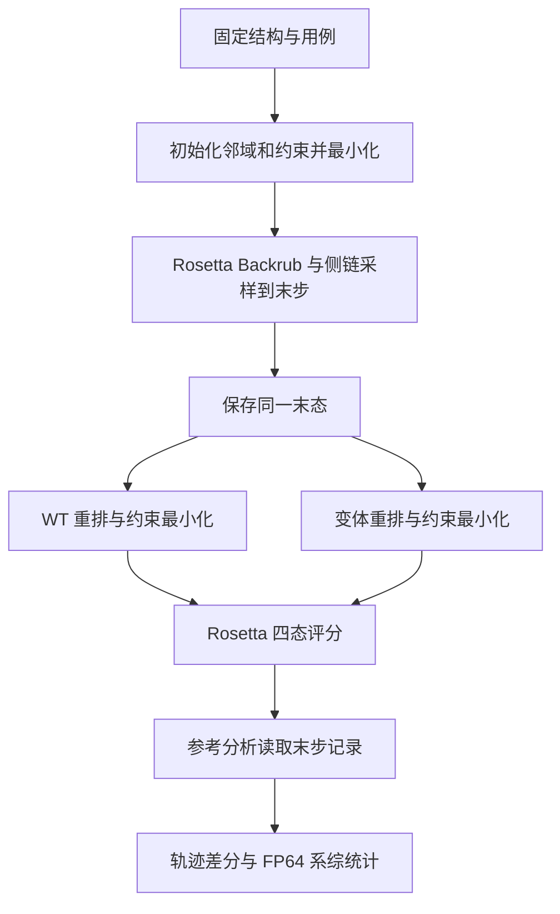
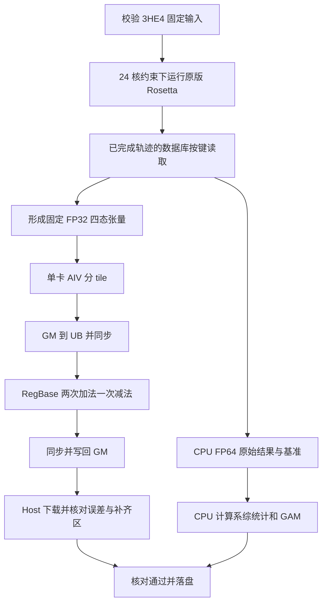

# Rosetta Flex ddG 端到端异构加速设计

2026-11-25 · dls / aufw · 3HE4 工程评审稿 · 24 核 CPU + 单卡 Ascend 950PR

## 一、需求背景

### 1.1 需求来源

本稿对应 11 月社区任务《生命科学 flexddg ΔΔG 计算加速（24 核 CPU + 950）》。工程评审范围为 Host 运行管理、Flex ddG 协议一致性、数值后处理、结果契约与验证。工程用例选用人工设计的 SYNZIP5:SYNZIP6 异二聚体，保留 Rosetta 的完整采样、重排、最小化和评分语义。工程目标是在同一台 24 核受限主机上减少调度、文件处理及归并开销，并单独测量 950PR 后处理的净收益。[社区任务页面](https://www.hiascend.com/activities/task-center/details/4373d1139dfe4ba7b448a8ef5cc3596b)

| 审查范围 | 数据与判据 | 当前状态 |
| --- | --- | --- |
| 设计评审 | 接口、资源约束、数值路径、失败语义和验证计划，见 §2–§5 | 本 PR 提交设计文档 |
| 3HE4 工程自验 | §2.1 固定的 12 个用例与独立 FP64 参考，见 §5.1 | 计划，待实现和实测 |
| 社区正式验收 | 任务书 §3 指定 BD-623 的 50 个用例、官方参考及验收脚本，见 §5.2 | 3HE4 替代资格待维护者确认 |

设计结构沿用官方模板。运行环境、Host 管理、工程接口和验收证据采用同任务已合入稿的审查粒度。[官方模板](https://gitcode.com/cann/cann-ops-competitions/blob/master/04_tasks/01_community-task-2026/resources/design_template.md) · [已合入工程与验收设计 #3215](https://gitcode.com/cann/cann-ops-competitions/merge_requests/3215)

### 1.2 软件基线及流程

参考为 Rosetta `80a0635615099e1b918474a63acba7b1de6fd107` 和 Kortemme Lab 教程 `2bef78cf4ee92877070434ee3be5fec3f5812eec`。协议使用该提交的 `ddG-backrub.xml`，SHA-256 为 `dcba9d635446fddb458d6c2e86a8f673696aa2ddbdd20209d8b12004393c7a67`。分析参考为同提交的 `analyze_flex_ddG.py`，SHA-256 为 `2c045a33094f6bf291f4f40d2c763c9d295b4741b906788097c33d38293c3eb5`。Rosetta、数据库及分析依赖将以构建清单冻结，并在首轮联调确认兼容。TBE 源码、算子信息库与 ACLNN 对标属于单算子迁移模板，在这个直调工程里不适用。[Rosetta 源码](https://github.com/RosettaCommons/rosetta/tree/80a0635615099e1b918474a63acba7b1de6fd107) · [Flex ddG 协议与分析实现](https://github.com/Kortemme-Lab/flex_ddG_tutorial/tree/2bef78cf4ee92877070434ee3be5fec3f5812eec)

固定参数为 `talaris2014`、`restore_talaris_behavior`、`-ex1 -ex2`、`nstruct=35`、`trials=35000`、末步检查点 `stride=35000`、8 Å 邻域、`mc_kt=1.2`、L-BFGS 最大迭代 5000、容差 \(10^{-6}\) 和绝对分数收敛阈值 1.0。解离链为 B。Rosetta 从同一末态分别执行 WT 和变体分支，输出评分数据库。分析按指定检查点、评分函数及轨迹 ID 读取四态，先算每条轨迹的差，再做系综汇总。

## 二、需求分析

### 2.1 结构与固定用例

选用 RCSB PDB 3HE4 v1.2 的作者指定生物学组装 **2**。原 PDB 的 `REMARK 350` 表明组装 2 由作者链 A 和 B 以单位变换生成。A 为 SYNZIP6，含 45 个有坐标的残基，B 为 SYNZIP5，含 44 个。该组装是用于分子工程的人工卷曲螺旋异二聚体。[RCSB 结构、组装与文献](https://www.rcsb.org/structure/3HE4)

源 `3HE4.pdb` SHA-256 为 `af4ba7c9425e9bd4da4b0879fd3ee0be67faf1ab4a34fa6e50283219fff1fb8a`，组装 2 的 mmCIF 为 `4d8b002249a52ea596d1bf5980ceb2c8338bb2b927656418c3f9f8e75077988b`。规范化 PDB 保留链 A 与 B 的 `ATOM` 行及原残基编号，按 A、B 顺序，在每链后附字面 `TER`，末尾附 `END`，行尾统一 LF 并保留源 `ATOM` 行中的空白。共 733 条原子记录，链内无内部断号，所选用例无插入编号或备用构象。规范化 SHA-256 为 `82ccc5be242a2dc3d94ae37c90399ffecc99c6656518ac6e653b535fe4e65d77`。保留有坐标片段，缺失端部保持原状。源结构版本变化需重新核对后更新基线。[RCSB 源坐标](https://files.rcsb.org/download/3HE4.pdb) · [组装 2 文件](https://files.rcsb.org/download/3HE4-assembly2.cif)

以下是固定的计算用例，不包含实测突变亲和力。近接触组覆盖两条链，A14 是几何远端对照。距离为原结构中该残基至对侧链的最小重原子距离，单位 Å。用例以表序冻结为 12 项。每项 35 条轨迹，共 420 条、14,700,000 个 Backrub 步。

| Case ID | 链 | PDB 残基号 | 原残基 | 替换 | 最近距离 Å |
| --- | --- | ---: | --- | --- | ---: |
| SZ01 | A | 14 | L | V | 10.14 |
| SZ02 | A | 20 | L | I | 3.53 |
| SZ03 | A | 23 | I | V | 4.08 |
| SZ04 | A | 27 | L | V | 3.48 |
| SZ05 | A | 34 | L | I | 3.41 |
| SZ06 | A | 38 | I | V | 3.49 |
| SZ07 | B | 10 | I | V | 3.32 |
| SZ08 | B | 13 | L | I | 3.30 |
| SZ09 | B | 20 | L | V | 3.31 |
| SZ10 | B | 23 | L | I | 3.81 |
| SZ11 | B | 27 | L | V | 3.49 |
| SZ12 | B | 34 | L | I | 3.40 |

### 2.2 外部依赖和内部模块

| 组件 | 职责与版本约束 |
| --- | --- |
| RosettaScripts、Rosetta 数据库、官方 XML | 原样执行协议，记录源码、可执行文件、数据库和 XML 摘要 |
| Linux、SQLite、Python | CPU affinity 核验、读取每条轨迹只读数据库、编排和导出。独立参考分析冻结 Python、NumPy 和 pandas 版本 |
| CANN、Ascend C、驱动和固件 | `dav-3510` RegBase 直调，自验首选与官方示例一致的 CANN 9.2.0 或以上配套环境 |
| `manifest` 与 CPU runner | 固定输入、轨迹种子、亲和性、运行目录、退出状态和故障索引 |
| `reader` 与 `reducer` | 确认末步四态齐全，保持 FP64 基准和权威统计，输出结果及验证证据 |
| `npu_postprocess` | 对已完成的 Rosetta 数值记录做 FP32 批量差分和精度交叉核对 |

[Ascend C 直调编译文档](https://asc.gitcode.com/guide/programming_guide/compilation_and_execution/operator_compilation/ai_core_operator_compilation.html) · [RegBase 官方实现样例](https://gitcode.com/cann/asc-devkit/blob/master/examples/01_simd_cpp_api/00_introduction/04_reg_compute/add/README.md)

### 2.3 接口与原型

计划入口为 `run_synzip_flexddg --dataset-dir DIR --out-dir DIR --backend cpu|950pr --seed INT [--device-id ID]`。输入目录提供上述固定结构、XML、从 §2.1 表生成的 UTF-8 `cases.csv` 和 `manifest.json`。CSV 列顺序为 `case_id,chain,pdb_position,wt_aa,mut_aa`，恰好 12 行数据，残基号为整数。manifest 记录 `schema_version`、`dataset_id`、文件 SHA-256 和数据行数。入口核对固定结构与 XML 的内置 SHA-256，将 CSV 的每行逐字段与 §2.1 固定表对比，再核对原残基、清单摘要及设备型号。候选 CPU 模式和 NPU 模式使用同一按 `(case_id, trajectory_id)` 冻结的种子表和固定协议。使用索引 `35*case_index+trajectory_id`（均从零开始）叠加用户给出的正整数起始种子。种子超过 Rosetta 支持的上界时在运行前拒绝。每批只输出一个运行目录。

Rosetta 记录主键为 `(case_id,trajectory_id,checkpoint,state,score_term)`。检查点为 35000，轨迹 ID 为 0–34，状态固定顺序为 `bound_mut,unbound_wt,bound_wt,unbound_mut`。设备仅接收已评分后的数值。设备 term 顺序固定为 `total_score,fa_atr,fa_rep,fa_sol,fa_elec,hbond_sc,hbond_bb_sc,hbond_lr_bb`。CPU 原始数据保留二进制 FP64 精度。设备视图为 FP32 ND 连续数组 `[12,8,4,64]`，轨迹 35–63 为零填充。输出为 FP32 ND 数组 `[12,8,64]`。原型为 `synzip_delta32(scores, deltas, tilesPerCore, extraTiles)`，输入与输出各占独立 GM 区。

输出按一次运行成组发布。记录中的 `run_id`、`dataset_id=3he4-assembly2-synzip-v1` 和 SHA-256 共同标识证据。

| 产物 | 数据合同 |
| --- | --- |
| `results.csv` | 12 行，按 `cases.csv` 键顺序输出。键为 `case_id,chain,pdb_position,wt_aa,mut_aa`，后接 `nstruct_done,backrub_trials,ddg_mean_reu,ddg_std_reu,ddg_all_reu`、§2.3 七个能量项均值（字段后缀 `_mean_reu`）、`ddg_residual_reu` 和 `gam_tutorial_total`。每行 19 列。 |
| `npu_check.csv` | 设备模式输出 96 行，每个 Case ID 与 term 唯一。记录有效槽数、最大绝对偏差、误差门限判定及补齐区判定。 |
| `run_summary.json` | 包含 `schema_version,run_id,dataset_id,status,wall_time_s,mutations_completed,cpu_cores_limit,npu_device,cann_version,seed,git_commit,command,backend,phase_timings_s,input_sha256,artifact_sha256`。CPU 模式的 `npu_device` 为 null。用 `status=complete` 标记完成。时间为有限秒数，`mutations_completed` 为 12 才满足本工程的成功条件。 |

`ddg_all_reu` 按轨迹 ID 递增序列化 35 个有限浮点值，以分号分隔。均值和样本标准差使用 FP64（`ddof=1`），发布时使用可往返解析 FP64 的十进制表示。残差为总分双差均值减去七项均值之和，在本工程作为诊断量。其他 Rosetta 评分项保留在原始记录。

## 三、详细设计

### 3.1 使能方式与资源控制

Linux CPU 运行范围固定为 `taskset -c 0-23`，启动时核对实际亲和性。参考由独立的 CPU runner 在相同约束下以 24 个单线程 Rosetta 进程调度，所有进程结束后集中读取数据库。候选模式以至多 23 个单线程 Rosetta 进程执行相同的协议，保留一个 CPU 配额给调度、异步读取与 ACL，运行时统计每个角色的时间，验证预留策略是否获益。候选各角色可共享此掩码内的空闲核，子进程继承掩码。NPU 模式只打开一个逻辑设备、一个 stream，核验设备名称为 950PR。Host 通过三尖括号直调后处理 kernel。设备故障使 NPU 模式返回失败；CPU 模式作为可独立运行的对照。

### 3.2 Host 侧设计

**调度与 I/O。** 候选以有界工作队列分派固定用例，给每条轨迹预分配唯一工作目录，并复用已校验的只读输入和数据库文件。每个 Rosetta 子进程完整执行官方 XML。进程成功且关闭数据库后，reader 才在计算进行期间为已完成轨迹串联解析、键校验和轻量摘要写入，缩短所有进程退出后的归并尾部。读取可与在途计算重叠。结果和日志独立写入，失败任务不得发布完成标记。每次正式计时建新输出目录，重试轮次保留为独立记录。

**分核。** 每个 `(case,term)` 是一个 tile，共 `M=12*8=96` 个。由运行时查询 AIV 核数 `A`，启动 `B=min(A,M)`。当 `B=0` 时失败。令 `q=floor(M/B)`、`r=M mod B`，第 `b` 核负责起点为 `b*q+min(b,r)`、长度为 `q+[b<r]` 的连续 tile 区间。结果地址按 tile 唯一，与调度顺序无关。

**数据分块与内存。** 轨迹 35 项填充到 64，状态方向拆为四个连续的 64 元素平面，每平面 `64*4=256 B`，整数倍满足 GM↔UB 搬运和寄存器连续加载的对齐约束。每核心用四个输入 buffer，结果复用第一个平面，应用 UB 预算 `4*64*4=1,024 B` 加编译器开销。按 256 KiB UB 与 8 KiB 预留预算，应用 buffer 外约剩 247 KiB，实机以目标编译报告为准。无 SIMT cache 或双缓冲分配。GM 数据区为 `96*(4+1)*64*4=122,880 B`，Host 锁页 staging 同量；CPU FP64 的有效四态数据约 `12*8*4*35*8=107,520 B`，数据库、索引与日志另计。

**tilingKey。** 唯一路径是 FP32、64 轨迹槽、四状态、固定 term 数。直调没有注册式 tilingKey。Host 验证这些静态约束，只传 `q,r` 和地址。无效形状在 Host 拒绝。逻辑尾块经 Host 补零，算完后验证补齐区且统计只采有效轨迹。

### 3.3 Kernel 侧设计与数值契约

每 tile 从 GM 向 UB 搬入四个连续状态，完成 MTE2 后触发 RegBase VF。执行 `(bound_mut + unbound_wt) - (bound_wt + unbound_mut)`，用 FP32 Add/Sub 后原位写回第一个 UB buffer。Vector 完成后触发 MTE3，把完整 tile 写入 `deltas`。下一个 tile 覆盖 UB 前等待当前写回。所有跨流水同步依赖均为核内，核间彼此不写同一 tile。FP32 运算采用逐次舍入，关闭重结合类优化。预期使用连续 DataCopy、LoadAlign、StoreAlign 和 Reg::Add/Sub，VF 编译检查向量宽度整除 64 槽。以上 API 的 950PR 支持按 asc-devkit RegBase 文档和同架构示例核对，编译与设备留待实现阶段确认。[Ascend C 文档](https://asc.gitcode.com/guide)

CPU 保留 FP64 权威结果，按固定键顺序计算四态差、样本标准差和 GAM。官方分析脚本先聚合四态差的系综均值并按脚本约定舍入，再对七项均值分别做 GAM 变换并求和。主 GAM 字段沿用此顺序。逐轨迹先变换后统计的样本标准差如需输出，必须以独立诊断字段标注。NPU 差分用于辅助验证和计量。相对 CPU 基线，候选引入在途读取与设备后处理，原协议与所有评分留在 Rosetta。该设计的加速假设集中在 Host 端调度、I/O 和归并。由实测决定设备后处理是否产生净收益。

### 3.4 硬件、约束与失败处理

目标设备为一张 950PR，主机使用固定 24 核。输入限定为 §2.1 冻结的 3HE4 组装和 12 个用例。每条轨迹均须终止成功且存在唯一完整末步记录。各子进程输出保留原始诊断，Host 日志记录 `run_id,stage,case_id,trajectory_id,exit_code`，不适用的用例或轨迹 ID 置空。

| 退出码 | 阶段 | 示例 |
| --- | --- | --- |
| 2 | 输入预检 | 清单哈希不符、WT 不匹配、种子越界 |
| 3 | 环境预检 | CPU 亲和性不符、依赖缺失或目标设备不可用 |
| 4 | 运行 | Rosetta 进程失败、设备分配或同步失败 |
| 5 | 校验与发布 | DB 读取失败、非有限值、缺失或重复记录、输出落盘失败 |

结果先写入同一文件系统的新运行目录。结果封存后，采集其 SHA-256 并写入摘要。最终以摘要中匹配的结果哈希和成功状态作为完成标记。失败运行保留日志和中间证据，消费者需要完整性校验通过后才接收结果。

## 四、特性交叉分析

| 交叉场景 | 验证 |
| --- | --- |
| CPU 并发 × 随机种子 | 重排进程完成顺序，验证冻结 ID 与种子仍一一对应，结果按清单顺序输出 |
| 协议终点 × 数据库读取 | 构造缺末步、重复状态、混合评分函数和非零退出四类用例，确认失败后无完成标记 |
| 浮点消减 × 设备结果 | 用独立纯数值夹具覆盖四态大值抵消、零值、负值、非有限值、溢出及尾槽 |
| I/O × 故障恢复 | 注入只读目录或写盘失败，确认保留原始日志且运行目录不能混入其他轮成果 |
| 分核 × 填充 | 核数不整除 96 时检查 tile 覆盖、写区间互斥和 35–63 槽全零 |
| 设备选择 × 降级 | 错误卡号、非 950PR 和 stream 失败与显式 CPU 对照分别测试 |

## 五、可维可测分析

### 5.1 功能、精度和性能

**覆盖。** 冻结的 12 个用例均需成功，每个恰好 35 条末步轨迹。建立独立于候选的 CPU 参考，把逐轨迹四态记录和官方分析输出存档。CPU 基线先同种子复跑两次确认自身可重复性。候选的原始四态记录以同版本、同种子的 CPU 基线为对照。期望原始数值相等；若基线自身不确定，先定位并冻结环境原因，再由评审确定允许误差。验证未经显示舍入的 FP64 值，供裁判复算，正式 CSV 同时遵循约定精度。

**算子精度。** 用 FP32 舍入后的输入由独立 CPU 实现按相同运算顺序生成精确对照。所有有限正常样本应一致，允许比较有符号零时按值相等。相对原始 FP64 差值另设保守检查 `abs(d32-d64) <= 8*u*Σabs(state64)+1e-6 REU`，其中 `u=2^-24`，适用于中间结果有限且不受非规格化冲刷影响的测试域。域外或核对失败的 NPU 样本做诊断，保留 CPU FP64 原值，同时记录该设备模式验证失败。补齐区必须为零，且不参与统计。

**性能。** 使用同一单调时钟，`wall_time_s = t_results - t_start`。起点为入口开始读取输入，终点为完整 `results.csv` 落盘，包含预检、初始化、Rosetta、DB、后处理、双向传输、设备同步和结果写入。摘要发布耗时另计，并同时记录入口到完成标记的墙钟。一次性安装和编译在测量区间外。A 为独立 CPU 参考，B 为候选 CPU 调度和 reader，C 为相同候选加单卡 950PR。三者使用相同主结果合同，C 在发布主结果前完成设备核对并落盘诊断，相关开销计入端到端时间。至少三组配对，首三组依次使用 A–B–C、B–C–A、C–A–B，固定主机、种子、文件系统与缓存策略。报告全量样本和 `T_A/T_B`、`T_B/T_C`、`T_A/T_C` 的配对中位数。设备启动、拷贝和 kernel 时间单列。

3HE4 工程目标为 `median(T_A/T_C) >= 1.05`。仅当各有效配对均有 `T_C < T_B`，并且绝对差值中位数大于 B 样本墙钟的中位绝对偏差时，报告单卡后处理有可区分的净收益。样本失败时报告失败原因并重新完成整组。该目标用于 3HE4 工程自验，社区正式性能判据见 §5.2。

**热点与停止条件。** 先记录 CPU 初始化、Rosetta 协议计算、数据库写读、归并、拷贝与同步的耗时。异步重叠阶段分别记录区间，不相加冒充总耗时。若 profile 显示后处理在墙钟占比为 `p`，仅消除后处理的理论上限为 `1/(1-p)`。若 A/B 已达收益而 C 增加耗时，保留 C 为调试验证模式并如实记录结论。优先检查尾部是否可通过 I/O 重叠减少，避免根据核函数时延推断整模块速度。现阶段没有构建或实机数据。

### 5.2 社区任务验收对照

本节供评审核对任务书范围。3HE4 的结果用于工程验证，官方数据和验收判据依任务书 §2.4、§3 和 §4。现阶段正式验收证据待提交。

| 任务书条款 | 正式判据 | 本稿证据 |
| --- | --- | --- |
| §2.3–§2.4 交付接口 | 官方 CLI，包含 50 行 22 列的 `results.csv` 及规定摘要字段 | §2.3 给出 3HE4 工程接口与结构化日志。官方入口兼容性待实现阶段验证。 |
| §3.2 完整性与精度 | 50 个官方用例全部完成，使用随包 CPU 参考与分层判据，结果由官方自验脚本核验 | 工程自验采用 12 个 3HE4 用例和独立 FP64 参考。 |
| §3.3 性能 | 24 核 CPU + 单卡 950PR，官方完整用例 `wall_time_s <= 5565.3` 秒，以任务书 48 核 CPU 基线比较 | §5.1 对齐计时边界与证据结构。3HE4 单独测量，使用 §5.1 工程目标。 |
| §4 交付 | 设计稿、代码与复现脚本、自验及运行证据和对应提交 | 本 PR 评审设计稿。实机编译、设备精度、性能证据和验收由后续阶段提交。 |

### 5.3 兼容性与留痕

`schema_version=1` 固定主版本和列序。以后增加诊断字段时声明版本并保持旧版解析。PDB、XML、用例、种子表、构建产物及结果均记录 SHA-256。留存 CPU 拓扑和亲和性、设备型号与卡号、驱动固件、CANN、Rosetta 版本、执行命令、流水线记录和错误日志。变更 CANN、驱动或固件后，重新验证环境预检、构建与目标设备运行。

## CheckList 逐项核对

| 行号 | 审核项 | 对应章节或状态 |
| --- | --- | --- |
| 2 | 设计 PR、目标路径、CLA、构建、/compile | [PR #3310](https://gitcode.com/cann/cann-ops-competitions/merge_requests/3310) 提交到已合入的同任务目录，变更仅含 `aufw/docs/design.md`。CLA、当前修订的 CI 和评审以 PR 记录为准。 |
| 3 | PR 标题 | PR #3310 为「【社区任务】：flexDDG设计文档」。正文标题注明 Rosetta Flex ddG 和 3HE4 工程评审范围。 |
| 4 | 需求来源 | §1.1 |
| 5 | TBE 源码、信息库、接口与对标 | §1.2 提供 Rosetta、XML 和分析路径与版本。TBE/ACLNN 不适用 |
| 6 | 基线 dtype 与数据格式 | §2.3。TBE 信息库不适用 |
| 7 | 基线实现描述 | §1.2、§3.3 |
| 8 | 基线流程图 | §1.2 |
| 9 | 外部依赖 | §2.2 |
| 10 | 内部适配模块 | §2.2 |
| 11 | Ascend C 原型 | §2.3 |
| 12 | Ascend C 相关约束 | §2.3、§3.4 |
| 13 | 使能方式 | §3.1 |
| 14 | Host 分核 | §3.2 |
| 15 | 分块与 LocalMemory 公式 | §3.2 |
| 16 | tilingKey 规划 | §3.2 的单路径及静态约束 |
| 17 | kernel 实现描述 | §3.3 |
| 18 | Ascend C 流程图 | §3.3 |
| 19 | 实现流程差异及原因 | §3.2–§3.3，按 CPU 参考比较，TBE 流程不适用 |
| 20 | 支持硬件 | §3.1、§3.4 |
| 21 | 运行限制 | §2.3、§3.4 |
| 22 | 特性交叉 | §四 |
| 23 | 精度和性能判据 | §5.1 工程自验，§5.2 社区任务对照 |
| 24 | 兼容性分析 | §5.3 |
