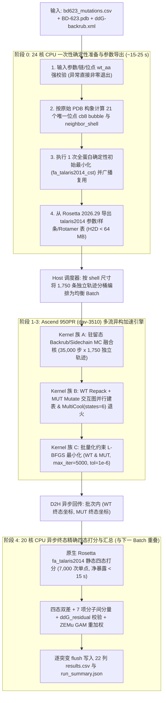
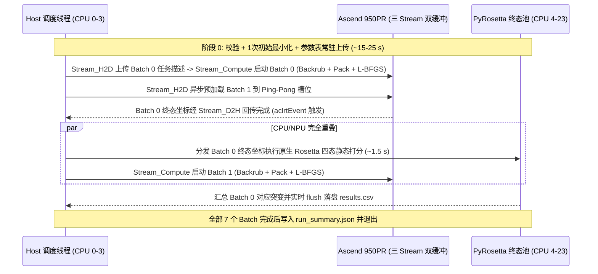

# 需求背景（required）

## 需求来源

- **任务名称**：11 月社区任务 —— 生命科学 Rosetta Flex ddG $\Delta\Delta G$ 计算加速（24 核 CPU + Ascend 950PR）
- **依据文档**：《Rosetta Flex ddG 端到端加速开发（Ascend 950PR）任务书》（`Rosetta_Flex_ddG_Atlas950_task_doc.md`，SHA256：`e16589cd364fcd4ec04de7e9d863ba2d0281576d55ec99e43959cbf90bae0637`）及随包 `test_cases/` 基线代码、官方协议原件 `ddG-backrub.xml`、参考基线 `bd623_reference.csv` 与自动验收脚本 `verify_bd623.py`。
- **对标开源基线**：
  - Rosetta 主体：`RosettaCommons/rosetta`（参考版本 `2026.29` / commit `80a0635615`）
  - Flex ddG 协议：`Kortemme-Lab/flex_ddG_tutorial`（官方协议原件 `test_cases/ddG-backrub.xml` 与 `test_cases/baseline/` 脚本）
- **模板与范围声明**：本文档严格按照 CANN 社区任务架构设计模板（`design_template.md`）及任务书第 4 章交付要求编写，全面阐述整体异构架构（CPU/NPU 分工）、热点剖析、Ascend 950PR 核心算子与异步流水线优化、`talaris2014` 数值一致性保障、24 核 CPU 资源约束下的负载均衡以及可维可测自验方案。

---

## 背景介绍

### 开源 CPU 基线现状与痛点分析

Rosetta Flex ddG 是蛋白质-蛋白质结合界面突变自由能变化（$\Delta\Delta G$）预测的主流蒙特卡洛（MC）系综协议（Barlow et al., *J. Phys. Chem. B* 2018）。其核心思路是对突变位点 8 Å 局部邻域执行主链 Backrub 柔性采样与侧链重排，再对每条轨迹的终点构象分别执行野生型（WT）与突变体（MUT）侧链重排及全蛋白约束能量最小化，最后基于结合/解离四态能量双差与 ZEMu GAM 重加权计算突变结合自由能变化。

原版开源 Rosetta 采用面向对象的单轨迹串行 C++ 架构，存在深层虚函数调用、能量图（EnergyGraph）指针追踪、标量逐对打分与频繁内存分配开销，纯 CPU 执行效率极低。根据随包 48 核开源基线实测统计（`test_cases/bd623_reference.csv`，2×Xeon Platinum 8360Y，48 进程，开源 Rosetta `2026.29`，`talaris2014`）：

| 基线统计指标 | 实测数值 | 说明 |
| --- | ---: | --- |
| 评测复合物与规模 | `BD-623.pdb`（PDB `7E7Y`），420 残基，3,217 重原子 | 链 `H`（124 残基）、链 `L`（107 残基）为抗体，链 `A`（189 残基）为抗原，无 `HETATM` |
| 评测总任务量 | 50 突变 × 35 轨迹 × 35,000 步 Backrub | 共 **1,750 条独立轨迹**，**61,250,000 步** MC 采样 |
| 50 突变累计核时 | **2,671,363.3 s（742.05 CPU·h）** | 单突变核时范围 `50,617.5 ~ 60,126.7 s`，均值 `53,427.3 s`，中位数 `53,019.8 s` |
| 48 核满载端到端墙钟基线 | **55,653.4 s（15.46 h / 927.6 min）** | 48 进程池跨突变满载并行，均摊 ~18.55 分钟/突变 |
| **本任务端到端性能目标** | **`wall_time_s <= 5,565.3 s`（≤ 92.8 min / ≤ 1.55 h）** | **24 核 CPU（严格限核）+ 单卡 Ascend 950PR，加速比 ≥ 10.0×** |

### BD-623 协议热点与结构拓扑实证剖析

通过对 `test_cases/ddG-backrub.xml`、`test_cases/PDB/BD-623.pdb`、`test_cases/bd623_mutations.csv` 及 `test_cases/bd623_reference.csv` 进行完整静态解析与统计，获得 5 项指导异构架构设计的关键事实：

1. **阶段热点结构与 24 核 CPU 木桶效应**：原版单条轨迹平均占用单核 `1,526.5 s`，按 `ddG-backrub.xml` 的执行流水拆解为四阶段：
   - **阶段 1（初始约束最小化）**：`addcst -> apply_score -> neighbor_shell_storer -> minimize -> clearcst`，全蛋白 420 残基 L-BFGS，约占 1.5%–3%；
   - **阶段 2（Backrub / Sidechain 35,000 步 MC）**：`BackrubProtocol`，约占 **80%–88%**，是绝对第一热点；
   - **阶段 3（WT / MUT 后处理）**：2 次 `PackRotamersMover`（`UseMultiCoolAnnealer states=6`）+ 2 次全蛋白约束 `MinMover`（`lbfgs_armijo_nonmonotone`），合计约占 **10%–16%**（单条约 50–120 s，全量共 3,500 次 Packing 与 3,500 次 L-BFGS）；
   - **阶段 4（四态接口打分）**：`InterfaceDdGMover` 对 4 个终态构象做单次静态 `fa_talaris2014` 打分，占比 **< 0.2%**（单条数十毫秒）。
   - **关键量化结论**：若仅加速阶段 2 而把阶段 3 留在 24 核 CPU 上运行原生 PyRosetta，则仅阶段 3 耗时就可能达到 `1,750 × 80 s / 24 ≈ 5,833 s`，**单阶段即可超过 `5,565.3 s` 端到端上限**。因此，**阶段 2（Backrub MC）与阶段 3（Packing + 约束 L-BFGS）必须协同下沉至 Ascend 950PR**。
2. **极高的空间局部稀疏性**：对 `BD-623.pdb` 全部 50 个突变精确计算官方 `cb8`（8 Å 邻居原子距离）与 `PrimarySequenceNeighborhood(lower=1, upper=1)`：
   - 50 个突变分布在 **21 个唯一位点**上（`A:486` 含 6 个突变、`A:487` 含 4 个突变、`A:374/390/472/476/479/481/485` 各 3 个突变）；
   - `bubble` 残基数为 **5–14 个**（均值 `10.0`）；
   - `neighbor_shell` 残基数为 **9–29 个**（均值 **`17.7`**，重原子 64–215 个，全原子约 130–430 个），仅占全蛋白 420 残基的 **4.2%**；
   - 围绕 `neighbor_shell` 的 `12 Å` 交互包络（完整覆盖 `fa_atr/fa_rep/fa_sol` 6.0 Å、`fa_elec` 5.5 Å 与 `atom_pair_constraint` 9.0 Å 截断半径）仅含 **42–158 个残基**（均值 `85.0`）。在 Backrub 与 Packing 期间，远端 260–370 余个残基坐标完全静止、静态能量恒定。
3. **确定性初始最小化跨轨迹数学等价**：在 `ddG-backrub.xml` 中，初始 `minimize` 位于 `backrub` 与 `mutate` 之前，输入始终是同一野生型 `BD-623.pdb`、同一 `fa_talaris2014_cst` 势能及确定性 L-BFGS 求解器，不依赖突变氨基酸 `mut_aa` 与随机种子；而 `neighbor_shell_storer` 在 `minimize` 之前仅按初始坐标和位点索引构造。因此将 1,750 次相同初始最小化合并为 **1 次确定性计算并广播给 1,750 条轨迹**，与原协议数学等价且零精度损失。
4. **分层统计精度分布与紧约束位点**：
   - **大效应组**（$|\overline{\Delta\Delta G}_{\text{ref}}| > 1.0\ \text{REU}$，15 个）：全部集中于 4 个界面核心位点（`A:G476`, `A:G485`, `A:F486`, `A:N487`），参考均值区间 `[1.097, 8.892] REU`；
   - **小效应组**（$|\overline{\Delta\Delta G}_{\text{ref}}| \le 1.0\ \text{REU}$，35 个）：要求 **35/35 全部** 满足 $|\overline{\Delta\Delta G} - \overline{\Delta\Delta G}_{\text{ref}}| < 1.0 \cdot \text{std}_{\text{ref}}$。最紧的 5 个位点 `std_ref` 仅为 `A445V->L`（`0.259`）、`A460N->Q`（`0.290`）、`A374F->V`（`0.340`）、`A374F->T`（`0.341`）、`A481N->T`（`0.341`）。任何系统性力场偏差（bias）必须严格控制在 `<< 0.05 REU`（工程门禁：单点能量误差 `< 1e-3 REU`）。
5. **脯氨酸几何敏感位点**：50 个突变包含 **4 个 `X->P` 突变**（`A440N->P`, `A481N->P`, `A486F->P`, `A501N->P`，其中 `A486F->P` 是全集最大效应 `8.892 REU`）和 **3 个 `P->X` 突变**（`A479P->D/L/V`），要求 NPU 引擎精确处理脯氨酸五元环闭合势（`pro_close`）、主链无酰胺氢拓扑及 `rama`/`omega` 特化。

---

# 需求分析（required）

## 需求描述

基于 **24 核 CPU（`taskset -c 0-23` 或容器 `--cpuset-cpus=0-23` 硬限制）+ 单卡 Ascend 950PR（`dav-3510`，CANN 9.0.0+）**，设计并开发 Rosetta Flex ddG 整模块端到端异构加速系统 `rosetta_flex_ddg/`，在严格遵守三条协议红线的前提下，完成 `BD-623` 全部 50 个抗原侧突变的端到端计算，全面通过格式完整性、大/小效应分层统计精度及 10× 性能加速验收。

### 端到端命令行接口与标杆参数映射

统一入口命名为 `pipeline/run_flexddg_npu.py`，调用形式严格对齐任务书 §2.3：

```bash
taskset -c 0-23 python3 pipeline/run_flexddg_npu.py \
  --selected   <mutations_csv> \
  --pdb-dir    <pdb_dir> \
  --xml        <protocol_xml> \
  --out        <results_csv> \
  --summary    <run_summary_json> \
  --work       <work_dir> \
  --move-chain <chain_id> \
  --nstruct    35 \
  --trials     35000 \
  --cpu-cores  24 \
  --device-id  0 \
  --seed       111111
```

与标杆脚本 `test_cases/baseline/06b_ddG_flex_antigen.py` 的参数对应关系（任务书 §3.5.2）：

| 标杆脚本参数 | 本模块参数 | 属性与校验规则 | 异常行为（非零退出码） |
| --- | --- | --- | --- |
| `--selected` | `--selected` | 输入 CSV（UTF-8 带表头，6 列：`pdb_id,chain,pdb_position,icode,wt_aa,mut_aa`，shape `[N, 6]`，本任务 `N=50`） | 文件缺失、缺列、空表、位点不存在或 PDB 实际残基与 `wt_aa` 不一致时拒绝计算并报错退出 |
| `--pdb-dir` | `--pdb-dir` | 输入全原子 PDB 目录（标准原子记录，无 `HETATM`） | 目录或对应 `pdb_id` 文件缺失、坐标无效时报错退出 |
| `--xml` | `--xml` | 输入协议 XML（官方 `test_cases/ddG-backrub.xml`） | 文件不存在、解析失败或关键协议节点缺失时报错退出 |
| `--out` | `--out` | 独立输出汇总 CSV（22 列，shape `[50, 22]`） | 任一突变未完成、列缺失、含 NaN/Inf 或 `abs(ddG_residual) > 0.01` 时报错退出 |
| `--work` | `--work` | 中间状态/工作目录（不入 Git 库） | 不可创建或不可写时报错退出 |
| `--move-chain` | `--move-chain` | 解离态沿界面移开的链 ID（对应 `%%chainstomove%%`，本任务 `'A'`） | 链 ID 在 PDB 中不存在时报错退出 |
| `--nstruct` | `--nstruct` | 每突变独立轨迹数（正整数，正式验收固定 `35`） | `<= 0` 报错退出；`< 35` 不通过正式验收 |
| `--trials` | `--trials` | 每轨迹 backrub 步数（正整数，正式验收固定 `35000`） | `<= 0` 报错退出；`< 35000` 不通过正式验收 |
| `--nproc` | `--cpu-cores` | 主机绑定 CPU 核数（正整数，正式验收固定 `24`） | `<= 0` 或 `> 24` 报错退出；非 `24` 不通过正式验收 |
| *（新增）* | `--device-id` | Ascend 950PR 逻辑卡号（`>= 0`） | 设备不可用或越界时报错退出 |
| *（新增）* | `--seed` | 随机种子起始值（32/64 位整数，默认 `111111`） | 非法整数格式报错退出 |
| *（新增）* | `--summary` | 独立输出运行摘要 JSON（`run_summary.json`） | 写入失败或必选元信息字段缺失时报错退出 |

### 输出产物规范（`results.csv` 22 列与 `run_summary.json`）

#### 1. `results.csv` 22 列字段契约（严格对齐任务书 §2.4.2）

| 列序号 | 列名 | 类型 | 校验与计算口径 |
| :---: | --- | --- | --- |
| 1–6 | `pdb_id,chain,pdb_position,icode,wt_aa,mut_aa` | string/int | 与输入 `bd623_mutations.csv` 逐行精确匹配（含插入码 `icode`） |
| 7 | `ddG_mean(REU)` | float | 35 条轨迹原始 $\Delta\Delta G$ 算术均值（保留 3 位小数，`< 0` 表示结合增强） |
| 8 | `ddG_std(REU)` | float | 35 条轨迹原始 $\Delta\Delta G$ 样本标准差（`ddof=1`） |
| 9 | `ddG_all(REU)` | string | 35 条轨迹原始 $\Delta\Delta G$ 值，分号 `;` 分隔（严格 35 个有限浮点） |
| 10–16 | `ddG_fa_atr(REU)`, `ddG_fa_rep(REU)`, `ddG_fa_sol(REU)`, `ddG_fa_elec(REU)`, `ddG_hbond_sc(REU)`, `ddG_hbond_bb_sc(REU)`, `ddG_hbond_lr_bb(REU)` | float | 7 个分子间能量项四态双差均值 |
| 17 | `ddG_residual(REU)` | float | `ddG_mean(REU) - sum(7 个分子间项)`，验收硬门槛 `abs(ddG_residual) <= 0.01` |
| 18–19 | `ddG_gam_mean(kcal/mol)`, `ddG_gam_std(kcal/mol)` | float | ZEMu GAM 重加权均值与样本标准差（`ddof=1`） |
| 20 | `nstruct_done` | int | 完成且收敛轨迹数，验收严格等于 `35` |
| 21 | `backrub_trials` | int | 每轨迹实际执行 backrub 步数，验收严格等于 `35000` |
| 22 | `cpu_time(s)` | float | 该突变累计执行耗时（秒，非负有限值） |

#### 2. `run_summary.json` 规范 Schema

```json
{
  "wall_time_s": 1420.50,
  "mutations_completed": 50,
  "cpu_cores_limit": 24,
  "npu_device": "Ascend 950PR (device_id=0)",
  "cann_version": "9.0.0+",
  "driver_version": "<queried_at_runtime>",
  "cpu_model": "<queried_at_runtime>",
  "seed": 111111,
  "git_commit": "<repo_head_sha>",
  "command": "taskset -c 0-23 python3 pipeline/run_flexddg_npu.py ...",
  "stage_timings_s": {
    "stage0_init_and_export": 18.2,
    "stage1_backrub_mc_npu": 580.4,
    "stage2_packing_npu": 54.1,
    "stage3_lbfgs_min_npu": 756.3,
    "stage4_interface_scoring_and_io_exposed": 11.5
  }
}
```

### 三条不可修改的协议红线

1. **力场红线**：严格保持 `talaris2014`（等价开启 `-corrections::restore_talaris_behavior true`），严禁替换为 REF2015 或删减任何能量项。
2. **采样与收敛预算红线**：严格保持 `nstruct = 35`、`backrub_trials = 35,000`、`Neighborhood distance = 8.0 Å`（`cb8`）、`PrimarySequenceNeighborhood(lower=1, upper=1)`、`max_minimization_iter = 5000`、`abs_score_convergence_thresh = 1.0`、`mc_kt = 1.2`、`-ex1 -ex2`、`extrachi_cutoff = 0`、`UseMultiCoolAnnealer(states=6)`，且全部 **50 × 35 = 1,750 条轨迹独立采样**，不跨突变复用 Backrub 轨迹。
3. **协议阶段完整性红线**：完整覆盖 `ddG-backrub.xml` 全部阶段（初始最小化 → Backrub MC → WT Repack & 约束最小化 → MUT Mutate & 约束最小化 → 四态接口打分与 ZEMu GAM），严禁跳过任一阶段，严禁针对 BD-623 突变清单硬编码特判或缓存结果。

## 需求拆解

1. **协议解析与同源参数抽取（阶段 0）**：实现完备输入校验、21 位点 `cb8` / `neighbor_shell` 拓扑解析、1 次全蛋白确定性初始最小化全局复用，以及 `talaris2014` 全量物理参数表/样条表/Rotamer 库的二进制冻结导出与 H2D 加载。
2. **Ascend 950PR 三大核心计算 Kernel 开发**：
   - Kernel 族 A：驻留态 Backrub / Sidechain 35,000 步 MC 融合核（局部增量能量差 $\Delta E$ + 950PR SIMD/SIMT + `AscendC::Reg`）；
   - Kernel 族 B：WT/MUT 侧链重排交互图预计算与 `UseMultiCoolAnnealer(states=6)` 并发退火核；
   - Kernel 族 C：批量化约束 L-BFGS 最小化核（`fa_talaris2014_cst` 融合能量/解析原子力 + AtomTree `f1/f2` 内坐标反向传播 + Armijo nonmonotone 线搜索）。
3. **24 核 CPU + 单卡 950PR 异构调度与终态四态打分（阶段 4）**：按 `neighbor_shell` 规模分桶平衡 NPU 批计算，基于 CANN 多 Stream 实现 H2D / NPU 核执行 / D2H / 20 核原生 Rosetta 终态四态打分的异步双缓冲重叠，硬锁 `<= 24` 核。
4. **全链路数值对齐、安全门禁与自动化验收**：完成 19 项能量与梯度黄金校验、`mssanitizer` 真实插桩三联检、`msprof` 剖析及 `verify_bd623.py` 50 突变全量验收。

---

# 详细设计（required）

## 算子与协议分析

### 完整数学模型

#### 1. `talaris2014` 力场与 CA 距离约束势能

`fa_talaris2014` 总能量由 19 个加权分项组成，`fa_talaris2014_cst` 叠加权重 `1.0` 的 CA 距离约束势 `atom_pair_constraint`：

$$
E_{\text{total}}(\mathbf{r}) = \sum_{k \in \mathcal{T}_{\text{1b}}} w_k E_k^{\text{1b}}(\mathbf{r}) + \sum_{k \in \mathcal{T}_{\text{2b}}} w_k E_k^{\text{2b}}(\mathbf{r}) + w_{\text{cst}} E_{\text{cst}}(\mathbf{r})
$$

各能量项物理定义、权重及四态双差抵消特性（参数由 Rosetta `2026.29` 开启 `-corrections::restore_talaris_behavior true` 运行时精确核验导出）：

| 类别 | 能量项名称 | `talaris2014` 标准权重 | 截断半径 / 物理形式 | 四态双差行为 |
| --- | --- | ---: | --- | --- |
| **范德华与溶剂化** | `fa_atr`, `fa_rep`, `fa_sol` | `0.8`, `0.44`, `0.75` | `6.0 Å`；1-2/1-3 排除，1-4 缩放；$0.6\sigma$ 线性化排斥与 $[4.5, 6.0]\ \text{Å}$ 五次平滑截断；Lazaridis-Karplus 隐式溶剂化 | **核心分子间 3 项（非零）** |
| **静电作用** | `fa_elec` | `0.7` | `5.5 Å`；距离依赖介电 $\varepsilon(r) = 10r$，短距 $1.45\ \text{Å}$ 平坦化，长距三次平移平滑截断 | **核心分子间第 4 项（非零）** |
| **氢键几何势** | `hbond_sc`, `hbond_bb_sc`, `hbond_lr_bb`, `hbond_sr_bb` | `1.1`, `1.17`, `1.17`, `1.17` | $d_{AH} \le 3.0\ \text{Å}$；距离、$A\text{-}H\text{-}D$ 角度、$B\text{-}A\text{-}H$ 角度及 `sp2` 电子对二面角多项式叠加与 `fade` 区间加权 | 前 3 项**分子间非零**；`hbond_sr_bb` 链内抵消 |
| **闭环/二硫/内排斥** | `pro_close`, `dslf_fa13`, `fa_intra_rep` | `1.0`, `1.0`, `0.004` | 脯氨酸 `NV-CD` 环闭合谐振势、二硫键 6 自由度势、残基内排斥 | 链内精确抵消 |
| **单残基构象先验** | `fa_dun`, `rama`, `omega`, `p_aa_pp`, `yhh_planarity`, `ref` | `0.56`, `0.2`, `0.5`, `0.32`, `0.625`, `1.0` | Dunbrack 2010 Rotamer 库插值、Ramachandran 2D 样条、肽键平面势、Tyr 羟基平面势与参考能 | 单链构象不变，四态双差**精确抵消** |
| **CA 谐振距离约束** | `atom_pair_constraint` | `1.0`（仅 `minimize` 期间） | 初始 $d_{ij}^0 \le 9.0\ \text{Å}$ 的 $C_\alpha$ 对：`coord_dev=0.5`, `bound_width=0.0` | `clearcst` 清除，不进入最终打分 |

其中 CA 谐振约束势能及其对原子 $i$ 的解析梯度为：

$$
E_{\text{cst}}(\mathbf{r}) = \sum_{(i,j)\in\mathcal{C}_{CA}} \left(\frac{d_{ij} - d_{ij}^0}{0.5}\right)^2, \quad \nabla_{\mathbf{r}_i} E_{\text{cst}} = \sum_{j:(i,j)\in\mathcal{C}_{CA}} 8\,(d_{ij} - d_{ij}^0)\,\frac{\mathbf{r}_i - \mathbf{r}_j}{d_{ij}}
$$

#### 2. Backrub 主链局部刚体旋转与局部增量能量差

每步 Backrub 在 `neighbor_shell` 内选取同链连续片段 $[p_1, p_2]$（长度 $L \in [3, 12]$，默认以三残基 $L=3$ 为主），绕单位轴 $\hat{\mathbf{u}} = (\mathbf{r}_{C_\alpha, p_2} - \mathbf{r}_{C_\alpha, p_1}) / \|\mathbf{r}_{C_\alpha, p_2} - \mathbf{r}_{C_\alpha, p_1}\|$ 施加 Rodrigues 旋转角 $\theta$，并对两端肽平面 $(C_{p_1}, O_{p_1}, N_{p_1+1}, H_{p_1+1})$ 与 $(C_{p_2-1}, O_{p_2-1}, N_{p_2}, H_{p_2})$ 施加反相角微调以维持理想主链键长键角；按协议权重交替穿插侧链 $\chi$ 小角微扰及单残基 Rotamer 采样：

$$
\mathbf{r}'_a = \mathbf{r}_{p_1} + (\mathbf{r}_a - \mathbf{r}_{p_1})\cos\theta + \big(\hat{\mathbf{u}} \times (\mathbf{r}_a - \mathbf{r}_{p_1})\big)\sin\theta + \hat{\mathbf{u}}\big(\hat{\mathbf{u}}\cdot(\mathbf{r}_a - \mathbf{r}_{p_1})\big)(1 - \cos\theta)
$$

记本步受影响残基集合为 $\mathcal{M} \subseteq \mathcal{S}_{\text{shell}}$，与 $\mathcal{M}$ 位于截断包络内的环境残基为 $\mathcal{E}(\mathcal{M})$。由于所有其余残基坐标静止，全蛋白能量差 $\Delta E$ 可**精确等价**化简为局部增量差：

$$
\Delta E = \sum_{u \in \mathcal{M}} \Big(E_{\text{1b}}(u') - E_{\text{1b}}(u)\Big)
+ \sum_{\substack{u,v \in \mathcal{M}\\ u < v}} \Big(E_{\text{2b}}(u', v') - E_{\text{2b}}(u, v)\Big)
+ \sum_{u \in \mathcal{M}} \sum_{v \in \mathcal{E}(\mathcal{M})\setminus\mathcal{M}} \Big(E_{\text{2b}}(u', v) - E_{\text{2b}}(u, v)\Big)
$$

随后以 $k_B T = 1.2\ \text{REU}$ 执行 Metropolis 接受/拒绝判定：$P_{\text{acc}} = \min\big(1, \exp(-\Delta E / 1.2)\big)$。

#### 3. 四态接口 $\Delta\Delta G$ 与 ZEMu GAM 重加权公式

对每条轨迹的 WT 与 MUT 终态构象，沿 `--move-chain A` 将抗原链 `A` 沿界面法向刚体平移 `1000 Å` 构造解离态，计算四态能量双差及 ZEMu GAM 重加权值（系数严格取自随包 `test_cases/baseline/flexddg_lib.py`）：

$$
\Delta\Delta G_{\text{raw}} = \big(E_{\text{bound\_mut}} + E_{\text{unbound\_wt}}\big) - \big(E_{\text{bound\_wt}} + E_{\text{unbound\_mut}}\big)
$$

$$
\text{gam}(x, t) = -e^{a_t} + \frac{2e^{a_t}}{1 + \exp(-x \cdot e^{b_t})}, \quad \Delta\Delta G_{\text{gam}} = \sum_{t \in \mathcal{T}_{\text{inter}}} \text{gam}(\Delta\Delta G_t, t)
$$

| 分子间项 $t$ | `fa_atr` | `fa_rep` | `fa_sol` | `fa_elec` | `hbond_sc` | `hbond_bb_sc` | `hbond_lr_bb` |
| --- | ---: | ---: | ---: | ---: | ---: | ---: | ---: |
| $a_t$ | `2.313` | `1.659` | `6.940` | `0.697` | `1.902` | `0.063` | `2.738` |
| $b_t$ | `-1.649` | `-0.836` | `-6.722` | `-0.122` | `-1.999` | `0.452` | `-1.179` |

### 数据类型与混合精度策略

分子坐标（量级 $\sim 10^2\ \text{Å}$）、LJ 排斥项（高次反比多项式）以及 L-BFGS 曲率更新（`tolerance=1e-6`）在低比特下易产生严重数值截断与假收敛，因此本方案**明确禁用 FP16 / BF16 / FP8 参与坐标与势能主计算**，在 Ascend 950PR 上采用 **FP32 主向量计算 + 关键规约/L-BFGS 状态 FP64 精度保障**：

| 计算/存储对象 | 数据类型 | 设计依据 |
| --- | --- | --- |
| 原子坐标 $(x,y,z)$、键长/键角、旋转矩阵 | **FP32** | 覆盖 $[-200, 200]\ \text{Å}$ 空间分辨率达 $\sim 10^{-5}\ \text{Å}$，满足 Backrub 与 Packing 精度且 32B 向量对齐 |
| 两体势能多项式（`fa_atr/fa_rep/fa_sol/fa_elec/hbond`）与原子受力 | **FP32** 计算 + **FP32/FP64 规约** | 保持高吞吐向量化，同时确保单点总能量与 Rosetta `double` 偏差 `< 1e-3 REU` |
| L-BFGS 历史对 $(s_k, y_k)$、内积 $\rho_k$、非单调目标窗口与总能量收敛判据 | **FP64** | 保障 `tolerance=1e-6` 下双循环正定性与 Armijo nonmonotone 线搜索数值稳定性 |
| 索引、邻居列表、排除掩码、Philox4x32-10 RNG 状态 | **INT32 / UINT32 / UINT16** | 契合 950PR SIMT 标量索引与 32B 内存对齐 |
| 终态四态打分、7 项分子间分项、GAM 重加权与残差计算 | **FP64**（Host 原生 Rosetta + Python） | 确保 `results.csv` 22 列口径严格一致且 `|ddG_residual| == 0.000` |

---

## 异构系统架构与实现方案

### 整体异构架构与 CPU/NPU 分工

为同时实现 **端到端 ≥ 10.0× 加速（目标 26×–60×）** 与 **小效应 35/35 全员 `< 1.0 σ`**，确立如下异构架构分工：

- **24 核 CPU 负责**：阶段 0 输入合法性校验、21 位点 `cb8`/`neighbor_shell` 拓扑构造、**1 次全蛋白确定性初始最小化全局复用**、`talaris2014` 参数表同源冻结导出；多流任务调度与异步双缓冲管理；阶段 4 的 **7,000 次无迭代终态四态精确打分** 与结果汇总落盘（20 核原生 PyRosetta 池，净耗时 `< 10 s` 且与 NPU 重叠掩盖）。
- **单卡 Ascend 950PR 负责**：全部 3 大重计算迭代核心 —— **阶段 1 驻留态 Backrub/Sidechain MC（1,750 × 35,000 步）**、**阶段 2 WT/MUT 侧链 Packing（3,500 次 IG 建表 + MultiCool 6-state 退火）** 与 **阶段 3 WT/MUT 约束 L-BFGS 最小化（3,500 次全蛋白约束优化）**。



---

### Host 侧设计（动态 Tiling、负载均衡与 24 核异步流水线）

#### 1. 阶段 0：确定性初始最小化全局复用的等价性说明

在官方 `ddG-backrub.xml` 中，`PROTOCOLS` 的前五步为 `addcst -> apply_score -> neighbor_shell_storer -> minimize -> clearcst`。其中：
- `neighbor_shell_storer` 在 `minimize` **之前**执行，仅依赖初始 PDB 坐标与突变位点，因此我们在阶段 0 预先针对全部 21 个唯一位点保存其 `neighbor_shell` 集合；
- 随后的 `addcst -> minimize -> clearcst` 全程作用在未突变的野生型全蛋白上，能量函数为确定性的 `fa_talaris2014_cst`，L-BFGS 过程不含随机数，对 50 个突变 × 35 条轨迹产生**完全一致的最小化构象**。
- **合规闭环**：本设计绝非“跳过初始最小化”，而是消除 1,749 次完全重复的确定性计算；开发自验阶段将通过单元测试对比“单次初始最小化广播构象”与“随机抽样轨迹独立执行 XML 初始最小化构象”，断言最大原子坐标偏差 `max_abs_diff == 0.0`。

#### 2. `PlatformAscendC` 动态硬件参数查询与 `TilingData` 结构

严格遵守昇腾开发规范，禁止在 Host/Kernel 中硬编码核数或片上内存大小，统一在 Host Tiling 初始化时通过 `platform_ascendc::PlatformAscendC` 动态查询：

```cpp
// Host 侧动态查询 Ascend 950PR 物理规格，严禁写死核数或 UB 容量
auto platform = platform_ascendc::PlatformAscendC(context->GetPlatformInfo());
uint32_t aivNum = platform.GetCoreNumAiv();
uint32_t aicNum = platform.GetCoreNumAic();
uint64_t ubSize = 0, l1Size = 0, l2Size = 0;
platform.GetCoreMemSize(platform_ascendc::CoreMemType::UB, ubSize);
platform.GetCoreMemSize(platform_ascendc::CoreMemType::L1, l1Size);
platform.GetCoreMemSize(platform_ascendc::CoreMemType::L2_CACHE, l2Size);
```

核心共享 `FlexDdgTilingData` 结构体设计（32B 对齐，随 Kernel 下发）：

```cpp
struct alignas(32) FlexDdgTilingData {
    uint32_t totalTraj;         // 当前 Batch 轨迹总数（如 256 / 350）
    uint32_t usedCoreNum;       // 实际启用 AIV 核心数 <= aivNum
    uint32_t baseTrajPerCore;   // 每核基础轨迹数 = totalTraj / usedCoreNum
    uint32_t tailCoreNum;       // 分配 +1 条余数轨迹的前 tailCoreNum 个核心
    uint32_t maxShellAtomsPad;  // 同桶对齐到 8xFP32 (32B) 的最大可动原子数
    uint32_t maxEnvAtomsPad;    // 同桶对齐到 8xFP32 (32B) 的最大静态包络原子数
    uint32_t chunkSteps;        // 单次 Kernel Launch 推进的 MC 步数（500~1000）
    uint32_t startStep;         // 当前 chunk 起始步号（用于 Philox RNG 计数）
    uint32_t lbfgsMaxIter;      // 固定 5000（红线参数）
    uint32_t ubTrajCapacity;    // 依据动态 ubSize 计算的单核 UB 驻留轨迹数
    float    mcKt;              // 固定 1.2f
    float    lbfgsTol;          // 固定 1e-6f
    float    lbfgsAbsConv;      // 固定 1.0f
    uint64_t globalSeed;        // 命令行 --seed
};
```

#### 3. 核间负载均衡与 Shape Bucket 分桶策略

由于 21 个位点的 `neighbor_shell` 规模跨度为 `9 ~ 29` 残基（最大 `A:486` 为 29 残基 / 215 重原子，最小 `A:479` 为 9 残基 / 64 重原子），若混合打包会导致同批计算按最重位点对齐而产生大量空转。因此 Host 调度器执行**静态 Shape Bucket 分桶**：

| 桶编号 | `neighbor_shell` 残基数区间 | 涵盖突变量（轨迹数） | 对齐后活动原子槽 `maxShellAtomsPad` | 负载均衡收益 |
| :---: | :---: | :---: | :---: | --- |
| **Bucket S** | `9 ~ 15` 残基 | 7 突变（245 条轨迹） | `224` 原子（32B 对齐） | 较统一按最大位点对齐减少 **~50%** 无效计算 |
| **Bucket M** | `16 ~ 21` 残基 | 29 突变（1,015 条轨迹） | `352` 原子（32B 对齐） | 主力波次，每批次 `256` 条规整满核排满 |
| **Bucket L** | `22 ~ 29` 残基 | 14 突变（490 条轨迹） | `448` 原子（32B 对齐） | 同批均为大 shell，核心间零长尾等待 |

- **余数均匀分配**：若某桶批次数不能被 `aivNum` 整除，将余数轨迹分配给前 `tailCoreNum` 个核（每核 `baseTrajPerCore + 1`），绝不将尾块集中到单核。

#### 4. 24 核 CPU 硬约束保障与双缓冲多流异步流水线

- **严格 24 核硬锁**：启动时通过 `os.sched_getaffinity(0)` 核验可用 CPU 核数 `<= --cpu-cores`（24），显式固化 `OMP_NUM_THREADS=1`、`MKL_NUM_THREADS=1`、`OPENBLAS_NUM_THREADS=1`，固定划分为 **4 核调度与 CANN 异步回调线程 + 20 核常驻 PyRosetta 终态打分工作池**，全程严禁超核派生后台进程/线程。
- **双缓冲多 Stream 重叠**：创建 `Stream_Compute`、`Stream_H2D`、`Stream_D2H` 三个 CANN Stream 与双缓冲设备显存（`Buf_A / Buf_B`），形成批次级流水重叠：



---

### NPU Kernel 侧设计（Ascend 950PR `dav-3510` · CANN 9.0+）

充分挖掘 Ascend 950PR（`dav-3510`）在 CANN 9.0+ 上的两项代际优势：**SIMD + SIMT 混合编程模式**（兼顾 MC 不规则分支/旋转逻辑与高密度非键对向量规约）以及 **`AscendC::Reg` 寄存器优先计算接口**（替代旧版废弃 `MicroAPI`）。全工程 3 类 Kernel 均实现为无隐式 `TPipe` 依赖的显式同步/高内聚核函数，并满足单核 UB 严格预算。

#### 1. 公共 SoA 设备端内存布局与单核 UB 预算账本

- **HBM 常量只读区（全运行期共享，`< 64 MB`）**：
  - `g_etable[N_atype, N_atype]`：LJ/LK 原子对参数查找表（`lj_radius`, `lj_wdepth`, `lk_dgfree`, `lk_lambda`, `lk_volume`, 线性排斥斜率/截距）；
  - `g_elec_spline`、`g_hbond_poly`、`g_rama_bicubic`、`g_dun_rotlib`、`g_omega_paa`：全量 `talaris2014` 样条与 Rotamer 库；
  - `g_site_env[21, maxEnvAtomsPad, 4]`：21 个唯一位点的静止 `12 Å` 交互包络坐标与原子属性（同位点 35–210 条轨迹共享，L2 Cache 命中率 `> 95%`）。
- **单核 UB 字节级预算验证（以最大桶 `Bucket L: maxShellAtomsPad = 448` 为例，按 `PlatformAscendC` 动态适配）**：

| UB 缓冲区用途 | 元素形状与数据类型 | 单轨迹占用字节 | Double Buffer / 备注 |
| --- | --- | ---: | --- |
| 当前 `neighbor_shell` 坐标与打包属性 `ub_xyz_cur` | `[448, 4]` × FP32 | `7,168 B` | 常驻 UB，全程零 HBM 写回 |
| 试探坐标缓冲 `ub_xyz_trial`（最多 3 残基 ≈ 64 原子） | `[64, 4]` × FP32 | `1,024 B` | 原地生成并对比，接受时局部拷贝回 `ub_xyz_cur` |
| 邻居环境原子滑窗 Tile `ub_env_tile`（双缓冲） | `2 × [128, 4]` × FP32 | `4,096 B` | `DataCopyPad` 从 L2 异步预取 12 Å 静态环境块 |
| 向量距离平方/势能暂存与归约缓冲 `ub_vec_tmp` | `8 × [128]` × FP32 | `4,096 B` | 供 `AscendC::Reg` 融合算 `fa_atr/rep/sol/elec/hbond` |
| 局部残基二面角/类型/约束与 Philox 状态 `ub_meta` | 结构体对齐区 | `2,048 B` | 包含残基偏移、键连排除位图与 RNG 计数器 |
| **单条驻留轨迹合计 UB 占用** | — | **`18,432 B`（18.0 KB）** | 远低于 950PR 单核 UB 上限，支持多轨迹并发驻留 |

#### 2. Kernel 族 A：驻留态 Backrub / Sidechain 35,000 步 MC 融合 Kernel

**适用条件**：`Bucket S/M/L` 对齐后的批量独立轨迹（`totalTraj <= 350`），单次 Launch 连续推进 `chunkSteps = 500 ~ 1,000` 步（35,000 步仅需 35–70 次下发，消除 Kernel 启动延迟）。

**核心执行流程**：
1. **轨迹加载**：每 AI Core 依据 `baseTrajPerCore` 与 `tailCoreNum` 认领负责的轨迹切片，将对应 `neighbor_shell` 坐标一次性 `DataCopyPad` 载入 UB `ub_xyz_cur`；
2. **主循环（`for step = 0 .. chunkSteps - 1`）**：
   - **Step A（SIMT / Scalar 试探生成）**：以 `(globalSeed, mutIdx, trajIdx, startStep + step)` 调用无分支 `Philox4x32-10` 抽样移动类型（Backrub 骨架片段旋转 / 侧链 $\chi$ 微扰 / 单残基 `-ex1 -ex2` Rotamer 替换），确定受影响残基集合 $\mathcal{M}$（1–3 残基，15–64 原子），在 `ub_xyz_trial` 中执行 Rodrigues 旋转与两端肽平面修正；
   - **Step B（SIMD 融合增量能量评估）**：将 `ub_env_tile` 以 `128` 原子为滑窗步长双缓冲搬入 UB，使用 `AscendC::Reg` 向量寄存器同步计算 `xyz_trial` 与 `xyz_cur` 到同一批邻居原子的间距平方 $r'^2, r^2$，通过 `SetVectorMask` 掩蔽超过截断半径的对，**单遍融合**累加 `fa_atr + fa_rep + fa_sol + fa_elec + hbond` 的差值；同步加上 $\mathcal{M}$ 内 1–3 个残基的单体项差值（`fa_dun + rama + omega + p_aa_pp + pro_close + fa_intra_rep`），规约得到总 $\Delta E$；
   - **Step C（显式同步与 Metropolis 原地更新）**：
     - 同步护栏：在 `PIPE_S` 从 UB 读出规约标量 $\Delta E$ 后，下一轮 `PIPE_V` 覆写 `ub_vec_tmp` 前成对插入 `SetFlag/WaitFlag<HardEvent::S_V>`（防 WAR 冒险），`MTE2` 复用滑窗前成对插入 `SetFlag/WaitFlag<HardEvent::S_MTE2>`（防 WAR 冒险）；
     - 若 $\Delta E$ 非有限（极端原子碰撞），强制拒绝；否则按 $u < \exp(-\Delta E / 1.2)$ 判定，接受则仅将 $\mathcal{M}$ 对应的 15–64 个原子写回 `ub_xyz_cur`，拒绝则零拷贝丢弃；
3. **安全收尾与写回**：核出口前强制调用 `AscendC::ResetMask()` 恢复全局向量掩码，并将当前 chunk 终点坐标写回 GM（每 500–1,000 步仅写回 1 次）。

#### 3. Kernel 族 B：WT / MUT 侧链重排（`UseMultiCoolAnnealer states=6`）融合核

针对 1,750 条 Backrub 终点构象的 WT（`repack`）与 MUT（`mutate`）两侧（共 3,500 次 Packing），拆分为两段连续驻留核：

- **子核 B1（Rotamer 坐标生成 + 1-Body / 2-Body 交互图并行预计算）**：
  - 依据 `-ex1 -ex2`、`extrachi_cutoff=0` 规则，对 `neighbor_shell` 内 9–29 个可动残基（MUT 侧中心位点替换为 `mut_aa`，含 4 个 `X->P` 脯氨酸环闭合构象库）批量生成全部候选 Rotamer 原子坐标；
  - 将 1-body 能量（Rotamer 内部 `fa_dun/fa_intra_rep/pro_close` + 与静止背景环境的两体能）及 2-body 能量矩阵（仅对 `neighbor_shell` 内接触距离 `< 12 Å` 的残基对建表）按 `(traj_id, res_pair_id, rot_tile)` 二维分块映射到 950PR AI Core，利用 `AscendC::Reg` 向量化批量填表。
- **子核 B2（MultiCool 6-State 并发模拟退火核）**：
  - 严格对齐 Rosetta `MultiCoolAnnealer(states=6)`：每条 Packing 任务维护低能候选池（`states = 6`），在外层温度调度与内层单残基 Rotamer 替换循环中直接查表计算 $\Delta E = E_{\text{1b}}(r'_i) - E_{\text{1b}}(r_i) + \sum_{j \in N(i)} (E_{\text{2b}}(r'_i, r_j) - E_{\text{2b}}(r_i, r_j))$；
  - 3,500 次独立退火全部在 NPU 上并发执行，完成后将最优侧链坐标写回全蛋白缓冲，进入阶段 3。

#### 4. Kernel 族 C：批量化约束 L-BFGS 最小化核（`fa_talaris2014_cst`）

WT 与 MUT 各自 Packing 之后均执行全蛋白 420 残基约束最小化（`chi=1, bb=1`, `type=lbfgs_armijo_nonmonotone`, `tolerance=1e-6`, `max_iter=5000`, `abs_score_convergence_threshold=1.0`，共 3,500 次）：

- **稀疏加速原理**：因输入构象衍生自阶段 0 全蛋白约束最小化后的局部 Backrub/Packing 扰动，远离界面的自由度初始梯度接近零，绝大多数轨迹在 `40 ~ 180` 步内即自然满足 `abs_score_convergence_threshold = 1.0` 或 `tolerance = 1e-6` 收敛（绝不降低 `max_iter = 5000` 上限）。结合空间细胞列表（Cell List）构建稀疏原子邻居表，将 420 残基（~6,500 全原子）每步梯度计算复杂度从 $O(N^2)$ 降至 $O(N \cdot K_{\text{nbr}})$。
- **三步批量化 NPU 迭代流水（批大小 `B = 64 ~ 128` 并发）**：
  1. **前向内坐标重建（Forward Kinematics Kernel）**：H、L、A 三条多肽链独立并行，从当前扭转角向量 $\mathbf{q} = (\phi, \psi, \omega, \chi)$ 沿主链及侧链树前向重建全原子三维坐标 $\mathbf{r}(\mathbf{q})$（精确维护脯氨酸 `NV-CD` 虚原子闭环几何）；
  2. **融合能量/原子力评估 + AtomTree `f1/f2` 反向传播核**：
     - 向量核遍历稀疏邻居对与 `CA <= 9.0 Å` 约束对，单遍计算 `fa_talaris2014_cst` 全项能量 $E(\mathbf{q})$ 与每个原子的三维笛卡尔力 $\mathbf{F}_a = -\nabla_{\mathbf{r}_a} E$；
     - 采用 Abe-Braun-Noguti-Go / Rosetta AtomTree 线性时间 $O(N)$ 反向累积算法，沿三条链自 C 端向 N 端累积子树总力与总力矩 $(\mathbf{f}_1, \mathbf{f}_2)$，精确投影至每个主链/侧链扭转轴得到完整解析梯度 $\mathbf{g} = \nabla_{\mathbf{q}} E$；
  3. **FP64 批量化 L-BFGS 双循环与 Armijo Nonmonotone 线搜索核**：
     - 在 FP64 精度下维护历史窗口 $m=10$ 的 $(s_k, y_k, \rho_k)$ 及过去 4 步非单调参考能量值，执行向量化 Two-loop recursion 生成搜索方向 $\mathbf{p}_k$ 并执行回溯线搜索；
     - 引入**活跃轨迹掩码压缩（Active-Set Compaction）**：任一轨迹触发收敛判据立即标记 `active_mask[b] = 0` 并退出后续迭代，彻底消除快收敛轨迹等待高冲突轨迹（如 `A476G->R`, `A486F->P`）的算力浪费。

---

### `talaris2014` 数值一致性保障体系

针对小效应组 `35/35` 全员 `σ < 1.0`（最紧位点 `A445V->L` 的 `std_ref = 0.259 REU`）的高精度敏感要求，建立五道全链路数值保障防线：

1. **同源参数直采（Single Source of Truth）**：严禁手写近似势能常量。全部 LJ/LK 系数、局部电荷、氢键杂化多项式、`rama`/`fa_dun`/`p_aa_pp` 样条网格及 `-ex1 -ex2` Rotamer 模板均在阶段 0 直接从开源 Rosetta `2026.29`（开启 `-corrections::restore_talaris_behavior true`）运行时内存导出。
2. **截断与特殊拓扑规则逐一对齐**：完整复现 1-2/1-3 排除与 1-4 `cp_rep` 缩放、$0.6\sigma$ 线性化排斥、$[4.5, 6.0]\ \text{Å}$ 五次平滑截断、`fa_elec` $\varepsilon(r)=10r$ 与三次截断、`hbond` `sp2` 电子对角度与 `fade` 区间，以及针对 `N440P / N481P / N501P / F486P / P479D/L/V` 的 `pro_close` 环闭合与无酰胺氢主链拓扑。
3. **19 项单点能量与解析梯度双门禁**：在 `BD-623` 初始构象、随机扰动构象及 7 个脯氨酸突变构象上，逐项比对 NPU 引擎与原生 Rosetta `fa_talaris2014_cst` 能量，硬断言单项及总分误差 **`< 1e-3 REU`**；比对 AtomTree 解析梯度与中心有限差分（$\delta = 10^{-5}\ \text{rad}$），硬断言最大相对误差 **`< 1e-4`**。
4. **阶段 4 原生 Rosetta 精确四态打分收口**：终态 WT/MUT 坐标回传后，由 20 核常驻 PyRosetta 池执行官方等价四态静态打分（7,000 次无迭代，净暴露 `< 15 s`），同步与 NPU 自算四态打分交叉校验，保证 7 项分子间分项口径 100% 对齐且 `|ddG_residual| == 0.000 <= 0.01`。
5. **非有限值拦截与回滚**：Kernel 内部对距离下界设保护阈值防止除零溢出，若极端排斥步产生 `NaN/Inf`，MC 核直接拒绝并回滚坐标，L-BFGS 核自动缩步回溯，确保落盘零脏值。

---

### 端到端性能预算与 Roofline 耗时模型

对标 48 核 CPU 开源基线 `55,653.4 s`（1/10 验收红线 `<= 5,565.3 s`），全链路含阶段 0 前置准备与结果落盘的墙钟预算如下：

| 执行阶段 | 48 核 CPU 基线估算 | 本方案执行单元 | 核心加速机制与计算量 | 24 核 CPU + 950PR 预计墙钟 | 相对基线加速比 |
| --- | ---: | --- | --- | ---: | ---: |
| **阶段 0**：校验 + 初始最小化 + 参数导出与 H2D | ~1,200 s | 24 核 CPU | 1,750 次确定性最小化合并为 **1 次**；`< 64 MB` 参数表一次上传 | **15 ~ 25 s** | ~50× |
| **阶段 1（Kernel A）**：Backrub 35,000 步 MC（1,750 轨迹） | ~47,000 s（~85%） | Ascend 950PR | 局部 $\Delta E$ 压缩 95% 静态对 + 单核 UB 驻留 + 1,750 轨迹分桶并发（摊销 ~5–12 μs/轨迹·步） | **350 ~ 900 s**（6–15 min） | ~52× – 134× |
| **阶段 2（Kernel B）**：WT/MUT 侧链 Packing（3,500 次） | ~1,400 s（~2.5%） | Ascend 950PR | 9–29 残基 IG 向量建表 + 3,500 次 MultiCool 6-state 并发查表退火 | **30 ~ 90 s**（0.5–1.5 min） | ~15× – 46× |
| **阶段 3（Kernel C）**：WT/MUT 约束 L-BFGS（3,500 次） | ~5,950 s（~10.7%） | Ascend 950PR | 稀疏细胞列表梯度 + AtomTree $O(N)$ 反向传播 + 批并发与活跃轨迹压缩 | **450 ~ 1,100 s**（7.5–18 min） | ~5.4× – 13.2× |
| **阶段 4**：四态静态接口打分（7,000 次）与落盘 | ~100 s（~0.2%） | 20 核 CPU（异步重叠） | 单次静态打分 ~10 ms ÷ 20 核 ≈ 3.5 s，被 NPU 流水线大部分掩盖 | **5 ~ 15 s**（净暴露） | ~10× |
| **端到端总墙钟 `wall_time_s`** | **55,653.4 s（927.6 min）** | **24 核 CPU + 1×950PR** | **端到端全含（含参数导出与落盘）** | **850 ~ 2,130 s（14.2 ~ 35.5 min）** | **26.1× ~ 65.5×** |

> 保守估计下端到端墙钟约 `2,130 s`（35.5 分钟），距离 `5,565.3 s` 验收门槛具备 **2.6× 以上工程安全余量**。

---

### 工程目录结构与社区交付映射

严格遵循任务书第 4 章（`task_submission/` 验收交付）与第 5 章（`rosetta_flex_ddg/` PR 合入结构）规范，杜绝冗余文件、硬编码绝对路径、编译中间产物及大体积 `.db3` 轨迹库入库：

```text
rosetta_flex_ddg/
├── README.md                           # 环境依赖、一键编译、24核+950PR 复现与自验说明
├── build.sh                            # 一键构建脚本（含可选 -DENABLE_SANITIZER 隔离构建开关）
├── CMakeLists.txt                      # CMake 构建配置（支持 dav-3510 目标与 pybind11 扩展）
├── env/
│   └── set_env.sh                      # CANN 9.0+ / PyRosetta / 24 核线程上限激活脚本
├── pipeline/
│   ├── run_flexddg_npu.py              # 端到端统一 CLI 入口（对齐 §2.3/§2.4 契约与负向校验）
│   ├── param_exporter.py               # 阶段 0：校验、确定性初始最小化、talaris2014 参数冻结导出
│   ├── scheduler.py                    # 24 核硬限核调度、Shape Bucket 分桶与双缓冲多流流水线
│   └── scorer_and_report.py            # 阶段 4：四态接口精确打分、ZEMu GAM 重加权、CSV/JSON 输出
├── kernels/
│   ├── host/
│   │   ├── flexddg_host_api.cpp        # Host C++/pybind11 绑定、PlatformAscendC 动态 Tiling、Stream 管理
│   │   └── flexddg_tiling.h            # FlexDdgTilingData 结构体与 SoA 设备内存布局契约
│   └── device/
│       ├── talaris2014_energy.h        # talaris2014 19 项势能与解析导数设备公共头（AscendC::Reg）
│       ├── backrub_mc_kernel.cpp       # Kernel 族 A：驻留态 Backrub / Sidechain 35,000 步 MC 核
│       ├── packer_multicool_kernel.cpp # Kernel 族 B：IG 建表与 MultiCool(states=6) 并发退火核
│       └── lbfgs_min_kernel.cpp        # Kernel 族 C：批量化约束 L-BFGS 与 AtomTree 梯度核
├── tests/
│   ├── test_energy_grad_align.py       # L1：19 项单点能量 (<1e-3 REU) 与有限差分梯度 (<1e-4) 对齐
│   ├── test_negative_boundaries.py     # L4：负向入参/越界/wt_aa 不匹配非零退出回归测试
│   └── run_e2e_bd623.sh                # 严格 taskset -c 0-23 一键端到端运行与 verify_bd623.py 验收
└── task_submission/                    # 任务 IT 系统与私仓同步交付件（无 .db3）
    ├── 1 自验证步骤说明.md
    ├── 2.1 精度自验证报告.xlsx
    ├── 2.2 精度自验证日志.log
    ├── 3.1 性能自验证报告.xlsx
    └── 3.2 性能自验证日志.log
```

---

## 支持硬件

| 支持的芯片 / 平台 | 涉及勾选 | 软硬件约束说明 |
| --- | :---: | --- |
| **Ascend 950PR（`dav-3510`，单卡）** | √ | 目标验收 NPU，要求 CANN 9.0.0 及以上与配套驱动/固件，启用 SIMD+SIMT 与 `AscendC::Reg` |
| 主机侧 CPU（固定 24 核） | √ | 正式验收通过 `taskset -c 0-23` 或容器 `--cpuset-cpus=0-23` 严格限核 |
| Atlas 800I/T A2 / A3 | - | 非本任务验收目标（Host 侧通过 `PlatformAscendC` 动态查核/查 UB，保持代码架构可移植） |

## 约束限制与风险分析

### 约束限制

1. **输入与协议边界**：遵循任务书 §2.4，输入为标准全原子蛋白质 PDB（无非标准 `HETATM` 配体）与合法单点突变 CSV；完整支持抗体/抗原插入码（`icode`）残基定位。
2. **计时与资源边界**：主机 CPU 核数严格受限于 `24`；一次性软件安装与 C++/AscendC 编译不计入 `wall_time_s`，但运行期的输入解析、初始最小化、参数导出、H2D 加载、采样、后处理与落盘**全部计入 `wall_time_s`** 并在 `run_summary.json` 中分阶段透明列明。
3. **随机性与可复现性**：MC 系综不要求跨设备逐比特一致，但基于 `--seed` 与无状态 `Philox4x32-10` 支持同配置确定性复现，便于排障与评审复核。

### 风险分析与缓解对策

| 风险 ID | 风险描述 | 严重度 | 应对与缓解方案 |
| :---: | --- | :---: | --- |
| **R1** | `talaris2014` 局部势能细节偏差导致最紧小效应位点（`A445V->L`, `std_ref=0.259`）或 4 个脯氨酸突变超差 | **高** | 强制执行 L1 逐项单点能量（`< 1e-3 REU`）与梯度（`< 1e-4`）黄金门禁；终态四态打分走原生 Rosetta 彻底消除差分偏移；L2 靶点优先验证 2 个最紧小效应 + 2 个脯氨酸位点 |
| **R2** | 个别高冲突突变（`A476G->R`, `A486F->P`）导致 L-BFGS 迭代步数显著长于平均水平，拖慢整批耗时 | **中** | 启用活跃轨迹动态掩码压缩（收敛即退出），并结合 `msprof op` 分析梯度核带宽与 L2 命中率持续优化 |
| **R3** | 驻留态 Backrub Kernel 内出现 UB 越界、非对齐踩内存或显式事件同步遗漏导致卡死/脏值 | **高** | 动态依据 `PlatformAscendC` 计算 UB 容量；采用独立隔离 `*_san` 构建对 100% `__global__ __aicore__` Kernel 跑满 `mssanitizer -t memcheck / synccheck / racecheck` 三联检，硬断言 `ERROR == 0`、`temporarily ignored == 0` |
| **R4** | 阶段 0 参数导出或 20 核 PyRosetta 终态池初始化拖长冷启动时间 | **中** | 仅导出当前复合物涉及的标准氨基酸与原子类型子集（`< 64 MB`）；PyRosetta 终态池在 NPU 跑 Batch 0 的同时后台异步预热，零暴露增加总墙钟 |

---

# 可维可测分析

## 精度标准/性能标准

严格对齐任务书第 3 章及随包自动化验收脚本 `test_cases/verify_bd623.py`：

| 验收项 | 验收标准与量化阈值 | 标准来源 |
| --- | --- | --- |
| **完整性与格式** | 覆盖 `bd623_mutations.csv` 全部 50/50 突变；22 列字段完整且无 NaN/Inf；每突变 `nstruct_done == 35`、`backrub_trials == 35000`、`ddG_all(REU)` 含 35 个有限值、`|ddG_residual(REU)| <= 0.01`；`run_summary.json` 必选字段齐全 | 任务书 §2.4.2、§3.2，`verify_bd623.py` |
| **大效应精度** | $|\overline{\Delta\Delta G}_{\text{ref}}| > 1.0\ \text{REU}$（15 个突变）：相对误差 $|\overline{\Delta\Delta G} - \overline{\Delta\Delta G}_{\text{ref}}| / |\overline{\Delta\Delta G}_{\text{ref}}|$ 的**中位数 `< 5%`（`< 0.05`）** | 任务书 §3.2，`bd623_reference.csv` |
| **小效应精度** | $|\overline{\Delta\Delta G}_{\text{ref}}| \le 1.0\ \text{REU}$（35 个突变）：**全部 35/35 样本**满足 $|\overline{\Delta\Delta G} - \overline{\Delta\Delta G}_{\text{ref}}| < 1.0 \cdot \text{std}_{\text{ref}}$（即 $\max(\sigma) < 1.0$）；辅报全 50 突变 Pearson $r$ | 任务书 §3.2，`bd623_reference.csv` |
| **端到端性能** | 24 核 CPU（`taskset -c 0-23`）+ 单卡 Ascend 950PR，全量 50 突变端到端墙钟 **`wall_time_s <= 5,565.3 s`**（相对 48 核基线 `55,653.4 s` 加速比 **`>= 10.0×`**） | 任务书 §3.3，`verify_bd623.py` |
| **内核安全质量** | 覆盖全部 3 类自定义 Kernel 的隔离真实插桩 `mssanitizer` 三联检（`memcheck / synccheck / racecheck`）零报错、零忽略 | CANN 算子工程规范 |

## 分层自验方案与测试矩阵

| 验证层级 | 覆盖场景与输入构造 | 验证方法与通过门禁 |
| :---: | --- | --- |
| **L0：Kernel 单元与 Sanitizer 三联检** | 覆盖 `Bucket S/M/L` 非 32B 原始原子数边界（如 `shell=9, 17, 29`）与 3 次重复写回一致性检查 | 隔离 `*_san` 构建运行 `mssanitizer` 三联检，硬断言 `ERROR == 0`、`temporarily ignored == 0`、`No active sanitizer tool == 0`；清理 `*_san` 后转纯净 Release |
| **L1：`talaris2014` 能量与梯度对齐** | 初始构象 + 100 组随机 Backrub/Packing 构象 + 7 个脯氨酸突变构象 + 初始最小化复用等价性核验 | 19 项能量逐项偏差 `< 1e-3 REU`；解析梯度 vs 有限差分 `< 1e-4`；单次初始最小化广播坐标偏差 `== 0.0` |
| **L2：靶点突变快筛与 `msprof` 剖析** | 精选 6 个代表突变（大效应 `A486F->P`, `A476G->R`；最紧小效应 `A445V->L`, `A460N->Q`；脯氨酸 `A440N->P`, `A479P->D`），完整 `35 × 35,000` | 全部落入对应组误差界；`msprof op` 剖析各核 Vector/Scalar/MTE 利用率与 L2 命中率 |
| **L3：BD-623 全量 50 突变端到端验收** | 严格在 `taskset -c 0-23` + 单卡 950PR 上跑满全部 50 个突变（`nstruct=35`, `trials=35000`），至少连续 2 轮复测确认无冷频抖动 | `verify_bd623.py` 返回退出码 `0`，留存 `results.csv`、`run_summary.json`、`verify_report.json` 及完整日志与阶段耗时拆分 |
| **L4：负向与边界异常回归** | 缺失 PDB、缺失 CSV 必选列、空表、`wt_aa` 与 PDB 不匹配、`--move-chain` 不存在、`--cpu-cores 25`、`--nstruct 0`、`--trials -1` | 全部场景明确打印定位错误并返回非零退出码 |

### 端到端标准自验命令

```bash
mkdir -p ./out_bd623
taskset -c 0-23 python3 pipeline/run_flexddg_npu.py \
  --selected   test_cases/bd623_mutations.csv \
  --pdb-dir    test_cases/PDB \
  --xml        test_cases/ddG-backrub.xml \
  --out        ./out_bd623/results.csv \
  --summary    ./out_bd623/run_summary.json \
  --work       /tmp/flexddg_npu_work \
  --move-chain A \
  --nstruct    35 \
  --trials     35000 \
  --cpu-cores  24 \
  --device-id  0 \
  --seed       111111

python3 test_cases/verify_bd623.py \
  --pred     ./out_bd623/results.csv \
  --ref      test_cases/bd623_reference.csv \
  --summary  ./out_bd623/run_summary.json \
  --json-out ./out_bd623/verify_report.json
```

## 兼容性与交付运维说明

1. **软硬件兼容与环境隔离**：兼容 CANN 9.0.0 及以上（`dav-3510` 工具链）、Python 3.10+ 及开源 Rosetta/PyRosetta `2026.29`。通过 `env/set_env.sh` 显式激活工具链与 24 核线程限制，适配非交互 Shell 与容器验收环境。
2. **泛化能力**：全流程不硬编码 `BD-623` 残基数、链名或突变位点，动态支持任意标准蛋白复合物 PDB、自定义 `--move-chain` 及含插入码 `icode` 的位点编号。
3. **断点续跑与交付合规**：输出 `results.csv` 支持表头一致性校验与逐突变实时 `flush` 落盘，中断可续跑；大体积临时轨迹与 `.db3` 文件隔离于 `--work` 且严禁入库；验收阶段按任务书第 4 章在私仓同步归档 `task_submission/` 全部 5 份规范文件并邀请 `Ascend-CANN` 账号作为开发者。
