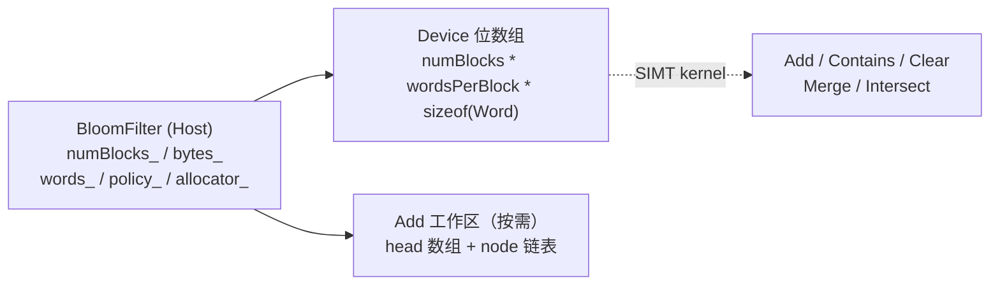
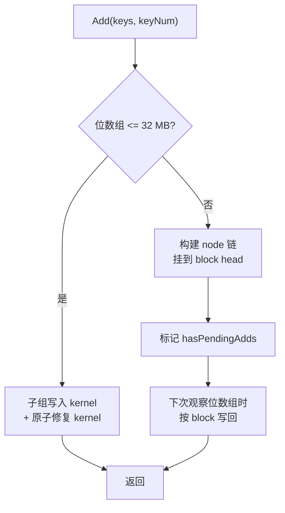

# BloomFilter 容器设计文档

## 需求背景（required）

### 1.1 需求来源

社区任务《BloomFilter 容器开发任务书》要求在昇腾 NPU 上基于 C++ / Ascend C SIMT 实现一个 Bloom Filter 概率集合容器，完成设计、开发、测试全流程，验收通过后将代码提交至昇腾算子库 [ops-collections](https://gitcode.com/cann/ops-collections)

### 1.2 背景介绍

#### 1.2.1 容器目标

`BloomFilter` 是一个基于位数组的概率集合容器，支持批量 `Add`（添加 key）与 `Contains`（成员查询），不保存原始 key。查询可能存在假阳性，但已添加 key 不会出现假阴性。对外提供以下接口：构造、析构、`Add`、`Contains`、`Clear`、`Merge`、`Intersect`。key 类型支持 `uint32_t`、`uint64_t`、`float`

本次设计目标如下：

1. 提供上述 7 个接口与 3 种 key 类型，在合法输入下行为正确
2. 接口以 `void* 起始地址 + 元素个数(Extent)` 替代 CUDA 迭代器，保留批量输入语义，附 `aclrtStream`
3. 默认策略使用 XXHash64、`uint32_t` word, 256 bit block, 8 bit 指纹，并支持与 cuCollections 同类的策略参数
4. 支持同步 / 异步、条件批量（`AddIf` / `ContainsIf`）、非拥有 Device 引用（`BloomFilterRef`）和自定义分配器
5. 完成任务书规定的 42 个 I32/I64 性能用例并自动判定性能要求，额外执行 16 项策略性能矩阵
6. 适配硬件为 Atlas 950 系列产品

#### 1.2.2 基线来源说明

| 基线层次 | 路径或版本 | 作用 |
| --- | --- | --- |
| 功能语义层 | cuCollections `include/cuco/bloom_filter.cuh`，下载提交见 `参考资料清单.md` | 核对 Add, Contains, Merge, Intersect 语义与默认策略 |
| 仓内文档层 | `docs/DynamicMap_design.md`、`docs/DynamicMap_API文档和使用示例.md` | 对齐文档结构与写法 |
| SIMT 接口层 | `cann/asc-devkit`，下载提交见 `参考资料清单.md` | 核对线程模型、shuffle、原子和启动接口 |
| 官方开发文档 | CANN 8.5/9.0 对应 Ascend C 和 API 资料 | 核对编译、运行时和内存接口 |
| 验收基线层 | BloomFilter 任务书 | 核对类型、用例、精度和性能阈值 |

`BloomFilter` 为独立新增容器，不依赖 `StaticMap` 等已有容器，所有 Device 计算由专用 SIMT kernel 实现。Host 侧负责对象生命周期、路径选择和 kernel 调度

#### 1.2.3 现状分析

ops-collections 仓已实现 `StaticMap`、`StaticSet` 和 `DynamicMap`。Bloom Filter 与上述精确集合 / 映射在功能定位上不同：它以空间换精度，不保存原始 key，也不支持单 key 删除。因此需要全新的位数组存储、哈希映射和 Device kernel，无法复用已有容器的开放寻址逻辑

新增的公共组件仅 `xxhash_64`（64 bit 哈希），与已有 `xxhash_32` / `murmurhash3_32` 并列暴露

## 需求分析（required）

### 2.1 外部组件依赖

不引入新的第三方组件。复用 ops-collections 已有的 `Extent` 类型、`DefaultAllocator`、测试公共件（`acl_env` / `device_buffer`）与性能测试框架（`tests/performance/performance_test_framework.h`）

### 2.2 内部适配模块

| 模块 | 文件 | 职责 |
| --- | --- | --- |
| 容器头文件 | `include/bloom_filter.h` | `BloomFilter` 模板类：所有权、公开接口、类型别名 |
| 策略 | `include/bloom_filter_policy.h` | Hash, Word, block、指纹、布局和访问策略的编译期配置与校验 |
| Device 引用 | `include/bloom_filter_ref.h` | `BloomFilterRef`：可传入调用者自定义 SIMT kernel 的非拥有 trivially-copyable 引用 |
| Host 实现 | `include/detail/bloom_filter/bloom_filter.inl` | 参数校验、内存管理、缓存、延迟写回调度和同步 |
| 默认策略 kernel | `include/detail/bloom_filter/kernels.h` | 默认策略专用 SIMT kernel：Add（子组写入 + 原子修复 / 链表构建 + 按 block 写回）、Contains, Clear, Merge, Intersect |
| 泛化策略 kernel | `include/detail/bloom_filter/generic_kernels.h` | 非默认策略 SIMT kernel：支持任意 Word, PatternBits、布局、条件操作和缓存访问 |
| 哈希 | `include/detail/hash_functions/xxhash.h` | XXHash64 实现（4/8 byte key） |
| 功能测试 | `tests/bloom_filter/*.cpp` | 按接口和策略维度拆分的 16 个测试文件 |
| 性能测试 | `tests/performance/bloom_filter/*.cpp` | 任务书 42 项矩阵和 16 项策略矩阵 |
| 构建接入 | `tests/CMakeLists.txt` | 将 `bloom_filter/*.cpp` 纳入测试与性能 glob |

### 2.3 容器接口原型

#### 2.3.1 接口清单（7 + 扩展接口）

| 接口 | 方法签名 | 作用 |
| --- | --- | --- |
| 构造 | `BloomFilter(Extent numBlocks, [Policy], [Allocator], aclrtStream)` | 分配 Device 内存并清零 |
| 析构 | `~BloomFilter() noexcept` | 释放或缓存 Device 内存 |
| Add | `void Add(void* keys, Extent keyNum, aclrtStream)` | 批量添加 key |
| Contains | `void Contains(void* keys, Extent keyNum, void* output, aclrtStream) const` | 批量查询，结果写入 `bool` 数组 |
| Clear | `void Clear(aclrtStream)` | 清零全部 bit |
| Merge | `void Merge(BloomFilter const& other, aclrtStream)` | 原地按位或（并集） |
| Intersect | `void Intersect(BloomFilter const& other, aclrtStream)` | 原地按位与（交集） |
| 异步变体 | `AddAsync` / `ContainsAsync` / `ClearAsync` / `MergeAsync` / `IntersectAsync` | 仅入队，不同步 |
| 条件批量 | `AddIf` / `ContainsIf` 及异步变体 | 按 stencil + predicate 选择性处理 |
| 访问器 | `Data` / `BlockExtent` / `GetPolicy` / `GetAllocator` / `Ref` / `RefAsync` | 底层存储和 Device 引用 |

#### 2.3.2 接口入参说明

接口以 `void* 起始地址 + Extent 数量` 替代 CUDA 迭代器，附 `aclrtStream`。以 `Add` 为例：

| 名称 | 类别 | 类型 | 含义 |
| --- | --- | --- | --- |
| `keys` | 输入 | `void*`（实际 `Key*`） | Device 侧连续 key 数组起始地址 |
| `keyNum` | 输入 | `Extent` | 需要添加的 key 数量 |
| `stream` | 输入 | `aclrtStream` | 执行流 |

计算接口返回类型均为 `void`。`Contains` 通过 Device 侧 `bool` 数组返回逐 key 结果。Runtime 或参数错误通过 C++ 异常报告

#### 2.3.3 设计范围与约束

| 类别 | 约束项 | 约束内容 |
| --- | --- | --- |
| 功能 | 接口集 | 构造 / 析构 / Add / Contains / Clear / Merge / Intersect 共 7 个 |
| 适配硬件 | 产品 | Atlas 950 系列产品 |
| dtype | key | `uint32_t`、`uint64_t`、`float` |
| 位数组 | block 数 | `[1, UINT32_MAX]`，不要求 2 的幂 |
| 默认策略 | 取值 | XXHash64、`uint32_t` word, 8 words/block（256 bit）、8 bit 指纹 |
| 语义 | 假阳性 | `Contains` 存在固有假阳性，已添加 key 无假阴性 |
| 语义 | 幂等 | 重复 `Add` 同一 key 为幂等操作 |

## 详细设计（required）

### 3.1 使能方式

本设计面向 C++ 容器直调场景，通过头文件 `include/bloom_filter.h` 引入，复用 ops-collections 的构建与测试工具链

| 上层调用 | 状态 |
| --- | --- |
| C++ 容器直调（专用 SIMT kernel） | 支持 |

### 3.2 需求总体设计

`BloomFilter` 维护一段连续的 Device 位数组，按固定大小的 block 组织。每个 key 通过一次 XXHash64 定位唯一 block，并在该 block 内设置若干 bit（指纹）。查询时重新计算指纹，所有 bit 均为 1 则报告 "可能存在"，任一 bit 为 0 则确定 "不存在"。容器整体架构如下：



数据结构定义：

```cpp
template <class Key, class Extent, class Policy, class Allocator>
class BloomFilter {
    Policy policy_;                 // 哈希与布局策略
    Allocator allocator_;           // 分配器
    WordType* words_;               // Device 位数组
    void* addHeads_;                // 大过滤器 Add 的 block head 数组
    void* addNodes_;                // 大过滤器 Add 的 node 链表
    std::uint64_t addNodeCapacity_; // node 容量（只扩容不缩容）
    bool hasPendingAdds_;           // 是否有待写回的 Add
    SizeType numBlocks_;            // block 数
    std::size_t bytes_;             // 位数组字节数
    bool useOptimizedDefault_;      // 是否走默认策略专用快路径
};
```

#### 位数组布局

过滤器由 `numBlocks` 个连续 block 组成。默认策略每 block 为 8 个 `uint32_t` word，即 256 bit，策略可配置为 1-32 个 word、`uint32_t` / `uint64_t` word 和不超过 64 的 `PatternBits`。一个 key 只访问一个 block，指纹 bit 均分到 block 内各 word

```text
block 0: [word0][word1][word2][word3][word4][word5][word6][word7]
block 1: [word0][word1][word2][word3][word4][word5][word6][word7]
...

key --XXHash64--> 选择一个 block --> word0..7 各选择一个 bit, 共 8 bit
```

分 block 访问使一次查询只读取连续的 32 字节（默认策略），而非在整个位数组中产生多次随机访问

#### 哈希、block 索引与指纹

设 XXHash64 结果为 `h`，block 数为 `B`：

```text
upper = uint32(h >> 32)
lower = uint32(h)
block = (uint64(upper) * B) >> 32      // 乘高映射，支持任意 B
bit[i] = (salt[i] * lower) >> 27       // i = 0..PatternBits-1
wordIndex[i] = block * wordsPerBlock + i
pattern[i] = 1U << bit[i]
```

`block` 使用乘高映射支持任意 `B`，`B` 为 2 的幂时走等价移位快路径。泛化路径从 64 个固定 salt 中取前 `PatternBits` 个，按 word 位宽生成位置，修改 `PatternBits` 不增加完整哈希次数

操作语义：

```text
Add:       filter[wordIndex[i]] |= pattern[i]
Contains:  for all i, (filter[wordIndex[i]] & pattern[i]) != 0
Merge:     this[word] |= other[word]
Intersect: this[word] &= other[word]
```

#### Host 与 Device 数据流


Host 不读取或计算 key 的哈希，只负责对象生命周期、路径选择和 kernel 调度。所有批量数据计算在 NPU 完成，避免 Host 与 Device 之间的结果往返

#### 设计要点

1. **两级 kernel 路径**：默认策略使用 8 word 展开、`uint4` 向量读写和 `asc_shfl` 子组交换的专用快路径，非默认策略使用循环遍历的泛化路径
2. **大过滤器延迟写回**：大于 32 MB 的过滤器采用 "构建更新链 -> 按 block 写回" 的两阶段策略，将随机原子写转化为按 block 顺序写回
3. **进程内缓存**：32 MB 及以上的分配可进入进程内缓存（上限 3 GiB / 32 项），避免反复调用 `aclrtMalloc` / `aclrtFree`
4. **工作区复用**：大过滤器 Add 所需的 head 数组和 node 链表在首次使用时分配，后续跨 Add 复用，只扩容不缩容

### 3.2.1 Add 设计：按过滤器规模选择路径

#### 32 MB 及以下：子组写入 + 原子修复

8 线程子组中每个 lane 负责 block 内一个 word，通过 `asc_shfl(..., width=8)` 交换 8 个 key 的哈希，形成 Horizontal 8 / Vertical 1 访问模式。第一个 kernel 提高合并访问比例，第二个修复 kernel 对缺失 bit 执行 `asc_atomic_or`，保证多个 key 并发更新同一 word 时不丢 bit

该路径不申请大工作区，适合位数组能较好利用缓存的场景

#### 32 MB 以上：构建更新链 + 按 block 写回

大过滤器直接实现会让每个 key 产生 `wordsPerBlock` 次随机 GM 原子或。80,000,000 个 key 在默认策略下将产生 6.4 亿次随机更新，内存延迟占主导。改为两阶段：

1. **构建阶段**：每个 key 计算一次 XXHash64，将 `lowerHash` 和前驱索引写入连续 node 数组，并通过一次原子操作挂到所属 block 的 head，
2. **写回阶段**：一个线程独占一个 block，在寄存器中遍历该 block 的 node 链，合并全部 word 后用两个 `uint4` 连续写回

256 MB 及以下使用 4 byte head + `asc_atomic_exch`，更大过滤器使用 8 byte 压缩 head + `asc_atomic_cas`。node 和 head 按需分配，后续 Add 操作中复用

`Add` 返回前构建阶段已完成，调用方可立即释放或复用输入 key 数组。位数组可暂不写回——下一次 `Add`、`Contains`、`Merge`、`Intersect` 或 `Data` 需要观察位数组时，先在同一流中执行写回 kernel。`Clear` 无需写回旧更新，直接复位 head 并清零

构建与写回不能融合为一个 SIMT kernel：写回前必须确认所有线程已完成链表构建，而当前路径没有全网格同步，因此用 kernel 边界作为全局可见性屏障



#### 融合边界

以下工作已融合：

- 写回 kernel 在一次遍历中完成 node 归并、word 更新、连续写回和 head 复位，
- `Clear` 用单次线性 kernel 清零全部 word，
- `Merge` 和 `Intersect` 用单次线性 kernel 完成读取、按位运算和写回，
- `Contains` 一次哈希后用两个 `uint4` 读取整个 256 bit block 并直接写结果

### 3.2.2 Contains / Clear / Merge / Intersect 设计

#### Contains

先写回待处理 Add，再由一个线程处理一个 key。线程计算一次 XXHash64，用两个 `uint4` 加载选中 block 的 8 个 word，8 个 pattern 都存在时向 Device 侧 `bool` 数组写 `true`。访问布局为 Horizontal 1 / Vertical 8

#### Clear

若有待处理 Add，先丢弃对应 head 链，再用 grid-stride 循环把全部 word 写 0。返回后此前添加的 key 不再保证命中

#### Merge

先写回左右过滤器，再逐 word 执行按位或，结果写回左操作数。左右过滤器原有已添加 key 不会因 Merge 产生假阴性。`other` 不改变

#### Intersect

先写回左右过滤器，再逐 word 执行按位与，结果写回左操作数。这是 **位数组交集**，不是精确集合交集，碰撞 bit 可能保留额外假阳性。仅在一个过滤器中出现的 key，在 Intersect 后不再承诺命中。`other` 不改变

### 3.2.3 生命周期与内存管理

#### 构造

1. 检查 `numBlocks > 0`、不超过 `UINT32_MAX` 且字节数计算不溢出，
2. 尝试从进程内同尺寸缓存取得内存，
3. 未命中时用 `ACL_MEM_MALLOC_HUGE_FIRST | ACL_MEM_TYPE_HIGH_BAND_WIDTH` 申请 GM，
4. 调用 Clear kernel 并同步，使构造完成的对象立即可用

默认策略的位数组字节数为：

```text
filterBytes = numBlocks * 8 words/block * 4 bytes/word = numBlocks * 32
```

泛化策略使用 `numBlocks * Policy::wordsPerBlock * sizeof(Policy::WordType)`。传入自定义 Allocator 时，过滤器存储和 Add 工作区均由该分配器管理

#### 析构与移动

32 MB 及以上的分配可进入进程内缓存，缓存上限为 3 GiB 和 32 项，超出上限或小于 32 MB 时调用 `aclrtFree`。缓存命中前用 `aclrtPointerGetAttributes` 排除 Runtime 重启后的失效指针。析构为 `noexcept`

对象禁止复制，避免两个对象重复释放同一地址，支持移动构造和移动赋值。移动后的源对象只允许析构或重新赋值

### 3.2.4 缓存与工作区

| 内存 | 大小 | 分配时机 | 复用方式 |
| --- | --- | --- | --- |
| 位数组 | `numBlocks * wordsPerBlock * sizeof(Word)` | 构造 | 生命周期内常驻，析构后大分配可进入进程缓存 |
| head 数组 | `numBlocks * 4` 或 `numBlocks * 8` 字节 | 大过滤器首次 Add | 容器内跨 Add 复用 |
| node 链表 | `keyNum * 8` 字节 | 大过滤器 Add 需要更大容量时 | 只扩容不缩容，跨 Add 复用 |
| Contains 输出 | `keyNum * sizeof(bool)` | 调用方分配 | 容器不拥有 |

80,000,000 key 的 node 约为 610 MiB。随机 key 访问不适合把完整工作集搬入有限 UB，实现以寄存器聚合、L2/DataCache 和高带宽 GM 连续缓冲为主。工作集超过 L2 时，按 block 归并仍把过滤器写流量降到每个非空 block 一次 256 bit 写回

### 3.2.5 dtype 支持

`BloomFilter<Key>` 模板化，实例化 `uint32_t` / `uint64_t` / `float`。XXHash64 对 4 byte 和 8 byte 输入分别处理：4 byte key 作为单 stripe 追加，8 byte key 按完整 32 byte stripe 逻辑处理。`float` 按 32 bit 内存表示参与哈希，`+0.0f` 与 `-0.0f`、不同 NaN 载荷视为不同 key

### 3.2.6 性能优化策略

1. **分 block 局部性**：一个 key 只访问一个连续 32 byte block（默认策略），而非在整个位数组中产生多次随机访问
2. **两级 kernel 路径**：默认策略使用 `uint4` 向量读写、8 word 全展开和 `asc_shfl` 子组交换的专用快路径，非默认策略使用泛化循环路径，保证正确性
3. **延迟写回**：大过滤器 Add 将随机原子写转化为按 block 顺序写回，每个非空 block 只做一次 256 bit 写回，显著降低 GM 写流量
4. **融合操作**：写回 kernel 一次遍历完成 node 归并、word 更新、连续写回和 head 复位，Contains 一次哈希后用 `uint4` 读取整个 block 并直接写结果
5. **进程内缓存**：大分配析构后可缓存，避免热路径上反复 `aclrtMalloc` / `aclrtFree`

### 3.2.7 特殊情况与边界处理

| 特殊情况 | 处理方式 |
| --- | --- |
| `numBlocks == 0` | 抛出 `std::invalid_argument` |
| block 数或字节数溢出 | 抛出 `std::overflow_error` |
| `keyNum > 0` 但指针为空 | 抛出 `std::invalid_argument` |
| `keyNum == 0` | 不启动 kernel，输入 / 输出指针可为空 |
| Merge/Intersect block 数不同 | 抛出 `std::invalid_argument` |
| 对移动后源对象调用接口 | 抛出 `std::logic_error` |
| ACL 分配 / 同步失败 | 抛出 `std::runtime_error`，附返回码 |
| 析构中释放失败 | 不抛异常 |
| 重复 Add 同一 key | 幂等 |
| `float` 特殊值（`+0/-0`、Infinity, NaN） | 按原始 bit 哈希，产生不同结果 |

### 3.2.8 并行调度

- 从 `PlatformAscendCManager` 取得 AIV 核数，满核启动，
- 默认快路径每核 1024 个 SIMT 线程，泛化路径使用较小线程组控制资源占用，
- kernel 通过全局线程号和 grid-stride 循环覆盖全部 key 或 word，无需额外 tiling 数据，
- 使用 `threadIdx` / `blockIdx` / `blockDim` / `gridDim`、`asc_vf_call`、`asc_shfl` 和 `asc_atomic_*`，
- 同一对象不支持多个 Host 线程同时调用，调用方须串行化，
- 无核间通信、跨核同步和多卡通信

### 3.3 支持硬件

| 支持的芯片版本 | 涉及勾选 |
| --- | --- |
| Atlas 950 系列产品 | √ |

当前实测环境为 CANN 9.0.0-beta.2。CCEC 构建参数使用该版本工具链内部目标名 `dav-c310`，生成代码在 950PR 实机完成编译、功能和性能验证。硬件架构名称和接口以 `参考资料清单.md` 记录的官方资料为准

### 3.4 算子约束限制

1. key 只支持 `uint32_t`、`uint64_t` 和 `float`
2. word 只支持 `uint32_t` 或 `uint64_t`，`WordsPerBlock` 必须是 1-32 的 2 次幂
3. `PatternBits` 范围为 `[WordsPerBlock, min(64, blockBits)]`，Add/Contains 布局乘积必须整除 `WordsPerBlock`
4. 输入和输出必须位于当前 Device 可访问内存，异步接口要求资源在流执行完成前保持有效
5. 不支持单 key 删除、枚举或取回原始 key
6. `Contains` 存在 Bloom Filter 固有假阳性
7. `Intersect` 后只保证位数组按位与结果正确，不保证左侧原有 key 继续命中

## 四、特性交叉分析

| 交叉维度 | 风险 | 处理方式 |
| --- | --- | --- |
| dtype * 哈希 | 4 byte 和 8 byte 输入路径不同 | XXHash64 标准向量及 U32/U64/float 功能测试 |
| float * 特殊值 | `+0/-0`、Infinity 和 NaN bit 表示不同 | 按原始 bit 哈希，用原始 bit 测试 |
| block 数 * 映射 | 非 2 的幂可能产生越界或偏斜 | 通用乘高映射，2 的幂仅作为等价快路径 |
| key 数 * 线程数 | 尾部元素、空输入和超大输入 | grid-stride 循环及 0/1/7/8/9/1025/ 百万级用例 |
| Add * 并发冲突 | 普通读改写可能丢 bit | 原子修复或按 block 独占写回 |
| 操作 * 待处理 Add | 位数组尚未写回时观察到旧值 | Contains/Merge/Intersect/Add 前写回，Clear 直接丢弃 |
| 过滤器大小 * 性能 | 小 / 大工作集瓶颈不同 | 32 MB 边界选择子组路径或链表路径 |
| Merge/Intersect * 尺寸 | 不同位数组不能逐 word 对应 | Host 侧检查 `numBlocks` 一致 |
| 所有权 * 移动 | 重复释放或使用空对象 | 禁止复制、转移全部指针、检查可用状态 |
| PatternBits * 资源 | 大指纹增加单线程资源 | 泛化路径不强制展开，1/4/8/12/32/64 bit 策略实机覆盖 |
| 策略 * 位布局 | 不同 Add/Contains 布局不能改变结果 | 不同布局生成的位数组逐 word 比较 |
| 分配器 * 移动 | 有状态分配器与内存所有者分离 | 分配器随对象移动，构造 / 工作区 / 析构计数测试 |

## 五、可维可测分析

### 5.1 验收标准与验证方式

| 验收项 | 标准 | 验证方式 |
| --- | --- | --- |
| 功能 | Add, Contains, Clear, Merge, Intersect 行为正确 | Catch2 接口测试 |
| 类型 | 支持 I32, I64, float32 | 模板化用例及编译期断言 |
| 精度 | 已添加 key 全部命中，无假阴性 | Device 输出逐元素回拷比对 |
| 泛化 | 空输入、边界数量、任意合法 block 数、重复 key、特殊 float | 结构化功能矩阵 |
| 所有权 | 不可复制，可移动，析构安全 | 类型特征、移动构造 / 赋值测试 |
| I32 性能 | 实测时间 <= 参考时延 / 0.8 | 21 项性能用例自动判定 |
| I64 性能 | 实测时间 <= 参考时延 / 0.6 | 21 项性能用例自动判定 |

功能测试使用 Catch2。性能测试按任务书使用 32, 256, 2048 MB 过滤器，Add/Contains/Merge/Intersect 使用 80,000,000 key。验收交付件中的性能检查脚本确认 42 项是否完整并逐项判断，缺项或超限均返回失败

### 5.2 验证矩阵

| 验证项 | 典型场景 | 验证方式 |
| --- | --- | --- |
| dtype 覆盖 | `uint32_t` / `uint64_t` / `float` | 模板化测试用例 |
| 接口覆盖 | 构造 / 析构 / Add / Contains / Clear / Merge / Intersect | 16 个测试文件按接口拆分 |
| 策略覆盖 | 不同 Word, WordsPerBlock, PatternBits、布局、条件 Add、提前退出、缓存访问、有状态 Hash、自定义 Allocator | 策略矩阵与 Allocator 测试 |
| 边界场景 | 空输入、最小 block、非 2 次幂 block 数、超大输入（百万级） | 结构化边界用例 |
| 并发正确性 | 多 key 更新同一 block | 添加后查询验证无假阴性，百万级压力测试 |
| 所有权 | 移动构造 / 赋值、移动后源对象拒绝操作、析构安全 | 类型特征检查与移动测试 |
| 哈希正确性 | XXHash64 标准向量（uint32 和 uint64 key） | 与标准测试向量逐位比对 |
| 性能场景 | 32/256/2048 MB 过滤器，80M key | 42 项 I32/I64 性能矩阵 + 16 项策略矩阵 |

### 5.3 兼容性分析

BloomFilter 为新增头文件容器，不修改 StaticMap, StaticSet 和 DynamicMap 的接口与行为。新增 XXHash64 公开别名（`aclco::xxhash_64`），不改变 XXHash32。项目继续使用现有 CMake, Catch2 和性能框架

### 5.4 交付件

1. `BloomFilter` 容器代码（公共头文件 + 内部实现 + SIMT kernel）
2. 16 个功能测试文件 + 7 个性能测试文件
3. XXHash64 实现与标准向量测试
4. 设计文档与 API 文档

## 六、与 cuCollections 的对齐范围

对照基线为 cuCollections `dev` 提交 `1a1e640179e85139765a27d2d376e02628b2ccbc`

### 6.1 任务书要求的功能

| 能力 | cuCollections | 本实现 | 结论 |
| --- | --- | --- | --- |
| 构造、析构 | 支持 | 支持 | 对齐 |
| Add / Contains | 支持 | 支持 | 对齐 |
| Merge / Intersect | 支持 | 支持 | 对齐 |
| Clear | 支持 | 支持 | 对齐 |
| key 类型 | 模板参数 | `uint32_t`、`uint64_t`、`float` | 对齐任务书指定类型 |
| 默认策略 | XXHash64, U32 word, 256 bit block, 8 bit pattern | 相同默认策略 | 对齐 |
| 输入范围 | Device 随机访问迭代器 | `void*` + `Extent` | 按任务书适配 |
| 流 | `cuda::stream_ref` | `aclrtStream` | 按运行时适配 |

三种 key 类型、空输入、重复 key、最小 block、非 2 次幂 block 数、64 bit Extent、非法指针、数量溢出和不同大小过滤器组合均有测试。合法 block 数范围为 1 至 `UINT32_MAX`，输入数量由不超过 64 bit 的无符号 `Extent::ValueType` 表示

### 6.2 扩展能力对照

| 能力 | cuCollections | 本实现 |
| --- | --- | --- |
| 同步 / 异步批量接口 | 支持 | `Add/Contains/Clear/Merge/Intersect` 及 `Async` 变体 |
| 条件批量接口 | `add_if` / `contains_if` 及异步变体 | `AddIf` / `ContainsIf` 及异步变体 |
| 非拥有 Device 引用 | `bloom_filter_ref` | `BloomFilterRef`，支持单 key 和 grid-stride 批量操作 |
| 访问器 | `data` / `block_extent` / `allocator` / `ref` | `Data` / `BlockExtent` / `GetAllocator` / `Ref`，另提供 `GetPolicy` |
| 策略参数 | Hash, Word, WordsPerBlock, PatternBits, 布局, 条件 Add, 提前退出, 缓存访问 | 同类编译期策略参数，默认值一致 |
| 有状态对象 | Hash, Allocator | Policy 保存 Hash 对象，Allocator 随存储移动 |

CUDA 线程作用域和 Device 迭代器是平台类型，不直接暴露，当前 NPU 实现以 Device 作用域原子、SIMT 线程索引和 `void*` + `Extent` 表达相同功能。布局参数不改变位数组语义，默认策略使用专用快路径，非默认策略使用统一泛化路径
