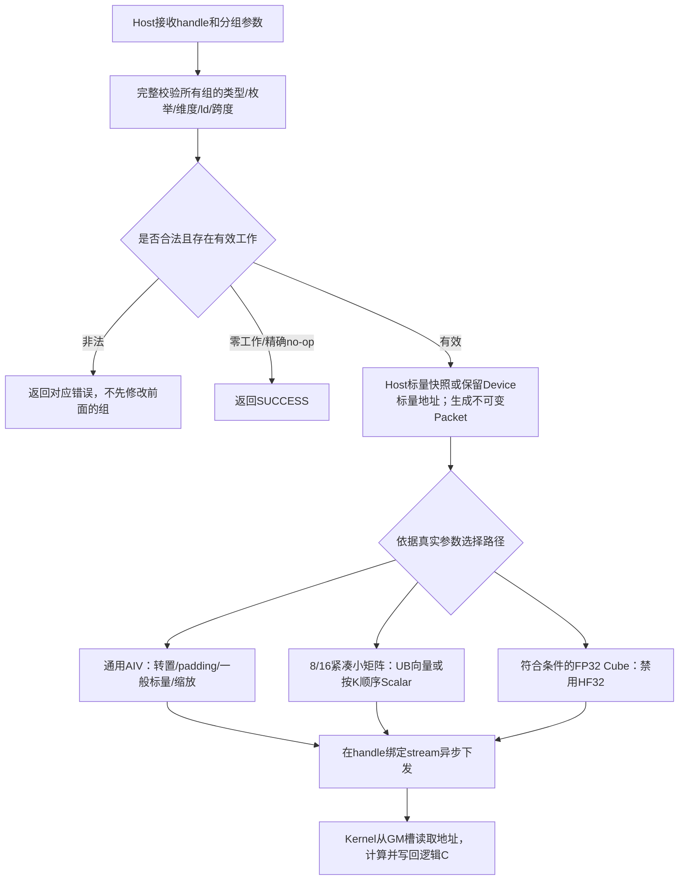

# aclblasGemmGroupedBatchedEx A2/A3 FP32 设计

贡献者：GitCode [xhf_A2_2](https://gitcode.com/xhf_A2_2)。本设计用于社区方案评审，报名信息已提交，当前待审核；尚未提交官方验收。任务ID：36dbb2d3e38d4b4c96fc71b4869cd3e7。本PR仅提交本账号设计文档和目录说明，不包含算子代码、测试附件或其他贡献者文件。

# 需求背景

## 需求来源

2026年10月社区任务 [aclblasGemmGroupedBatchedEx算子开发（A2/A3）](https://www.hiascend.com/activities/task-center/details/36dbb2d3e38d4b4c96fc71b4869cd3e7)。算子实现目标仓为 [cann/ops-blas](https://gitcode.com/cann/ops-blas)，分析起点为456b3487f939920a103a4f3f1a7d7636c7c94c17。官方原始任务包SHA-256：f594aa4fc0ed8bde8c39e6791b9dd006c50771ee851599accd42ce452f252d89。

## 背景介绍

仓库已经有公开扩展分组 GEMM 接口及 arch35 实现，arch22 缺少本任务要求的 FP32 路径。本设计在原公开 ABI、handle 和 stream 框架内补充 Atlas A2/A3 支持，各组维度、转置、标量和批数可以不同。arch35 实现不在本变更范围内。

# 需求分析

## 需求描述

对每个组 g 和组内矩阵 i，按列主序计算：

`C[g,i] = alpha[g] * op(A[g,i]) * op(B[g,i]) + beta[g] * C[g,i]`。

op(A) 为 m×k，op(B) 为 k×n，C 为 m×n；实数共轭转置 C 与 T 相同。主路径 A/B/C 为 ACL_FLOAT，computeType 为 ACLBLAS_COMPUTE_32F。其他类型/组合返回 NOT_SUPPORTED；不通过降低精度实现主路径。

## 需求拆解

1. 保持 include/cann_ops_blas.h 原型，支持 Host 形状数组、Device 矩阵指针数组和 Host/Device 标量。
2. 完整校验全部组元数据后下发，保持原地 C、padding、输入和保护区；支持零组/零维/零批、k=0、alpha=0、beta=0/1。
3. 使用 handle 绑定 stream 异步执行；无新增 Device workspace、无显式 Host 强制同步、无跨流共享可变 GM 计划。
4. 默认 GTest 注册冻结 1000 精度、200 性能，并补足标量位置、偏移、分布和异步等覆盖。
5. 在 CANN9.1.0 实机验证；A3 精度仅作辅助，正式性能使用实际 Ascend910B3。

# 详细设计

## 算子分析

### 数学公式与地址

列主序逻辑 C(r,c) 存于 `C[r+c*ldc]`。A 不转置时 `A[r+t*lda]`，转置时 `A[t+r*lda]`；B 不转置时 `B[t+c*ldb]`，转置时 `B[c+t*ldb]`。按 g 的 groupSize 前缀和索引 Aarray/Barray/Carray 的槽位，禁止组间广播。

### 数据类型与形状

arch22 只支持 FLOAT32 输入、输出和计算。维度、groupCount、groupSize 非负；ld 至少 max(1,物理行数)。Host 对地址跨度做 ptrdiff_t 范围校验。调用方负责提供有效的数组长度、GM 槽位、矩阵存储和互不重叠的独立输出；C ABI 无数组长度信息，不能保证检测越界的 Host 数组。


### Ascend C 算子原型及框架

沿用ops-blas公开头文件的现有声明，不新增ACLNN图算子原型：

```cpp
aclblasStatus_t aclblasGemmGroupedBatchedEx(
    aclblasHandle_t handle, const aclblasOperation_t transaArray[],
    const aclblasOperation_t transbArray[], const int mArray[], const int nArray[],
    const int kArray[], const void* alphaArray, const void* const Aarray[],
    aclDataType Atype, const int ldaArray[], const void* const Barray[],
    aclDataType Btype, const int ldbArray[], const void* betaArray,
    void* const Carray[], aclDataType Ctype, const int ldcArray[], int groupCount,
    const int groupSize[], aclblasComputeType_t computeType);
```

本任务为handle/stream式BLAS Kernel直调，语义参考cuBLAS cublasGemmGroupedBatchedEx，精度参考Netlib3.10.0 cblas_sgemm。它不涉及TBE图算子替换、图注册、InferShape或ACLNN两阶段workspace API；继续使用ops-blas的CMake、handle和标准测试main。

| 参数组 | 位置/类型 | 含义与约束 |
|---|---|---|
| transaArray/transbArray | Host枚举数组 | 每组N/T/C；实数C与T相同 |
| mArray/nArray/kArray、ld数组 | Host int数组 | 每组逻辑维度和列主序leading dimension；维度非负，ld满足物理行数 |
| groupCount/groupSize | Host int/数组 | 组数、各组矩阵数；按groupSize前缀和映射矩阵指针槽，无组间广播 |
| alphaArray/betaArray | Host或Device FP32数组 | 每组标量；Host按值快照，Device由Kernel执行时读取 |
| Aarray/Barray/Carray | Device指针数组，载荷也在Device | Host不得解引用槽；C原地写回，独立输出区域不得交叠 |
| Atype/Btype/Ctype/computeType | 枚举 | arch22范围为ACL_FLOAT三输入/输出及ACLBLAS_COMPUTE_32F |
| handle | 已初始化ops-blas handle | 使用其绑定stream异步执行，生命周期由调用方保证 |

### 标杆语义与执行流程



流程图是本方案对cuBLAS/Netlib分组GEMM语义的实现映射，不表示两者的内部私有Kernel结构。负例由接口状态校验，不能用未执行Kernel的状态检查冒充NPU数值计算。

## 算子实现

### Host 设计

实现位于 blas/gemm_grouped_batched_ex/arch22。首先检查 handle、dtype，再检查 groupCount；0 组合法返回；非零组检查 Host 数组、枚举、维度、ld 及总批数，最后检查外层 A/B/C 指针数组非空。全部组校验成功后才构造执行计划，避免后组非法时前组已被修改。

CheckPtrLocation 区分 alpha/beta 的 Host 或 Device 地址。Host 标量按值快照；Device 标量保留 GM 地址，执行时读取。A/B/C 指针数组位于 Device，Host 仅计算其槽地址，绝不解引用槽内容或做 D2H。

每个普通 Packet 为 1840 字节，最多 74 个指针三元组；通过 kernel 参数按值传递。Cube 参数包含静态断言校验的 TCubeTiling；CANN9.1.0 的 tiling 为 200 字节，CubePacket 为 2048 字节。连续槽偏移表示允许一包更多独立矩阵，实际边界由对应结构和 static_assert 保证。没有额外 Device 元数据分配。

#### 分核和数据分块

通用 AIV 将输出按列和最多 512 行分块，任务在实际可用 AIV 核上分配；处理奇数、padding、任意转置及一般标量。8/16 阶紧凑方阵按独立矩阵分配核心。Cube 仅用于 Host alpha=1、beta=0、紧凑且 m/n/k 均为 16 倍数的中大矩阵，硬件核数来自平台查询。

Cube 初始输出 tile 由维度可整除性选取；并行任务不足时缩小 tile 暴露更多 AIC 工作。短 K、窄矩阵、高批数和长 K 使用独立的形状启发式；相同形状、标量可兼容的小组合并 Packet，其他符合条件的组可合并一次下发。完整决策位于 ggemm_ex_cube_host.h，不依赖测试名称、环境变量或性能采样模式。各目标 SoC 必须重新验证性能，不用 A3 数字替代 B3。

#### 分派规划

kernel 直调使用明确的 vector/cube/cube-offset/cube-groups 入口，不引入公开 tilingKey 属性。Host 依据形状、ld、转置、标量位置和值分派。8/16 小矩阵内部还检查数值范围；没有识别用例名称或把测量模式作为算法开关。

### Kernel 设计

进入 kernel 后从 GM 指针槽取实际矩阵地址。k=0 或 alpha=0 时不读取 A/B；beta=0 不读取旧 C，beta=1 的纯缩放为精确 no-op。Device 标量也遵循同样的执行期语义。

通用 AIV 使用 FP32 计算。紧凑 8/16 方阵先装载 UB；安全范围内通过 Gather 广播 A/B 并用 FP32 向量乘加，存在绝对值≥2^59、非有限值或相应转置条件时按递增 K 的 Scalar 顺序累加，以覆盖默认 ARM Netlib 在极值下的融合/溢出行为。Cube 使用 FP32 Matmul 并显式禁用 HF32。当前尚未证明任意大矩阵的全部溢出排列，报告仅声明实际已覆盖范围。

异步计划不存于共享 GM：每次调用按值参数独立，Host 标量不会在返回后悬空。handle 生命周期与输入/Device 标量释放仍由调用方遵守 stream 同步规则。不得在结果读回前释放矩阵或指针数组。

## 支持硬件

| 平台 | 架构 | 验证安排 |
|---|---|---|
| Atlas A2 / Ascend910B3 | arch22 | 最终3328e878完整1213项及正式200PF全部严格通过 |
| Atlas A3 / 本次实际9362 | arch22 | 初轮功能、极值、补充与采样链路辅助验证；不代替 B3 |

## 算子约束限制

无除 ld 以外的任意跨步、无广播、无输出视图；独立矩阵的写区不可交叠。仅 FLOAT32 主路径。Host 数组长度由调用方保证。TC_ED_194 的 CSV 长度负例在适配层检测，日志单列 CSV_ADAPTER_LENGTH_CHECK_ONLY，不把它写成原生接口/NPU 检测成功。

# 可维可测分析

## 精度与性能标准

默认测试用仓库标准 BlasTest/GTest/main/CMake，原 CSV 字节不变。golden 为独立私有 Netlib3.10.0 默认编译的 cblas_sgemm；不以另行关闭浮点融合的诊断版替换参考。逐矩阵完整 C 对比，rtol=atol=2^-13、匹配率≥0.99、最大误差≤max(0.01,32ULP)；按任务书单独核验 NaN/Inf，缩放精确语义按位检查。读写边界、padding、输入保持均纳入验证。

性能采用 msprof Task Duration(us)，每个调用所有 compute kernel 时间求和。当前预研选择 1 次正确性 +5 次预热 +51 次有效测量，取最后 51 次算术平均；NPU event 仅辅助。严格核验一用例一个进程、原始 kernel 签名、57 次调用及全部 200 参数键与冻结 GPU 基线的一一对应。

任务书正文和附件对 200/1200 条、10/>10/>50 样本、A100/P102 标识、≥0.8/≥1 倍门槛存在冲突。本地按完整 1200、51 有效和严格≥1 倍预研，同时保留≥0.8结果，尚未获得官方确认，不宣称激励资格或验收顺序。

workspace 正文“不涉及”，模板另有 GPU 倍率要求且无 GPU 内存基线。本实现新增 Device workspace=0；handle 默认 workspace 独立记录，不能编造 GPU=0 或把拦截器观察范围扩大为 SDK 内部证明。

## 兼容性分析

不改变公开 ABI、公共测试 main 和 arch35 算法。arch22 参数结构在 Host/Device 共享头中用 static_assert 固定布局，CANN 或 TCubeTiling ABI 变更应编译失败并重新适配。代码、CSV、依赖、库和二进制哈希随 run-id 绑定，旧版本全量和新版本定向结果分别保留。

普通测试使用前后64个float保护区保留256B对齐，另有4/8/12B偏移专项，全部地址模值和保护区实际检查；逻辑输入值、CSV与阈值不变。早期32B偏移性能实验与最终数据分开保留，不能拼接最佳值。

上述结果来自独立实现提交3328e87875f8f4ba442a98b9bfd1ddcf017497a7的本地自验证，不是本设计文档PR的源码测试，也不代表官方验收通过。已保存全部200条NPU/GPU耗时与GPU/NPU明细、完整精度与性能日志、逐例51有效样本和原始Profiler。后续验收按流程提供完整材料；本PR不上传大体积测试归档。


## 实现与测试文件映射

| 内容 | ops-blas中的位置 |
|---|---|
| 公开接口 | include/cann_ops_blas.h的既有aclblasGemmGroupedBatchedEx声明 |
| Host入口及参数计划 | blas/gemm_grouped_batched_ex/arch22/gemm_grouped_batched_ex_host.cpp、ggemm_ex_plan.h |
| Cube计划/按值协议 | 同目录ggemm_ex_cube_host.h、ggemm_ex_packet.h、ggemm_ex_cube_packet.h |
| Vector/Cube Kernel | 同目录gemm_grouped_batched_ex_kernel.cpp、gemm_grouped_batched_ex_cube_kernel.cpp |
| 默认GTest及冻结CSV | test/gemm_grouped_batched_ex/arch22/ |
| 算子说明 | blas/gemm_grouped_batched_ex/README.md |

设计评审与后续ops-blas实现贡献分开。后续若评审要求改变算法或分派，按影响范围回归，并对最终交付版本重新绑定完整精度、性能、源码与二进制身份；不继承已改变路径的旧结果。
