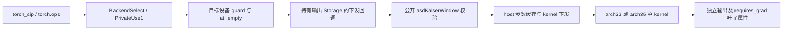

# 需求背景（required）

## 需求来源

社区任务：torch_npu 支持 kaiser_window 接口（A2/A3/A5）。[任务页面](https://www.hiascend.com/activities/task-center/details/3e07081ee52b4043a030ec48d3f0ec34?menu=tasks)。完整实现汇总在 [SiP 提交 6a829ff](https://gitcode.com/m0_51155633/sip/commit/6a829ff32bc3c9629cc31edb7b281a8d74ac9a0e)，生产代码与三档实机验证版本 `31525ba` 一致。原始记录和报告固定在 [验收材料 fe2dcd6](https://gitcode.com/m0_51155633/sip/tree/fe2dcd62e88c6c5700c81161c5d5722d47bb2da9/task_submission)。

任务要求的 CANN 为 9.2.0 系列；本次实际使用并记录用户确认的 **9.2.0-beta.2**，torch 2.7.1、torch_npu 2.7.1.post4。性能采用配套原始 Event 接口平均耗时、200 条完整用例、10 次预热及 60 次采样。

## 背景介绍

KaiserWindow 是无 Tensor 输入的窗函数工厂。实现通过一个 Ascend C kernel 直接生成输出，避免用多个逐元素算子拼接及产生与输出等长的 GM 中间张量。kernel 和 Torch 封装均位于 SiP 仓。

# 需求分析（required）

## 需求描述

公开接口：

```cpp
AspbStatus asdKaiserWindowGetWorkspaceSize(size_t *workspaceSize);
AspbStatus asdKaiserWindow(aclTensor *outTensor, int64_t windowLength,
                         bool periodic, double beta, void *stream, void *workspace);
```

```python
torch_sip.asd_kaiser_window(window_length, periodic=True, beta=12.0, *,
                           dtype=None, layout=torch.strided, device=None,
                           requires_grad=False)
```

支持 float16、bfloat16、float32；缺省 float32，设备缺省当前 NPU。layout 为 strided 或 None。直接注册入口为 `torch.ops.torch_sip.asd_kaiser_window`，没有 CPU 回退。

## 需求拆解

1. 在 SiP 完成参数结构、Operation、Kernel、tiling、两档架构注册和公开 C API。
2. 实现 tensorless factory 的 BackendSelect → PrivateUse1 分发、目标设备 guard 和当前 stream 下发。
3. 覆盖长度 0/1、奇偶窗、periodic、负 beta、零和非有限 beta；workspace 恒为零。
4. 三档独立构建，按原精度、API、Event、内存和确定性要求验证，并保存所有轮次。

# 详细设计（required）

## 算子分析

### 数学公式

令 `N = periodic ? L : L-1`，`r = float32(2*i-N)/float32(N)`，`t = sqrt(abs(1-r*r))`。整数分子先准确计算后再转 float32。对有限 beta 取 `b=abs(beta)`，使用：

```text
w = i0e(b*t) / i0e(b) * exp(b*(t-1))
exp(b*(t-1)) = exp(-b*r*r/(1+t))
```

后一种形式减少中心附近的消减误差。host 在 tiling 阶段计算一次分母倒数；同参数复用，不在每次接口调用重复初始化。

边界分别处理：L=0 不启动 kernel；L=1 或 beta=0 输出 1；L≥2 且 beta 为 NaN/±inf 输出全 NaN。先在 double 域识别有限性；有限但超过 float32 范围的 beta 使用极限结果，仅精确中心为 1，其余为 0。

### 支持数据类型

float16、bfloat16、float32；内部计算域为 float32。

### 支持形状

输出为一维连续 ND Tensor，shape 为 `[L]`，`0 ≤ L ≤ INT32_MAX`。内部计算使用 float32，最后按 round-to-nearest-even 收窄。SiP 允许连续且有 storage offset 的输出描述符，写入时保留两侧数据；Torch 工厂总是新分配独立连续输出。

## 算子实现

### 实现方案



#### 3.2.1 host 侧设计

- SiP 校验长度、shape、dtype、连续 stride、格式和指针，使用仓库返回码。GetWorkspaceSize 返回零。
- MKI 平台信息提供 UB 容量和 AIV 核数。tiling 保留 8 KiB，按 36 B/元素预算并限制 tile≤4096；这是覆盖 arch22 临时数组和输出队列的保守上界。
- 按 64 元素块分核，coreSpan 向上对齐；每核循环处理自己的 tile。950 另外将可用核数限制为 `min(hardwareCores, max(1,L/4096))`，摊薄中小窗的每核初始化开销。
- 使用 host-only、每线程单项缓存，完整键包含设备、L、periodic、beta、dtype。命中时只更新输出地址和本次 stream；不缓存结果、Tensor 或设备输出。
- 非有限 beta 的键不依赖错误的 NaN 相等比较获得结果复用；不会把一个输出返回给多次调用。

##### 1. 分核策略

使用上述 64 元素对齐的 coreSpan 和平台向量核数；950 的每核最小工作量策略独立于 A2/A3，不改变数学参数或原始验收用例。

##### 2. 数据分块和内存优化策略

tile 不超过 4096，依据实际 UB 容量和缓冲预算计算；多 tile 时使用双输出缓冲，窄输出另保留 float 转换缓冲。尾部写入精确字节数，不向上扩展 GM 写入长度。

##### 3. tilingkey 规划策略

架构通过 kernel 注册和平台能力选择；dtype、边界 mode、长度及数值分段信息通过 tiling data 传递。算子无输入广播，不需要广播模式的 tilingkey。

#### 3.2.2 kernel 侧设计

arch22 使用 Ascend C 向量指令和 UB 缓冲；arch35 使用 RegBase/MicroAPI，寄存器中以 Estrin 树计算多项式。两者共用精确长度的输出搬运，使用 DataCopyPad 的字节长度处理非对齐尾部。

小域 `x≤8` 使用 I0 正幂级数；大域使用逆 x 的渐近多项式。host 给出保守的小域/大域边界，只有整 tile 可证明处于某个区间时才省略另一分支，跨界 tile 逐元素选择。

当 b≤80 且整个 tile 属于小域时，用 `I0(x)*smallScale`，其中 `smallScale=exp(-b)/i0e(b)`。直接从 `abs(1-r*r)*b*b/4` 构造幂级数变量，省去开方再平方。arch22 小域的保守阶数为 3/7/8/12，beta 分界为 0.75、3.5、4。

arch22 大域对整个 tile 分类：端点最大半径加 2e-6 保守余量，可证明 `x≥16` 时使用四阶，`x≥32` 时使用三阶，其余保留六阶。每核缓存分类阈值，避免每 tile 增加除法。CPU 检查覆盖 INT32_MAX、非对齐 offset/count 和 ULP 两侧，且设备扩展用例单独验证。渐近展开的误差扫点是实验结果，不冒充全域严格余项证明。

大域归一化复用已有 `1/x`，以 `sqrt(1/x)*polynomial` 省去第二次除法；未采用精度不足的 native approximate Rsqrt。精确中心在输出转换前置为 1。

GM 只写输出，不生成与输出等长的中间 Tensor，workspace=0。队列、float 转换缓冲及临时数组位于 UB，arch35 多项式临时量位于寄存器。异步下发回调持有 Storage，保护输出生命周期；主机任务队列是否启用是进程运行配置，不在算子内强制覆盖。

### Torch 适配

工厂无 Tensor 输入，通过 BackendSelect 指定 NPU 后进入 PrivateUse1。使用目标 NPUGuard、`at::empty`、当前 NPU stream 和公开 SiP 接口。请求 requires_grad 时在填充下发完成后设置叶子属性。Python native FASTCALL 避免重复装箱；torch dispatch/function mode 与 tracing 场景仍进入注册分发，不绕过覆盖语义。

### 构建与注册

A2/A3 注册 ascend910b/arch22；950 注册 ascend950/arch35。A5 使用 `dav-c310-vec` 和 AIV-only 入口，按 beta2 工具链配置 O3、自动同步及 mask 优化。保留向量 kernel 末尾 DCCI；早期移除它导致重复调用故障的实验已撤销并保留失败记录。MKI 和 SiP 侧 ABI0、目标 torch 扩展 ABI1 的构建命令分别存档，不混用 SDK 软链接。

### 源码与许可证

host i0e 的分段 Chebyshev 系数和递推参考 [PyTorch v2.7.1 Math.h](https://github.com/pytorch/pytorch/blob/v2.7.1/aten/src/ATen/native/Math.h)，其来源包含 Cephes。保留 `op_kernel/LICENSE.pytorch` 及系数头的许可说明；数值原型、脚本和额外边界测试随交付提供。

## 支持硬件

| 平台 | 已使用的实机 | 实现 |
| --- | --- | --- |
| A2 | Ascend910B2 | arch22 |
| A3 | Ascend910_9382 | arch22 |
| A5 | Ascend950PR_9579 | arch35 |

## 算子约束限制

不支持 CPU、float64、整数、复数、稀疏 layout、非连续输出或 L>INT32_MAX。beta 的非有限输入和较大有限输入按上述边界规则处理，不在接口补造 beta 范围错误。输出不存在广播或原地输入语义。

# 可维可测分析

## 精度标准 / 性能标准

| 项目 | 判据 | 证据 |
| --- | --- | --- |
| 精度 | 原始1000条；FP16 2^-10、BF16 2^-7、FP32 2^-13 混合容差，匹配率≥99%，保留最大误差门限 | 2.1 / 2.2 与逐用例 JSON |
| 接口 | 原始23项、额外设备/stream/叶子/参数检查 | 原始 API 及 edges 日志 |
| 性能 | 原始200条 Event 平均，10预热/60采样；A2/A3≥0.8，A5≥0.4 | 3.1 / 3.2，固定三轮逐条保留 |
| 内存 | workspace API实测为0，无中间GM Tensor，精确尾部写入、生命周期正确 | 4.1 / 4.2、源码及补充guard日志 |
| 确定性 | 同参数重复执行字节一致 | edges 中210项位级确定性 |

msprof op 使用工具 5 次预热、10 次有效采样，仅作内核诊断。额外长窗口 BF16 严格 .002 检查暴露过 float32 误差跨舍入中点的 1 ULP 差异，基线和未选 tile8192 实验均存在；哨兵写入正常，原任务精度判据通过。完整记录保留，未通过放宽原始验收阈值消除失败。

本次未声称执行 mssanitizer；内存结论来自 workspace API、guard、临时输出释放/多 stream 测试、单 kernel 证据和源码检查。最终平台环境、固定配置、三轮结果及例外项以验收报告为准。

## 兼容性分析

公开接口及注册保持 SiP 扩展约定。默认 dtype 固定 float32，不受全局默认 dtype 更改影响；默认 device 为当前 NPU。使用目标设备 guard 并恢复调用方设备状态，支持非默认 stream 的顺序依赖。

## 设计提交状态

本文随设计 PR 提交评审；评审通过和合入以该 PR 的实际状态为准。代码合入另走 SiP PR 流程。设备自验证通过与上游评审、合入是独立状态。


## 最终验收结果与复现

三档原始精度各 1000/1000，原始 API 各 23/23。按预先固定的连续三轮运行原始 Event 性能用例，各轮均为 200/200。倍率为原任务 GPU 基线耗时 / NPU Event 平均耗时，未更改原用例、GPU 基线、倍率门槛或 10 次预热 / 60 次采样。

| 平台 | 进程配置 | 三轮最低倍率 | 任务门槛 |
| --- | --- | --- | --- |
| A2 | queue=0；CPU 8,10,12,14 | 0.9259 / 1.1199 / 1.1119 | 0.8 |
| A3 | queue=1；CPU 0,2,4,6 | 1.5332 / 1.5306 / 0.9607 | 0.8 |
| A5/950 | queue=0；默认 CPU 亲和性 | 1.4700 / 1.4457 / 1.2838 | 0.4 |

CPU 编号仅对应实测实例，不是算子实现中的固定配置。设备型号、完整 CANN/驱动/torch 版本、实际构建命令、原始日志、逐条 JSON、内存 guard、生命周期及非默认 stream 检查见上述固定验收材料。其中 `1 自验证步骤说明.md` 和 `tools/reproduce_final.sh` 给出复现步骤；`final_sources.json` 指向各平台最终原始记录。全部历史成功和失败档案均保留在 `evidence/` 中。
