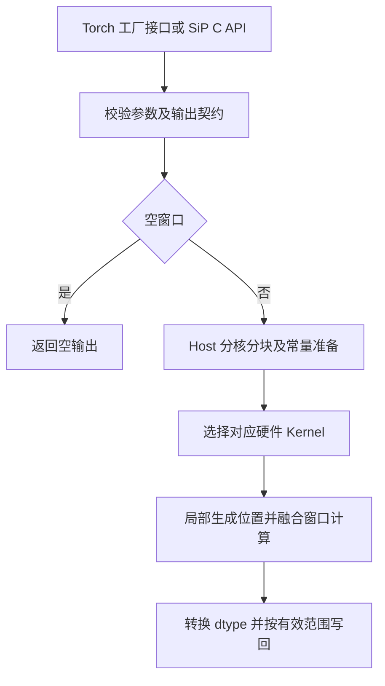

# KaiserWindow 算子设计文档（A2/A3/950）

## 文档信息

| 项目 | 内容 |
| --- | --- |
| 社区任务 | 10月社区任务-torch_npu支持kaiser_window接口（A2/A3/950） |
| 任务 ID | 3e07081ee52b4043a030ec48d3f0ec34 |
| 参与账号 | qq_51183872 |
| 需求跟踪 | [cann/sip Issue #308](https://gitcode.com/cann/sip/issues/308) |
| 实现目标仓 | [cann/sip](https://gitcode.com/cann/sip)，含 kernel 与 sip_pta 封装 |
| 依据 | 2026-10-28 获取的官方任务书及配套 test_cases |
| 当前阶段 | 设计评审；950 实现已完成本地自验证，正式验收及三硬件最终同版本回归另行进行 |

# 需求背景（required）

## 需求来源

来自昇腾社区 [KaiserWindow 任务](https://www.hiascend.com/activities/task-center/details/3e07081ee52b4043a030ec48d3f0ec34)。以该任务的接口、环境、官方测试包及分档判据为交付依据；流程遵循[社区任务流程及注意事项](https://gitcode.com/org/cann/discussions/39)。

## 背景介绍

Kaiser 窗用于信号加窗和频谱分析。窗长度、周期性与形状参数决定一维窗序列，不需要输入 Tensor。任务要求在 SiP 中补齐原生 NPU 实现，避免 CPU 回退和多个现成逐元素算子拼接产生的重复下发及中间 GM 张量。

对标为 PyTorch 2.7.1 的 `torch.kaiser_window`；交付入口是 `torch_sip.asd_kaiser_window`，不是修改 PyTorch 内置接口或向 op-plugin 提交另一套封装。CPU 实现用于精度参考，性能基线使用官方随包提供的 GPU 数据。

# 需求分析（required）

## 需求描述

使用 Ascend C 在 SiP 工程中实现独立 KaiserWindow kernel，并通过 sip_pta 暴露 Torch 工厂接口。输出为 NPU 上长度为 `window_length` 的一维连续独立张量，支持 FLOAT16、BFLOAT16、FLOAT32。A2、A3、950 分别采集并判定结果。

## 需求拆解

| 层次 | 设计与交付内容 | 对应验证 |
| --- | --- | --- |
| SiP 入口 | 输出描述符校验、零工作区查询、Operation 下发 | C 接口行为、内存记录 |
| MKI 注册 | 参数、Operation、Kernel、Tiling 与构建清单 | 对应 SoC 编译与加载 |
| Ascend C kernel | 稳定 Bessel 比值、分核分块、边界处理、目标 dtype 写回 | 官方 1000 条精度与确定性检查 |
| sip_pta | 无 Tensor 输入的工厂分发、设备/stream、完整 Python 签名 | 官方接口契约脚本 |
| 性能 | A2/A3 向量实现与 950 RegBase 实现分别调优 | 官方每档 200 条性能 |
| 交付 | 文档、自验步骤、逐条数据/日志/截图、版本及源码标识 | 任务书交付件模板 |

# 详细设计（required）

## 算子分析

### 数学公式与数值稳定性

令 `L = window_length`。当 `L >= 2` 时：

```text
N = L - 1                       if periodic == False
N = L                           if periodic == True
r[i] = float32(2*i - N) / float32(N)
t[i] = sqrt(abs(1 - r[i]*r[i]))
out[i] = I0(beta*t[i]) / I0(beta),   0 <= i < L
```

`I0` 为第一类零阶修正贝塞尔函数。周期窗直接按 `N=L` 计算前 L 个点，不实际分配 L+1 个点再切片。对称窗按 `N=L-1` 计算。

核内使用任务书要求的缩放形式，先取 `b=abs(beta)`，保证负 beta 的偶函数语义：

```text
i0e(x) = exp(-abs(x)) * I0(x)
out[i] = (i0e(b*t[i]) / i0e(b)) * exp(b*(t[i]-1))
```

中间计算使用 FP32，采用公开 Bessel 函数近似体系实现分段多项式计算，避免直接在 FP16/BF16 中求取大幅值 I0 导致过早溢出。数值定义参考 PyTorch 2.7.1 与 Cephes；实现保持公开系数来源和许可说明。设计以缩放函数比值、误差控制和官方用例验证为依据。

归一化量作为同次调用的公共常量复用。索引运算与字节偏移须避免允许的长度范围内发生整数溢出；最终结果在写回阶段按目标 dtype 收窄，采用 round-to-nearest-even。具体近似参数、局部存储配置与调优记录随实现材料维护。

### 参考流程、Ascend C 流程与差异

下图是数学参考流程，不代表特定 GPU kernel 的内部实现；GPU 性能数据仍使用任务随附基线。





优化方向是融合计算、合理分核分块、复用片上局部数据及控制尾块写回。性能是否达标以官方脚本逐例测量为准，流程图不构成性能保证。

### 支持的数据类型、形状与参数

| 参数 | 类型/默认值 | 契约 |
| --- | --- | --- |
| window_length | int，必填 | 支持范围 [0, 2^31-1]；输出 shape=[L] |
| periodic | bool，True | True 为周期窗，False 为对称窗；允许位置或关键字传参 |
| beta | host double，12.0 | 正常精度域 [0,88]，另覆盖负值、NaN、±inf；不增加 beta 值域报错 |
| dtype | None | None 按任务书固定为 float32；仅支持 float16/bfloat16/float32 |
| layout | torch.strided | 仅 strided；None 按默认处理 |
| device | None | None 为当前 NPU；显式 npu:index 绑定对应设备；不回退 CPU |
| requires_grad | False | True 时输出为可累积梯度的叶子；不引入本算子反向公式 |
| 输出 | ND、[L] | 一维连续、独立分配，无输入张量、无广播、无原地/视图语义 |

### 边界分支及优先级

| 判断顺序 | 条件 | 行为 |
| --- | --- | --- |
| 1 | L=0 | 返回空张量；工作区为 0；不启动计算 kernel |
| 2 | L=1 | 写入 1，优先于 beta 非有限值判断，periodic 不影响结果 |
| 3 | L>=2 且 beta 为 NaN/±inf | 所有输出为 NaN |
| 4 | L>=2 且 beta=0 | 所有输出为 1，避免 0/0 |
| 5 | 其余有限 beta | 按稳定公式计算；负 beta 使用绝对值 |

专门核对 `L=2`：非周期为 `[1/I0(b),1/I0(b)]`，周期为 `[1/I0(b),1]`；`L=3` 非周期为 `[1/I0(b),1,1/I0(b)]`。开方前使用 `abs(1-r²)`，不将该任务约定替换为另一个端点公式。常量分支与普通分支均由同一个算子实现，不调用其他填充算子拼接计算。

## 算子实现

### SiP API 与 Host 侧设计

在 `include/base_api.h` 的 `AsdSip` 命名空间内增加任务书规定的 C linkage 声明，保持 SiP 的返回码体系：

```cpp
namespace AsdSip {
extern "C" {
AspbStatus asdKaiserWindowGetWorkspaceSize(size_t *workspaceSize);
AspbStatus asdKaiserWindow(aclTensor *outTensor, int64_t windowLength,
                         bool periodic, double beta, void *stream,
                         void *workspace);
}
}
```

`GetWorkspaceSize` 校验返回指针并写入 0。执行入口校验长度、outTensor 的维数、长度、dtype 和连续性，返回 `ACL_ERROR_INVALID_PARAM` 或 `ACL_ERROR_UNSUPPORTED_DATA_TYPE` 等仓内规定错误码；成功返回 `ACL_SUCCESS`。beta 不做取值拦截；L=0 不要求有效的输出数据地址。

SiP 入口只写调用方提供的 outTensor，不在入口申请输出或中间 GM 缓冲。组装零输入、一个输出的 OpDesc，填入 `OpParam::KaiserWindow`，经 SiP 算子执行框架在调用方 stream 上异步执行。不增加每次调用的设备全局同步，也不缓存用户输出数据。

Operation 的 InferShape 按 host 长度参数确定 `[L]`，不能照搬从输入 Tensor 推导形状的例子。Kernel 的 CanSupport 校验零输入/一输出、参数类型、输出 dtype 和目标 SoC；GetTilingSize/InitImpl 与对应 tiling 数据结构保持一致。

### Tiling、分核与局部存储

1. 根据输出长度和平台向量核能力划分互不重叠的 tile；各核处理分配给自己的 tile，最后一块单独记录有效长度。
2. 核内生成索引，FP32 中间量存放在 UB/寄存器；局部存储预算同时覆盖计算临时量和输出缓冲。
3. tiling 传递长度、周期性派生参数、公共常量、计算模式及分块信息。空窗、常量输出和普通窗口采用相应路径；不按官方 case 编号返回预置结果。
4. 尾块按实际有效元素写回，屏障/事件遵循对应硬件的流水要求，防止越界或覆盖其他核心输出。
5. 输出一次写回 GM，workspace 为 0，不使用输出等长的中间 GM 张量。分块与缓冲参数以各硬件实际测量结果确定。

### Kernel 侧设计

**A2/A3（ascend910b、arch22）：** 使用 Ascend C AIV 向量接口实现索引转换、乘加、绝对值、开方、指数及分段多项式求值；通过局部向量复用控制 UB 峰值。FP16/BF16 仅作为输出类型。A2 与 A3 共用算法但分别验证，不能用其中一档成绩代替另一档。

**950（ascend950、arch35）：** 单独组织 RegBase/MicroAPI 实现，在寄存器中完成逐元素计算，使用对应掩码、类型转换和搬出接口；不假定 arch22 的代码或流水同步方式可直接复用。两条路径共享数学定义、系数来源和边界语义，不混用架构专属头文件。

每个输出元素独立计算，不使用跨核归约、原子累加或其他依赖执行次序的操作。同一设备、同一版本、同一参数重复执行应逐位一致。

### Torch 工厂接口设计

```python
def asd_kaiser_window(
    window_length: int, periodic: bool = True, beta: float = 12.0,
    *, dtype: Optional[torch.dtype] = None,
    layout: torch.layout = torch.strided,
    device: Optional[torch.device] = None,
    requires_grad: bool = False,
) -> torch.Tensor:
    ...
```

Python 入口保留以上参数与默认值，尤其支持省略 periodic、只给 beta 的调用。C++ 用 `TORCH_LIBRARY_FRAGMENT(torch_sip, ...)` 声明 `asd_kaiser_window` schema，用 `TORCH_LIBRARY_IMPL(torch_sip, PrivateUse1, ...)` 注册 NPU 实现。

由于本接口没有 Tensor 入参，不能假设 Dispatcher 能从输入 Tensor 自动选中 PrivateUse1。接口支持显式工厂分发：增加该算子的 BackendSelect 入口，根据已解析的 device 将调用转发到 PrivateUse1 实现；不向公开签名塞入虚假 Tensor 参数。以 torch 2.7.1 的实际 Dispatcher API 编译验证，并用裸调 `torch.ops.torch_sip.asd_kaiser_window` 与 Python 包装入口同时检查可达性。

在 C++ 侧解析 device 并建立 NPUGuard，使用对应设备的当前 NPU stream；以 `at::empty` 创建 `[L]` 连续输出，调用 workspace 查询并核验返回码，再构造 aclTensor 描述符调用 SiP 入口。workspace=0 时不分配替代 Tensor。描述符与输出存储遵循 sip_pta 现有异步生命周期约定，描述符释放不得造成设备执行期间的存储提前释放。

dtype=None 固定为任务书要求的 float32，不跟随全局默认 dtype 漂移；layout=None 规范化为 strided。requires_grad 由封装层处理，生成输出后设置为相应叶子状态，不在内部数值计算上建立无意义的反向图。非法 dtype/device/layout 使用 TORCH_CHECK 报错，不静默搬回 CPU。

### 工程改动清单

```text
core/base/kaiser_window.cpp
include/base_api.h
ops/base/kaiser_window/CMakeLists.txt
ops/base/kaiser_window/kaiser_window_operation.cpp
ops/base/kaiser_window/kaiser_window/kaiser_window_kernel.cpp
ops/base/kaiser_window/kaiser_window/tiling/tiling_data.h
ops/base/kaiser_window/kaiser_window/tiling/kaiser_window_tiling.h
ops/base/kaiser_window/kaiser_window/tiling/kaiser_window_tiling.cpp
ops/base/kaiser_window/kaiser_window/op_kernel/arch22/kaiser_window.cpp
ops/base/kaiser_window/kaiser_window/op_kernel/arch35/kaiser_window.cpp
ops/include/params/kaiser_window.h
ops/base/CMakeLists.txt
configs/op_list.yaml
sip_pta/csrc/base/kaiser_window.cpp
sip_pta/torch_sip/__init__.py
sip_pta/test/base/kaiser_window.py
```

在 `configs/op_list.yaml` 登记 Operation/Kernel，并启用 ascend910b 与 ascend950。另补充算子 API/使用说明及 sip_pta README，具体文件组织遵循 SiP 当前工程规范。本设计 PR 只新增设计文档，不在 competitions 仓提交实现代码。

## 支持硬件与环境

| 验证设备 | 实现路径 | 性能基线 | 最低倍率 |
| --- | --- | --- | --- |
| Atlas A2 | ascend910b / arch22 AIV | 官方 A100 CSV | T_A100/T_NPU >= 0.8 |
| Atlas A3 | ascend910b / arch22 AIV | 官方 A100 CSV | T_A100/T_NPU >= 0.8 |
| Ascend 950（任务书 A5） | ascend950 / arch35 RegBase | 官方 H100 CSV | T_H100/T_NPU >= 0.4 |

任务指定 CANN 9.3.0、torch/torch_npu 2.7.1。当前 950 自验证环境实际为 CANN `9.3.0~weekly.20261021.01`、torch `2.7.1+cpu`、torch_npu `2.7.1.post11`；软件版本口径需由验收方确认。torch_sip 与 libasdsip 使用同一实现版本构建，实际库路径和版本随验收材料记录。

### 当前验证状态

截至 2026-10-28，950 已完成官方精度、Torch 接口、性能及内存本地自验证并通过；原始数据与可复现材料已归档。单设备环境不能替代多设备覆盖。A2、A3 的历史验证材料独立保存，三类硬件最终统一源码版本的回归结论另行提供。本 PR 用于设计评审，不将本地自测结果视作官方验收通过。

## 算子约束限制

不支持 FLOAT64、整型、BOOL、复数、稀疏布局、非连续输出、广播和输入原地修改。不额外要求动态 shape 或反向公式。L=0 合法，零维标量输出不合法。数学定义下有限 beta 的窗口值处于 [0,1]；当前数值精度保证以任务规定的有限 beta 测试域为准，不外推至全部有限 double。非有限 beta 按前述边界表传播。

# 可维可测分析

## 精度标准与官方用例

直接使用官方 `test_cases`，保留原始 CSV、cases.json、facts.json、脚本及 SHA256，不修改阈值或删除失败项。CSV 共 1200 行：1000 行精度与 200 行性能；性能参数是从精度覆盖范围中抽取的子集，不声称有 1200 个独立精度用例。

精度 golden 为 CPU `torch.kaiser_window(dtype=torch.float64)` 在线结果，先转换为输出 dtype 再按官方脚本比较。逐元素条件为 `abs(actual-golden) <= atol+rtol*abs(golden)`；整体要求 matched_ratio>=0.99，且满足最大绝对误差限。

| dtype | rtol、atol | 最大绝对误差限 |
| --- | --- | --- |
| FLOAT16 | 2^-10 | max(0.1, 32×ULP(g_low)) |
| BFLOAT16 | 2^-7 | max(0.1, 32×ULP(g_low)) |
| FLOAT32 | 2^-13 | max(0.01, 32×ULP(g_low)) |

g_low 是最大误差点按输出 dtype 收窄后的 golden；非有限值、全 NaN、空张量与 L=1 按官方脚本单独规则判定，不自行改成所有元素逐位等于 FP64。逐位一致只用于任务书要求的同版本重复执行确定性检查。

接口测试使用 `verify_torch_api.py`，覆盖正常调用形态、默认值、shape/dtype/device、layout、requires_grad 和边界行为。实现保留必要的参数防护，但不把任务书未要求的异常参数大规模测试作为额外验收门槛。

## 性能标准、计时与内存

性能全量为每档 200 条，默认预热 10 次、采集 60 次。执行随包 `verify_performance.py`：有 NPU Event 时由事件包围 60 次公开接口调用并除以次数；记录实际所用计时路径，不另换成单独挑选的最快 kernel、最小时间或自定义采样规则。任务书目标为单次接口 Device 平均耗时，不含 golden 比对。

基线直接读取 `gpu_baseline_a100.csv` / `gpu_baseline_h100.csv` 的 gpu_ms，统一换算单位、按 case_name 逐条计算比值，不需要重新申请 GPU 采集基线。A2/A3 每条 NPU 耗时不高于 A100 的 1.25 倍；950 每条不高于 H100 的 2.5 倍；不得用所有 case 的平均倍率掩盖单项失败。

内存采集输出逻辑字节数 `L*sizeof(dtype)` 与 workspaceSize=0，结合实现检查确认无中间 GM 张量；不把框架缓存分配器保留量直接等同于算子工作区。AIV 的 UB/寄存器临时量不计为中间 GM。

## 可复现的验证步骤

以下为验收复测步骤；当前 950 的本地验证状态见上节，其余硬件及新版本按同一流程独立记录。

1. 固定 SiP commit，按官方说明加载 CANN 9.3.0 与同源 asdsip 环境，在 sip_pta 下执行 `bash build.sh --install`，检查实际版本和对应 NPU 型号。
2. 在官方 test_cases 目录执行以下命令，并同时保存完整 stdout/stderr、退出码及 JSON：

```bash
python verify_accuracy.py --device npu --json-out acc_npu.json
python verify_torch_api.py --device npu
python verify_performance.py --device npu --tier a2a3 --json-out perf_npu.json
# 950 环境使用下面命令代替上一条；A2、A3 的结果分别存档。
python verify_performance.py --device npu --tier a5 --json-out perf_npu.json
```

3. 对任务覆盖参数进行同版本重复执行检查；单独记录工作区查询、输出字节数和无中间 GM 的检查结果。
4. 完成官方 200 条性能用例的正式采集，记录源码与二进制版本，不混合不同版本的最好结果。
5. 只有 NPU 实测可形成精度/性能结论。CPU 自检只检查测试输入及参考语义；环境不可用、SKIP 和未测均不记作 PASS。
6. 使用官方验收模板汇总各档完整精度、性能、内存数据及截图，附自验证步骤、源码 commit、构建日志和测试输入哈希；无法归因于实现的问题保留证据并如实说明，不擅自放宽判据。

## 兼容性、风险与实施顺序

新增接口不改变既有 SiP 算子签名。维护重点为接口默认值与边界语义、不同硬件的局部存储和写回行为、精度与性能的独立验证。实现更新后使用官方测试进行回归，软件版本差异随材料说明，未经验证不扩展支持范围。

设计文档先在 competitions 仓评审；设计审核通过并完成自验后按任务书提交 ZIP 及私仓 task_submission 材料。测试通过后，将 kernel 与 sip_pta 封装作为一个代码 PR 提交 SiP 并关联 #308。设计文档合入不自动关闭需求 Issue，不等同于任务验收完成。

## 参考资料

- [SiP 算子接入指南](https://gitcode.com/cann/sip/blob/master/docs/developing_a_simple_operator.md)
- [sip_pta 构建与封装说明](https://gitcode.com/cann/sip/blob/master/sip_pta/README.md)
- [SiP 贡献指南](https://gitcode.com/cann/sip/blob/master/docs/contributing_guide.md)
- [PyTorch 2.7.1 Math.h](https://github.com/pytorch/pytorch/blob/v2.7.1/aten/src/ATen/native/Math.h)
- [PyTorch 2.7.1 TensorFactories.cpp](https://github.com/pytorch/pytorch/blob/v2.7.1/aten/src/ATen/native/TensorFactories.cpp)
- [生态算子混合容差标准](https://gitcode.com/cann/opbase/blob/master/docs/zh/ops_precision_standard/mixed_tolerance_standard.md)
