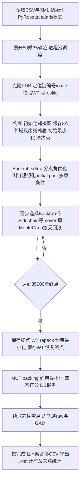
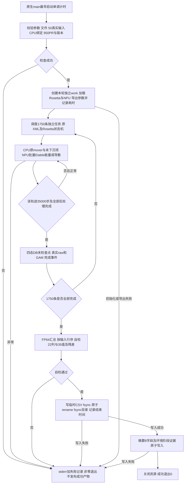
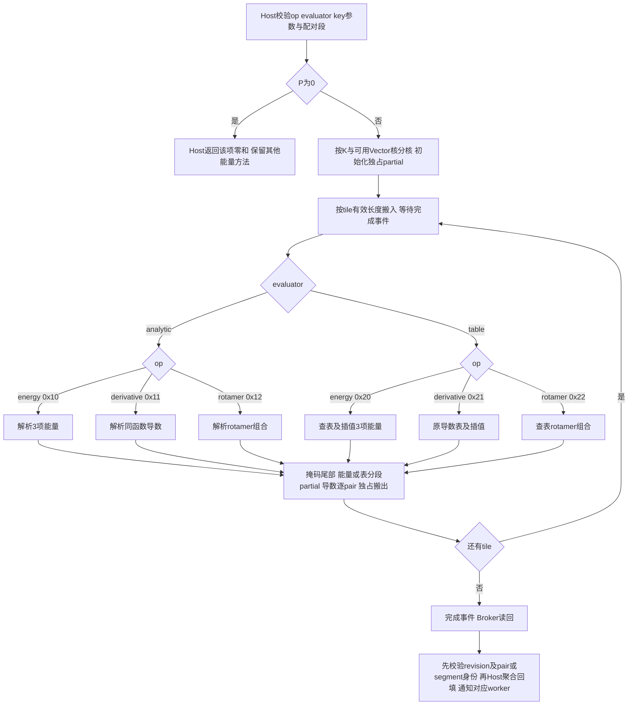

# 需求背景（required）

## 需求来源

本设计对应“Rosetta Flex ddG 端到端加速开发（Ascend 950PR）”，官方任务名称为“11月社区任务-生命科学flexddg ΔΔG 计算加速（24核CPU+950)”，任务标识 `4373d1139dfe4ba7b448a8ef5cc3596b` 取自[官方任务详情](https://www.hiascend.com/activities/task-center/details/4373d1139dfe4ba7b448a8ef5cc3596b)。本文提交整体架构、CPU/NPU 分工、数值语义与验证计划供官方评审；开发已获用户授权提前开展，尚未取得正式 NPU 全量精度或性能通过结论。

| 依据 | 生效版本与用途 |
| --- | --- |
| 任务书原件 | [任务书.zip](https://www.hiascend.com/p/resource/202611/b5e74591f9ae478798a8ba810e1abf6a.zip)，SHA256 `5205cfdafe82bbe4cc18e097ea2e44bff8f676fb84ea2fdef32e7a7a0c335539`；正文 Rosetta_Flex_ddG_Atlas950_task_doc.md，SHA256 `e16589cd364fcd4ec04de7e9d863ba2d0281576d55ec99e43959cbf90bae0637` |
| 需求拆解 | 任务书拆解.md，SHA256 `14f266c3c675e5679bbf486359a31811703984373c79ac246b61bfb4547543bc`；沿用 R-001—R-060、V-001—V-039、D-001—D-018、Q-001—Q-014，不重新编号 |
| 指定源码 | Rosetta `2026.29` / `80a0635615`，已解析完整 commit `80a0635615099e1b918474a63acba7b1de6fd107`；本稿查阅该固定 commit 的相关 C++ 文件，文末“固定源码依据”列出已查阅文件的官方固定链接与 SHA256 |
| 协议与功能基线 | 随包 ddG-backrub.xml、baseline/ddG_flex_lib.py、baseline/flexddg_lib.py；教程仓没有指定 commit，不能把当前主分支当固定版本。随包 XML 为 5167 字节，SHA256 `4f5c48046d624934758d53bbdf69aca19e5494ed0a16a92a77e0973fae5cd1ae` |
| 官方设计格式 | [官方设计模板](https://gitcode.com/cann/cann-ops-competitions/blob/master/04_tasks/01_community-task-2026/resources/design_template.md)的四个主章与表头，并补充特性交叉分析和流程图。在线设计检查表仅能取得界面与“加载中”，单元格内容待核 Q-015 |
| 正式代码仓 | 正式代码合入仓及分支未确定，沿用 Q-001；已核对官方任务详情与本题讨论，二者未指定代码合入仓。设计仓固定为`cann/cann-ops-competitions`，提交路径使用官方任务标识和登录用户名。Rosetta 是指定基线仓，不能自动视为最终交付仓；`ops-blas` 仅是贡献指南示例 |

固定 commit 的源码是设计依据，查阅文件见文末清单。构建时从官方仓取得该 commit 的完整源码，依适用许可和数据库要求构建；查阅文件清单不代表完整 Rosetta 分发包。正式仓未知不阻塞本地架构与接口设计，但阻塞最终远端目录、贡献规范及补丁接入方式的确认。新发现的设计问题 Q-015—Q-017 在文末单独登记，不覆盖第一步的历史记录。

## 背景介绍

### Rosetta Flex ddG 实现优化

目标是在 24 核 CPU + 单卡 Ascend 950PR、CANN ≥ 9.0.0 及配套驱动固件上，完成 BD-623 固定 50 个突变、每个 35 条独立轨迹、每轨迹 35000 步的完整协议。总计 1750 条轨迹、61250000 步。保留 `talaris2014`、8 Å 邻域、5000 最小化迭代上限、1.0 收敛阈值和 WT/MUT 两侧全部阶段。

拟采用 **源码构建的 Rosetta C++ worker + 单 NPU 批量计算服务 + C++ 原生端到端入口**。Rosetta 保留构象、随机过程、packing 退火、最小化器和四态报告；在已核对的打分/能量方法入口引入批量 Etable 能量、导数及 rotamer 能量表计算。其他能量项继续按 Rosetta 原实现计算，返回同一 EnergyMap 后统一加权。该方案避免另写一套采样协议，但需要维护 Rosetta 源码适配；标准 PyRosetta wheel 不能凭 Python 包装自动接管这些 C++ 热点。

这里的 NPU 覆盖范围是设计选择，不是任务书规定只有三个能量项。首版拟下沉 Etable 的 `fa_atr/fa_rep/fa_sol` 及相应导数/packing 表，其他项完整保留。**这部分热点是否足以达到整批 ≥10×，当前没有实测依据（Q-017）**。后续先量化 CPU 保留部分、数据整理和 NPU 往返开销；若理论下界已超过门槛，必须修订分工并重新评审，不能把一次局部 Kernel 加速宣称为本题完成。

本题没有指定 TBE 算子或算子信息库路径，相关模板项不涉及；没有广播算子、通用 tensor dtype 组合或 Atlas A2 的支持义务。

### Rosetta Flex ddG 现状分析

| 参数 | 参数含义 | 数据类型 | 支持数据类型 | 约束 | 形状 |
| --- | --- | --- | --- | --- | --- |
| `--selected` | 待算突变 CSV | UTF-8 file(CSV) | string/int 六字段 | 列为 `pdb_id,chain,pdb_position,icode,wt_aa,mut_aa`；合法单字母氨基酸、定位存在、WT 匹配 | `[N,6]`，正式 N=50 |
| `--pdb-dir` | 全原子结构目录 | dir(PDB) | PDB 文本坐标 | BD-623 420 残基；A 抗原，H/L 抗体；无 HETATM；坐标有限有效 | 1 个 `BD-623.pdb` |
| `--xml` | 官方协议 | file(XML) | RosettaScripts XML string | 使用随包原件；内存替换运行占位符，不改磁盘原件 | 单文件 |
| `--move-chain` | 解离时移开的链 | attr | string | 非空且存在；正式 A | 标量 |
| `--nstruct` | 每突变独立轨迹数 | scalar | int | >0；正式固定35 | 标量 |
| `--trials` | 每轨迹 backrub 步数 | scalar | int | >0；正式固定35000 | 标量 |
| `--cpu-cores` | 主机核预算 | scalar | int | >0 且≤24；正式固定24；必须真实绑定 | 标量 |
| `--device-id` | NPU 逻辑卡号 | scalar | int | ≥0 且设备为可用950PR | 标量 |
| `--seed` | 随机种子起始值 | scalar | int32/int64 可解析整数 | 默认111111；不要求跨运行逐比特一致 | 标量 |
| `--work` | 轨迹与缓存工作目录 | dir | 不涉及元素类型 | 可创建且可写，运行间隔离 | 目录 |
| `--out` | 汇总 CSV | UTF-8 file(CSV) | 六标识字段、float、int、轨迹值string | 与输入逐行对应；22列；数值有限，残差绝对值≤0.01 | 正式 `[50,22]` |
| `--summary` | 运行摘要 | UTF-8 file(JSON) | JSON Object | 指定8字段齐全；wall>0，completed=50 | 1个对象 |

当前随包入口是 `test_cases/baseline/06b_ddG_flex_antigen.py:base.main()`，调用 `ddG_flex_lib.py:init_worker/run_trajectory/summarize/main`；统计读取 `flexddg_lib.py:read_db3/ddG_from_db3/ddG_from_terms`。基线默认进程数32，48核复现需显式48；交付入口改为 `--cpu-cores`，正式固定24，不能沿用默认32。

| 固定源码位置与入口 | 已查到的现有行为及设计影响 |
| --- | --- |
| `protocols/rosetta_scripts/XmlObjects.hh:create_from_string/get_mover` | 可从内存 XML 构造对象并取得 `ParsedProtocol`；本设计用这一实际接口执行原协议 |
| `protocols/backrub/BackrubProtocol.cc:finalize_setup/apply` | setup 保留 `mm_bend`、氢键分解选项及支点设置；apply 保留分支角优化、侧链理想化、可能的 initial_pack、mc.reset；逐步选 mover 再调用 `mc.boltzmann`；在 stride 调用终点后处理，`recover_low=0`返回 last accepted |
| `protocols/moves/MonteCarlo.cc:boltzmann` | 按温度、能差及 proposal density 等既有逻辑接受或回滚；不能用简化接受公式替换全部实现 |
| `protocols/minimization_packing/MinMover.cc:minimize/apply` | 调用 AtomTree/Cartesian 最小化器；本 XML 未选 Cartesian，沿用原配置。5000 是迭代预算上限，不要求每次一定跑满5000；合法收敛可提前停止 |
| `core/scoring/ScoreFunction.cc:operator()/asym_eval_twobody_neighbor_energies` | `pose.scoring_begin`、setup、邻接二体、长程、单体、最终聚合；还调用各方法的 `finalize_total_energy`，启用 nblist 时加回 minimization graph 的 `fixed_energies`；必须尊重 Energies 缓存和失效机制，不能只替换最后输出分数 |
| `core/scoring/etable/BaseEtableEnergy.tmpl.hh:finalize_total_energy` | `use_nblist && use_nblist_auto_update` 时，在此遍历 intra/inter residue 上三角原子邻居，保留 `weight_func()*weight()` 后汇入总分；常规 residue-pair 预取不能覆盖或重复叠加这一分支 |
| `core/scoring/etable/EtableEnergy.hh`、`BaseEtableEnergy.hh/.tmpl.hh` | 实际存在 `AnalyticEtableEnergy` 与 `TableLookupEtableEnergy`，并有常规/扩展 residue pair 能量、导数及 rotamer pair/background 入口；不能假定该基线永远只使用某一种 evaluator |
| `core/pack/pack_rotamers.cc:pack_rotamers_setup/run/cleanup` | 生成 rotamer/interaction graph，退火后重打分；拟仅替换选定能量表的计算来源，保留任务操作、退火和其余项 |
| `protocols/features/InterfaceDdGMover.cc:apply/compute` | A链解离，四态打分并按 bound_wt、unbound_wt、bound_mut、unbound_mut 报告；源码中 `translate_by_`默认1000，沿用类行为，不能据8Å邻域把解离距离改成8Å |
| `numeric/random/random.hh:RandomGenerator::set_seed(int)` | 存在每轨迹重置 RNG 的接口；worker 重用时须按轨迹重新设种子，不按任务完成顺序分配随机流 |

上述相对路径均以固定 Rosetta commit 的 `source/src/` 为根；文末“固定源码依据”可定位官方固定 URL。当前基线写行顺序取决于 `imap_unordered` 的完成顺序，异常可转为 `_error` 后正常退出，计时 t0 在读取 CSV 之后；这些工程行为在交付入口必须调整，沿用 Q-012。基线可选断点续跑仅用于开发排查，不用于缩短正式完整运行。

标杆实现流程（图1）：



图1记录现有行为；正式输出顺序、完整计时、非零失败码按图2改进。图中 mover 的具体比例、条件与额外初始化沿用固定源码/XML/命令行默认值，不另造比例。

### Rosetta Flex ddG 功能分析

每条轨迹从真实全原子结构进入官方协议，输出四态能量；按未派生项求原始 ΔΔG，按7项逐条做 GAM，再对35条统计。正式精度使用参考 CSV 的原始 REU 均值与参考样本标准差。参考 CSV 是50×23，多出的 `cpu_time(h)` 只用于展示；正式输出必须50×22。不可读取参考值后直接填充待测结果，生产计算路径不接收参考 CSV；只有独立验收工具读取参考。

# 需求分析（required）

## 需求描述

完整覆盖固定输入、CLI、协议红线、统计精度、计时、资源约束和交付。最终正式通过须同时满足：50/50完成，1750条真实轨迹及实际步数自洽；大效应15条中位相对误差<0.05；小效应35条逐个误差<参考std；残差绝对值≤0.01；24核+单950PR整批墙钟≤5565.3s且相对48核基线≥10×。

## 需求拆解

下表将每个原 R 编号落到拟实现模块、入口及可观察结果。M01—M08 在下一节定义；流程/交付类要求在对应材料或操作记录中落实，不伪造当前已完成。原要求性质、条件和全部验证项仍沿用拆解稿。

| 需求或对象 | 需实现或保持的行为 | 适用条件、例外与边界 |
| --- | --- | --- |
| R-001 · M01/M03/M04 | 整批run入口生成50×35任务，M08记录设备与结束状态 | 950PR单卡；V-001/V-002/V-024 |
| R-002 · M01/M05/M08 | preflight核CANN≥9.0.0与配套驱动固件，版本入摘要/日志 | OS、编译器版本以官方支持矩阵和实机为准；Q-011/Q-016 |
| R-003 · M03 | 固定Rosetta commit与XML/基线哈希，导出协议清单 | Q-008/Q-012/Q-013/Q-014；V-003 |
| R-004 · M02/M03 | load_inputs定位chain/position/icode与WT，原selector生成邻域 | bubble=cb8，8Å并加序列前后各1；V-004 |
| R-005 · M03 | ParsedProtocol执行初始加约束/计分/邻域存储/最小化/清约束 | L-BFGS原算法、1e-6、5000上限及1.0收敛阈值；V-004 |
| R-006 · M03/M04 | 每轨迹独立随机流，原Backrub执行35000步并记录实际计数 | MC1.2、ex1/ex2、extrachi0、recover_low0；V-004/V-008 |
| R-007 · M03 | 终点WT repack、约束最小化、保存WT、恢复终点 | states6与原顺序；V-005 |
| R-008 · M03 | 同一终点MUT resfile packing与约束最小化 | 不得省略任一侧；V-005 |
| R-009 · M03/M05/M06 | talaris初始化和原全能量方法保留，NPU只接管选定项 | 不换REF2015、不减项；V-003—V-005 |
| R-010 · M03/M04 | 固定预算检查与阶段事件计数 | 5000是上限；不调低预算、不跳阶段；V-004/V-005/V-008 |
| R-011 · M03/M07 | 四态报告按状态读取，排除total_score再作双差 | A链解离；缺态失败；V-006 |
| R-012 · M07 | 保留raw、7项和逐轨迹GAM再统计 | 固定7项参数；V-006/V-009/V-010 |
| R-013 · M01—M06 | C++调度调用Rosetta worker和CANN/Ascend C服务 | 整模块实际异构；V-025 |
| R-014 · M04/M05 | 独立轨迹请求批量与异步队列 | 允许的优化非全部必做；不改变单轨迹依赖；V-025 |
| R-015 · M01/M04 | 父子进程cpuset核验及核分配 | 总可运行CPU集合限0-23；V-002/V-024 |
| R-016 · M01 | 原生run_flexddg_npu统一12参数入口 | nproc→cpu-cores；新增device/seed/summary；V-007 |
| R-017 · M01 | 使用等价原生可执行入口，README给统一命令 | 推荐Python文件名不是硬约束；V-007 |
| R-018 · M02 | CSV头/空表/定位/WT预校验，异常向顶层传播 | 规定异常均非零；V-001/V-012—V-014 |
| R-019 · M02/M03 | 检查目录与PDB文件、记录、坐标、链与WT | 缺目录或对应文件立即非零；V-001/V-012 |
| R-020 · M02/M03 | 核XML存在且可解析，哈希及内存占位符替换 | 使用随包原件；V-003/V-015 |
| R-021 · M01/M04 | 解析正整数nstruct；正式固定35，完成数复核 | ≤0非零；其他正数可作开发但非正式；V-008/V-017/V-037 |
| R-022 · M01/M03 | seed默认111111，按全键和轨迹ID派生重置 | 非法整数格式非零；工程选int64解析；V-007/V-019 |
| R-023 · M02/M08 | work实际mkdir和试写，运行ID隔离 | 不可创建/不可写非零；V-020 |
| R-024 · M07 | 按input_index稳定排序，逐行6键原样输出22列 | 禁止抄第23列或按完成顺序落正式表；V-009/V-011 |
| R-025 · M07 | 对真实35条raw用FP64均值/样本std，序列化全部值 | 保留未舍入来源；Q-014；V-008/V-009 |
| R-026 · M07 | 7项均值及未舍入raw-sum残差独立核验 | 正式残差≤0.01；不设舍入零差断言；V-010/V-011 |
| R-027 · M07 | 逐轨迹GAM后算FP64均值和样本std | 非对项均值先GAM；V-006/V-009 |
| R-028 · M03/M07 | 输出真实完成轨迹数、实际步数、累计轨迹执行秒 | 35/35000；cpu_time有限非负，不当整批wall；V-008/V-011/V-024 |
| R-029 · M08 | UTF-8成功摘要8字段，核版本/命令/完成数/正有限wall | Q-004，字段完整；V-023 |
| R-030 · M03/M07 | 保留随机系综性质，跨运行按统计验收 | 不要求bitwise；仍须V-021/V-022 |
| R-031 · M07及独立verify | 大效应按官方ref绝对值>1.0筛选15条 | median(abs(pred-ref)/abs(ref))<0.05；V-021 |
| R-032 · M07及独立verify | 小效应按ref绝对值≤1.0筛选35条 | 全部abs(pred-ref)<ref_std，非SEM；V-022 |
| R-033 · M07及tests | 全量完整性、自洽与两组判据合取 | Pearson仅辅助；V-008—V-011/V-021/V-022 |
| R-034 · M08及run_full | 真实50×35×35000端到端计时并独立核正文阈值 | ≤5565.3s且≥10×；Q-005/Q-017；V-024 |
| R-035 · M01/M08 | main最早计时到results原子落盘，阶段单列 | 安装不计；冷编译/导出保守纳入；Q-004/Q-012；V-023/V-024 |
| R-036 · 交付范围 | 内存专项验收写不涉及 | 容量自检只为能运行，不新增内存门槛；D-015 |
| R-037 · M08 | 环境快照与commit/完整命令贯穿报告 | 真实硬件及驱动；V-002/V-026 |
| R-038 · tests/run_full.sh | 运行原verify并保存JSON与截图 | 不使用minimal正式通过；不接受性能SKIP；Q-006；V-027 |
| R-039 · tests/ | 全量正向加每个参数明确异常及非正式边界 | 固定50输入不随机替代；V-001/V-012—V-020/V-037—V-039 |
| R-040 · 本文/评审记录 | 覆盖整体分工、热点、数值一致性和24核均衡 | Q-001/Q-015；V-028 |
| R-041 · build.sh/env/README/pipeline/tests | 构建与一键运行/自验可复现 | 未实现前不声称可运行；V-029 |
| R-042 · M08及交付报告 | 保存CSV/摘要/验收报告截图/日志/profiling | 在线模板细节Q-002；V-026/V-030 |
| R-043 · 交付流程 | 固定个人私仓URL/分支/commit并赋Ascend-CANN开发者权限 | 待03/交付阶段执行；Q-001；V-031 |
| R-044 · task_submission/ | 固定五文件同名同步提交 | 逐项D-009—D-013；V-030 |
| R-045 · IT提交说明 | 说明内包含验收commit链接，按系统字段提交 | Q-009；仅设计登记；V-032 |
| R-046 · 仓库材料检查 | 保留源码/汇总/运行日志，排除db3/编译及临时文件 | 轨迹来源在工作区留证，不把大文件入库；V-033 |
| R-047 · 目标仓PR | 通过测试再PR，关联Issue/RFC及逐项自验材料 | Q-001；本阶段不提交；V-034 |
| R-048 · 拟代码树 | README/build.sh/env/pipeline/kernels/tests职责落位 | 真实目标仓适配Q-001；V-033/V-034 |
| R-049 · 代码组织/评审 | 核函数与流水线清晰分层、无冗余文件 | 不设文件个数阈值；V-033/V-034 |
| R-050 · 设计及验收流程 | 设计评审与全交付自验后申请验收 | Q-009图文前提仍待核；V-035 |
| R-051 · 项目流程记录 | 按适用规则阅读流程、评审/CI/合入 | TBE特定要求不套用；Q-001/Q-009/Q-011；V-034/V-035 |
| R-052 · 资源使用记录 | 免费实例不用时关闭，耗尽前保存 | 资格/余额Q-010；V-036 |
| R-053 · 备份说明 | 建议备份，申请示例账号替换为真实账号 | 非强制新增验收项；无专门V |
| R-054 · 可选CPU诊断 | 固定baseline可跑单轨迹/单突变参考 | 48核整批基线已提供，不要求重跑；V-003 |
| R-055 · M01/M02/M03 | move-chain存在非空，正式A，传入chainstomove | 不存在链非零；V-016 |
| R-056 · M01/M03 | trials正整数且正式35000，实际步数计数 | ≤0非零，非正式正值另标；V-008/V-017/V-037 |
| R-057 · M01/M04 | cpu-cores正整数，≤24，正式24及真实限核 | ≤0或>24非零；V-002/V-017/V-037 |
| R-058 · M01/M05 | 检查有效950PR逻辑号及单设备上下文 | 负数/越界/不可用非零；V-002/V-018 |
| R-059 · M07/M08 | 任意未完成/缺列/非有限/超残差汇总均非零 | 临时/失败产物不能冒充正式成功；Q-012；V-039 |
| R-060 · M08 | 摘要写入失败或必需字段缺失使顶层非零 | 不能靠verify事后碰巧报错代替；V-038 |

## 外部组件依赖与内部适配模块

| 组件或模块 | 拟版本、文件位置与职责 | 接入与输出 |
| --- | --- | --- |
| Rosetta 源码与数据库 | 固定上述 commit；完整数据库指纹/构建选项写入环境清单 | 自行构建 worker，保持 talaris 模式；不在任意版本 wheel 上声称已打补丁 |
| CANN/Ascend C | ≥9.0.0，匹配950PR驱动固件；具体补丁版、编译器和算子包由实机核定（Q-011/Q-016） | 原生Host运行时加载自定义Vector Kernel；不要求同时安装Triton/PyTorch/torch_npu |
| C++工具链/构建 | 拟C++17应用层，Rosetta按该commit支持的编译标准/ABI构建；CMake用于新增模块，Rosetta沿用自身构建 | `build.sh`检查工具链并应用版本化补丁；最终版本锁定在env中，不假定Ubuntu22.04是正式平台 |
| Python3/SQLite | Python用于随包verify和工程诊断；C++worker用Rosetta ReportToDB，M07用SQLite读取 | Python最低/精确版本由实际发行环境确定；无需额外numpy/pandas才能运行原verify |
| M01 统一入口 | `pipeline/main.cc` → `run_flexddg_npu` | 最早计时、参数/preflight、顶层退出码 |
| M02 输入 | `pipeline/input.cc` | CSV/PDB/XML/work检查，`input_index`及原始6字段 |
| M03 协议与适配 | `pipeline/rosetta_adapter/`、`pipeline/trajectory_worker.cc`、`kernels/rosetta_bridge/patches/` | XmlObjects协议执行、能量方法分派、轨迹阶段事件/四态db3 |
| M04 调度 | `pipeline/scheduler.cc` | 1750任务、22worker、独立种子、超时/失败传播 |
| M05 NPU服务 | `pipeline/npu_broker/` | 单卡单上下文，合批、缓存版本、内存和stream事件 |
| M06 Kernel | `kernels/ascendc/` | Etable能量/导数/rotamer表的Vector路径 |
| M07 汇总 | `pipeline/results.cc` | 四态取数、FP64统计、格式自检、输入顺序输出 |
| M08 记录 | `pipeline/run_record.cc` | 环境、计时、成功/失败摘要和分阶段trace |

拟实现代码组织（本设计 PR 只包含本文）：

```text
rosetta_flex_ddg/
├── README.md
├── build.sh
├── env/                       # 依赖锁定/激活，具体文件名由实现确定
├── pipeline/                  # main、input、worker、scheduler、broker、results、run_record
├── kernels/
│   ├── ascendc/               # pair_energy / pair_derivative / rotamer_table
│   └── rosetta_bridge/        # 固定commit适配代码与版本化补丁
└── tests/                     # 官方调用、内容补验、负向、协议及数值对照
```

`build.sh`构建的二进制和外部完整Rosetta源码放构建/依赖目录并加入忽略规则；不提交生成的编译文件。是否以补丁还是目标仓已有扩展点交付适配层，最后随Q-001核定；不假设维护者已同意某种合入方式。

## 需求模块设计

外部生产接口为下文完整CLI。以下为**拟新增内部接口**，不是已存在的CANN或Rosetta API：

```cpp
// 内部类型按输入行号和轨迹号稳定标识，不以完成顺序标识。
struct TrajectoryId { uint32_t input_index; uint32_t trajectory_index; };
struct RequestId { uint64_t worker_id, trajectory_id, revision, sequence; };
struct EnergyRequest;      // RequestId、op/evaluator/参数指纹、pair_id/atom_id/segment及offset
struct EnergyResponse;     // 同RequestId、状态；能量段partial/逐pair径向导数/表单元partial
TrajectoryResult run_trajectory(InputRow const&, uint32_t trajectory_index,
                                int derived_seed, ProtocolConfig const&);
EnergyResponse submit_and_wait(EnergyRequest const&);  // 仅跨独立worker合批
RunResult run(RunConfig const&);                       // 顶层统一错误传播
```

适配层只承诺本文明确覆盖的非对称BD-623真实结构。任何尚未实现的 evaluator 选项或能量方法分支保留原CPU计算并记覆盖率；CPU回退不允许返回占位0、少算项或隐藏设备故障。设备初始化失败、内核执行错误、NaN/Inf必须向顶层非零传播。调试CPU-only模式与正式NPU运行分开记录，不能作为本题通过证据。

# 详细设计（required）

## 算子分析

### 数学公式

对突变i、轨迹t和能量项k，先取四态已按Rosetta定义加权的项能量：

```text
d[i,t,k] = E_bound_mut[k] + E_unbound_wt[k]
           - E_bound_wt[k] - E_unbound_mut[k]
raw[i,t] = sum(d[i,t,k] for k not in DERIVED_TERMS)
DERIVED_TERMS = {total_score}
mean[i] = sum(raw[i,t], t=0..34) / 35
std[i] = sqrt(sum((raw[i,t]-mean[i])^2, t=0..34) / 34)
term_mean[i,k] = sum(d[i,t,k], t=0..34) / 35
residual[i] = mean[i] - sum(term_mean[i,k] for k in 7_intermolecular_terms)
gam(x,k) = -exp(a[k]) + 2*exp(a[k])/(1+exp(-x*exp(b[k])))
gam_traj[i,t] = sum(gam(d[i,t,k],k) for k in 7_intermolecular_terms)
gam_mean/gam_std = mean/sample_std(gam_traj[i,0..34])
```

固定GAM参数来自随包`flexddg_lib.py:ZEMU_GAM_PARAMS`：

| 项 | a | b |
| --- | --- | --- |
| fa_atr | 2.313 | -1.649 |
| fa_rep | 1.659 | -0.836 |
| fa_sol | 6.940 | -6.722 |
| fa_elec | 0.697 | -0.122 |
| hbond_sc | 1.902 | -1.999 |
| hbond_bb_sc | 0.063 | 0.452 |
| hbond_lr_bb | 2.738 | -1.179 |

GAM在Host FP64完成。可用数值稳定但等价的sigmoid/tanh形式避免指数溢出，须对原公式和有限域作工程对照，不改拟合参数。不得把GAM施于7项均值后冒充逐轨迹GAM均值。

NPU负责的Etable计算定义为**固定源码实际evaluator的等价求值**，不是用普通Lennard-Jones或简化溶剂式代替：

```text
For each Rosetta-approved atom pair (u,v):
    displacement = fp32(fp64(x[u]) - fp64(x[v]))   # Host先作差
    r2 = dot(displacement, displacement)           # NPU距离计算
    (atr, rep, sol, radial_derivatives) =
        evaluator(atom_types[u], atom_types[v], r2, exact_exported_parameters)
    contribution = Rosetta_count_pair_weight(u,v) * (atr,rep,sol)
ResiduePairEnergy = segmented_sum(contribution)
FullScore = Rosetta_weighted_sum(CPU_remaining_terms + offloaded_Etable_terms)
```

导数沿同一分段函数及其导数定义计算，保留截断、短程平滑、类型特例、count-pair规则与权重。返回径向导数/必要中间量后，由适配层按Rosetta原F1/F2/AtomTree约定汇入原最小化器，不能把笛卡尔梯度直接当扭转角梯度。解析evaluator与查表evaluator的参数及插值分支分别处理；数据导出与核实现的实机核准见Q-016。

MC mover选择、proposal density、接受回滚、branch angle/sidechain初始化，packing MultiCool退火和L-BFGS线搜索仍使用原类，不重写为简化公式。预算5000和收敛条件1.0不是二者都无条件执行到5000；只允许原算法判定的收敛停止。

### 支持数据类型

CLI及外部文件类型见“现状分析”。工程内部结构：Host坐标/原始能量及最终统计使用Rosetta原`core::Real`/FP64；NPU首选FP32配对位移、系数、逐项能量和导数，整数ID/offset用有界int32，Host计数/字节计算用uint64并先检查溢出。Host先以FP64作坐标差再转换位移，避免解离平移1000等大绝对坐标在FP32先舍入后相减而损失局部精度；原FP64坐标保留供导数回填。位移转换与配对构造的CPU耗时纳入性能预算，不假定其免费。NPU能量/表partial经Host FP64聚合；导数按下述逐pair身份回填。内部FP32是拟实现选择，需要工程数值对照及正式分层验收验证；不宣称950PR原生FP64能力，也不新增float16/bfloat16验收场景。

若特定选项/极端距离/参数转换无法满足数值对照，整段改用原CPU函数并计覆盖率；不能仅把超大值钳成有限数、剪裁轨迹或跳过失败样本。是否需要更高精度或扩大下沉范围，由Q-016/Q-017实测决定并同步设计。

### 支持形状

正式N=50、R=35、每轨迹35000步；PDB含420残基，原文件3217条ATOM记录。**Rosetta补氢/建模后原子数A取真实Pose，不把3217硬编码为运行原子数。** 每个Pose/rotamer的配对数P、rotamer组合数和邻接图随轨迹而变。

按请求使用`pair_offsets[B+1]`和段ID表示变长批次；第b段为`[offset[b],offset[b+1])`，最后offset等于总配对数。P=0由Host清零该分量且不启动Kernel；空段不能跳过该轨迹或其他能量项。无tensor广播。N≠50、R≠35、trials≠35000或cpu≠24的合法开发运行须标`formal_eligible=false`；不作为正式验收。非法值与非正式正值分开处理。

请求offset用于划分不同worker请求；请求内另有操作对应的segment映射，不能把一个请求的全部pair误作一个输出。energy段由`(request_id,residue_pair_id,score_component)`标识；rotamer段增加表行列/rotamer组合及background身份；导数则保留每个`pair_id -> (atom_u,atom_v)`和原CPU转换所需的FP64几何映射。原子身份包含实际rotamer/残基上下文。超过int32索引范围时先以Host uint64按完整段分批并检查重映射；不截断索引。所有输出均须带相同revision及操作标识。

## 调用方式

正式入口选择等价原生可执行文件，不强制Python包装，统一12参数保持任务书含义。以下是实现与自验必须满足的调用约定，实际可运行性以构建与实测证据为准。运行目录以`rosetta_flex_ddg/`为基准，测试材料按复现步骤复制到其`test_cases/`（不修改原件）：

```bash
taskset -c 0-23 ./pipeline/run_flexddg_npu \
  --selected test_cases/bd623_mutations.csv \
  --pdb-dir test_cases/PDB \
  --xml test_cases/ddG-backrub.xml \
  --out output/results.csv \
  --summary output/run_summary.json \
  --work work/formal_run \
  --move-chain A \
  --nstruct 35 \
  --trials 35000 \
  --cpu-cores 24 \
  --device-id 0 \
  --seed 111111

python3 test_cases/verify_bd623.py \
  --pred output/results.csv \
  --ref test_cases/bd623_reference.csv \
  --summary output/run_summary.json \
  --json-out output/verify_report.json
```

`--seed`允许省略并采用111111；其他参数须提供或由文档化的一键脚本显式填入，不臆造任务书未给的通用默认值。正式入口不读取ref，不接受把预先完成的轨迹或结果缓存当本轮计算。`--nproc`不作为正式接口；baseline额外的`--bubble atom4`不暴露为正式选项。

## 算子实现

### 实现方案

拟实现流程（图2）：



与图1的差异：保持原协议对象及其阶段；改变的是选定能量求值来源、跨轨迹批量调度、输出稳定排序、计时起点和错误传播。原XML的ReportToDB/结构报告仍执行，不以“优化IO”为由删去协议阶段；中间db3留工作区，不入Git。

#### Host 侧设计

**参数与失败。** M01在`main()`进入后、解析参数/读取任何输入/初始化Rosetta或CANN之前记录`steady_clock`起点。M02先验证必选文件、六列/空表/合法氨基酸码/重复或未知正式输入、PDB坐标与WT、XML解析和work可写；不修改输入。对stdout/stderr记录完整命令，敏感账号信息不属于计算参数。非法参数建议统一退出2、执行/设备/IO失败退出1、成功0；具体非零值是工程约定，官方只要求非零。

输出预检解析实际路径及已有文件的设备号/inode：`out`与`summary`必须不同，也不得与CSV/PDB/XML等输入、日志目标或轨迹数据库互相别名；符号链接/硬链接不能绕过。正式运行拒绝已有输出目标，使用独占创建的run目录及临时文件；父目录可创建但不得覆盖输入。输入和输出路径的别名冲突属于工程保护错误，明确非零。由路径/链名填入XML属性时做XML属性转义，填入后再次解析并确认所有占位符已替换，避免含`&`或引号的合法路径损坏协议。

对nstruct≤0、trials≤0、cpu≤0或>24、seed非法格式、无效设备、缺文件/列/位点/WT、XML损坏、不可写work等，拒绝或终止本轮。合法非正式正参数允许开发运行但明确不满足正式固定值；不能为其伪造completed50/正式通过。若采用int64解析seed，溢出时清晰报错；任务书没有更细有符号范围，不能把所选解析范围升级为新的官方门槛。

**轨迹隔离和随机流。** M04任务ID为`(input_index, trajectory_index)`；各条从原始Pose克隆，不能共享可变构象。Host缓存仅复用不可变的输入模板/参数/代码，正式运行不得复用已经做完的采样、初始最小化、后处理或四态结果。派生种子以基础seed的规范整数表示、六个输入键、轨迹号作长度编码后SHA256，映射到正int范围；同一运行若碰撞按稳定任务次序再派生，保持1750个种子不重复。worker每条调用已存在的`numeric::random::rg().set_seed(int)`重置流，完整映射写日志；不以到达队列顺序设种子。伪随机流不因队列合批而共享。

**Rosetta接入。** 固定commit worker按baseline的talaris/全原子/占据率/ex1/ex2/SQLite选项初始化；校验位点并生成`NATAA/start/PIKAA` resfile。只在内存替换XML中的resfile、数据库路径、chainstomove、trials、stride、5000和1.0等占位符，取得`XmlObjects::create_from_string(xml)->get_mover("ParsedProtocol")`后apply。每个轨迹目录包含运行ID与完整六键、轨迹号，路径编码防止覆盖及插入码冲突。C++适配以原行为对照，不忽略PDB编号与icode。

**能量接入边界。** 常规非对称打分在`ScoreFunction::operator()`完成`scoring_begin/setup_for_scoring`后、`asym_eval_twobody_neighbor_energies`前，为本次确需重算的邻接边生成批量请求。`BaseEtableEnergy`入口只查询本次revision的结果并回填选定项；其他方法照常执行。常规、扩展最小化、intrares、backbone/sidechain拆分、rotamer pair/background等路径逐一登记：未覆盖的路径继续原CPU方法，不能因查不到批量结果返回0。不得同时计算原Etable项又叠加NPU项。最小化扩展接口不能假定都经过常规ScoreFunction入口，需在其相应能量/导数入口独立接入并对照。

下表固定首版接入/回退边界；各入口启用前必须独立对照，不能把“有一次NPU调用”当全路径覆盖。这里的CPU回退是完整原计算，性能预算须包含其成本。

| 原调用路径与条件 | 首版处理及唯一计分责任 | 核对证据 |
| --- | --- | --- |
| 普通非对称 residue-pair score，非 nblist auto-update | 仅为原框架将重算的边预取；对应Etable方法以NPU结果替代原三项一次；原Energies保留未失效边 | E-001/E-004：边、revision、EnergyMap和权重对照 |
| `residue_pair_energy_ext`与对应pair导数入口 | 在各自入口导出该minimization数据并按evaluator分派；未核准的选项整次调用原CPU | E-002/E-004：能量、导数及线搜索调用对照 |
| `use_nblist && use_nblist_auto_update`的 `finalize_total_energy`及`eval_atom_derivative` | 首版保留原CPU；常规预取明确旁路，保留intra/inter邻居和原count-pair权重，不再叠加相同NPU项；未来下沉须同时评审能量/导数 | E-002/E-004：auto-update开/关、邻居重建、finalize调用与原结果 |
| minimization graph `fixed_energies` | 仍由原ScoreFunction加回一次，非本次移动pair的NPU输出；禁止将其清零或再次混入partial | E-004：固定/移动区域总分分解和双计检查 |
| intrares、BB/SC拆分、非标准选项或其余未登记路径 | 首版完整原CPU；路径记录不得把它们误记为已加速的interres三项 | E-004：入口覆盖及回退原因计数 |
| rotamer pair/background表 | 沿原interaction graph入口分块计算已核准三项，其余能量按原CPU加一次；未核准变体完整CPU | E-001/E-004：完整表及退火后score对照 |

上述方法均见固定源码快照。nblist开关沿用原MinMover配置，不为性能而强制切换。任何后续接入扩展需同步此表、图2、六key适用边界及E-004，再重新核查漏项/双计。

参数/atom type/count-pair/邻接图由同一Rosetta实例导出，保留实际evaluator、cutoff、平滑/插值、连接与排除规则、权重指纹；不是固定截取8Å内所有原子对。8Å是选择器邻域，约束中的9也不是所有能量项统一cutoff。M03保留权重、其他能量方法和Energies缓存语义，包括Backrub动态设置的mm_bend及相关选项。

**缓存与批量。** 每个请求含worker、轨迹、pose revision、请求sequence、操作种类、evaluator和参数指纹。坐标修改、MC拒绝回滚、残基突变、邻接图/权重/约束变化、Pose克隆和bound/unbound切换都使相关缓存失效。GPU式仅按地址缓存会错用回滚前后结果，不采用。缓存miss返回原CPU方法或显式重算；相同键必须绑定相同只读数据版本。静态类型/参数驻留NPU；Host候选坐标按revision生成配对位移并传入，过期reply不得回填新状态。

M05仅在同操作/evaluator/精度/参数指纹下合批来自独立worker的请求，首版最多22个并发轨迹请求；`batch_max=22`、最大等候100µs作为待测工程初值，不是官方参数。达到上限、等候期限或队列暂空且有等待worker时立即发车，不等整齐批次；单轨迹t+1必须等t的接受/回滚完成，不能把同链未来步当独立样本并行。队列有界，超额反压；worker退出或设备失败取消其请求并向主控传播。

##### 分核策略

整个父子进程树首先继承`taskset -c 0-23`/cgroup。初始分配：CPU0主控/汇总/日志，CPU1 broker及其运行时线程，CPU2—23共22个持久worker，每worker单计算线程。所有库线程和子进程保持在这24核内；设置OMP/BLAS线程为1，并实际检查进程树亲和性，不以参数字符串作证明。950PR内部Vector核数量不等于Host24核。

上述为正式`--cpu-cores 24`的布局。若开发运行给定合法预算n<24，则父子进程树进一步限制为可用CPU中的n个（本题基准从0起取），不得仍用0—23；n≥3时预留主控/broker各1个，worker数取`min(22,n-2,任务数)`；n=1或2时仅用1个worker，主控/broker/worker共享这n个CPU的亲和性，避免产生0 worker或越界绑核。合批上限随实际worker数收缩。启动前核验所选CPU都在外层cpuset内，不足则明确非零。开发任务数按`N*nstruct`展开；1750及22worker均为正式规模，非正式摘要标明实际完成数及`formal_eligible=false`。

1750任务取全局动态队列，跨突变调度，不将某突变固定绑某CPU；末尾不足22任务时照常执行，不补造轨迹。controller在任务开始/结束分别记日志；worker只返回真实完成轨迹，失败不补空成功值。失败时停止接受新任务、使等待者退出、收齐可用失败现场、释放设备，顶层非零。若worker/broker分配调整，只允许在同一24核预算内，并更新环境及profiling。

Kernel的独立配对tile数`K=ceil(P/T)`，实际block数`C=min(K,C_available)`；C_available和可用Vector核来自对应运行时/设备信息，不写死。第c块处理tile区间`[floor(c*K/C), floor((c+1)*K/C))`，每tile对应配对区间`[j*T,min((j+1)*T,P))`；P=0不launch，C=1/不能均分/尾tile均有明确范围，不按pair平均时丢余数。

##### 数据分块和内存优化策略

不创建`[B,A,A]`全稠密矩阵；输入为SoA配对位移与类型数据、segment ID及offset，rotamer组合按实际列表流式分块。缓存系数表占用M_coeff、驻留构象元数据M_pose（首版不驻留绝对坐标）、请求缓冲M_queue；设备全局内存满足：

```text
M_coeff + M_pose + M_queue + 2*M_batch_io + M_partial + M_runtime < M_free
```

单位统一字节，所有乘法先做uint64溢出检查；超出时分批/逐块处理或明确报内存不足，不静默截断原子/配对/rotamer。M_free在设备上下文初始化后、上述应用缓冲分配前真实查询；等式左侧均为从该时点起的新增分配，M_runtime为后续运行时额外余量，已在查询前占用的上下文内存不重复扣除。不从硬件型号猜容量。

每核UB从所选SDK平台信息核实为U字节，R保留事件/实现保留区，W分配系数和归约临时区。首版每pair输入最多按12个FP32等价槽（48B）、输出最多按4个FP32（16B）预留；双缓冲D=2。以查询/编译确认的对齐a字节，预留模型为：

```text
U_used(T) = D*(align_up(48*T,a) + align_up(16*T,a)) + W + R
tile_quantum = lcm(vector_lane_quantum, a/gcd(a,4))
T = max positive multiple of tile_quantum satisfying U_used(T) <= U
```

12槽/4槽是首版ABI的内存上界预算，输入槽按32位槽计入几何、类型、count-pair权重及segment等逐pair元数据；不得在48B之外另设未计入的逐pair数组。上述tile_quantum使每个SoA数组的`4*T`字节均满足a对齐，因此合并的48T/16T预算适用；若使用其他布局则须逐数组计算对齐。evaluator系数/查表的局部工作集、索引临时量和归约空间全部计入W，常驻全量表计入M_coeff；若真实布局超过12槽则先修订公式和T。最终结构布局、编译产生的scratch和API额外空间必须在Q-016实机核准后代入；不是已测UB大小，也不能用理论剩余空间掩盖隐式分配。若没有满足条件的T则构建/预检失败，不能发起0长tile。常见pair路径多余槽不读；导数/rotamer路径若需要更多局部暂存则分别重算W/T，并在Host tiling数据中标操作类型。

配对尾部只处理`valid=min(T,P-offset)`；DMA对齐用独立填充区，超出有效范围的数据按中性值初始化且不参与分段归约。对齐padding不能覆盖邻接请求。大型rotamer表以row/column tile及实际stride逐块计算，segment边界跨tile时写partial再归约，不能把整行矩阵假定能放UB。

##### tilingKey 规划

以下是本项目新增的分派键约定；采用自定义Kernel launch映射，不声称它们是已存在的CANN算子注册值。Host做设备支持/布局检查，键与op/evaluator必须一致，否则非零。公共tiling数据含`P,K,C,T,valid_tail,segment_offsets,parameter_id,request_id`及对应buffer/stride/类型信息。

| tilingKey | 触发条件 | 操作与输入差异 | Kernel分支与输出 |
| --- | --- | --- | --- |
| `0x10` | analytic、energy | 原子对几何/类型与解析系数 | 解析pair_energy，3项未计score weight能量 |
| `0x11` | analytic、derivative | 同上并带导数标志/原pair身份 | 解析pair_derivative，三项未计score weight的逐pair径向导数 |
| `0x12` | analytic、rotamer_table | rotamer配对offset、表行列/stride | 解析rotamer表partial，Host按原packing权重汇入 |
| `0x20` | table、energy | 原子对与实际查表/插值参数 | 查表pair_energy，3项能量 |
| `0x21` | table、derivative | 同上及原导数表/原pair身份 | 查表pair_derivative，三项未计score weight的逐pair径向导数，不用另一evaluator的导数 |
| `0x22` | table、rotamer_table | 查表参数及rotamer布局 | 查表rotamer表partial |

P=0在Host直接返回该项零和，无tilingKey；未支持的Rosetta选项在构造请求前回到原CPU函数并计数，不能默认落入上述任一分支。坏键/数据损坏是错误，不能当正常CPU回退。实际SDK dispatch API、对齐/掩码方式在Q-011/Q-016核准，不以本表代替编译验证。

六分支统一权重约定：Kernel对各项只乘原count-pair权重一次；返回能量三项或三项`dE/dr`，均不乘score weight，第4输出槽保留为0。Host按当前原score weights加权一次；导数再按原evaluator约定转换为其所需的径向因子和F1/F2，不将`dE/dr`与`(dE/dr)/r`混用。零距离及未核准特例在请求前完整CPU处理，禁止额外除零或擅改原分段函数。rotamer返回的同样是未乘score weight的三项partial，由原packing路径加权；background/表单元身份按前述segment保留。

#### Kernel 侧设计

采用Vector路径从配对位移计算距离，再做分段函数/查表插值、逐pair导数或能量/表的分段partial归约；Cube矩阵乘法不涉及当前方案，不能为了模板勾选强行改变能量公式。每个block按Host给定tile范围Init/CopyIn/Compute/CopyOut。两个本地buffer交替，CopyIn完成事件后才能Compute，Compute完成后才能CopyOut，下次复用buffer须等前一CopyOut完成；请求完成事件使broker才能读回/通知worker。不跨请求共享未初始化partial。

能量/rotamer分支每个tile写独占`(request_id,segment,tile)` partial，避免多个核以不确定次序原子累加同一能量；Host按固定segment/tile序累加到FP64，再按原路径回填EnergyMap或packing表。导数分支逐pair写独占径向导数，不能先按residue pair求一个总和而丢失原子身份；Host按pair_id核对revision，以保留的FP64几何执行原F1/F2变换，再按原子/自由度稳定累加。输出最坏每pair4个FP32槽，M_partial至少按`16*P`字节另加段offset/身份映射及对齐计算，并随分块有界复用，不分配segment数乘tile数的稠密积。score weight只施加一次；pair count权重与score weight不能混用。导数严格对应能量分段及其cutoff/平滑边界；最小化器的线搜索和收敛完全保留。所有末级FP64累加均在Host完成。

Kernel流程（图3）：



### 输出、统计、计时与故障一致性

M07以DB中末次检查点四态记录为统计来源，状态名与batch顺序交叉核验；缺态/缺项/非有限值失败。每轨迹保留raw、7项、GAM、阶段计数、种子、参数/数据库指纹；同一轨迹只能归并一次。当前`cpu_time(s)`按基线“各轨迹执行秒数累加”的语义，包含每条worker执行与等待该条NPU结果的时间；不是实际OS进程CPU核时测量，也不是整批wall。另行保留OS CPU时间/队列等待作profiling，避免用轨迹累计秒数推算NPU整批性能。

正式CSV只含下列22列，序号和名称严格固定；前6列按输入原值和原顺序写，不按内部归一化键重写：

```text
1 pdb_id
2 chain
3 pdb_position
4 icode
5 wt_aa
6 mut_aa
7 ddG_mean(REU)
8 ddG_std(REU)
9 ddG_all(REU)
10 ddG_fa_atr(REU)
11 ddG_fa_rep(REU)
12 ddG_fa_sol(REU)
13 ddG_fa_elec(REU)
14 ddG_hbond_sc(REU)
15 ddG_hbond_bb_sc(REU)
16 ddG_hbond_lr_bb(REU)
17 ddG_residual(REU)
18 ddG_gam_mean(kcal/mol)
19 ddG_gam_std(kcal/mol)
20 nstruct_done
21 backrub_trials
22 cpu_time(s)
```

均值/样本std及7项/残差来自未舍入数据；输出采用足够有效数字（拟Host double的可往返表示），不强制3位。原参考保留原样，不用复算值替换官方mean/std。仅凭已舍入参考复算时可能有差异（Q-014）；不得设CSV均值/std/残差的逐字零差断言，也不得放宽正式残差≤0.01。

成功摘要必含：`wall_time_s, mutations_completed, cpu_cores_limit, npu_device, cann_version, seed, git_commit, command`。其中npu_device记录逻辑号与950PR型号（正文未固定其内部JSON子结构），git_commit为本次受测工程commit，不拿Rosetta基线commit替代；额外记录rosetta_commit、编译/数据库/参数指纹、driver/firmware、阶段耗时、缓存状态、formal_eligible、NPU调用/CPU回退计数与profile路径。command用可复现的argv数组及实际启动命令记录；若报告要求字符串另给shell安全转义显示。

计时到全50突变CSV临时文件flush/fsync、原子rename及目录fsync完成后取t1，wall=(t1-t0)>0。成功摘要在其后写入，保存这个已确定的CSV落盘终点。外部`/usr/bin/time`同步记录整命令耗时以佐证范围；若解释器/包装或结束清理使外部更长，两者分列，不能挑较短的Kernel计时声称端到端成绩。正式选原生入口尽量使起点贴近进程启动；评审若要求采用更宽外部边界则按更宽值申报。

一次性安装/离线源码构建单列；运行时算子加载、参数导出、冷编译/JIT、图捕获若使用，保守纳入本轮wall并在摘要/报告列明（Q-004）。不得将已完成轨迹复制到新work作短计时。各异步阶段可重叠，profiling记录interval及重叠关系，不强制各阶段累加等于wall。

正式run要求out/summary无既存成功文件，使用新的run_id；开发续跑使用独立目录并标非正式。成功CSV与摘要分别原子发布；二者不存在跨文件原子事务。若CSV已发布而摘要写失败，顶层仍非零、stderr/独立失败记录说明结果不构成成功验收；禁止把缺摘要的CSV当本轮成功。中断时保留临时文件和现场；重启不能把上轮文件当本轮完成数。

### 性能预算与实施顺序

官方48核CPU基线由参考累计`2671363.3s/48=55653.40208333333s`得到，正文写55653.4s。24核CPU若理想线性缩放约111306.804s，目标5565.3s意味着约20倍的24核自身提速；这是容量估算，不能当实测基线。

设同一24核CPU实现实测T24，下沉热点占比p，该热点含数据搬运后的加速比S，未计入S的调度/导出/额外IO占比o，则工程估算：

```text
T_est = T24 * ((1-p) + p/S + o)
S_total_required = T24 / 5565.3
p_required = (1 + o - 5565.3/T24) / (1 - 1/S)  # S>1
```

`S_total_required`是端到端所需加速比，不是上式热点自身的S；若计算得`p_required>1`则所设S/o组合不可能达标。以理想T24为例，即使S趋于无穷且o=0，也需p约≥0.95；若S=64且o=0.01，需p约≥0.97524。实际以实测T24和分阶段时间代入，并避免重复计算传输开销。CPU保留部分或排队下界一旦超过5565.3，现分工不能判为可达；记录Q-017，扩大下沉或改变驻留粒度需同步本文并依评审/后续阶段变更规则处理。

开发与验证顺序：核准环境并提交设计评审；建立相同版本CPU协议对照与阶段事件；接入一个完整能量路径并完成数值/导数/状态失效测试；打通22worker单卡批处理，再扩展packing/最小化入口；最后做全50正式精度与端到端性能。单轨迹/单突变只用于定位，不从局部乘法外推正式通过。以上步骤是开发验证计划，不是本稿已有性能结论。

## 支持硬件

| 支持的芯片版本 | 涉及勾选 |
| --- | --- |
| Ascend 950PR（单卡） | √，任务要求且正式验收必须实测 |
| Host CPU 24核 | √，主机资源约束，须全过程绑定 |

CANN≥9.0.0并配套驱动固件。950PR的可用Vector核数、UB/全局内存、对齐约束及SDK实际API在环境到位后测/核定，不填入未证实数值；其他昇腾卡不作为替代通过设备。

## 算子约束限制

正式范围固定BD-623抗原A链50个突变（21个位点），含4个脯氨酸突变；不增加随机输入替代正式分布。不支持把atom4邻域、REF2015、降预算、跨机或超核成绩当本题结果。无通用tensor广播要求，无跨运行bitwise要求，内存专项验收不涉及。内部对未支持Rosetta能量分支走原CPU计算，须完整并可追溯，不能以“只支持7项”删减力场。

# 特性交叉分析

| 条件组合 | 对行为的影响及方案 | 对应验证与证据 |
| --- | --- | --- |
| 大/小效应×全部50输入 | 只能按ref分组15/35；生产路径与分组无关，验收路径按组判据 | V-001/V-021/V-022，全清单及verify details |
| P突变×packing/几何 | N440P/N481P/N501P/F486P沿原residue type、rotamer和骨架处理，不做普通残基简化 | V-004/V-005，全量日志及阶段对照 |
| 空icode/非空icode×定位/目录/种子 | 正式清单空码，补充定位场景可用受控PDB/CSV；键、resfile和路径须包含icode | V-014及工程补充E-003，不扩充正式50条 |
| 解析/查表×能量/导数/rotamer | 六个key与正确系数/表及权重对应；能量/表按段聚合，导数逐pair保留身份；未启用分支以受控对照验证 | 工程E-001/E-002，六分支数值与尾部记录 |
| bound/unbound大平移×FP32转换 | Host FP64先作差再转配对位移，保留原几何供F1/F2；不得直接将大绝对坐标先转FP32 | E-001/E-002，相同局部构象平移前后能量/导数对照 |
| 常规score/最小化extended/nblist finalize/packing×缓存 | 按接入表逐项覆盖或完整CPU回退；auto-update与fixed_energies保留唯一计分责任，不能只测常规score | V-004/V-005/V-025、E-004，方法覆盖计数及总分分解 |
| score weight/约束/突变/解离/拒绝回滚×revision | 任一变化失效相应缓存；未变化项按原Energies语义重用 | E-004，旧reply拒绝/状态指纹对照 |
| P=0/小于tile/不能均分/多tile×批量尾部 | Host空配对零和、valid掩码、跨tile segment归约，其他能量仍算 | E-001，P=0/1/T-1/T/T+1及非均分 |
| 1/22/不足22末批×调度 | 只有独立轨迹合批；期限到即发、无等待整齐批死锁 | E-005，单请求与末批进展/超时证据 |
| 正参数非正式×非法参数 | 34/36、34999/35001、cpu23仅非正式；合法小核预算采用对应cpuset/worker布局；0/负数/cpu25必须非零 | V-017/V-037及E-005，分别记录退出、实际亲和性和资格 |
| 设备故障/worker退出×已完成部分 | 全局失败传播、取消等待、现场保留，不能补成功行/继续返回0 | V-018/V-039、E-005，进程退出和失败日志 |
| 输出成功/摘要失败×原子发布 | 两文件非事务，摘要失败整体非零，遗留CSV不得冒充成功 | V-038，故障注入及失败标识 |
| 输出/输入同路径或链接别名×预检 | 拒绝覆盖；out/summary互相别名也非零；含XML特殊字符的独立合法路径经转义仍可执行 | E-005，路径别名/转义及输入前后哈希 |
| seed省略/显式/调度乱序 | 默认111111、按稳定ID派生，改变完成顺序不改变分配 | V-007/V-019、E-003，种子表与调度trace |
| 冷/缓存代码与参数×正式计时 | 正式每轮真实计算全部轨迹；加载/导出/冷编译范围显式记录 | V-023/V-024，Q-004所涉阶段分列 |
| 舍入CSV×统计复算/残差/分层判据 | 用未舍入来源自洽；官方ref原值用于精度；边界差异待核 | V-009/V-010/V-021/V-022，Q-014 |

# 可维可测分析

## 精度标准/性能标准

| 验收标准 | 描述(不涉及说明原因) | 标准来源 |
| --- | --- | --- |
| 精度标准 · 大效应 | ref均值绝对值>1.0 REU共15条；median(abs(pred_mean-ref_mean)/abs(ref_mean))严格<0.05，等于失败；不要求每条都<5% | 正文§3.2；R-031/V-021 |
| 精度标准 · 小效应 | ref均值绝对值≤1.0共35条；每条abs(pred_mean-ref_mean)<ref_std，即maxσ<1.0；用35轨迹样本std，非SEM，等于失败 | 正文§3.2；R-032/V-022 |
| 完整性与自洽 | 50/50、35条真实完成收敛轨迹/35000实际步、35个有限raw、22列原序、输入逐行对应、所有数值有限、cpu_time≥0、残差绝对值≤0.01 | 正文§2.4/§3.2；R-024—R-028/R-033；V-008—V-011 |
| 性能标准 | 单950PR+真限24核，全50×35×35000，从入口读取前到CSV落盘完整wall≤5565.3s，且相对48核基线≥10.0×；无额外warmup/重复轮数要求 | 正文§3.3/§7(5)；R-034/R-035/V-024 |
| 摘要与环境 | UTF-8 JSON Object含指定8字段，wall正有限、completed50；真实950PR/CANN≥9.0.0/驱动固件/commit/命令和CPU绑定可查 | 正文§2.4.1/§3.1；R-002/R-029/R-037；V-002/V-023 |
| 错误行为 | 所有明确非法参数、文件/路径问题、结果生成与摘要写入异常均明确失败并非零；合法非正式参数不能算正式通过 | 正文§2.4.1/§3.5；V-012—V-020/V-037—V-039 |
| 内存标准 | 不涉及专项验收；只检查资源足以正确运行，不擅设官方内存阈值 | 正文§3.4；R-036、Q-007 |
| 确定性 | 无跨运行逐比特要求；seed及真实统计来源保留，统计精度仍须通过 | 正文§2.1(4)/§3.2；R-030 |

脚本按累计秒/48/10得到5565.340208333333s，正文为5565.3s（Q-005）；保留原脚本并独立按正文秒数检查，临界差异不靠预先舍入掩盖。官方脚本没有完整检查列序/多余列/全部数值/std/GAM/残差复算/摘要8字段/硬件/真实轨迹/完整计时（Q-006），因此“退出0”还须结合补验；minimal调试或性能SKIP均不是正式通过。

### 完整固定输入清单

原CSV数据行编号、六字段与参考分组保留如下。结构均为`test_cases/PDB/BD-623.pdb`；`空`表示空字符串。来源原输入和原参考，不按待测结果重分组。正式验证必须完整覆盖，不只测代表行。

| CSV 数据行 | pdb_id | chain | pdb_position | icode | wt_aa | mut_aa | 分组 | 参考均值 REU | 参考样本标准差 REU |
| --- | --- | --- | --- | --- | --- | --- | --- | --- | --- |
| 1 | BD-623.pdb | A | 369 | 空 | Y | C | 小效应 | -0.022 | 0.655 |
| 2 | BD-623.pdb | A | 369 | 空 | Y | S | 小效应 | 0.13 | 0.498 |
| 3 | BD-623.pdb | A | 374 | 空 | F | L | 小效应 | -0.037 | 0.402 |
| 4 | BD-623.pdb | A | 374 | 空 | F | T | 小效应 | -0.143 | 0.341 |
| 5 | BD-623.pdb | A | 374 | 空 | F | V | 小效应 | 0.075 | 0.34 |
| 6 | BD-623.pdb | A | 390 | 空 | L | A | 小效应 | -0.138 | 0.474 |
| 7 | BD-623.pdb | A | 390 | 空 | L | H | 小效应 | 0.167 | 0.754 |
| 8 | BD-623.pdb | A | 390 | 空 | L | Q | 小效应 | 0.029 | 0.417 |
| 9 | BD-623.pdb | A | 427 | 空 | D | E | 小效应 | 0.083 | 0.606 |
| 10 | BD-623.pdb | A | 427 | 空 | D | G | 小效应 | -0.048 | 0.456 |
| 11 | BD-623.pdb | A | 439 | 空 | N | C | 小效应 | 0.135 | 0.667 |
| 12 | BD-623.pdb | A | 439 | 空 | N | D | 小效应 | -0.13 | 0.433 |
| 13 | BD-623.pdb | A | 440 | 空 | N | K | 小效应 | -0.037 | 0.453 |
| 14 | BD-623.pdb | A | 440 | 空 | N | P | 小效应 | -0.196 | 0.426 |
| 15 | BD-623.pdb | A | 445 | 空 | V | L | 小效应 | 0.05 | 0.259 |
| 16 | BD-623.pdb | A | 456 | 空 | F | Q | 小效应 | 0.549 | 0.972 |
| 17 | BD-623.pdb | A | 460 | 空 | N | Q | 小效应 | 0.026 | 0.29 |
| 18 | BD-623.pdb | A | 472 | 空 | I | C | 小效应 | 0.074 | 0.436 |
| 19 | BD-623.pdb | A | 472 | 空 | I | K | 小效应 | -0.037 | 0.505 |
| 20 | BD-623.pdb | A | 472 | 空 | I | T | 小效应 | -0.11 | 0.404 |
| 21 | BD-623.pdb | A | 473 | 空 | Y | N | 小效应 | -0.045 | 0.465 |
| 22 | BD-623.pdb | A | 476 | 空 | G | Q | 大效应 | 1.097 | 1.843 |
| 23 | BD-623.pdb | A | 476 | 空 | G | R | 大效应 | 4.336 | 4.476 |
| 24 | BD-623.pdb | A | 476 | 空 | G | S | 小效应 | -0.413 | 1.175 |
| 25 | BD-623.pdb | A | 478 | 空 | T | D | 小效应 | 0.962 | 0.832 |
| 26 | BD-623.pdb | A | 478 | 空 | T | L | 小效应 | -0.609 | 1.166 |
| 27 | BD-623.pdb | A | 479 | 空 | P | D | 小效应 | 0.565 | 0.443 |
| 28 | BD-623.pdb | A | 479 | 空 | P | L | 小效应 | 0.275 | 0.349 |
| 29 | BD-623.pdb | A | 479 | 空 | P | V | 小效应 | 0.41 | 0.482 |
| 30 | BD-623.pdb | A | 481 | 空 | N | F | 小效应 | -0.171 | 0.342 |
| 31 | BD-623.pdb | A | 481 | 空 | N | P | 小效应 | 0.57 | 1.474 |
| 32 | BD-623.pdb | A | 481 | 空 | N | T | 小效应 | -0.055 | 0.341 |
| 33 | BD-623.pdb | A | 485 | 空 | G | E | 大效应 | 1.845 | 1.011 |
| 34 | BD-623.pdb | A | 485 | 空 | G | M | 大效应 | 1.315 | 1.54 |
| 35 | BD-623.pdb | A | 485 | 空 | G | T | 大效应 | 4.251 | 1.067 |
| 36 | BD-623.pdb | A | 486 | 空 | F | G | 大效应 | 7.576 | 0.69 |
| 37 | BD-623.pdb | A | 486 | 空 | F | H | 大效应 | 3.209 | 0.631 |
| 38 | BD-623.pdb | A | 486 | 空 | F | I | 大效应 | 5.363 | 0.766 |
| 39 | BD-623.pdb | A | 486 | 空 | F | N | 大效应 | 5.889 | 0.818 |
| 40 | BD-623.pdb | A | 486 | 空 | F | P | 大效应 | 8.892 | 0.843 |
| 41 | BD-623.pdb | A | 486 | 空 | F | S | 大效应 | 6.795 | 0.728 |
| 42 | BD-623.pdb | A | 487 | 空 | N | D | 大效应 | 2.116 | 0.76 |
| 43 | BD-623.pdb | A | 487 | 空 | N | H | 大效应 | 4.623 | 1.363 |
| 44 | BD-623.pdb | A | 487 | 空 | N | L | 大效应 | 3.533 | 1.171 |
| 45 | BD-623.pdb | A | 487 | 空 | N | Y | 大效应 | 6.091 | 1.812 |
| 46 | BD-623.pdb | A | 493 | 空 | Q | V | 小效应 | -0.144 | 0.537 |
| 47 | BD-623.pdb | A | 501 | 空 | N | A | 小效应 | 0.145 | 0.896 |
| 48 | BD-623.pdb | A | 501 | 空 | N | P | 小效应 | -0.014 | 0.519 |
| 49 | BD-623.pdb | A | 514 | 空 | S | Q | 小效应 | -0.114 | 0.605 |
| 50 | BD-623.pdb | A | 514 | 空 | S | Y | 小效应 | 0.097 | 0.458 |

### V 验证计划与实现入口

以下39项为完整验证计划；本设计不宣称已有NPU通过结论。沿用原V编号与正式判据，增加实现入口和证据去向。表内沿用的“第2节”“第3节”指拆解稿的原节号；本稿已将相应内容完整列于“完整固定输入清单”和“输出、统计、计时与故障一致性”，可直接对照。受控负向修改仅用于独立测试目录，不改原件，不混入正式50条。

| 编号 | 关联要求 | 验证对象与输入 | 方法、环境及基线 | 通过标准及例外 | 实现入口与证据去向 | 出处 |
| --- | --- | --- | --- | --- | --- | --- |
| V-001 | R-001、R-018、R-019、R-039 | 固定 `bd623_mutations.csv` 全50条 + `PDB/BD-623.pdb`，含4个P突变 | 对照第2节逐行读取6列并定位 PDB 链/编号/icode、WT、坐标；完整正式运行覆盖全部 | 50个唯一突变、21个位点、420残基、A/H/L、无HETATM，WT全部匹配；正式输入不随机造数 | M02/M03；tests/check_protocol；协议/轨迹事件→D-007/D-011 | 正文 §2.4、§3.5、静态核对 |
| V-002 | R-001、R-002、R-015、R-037、R-057、R-058 | 实际运行机、设备、进程树、环境版本 | 24核+单卡950PR，CANN≥9.0.0；收集CPU型号、亲和性/cgroup、NPU型号和逻辑卡号、CANN/驱动/固件、完整命令/commit；核查子进程约束 | 整段运行和后台子进程无超核、无跨机；版本配套；仅 `--cpu-cores 24` 字符串不足以证明绑定 | M01/M04/M08；环境与亲和性快照→D-007/D-013 | 正文 §2.2、§3.1、§7(4) |
| V-003 | R-003、R-009、R-020、R-054 | 基线版本、XML、脚本、参考CSV | 核对 taskbook/附件哈希及指定Rosetta commit；XML原件与语义；基线可选重跑不作为强制项 | 使用随包原件和talaris2014；Q-008仅CRLF/LF差异已确认；atom4不能作正式协议。baseline仅作协议/取数口径，不照搬行序/失败/计时行为（Q-012）；参考23列与正式22列区分见Q-013，舍入差异见Q-014 | M02/M03；tests/check_protocol；协议/轨迹事件→D-007/D-011 | 正文 §2.1、§3.1、测试说明 §2 |
| V-004 | R-004、R-005、R-006、R-009、R-010 | 结构准备、初始最小化、MC采样及配置 | 与XML的selectors/movers/PROTOCOLS及baseline `run_trajectory`逐阶段对照；保留可查配置、轨迹与执行记录 | 8Å+前后邻域，CA约束0.5/9，L-BFGS算法/1e-6/5000/1.0，35×35000，MC1.2，ex1/ex2、extrachi0、recover_low0等均等价；不能只校验输出自报数 | M02/M03；tests/check_protocol；协议/轨迹事件→D-007/D-011 | 正文 §2.1、协议、基线主库 |
| V-005 | R-007、R-008、R-009、R-010 | 每轨迹WT/MUT后处理 | 对照finish_ddg_post_backrub，核查终点保存/恢复、WT repack、MUT mutate、两侧约束最小化与四态打分顺序 | 两侧均完整；states=6；初始/后处理无跳过、减预算或换力场；数值中间态具体逐元素容差正文未规定，正式统计判据仍执行V-021/V-022 | M02/M03；tests/check_protocol；协议/轨迹事件→D-007/D-011 | 正文 §2.1、协议 |
| V-006 | R-011、R-012、R-027 | 四态能量、7项、原始/GAM逐轨迹结果 | 用baseline取数库的状态符号、排除total_score、末次检查点、固定GAM参数独立复算；若改为NPU原生等价实现，核对语义与汇总关系 | 双差符号/状态无错配，7项集合与固定参数不变；逐轨迹GAM后再统计；正文未给独立GAM误差阈值，不擅造阈值替代统计验收 | M02/M03；tests/check_protocol；协议/轨迹事件→D-007/D-011 | 正文 §2.1、§2.4.2、取数库 |
| V-007 | R-016、R-017、R-022 | 完整CLI及默认seed | 按正文完整命令调用，核对基线nproc→cpu-cores与新增3参数；核对未传seed时的解析/摘要 | 参数存在且类型/用途正确，默认seed111111；名称可用等价入口；不要求跨运行bit-wise一致 | M01/M03；tests/check_cli；解析与种子→D-009/D-011 | 正文 §2.3—2.4、§3.5(2) |
| V-008 | R-006、R-010、R-021、R-025、R-028、R-033、R-056 | 全50突变/1750条轨迹的完成与实际预算 | 官方脚本检查自报35/35000/35有限值，补核轨迹执行和收敛证据；从未裁剪的输入全量产生结果 | 每个突变35条完成且收敛轨迹，实际每条35000步；无伪造计数、提前截断；Q-006保留脚本覆盖边界 | M02/M03；tests/check_protocol；协议/轨迹事件→D-007/D-011 | 正文 §2.4.2、§3.2、验收脚本 L157—174 |
| V-009 | R-012、R-024、R-025、R-027、R-033 | results.csv 22列、行序、均值/标准差/GAM | 按第3节字段原序核对输入逐行6键；从35个真实轨迹值重算均值和样本std，核对7项与GAM统计来源 | [50,22]、UTF-8表头、行序/6键精确匹配、ddof=1、轨迹值有限；参考第23列不进正式结果（Q-013）。优先从保留的未舍入轨迹及各字段输出精度核对统计来源；不能强求从已舍入ddG_all复算后与均值/std逐字相等；如仅有舍入CSV且差异影响结论，判定待核（Q-014）；行序补核Q-006/Q-012 | M07；tests/check_results；内容/统计来源→D-004/D-011 | 正文 §2.4、基线主库 summarize；Q-006 |
| V-010 | R-012、R-026、R-033 | 所有50行的7项与残差 | 核对未舍入mean和7项及残差的定义、生成顺序、输出精度；也计算已输出列的mean-sum(7项)作诊断 | 正式残差字段绝对值≤0.01且数值有限、来源符合定义；基线存在独立舍入，已输出列差值与残差字段不要求零差；不能仅信自报字段，也不把舍入差异直接判失败。仅有舍入CSV时无法消除的复算判定待核（Q-014）；不得自设更宽正式阈值 | M07；tests/check_results；内容/统计来源→D-004/D-011 | 正文 §2.4.2、§3.2 |
| V-011 | R-024、R-026、R-028、R-033 | 全50行的格式、有限值与内容约束 | 官方格式检查+补核全部数值列有限性、cpu_time非负、行序/键唯一、未知/缺失行及22列顺序 | 50/50完成、全部22列、所有数值有限、cpu_time≥0、35/35000、残差合规；脚本不足见Q-006；入口输出失败退出行为独立见V-039 | M07；tests/check_results；内容/统计来源→D-004/D-011 | 正文 §2.4.1—2.4.2、§3.2 |
| V-012 | R-018、R-019、R-039 | CSV不存在；PDB目录不存在；目录在但 `BD-623.pdb` 不存在 | 分别构造3类独立负向场景，其他输入保持有效，调用正式入口并记录错误与退出码 | CSV拒绝计算；PDB缺失立即明确报错；每类均非零退出，不产生可冒充完成的结果 | M01/M02/M05/M07/M08；tests/run_negative；逐例错误/退出码→D-011 | 正文 §2.4.1、§3.5(3) |
| V-013 | R-018、R-039 | CSV缺必选列；有表头无数据的空表 | 从6必选列分别删除各列；独立构造空表；保留其他输入 | 明确拒绝计算并非零退出；文件格式应满足UTF-8与合法氨基酸等值域，不能把不合法输入算作正式50条 | M01/M02/M05/M07/M08；tests/run_negative；逐例错误/退出码→D-011 | 正文 §2.4.1 selected 行、§3.5(3) |
| V-014 | R-018、R-039 | 位点不存在；WT与PDB实际残基不符 | 保留真实PDB，在一行修改chain/position/icode指向不存在位点，或修改wt_aa制造不匹配；两类分开记录 | 定位/WT校验明确报错并非零退出；含icode定位不能被忽略 | M01/M02/M05/M07/M08；tests/run_negative；逐例错误/退出码→D-011 | 正文 §2.1、§2.4.1、§3.5(3) |
| V-015 | R-020、R-039 | XML文件不存在；文件内容无法解析 | 分别用不存在路径与损坏XML调用入口 | 两类均明确报错并非零退出；有效正式运行仍须使用官方协议 | M01/M02/M05/M07/M08；tests/run_negative；逐例错误/退出码→D-011 | 正文 §2.4.1 xml 行 |
| V-016 | R-055、R-039 | `--move-chain`空值或PDB不存在的链 | 真实PDB上分别传空字符串与不存在链ID，正常A链作对照；分开记录错误 | 不满足非空/存在链的值域要求，链不存在须非零退出；正式A；不自造未规定的特定错误码 | M01/M02/M05/M07/M08；tests/run_negative；逐例错误/退出码→D-011 | 正文 §2.4.1 move-chain 行 |
| V-017 | R-021、R-056、R-057、R-039 | nstruct≤0、trials≤0、cpu≤0或>24的负向场景 | 对nstruct/trials/cpu分别覆盖0和负数，对cpu另覆盖25；其他输入有效 | 每个明确非法场景均报错且非零退出；非正式正值的验收限制另见V-037，不能混同为必须拒绝启动 | M01/M02/M05/M07/M08；tests/run_negative；逐例错误/退出码→D-011 | 正文 §2.4.1、§3.5(3) |
| V-018 | R-058、R-039 | 设备不可用或越界 | 分别核查负设备号、实际环境中越界设备号、设备不可用场景；正常device0作对照；若无法真实构造某项则保留待执行 | 错误设备明确报错并非零退出；正式单卡950PR有效逻辑号≥0 | M01/M02/M05/M07/M08；tests/run_negative；逐例错误/退出码→D-011 | 正文 §2.4.1 device-id 行 |
| V-019 | R-022、R-039 | seed非法整数格式 | 例如 `--seed abc`；核查有效32/64位整数解析与摘要记录 | 非法格式非零退出；有效seed正确记录；正文未细化的整数范围不自设正式验收门槛 | M01/M02/M05/M07/M08；tests/run_negative；逐例错误/退出码→D-011 | 正文 §2.4.1 seed 行 |
| V-020 | R-023、R-039 | work目录不可创建或不可写 | 分别对目录创建和写入作受控故障；在具备真实不可写条件的权限环境执行 | 每类明确报错且非零退出；root绕过权限而仍可写不能算有效负测；summary错误独立见V-038 | M01/M02/M05/M07/M08；tests/run_negative；逐例错误/退出码→D-011 | 正文 §2.4.1 work/summary 行 |
| V-021 | R-030、R-031、R-033 | 第2节大效应15条，参考35轨迹均值 | 固定参考CSV；`rel_err_i=abs(pred_mean_i-ref_mean_i)/abs(ref_mean_i)`；筛选abs(ref)>1.0 REU | 样本数15且 `median(rel_err)<0.05`；保留逐突变误差；等于0.05失败，无逐突变5%必过要求 | 原verify及tests/check_results；完整JSON/补验/截图→D-006/D-010/D-011 | 正文 §3.2 大效应行、验收脚本 L191—208 |
| V-022 | R-030、R-032、R-033 | 第2节小效应35条，参考35轨迹样本std | `σ_i=abs(pred_mean_i-ref_mean_i)/ref_std_i`；abs(ref)≤1.0；不使用std/√35 | 35条全部σ<1.0，即maxσ<1.0；等于1.0失败；保留逐项σ/中位偏差；Pearson r辅助诊断无单独通过阈值 | 原verify及tests/check_results；完整JSON/补验/截图→D-006/D-010/D-011 | 正文 §3.2 小效应行及说明、验收脚本 L176—208 |
| V-023 | R-029、R-035 | run_summary.json与原始运行日志 | 核对UTF-8 JSON Object及8字段，与受测版本/实际命令/设备/50完成数/计时来源对照；冷编译/导出单列 | wall_time_s为正有限秒数，mutations_completed==50，字段齐全真实；cpu限24、NPU950PR、CANN合规；Q-004计时边界待核，baseline计时起点差异按Q-012处理 | M04/M05/M08；tests/run_full；摘要、阶段trace与wall→D-005/D-007/D-012/D-013 | 正文 §2.4.1、§7(5) |
| V-024 | R-001、R-015、R-028、R-034、R-035 | 整批50×35×35000端到端墙钟 | 24核+单卡950PR，起于入口读取输入、止于results.csv落盘；记录解析/准备/加载/采样/后处理/落盘；speedup=基线wall/实测wall；不得照搬baseline读输入后的t0（Q-012） | 正文wall≤5565.3s且speedup≥10；严格秒为主，92.8min/1.55h为近似表示。脚本目标5565.340208…s（Q-005）；冷编译计时范围待核（Q-004）；不规定额外warmup/iterations | M04/M05/M08；tests/run_full；摘要、阶段trace与wall→D-005/D-007/D-012/D-013 | 正文 §3.3、§7(5)、验收脚本 L100—102、L211—224 |
| V-025 | R-013、R-014 | Host/NPU实现、执行路径与profiling | 核查实际CPU/NPU分工、选用的Kernel/驻留流水线或其他优化与执行证据；批量化、异步等按实际方案核对 | 完整异构端到端实现满足语义/预算；正文举例的各项优化不是逐项必选，未指定每阶段独立加速阈值 | M04/M05/M08；tests/run_full；摘要、阶段trace与wall→D-005/D-007/D-012/D-013 | 正文 §2.2、§4 |
| V-026 | R-037、R-042 | 自测报告、日志、阶段profiling与截图 | 对照实际设备/commit/命令、V项结果、原始CSV/JSON、完整日志和阶段耗时 | 第3章逐项可追溯；阶段profiling说明计时范围和异步重叠，与整批墙钟对应，不能强求重叠阶段时长之和等于墙钟；截图粒度见D-010/D-012；在线模板细节待核（Q-002） | M04/M05/M08；tests/run_full；摘要、阶段trace与wall→D-005/D-007/D-012/D-013 | 正文 §3.1、§4、精度模板、性能模板 |
| V-027 | R-038 | 官方verify脚本及完整pred/ref/summary | 使用下方正文命令；不得带`--allow-minimal-csv`作正式验收；计时参数优先级遵循脚本 | 完整性、精度、性能都PASS，退出0并保存JSON明细/截图；性能SKIP不算正式通过。正文补核继续执行V-004—V-011/V-023/V-024/V-037—V-039；脚本Q-006、参考列Q-013、舍入Q-014仍区分处理 | 原verify及tests/check_results；完整JSON/补验/截图→D-006/D-010/D-011 | 正文 §3.5、测试说明 §3—4、验收脚本 L224、L291；Q-006 |
| V-028 | R-040 | 方案设计文档 | 对照官方模板 required章节及本题异构架构、热点、数值一致性、负载均衡 | 本题要求均有落点；模板Addcdiv/TBE/广播/A2内容是范例，不作为本题要求 | 对应设计/构建/交付/流程材料核查；D-001—D-018按下表定位 | 正文 §4、[设计模板](https://gitcode.com/cann/cann-ops-competitions/blob/master/04_tasks/01_community-task-2026/resources/design_template.md) |
| V-029 | R-041 | 完整源码、build.sh、环境脚本、README、一键运行/自验 | 按实际说明安装/构建/执行，不靠作者机器缓存或未说明路径 | 验收人可依说明一键复现；编译/测试编译若由脚本包含，可不单独提供命令但须说明；不可执行按不通过 | 对应设计/构建/交付/流程材料核查；D-001—D-018按下表定位 | 正文 §4、步骤模板 |
| V-030 | R-042、R-044 | IT交付与私仓task_submission五文件 | 按D-009—D-013逐文件、扩展名、报告单元格、截图/日志引用核查 | 五文件齐备、命名正确、证据与受测版本一致；在线模板尚未核到的细节保持待核Q-002；不新增内存报告义务 | 对应设计/构建/交付/流程材料核查；D-001—D-018按下表定位 | 正文 §4、[交付模板](https://cann-op.obs.cn-north-4.myhuaweicloud.com/task_submission.zip)；Q-007 |
| V-031 | R-043 | 私仓链接、分支、固定commit、开发者邀请权限 | 到交付时核查远端实际版本与Ascend-CANN开发者权限 | 链接可定位本次验收代码、分支/commit齐全、账号获指定开发者权限；不能仅有本地目录或截图声明 | 对应设计/构建/交付/流程材料核查；D-001—D-018按下表定位 | 正文 §4 |
| V-032 | R-045 | IT系统说明、上传材料、设计PR链接等适用字段 | 对照实际活动页与正文/流程截图；字段更新及图文差异见Q-009 | 【说明】含验收commit链接，材料按要求上传；当前系统具体限制待核，不将旧截图直接当现行页面 | 对应设计/构建/交付/流程材料核查；D-001—D-018按下表定位 | 正文 §4、流程图 |
| V-033 | R-046、R-048、R-049 | 最终提交完整代码树 | 对照正文rosetta_flex_ddg结构、必要文件和实际构建/运行引用，扫描.db3/临时工作/编译产物/本地绝对路径 | 结构对应且无明显冗余，不删除运行所需文件；文件个数无正文固定值；目标仓路径适配待核Q-001 | 对应设计/构建/交付/流程材料核查；D-001—D-018按下表定位 | 正文 §5、§7(6) |
| V-034 | R-047、R-048、R-049、R-051 | 目标仓代码PR及Issue/RFC、CI、评审记录 | 待维护者明确正式仓/分支后，按该仓实际规则核查；保留第3章自验与第4章材料关联 | 测试通过后提交；关联Issue/RFC、交付完整、目标仓规范及CI/评审满足；未明确仓前本项待核Q-001；compile等流程见Q-009 | 对应设计/构建/交付/流程材料核查；D-001—D-018按下表定位 | 正文 §5、[流程说明 第四节](https://gitcode.com/org/cann/discussions/39) |
| V-035 | R-050、R-051 | 开发/设计审核/自验/申请验收先后证据 | 对照正文、直接引用讨论、附图；不把本地稿完成当官方设计审核通过 | 开发前已阅读流程；验收申请前全交付自验且设计评审通过；“已合入”前提的图文差异待核Q-009 | 对应设计/构建/交付/流程材料核查；D-001—D-018按下表定位 | 正文 §7、[流程说明](https://gitcode.com/org/cann/discussions/39)、流程图 |
| V-036 | R-052 | 若使用免费算力的环境及资源保存记录 | 在实际可用入口确认950PR/24核、时长与关闭状态 | 不使用时及时关闭、耗尽前保存；现有合规环境可直接自验，不因网页不可读一概阻塞；Q-010 | 对应设计/构建/交付/流程材料核查；D-001—D-018按下表定位 | 正文 §8 |
| V-037 | R-021、R-056、R-057、R-039 | 非正式正参数与正式固定值的验收边界 | 用nstruct34/36、trials34999/35001、cpu23分别核查；正式35/35000/24作对照 | 非正式正数即使允许运行，也不得算正式验收通过；必须满足正式固定值及输出35/35000。与V-017中明确非法值的非零退出判据分开 | M01/M02/M05/M07/M08；tests/run_negative；逐例错误/退出码→D-011 | 正文 §2.4.1、§2.4.2、§3.2 |
| V-038 | R-060、R-039 | summary写入失败或指定字段缺失 | 构造不可写输出或写入故障，核查8字段遗漏时的生成/退出处理；有效摘要内容另见V-023 | 写入失败或缺字段明确失败并非零退出；不能只把损坏摘要交给verify脚本碰巧报错当作入口已满足要求 | M01/M02/M05/M07/M08；tests/run_negative；逐例错误/退出码→D-011 | 正文 §2.4.1 summary行 |
| V-039 | R-059、R-039 | results生成时突变未完成、缺列、NaN/Inf或残差超限 | 分别构造中途失败、字段遗漏、非有限值、残差超限的受控场景，核查正式生产入口错误传播；正常内容检查另见V-011 | 每类均由入口明确报错且非零退出；不得沿用baseline只打印失败统计仍正常结束的行为；Q-012 | M01/M02/M05/M07/M08；tests/run_negative；逐例错误/退出码→D-011 | 正文 §2.4.1 out行、基线主库 run_trajectory/main |

### 工程补充验证（不新增官方验收阈值）

| 编号 | 输入与方法 | 工程通过/失败条件 | 证据 |
| --- | --- | --- | --- |
| E-001 | 固定真实Pose/rotamer抽取的原子对，对照原CPU evaluator；六key×P=0/1/T-1/T/T+1×非均分核；覆盖短程分段/平滑/截断附近、排除/缩放pair、跨tile segment；同一局部构象共同平移1000前后及真实四态 | 首版拟用逐项abs误差≤1e-5+1e-5×abs(CPU值)、累计score误差≤1e-4+1e-5×abs(CPU值)作工程报警阈值；不是官方精度标准。失败阻止该分支正式启用，回到原CPU或修正核；最终仍需全部正式判据 | CPU/NPU原始项、输入参数指纹、最大误差、tile/key、平移/位移转换和回退记录；D-007/D-011 |
| E-002 | 在同一真实构象用CPU解析导数和有限差分交叉核对，分别测两evaluator和边界单侧差分；步长选择记录；多原子pair/跨tile/合批分离映射与共同大平移对照 | 径向/逐pair身份/F1F2/扭转方向一致，不把不同原子的径向导数先合成标量；拟报警abs≤1e-4+1e-3×abs(CPU导数)，有限差分用于诊断不取代原解析导数；分段不可微点按原实现边界约定核查 | pair_id与原子映射、导数分量、步长、边界方向、L-BFGS阶段记录；D-007/D-011 |
| E-003 | 同一seed重复派生1750任务，改变worker完成顺序；检查全键含icode且无碰撞；受控非空icode输入独立运行 | 种子映射和目录ID稳定/唯一，轨迹状态隔离；不要求随机输出跨运行bitwise | 种子映射、目录与任务归属；D-007/D-011 |
| E-004 | 同一Pose分别执行移动/拒绝回滚/权重或约束切换/突变/clone/四态解离，对照每次CPU未缓存结果；按接入表覆盖常规/extended/packing、nblist auto-update开关及邻居重建、finalize和fixed_energies | 缓存不使用过期revision，无漏项/双计；未下沉入口完整CPU回退且计数，finalize/fixed_energies仅原框架各加一次；按E-001/E-002工程误差诊断 | request/reply revision、EnergyMap来源、固定/移动分解和方法覆盖率；D-007/D-011 |
| E-005 | 单worker到22worker、最后不足22请求、合法开发cpu=1/2/3/23与正式24的亲和性/worker数、worker/broker退出、队列反压、设备错误、磁盘失败；out/summary与输入或彼此同路径/符号链接/硬链接；路径含XML特殊字符 | 独立任务有进展、不死锁/跨轨迹串结果，全部线程CPU集合不超实际n，n≤2仍有1worker；错误唤醒等待者、顶层非零；别名预检非零且输入哈希不变，合法转义路径成功；不把CPU-only当NPU成功 | 时间线、实际cpuset与worker数、超时/取消/退出和故障日志、路径及输入前后哈希；D-007/D-011/D-013 |
| E-006 | 同24核CPU路径阶段profiling、NPU各路径含复制/排队实测，按Amdahl及CPU保留下界估算，再全量测 | 预算估算能否支持目标有证据；若下界超标标Q-017，不能宣称可达。官方通过仍仅依据V-024整批真实成绩 | T24、p/S/o、关键路径、NPU调用与CPU回退比例；D-007/D-012/D-013 |

工程报警阈值是设计选择，后续若调整须给数据依据、更新设计及评审记录；不能用它们替代大/小效应判据，不能为已有正式失败结果事后放宽官方标准。

### D 交付物与取证映射

下表登记设计评审及后续实现交付去向。本设计PR仅提交本文；实现、报告和验收材料依后续实测补齐。

| 编号 | 关联要求 | 交付物 | 位置与格式 | 内容或证据要求 | 出处 |
| --- | --- | --- | --- | --- | --- |
| D-001 | R-040、R-050、R-051 | 方案设计文档及设计评审记录 | 按[官方设计模板原链接](https://gitcode.com/cann/cann-ops-competitions/blob/master/04_tasks/01_community-task-2026/resources/design_template.md)组织；已取得[原文快照](https://gitcode.com/cann/cann-ops-competitions/blob/master/04_tasks/01_community-task-2026/resources/design_template.md)；设计PR提交至cann/cann-ops-competitions对应目录，本题设计目录见下文D-001说明；正文未固定本题设计文档文件名 | 模板required：需求背景、需求分析、详细设计；还有可维可测分析、精度/性能标准、兼容性等结构；覆盖CPU/NPU分工、热点、异步、数值一致性、24核均衡；Addcdiv范例不照抄成要求；流程图文差异Q-009 | 正文 §4交付件1、§7、[设计模板](https://gitcode.com/cann/cann-ops-competitions/blob/master/04_tasks/01_community-task-2026/resources/design_template.md)、[流程说明 第一节](https://gitcode.com/org/cann/discussions/39) |
| D-002 | R-013、R-016、R-041、R-048 | 完整源码与NPU原生扩展/调度 | 提交代码树中 `rosetta_flex_ddg/pipeline/`、`kernels/` 等；入口推荐 `run_flexddg_npu.py`，可用等价入口；实际合入位置待核Q-001 | 完整可编译/运行，协议阶段/力场/预算等价；接口按§2.3—2.4 | 正文 §4交付件2、§5 |
| D-003 | R-041、R-048 | 构建脚本与必要构建配置 | `rosetta_flex_ddg/build.sh`；CMakeLists.txt等配置按实际方案需要 | 完整可编译/可运行源码的一键构建，环境/步骤可从README定位；不依赖未声明路径/缓存；README、env/、tests/分别见D-016—D-018 | 正文 §4交付件2、§5、步骤模板 |
| D-004 | R-024—R-028、R-042、R-046 | `results.csv` | UTF-8带表头CSV，50×22，仓库提交且纳入IT材料；正文未固定其仓库子目录/包内子目录 | 全50条逐行匹配、35轨迹值、7项/残差、GAM、完成数/步数/耗时，数值有限；正式仅22列，不能复制参考第23列（Q-013）；保留可核对的未舍入统计来源/输出精度，避免舍入复算误判（Q-014） | 正文 §2.4、§4交付件3、§7(6) |
| D-005 | R-029、R-035、R-042、R-046、R-060 | `run_summary.json` | UTF-8 JSON Object，仓库及IT材料；目录正文未固定 | 8指定字段真实齐全，wall>0、completed50；若含冷编译/导出须列明（Q-004）；计时覆盖读输入至结果落盘，不能照搬baseline的局部t0（Q-012） | 正文 §2.4.1、§4、§7(5)—(6) |
| D-006 | R-038、R-042、R-046 | `verify_report.json`、验收脚本报告与截图 | 官方命令 `--json-out` 输出JSON；截图纳入自测报告/材料；目录未固定 | 完整性、分层精度、性能与50条details；脚本输出报告与截图均提供，Q-006补验留证；参考23列用途与正式22列区别见Q-013，舍入复算见Q-014 | 正文 §3.5、§4交付件3、§7(6)、验收脚本 L284—289 |
| D-007 | R-037、R-042 | 自测报告、端到端实测日志和阶段profiling拆分 | 对应精度/性能报告与日志并可附原始profiling；具体profiling文件名/后缀正文未规定；[在线自测报告模板](https://docs.qq.com/sheet/DUmVWWndaUE12WGFB?tab=BB08J2)具体单元格待核Q-002 | 环境CPU型号/绑定、950PR、CANN/驱动、commit和完整命令；全50突变、逐项第3章结果、阶段拆分与实测墙钟 | 正文 §3.1、§4交付件3 |
| D-008 | R-043、R-045 | 验收代码地址、分支、commit链接与权限 | 个人私仓；IT系统【说明】填写验收代码commit链接；同时提供构建/运行/自验文档 | 邀请`Ascend-CANN`为开发者；固定提交与所测代码一致；实际目标仓另见Q-001，当前页面字段Q-009 | 正文 §4交付件4及末段 |
| D-009 | R-041、R-044 | `1 自验证步骤说明.md` | **个人仓根目录** `task_submission/1 自验证步骤说明.md`；IT交付包按模板同名 | 基于本题test_cases完整可复现步骤；编译安装/测试程序编译若已由脚本包含可不单列命令但须说明；功能、性能命令齐全。模板BLAS/shape/warmup示例不直接套本题 | 正文 §4目录树、步骤模板 |
| D-010 | R-042、R-044 | `2.1 精度自验证报告.xlsx` | `task_submission/2.1 精度自验证报告.xlsx`；IT模板同名；已读取模板原件“精度”工作表 | 模板A1：环境、用例数/通过数、覆盖场景、精度满足情况；第3行列为shape/dtype/精度是否通过/Ascend截图/解释说明。D3明确**单个用例或全部执行通过的截图均可**；填本题50突变和分层判据，不把示例dtype当新增场景；在线细节Q-002 | 正文 §4、精度模板 A1/A3:E3 |
| D-011 | R-042、R-044 | `2.2 精度自验证日志.log` | `task_submission/2.2 精度自验证日志.log`；IT模板同名 | 完整精度/完整性判定及负向自验，能对应输入、版本、命令、报告与原始输出；舍入复算说明见Q-014；模板示例不能当本题证据 | 正文 §3.5、§4目录树、[通用模板](https://cann-op.obs.cn-north-4.myhuaweicloud.com/task_submission.zip) |
| D-012 | R-034、R-035、R-042、R-044 | `3.1 性能自验证报告.xlsx` | `task_submission/3.1 性能自验证报告.xlsx`；IT模板同名；模板原件“性能”工作表 | A1：环境、用例/通过数、失败说明、是否满足性能；第3行shape/dtype/是否通过/截图/标杆性能(us)/Ascend性能(us)/rato/解释。截图可单用例或全部通过；模板G示例为待测/标杆比值，**不是本题标杆/待测的加速比**；本题按秒记录整批wall和≥10×，保留单位/公式说明，不能混用微秒示例；在线细节Q-002 | 正文 §3.3、§4、性能模板 A1/A3:H3/G4:G13 |
| D-013 | R-034、R-035、R-042、R-044 | `3.2 性能自验证日志.log` | `task_submission/3.2 性能自验证日志.log`；IT模板同名 | 全50突变实测wall、完整命令、CPU绑定/950PR/CANN驱动、计时边界与阶段profiling；异步重叠说明；冷编译/导出Q-004、阈值Q-005、baseline局部计时不能照搬Q-012 | 正文 §3.3、§4目录树、§7(5) |
| D-014 | R-047、R-048、R-049、R-051 | 目标开源仓代码PR、关联Issue/RFC及验收材料 | 维护者指定正式仓/目标分支待核Q-001；正文rosetta_flex_ddg目录组织；贡献指南示例不能代替目标仓规则 | 测试通过后提交，附第3章逐项自验和第4章交付件，目录/质量满足实际仓规范；流程CI及前缀等见Q-009 | 正文 §5、[流程说明 第四节](https://gitcode.com/org/cann/discussions/39) |
| D-015 | R-036 | 内存专项报告与日志 | **不涉及**；通用ZIP虽有`4.1 内存自验证报告.xlsx`和`4.2 内存自验证日志.log`，正文固定同步清单不含它们 | 不能由通用包新增内存阈值或强制测试；正文明确豁免，见Q-007 | 正文 §3.4、§4、[交付模板](https://cann-op.obs.cn-north-4.myhuaweicloud.com/task_submission.zip) |
| D-016 | R-041、R-048 | `README.md` | `rosetta_flex_ddg/README.md`；仓库与交付代码中均应能定位 | 环境依赖、编译构建、统一CLI运行与自验步骤可一键复现；无未声明本地绝对路径/缓存 | 正文 §4交付件2、§5目录树 |
| D-017 | R-041、R-048 | 环境激活与依赖配置脚本 | `rosetta_flex_ddg/env/`；正文未固定目录内脚本文件名 | 对应24核+单卡950PR及CANN≥9.0.0的实际依赖与激活方式 | 正文 §4交付件2、§5目录树 |
| D-018 | R-039、R-041、R-048 | 单元测试与端到端自验脚本 | `rosetta_flex_ddg/tests/`；正文未固定目录内文件名 | 官方全量自验和应补负向场景可执行，基线/官方脚本与本题补验边界明确；不提交无用测试 | 正文 §3.5、§4交付件2、§5目录树 |

D-001即本文，设计路径为`04_tasks/01_community-task-2026/tasklist/4373d1139dfe4ba7b448a8ef5cc3596b-flexddg/gang1022/docs/design.md`；任务目录按官方README的新建规则以真实任务标识命名，正式代码仓仍待核Q-001。D-004—D-007建议在受测仓`artifacts/<run_id>/`保存汇总和必要小型证据，再按IT模板引用；这是工程组织选择，正文没有固定这几个文件的包内子目录。大型db3/临时目录留独立work，不入Git。五个固定`task_submission/`文件名不改；通用包额外内存两项不构成本题义务（Q-007）。

## 兼容性分析

与原baseline协议/原参考统计口径保持一致，正式CLI将`--nproc`改`--cpu-cores`并增加device/seed/summary；推荐入口名允许等价原生可执行文件。baseline内部`--bubble`变体不作为正式接口。参考23列保留，结果22列严格原序。保留所有原始输入、XML及baseline；源码补丁对固定commit校验，不在未知Rosetta版本静默套用。

新代码的行序、异常传播和完整计时按正文实现，区别于baseline工程行为（Q-012），不把其正常退出失败行、局部t0和无序写行视为兼容性要求。NPU的选定项通过原EnergyMap/packing/导数路径回填，其他项、权重与缓存语义不改；需要单独验证的入口在E-004登记。新SDK/驱动/evaluator选项若改变已核准实现需重新构建并保留指纹/数值证据，不能假定任意CANN≥9.0组合都已测试。

### 末尾遗留问题及交接边界

Q-001—Q-014沿用拆解原编号、状态与确认来源；Q-015—Q-017是本设计新增，供03/04沿用，本次不改写01已交接版本。待核只阻塞依赖其答案的决定，其他章节可继续。

| 编号 | 当前状态与依据 | 可继续事项 | 需等待或后续核准的具体决定 |
| --- | --- | --- | --- |
| Q-001 | 正式代码合入仓/分支待核；任务书、官方详情与专属讨论均未指定。设计仓、任务标识和设计路径已核定，见本文首节及D-001 | 本地接口/协议/模块/验证方案 | 正式代码Fork、源代码补丁交付与CI规范；不能自选ops-blas或Rosetta为合入仓，不阻塞独立设计PR |
| Q-002 | 在线自测报告单元格待核；ZIP模板已读 | 按正文与ZIP字段收集精度/性能/截图/日志 | 报告最终在线布局适配 |
| Q-003 | 已确认，设计raw模板和通用ZIP已取得 | 本文保留四主章及表头，替换算子范例 | 无新增阻塞；不套Addcdiv/TBE/A2/dtype示例 |
| Q-004 | 源码编译豁免与冷编译纳入边界待确认 | 记录全部阶段，冷编译/导出保守纳入 | 依赖排除这些阶段才能达标的正式性能结论 |
| Q-005 | 正文5565.3与脚本5565.340208…临界差异待核 | 原脚本照跑且独立按更严正文核查 | 实测落入两门槛之间时的正式判定 |
| Q-006 | 已确认，verify覆盖不足 | 原脚本加V/E补验，不等待作者补丁 | 无新增阻塞；不能以退出0替代全部要求 |
| Q-007 | 已确认，内存专项不涉及 | 五文件材料与运行容量自检 | 无新增内存验收门槛 |
| Q-008 | 已确认，随包与上游XML仅114个CR差异 | 原件保留，内存替换占位符执行 | 不替换磁盘XML，不声称上游已固定教程commit |
| Q-009 | 活动页现行字段、设计评审/合入前提、前缀/CI评论图文差异待核 | 本地设计与后续获授权工作 | 正式PR登记/触发CI/申请验收按实际规范确认；验收前按较严设计通过且已合入准备 |
| Q-010 | 已取得单卡950PR开发实例，实机检查为CANN 9.1.0、驱动25.7.rc1.10；余额/到期时间仍待核 | 开发、设备profiling及后续自验 | 资源到期前保存成果；环境可用不代表正式精度/性能已通过 |
| Q-011 | 论文/部分CANN文档不可读；指定Rosetta源码本轮已查到 | 以任务书/附件/固定源码设计协议，不借论文造阈值 | 需要具体CANN≥9.0 API/型号支持细节时核实官方可读文档；论文若用于额外结论须补原文 |
| Q-012 | 已确认，baseline无序行/错误正常退出/局部计时与正文不同 | 本文稳定行序、顶层非零、main早计时 | 无新增阻塞，保留baseline原件 |
| Q-013 | 已确认，参考23列/正式22列用途不同 | 生产严格22列，参考小时列不入正式结果 | 无新增阻塞 |
| Q-014 | 参考分别舍入后的复算差异已核，CSV单独复算判据待核 | 保留未舍入真实统计，官方ref均值/std不改，正式阈值照用 | 仅有舍入CSV且差异影响统计自洽结论时的容差/来源裁定 |
| Q-015 | 设计阶段新增：在线设计检查表仅见“设计文档CheckList.xlsx”和加载界面；[原链接](https://docs.qq.com/sheet/DUHVGUFdmSFRjVFFU?tab=000001)，未读单元格 | 本文已补齐特性交叉、分核/分块/key与三流程图 | 取得可读检查表后逐条比对；不能声称已核完在线隐藏条目 |
| Q-016 | 设计阶段新增：实机CANN/950PR开发能力、工具链ABI、UB/核数、精度与配对参数导出尚未构建核准 | 以固定源码制定内部ABI、六分支与CPU回退、内存公式和数值计划 | 实机确定SDK实际API/对齐/scratch、源码构建及桥接、解析/查表参数逐项导出覆盖；核准前不把拟接口称作可编译实现 |
| Q-017 | 设计阶段新增：没有T24/热点比例/含通信NPU速度，不能证明初始Etable分工能达整批10× | 评审接口/语义/取证方案，后续按授权建立正确性与profiling | 性能可行性及是否扩大下沉范围；若理论/实测不支持目标，修订设计重新评审，禁止降预算或用局部速度冒充完成 |

本文由已复查的设计稿整理为单文件提交版，保留原技术方案。用户已授权提交设计并继续开发。官方评审意见或方案变更须同步本文、图表和验证计划；本稿不代表官方已评审通过或任务已验收。

### 依据文件与引用说明

本文的 R、V、D、Q 编号及其行为、判据和交付边界已在正文展开，阅读设计无需访问个人工作目录。“正文 §…”指随任务书 ZIP 提供的 `Rosetta_Flex_ddG_Atlas950_task_doc.md`；“基线”“协议”“输入”“参考”等指下表中的随包文件。参考 CSV 仅供独立验收工具使用。原始任务书、附件和过程复查记录不包含在本单文件设计 PR 中；本表给出文件身份，未为未公开文件伪造下载链接。

已从[任务详情所列官方ZIP](https://www.hiascend.com/p/resource/202611/b5e74591f9ae478798a8ba810e1abf6a.zip)重新下载核验，归档SHA256与首节任务书原件一致。[本题任务讨论](https://atomgit.com/cann/community/discussions/2)截至2026-11-25核对时无评论或技术更正，要求至少每3个工作日更新进展且报名与评论账号一致。截止日期存在公开资料冲突：任务详情`deadlineTime=2027-01-28T16:00:00Z`（北京时间2027-01-29 00:00），[社区总帖](https://gitcode.com/org/cann/discussions/22)列2027-02-13；在官方澄清前按较早日期安排，不采用较晚日期扩展期限。

| 随包文件（相对任务目录） | SHA256 |
| --- | --- |
| `Rosetta_Flex_ddG_Atlas950_task_doc.md` | `e16589cd364fcd4ec04de7e9d863ba2d0281576d55ec99e43959cbf90bae0637` |
| `test_cases/ddG-backrub.xml` | `4f5c48046d624934758d53bbdf69aca19e5494ed0a16a92a77e0973fae5cd1ae` |
| `test_cases/bd623_mutations.csv` | `1ba425d815d48969fa9f7bcfb6fe4b30b2c30a70d3ce00488d2ba80587ad07b2` |
| `test_cases/bd623_reference.csv` | `314858dcb265e9497c1ab4cc78375e26a546c62740f248b8436ed8e306427130` |
| `test_cases/PDB/BD-623.pdb` | `314c25b544a3a2149f6949f464cd3171a6a89f46cbf2c18a7df8dc741ceffce6` |
| `test_cases/baseline/06b_ddG_flex_antigen.py` | `ef4631c19709b2eb0a637ffdee35401022081716cc3dd1581296aa3684ef67ac` |
| `test_cases/baseline/ddG_flex_lib.py` | `78b947d07b1ceabc128088ffe3f559023c2b15ff9cbdc522b7f10466598a8d70` |
| `test_cases/baseline/flexddg_lib.py` | `35468fd281ffda6b571e28b4f8afa0782eedfc3b2ba1f954a77d75885ff1d806` |
| `test_cases/verify_bd623.py` | `6e9167cda0f5bca16c7d4f4ac5c458aca632101eddd2c5f9fd27d6fd3fdc17aa` |

### 固定源码依据

以下为设计已查阅的源码文件，统一固定到 Rosetta commit `80a0635615099e1b918474a63acba7b1de6fd107`。路径点击后可读取该版本原文。

| 固定源码路径 | SHA256 |
| --- | --- |
| [source/src/protocols/backrub/BackrubProtocol.cc](https://raw.githubusercontent.com/RosettaCommons/rosetta/80a0635615099e1b918474a63acba7b1de6fd107/source/src/protocols/backrub/BackrubProtocol.cc) | `9550bf9778d6b78ecea0b0b50e880bf82bb63c597b7ec8ad34d2e4fb243adc48` |
| [source/src/protocols/backrub/BackrubMover.cc](https://raw.githubusercontent.com/RosettaCommons/rosetta/80a0635615099e1b918474a63acba7b1de6fd107/source/src/protocols/backrub/BackrubMover.cc) | `09e92914daf2b2475d5cd9d05fc5d175b57953ecd06abdb6ce4412b0ac5ffa09` |
| [source/src/protocols/minimization_packing/MinMover.cc](https://raw.githubusercontent.com/RosettaCommons/rosetta/80a0635615099e1b918474a63acba7b1de6fd107/source/src/protocols/minimization_packing/MinMover.cc) | `e9713fb36091ab99e69e8df8ca0a9564f883fc4fdbc0f36444d3a9e7f6c43a16` |
| [source/src/core/scoring/ScoreFunction.hh](https://raw.githubusercontent.com/RosettaCommons/rosetta/80a0635615099e1b918474a63acba7b1de6fd107/source/src/core/scoring/ScoreFunction.hh) | `96e578333fad48aaed3b14f4fdebe8faf1737dec40ade1916bce13c6d046cd92` |
| [source/src/core/scoring/etable/BaseEtableEnergy.hh](https://raw.githubusercontent.com/RosettaCommons/rosetta/80a0635615099e1b918474a63acba7b1de6fd107/source/src/core/scoring/etable/BaseEtableEnergy.hh) | `bdb7da7f8904860a8e1dd43212d3269d6a75dfd4c32ed9bbf716e37ef3a39ea0` |
| [source/src/core/pack/pack_rotamers.cc](https://raw.githubusercontent.com/RosettaCommons/rosetta/80a0635615099e1b918474a63acba7b1de6fd107/source/src/core/pack/pack_rotamers.cc) | `713a2788b2c29178196c0a827d44fae0ebf83650311c990f4bdb51ab7909d9f3` |
| [source/src/core/scoring/ScoreFunction.cc](https://raw.githubusercontent.com/RosettaCommons/rosetta/80a0635615099e1b918474a63acba7b1de6fd107/source/src/core/scoring/ScoreFunction.cc) | `53be0b6697ac4f063f0d68d6e111b07ca2173b816f9ccc068cf4c07c18f76b28` |
| [source/src/core/scoring/etable/EtableEnergy.hh](https://raw.githubusercontent.com/RosettaCommons/rosetta/80a0635615099e1b918474a63acba7b1de6fd107/source/src/core/scoring/etable/EtableEnergy.hh) | `be5b7f1a8f218b0d363e4f88b94064cea0a441e5ba7096b7c30e9cb86ef83ee4` |
| [source/src/core/scoring/etable/EtableEnergy.cc](https://raw.githubusercontent.com/RosettaCommons/rosetta/80a0635615099e1b918474a63acba7b1de6fd107/source/src/core/scoring/etable/EtableEnergy.cc) | `6f21230e6b950bd9e39c56e0a36acc8afa871eb162e37563f618f5060054eef2` |
| [source/src/core/scoring/etable/BaseEtableEnergy.tmpl.hh](https://raw.githubusercontent.com/RosettaCommons/rosetta/80a0635615099e1b918474a63acba7b1de6fd107/source/src/core/scoring/etable/BaseEtableEnergy.tmpl.hh) | `a834edabcbb50471c0f74e9d2ba9df55b942ca82fdc636c96536d28c3bdd6ded` |
| [source/src/protocols/moves/MonteCarlo.cc](https://raw.githubusercontent.com/RosettaCommons/rosetta/80a0635615099e1b918474a63acba7b1de6fd107/source/src/protocols/moves/MonteCarlo.cc) | `d3141e7903019f6aa0b14d58490010ba2e78f6e71f1131a589c9bf84d7aa95f9` |
| [source/src/core/scoring/etable/Etable.hh](https://raw.githubusercontent.com/RosettaCommons/rosetta/80a0635615099e1b918474a63acba7b1de6fd107/source/src/core/scoring/etable/Etable.hh) | `68d2dd8d9a3bd2154beed9a38eb700337dcfb6046b2ef8b50721d32db7620648` |
| [source/src/core/scoring/etable/count_pair/CountPairFactory.cc](https://raw.githubusercontent.com/RosettaCommons/rosetta/80a0635615099e1b918474a63acba7b1de6fd107/source/src/core/scoring/etable/count_pair/CountPairFactory.cc) | `25249f68505c46a6d64167e4c285406dbf473ed84060aa3a42125d5153d8287a` |
| [source/src/protocols/features/InterfaceDdGMover.cc](https://raw.githubusercontent.com/RosettaCommons/rosetta/80a0635615099e1b918474a63acba7b1de6fd107/source/src/protocols/features/InterfaceDdGMover.cc) | `24a0953feb54ec86bf701f48c53a490d91858f1373f5bd51beca74579370ee0e` |
| [source/src/protocols/rosetta_scripts/XmlObjects.hh](https://raw.githubusercontent.com/RosettaCommons/rosetta/80a0635615099e1b918474a63acba7b1de6fd107/source/src/protocols/rosetta_scripts/XmlObjects.hh) | `ae2977dd1ae3f3c09596ab1aa4d3c431b1d560b4313ef56a8398323ee7585c4f` |
| [source/src/protocols/rosetta_scripts/XmlObjects.cc](https://raw.githubusercontent.com/RosettaCommons/rosetta/80a0635615099e1b918474a63acba7b1de6fd107/source/src/protocols/rosetta_scripts/XmlObjects.cc) | `847de5755adfad3ca069baae517f4e6b7d65a6d537d5074affa189008b1f3d5e` |
| [source/src/protocols/moves/MonteCarlo.hh](https://raw.githubusercontent.com/RosettaCommons/rosetta/80a0635615099e1b918474a63acba7b1de6fd107/source/src/protocols/moves/MonteCarlo.hh) | `b89c3de3c70bf1cabe4ecec9ac0d79ad4d283379687dbfe0d6aa55d4875c10c3` |
| [source/src/numeric/random/random.hh](https://raw.githubusercontent.com/RosettaCommons/rosetta/80a0635615099e1b918474a63acba7b1de6fd107/source/src/numeric/random/random.hh) | `7629d28ffc47d5d0ac6e38fabb28fcf01d6f6f0e58f060988ae139b5aedde732` |
