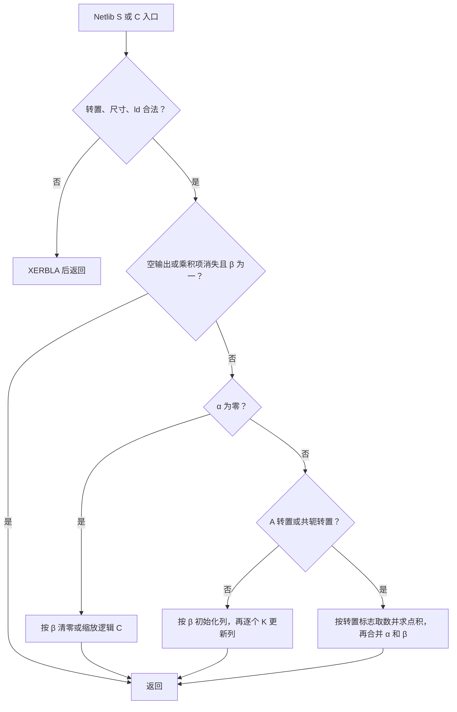
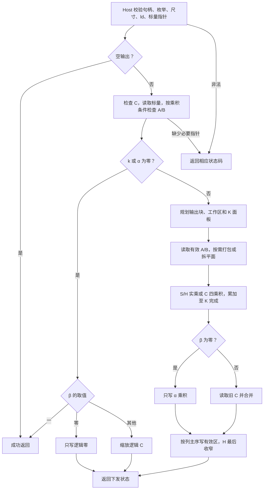

# 一、需求背景

## 1.1 需求来源

11 月社区任务要求在 Atlas A2/A3 的 ops-blas 工程中交付三个单矩阵接口：单精度实数 `aclblasSgemm`、单精度复数 `aclblasCgemm` 和半精度实数 `aclblasHgemm`。三者共享列主序布局和参数序列，分别对标 cuBLAS 同类型 GEMM。需求与验收口径取自任务包中的 `aclblasSgemm_Cgemm_Hgemm_AtlasA2_A3_task_doc.md`，压缩包 SHA-256 为 `f5d16686313119b782ae059b522e787b6438516159d101936e46fca39acb1d41`。[社区任务](https://www.hiascend.com/activities/task-center/details/4b45f7b048224317a2ec62eab1e8df52) · [正式任务包](https://www.hiascend.com/p/resource/202611/65f1c7ed628f416ebbb68e9dc9595ce0.zip)

## 1.2 背景介绍

一次调用完成 `C ← α·op(A)·op(B) + β·C`。使用者可直接传入带列间填充的矩阵。α、β 决定哪些内存必须可读，例如 β 为零时调用者只需提供可写的 C。这个约定影响入口判空、数据搬运和结果比对。[cuBLAS GEMM 接口](https://docs.nvidia.com/cuda/cublas/index.html#cublas-t-gemm)

### 1.2.1 三个 GEMM 接口的实现优化

以 ops-blas 的固定提交 `187d56dafbd373cb32e0a032bf4d7dc883bfcdf0` 为设计基线。任务书 §2.2 描述了更早的仓库状态。实现时须先区分可复用部分和待适配部分。

| 接口 | 固定提交的代码事实 | 本设计的改动 |
| --- | --- | --- |
| Sgemm | arch22 的 `gemm_host.cpp`、`gemm_kernel.cpp` 已有 FP32 路径。Host 按形状和对齐选择整图或面板乘法，必要时打包、累加、写回。空输出早于 ld 校验返回。 | 保留 FP32 乘法后端，把 ld 校验移至空输出返回前。退化时按逻辑列清零或缩放，β=1 直接返回。 |
| Cgemm | arch22 的 `cgemm_host.cpp`、`cgemm_kernel.cpp` 已将实虚拆平面，按四个实乘积调用 Sgemm，再组合写回。`ValidateCgemmPointers` 在 k>0 时直接要求 A/B 非空，随后从 Device 回读标量并同步。 | 复用四乘积，增加任务要求的 Host 标量路径，读出 α 后再决定 A/B 是否必需。保留已有 Device 标量调用的兼容处理，见 5.2。 |
| Hgemm | 公开头文件已有非 batch 的 Hgemm 声明。arch35 已有 `hgemm_host.cpp` 和 `hgemm_kernel.cpp`，固定提交的 `blas/gemm/arch22/` 中缺少对应入口。 | 在 arch22 增加半精度直调路径，沿用已有 ABI。在 FP32 域完成缩放和累加，最后一次写回时转为 FP16。 |

实现位置及约束可通过源码复查。[Sgemm Host](https://gitcode.com/cann/ops-blas/blob/187d56dafbd373cb32e0a032bf4d7dc883bfcdf0/blas/gemm/arch22/gemm_host.cpp) · [Cgemm Host](https://gitcode.com/cann/ops-blas/blob/187d56dafbd373cb32e0a032bf4d7dc883bfcdf0/blas/gemm/arch22/cgemm_host.cpp) · [arch35 Hgemm Host](https://gitcode.com/cann/ops-blas/blob/187d56dafbd373cb32e0a032bf4d7dc883bfcdf0/blas/gemm/arch35/hgemm_host.cpp) · [公共声明](https://gitcode.com/cann/ops-blas/blob/187d56dafbd373cb32e0a032bf4d7dc883bfcdf0/include/cann_ops_blas.h)

### 1.2.2 标杆算子现状分析

cuBLAS 提供三种类型的对标接口。S/C 另有 Netlib BLAS 3.10.0 可读参考实现，H 采用任务书的高精度 golden。下图取自 S/C 的公开参考控制流，GPU 内部调度不作为设计依据。本任务走 BLAS 句柄与 stream，TBE 源文件、算子信息库和 ACLNN 两阶段接口均不适用。

#### 1.2.2.1 标杆算子支持的数据类型和数据格式

| 接口 | A、B、C 与两个标量的同一类型 | 每元素字节 | 转置语义 |
| --- | --- | ---: | --- |
| Sgemm | `float`，IEEE FP32 | 4 | N 保持，T/C 均转置 |
| Cgemm | `aclblasComplex`，依次为 FP32 的 `real`、`imag` | 8 | N 保持，T 只转置，C 转置且虚部取反 |
| Hgemm | `aclblasHalf`，以 `uint16_t` 承载 IEEE binary16 位模式 | 2 | N 保持，T/C 均转置 |

三者都是二维稠密列主序（ND）。矩阵在 Device，任务标量位于 Host。H 的 `0x3c00` 表示 1.0，标量判断和计算均按 FP16 解码。复数的零、一按两个分量精确判定。[公共类型](https://gitcode.com/cann/ops-blas/blob/187d56dafbd373cb32e0a032bf4d7dc883bfcdf0/include/cann_ops_blas_common.h)

#### 1.2.2.2 标杆算子实现描述

Netlib S/C 先解析转置标志，依次检查枚举、m/n/k 和三个前导维度；错误由 XERBLA 处理。空输出或“乘积项消失且 β=1”直接返回。α=0 时逐列清零或缩放。其余情况由转置组合决定取数方式：A 不转置时先按 β 初始化输出列，再以 `α·op(B)[p,j]` 更新整列；A 转置时对每个输出元素先求点积，再合并 α、β。Cgemm 只在选择共轭的操作数上取共轭。k=0 时归约为空。H 没有 Netlib half 例程，参考结果的逐级舍入见 5.1。[Netlib 3.10.0 SGEMM](https://github.com/Reference-LAPACK/lapack/blob/aa631b4b4bd13f6ae2dbab9ae9da209e1e05b0fc/BLAS/SRC/sgemm.f) · [Netlib 3.10.0 CGEMM](https://github.com/Reference-LAPACK/lapack/blob/aa631b4b4bd13f6ae2dbab9ae9da209e1e05b0fc/BLAS/SRC/cgemm.f)

#### 1.2.2.3 标杆算子实现流程图



# 二、需求分析

## 2.1 外部组件依赖

开发和验收版本为 CANN 9.1.0。Ascend C 编译 arch22 kernel，AscendCL 提供 stream、设备缓冲和事件。测试使用 ops-blas 的 ATK/C++ GTest、Netlib BLAS 3.10.0（S/C 对照）、`msprof op`（NPU kernel 计时），GPU 对标使用 A100 cuBLAS 和 kernel profiling。CPU golden 和 GPU 基线均属于测试依赖。

## 2.2 内部适配模块

公开声明复用 `include/cann_ops_blas.h` 中第 575、579、589 行起的 S/C/H 接口。内部通过 `blas/common/helper/aclblas_handle_internal.h` 取得 stream 与工作区，S/H 共享形状、ld 校验及实数转置归一逻辑，C 保留独立的共轭标志。实现归入 `blas/gemm/arch22/`，补齐构建对该架构 H kernel 的选择。测试扩展 `test/gemm/arch22/gemm_test.cpp` 的公共入口和 `gemm_test.csv` 解析，保留已有 S 回归及 `test/gemm/cgemm/arch22/` 的 C 回归。产品范围、标量位置和异常行为同步到 `blas/gemm/README.md`。[句柄和工作区](https://gitcode.com/cann/ops-blas/blob/187d56dafbd373cb32e0a032bf4d7dc883bfcdf0/blas/common/helper/aclblas_handle_internal.h) · [公共测试入口](https://gitcode.com/cann/ops-blas/blob/187d56dafbd373cb32e0a032bf4d7dc883bfcdf0/test/gemm/arch22/gemm_test.cpp)

## 2.3 需求模块设计

### 2.3.1 Ascend C 算子原型

```cpp
aclblasStatus_t aclblasSgemm(
    aclblasHandle_t handle, aclblasOperation_t transa, aclblasOperation_t transb,
    int m, int n, int k, const float* alpha, const float* A, int lda,
    const float* B, int ldb, const float* beta, float* C, int ldc);

aclblasStatus_t aclblasCgemm(
    aclblasHandle_t handle, aclblasOperation_t transa, aclblasOperation_t transb,
    int m, int n, int k, const aclblasComplex* alpha, const aclblasComplex* A,
    int lda, const aclblasComplex* B, int ldb, const aclblasComplex* beta,
    aclblasComplex* C, int ldc);

aclblasStatus_t aclblasHgemm(
    aclblasHandle_t handle, aclblasOperation_t transa, aclblasOperation_t transb,
    int m, int n, int k, const aclblasHalf* alpha, const aclblasHalf* A,
    int lda, const aclblasHalf* B, int ldb, const aclblasHalf* beta,
    aclblasHalf* C, int ldc);
```

设 `0≤i<m`、`0≤j<n`、`0≤p<k`。以下偏移均以接口元素为单位，设备地址为基址加上偏移乘每元素字节数。T/C 使用相同的寻址方式。

| 操作数 | 转置 | 有效物理行 × 列 | 最小 ld | 读取或写入偏移 |
| --- | --- | --- | --- | --- |
| A | N | m × k | max(1,m) | i+p·lda |
| A | T/C | k × m | max(1,k) | p+i·lda |
| B | N | k × n | max(1,k) | p+j·ldb |
| B | T/C | n × k | max(1,n) | j+p·ldb |
| C | 固定 | m × n | max(1,m) | i+j·ldc |

每个逻辑输出为 `α·Σₚ op(A)[i,p]·op(B)[p,j] + β·C_old[i,j]`。例如 m=2、n=3、k=4、transa=C、transb=N、lda=6、ldb=5、ldc=4 时，输出 (1,2) 的第 3 项（p=2）读 A[8]、B[12]，写 C[9]。Cgemm 只对该项的 A 取共轭。C 的三个有效列各占两个元素，列尾各两个元素须保留。

### 2.3.2 Ascend C 算子相关约束

调用方提供尺寸足够且类型正确的缓冲。A/B 只读，C 就地覆写，C 的可写区域与所读 A/B 不得重叠，库不扫描 Device 内存确认别名。列内连续，只接受正的 ld，可从较大矩阵的列内起点传子矩阵并保留原 ld。三个接口均为单矩阵，无广播、任意行步长、负 inc、batchCount、pointer-array 或 element-stride 参数。运行时 shape 通过整数传入，无图编译形状推导或自动连续化。

# 三、需求详细设计

## 3.1 调用方式

调用者创建 handle，通过 `aclblasSetStream` 绑定 stream，准备 Host 标量和 Device 矩阵后调用上述入口。Host 在提交前按值保存所需标量和 tiling 参数，返回 `ACLBLAS_STATUS_SUCCESS` 表示成功短路或成功下发。读回结果、释放缓冲或在其他 stream 上消费 C 前，以 stream 同步或事件建立依赖。无需调用者查询算子 workspace 大小或传 executor。

## 3.2 需求总体设计

三个入口共享“校验 → 判定实际访存 → 规划工作区 → stream 提交”的顺序。计算分为无操作、仅缩放、完整 GEMM。普通 GEMM 中一块逻辑输出只由一个最终写者负责，每个输出的 β 项只应用一次。

### 3.2.1 Host 侧设计

| 顺序 | 检查或动作 | 结果 |
| ---: | --- | --- |
| 1 | handle 是否为空 | 空返回 `ACLBLAS_STATUS_HANDLE_IS_NULLPTR` |
| 2 | transa、transb 是否各为 `ACLBLAS_OP_N/T/C` 三枚举之一 | 任一非法返回 `ACLBLAS_STATUS_INVALID_ENUM` |
| 3 | m/n/k 均非负，随后按 2.3.1 验证 lda/ldb/ldc | 尺寸或 ld 非法返回 `ACLBLAS_STATUS_INVALID_VALUE`，包括空输出时非法 ld |
| 4 | α、β 指针均非空 | 任一为空返回 `ACLBLAS_STATUS_INVALID_VALUE`，即使 m=0 或 n=0 |
| 5 | m=0 或 n=0 | 成功返回，允许 A/B/C 全空，无矩阵访问、工作区申请或 kernel |
| 6 | 非空输出须有 C；按值取标量，令 `product = (k>0 且 α≠0)` | C 为空，或 product 为真而 A/B 任一为空，均返回 `ACLBLAS_STATUS_INVALID_VALUE` |
| 7 | product 为假且 β=1；product 为假且 β=0；其余 product 为假 | 依次对应成功返回、只写逻辑零、读取并缩放逻辑 C，三种均不引用 A/B |
| 8 | product 为真 | 对实际访问的尺寸和字节数做检查，β=0 选择只写 C 的尾处理 |

Host 先转换至足够宽的无符号整型，再做带溢出检查的乘加。对非空矩阵，最大元素偏移为 `(物理列数−1)·ld + 有效物理行数−1`；还须检查转换成字节跨度、缓冲对齐和多个工作区偏移的加法。零维与未引用的矩阵不构造末元素指针。不可表示的地址跨度返回 INVALID_VALUE；无法取得可用工作区时返回分配错误。Host 不逐元素检查 NaN、Inf 或数据分布。

#### 3.2.1.1 分核策略

拟将逻辑输出分为 `BM×BN` 的矩形，`Gm=ceil(m/BM)`、`Gn=ceil(n/BN)`。对块号 t，起点为 `((t mod Gm)·BM, floor(t/Gm)·BN)`。带步进循环的 kernel 取 `P=min(Gm·Gn, 可用核数)`，核 q 负责 q、q+P 等块。现有 S 整图 kernel 一 block 对应一 tile，没有步进循环，须提交 Gm·Gn 个逻辑 block。AIC 和 AIV 分别按实际可用核数规划，狭长矩阵可细分较长的输出轴，减少空闲核。优先在核内走完整 K，避免核间原子累加。退化缩放按列及有效行段分给 AIV，边界写入不得覆盖相邻核的有效元素。

#### 3.2.1.2 数据分块和内存优化策略

一次取 A 的 `bm×bk` 和 B 的 `bk×bn` 面板。容量只对内部面板向上对齐，`bm=min(BM,m−i₀)` 等有效尺寸决定 GM 访问范围。以下给出候选预算，实际 pitch、格式对齐与保留区以目标机、CANN 9.1.0 和所选内核为准。

| 层级 | 同时存活的数据和容量约束 |
| --- | --- |
| L1 | 设 a、b 为按内部格式对齐的输入面板元素数，e 为实数计算面板元素字节数（S/C 的单个 FP32 平面为 4，H 为 2）。需满足 `d·e·(a+b)+保留区 ≤ 可用 L1`，d=1 或 2。同驻多个复数分量时逐面板相加。 |
| L0A、L0B、L0C | 以实际微块 u、v、w 的布局分别预算左块 u×w、右块 w×v 和 FP32 累加 u×v；各加独立对齐、缓冲份数和库临时区后分别与对应存储上限比较。C 四乘积分时调度，共驻累加平面数须计入 L0C。 |
| UB | 对一次处理的有效行段 l，设各输入、输出、拆包、类型转换暂存的实际字节为 Sᵣ。约束为 `Σ align(Sᵣ)·缓冲份数 + API 临时区 + 保留区 ≤ 可用 UB`。例如 H 一段融合写回最多需要 FP32 乘积、按需读取的 FP16 旧 C、转换和结果缓冲，β=0 可省旧 C。 |
| GM 工作区 | S 沿用直接路径或按需分配对齐的 packA、packB、product、accum；H 通用路径拟使用两个 FP16 面板和 FP32 乘积/累加块，复用后预算为各存活切片的对齐字节和。C 已有布局按对齐后的平面元素数 a、b、r 预留 `4·(2a+2b+4r+scratch)` 字节，scratch 由内层实 GEMM 独占。大形状采用输出面板和 K 段限制峰值。 |

先试单缓冲的可行微块，再根据容量和访存占比评估双缓冲。板上验证前不设通用最优块长。对齐搬运不得把调用者的列尾当作可读空间：对齐主体按列搬运，尾部按有效长度精确搬运，内部 K 补零，额外 M/N 位置在内部暂存。窄行、非对齐列首或无法安全定长写入时使用按元素宽度的尾部路径，避免读改写跨列造成竞态。

#### 3.2.1.3 tilingKey 规划策略

直调接口通过 Host 分支选择内部 kernel 入口与 tiling 结构，无需图算子 tilingKey 注册。分派输入为类型、转置/共轭、product、β 分类、形状、ld、指针对齐、核数及容量。紧凑且对齐时评估直读与直写，padding 或尾块走地址映射、必要的面板打包和精确写回。小形状评估由 AIV 在寄存器或 UB 内完成一块点积和缩放，以减少多次下发；中大型 H 评估 FP16 Cube 加 FP32 尾处理；C 对比现有拆平面四乘积与块内复用四乘积的方案。签名、误差标准和工作区不足时的行为对所有分支相同，分派不读取用例名或 seed。

### 3.2.2 Kernel 侧设计

#### 3.2.2.1 Kernel 侧实现描述

1. **输入。** 按 2.3.1 寻址，矩阵乘路径仅搬运有效 A/B。行主序计算后端可使用 `Cᵀ=op(B)ᵀ·op(A)ᵀ` 的乘积映射，内部交换操作数和 M/N。转置、ld、子面板偏移随各自操作数传递；物理列不紧凑时先打包。Cgemm 分离交错实虚时保留转置与共轭的独立含义。
2. **归约。** S 以 FP32 输入与累加，沿用 arch22 FP32 Cube 禁用 HF32 的处理。H 以 FP16 输入、FP32 乘加和缩放，面板之间保存 FP32 的部分和。C 对每块计算四个实矩阵积，令 sA、sB 在对应操作数共轭时为 −1，否则为 +1；乘积实部为 `Ar·Br−sA·sB·Ai·Bi`，虚部为 `sB·Ar·Bi+sA·Ai·Br`，式中各平面已按转置定位。若搬入已经翻转虚部则合并时不再翻转。此路径覆盖 NN 至 CC 全九种组合，独立于 Cgemm3m。
3. **同步。** 双缓冲的面板写完后才允许计算读取，计算消费结束后才能覆盖对应槽。输出或中间平面搬出完成前禁止重用该缓冲。跨 AIV 打包、AIC 乘法和 AIV 合并优先复用现有同 stream 顺序 kernel，跨 kernel 阶段通过 GM 切片传值。在分段 K 中第一段初始化、后续段累加，最后一段才启动缩放写回。
4. **输出。** S/H 在 FP32 域合并 `αP+βC`。C 对 (Pr,Pi) 计算 `(αr·Pr−αi·Pi, αr·Pi+αi·Pr)`，同法加 β 与旧 C 的乘积。β=0 通过独立分支跳过 C 读取，α=0 或 k=0 也不对未引用的矩阵做任何预取。H 写出时按最近偶数舍入到 FP16。仅写 `i<m`、`j<n` 的 C；其他列内槽和前后保护区保持原值。[Sgemm 设备实现](https://gitcode.com/cann/ops-blas/blob/187d56dafbd373cb32e0a032bf4d7dc883bfcdf0/blas/gemm/arch22/gemm_kernel.cpp) · [Cgemm 设备实现](https://gitcode.com/cann/ops-blas/blob/187d56dafbd373cb32e0a032bf4d7dc883bfcdf0/blas/gemm/arch22/cgemm_kernel.cpp)

H 的直写条件是整段 K 已完成、α=1、β=0，且输出地址、ldc 和尾部长度均满足所选写回指令的约束。其他形状保留 FP32 乘积，交给尾处理后再收窄。若目标款型的半精度乘法或转换会把次正规数冲零，需以最小次正规数乘放大因子的定向用例检出，并切换到按位解码 FP16、以 FP32 计算及按位舍入的保真路径。该选择依赖机型能力，不根据 A/B 内容或测试编号切换。

#### 3.2.2.2 Ascend C 实现流程图



#### 3.2.2.3 与标杆流程的差异及原因

Netlib 直接访问 CPU 数组并按 trans 分支遍历，ops-blas 需要在 Host 先确定可读指针，再在绑定 stream 上安排搬运和计算。分面板乘加或四实乘积会改变浮点加法顺序，按输出类型检验误差。β=0 的专用写回仍需支持未初始化的目标，不能把它折叠成“读 C 后乘零”。与 cuBLAS 的非法 trans 状态相比，此处遵循 ops-blas 的 INVALID_ENUM。

## 3.3 支持硬件

适配范围为 Atlas A2、Atlas A3 系列（含 Atlas 800T A2、Atlas 800T A3）的 arch22。任务书允许在一种款型完成自验证，正式性能标杆设备为 Atlas 800T A2（910B3）；A3 的功能适配须保留。arch35 的 950 实现仅用于参考半精度乘法与尾处理，其核数、内存、指令和调度阈值不迁入 arch22。[arch35 半精度批量计算参考](https://gitcode.com/cann/ops-blas/blob/187d56dafbd373cb32e0a032bf4d7dc883bfcdf0/blas/gemm/arch35/hgemmStridedBatched_kernel.cpp)

## 3.4 算子约束限制

普通输入按类型可表示的有限值生成。附件还覆盖 Inf、NaN、H 次正规数和溢出，参与运算时按输出精度检查传播，未读分支的 NaN 不得污染结果。不得按数值分布扫描矩阵或更换算法。函数无随机状态；分块及归约顺序可随实现变化，任务未要求重复运行逐位一致。工作区不足时先评估更小的可行面板；如仍不足则返回错误，在首次写 C 前完成必要的空间预留。

# 四、特性交叉分析

| 交叉情形 | 实现约定与验证点 |
| --- | --- |
| 原地写回与 β 非零 | 每个输出位置只合并一次旧 C。分段 K 的中间量写工作区；给 C 的每列 padding、前后 guard 设置哨兵，另比对 A/B 原始字节。含重叠子视图时由调用方保证读写区不交叠。 |
| 异步与生命周期 | `EnsureDefaultWorkspace` 核实容量，`GetEffectiveWorkspace` 获取当前切片。库自有区扩容前已有 stream 同步保护，用户注入区不由库释放或扩容。资源按 stream 完成点复用或释放；同一工作区不交叉供在途的其他 stream 使用，并发优先独立 handle 和工作区。 |
| 复数复用实 GEMM | 实平面、结果平面与内层 Sgemm 的 scratch 分开，用同一 stream 的子句柄限制其有效工作区。不能让内部扩容使外层平面地址失效。若分段处理，则每段完成后复用同一 scratch。 |
| 错误与重试 | Host 结构错误在下发前返回。内存分配、内层 API 或 launch 失败立即返回对应错误并停止后续提交。已下发的阶段仍需等待，执行中故障后 C 可能部分更新，重试前从保存的输入恢复 C，尤其是 β 非零时。 |
| 计时与可测性 | 记录实现 SHA、设备、类型、转置、ld、标量、tile/核数、工作区字节数及同一调用的各段 kernel 名。对小矩阵看下发次数，对大矩阵比较打包流量与 Cube 时间，对非对齐矩阵核对尾段占比。候选选择须结合精度与全调用耗时。 |

# 五、可维可测分析

## 5.1 精度标准/性能标准

**验收用例。** 按任务书 §3.5，精度全量 1000 条，性能子集 200 条。下表按三个 `test_cases/<接口名>/<接口名>_test.csv` 的记录统计，均扣除表头。精度含负向用例（每接口 22 条）；性能按 `TC_PF` 识别。分档取 `e·max(mk,kn,mn)`，其中 e 为接口元素字节数，small ≤64 KiB，medium >64 KiB 且 ≤2 MiB，large >2 MiB。性能子集不含零尺寸。

| 接口 | 精度 | 性能 | CSV 合计 | 性能 small / medium / large | 非默认 α/β | 对应 gpu_ms 正值行 |
| --- | ---: | ---: | ---: | --- | ---: | ---: |
| Sgemm | 334 | 67 | 401 | 19 / 23 / 25 | 8 | 67 |
| Cgemm | 333 | 67 | 400 | 16 / 24 / 27 | 8 | 67 |
| Hgemm | 333 | 66 | 399 | 19 / 35 / 12 | 8 | 66 |
| 总计 | 1000 | 200 | 1200 | 54 / 82 / 64 | 24 | 200 |

三组实际精度分类按 L0/MN/AB/LD/FL/CV/ED/EX 依次为 S 的 18/52/24/15/21/16/41/147、C 的 18/52/23/15/21/16/43/145、H 的 18/52/23/15/21/16/49/139。各接口精度和性能均覆盖九种转置组合、4095³/4096³，以及小矩阵、矩形和非对齐尺寸。精度覆盖空维、负维、非法 ld/枚举、空句柄/标量/必要矩阵。补充交叉验证包括“空输出但 ld 非法”“非空输出、k=0、β=1 但 C 为空”；H 另测正负零、±65504、最小次正规数及最终舍入边界。C 用独立非零实虚分量的非对称矩阵比较 T/C，对两个操作数分别及同时共轭。S/H 的同输入 T/C 结果应相等。

**测试数据与参考值。** 一般数据按任务书要求以等比例的 [-5,5] 均匀分布与 N(0,1) 正态分布生成，随机种子仅用于复现。特殊组覆盖交替符号、零、极值、NaN、±Inf，以及 0、±1、0.5、±1e4 等标量，C 另含纯虚标量，H 先量化到 FP16。将“α=0 且 A/B 为 NaN”“β=0 且 C 为 NaN”与允许的空指针组合起来，既检查数值污染也检查非法访问。读写保护核对整个物理缓冲，数值判定只统计逻辑 m×n。空输出按状态、未启动计算和哨兵判定，避免计算空集比例。

| 接口 | Golden 生成和落盘 | rtol=atol | 单用例通过条件 |
| --- | --- | --- | --- |
| Sgemm | 输入及标量先按 FP32 定值，FP64 累加和缩放后收窄为 FP32。另以 Netlib 3.10.0 `cblas_sgemm` 列主序直接计算对照。 | 2⁻¹³ | matched_ratio ≥0.99，最大有限误差受 FP32 硬上限约束 |
| Cgemm | 从 complex64 定值输入提取两个分量，按共轭标志、复数 α/β 在 FP64 分量域计算，再各自收窄为 FP32。另以 `cblas_cgemm` 对照。 | 2⁻¹³ | 两个分量各自满足 0.99 和 FP32 硬上限，两者都通过 |
| Hgemm | FP16 位模式解码，输入和标量转 FP64，计算完整表达式后先收窄到 FP32，再按最近偶数舍入到 FP16。 | 2⁻¹⁰ | matched_ratio ≥0.99，最大有限误差受 FP16 硬上限约束 |

有限点满足 `abs(actual−golden) ≤ atol + rtol·abs(golden)` 计为 matched。对最大有限绝对误差所在点，取其按输出 dtype 收窄的参考值 g，以 `max(floor,32·ULP(g))` 为硬上限，S/C 分量的 floor=0.01，H 的 floor=0.1。NaN 与 NaN、同号 Inf 与同号 Inf 匹配，参考值须先按输出精度舍入；其余非有限值错配记为不匹配。非有限点不参与最大有限误差计算，全非有限时逐点核对类别和符号。负向用例比对状态及写保护。自测报告写明冻结 golden 的生成器、累加精度与直接 cblas 单精度结果间的差异。[任务指定的混合容差标准](https://gitcode.com/cann/opbase/blob/28a1ce52ae856353589841226a0002af73314a6b/docs/zh/ops_precision_standard/mixed_tolerance_standard.md)

**性能采样。** GPU/NPU 对齐接口、转置、m/n/k、三个 ld 和两个标量，C 的判定键含四个标量分量。A100 使用 Host pointer mode，记录 cuBLAS 版本、数学模式及 nsys/kernel profiling 原始样本。每个参数键先预热 5 次，随后收集 10 次成功执行的有效样本取算术平均。非默认 β 的用例为每次调用预置独立的初始 C，或在计时区外恢复，避免连续迭代改变输入。

| 记录 | 测量边界与判据 |
| --- | --- |
| 正式 kernel 指标 | 910B3 上以 `msprof op` 读取 Task Duration(us)，按调用和 stream 关联打包、全部实乘/累加、缩放及写回。对同一串行 stream 的多 kernel 调用先求各 task duration 之和，再对 10 次求平均并除以 1000 转成 ms。逐例要求 `NPU_ms ≤ 1.25·gpu_ms`。可比用例倍率 `gpu_ms/NPU_ms` 的算术平均亦须 ≥0.8。保存逐段明细，避免只报最快的乘法 kernel。 |
| 辅助事件指标 | 在预置的 Device 缓冲上预热 5 次，再用一对 `aclrtEvent` 包围同一 stream 连续 10 次下发，同步结束事件后求均值。GTest 逐例输出 `[PERF] case=<case_name> ... avg_us=<值>`。该区间包含提交影响，排除 H2D、D2H、造数与 golden 比对。 |
| 失败及缺数 | 记录异常样本及原因，补足 10 个有效样本。不能从 GTest 整数毫秒回填 kernel 时间。缺失用例、缺少有效事件值、缺少同键 GPU 基线需单独列出，保留失败或待补采状态。 |

**附件差异及处理。**

| 任务书或附件说明 | 静态核对结果及验收处理 |
| --- | --- |
| §3.5 建议精度分摊约 333/333/334；各 README 的分类表、默认标量描述及部分占位说明对应较早版本。 | 保留表中实际 334/333/333 和全部 200 条性能行。24 条非默认标量占 12%。各 `gpu_baseline.csv` 只有一个计时字段 `gpu_ms`，全部参数键一一匹配且均为正值。README 又称非默认标量待复测，包内没有 A100 profiler 原始记录；正式验收需核实采集记录，缺证据的键按同参数补测。 |
| §3.5 要求 ld 下界加 1、8、64；§3.3 提及性能 padding。 | 实际合法用例中 ld 相对下界的增量只有 0、4、8，200 条性能行全为紧凑布局。保留原集，另补 +1、+64 的 A/B/C 哨兵用例和带 padding 的性能样本，单列对应 GPU 基线与结果。 |
| 任务书正态 token 为 `RANDOM_GAUSS_0_1`，§2.4 写任意有限值。 | CSV 使用 `GAUSS_NORM_0_1` 表示同一正态分布，按实际 token 解析；普通分布之外保留 §3.5 要求的非有限值与 H 次正规数。 |
| 三份 CSV 的字段及用例名不能直接拼接。 | S/H 以 `null`、`NULLPTR` 和完整枚举名编码，测试文件自身区分 dtype；C 有 `func`、N/T/C、四个标量分量及五个 `*_null` 列。ld 字段留空时按各自最小合法值推导，非法值原样校验。各族用例名可重复，结果以“接口、case_name”标识，装入公共测试工程时按族隔离。 |
| §3.1、§3.2 与脚本对 golden 使用“cblas”“FP32”或“float64 累加”的简写。CSV 同时携带 MERE/MARE 字段。 | 冻结值按上表 §3.2 第 4 项生成；直接调用单精度 cblas 是另一对照，H 不调用不存在的 cblas_hgemm。脚本只解析 GTest 结果，测试体需实现 mixed tolerance 联合判定；CSV 的旧字段不能替代它。 |
| §4 列出冻结数据、性能/内存交付件，§3.4 明定内存验收不涉及。 | 本包交付的是三组 README、生成/核验脚本和 CSV，未含 `cases.json`、`perf/`、`inputs/`、`golden/`、`facts.json`。验收阶段须按 §4 补齐冻结材料、可复现步骤、日志、参数与截图。内存报告和日志注明 §3.4 不适用；附件的 512 MB 为造数预算，无设备内存达标阈值。 |

自验时以 CANN 9.1.0 为基准，任务书给出的构建选择为 `bash build.sh --ops=sgemm,cgemm,hgemm --soc=ascend910b3`。按族加载 CSV，精度脚本的 `--csv` 会覆盖公共测试 CSV 并备份，三个接口需分别准备数据与对应测试实例。精度脚本排除 PF，检查 GTest 状态、超时、进程失败和缺测；性能脚本优先读取仓内 PF 参数，补全 ld 后按该族基线列匹配，解析事件 `avg_us`，对 NO_REF 默认失败。验收时还须独立核对测试进程返回值、期望与实际清单、两类原始计时及代码版本。`--allow-noref` 仅用于开发采集。交付报告分别列出 S/C/H 精度、kernel 与事件数据、异常/复测原因及待验收代码提交。以上均为验收方案。

## 5.2 兼容性分析

保留三个公共符号、参数顺序和公共类型，H 直接复用已有声明。S 的校验调整专门覆盖空输出与非法 ld 并存的情况。C 的 arch22 现有测试封装会把两个标量也上传到 Device；若直接将所有标量都当 Host 指针解引用，旧调用会失效。拟沿用仓内指针位置查询，在确定需要标量值后分别识别位置：任务规定的 Host 标量按值读取，已知的旧 Device 标量路径保留同 stream 回读；查询失败返回错误，避免猜测地址。用普通 Host 标量、既有 Device 包装回归和空输出跳过标量读值三组用例验证。公共任务的性能与功能验收均以 Host 标量完成。[已有 Cgemm 测试封装](https://gitcode.com/cann/ops-blas/blob/187d56dafbd373cb32e0a032bf4d7dc883bfcdf0/test/gemm/cgemm/arch22/cgemm_npu_wrapper.h) · [位置查询辅助函数](https://gitcode.com/cann/ops-blas/blob/187d56dafbd373cb32e0a032bf4d7dc883bfcdf0/blas/common/helper/host_utils.h) · [已有 Device 标量读取](https://gitcode.com/cann/ops-blas/blob/187d56dafbd373cb32e0a032bf4d7dc883bfcdf0/blas/common/helper/complex_blas3_host_utils.h)

arch35 的同名 S/C/H、HgemmStridedBatched 和 Cgemm3m 使用原有产品选择及接口。arch22 单矩阵测试复用公共 GEMM 测试目录，构建和链接回归需确认每个目标架构只导出一个对应符号。文中列出的板上精度、两类性能指标和跨产品兼容性都须由后续实现实测。
