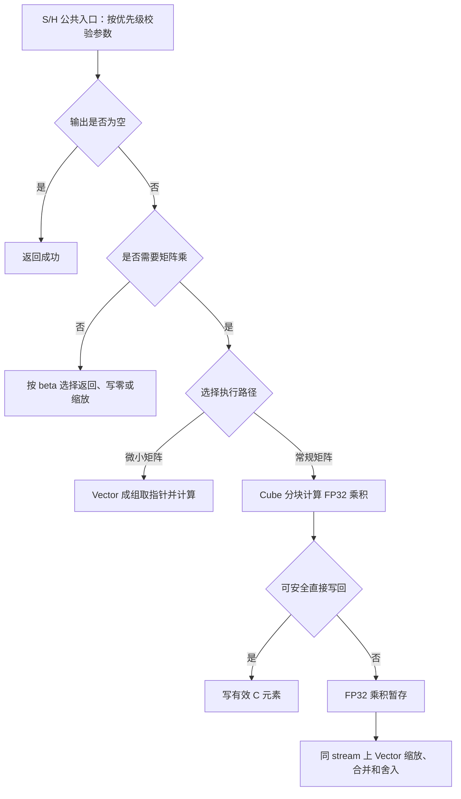

# aclblasSgemmBatched / aclblasHgemmBatched 算子（Atlas A2/A3）设计文档

| 项目 | 内容 |
| --- | --- |
| 任务名称 | 11 月社区任务：aclblasSgemmBatched / aclblasHgemmBatched 算子开发（A2/A3） |
| 任务编号 | `55123ab3caa64d089f525f646155094c`（2026-11-25 批次） |
| 贡献者目录 | `m0_64481238` |
| 目标仓库 | `cann/ops-blas` |
| 目标架构 | Atlas A2/A3，`arch22` |
| CANN 版本 | 9.1.0 |
| 文档状态 | 设计评审稿 v0.3 · 2026-11-25；精度和性能待实现后上板验证 |

## 一、需求背景（required）

### 1.1 需求来源

本任务要求在 Atlas A2/A3 上实现 cuBLAS 语义的批量单精度和半精度通用矩阵乘。两个接口作为一项社区任务交付，设计和验收分别注明 S（FP32）和 H（FP16）的要求。[任务详情](https://www.hiascend.com/activities/task-center/details/55123ab3caa64d089f525f646155094c) · [任务书与自验包](https://www.hiascend.com/p/resource/202611/50d7f6f055c948219f697c99ae5b0367.zip) · [设计文档格式参考 PR #1960](https://gitcode.com/cann/cann-ops-competitions/pull/1960)

设计文档提交到活动仓：

```text
04_tasks/01_community-task-2026/tasklist/55123ab3caa64d089f525f646155094c-aclblasSgemmBatched-aclblasHgemmBatched-A2A3/m0_64481238/docs/design.md
```

### 1.2 背景与价值

批内矩阵具有相同形状和前导维度，地址由三个 Device 指针数组逐批给出。对于数万个 1×1 矩阵，逐矩阵从 Host 下发 GEMM 的开销会淹没计算时间；对于单批 4096³ 矩阵，只按批号分核又会让大部分计算核空闲。方案分别沿批号和输出矩阵块划分工作，两种情况使用相同的公共接口。

### 1.3 仓库现状

ops-blas 已声明两个接口。arch35 提供 S/H 批处理实现，arch22 的同目录已有复数批量 GEMM，另有单矩阵 FP32 GEMM。计划复用 arch22 的列主序映射与矩阵乘路径，参考 arch35 的批调度和半精度缩放，在 arch22 增加 S/H 入口。[公共头文件](https://gitcode.com/cann/ops-blas/blob/master/include/cann_ops_blas.h) · [arch22 批处理目录](https://gitcode.com/cann/ops-blas/tree/master/blas/gemm_batched/arch22) · [arch22 单矩阵实现](https://gitcode.com/cann/ops-blas/tree/master/blas/gemm/arch22) · [arch35 批处理实现](https://gitcode.com/cann/ops-blas/tree/master/blas/gemm_batched/arch35)

| 参考位置 | 可复用的机制 | 本次需要解决的问题 |
| --- | --- | --- |
| arch22 单矩阵 Sgemm 的 `gemm_kernel.cpp` | FP32 Matmul、四种内部转置组合、关闭 HF32 的做法 | 输入来自指针数组；每个块还要确定 batch，不能假设同批数据物理连续 |
| arch22 CgemmBatched 的 `cgemm_batched_device_utils.h` | 用 `GlobalTensor<uint64_t>` 读取指定批的地址，再绑定矩阵缓冲区 | S/H 可直接访问实数元素，去除复数拆解与重组 |
| arch35 HgemmBatched 的 `hgemmBatched_host.cpp` | 按缩放需要选择直接输出或暂存 FP32 乘积，保留旧 C 至后处理 | 重新计算 arch22 的块形和工作区上限，检查 FP16 最终舍入的位置 |

代码核对基于 ops-blas 提交 `55ef791b`。[FP32 矩阵乘](https://gitcode.com/cann/ops-blas/blob/55ef791b77f3677b45da3468b0a8b17941424f84/blas/gemm/arch22/gemm_kernel.cpp) · [Device 取址](https://gitcode.com/cann/ops-blas/blob/55ef791b77f3677b45da3468b0a8b17941424f84/blas/gemm_batched/arch22/cgemm_batched_device_utils.h) · [H 路径](https://gitcode.com/cann/ops-blas/blob/55ef791b77f3677b45da3468b0a8b17941424f84/blas/gemm_batched/arch35/hgemmBatched_host.cpp)

### 1.4 接口定义

公共头文件 `include/cann_ops_blas.h` 已声明两个入口。标量位于 Host，矩阵和批指针表位于 Device。

```cpp
aclblasStatus_t aclblasSgemmBatched(
    aclblasHandle_t handle,
    aclblasOperation_t transa,
    aclblasOperation_t transb,
    int m, int n, int k,
    const float* alpha,
    const float* const Aarray[], int lda,
    const float* const Barray[], int ldb,
    const float* beta,
    float* const Carray[], int ldc,
    int batchCount);

aclblasStatus_t aclblasHgemmBatched(
    aclblasHandle_t handle,
    aclblasOperation_t transa,
    aclblasOperation_t transb,
    int m, int n, int k,
    const aclblasHalf* alpha,
    const aclblasHalf* const Aarray[], int lda,
    const aclblasHalf* const Barray[], int ldb,
    const aclblasHalf* beta,
    aclblasHalf* const Carray[], int ldc,
    int batchCount);
```

| 参数 | 输入/输出 | 含义 |
| --- | --- | --- |
| handle | 输入 | ops-blas 句柄，提供本次异步下发的 stream |
| transa、transb | 输入 | 分别选择 A、B 的操作；实数的 C 等价于 T |
| m、n、k | 输入 | 输出为 m×n，内积长度为 k，三者均为非负 int |
| alpha、beta | 输入 | Host 标量指针。S 为 float，H 为 IEEE binary16 位模式的 aclblasHalf |
| Aarray、Barray | 输入 | 长度均为 batchCount 的 Device 指针表，表中每个地址对应一个列主序输入矩阵 |
| lda、ldb | 输入 | A、B 物理存储的列间距，以元素计；下界见 §2.2 |
| Carray、ldc | 输入/输出、输入 | Carray 指向各批输出；按 ldc 定位列。beta 非零时读取旧 C，计算结果原地写回 |
| batchCount | 输入 | 独立矩阵乘的数量，可为零；每批共用同一组尺寸、转置位和标量 |

## 二、需求分析（required）

### 2.1 功能需求

对每个批次 `b ∈ [0, batchCount)`，原地写回 `C[b] = alpha × op(A[b]) × op(B[b]) + beta × C[b]`。两个输入在运算后的形状分别为 `m × k` 和 `k × n`。各批共享尺寸、前导维度、转置方式和标量。实数输入的 `ACLBLAS_OP_C` 与 `ACLBLAS_OP_T` 等价。

各批的 C 输出互不重叠，且与任意批的输入矩阵不重叠，由调用者保证。S/H 共用校验和调度。每列仅更新前 m 个输出元素；前导维度描述的填充区须保留。输入均为真实存储的矩阵，接口不定义广播或任意步长视图。

### 2.2 参数校验与边界语义

依次检查 handle、两项转置枚举、m/n/k、lda/ldb/ldc、batchCount、alpha/beta 和当前分支需要的数组本体。空句柄返回 `ACLBLAS_STATUS_HANDLE_IS_NULLPTR`，非法转置返回 `ACLBLAS_STATUS_INVALID_ENUM`，非法尺寸、前导维度或必需指针为空返回 `ACLBLAS_STATUS_INVALID_VALUE`。Host 只检查数组本体，元素有效性和输出无别名是调用契约。

| 矩阵 | N 时前导维度下限 | T/C 时前导维度下限 |
| --- | --- | --- |
| A | max(1, m) | max(1, k) |
| B | max(1, k) | max(1, n) |
| C | max(1, m) | max(1, m) |

| 结构参数合法后的条件 | 访问和执行 |
| --- | --- |
| m、n、batchCount 任一为 0 | 允许三个数组为空，直接成功，不启动 kernel。alpha/beta 指针仍按接口约束校验 |
| 输出非空，且 (k=0 或 alpha=0) | Carray 必须有效，允许 Aarray/Barray 为空。beta=1 直接返回；beta=0 直接写零；其余情况只做 C 的逐元素缩放 |
| 正常乘加 | 三个数组都必须有效。beta=0 走纯覆盖路径，避免旧 C 中的 NaN 参与乘法；其余情况加载旧 C |

### 2.3 任务拆解

| 模块 | 主要工作 |
| --- | --- |
| Host | 校验参数，判断空输出和仅缩放路径，绑定 stream 并传递 Host 标量的值 |
| Tiling | 将 batch、输出行块与列块映射到核，按目标 SoC 容量选择 BM、BN、BK |
| Kernel | 在 Device 侧取批地址；处理列主序、转置、FP32 累加及 FP16 写回 |
| Test | 用 S/H 两组 CSV 验证原地更新、保护区、数值误差和逐例性能 |
| Document | 记录接口约束、产品支持范围、构建方式和可复验的测试结果 |

## 三、详细设计（required）

### 3.1 数学定义与列主序存储

对第 b 批输出元素 (r,c)，下标从零开始。内积索引 t 依次取 0 到 k−1。

```text
P[b,r,c] = sum_t op(A[b])[r,t] * op(B[b])[t,c]
C[b][r + c*ldc] = alpha * P[b,r,c] + beta * C_old[b][r + c*ldc]
```

A 的元素偏移是 N 时 `r+t×lda`、T/C 时 `t+r×lda`。B 的元素偏移是 N 时 `t+c×ldb`、T/C 时 `c+t×ldb`。每个基地址来自该批的指针表项，地址计算使用 64 位偏移。beta=0 时省去公式中的旧 C 读取。

将 C 的同一段内存视作行主序的 Cᵀ，其形状为 n×m，行距为 ldc。内部先计算乘积 `Pᵀ = op(B)ᵀ × op(A)ᵀ`，再按标量合并为 `Cᵀ = alpha × Pᵀ + beta × C_oldᵀ`，左操作数取 B，右操作数取 A。将原始 B、A 内存分别解释成行主序的 Bᵀ、Aᵀ 后，左操作数沿用调用者的 transb，右操作数沿用 transa。这样可以复用行主序 Matmul；各自物理行距仍取 ldb、lda。

| 公共转置（A,B） | 内核转置（左 B，右 A） | 内核逻辑输出 |
| --- | --- | --- |
| N,N | N,N | n×m |
| N,T 或 N,C | T,N | n×m |
| T,N 或 C,N | N,T | n×m |
| T/C,T/C | T,T | n×m |

例如 m=2、n=3、k=4，A 转置、B 不转置，取 lda=6、ldb=5、ldc=4。以零为起点，输出 C(1,2) 位于偏移 9；内积第 t 项从 A 的偏移 `t+6`、B 的偏移 `t+10` 读取。内部视图 Cᵀ(2,1) 也写偏移 9。输出列尾偏移 10、11 应保持哨兵值。该例同时区分操作数交换错误、转置错误和误用逻辑高度作物理行距三种问题。

### 3.2 批内计算与核间执行顺序

#### 3.2.1 常规矩阵路径

常规路径沿 M、N 切输出块，每块独占一个 batch 内的一片 C，并在本核内遍历 K。设块形为 BM、BN、BK，则总任务数为 `batchCount × ceil(m/BM) × ceil(n/BN)`。令 `blockDim` 取可用计算核数和总任务数的较小值；核 q 依次处理编号 q、q + blockDim 等块。通过整除和取余还原 batch、列块、行块。输出块互斥，不需要跨核原子累加或存储全批的中间乘积。

令 R=ceil(m/BM)、S=ceil(n/BN)。块号 u 对应 `batch = u / (R×S)`、`列块 = (u / R) % S`、`行块 = u % R`，其中除法取整。起点分别为行块×BM、列块×BN，有效范围在 m、n 处截断。K 的各段始终归同一块所有者，最终只写一次结果。

以 m=129、n=65、k=33、batchCount=2、候选 BM=BN=64、BK=32 为例，总块数为 2×3×2=12。若以 4 核演算，核 0 负责 u=0、4、8。核 1 负责的 u=5 是第 0 批起点 (128,64) 的 1×1 输出尾块，内积处理 32+1 项。核数来自设备，4 核仅用于检查映射。

#### 3.2.2 微小矩阵与退化路径

对于 1×1×1、batchCount=65536，核 q 处理批号区间 `[floor(q×batchCount/P), floor((q+1)×batchCount/P))`，P 为启用核数。每核顺序读取一组指针，再从各批的独立地址取数。每个输出在一个核内完成乘加和回写。核数及微小矩阵切换阈值由形状、硬件容量与 profiling 确定。

当 k=0 或 alpha=0 时，省去内积，只按 beta 对有效输出做保留、清零或缩放；空输出优先按 §2.2 返回。

### 3.3 总体实现架构



工程落点如下：

```text
include/cann_ops_blas.h                         S/H 公共声明
blas/gemm_batched/arch22/                       Host、调度及 Device 内核
blas/gemm_batched/README.md                     平台支持与接口约束
test/gemm_batched/sgemm_batched/arch22/         S/H 共用 GTest 驱动
test/gemm_batched/sgemm_batched/CMakeLists.txt   arch22 测试注册
```

#### 3.3.1 Host 设计

Host 从句柄获取 stream，读取两个标量并按值随 launch 参数传递。按照 dtype、归一化转置组合、是否仅缩放和矩阵尺寸选择内核。所有分支都在同一 stream 异步下发，Host 将下发错误按工程约定返回。由调用方在读回输出前同步。

Host 负责数组本体的条件校验，Device 表项由调用者保证有效。Host 不逐项回读表，也无需为每批单独同步。需要临时存储的路径在下发前检查容量，申请失败按仓内约定返回错误。

#### 3.3.2 Tiling 设计

Host 将下列信息交给 Device。S/H 的公开签名和状态码保持不变，这些字段仅属于内部 launch 契约。

| 字段 | Host 产生方式 | Device 消费方式 |
| --- | --- | --- |
| m、n、k；lda、ldb、ldc；batchCount | 结构校验后的原始 int | 解引用指针后按真实前导维度计算元素偏移 |
| 左、右转置位，元素类型 | 将公共 C 归一为 T，对换 B/A 的次序；按 S/H 入口选择元素类型 | 实例化 NN、NT、TN、TT 之一，决定面板读取方向 |
| alpha、beta、是否读取旧 C | 读取 Host 标量一次，H 先解码到 FP32；beta=0 清除读旧 C 标志 | 直接输出、缩放或乘加后处理共用同一数值语义 |
| BM、BN、BK；行块数、列块数；起始块号和本组块数 | 按 SoC 和尺寸切块。块号、总块数及工作区字节数使用宽整数并检查表示范围 | 从组内编号恢复全局块坐标，用剩余有效行列处理尾块 |
| 指针表、临时缓冲和 stream | 三个指针表原样传入；需要暂存时预留组内乘积区；从 handle 获取 stream | 各 kernel 仅访问所属路径需要的指针；同流提交保持组间顺序 |

为避免截断，计算总块数、临时区字节数和指针偏移时先提升整数宽度并检查可表示范围。BM、BN、BK 约束和首轮预算见 §3.6。

#### 3.3.3 Kernel 分层策略

| 路径 | 读取 | 计算和输出 | 可检查的性质 |
| --- | --- | --- | --- |
| 仅写零 | C 指针表 | 按 ldc 写有效矩形的零值 | 旧 C 即使含 NaN 也应写零 |
| 仅缩放 | C 指针表及旧 C | FP32 域乘 beta，H 在写回时收窄 | k=0、beta≠1 时仍执行；A/B 可为空 |
| 微小矩阵 | 批量取 A/B/C 地址；beta≠0 时读旧 C | 每个输出完成整个内积后就地应用标量，H 最后舍入 | 输入批地址可乱序，输出与对应批一一对应 |
| 常规直接输出 | A/B/C 指针表及 A/B | alpha=1、beta=0 且布局与尾块支持精确写回时，Cube 写最终 C | S 关闭 HF32；H 的 FP32 累加值在最终存储时转 FP16 |
| 常规带后处理 | A/B/C 指针表及 A/B，按需读旧 C | Cube 将完整 K 归约后的乘积存到 FP32 工作区，Vector 在同一 stream 中计算 alpha·P+beta·C | 即使 H 乘积超出半精度范围，只要最终结果可表示，路径也不会因中间收窄而提前溢出 |

1. **常规矩阵乘。** 采用 arch22 可用的 Ascend C Matmul 路径分段搬入 A/B 面板，按 BK 遍历 K 并累加至 FP32。H 保持半精度输入，S 采用满足 FP32 误差要求的计算模式，避免以低精度输入近似替换 S。尾块对片上无效 K 项补零，只访问源矩阵有效区域。
2. **缩放与保存。** 内积完成后在 FP32 域乘 alpha，需要时读旧 C、提升到 FP32 并加 beta·C。H 在最终写回时一次舍入到 FP16。仅写有效行和列，尾部用支持非对齐长度的搬运或逐元素写回，避免覆盖相邻列和 padding。beta=0 与只写零分别直接生成结果。

### 3.4 数据搬运与内存安全

常规带后处理路径按一组输出块预留 FP32 暂存，每块一个定长槽。槽号属于当前组，槽内按转置后的行主序排布，尾块仅消费有效区域。若每组 W 个块，乘积区大小为 `W × BM × BN × 4`，64×64 块每槽 16 KiB；W=32 时为 512 KiB。API 所需系统工作区另计。Host 在首次下发前核对可用容量，容量决定 W 的上限，常规情况下优先选足以摊薄下发开销的组大小。

同一条 stream 的下发顺序是「第 g 组 Cube → 第 g 组 Vector → 第 g+1 组 Cube」，后一组可复用前一组的槽。各调用使用满足其异步生命周期的工作区；不同 stream 同时执行时必须使用独立存储或已有的 stream 安全分配机制。容量获取失败应返回工程状态码。直接输出、微小矩阵和仅缩放路径均无需这段乘积暂存。正式性能统计覆盖一次接口调用下发的完整计算序列。

输出沿列连续的有效行搬运，整段可用对齐写回；尾列、列尾、非对齐首地址使用目标支持的精确长度写入。若 Cube 输出路径无法保证该约束，则走 FP32 暂存、Vector 精确写回。各核只写所拥有的有效字节，避免将 GM 对齐块整段读改写而破坏相邻核的结果。测试在逻辑输出以外的列尾及分配区两侧填入不同哨兵值，执行后逐字节比较。

### 3.5 精度策略

H 的一个手算探针是单元素 A=256、B=256、alpha=0.5、beta=0。乘积 65536 在 FP32 中可表示，最终输出 32768 在 FP16 中可表示。如果在乘 alpha 前已把乘积写成 FP16，结果将提前溢出。S 路径则在 Matmul 前按同族实现关闭 HF32，验证长 K 和相消输入对 2⁻¹³ 混合容差的影响。

alpha、beta 在 S 路径按 FP32 读入，在 H 路径按 FP16 读入后提升到 FP32。所有 K 段完成后再执行缩放及合并。分别测量启用旧 C 读取和纯覆盖时的误差，正式判据见 §4.2。

### 3.6 硬件资源使用

以 64×64×32 为首轮验证块形，以下按单核计算，1 KiB=1024 字节。L1 输入面板使用两组，L0A、L0B 按相同 K 深度各保留两片，L0C 保留一个 FP32 输出块。实际编译时将格式对齐、Matmul 内部临时区一并计入，超过任一级预算就重新选块。

| 存储层级 | 计算方式 | S / H 示例占用 | 生命周期 |
| --- | --- | --- | --- |
| L1 | 2 × (BM×BK + BK×BN) × 输入字节数 | 32 / 16 KiB | 第 j 段用于计算时预取下一段；消费者释放后才覆盖对应槽 |
| L0A / L0B | 各 2 × 64 × 32 × 输入字节数 | 各 16 / 8 KiB | 当前面板从 L1 装载完成后交给 Cube |
| L0C | BM × BN × 4 | 16 / 16 KiB | 第一段初始化，最后一段完成前保持 FP32 累加值 |
| Vector UB | 一条 256 元素输出条带。分别预算 FP32 乘积、提升后的旧 C、FP32 结果；H 另计输入和输出的两块半精度缓冲 | 3 / 4 KiB（单组数据） | 有效元素数控制搬入和写回；双缓冲时为 6 / 8 KiB，另计 API 临时区 |

仓内 arch22 对应的参考容量为 L1 512 KiB、L0A/B 各 64 KiB、L0C 128 KiB、UB 192 KiB。Cube 与 Vector 的预算分别检查。上述占用只描述设计数据，最终核对编译器实际分配及目标 SoC 查询结果。[硬件容量定义](https://gitcode.com/cann/ops-blas/blob/55ef791b77f3677b45da3468b0a8b17941424f84/blas/common/arch/hardware.h)

## 四、可维可测分析

### 4.1 测试环境与基准

| 项目 | 计划配置 |
| --- | --- |
| 平台与软件 | Atlas A2/A3，CANN 9.1.0。按任务书任选一种款型自验证，正式性能设备为 Atlas 800T A2（910B3） |
| 构建 | `bash build.sh --ops=sgemm_batched,hgemm_batched --soc=ascend910b3`，A3 使用实机对应的 SoC |
| 测试入口 | ops-blas GTest 逐批分派 S/H，分别加载两套 CSV、随机种子和 GPU 基线 |
| 精度参考 | S 对照 Netlib BLAS 3.10.0 的 cblas_sgemm；H 使用任务书指定的高精度累加与 FP16 舍入 |
| 性能参考 | cuBLAS 对应 S/H 接口的 GPU kernel 时间；NPU 正式测量取 msprof op，端到端辅助测量取 aclrtEvent |

### 4.2 精度验收

在 CANN 9.1.0 上执行 S/H 各 500 条精度用例。S 逐批参考 Netlib BLAS 3.10.0 的 cblas_sgemm，并记录与任务书允许的 float64 累加后转 FP32 参考之间的差异；H 从已量化的 FP16 输入及标量出发，在 float64 中累加，先转 FP32、再按最近舍入至 FP16 得到 golden。固定种子、原始输入及参考结果随自测记录保存。

| 项目 | S（FP32） | H（FP16） |
| --- | --- | --- |
| atol、rtol | 均为 2⁻¹³ | 均为 2⁻¹⁰ |
| 单例逐元素匹配比例 | ≥ 0.99 | ≥ 0.99 |
| 最大绝对误差限制 | 1e−2 或 32 ULP，按任务书标准 | 1e−1 或 32 ULP，按任务书标准 |

比较每个逻辑输出元素的 `abs(actual − golden) ≤ atol + rtol × abs(golden)`，每条用例同时检查匹配比例与最大误差。另行核对 Inf 符号和 NaN 位置、padding 哨兵与异常返回码。[生态精度标准](https://gitcode.com/cann/opbase/blob/28a1ce52ae856353589841226a0002af73314a6b/docs/zh/ops_precision_standard/mixed_tolerance_standard.md)

### 4.3 性能目标

在 Atlas 800T A2（910B3）上为 S/H 分别采集 100 条性能用例，覆盖小、中、大规模和非默认 alpha/beta。每条按任务包对应 CSV 的算子、转置、尺寸、batchCount、前导维度及标量关联 GPU 基线。

| 采集 | 方法与判定 |
| --- | --- |
| 正式 kernel 耗时 | 预热 5 次，使用 msprof op 记录随后 10 次成功执行的 Task Duration，计算算术平均。若一次调用有多项计算任务，记录并核对完整调用边界，防止漏算。逐例要求平均耗时（µs）≤ 1250 × gpu_ms |
| 端到端辅助计时 | 输入与缓冲预置，预热 5 次，以同一 stream 上的 aclrtEvent 包围连续 10 次下发，输出每次平均的 `[PERF] case=… avg_us=…`。缺失事件记录的用例按任务书处理 |

下表由任务包两份 `gpu_baseline.csv` 的 `gpu_ms × 1250` 得到，单位为 µs，显示到小数点后三位。正式比较使用 CSV 原始精度。ID 为 S/H 各自前缀之后的部分。

| 基线 ID | m×n×k；批数；转置 | alpha, beta | S 上限 | H 上限 | 该条主要考察 |
| --- | --- | --- | ---: | ---: | --- |
| base-000 | 256×256×256；16；NN | 1, 0 | 89.600 | 22.912 | 多批矩阵的直接写回 |
| base-002 | 1024×1024×1024；4；TN | 1, 0 | 893.056 | 77.696 | 交换输入后的转置模板及 K 面板复用 |
| perf-016 | 4096×4096×4096；1；NN | 1, 0 | 11009.920 | 771.712 | 单批时靠 M/N 输出块分核，检查 Cube 利用率 |
| perf-017 | 4095×4095×4095；1；NN | 1, 0 | 9063.424 | 2079.488 | 三维均有尾部，检查尾块路径的额外搬运 |
| perf-020 | 1×1×1；65536；NT | 0.5, 0.5 | 228.864 | 492.160 | 每批只有一次乘加，检查指针取址与散布回写。非默认标量标杆按随包说明复核 |

随包 README 标记部分非默认 alpha/beta 的标杆待复测。报告按完整参数核对其来源，将待确认项单列。

每条记录关联算子、完整输入参数、SoC、代码提交号、kernel 名称、调用序号和 stream。若路径包含多个串行计算 kernel，则保留每个 duration 及同次调用合计，逐项与调度记录核对；事件计时另存。对于 beta≠0 的重复执行，精度校验使用独立的初始 C，并明确记录性能轮次的 C 初始化策略，保持 GTest 与 profiling 的输入条件一致。

### 4.4 功能用例设计

任务包把 S/H 分别放在 `sgemm_batched` 和 `hgemm_batched` 子目录。每份主 CSV 含 500 行精度及 100 行 `TC_PF_*` 性能用例；两个文件共用部分 case 名。测试调度、日志及结果键均使用「算子名 + case 名」。基线文件的 ID 与 GTest 的编号格式不同，绑定时还要核对转置、三维尺寸、batchCount、前导维度和标量。

| 设计义务 | 随包用例或增补探针 | 检查点 |
| --- | --- | --- |
| 空批、空输出 | S/H 的 TC_ED_005、TC_ED_006 | 结构合法且数组为空时成功，记录无 kernel 下发 |
| 退化缩放与指针校验 | S/H 的 TC_ED_011、TC_ED_012、TC_ED_014、TC_ED_015 | k=0、beta=0 写零；有效输出而 Carray 为空时报参数错误；alpha=0 时按 beta 选择路径 |
| 参数优先级 | S/H 的 TC_ED_043；增补「非法转置 + 空输出」 | 前者检查负 batchCount，后者先返回非法枚举 |
| 前导维度与地址独立 | S/H 的 TC_ED_061、TC_ED_062；增补 §3.1 的非方阵 | 比较有效输出和 padding；批指针表按不同次序排列，以不同数据区分各批 |
| 极大批量 | S/H 的 TC_CV_024、TC_PF_021 | 检查首、中、末批结果、批间写入边界及一次调用的 launch 数 |
| H 标量范围 | H 的 TC_ED_069、TC_ED_070；增补 256×256 的单元素探针 | 核对 FP16 次正规标量的解码及 FP32 累加到 FP16 的最后一次舍入 |

重点覆盖九种转置组合、非方阵、不连续的批地址、前导维度增加 1/8/64、4095³ 尾块与 4096³ 整块、1×1×1 且 batchCount 达 65536。以空数组验证零尺寸，以 A/B 中的 NaN 验证 alpha=0，以旧 C 中的 NaN 验证 beta=0；以空句柄、非法枚举、负尺寸和过小前导维度验证结构错误优先级。H 单独覆盖次正规数、接近上限值、溢出及舍入。本任务书 §3.4 未设单独内存指标，越界写仍通过输出保护区检查。

### 4.5 调试与定位能力

| 观测现象 | 优先核查 | 可证伪的对照 |
| --- | --- | --- |
| 小矩阵事件时间高，kernel 时间达标 | Host 是否按批循环下发、计时区间是否包含拷贝 | 固定尺寸，改变 batchCount，核对每次接口调用的 launch 数 |
| 整块通过而尾块超时或哨兵改变 | 实际 M/N/K、末列有效长度、是否回写了对齐填充 | 对比 4095³/4096³，再单独改变 ldc |
| H 仅在非默认标量下误差异常 | 乘积是否过早转 FP16，beta=0 分支是否读取旧 C | 用 65536×0.5 的中间乘积探针和旧 C=NaN 分别验证 |
| NN 正确，TN/NT 在非方阵出错 | 操作数交换时转置位、物理行距是否跟随原矩阵 | 逐项复算 §3.1 的非方阵示例，同时保留 padding |

### 4.6 兼容性与维护性

沿用现有 ABI。变更范围为 arch22；回归覆盖同目录 CgemmBatched 及 arch35 构建选择，检查符号注册与已有后端的隔离。

两个入口共享形状、步长与分核字段，测试键保留 S/H 类型；两类精度档、参考值生成和输出舍入可分别回归。arch22 专用执行策略置于对应架构目录，公共头文件签名保持一致。

## 五、交付件与计划

| 阶段 | 交付内容 | 完成标准 |
| --- | --- | --- |
| 设计评审 | 本设计及 PR #3161 | 核实接口、转置映射、工作区与验收口径，处理评审意见 |
| 基础实现 | arch22 双入口、Device 取址、乘加和退化路径 | S/H 编译通过；非方阵、空输入、仅缩放及 FP16 舍入探针通过 |
| 完整自测 | GTest、CSV 加载、精度记录和哨兵检查 | S/H 各 500 条精度用例逐条记录，特殊值、返回码与保护区可核对 |
| 性能采集 | 910B3 上的 msprof op 原始数据、事件计时、分形状分析 | S/H 各 100 条性能用例与同参数 GPU 基线逐条比较 |
| 任务验收与代码合入 | 自测说明、报告、日志、待验收代码提交，以及后续 ops-blas PR | 按任务书提交验收材料；验收通过后申请代码合入 |

## 六、风险与应对

| 风险 | 影响 | 应对措施 |
| --- | --- | --- |
| 交换左右操作数时错误复用前导维度 | 方阵 NN 可能通过，带填充的 TN/NT 得出错位结果 | 用 §3.1 非方阵手算偏移，交叉校验输出和哨兵 |
| 半精度中间结果提前收窄 | 最终结果可表示时仍可能产生 Inf | 保留 FP32 乘积至缩放后，用 §3.5 的 32768 探针回归 |
| 临时槽在异步消费者完成前复用 | 不同输出块或不同 stream 之间发生覆盖 | 同流按组串行复用，跨流隔离存储，用交错输入验证输出归属 |
| 小矩阵下发开销或尾部写回过大 | 大批量短任务或非对齐尺寸超过门槛 | 对照 §4.3 完整调用耗时，分别调整成组取址和尾块写回 |
| 非默认标量基线待复测 | 不同参数或计时方式导致误判 | 对齐 dtype、形状、标量和计时范围，保留原始数据及确认状态 |

## 七、评审检查项

- [ ] 两个接口的签名、指针位置、校验顺序及返回码与公共头文件、任务书一致。
- [ ] 非方阵九种转置组合、前导维度及 C 列尾保护均有可执行的验证用例。
- [ ] 空输出与仅缩放明确区分，alpha=0、beta=0 时分别验证 A/B 或旧 C 的免读语义。
- [ ] 分块映射覆盖所有输出；尾块、临时缓冲和异步复用均有独立的边界检查。
- [ ] FP32 累加及 H 最终舍入能通过 §3.5 的手算探针和 §4.2 的混合容差判据。
- [ ] 两种精度各 500 条正确性和 100 条性能用例可追溯到输入、参考值及采集记录。
- [ ] 性能表标明 GPU 换算上限；设备实测和事件辅助计时分别记录。
- [ ] 提交验收时提供可复现的 SoC、CANN 版本、构建命令、提交号及原始日志。
