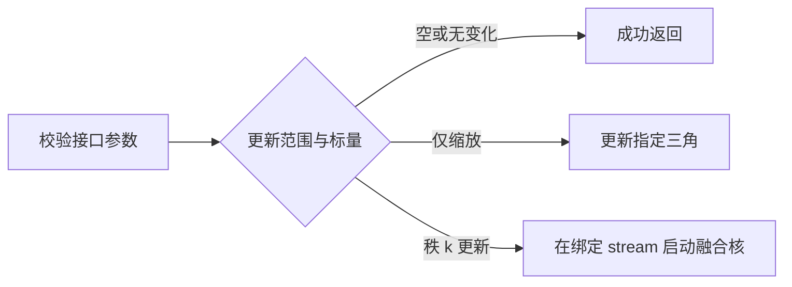
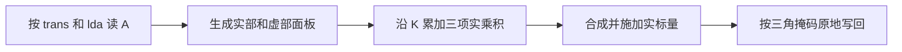

# aclblasCherk3mEx 算子设计（950PR）

## 需求背景

昇腾 950PR 上的调用方需要用单精度实标量更新复数 Hermitian 矩阵，并支持交错复数 int8 输入。拟在 ops-blas 增加句柄式入口 `aclblasCherk3mEx`，与 cuBLAS 的同名运算对齐，复用仓内非 Ex HERK 的列主序、三角存储和 stream 约定。[11 月社区任务与任务书](https://www.hiascend.com/activities/task-center/details/5f0045789d554794aca26d146e93d6b7) · [ops-blas](https://gitcode.com/cann/ops-blas)

## 需求分析

令 `X = op(A)`，仅对选定三角计算 `C ← α X Xᴴ + β C`。上三角对应行号不大于列号，下三角相反。调用方可在未选三角及列间留有其他数据，算子须保留这些位置的原值。

| 参数 | 接口约定 |
| --- | --- |
| handle、uplo、trans | 使用 handle 绑定的 stream。uplo 取 UPPER 或 LOWER，trans 取 OP_N 或 OP_C。OP_T 返回 INVALID_ENUM。 |
| n、k、lda、ldc | n、k 非负。OP_N 的 A 为 n×k，lda ≥ max(1,n)。OP_C 的 A 为 k×n，lda ≥ max(1,k)。两者均要求 ldc ≥ max(1,n)。 |
| A、Atype | ACL_COMPLEX64 每元素为两个 float。ACL_INT8 每元素为交错的有符号 int8 实部和虚部，分别精确提升为 float 再参与运算。lda 的单位是复元素。 |
| C、Ctype | C 为原地更新的列主序 n×n 矩阵，类型固定为 ACL_COMPLEX64。其写入区域与 A 的读取区域须互不重叠。 |
| alpha、beta | 均为 FLOAT32 实数指针。支持 Host 和 Device 两种指针模式。 |

## 详细设计

### 公共接口与工程位置

在 `include/cann_ops_blas.h` 声明下列接口，在 `blas/herk/arch35/` 实现，在 `blas/herk/README.md` 记录使用方式与硬件范围。沿用现有 `aclblasCherk` 的句柄约定，新增的 3M 路径独立于 `aclblasCherkEx`。

```cpp
aclblasStatus_t aclblasCherk3mEx(
    aclblasHandle_t handle, aclblasFillMode_t uplo, aclblasOperation_t trans,
    int n, int k, const float* alpha, const void* A, aclDataType Atype,
    int lda, const float* beta, aclblasComplex* C, aclDataType Ctype, int ldc);
```

### Host 侧与边界行为

入口依次检查句柄、操作枚举、尺寸与前导维度，再检查标量、类型组合和按路径所需的矩阵指针。空句柄返回 `ACLBLAS_STATUS_HANDLE_IS_NULLPTR`，非法枚举返回 `ACLBLAS_STATUS_INVALID_ENUM`，不支持的类型组合返回 `ACLBLAS_STATUS_NOT_SUPPORTED`，非法尺寸、跨度或必需的空指针返回 `ACLBLAS_STATUS_INVALID_VALUE`。Host 指针模式可直接判定标量，Device 模式须按绑定 stream 的依赖获取或使用标量，Host 不直接解引用设备地址。

| 有效参数下的条件 | 访问与结果 |
| --- | --- |
| n = 0 | 允许 A、C 为空，直接成功返回，不启动计算。 |
| n > 0，k = 0 或 α = 0，且 β = 1 | C 必须有效，但保持原样，包括对角原值。允许 A 为空。 |
| n > 0，k = 0 或 α = 0，且 β ≠ 1 | 只缩放选中三角，允许 A 为空。写回的对角虚部为零。 |
| 正常更新，或上述缩放且 β = 0 | β = 0 时跳过旧 C 的读取，避免未初始化值或 NaN 传入结果。 |



### Kernel 侧与分块

以 C 的输出块为分核单位，每个有效元素由一个核负责写回。Host 按 n、k、输入类型和片上容量确定输出块及 K 分段。整块位于未选三角时跳过，横跨对角线的块按元素限制 C 的读写。按前导维度计算列偏移，尾块只访问有效行列。

令 `X = R + iI`。OP_C 按共轭转置读取 A，得到 X 后统一计算下式。对于同一输出块，三项乘积在**同一次 kernel 启动**内沿 K 累加，再施加实数 α、β。

| 片内计算 | 结果 |
| --- | --- |
| 三次实矩阵乘 | P = R Rᵀ，Q = I Iᵀ，S = (R + I)(R − I)ᵀ |
| 合成 | 实部 P + Q，虚部 S − P + Q，即 I Rᵀ − R Iᵀ |
| 写回 | 旧 C 的对角仅取实部。凡发生对角写入，最终虚部分量直接置零。 |



### 支持硬件与兼容性

目标为昇腾 950PR（arch35），CANN 9.1.0 及以上。操作随绑定 stream 异步执行，调用方在读取设备结果前同步。该接口增加新符号，原有 HERK 接口及数据布局保持兼容。3M 与直接复数乘的 FP32 舍入顺序不同，按分量容差验收。

## 可维可测分析

测试入口为 `bash build.sh --ops=cherk3m_ex --soc=ascend950`，计划在 `test/herk/cherk3m_ex/arch35/` 以 ATK/GTest 加载任务 CSV。下表为验证计划。

| 验证项 | 样例与通过条件 |
| --- | --- |
| 精度 | 按任务书覆盖 1000 条精度用例（含 4 条 3M 专项），int8 输入先精确提升。以 Netlib BLAS 3.10.0 的 cblas_cherk 为参考，分别比较实、虚部。FLOAT32 分量的 atol、rtol 均为 2⁻¹³，同时满足匹配率 ≥ 0.99 和最大绝对误差上限 1e−2 或任务规定的 32 ULP 口径。 |
| 边界与存储 | 覆盖上下三角、OP_N/OP_C、带 padding 的 lda/ldc、非零对角虚部、空指针及非法枚举。以哨兵检查未选三角与 padding。分别检查 α=0 时 A 含 NaN、β=0 时旧 C 含 NaN、k=0 的缩放与直接返回。 |
| 共轭方向 | 取 OP_N、k=1、X 的两行为 1 和 i，α=1、β=0。上三角 C(1,2) 应为 −i，下三角 C(2,1) 应为 +i，可检出虚部符号反向。 |
| 性能 | 200 条性能用例逐条采集 msprof op 的 Task Duration(us)，预热 5 次，随后取 10 次有效采样的平均值，转为 ms。倍率为基线 gpu_ms 除以 NPU kernel 毫秒数，每条 ≥ 0.4，全部倍率的算术平均 ≥ 0.5。另补测交错 int8 输入并沿用对应 complex64 基线。GTest 事件耗时用于快速回归。 |
| 内存 | 任务书 §3.4 无独立内存指标。原地写回、无越界及非选中区域保持由功能测试覆盖。 |
