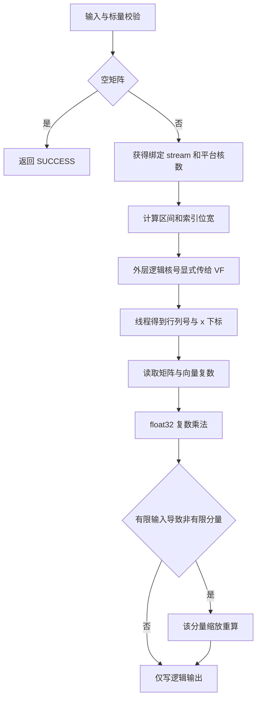

# aclblasCdgmm 算子设计文档（Ascend 950PR）

> 社区任务：CANN训练营华南师范-aclblasCdgmm算子开发（950）。
> 提交者/团队：2301_80657784；更新日期：2026-11-17。
> 本文用于设计评审。目标环境为 Ascend 950PR（arch35）和 CANN 9.1.0；本地 CPU 自测已完成，CANN 设备编译、实卡精度与性能尚待验证，本文不提供已通过实卡验收的结论。

# 需求背景（required）

## 需求来源

来源于 [CANN 社区任务](https://www.hiascend.com/developer/activities/cann-community-task)中的“CANN训练营华南师范-aclblasCdgmm算子开发（950）”，需求与验收口径以该任务的 `aclblasCdgmm_Atlas950PR_task_doc.md` 及配套测试附件为准。

- [任务讨论帖：aclblasCdgmm 算子开发（950）](https://atomgit.com/cann/ops-blas/discussions/69)。
- 代码目标仓库：[cann/ops-blas](https://gitcode.com/cann/ops-blas)，实现目录 `blas/dgmm/arch35/`，测试目录 `test/dgmm/cdgmm/arch35/`。
- [设计文档模板](https://gitcode.com/cann/cann-ops-competitions/blob/master/04_tasks/01_community-task-2026/resources/design_template.md)。

## 背景介绍

### 算子功能与应用

`aclblasCdgmm` 对单精度复数矩阵执行对角缩放：LEFT 模式按行缩放，RIGHT 模式按列缩放。每个输出复数只依赖一个矩阵元素和一个向量元素，不涉及归约。它对应 cuBLAS 的 `cublasCdgmm` 扩展接口，可用于复数矩阵的行列加权、归一化前后处理等场景。

### 已有接口与本任务的关系

沿用 `include/cann_ops_blas.h` 中已有公开接口，不修改声明，不定义 950PR 私有平行接口。

任务书明确指出 arch22 旧产品线实现使用行主序且仅支持 LEFT，950PR 任务要求列主序和 LEFT/RIGHT。本任务依据任务书独立设计 arch35 索引、校验与测试，不复用 arch22 的实现或 golden。接口文档需同步说明产品差异，避免同名 API 的历史说明与 arch35 行为冲突。

| 项目 | 950PR 本任务要求 |
|---|---|
| 数据类型 | COMPLEX64，实部/虚部各 FLOAT32 |
| A/C 排布 | 列主序，各自通过 lda/ldc 定位列首 |
| 缩放方向 | LEFT、RIGHT |
| x 步长 | 任意非零 int，支持正步长、负步长 |
| 原地执行 | 支持 A==C，要求 lda==ldc |
| 空矩阵 | 标量校验通过后 m==0 或 n==0 返回 SUCCESS |
| 实现方式 | Ascend C kernel 直调，使用 handle 绑定的 stream |

# 需求分析（required）

## 需求描述

在 Ascend 950PR 上开发 `aclblasCdgmm`，实现列主序复数对角矩阵缩放，支持正负向量步长、独立前导维与合法原地执行；保证输入和 padding 保护，达到任务规定的精度、确定性与性能要求。

公开接口保持如下签名：

```cpp
aclblasStatus_t aclblasCdgmm(
    aclblasHandle_t handle,
    aclblasSideMode_t mode,
    int m,
    int n,
    const aclblasComplex* A,
    int lda,
    const aclblasComplex* x,
    int incx,
    aclblasComplex* C,
    int ldc);
```

## 外部组件依赖与内部适配

CANN 9.1.0 提供 Ascend C 编译器、SIMT API、ACL runtime 和平台信息查询；ops-blas 提供 handle/stream 管理、公开状态枚举、SOC 源码选择与 GTest 测试框架。算子不依赖 TBE/GE、ACLNN executor 或额外数学库实现；测试使用 C++17、GTest 和任务附件 golden，通用测试框架的链接依赖沿用仓库要求。

本任务标杆是 cuBLAS 扩展接口，不提供 TBE 实现，因此模板中“TBE 源码和库路径”不适用。cuBLAS 内部 kernel 未公开，本文以任务提供的 CPU golden 列主序流程作可审计参考，不声称复现 cuBLAS 内部实现。仅为 arch35 增加实现与测试，不调整 arch22 模块。

## 需求拆解

| 需求项 | 实现与验证方式 |
|---|---|
| LEFT/RIGHT | 分别使用行号/列号作为向量逻辑索引，模板分发 |
| 列主序与 padding | A、C 分别用 i+j*lda、i+j*ldc；只写逻辑 m×n 区域 |
| incx≠0 | 正步长从首部访问；负步长按任务公式从尾部反向访问 |
| 原地执行 | A==C 且 lda==ldc 时，每线程先读完该复数再写回 |
| 参数与空输入 | 依任务顺序校验，no-op 不查询平台或发射 kernel |
| 宽地址 | 使用 64 位范围计算选择 32/64 位索引模板，含 INT_MIN 步长 |
| 精度和特殊值 | 独立对照附件 float64 golden；实虚部分别判定 |
| 确定性 | 无归约/原子更新；独占输出区间；相同原始输入重复测试 |
| 性能 | 200 条附件性能用例，msprof 有效采样≥10次；每条≥0.4倍、平均≥0.5倍 H100 |

# 详细设计（required）

## 算子分析

### 数学公式

设 A、C 为 m×n 复数矩阵，逻辑位置为 `(i,j)`，其中 `0≤i<m`、`0≤j<n`：

```text
LEFT : C(i,j) = x(idx(i)) * A(i,j), L=m
RIGHT: C(i,j) = A(i,j) * x(idx(j)), L=n

idx(k) = k*incx                  , incx>0
       = (L-1-k)*abs(incx)        , incx<0

A(i,j) 地址：A[i+j*lda]
C(i,j) 地址：C[i+j*ldc]

(ar + ai*i) * (xr + xi*i)
  real = ar*xr - ai*xi
  imag = ar*xi + ai*xr
```

`x` 传入底层分配起始地址；负步长不要求调用者预先偏移指针。

### 支持数据类型

A、x、C 均为 `aclblasComplex`，由两个 float32 分量构成，总计 8 字节；生产计算使用 float32。精度 golden 使用任务提供的 float64 中间计算后收窄到 float32 的实现。

### 支持形状与参数

| 参数 | 说明与约束 |
|---|---|
| handle | 有效 Host 句柄，持有绑定 stream；空句柄返回 HANDLE_IS_NULLPTR |
| mode | ACLBLAS_SIDE_LEFT / ACLBLAS_SIDE_RIGHT |
| m、n | 非负 int；无额外固定 shape，运行时计算 tiling |
| A | Device 列主序缓冲，至少 lda*n 个复数；非空矩阵时非空 |
| lda | ≥max(1,m) |
| x | Device 向量缓冲；非空矩阵时至少 `(L-1)*abs(incx)+1` 个复数 |
| incx | 非零 int；包含 INT_MIN 的绝对值计算先扩展至 int64 |
| C | Device 列主序缓冲，至少 ldc*n 个复数；非空矩阵时非空 |
| ldc | ≥max(1,m) |

本接口处理对角向量在行/列上的复用，不解析通用 Tensor 广播或任意多维 stride。空矩阵不访问数据指针。理论地址范围支持与实际可分配内存分开处理，测试不承诺超大 int 范围矩阵可在实际硬件上分配。

## 算子实现

### 实现方案

首版采用 DAV_3510 SIMT。将 m×n 逻辑区域按列主序展开为一维，相邻线程处理相邻复数；通过索引支持向量步长和独立 lda/ldc。x 在 RIGHT 模式下可由列内线程重复读取，缓存收益须以实卡数据确认。

选择 SIMT 是为了用统一实现覆盖两种 mode、正负 incx 和 padding；不是已证明的性能最优结论。若大尺寸紧凑场景带宽不足，再根据 profiling 评估向量化访存、SIMD/RegBase 连续路径、线程档位与缓存策略。

```text
API → 标量校验 → 空矩阵早返回
              → 指针与原地校验 → 获取 stream、实际 AIV 核数
              → tiling 与宽索引判定 → kernel 直调
              → 外层核编号显式传入 VF → 独占区间内逐线程计算 → 异步返回
```

#### 3.2.1 host侧设计

严格按顺序执行：

1. handle 判空。
2. mode 合法性，m<0、n<0、incx==0。
3. lda、ldc 均满足 max(1,m)。
4. m==0 或 n==0 返回 SUCCESS，允许 A/x/C 为空。
5. 非空矩阵检查 A/x/C 非空；A==C 时检查 lda==ldc。
6. 通过 `aclblasGetStream` 获取 handle 绑定 stream；失败状态透传。
7. 通过平台 helper 查询 AIV 核数；核数为零返回 INTERNAL_ERROR。
8. 计算 tiling，发射 kernel；调用者在回读输出前同步 stream。

非法 mode、维度、步长、前导维、非空矩阵空指针以及非法原地配置均返回 `ACLBLAS_STATUS_INVALID_VALUE`，不改成 INVALID_ENUM。空矩阵和参数错误不发射 kernel，数据值不由 Host 扫描。

##### 1. 分核策略

令 `N=uint64(m)*n`、`K` 为实际可用 AIV 核数：

```text
wanted = ceil(N/1024)
initialBlocks = min(wanted, K, 65535)
perBlock = align_up(ceil(N/initialBlocks), 16)
blockCount = ceil(N/perBlock)
```

每核负责 `[coreIndex*perBlock, min((coreIndex+1)*perBlock,N))`。16 个 complex64 对应 128B，作为切分对齐和访存局部性参数；仍按精确元素边界写回，不能覆盖 padding 或额外输出。重新计算 blockCount 避免空核。

外层 `__aicore__` 域通过 `AscendC::GetBlockIdx()` 获取逻辑核编号，并作为普通 uint32 参数传给 VF。VF 不依赖其局部 blockIdx 与外层核编号等价，消除不同文档版本中两种网格描述的歧义。每个逻辑元素仅属于一个核、一个线程，无需核间同步。

##### 2. 数据分块和内存优化策略

核内从 `begin+threadIdx.x` 开始，按 `blockDim.x` 跨步处理至 end。线程数从128按2的幂增长，32位索引最多1024线程，64位索引最多512线程；不超过 VF 的 LAUNCH_BOUND。上述阈值是首版调优参数，实际核数由平台查询。

SIMT 直接通过 GM 指针访问数据，不设置显式 UB buffer、动态 UB 或算子 workspace，不申请整矩阵中间副本；没有 DMA 流水或跨核交换。未使用 UB buffer 不代表没有寄存器、栈、缓存或运行时内部开销，上板后需检查编译资源与实际访存效率。

`CdgmmTilingData` 为56字节，通过 kernel 参数按值传递，包含 totalElements、elementsPerBlock、m/n、lda/ldc、incx、left/compact/wideIndex、blockCount 和 threadCount。

##### 3. tilingkey规划策略

本任务使用 kernel 直调，不注册 ACLNN tilingKey。Host 传入以下分支信息，在单个 kernel 入口分发八种模板组合：

- left：LEFT / RIGHT。
- compact：仅 lda==m 且 ldc==m 时采用紧凑索引，否则分别计算 A/C 前导维。
- wideIndex：32位 / 64位索引。

范围检查覆盖矩阵前导维跨度、x 的正负步长跨度和复数的两个 float lane；计算先在 uint64 完成，最大 lane 超过 INT32_MAX 时选择 uint64 模板。对 incx 先转 int64 再求绝对值，避免对 INT_MIN 直接取负溢出。

#### 3.2.2 kernel侧设计

1. 以外层核编号和 elementsPerBlock 得到本核精确逻辑范围。
2. 由一维索引 t 得到 `j=t/m`、`i=t-j*m`。
3. LEFT 使用 i、RIGHT 使用 j；根据 incx 正负得到 x 索引。
4. 紧凑路径直接使用 t；非紧凑路径分别用 `i+j*lda`、`i+j*ldc`。
5. 读取 A 和 x 的实部、虚部后，执行四次 float32 乘法及实部减法/虚部加法，再写入 C。

生产代码不对 A/C 使用 restrict，合法原地场景每线程读完该复数后再写回。不会写入 ldc padding，也不会修改独立输入 A 和 x。

普通计算路径保持独立乘积，避免 FMA 收缩改变特殊值语义。对有限输入导致中间乘积溢出、但 float64 golden 最终分量可能仍有限的场景，仅对非有限输出分量做2的幂缩放重算并恢复尺度；不影响另一个有限分量。输入含 Inf/NaN 时沿用直接展开结果，按任务规定的非有限值等效规则检查。该极值路径在设备上的 FTZ、指令支持和成本需实卡验证。

规划的文件为 `cdgmm_host.cpp`、`cdgmm_tiling_data.h`、`cdgmm_compute.h`、`cdgmm_simt.h`、`cdgmm_kernel.h`、`cdgmm_kernel.cpp`；由 ops-blas 现有工程自动收集并选取 arch35 实现。`include/cann_ops_blas.h` 原声明不变，更新 `blas/dgmm/README.md` 和 `docs/zh/api_list.md` 的产品语义说明。

### 参考流程与 Ascend C 流程

任务提供的 CPU golden 按列遍历矩阵，根据 mode 和 incx 定位 x，用 float64 计算并收窄为 float32；Ascend C 在相同逻辑映射上做分核与线程并行，生产计算为 float32，极值分量另走缩放重算路径。



参考与设备实现的主要差异是顺序/并行执行及中间计算精度，目标功能、参数语义与任务判据一致；浮点结果允许任务规定范围内的差异。padding 不参与两者的计算。

## 支持硬件

| 产品/软件 | 本次设计 |
|---|---|
| Ascend 950PR（arch35 / DAV_3510） | 本任务目标，实卡验证待完成 |
| CANN | 9.1.0，需配套编译器、运行时与驱动 |
| A2/A3（arch22） | 本次不修改已有实现，不作为950PR参考 |

## 算子约束限制

- 不改变公开接口、COMPLEX64 类型和列主序语义；不支持其他 dtype、批量接口或通用 stride。
- 仅支持 A==C 且 lda==ldc 的完全原地配置；部分重叠行为未定义，C 与 x 不复用内存，调用者负责保证。
- 不访问另一逻辑布局或 padding；向量缓冲必须满足实际跨度，非空输入输出为 Device 指针。
- no-op 仍须通过 mode、维度、步长和前导维校验；例如 n==0、lda==0 返回 INVALID_VALUE。
- 设备异步错误由调用者同步时检查；设计评审通过不代表已达到实卡性能门槛。

# 特性交叉分析

LEFT/RIGHT 决定 x 逻辑长度和索引，必须与 incx 正负、非单位步长联合覆盖；lda/ldc padding 必须与两种 mode、紧凑分支和原地配置交叉验证。A==C 时不能保留 restrict 假设，并需在重复执行前恢复输入。64位地址分支需与负步长及极端 incx 联合检查，防止在选择宽索引之前已发生32位溢出。异常参数校验需与空矩阵组合，确保 no-op 不绕过前导维要求。Inf/NaN 与极值场景使用不同判定路径，不以统一数值差掩盖有限/非有限不一致。

# 可维可测分析

## 精度标准/性能标准

| 验收标准 | 设计及判定口径 | 来源 |
|---|---|---|
| 精度 | 实部、虚部分别使用 atol=rtol=2^-13；有限元素匹配率≥0.99；硬误差界为1e-2或32×ULP；非有限值另行判定 | 任务书§3.2 |
| 非有限值 | 双方同为NaN、同号Inf，或一方NaN另一方±Inf，视为等效；有限/非有限不等效；非有限元素须全部通过 | 任务书§3.2 |
| 数据保护 | C的逻辑元素全部被写；输出padding哨兵不变；独立A/x只读；原地场景恢复原输入后比较 | 任务书§2.5、§3.2 |
| 确定性 | 同设备同输入同tiling，重复输出逐位一致；每次执行前重置输出或恢复原地输入 | 任务书§2.5 |
| 性能 | 每条H100_us/NPU_us≥0.4；全部200条倍率算术平均≥0.5，两项同时满足 | 任务书§3.3 |
| 采样 | 950PR上msprof op采集单算子Task Duration(us)；预热5次，有效样本≥10次取算术平均，排除异常并说明 | 任务书§3.3 |
| 内存 | 任务书§3.4为“不涉及”；kernel无算子workspace与整矩阵中间副本；交付模板适用性提交时说明 | 任务书§3.4 |

### 测试用例和方法

- 将任务附件 `cdgmm_golden.h` 原样提交到 `test/dgmm/cdgmm/arch35/`，使用其 `aclblasCdgmm_cpu` 作为标杆，不引用 arch22 或 GEAM 的 golden。
- 原始 CSV 的1000条精度用例和200条性能用例均保留完整参数与尺寸。测试通过 CSV 驱动 GTest 调用公开接口，读回并分别统计实虚部精度。
- 覆盖 LEFT/RIGHT、方阵/长条矩阵、正负步长、incx>1、独立 lda/ldc、非对齐尺寸、均匀/正态输入、极值和 Inf/NaN。
- 补充空handle优先级、空矩阵与前导维组合、非法枚举、零步长、空指针、合法原地及原地前导维不匹配、INT_MIN 步长等场景。
- 分块读回输出，检查padding、不漏写、输入只读；相同原始输入重复执行验证确定性。
- 本地分核回归编译生产SIMT分发头，将VF局部blockIdx固定为0、外层核编号变化，逐核检查输出归属，覆盖LEFT/RIGHT、紧凑/padding、正负步长和32/64位模板。将分核逻辑临时改回旧方式时回归应失败，防止模型再次掩盖核编号问题。
- 附件200条性能用例均为incx=1、紧凑前导维，另补LEFT/RIGHT的incx>1与padding性能场景；附件未提供这些补充场景的H100基线，其比较口径需与任务方确认，不将无基线场景计为性能达标。

### 当前验证状态及后续计划

截至2026-11-17，本地CPU模型已通过1000条原始精度用例及12项附加测试，并单独通过200条原始性能形状的功能检查；这些结果只反映Host、共享计算代码和本地SIMT分发模型，不作为NPU验收数据。

设计评审后将在950PR+CANN9.1.0依次完成设备编译、冒烟、完整精度、原地和确定性复验，再逐条采集200条性能。检查CANN实际SIMT接口、寄存器/栈资源、FTZ行为及msprof导出字段；根据实测决定是否调整核数、线程数、缓存或增加连续场景优化路径。没有足够采样、漏用例或缺有效基线时不判定通过。

README将给出编译、运行、设备选择和采样命令；验收时按模板附实部/虚部精度截图、真实性能报告与日志。当前仅提交设计文档用于评审，不提交代码验收申请。

## 兼容性分析

公开 `aclblasCdgmm` 声明和返回值保持兼容，不新建平行API；arch35按任务采用列主序、LEFT/RIGHT和正负incx。A2/A3原实现保持不变，其布局、mode和前导维约束与本任务不同，需在产品支持表与API列表明确说明。测试和构建按SOC选择arch35代码，避免与arch22同名符号同时编译。
