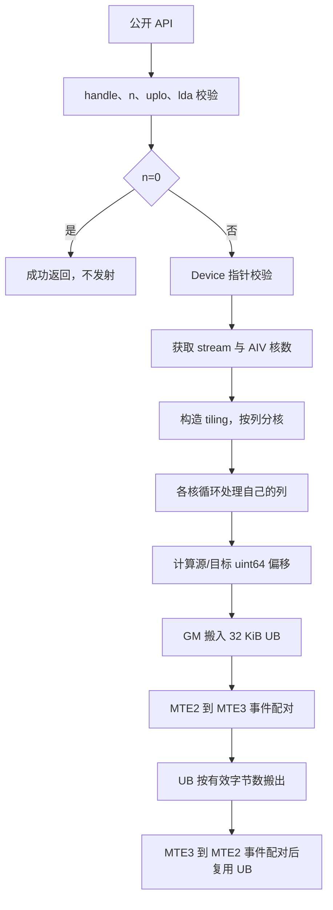

# aclblasCtpttr 算子设计文档（Ascend 950PR）

本文描述“最终版”中已完成本次实卡测试的 aclblasCtpttr 实现，文档整理日期为 2026-11-18（Asia/Shanghai）。
章节依据[官方设计模板](https://gitcode.com/cann/cann-ops-competitions/blob/8b3e8c742b8ce99c8d9a24a082e53280332949e1/04_tasks/01_community-task-2026/resources/design_template.md)，模板仓库版本为 `8b3e8c742b8ce99c8d9a24a082e53280332949e1`。需求依据为[原始任务书](任务书/aclblasCtpttr_Atlas950PR_task_doc.md)，实现和结果分别对应本目录 `源码/`、`测试结果/`。
当前 kernel 是按列连续段的 MTE 搬运方案，不是旧设计稿中的 SIMT 逐元素方案；本文以本次实际测试的源码为准。

# 需求背景（required）

## 需求来源

本任务要求在 Ascend 950PR、CANN 9.1.0 上，以 Ascend C kernel 直调方式实现 complex64 的packed 三角矩阵解包，功能和参数语义对齐 cuBLAS `cublasCtpttr`。
算子集成 ops-blas 的公开接口、handle 和 stream，设备实现位于 `blas/tpttr/arch35/`，测试位于 `test/tpttr/ctpttr/arch35/`。

## 背景介绍

### 算子功能与应用

输入 AP 为按列连续压缩的三角矩阵，输出 A 为带 lda 前导维的完整列主序存储。将 AP 中的元素逐个放回 uplo 指定三角；A 的另一三角和 padding 保留调用前内容。该转换用于在节省存储的 packed 数据与完整矩阵存储之间衔接已有数值流程。

复数类型为共用头文件中的 `aclblasComplex`，包含实部、虚部各一个 float32。
本算子只改变存储位置，不进行复数乘加、不共轭、不补零另一三角，也不创建与输入共享内存的输出视图。
Inf、NaN 及有符号零的位模式必须随原元素完整搬运。

### 仓内能力与本任务边界

任务书指出对应 arch35 家族已有实数版本，本任务补齐复数 API。
公开声明位于 `include/cann_ops_blas.h`，与其他产品线共用接口命名，不创建 950 私有平行 API。
实数版本的早返回顺序不能直接沿用：本任务在 n==0 时也要求先验证 lda≥1。

本交付是独立构建的 ops-blas 子工程，保留公共类型、handle、标准算子目录和 CSV/GTest 框架，只构建当前任务的实现与必要公共支持。
它不表示实现公共头文件中声明的全部 BLAS 算子。原有历史说明、性能数据或方案草稿不替代本次源码与实卡证据。

# 需求分析（required）

## 需求描述

```cpp
aclblasStatus_t aclblasCtpttr(
    aclblasHandle_t handle,
    aclblasFillMode_t uplo,
    const int n,
    const aclblasComplex* AP,
    aclblasComplex* A,
    const int lda);
```

| 参数 | 位置/方向 | 形状与类型 | 约束/行为 |
|---|---|---|---|
| handle | Host 输入 | ops-blas 句柄 | nullptr 优先返回 HANDLE_IS_NULLPTR |
| uplo | Host 属性 | UPPER / LOWER | 其他值返回 INVALID_VALUE |
| n | Host 属性 | int，矩阵阶数 | n≥0；n=0 在 lda 校验后 no-op |
| AP | Device 输入 | 至少 P=n(n+1)/2 个 complex64 | 非空矩阵时非空；按列 packed、只读 |
| A | Device 输出 | lda×n 个 complex64 | 仅写选定三角，另一三角及 padding 保持原值 |
| lda | Host 属性 | 完整矩阵列跨度，complex64 元素单位 | 至少 max(1,n)，包括 n=0 的情况 |

任务书把 A/AP 非重叠作为调用方前置条件。host 不扫描缓冲区地址范围，也不承诺把重叠指针必然拒绝为 INVALID_VALUE；重叠结果未定义，不能作为原地功能使用。

## 需求拆解

| 编号 | 需求 | 设计落点 | 验证落点 |
|---|---|---|---|
| R1 | UPPER/LOWER 列主序 packed 公式 | 分别计算每列 packed 起点、起始行和列长度 | 原始 CSV；n=1/2/3/5 等手工位模式用例 |
| R2 | 只写指定三角，另一三角与 padding 不改写 | `DataCopyPad` 精确字节数，按列边界搬运 | padding、非目标区域及尾部保护比较 |
| R3 | 纯搬运，complex64 位模式不变 | 使用 uint32_t 复制，不执行 float 运算 | 实部/虚部逐位比较、NaN 载荷、Inf、有符号零 |
| R4 | 空矩阵和规定的返回状态 | handle→n→uplo→lda→n==0→指针 | 空 handle、非法枚举、负维度、n=0/lda=0 交叉 |
| R5 | 有效同步与确定性 | 单 UB 缓冲，MTE2/MTE3 双向事件配对 | 同输入重复调用、输出保护和输入只读检查 |
| R6 | 动态核数与合理负载 | 以列为最小单位，循环分配至动态 AIV 核数 | 小 n、非对齐、两种 uplo、大规模 8192 场景 |
| R7 | 性能达标与复刻 | msprof op、5 warmup、每例 10 个有效样本 | 原始 200 条性能用例、2000 个捕获、官方报告 |

# 详细设计（required）

## 算子分析

### 数学公式

A 为列主序矩阵，元素 A(i,j) 位于 `A[i+j×lda]`。packed 数组 AP 含 `P=n×(n+1)/2` 个 complex64。
令 j 为列号，则：

```text
UPPER:
    packedStart(j) = j×(j+1)/2
    firstRow(j)    = 0
    columnLength(j)= j+1
    packedIndex(i,j)=packedStart(j)+i          ，0≤i≤j

LOWER:
    packedStart(j) = j×(2×n-j+1)/2
                   = j×n-j×(j-1)/2
    firstRow(j)    = j
    columnLength(j)= n-j
    packedIndex(i,j)=packedStart(j)+(i-j)      ，j≤i<n
```

解包方向为 `A[i+j×lda] = AP[packedIndex(i,j)]`，只对 uplo 选中的 (i,j) 赋值。不在其余位置填零，不生成完整对称/埃尔米特矩阵。

两种 uplo 的 packed 列起点不同，不共用一个起点公式。所有列起点和 `j×lda` 都先提升至 uint64_t 后计算。
以 n=3 为例，UPPER 列起点为 0、1、3，对应 `(0,0); (0,1),(1,1); (0,2),(1,2),(2,2)`；
LOWER 列起点为 0、3、5，对应 `(0,0),(1,0),(2,0); (1,1),(2,1); (2,2)`。
这些是元素偏移，转换为 uint32_t 的 word 偏移时还需乘 2。

### 支持数据类型

API 的输入输出为 complex64；设备侧使用两个 uint32_t 表示每个复数，host 静态断言其大小为 8 字节。
不把 NaN 数据送入浮点指令，不转换数据类型、不执行算术，因此纯搬运可以并且必须采用严格的 bit-exact 判定。

### 支持形状

n、lda 是运行时参数。n≥0，lda≥max(1,n)；n=0 时不发射 kernel，A/AP 可以为空。
实现不解析任意 Tensor stride 或 batch 维度，不支持 broadcast。lda 只表示完整矩阵的列跨度，AP 始终为 packed 连续存储。
host 未把 8192 设置为硬限制；本次任务附件覆盖的最大规模为 n=8192，超过已验证规模的可分配范围由实际存储与设备资源决定。

### 访存与开销分析

本算子没有实数浮点运算。每个 packed 元素读取 8 字节、写入 8 字节，逻辑读写总量为 `16×P=8×n×(n+1)` 字节；不计未参与处理的矩阵 padding 或另一三角。
n=8192 时 P=33,558,528，对应输入/输出有效数据合计 536,936,448 字节。
这是算法逻辑流量，不是实测 HBM 流量；缓存与 profiler 重放会影响实际物理流量，本文不把逻辑流量除以耗时称作硬件带宽测量。

每列在完整矩阵与 packed 数组中都是连续段，因此选用 DMA 块搬运，避免逐元素 SIMT 寻址或按 packed 线性下标反解列号。
小 n 的工作量较低，发射和列循环开销占比更明显；大 n 以数据搬运为主要成本。这里说明方案选择，不引用未经本次对照测试的旧方案加速比。

## 算子实现

### 实现方案



#### 3.2.1 host侧设计

入口为 `ctpttr_host.cpp::aclblasCtpttr`，校验顺序为：

1. handle==nullptr：返回 `ACLBLAS_STATUS_HANDLE_IS_NULLPTR`。
2. n<0：返回 `ACLBLAS_STATUS_INVALID_VALUE`。
3. uplo 不是 UPPER/LOWER：返回 INVALID_VALUE，不返回 INVALID_ENUM。
4. lda<max(1,n)：返回 INVALID_VALUE；因此 n=0、lda=0 也必须报错。
5. n==0：返回 SUCCESS，不检查输入/输出非空，不访问 Device 数据。
6. n>0 且 A/AP 任一为空：返回 INVALID_VALUE。
7. 获取 handle 绑定 stream；失败时传播原状态。
8. 由 `GetAivCoreCount()` 动态查询平台 AIV 核数；为 0 时返回 INTERNAL_ERROR。
9. 计算 tiling，在该 stream 上直调 kernel 并返回 SUCCESS。

不扫描 Tensor 元素，不为参数校验把 AP/A 拷回 Host。kernel 异步执行，调用方读回前须同步 stream；测试在同步点检查运行时错误。

##### 1. 分核策略

以一列为最小单位，避免多个核写同一列内的相邻片段。非空输入的有效核数为 `min(平台 AIV 核数,n)`。
代码以 `min(coreCount,max(n,1))` 计算，并对 0 作防御性回退；正常 host 路径已排除 n=0 和 coreCount=0。

kernel 使用 `GetBlockIdx()`、`GetBlockNum()` 获取 b、B，核 b 负责 `j=b, b+B, b+2B, ... <n`。
UPPER 的列长随 j 递增、LOWER 随 j 递减；循环分配让各核分散领取长短列，避免连续列分段把长列集中到一组核。
不宣称所有 n 下负载完全一致；例如很小 n 时仍会有列长度差异，但此时不发射超过列数的核。

每列恰好被一个核处理，列内按 chunk 顺序搬运，因此输出有效区间互不重叠，不需要核间屏障或全局原子操作。

##### 2. 数据分块和内存优化策略

```text
WORDS_PER_COMPLEX = 2
CHUNK_WORDS = 8192
单核 UB 缓冲大小 = 8192×sizeof(uint32_t) = 32768 字节
每个完整 chunk = 4096 个 complex64
```

一个列段可能由多个 chunk 组成。每轮 `chunkWords=min(totalWords-done,8192)`，`blockLen=chunkWords×4` 字节。
例如列长为 8192 个 complex64 时，totalWords=16384，分两次 32 KiB 搬运；不足 4096 个元素的列使用一个精确长度尾块。
`DataCopyPadExtParams<uint32_t>` 使用 `isPad=false`，不依靠填充 UB 尾部完成输出。源/目标的逻辑有效字节数均由 blockLen 限定。

每核只分配一个 `TBuf<TPosition::VECIN>`，串行复用；没有 double buffer，也没有显式浮点 Compute 阶段。
算子本身不另申请 GM 工作区或 Host→Device tiling 缓冲，tiling 作为直调参数传递。原有 handle 可能维护的库级 workspace 不算作本算子新增工作区。
任务书内存专项为“不涉及”，不能据此填写 0 GB 的专项测试通过结论。

##### 3. tilingkey规划策略

直调模式不注册数值 tiling key，通过以下 `CtpttrTilingData` 字段传递信息：

| 字段 | 类型 | 含义 |
|---|---|---|
| packedElements | uint64_t | host 计算的 P=n×(n+1)/2 |
| n、lda | uint32_t | 矩阵阶数和完整矩阵前导维 |
| upper | uint32_t | UPPER 为 1，LOWER 为 0 |
| useCoreNum | uint32_t | 动态确定的发射核数 |

kernel 按 upper 分支计算列长和起点，不进行 SIMT 模板分发或每点二分列定位。
实际列段地址由 n、lda、upper 计算；packedElements 记录总量，不代表将整个 packed 数组作为线性任务分给多个核。

#### 3.2.2 kernel侧设计

主入口为 AIV-only 的 `ctpttr_aiv_kernel`。在 kernel 的局部作用域创建 TPipe，通过引用传给 CtpttrAiv，再执行 Init/Process。
Init 绑定两个 uint32_t GM 张量、分配 32 KiB 缓冲，并经 FetchEventID 取得 MTE2_MTE3 和 MTE3_MTE2 两类事件。

对于列 j：

```text
firstRow  = upper ? 0 : j
colLen    = upper ? j+1 : n-j
fullBase  = 2×(uint64(j)×lda + firstRow)
packedBase= 2×packedStart(j)
totalWords= 2×colLen
srcBase = packedBase，dstBase = fullBase
```

读取 `apGM_[srcBase+done]`，写入 `aGM_[dstBase+done]`。输入每列从 AP 的 packed 起点开始连续读取 colLen 个复数，输出从完整矩阵的 firstRow 开始连续写入相同长度。

每个 chunk 的操作顺序：

1. `DataCopyPad(stage, sourceGM[srcBase+done], copyParams, loadParams)`，由 MTE2 读入有效字节。
2. `SetFlag/WaitFlag<MTE2_MTE3>`，在 MTE3 读 UB 前确认搬入完成。
3. `DataCopyPad(destinationGM[dstBase+done], stage, copyParams)`，由 MTE3 写回有效字节。
4. `SetFlag/WaitFlag<MTE3_MTE2>`，在下一次搬入覆盖同一 UB 前确认本次写回完成。
5. done 增加本次 chunkWords，直到整列完成，再处理下一列。

事件在所有 chunk 上配对，包括最后一个尾块；不以队列 EnQue/DeQue 推断跨 MTE 流水已同步。
位模式只通过 uint32_t 搬运，没有转换为 float 后再写回，因此 NaN 载荷和零的符号不会被算术规约。

### 输出与输入保护的正确性

UPPER 中 firstRow=0、colLen=j+1，只写 A(0,j)…A(j,j)；LOWER 中 firstRow=j、colLen=n-j，只写 A(j,j)…A(n-1,j)。两者都不写同列的另一三角，也不写行号 n…lda-1 的 padding。AP 仅作为输入，kernel 无写 AP 的指令；测试回读其有效元素和尾部保护区检查未改写。

不同列的完整矩阵区间由 lda 隔开；packed 区间按列公式无间隙排列且互不重叠。
列内 done 单调增加且每次长度不超过剩余量，所以不会漏拷或重复覆盖另一列。n=0 已在 host 返回，不会在 kernel 中进行空区间运算。

### 代码组织与依赖

| 文件/目录 | 职责 |
|---|---|
| `源码/include/cann_ops_blas.h` | 共用公开 aclblasCtpttr 声明 |
| `源码/blas/tpttr/arch35/ctpttr_host.cpp` | 参数、stream、平台核数与调用流程 |
| `ctpttr_tiling_data.h` | packed 总量、uplo 和动态核数 |
| `ctpttr_kernel.cpp` | 按列循环、64 位地址、DataCopyPad 和同步 |
| `ctpttr_kernel.h` | host/kernel 直调封装声明 |
| `源码/blas/common/helper/` | 句柄和平台查询 |
| `源码/test/common/complex_triangular_golden.h` | 独立 CPU 列游标参考 |
| `源码/test/common/complex_triangular_test.h` | 位模式比较、输入/输出保护、重复调用与采样发射 |
| `源码/test/tpttr/ctpttr/arch35/` | 本任务 GTest 注册及原始 CSV |
| `脚本/` | 构建、环境探测、正式测试、profiler 修复和归档 |

运行依赖 CANN ACL、Ascend C runtime 与平台库；测试使用原有 GTest/CSV 框架，并保留其 OpenBLAS 构建依赖。
本次 golden 采用任务书允许的独立 CPU 参考路径，未调用 LAPACK `ctpttr_`，也不声称存在对应的 `cblas_ctpttr` 接口。

## 支持硬件

| 支持的芯片版本 | 本次支持/验证 |
|---|---|
| Ascend 950PR（实卡为 Ascend950PR_9579、NpuArch 3510） | 支持，已实测 |

编译目标为 dav-3510，核数运行时查询。本次较大输入可以使用平台可用的 56 个 AIV，但这不是源码硬编码核数。
本次结果不代表对其他芯片、CANN 版本或产品线的验证。

## 算子约束限制

- A 为列主序且 lda≥max(1,n)，AP 为长度至少 P 的连续 packed 存储。
- 仅支持 complex64；不支持任意 Tensor stride、batch 或 broadcast。
- A/AP 不得重叠，输出数值不支持原地语义。未做完整地址区间检测。
- n=0 仅在 uplo 合法且 lda≥1 时成功；输入输出指针可为空，且不发射 kernel。
- 非法 uplo、负 n、非法 lda 使用 INVALID_VALUE；空 handle 使用 HANDLE_IS_NULLPTR。
- API 异步，调用方负责在读回前同步 stream，并提供有效 Device 存储。
- A 的另一三角和 padding 保留调用前内容，不保证它们具有任何特定数值。

# 特性交叉分析

| 特性交叉 | 处理和测试 |
|---|---|
| UPPER/LOWER × n=1/2/3/5 | 列起点不同；逐位样例核对 packed 顺序 |
| UPPER/LOWER × 非对齐 n × lda padding | 精确列段长度；非目标区域用初始内容校验 |
| n=0 × lda=0/1 × nullptr | 校验先于早返回，no-op 保护 Device 缓冲 |
| NaN 载荷/Inf/有符号零 × 两种 uplo | 原始 uint32 位模式搬运，实部和虚部分别比较 |
| 多 chunk 长列 × UB 复用 | 两类 MTE 事件配对；大规模性能形状也做完整输出比较 |
| 不同输出初值 × 重复调用 | VALUE、INDEX、随机极值等初始内容；重置输出后再次调用并检查 |
| A/AP 重叠 | 手工构造调用方错误场景，数值行为未定义；不能据此宣称支持原地 |

# 可维可测分析

## 精度标准/性能标准

| 验收标准 | 判定方法 | 来源 |
|---|---|---|
| 精度 | 实部、虚部 uint32 位模式逐元素相同；rtol=atol=0，匹配率 1.0 | 任务书 §3.2 |
| 特殊值 | NaN 载荷、Inf 符号和有符号零按位相同，不用普通减法容差 | 任务书 §3.2 |
| 输入/输出保护 | AP 与其尾部保护不变；A 的另一三角、padding 和尾部保护不变 | 任务书 §2、§3.2、§3.5 |
| 性能 | msprof op，5 次 warmup；每例至少 10 个有效 Task Duration 样本取均值；H100/NPU 单例≥0.4、全体平均≥0.5 | 任务书 §3.3 |
| 内存 | 专项不涉及，不能填写虚构 GB 数；保护区检查属于功能测试 | 任务书 §3.4 |

### 独立 golden 与测试输入

CPU golden 按列和行遍历，并用独立 packed 游标推进，不调用生产代码的 PackedStart 或分核函数。
比较器分别记录 real_mismatches、imag_mismatches、protected_mismatches；所有计数均应为 0。
额外的比较器破坏测试主动改变分量、NaN 载荷、符号和保护区域，确认比较器能拒绝损坏数据。

原始 1200 条 CSV 和 H100 基线保持任务附件内容。精度 1000 条，覆盖均匀与任务指定正态填充；性能 200 条，使用附件统一的均匀输入。
`GAUSS_NORM_5_2` 是随机 μ∈[-5,5]、σ∈[0.1,2] 后截断到 [-5,5]，不是截断 N(0,1)。
手工 payload 用例包含 NaN 载荷、Inf、正负零、次正规与极值位模式，并在 n=1/2/3/5/17、两种 uplo 下执行。

### 测试覆盖与本次结果

原始精度 CSV 之外的 8 项 GTest 分别为：NullHandlePriority、EmptyValidationOrder、PayloadsAndPackedOffsets、OutputInitialValues、MissingCsvColumnsRejected、EmptyPreservesBuffers、OverlappingPointersAreCallerError、ComparatorRejectsCorruption。
重叠测试不比较未定义输出；正常输入路径、protected 区域与每次同步的检查才构成本任务功能通过证据。

| 项目 | 本次结果 | 证据 |
|---|---|---|
| 原始精度 + 补充回归 | 1000 + 8，1008/1008 通过 | accuracy_summary.json、accuracy.json |
| 性能形状完整功能比较 | 200/200 通过 | performance_shapes_summary.json |
| 正式性能 | 200 条，每条 10 个有效样本，共 2000 个 | performance/summary.json、performance_samples.csv |
| 最低 H100/NPU 倍率 | 0.593852 | performance_cases.csv |
| 200 条倍率算术平均 | 1.529023 | 同上 |
| 低于 0.4 的原始性能用例 | 0 条；整体满足任务要求 | performance/summary.json |

下表为原始性能用例的前四条，均为本次实测；完整 200 条见逐例 CSV。

| case | 参数 | H100 us | NPU 均值 us | H100/NPU |
|---|---|---:|---:|---:|
| TC_PF_1001 | n=8192，ACLBLAS_UPPER，lda=8192 | 373.523197 | 374.633200 | 0.997037 |
| TC_PF_1002 | n=4096，ACLBLAS_LOWER，lda=4096 | 112.236800 | 78.292600 | 1.433556 |
| TC_PF_1003 | n=2048，ACLBLAS_UPPER，lda=2048 | 24.083200 | 31.402900 | 0.766910 |
| TC_PF_1004 | n=1024，ACLBLAS_LOWER，lda=1024 | 15.760000 | 15.532300 | 1.014660 |

性能形状功能回归独立执行完整数据比较；正式采样模式每例发射 10 次并逐次检查 SUCCESS 和同步，性能值只取 msprof op 的 Task Duration(us)。
H100 基线由原始 gpu_ms 乘 1000 转为 us，200 条平均倍率是每条 H100/NPU 倍率的算术平均，不是耗时总和之比。

### 可复刻性与定位入口

见[自验证步骤](task_submission/1%20自验证步骤说明.md)：初始环境依赖→芯片/CANN 探测→编译→1008 条精度→200 条性能形状功能→profiler 修复→200 条正式性能。
初始容器的 msprof 注入库需要设备号兼容修复；只在本任务工具副本构建补丁，不覆盖原 CANN/驱动，不改动算子、计时、warmup、时钟和阈值。
补丁来源版本、实际源码差异、构建命令和校验结果均随自验证步骤与日志提供。

`run_profile.py` 默认保留旧性能目录并重新实卡采样；仅显式 --resume 才验证并复用完整批次。
采集缺失、NA、0、非有限耗时、GTest 身份或捕获顺序不一致都不能形成性能通过结论；需要保留异常记录并整批重采，不筛掉慢样本。
定位资料包括 `accuracy.json`、`accuracy.log`、逐例位模式计数、`performance_shapes.json`、2000 个样本与每批 capture_manifest。

## 兼容性分析

本任务新增复数公开能力，声明仍位于共用头文件，参数顺序与任务指定 cuBLAS API 对齐。
实现限定在 arch35，不改动其他产品线的实现、实数 API 或其数据布局。
复数 ABI 通过共用类型与静态断言约束，handle/stream 沿用原工程。当前是“仅写/仅读指定三角”的接口契约，不能兼容性推断为补齐另一三角、共轭、原地或任意 stride 变换。
其他芯片和 CANN 版本未在本次实测；是否适配应由对应版本构建和回归验证。

## 需求与证据追踪

| 资料 | 路径 |
|---|---|
| 原始需求与用例 | `任务书/aclblasCtpttr_Atlas950PR_task_doc.md`、`任务书/test_cases/` |
| 当前实际实现 | `源码/blas/tpttr/arch35/ctpttr_host.cpp`、`ctpttr_kernel.cpp`、`ctpttr_tiling_data.h` |
| 环境与编译记录 | `测试结果/npu_arch.json`、`测试结果/build_flags.make` |
| 精度与保护检查 | `测试结果/accuracy.log`、`accuracy.json`、`accuracy_cases.csv` |
| 性能形状功能 | `测试结果/performance_shapes.log`、`performance_shapes_cases.csv` |
| 正式性能证据 | `测试结果/performance/summary.json`、逐例和逐样本 CSV、每批 capture_manifest |
| 官方报告与复现步骤 | `task_submission/`、`测试报告.md` |
