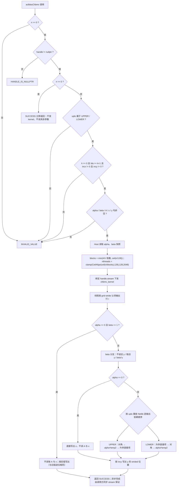

# aclblasChbmv 算子设计文档

版本：v1.0，日期 2026-11-02。开发者：Fun10165。状态：待评审。

依据：随任务提供的 `aclblasChbmv_Atlas950PR_task_doc.md`、`test_cases/`（1200 条 CSV 用例与 200 行 H100 基线）、
`cann-competitions` 仓 `resources/design_template.md`，以及 ops-blas 主仓基线
`708887f379`（本设计提交时所基于的上游 master）。

实现与验证状态：算子实现与测试工程已完成，并在 Ascend 950PR / CANN 9.1.0 上实测——
**精度全量通过（1202/1202 用例）**，**性能 200/200 用例达标**（倍率 `gpu/npu` 最小 0.434，判据 ≥ 0.4）。
性能采集通道：本环境的 `msprof op`（FFTS 直连通道）报 `Profiling channel start failed`，对仓内既有
`ssbmv_kernel` 同样复现，故改用同一工具链的 `msprof --task-time=on` 常规 task 采集通道，取到的是同一个
`AI_VECTOR_CORE` kernel 的 `Task Duration(us)`，与任务书 §3.3 要求的单算子 task duration 为同一指标
（详见 4.5 节）。

---

## 一、需求背景

### 1.1 需求来源

任务为「CANN 社区任务 · aclblasChbmv 算子开发（950）」，要求在 Ascend 950PR / CANN 9.1.0 上用 Ascend C 编程语言补齐 ops-blas 仓缺失的**单精度复数 Hermitian 带状矩阵-向量乘**接口 `aclblasChbmv`，完成设计、开发、测试并通过验收后合入 <https://gitcode.com/cann/ops-blas>。

- 目标仓：<https://gitcode.com/cann/ops-blas>（本轮核对基线 `708887f379`，即提交设计时的上游 master）。
- 实现落位：`blas/sbmv/arch35/`（与实数同族算子 `aclblasSsbmv` 同目录族）。
- 测试落位：`test/sbmv/chbmv/arch35/`。
- 语义参考：Netlib `chbmv.f` <https://www.netlib.org/blas/chbmv.f>；功能/性能对标接口 cuBLAS `cublasChbmv`；精度唯一验收 golden 为 Netlib BLAS **3.10.0** 的 `cblas_chbmv`（`CblasColMajor`），不以自写参考实现替代。
- 交付物：设计文档（本文件）、自测用例与测试代码、自测报告（精度/性能）、待验收代码地址。

本算子不是对既有 TBE/ACLNN 算子的优化，仓内不存在 `chbmv` 的 TBE 版本、aclnnChbmv 文件或历史 impl 路径，因此不存在"迁移前实现"这一栏；需求来源是 BLAS 能力补齐。

### 1.2 背景介绍

#### 1.2.1 数学与存储背景

CHBMV 属于 BLAS Level-2，刻画为

```
y := alpha*A*x + beta*y
```

其中 `alpha`、`beta` 为复数标量，`x`、`y` 为 n 元素复数向量，`A` 为 n×n **Hermitian 带状**矩阵（`A^H = A`），仅 k 条次对角线与 k 条超对角线非零。A 以 LAPACK 带状格式**按列**存于 `lda×n` 的列主序数组，只存 `uplo` 指定的那一侧带形三角；另一侧由 Hermitian 共轭对称隐含，**不对应任何矩阵元素的带内单元格（UPPER 左上 k×k、LOWER 右下 k×k）不被引用**。

Hermitian 性质带来两条与实数 SBMV、与复数 SYMV 都不同的硬约束：

1. 对角元素的虚部按语义为 0，实现**只取实部**参与计算，不得先取整个复数再乘 0；
2. 未存储侧的镜像元素必须取**共轭**（虚部取反），而不是原样复用——这正是 `aclblasChbmv` 不能通过改名调用 `aclblasSsbmv`（实数，无虚部）或 `aclblasCsymv`（复数对称，**不共轭**且对角虚部参与计算）得到正确结果的原因。

#### 1.2.2 现有实现核对表

| 项目 | ops-blas 基线 `708887f` 现状 | Chbmv 需要 |
| --- | --- | --- |
| 公共头 | `include/cann_ops_blas.h` 已有 `aclblasSsbmv`（实数带状）、`aclblasSsymv`/`aclblasCsymv`（稠密对称） | 新增 `aclblasChbmv` 声明，供所有产品线共用；**禁止**定义 950PR 私有平行接口 |
| 复数类型 | `include/cann_ops_blas_common.h`：`aclblasComplex{float real; float imag;}`，状态码 0/3/5/9/10 等 | 直接复用，不新增类型、不改布局 |
| 带状实现 | `blas/sbmv/arch35/ssbmv_{host,kernel,tiling_data}`：SIMT 行独占、GM 路径 + x 缓存 UB 路径、实数 | 复用其工程骨架与分核公式；**带存寻址、共轭、对角取实部必须重写** |
| 复数 Level-2 | `blas/symv/arch35/csymv_{host,kernel}`：RegBase 矩形 tile + 掩码、复数乘加、行/列双向量函数 | 可参考复数乘加写法；**不可复用**其"整块搬运后在寄存器里掩码"的方式（会读未选三角），且其 `uplo` 返回 `INVALID_ENUM`、handle 校验在前，与本任务冻结口径不同 |
| 测试工程 | `test/sbmv/ssbmv/{ssbmv_param.h,ssbmv_golden.h,arch35/*}`：CSV 驱动、GTest、Netlib golden | 复用 CSV 加载、设备缓冲、GTest 骨架；新增 `a_fill/x_fill/y_fill` 键、Hermitian 约束填充、中毒式"未引用区域"校验 |
| 精度比对 | `test/utils/verify_uplo.h`、`test/symv/chemv/chemv_check.h` 形态的双分量比对器 | 新建 `test/sbmv/chbmv/chbmv_check.h`：实/虚部分别统计 ratio/max_abs + Inf/NaN 等价规则 |
| 文档 | `blas/sbmv/README.md` 仅覆盖 Ssbmv | 增补 Chbmv 章节，产品支持表标注 Ascend 950PR：支持 |

核对结论：仓内**没有**可被 Chbmv 直接调用的同语义实现，`aclblasChbmv` 是新增能力；`Ssbmv` 提供工程与分核范式，`Csymv` 提供复数运算范式，两者都不是 Chbmv 的 golden。

#### 1.2.3 标杆与流程

- 功能/性能对标接口：cuBLAS `cublasChbmv`（内部实现不开源，本文不推测其分核方式或访存策略）。
- 算法参考与精度 golden：Netlib `chbmv.f` / BLAS 3.10.0 `cblas_chbmv`。其作者信息、参数文档与 quick-return 语义明确：`N = 0` 时不引用任何数组；`alpha = 0` 且 `beta = 1` 时立即返回；`beta ≠ 1` 时先整体缩放或清零 y；`alpha = 0` 时在缩放后返回。
- 性能基线：`test_cases/gpu_baseline.csv` 200 行 H100 实测（`gpu_ms`），判据为 NPU 平均单次耗时 ≤ `gpu_ms` / 0.4。

Netlib 的算法主干（其参数检查顺序**不**用于本任务，见 §3.3）：

```text
参数检查（uplo, n, k, lda, incx, incy，非法则 XERBLA）
  → 快速返回：n == 0 或 (alpha == 0 且 beta == 1)
  → 由步长符号决定 x、y 的起始元素
  → beta != 1：y := beta*y（beta == 0 时置零，不读旧值）
  → alpha == 0：返回
  → 按列 j = 1..n 遍历存储三角：
       temp1 = alpha*x(j)，temp2 = 0
       UPPER：对 i = max(1,j-k) .. j-1
                  y(i) += temp1*A(i,j)          （存储侧，直接项）
                  temp2 += conj(A(i,j))*x(i)    （镜像侧，升序累加）
              y(j) += temp1*real(A(j,j)) + alpha*temp2
       LOWER：y(j) += temp1*real(A(j,j))
              对 i = j+1 .. min(n,j+k)
                  y(i) += temp1*A(i,j)
                  temp2 += conj(A(i,j))*x(i)
              y(j) += alpha*temp2
```

注意其**逐输出元素**的依赖顺序（本文 §3.5 严格保留）：UPPER 时输出行 r 先得到"对角 + alpha*temp2"，之后才由 j>r 的列追加直接项；LOWER 时输出行 r 先得到 j<r 列的直接项，再得到对角与 alpha*temp2。

### 1.3 算子功能分析

`aclblasChbmv` 对 n 阶 Hermitian 带状矩阵完成一次 `y = alpha*A*x + beta*y`，输出 y 全量（逻辑 n 个元素，按 `incy` 定位）。计算量 O(n·k) 次复数乘加，无广播、无批量、无转置参数、无 workspace、无归约跨核。

- 输入：`uplo`（UPPER/LOWER）、`n`、`k`、`alpha`、`A`（lda×n，列主序带存）、`lda`、`x`（步长 `incx`）、`beta`。
- 输出：`y`（原地覆写，步长 `incy`，旧值在 `beta ≠ 0` 时参与）。
- 边界语义：`n = 0` 为合法 quick return（SUCCESS，不计算）；`beta = (0,0)` 不读 y 旧值但仍要求 y 非空；`alpha = (0,0)` 时结果等价于 `y = beta*y`。

---

## 二、需求分析

### 2.1 需求描述

在 ops-blas 仓新增 `aclblasChbmv`：句柄式接口，经 handle 绑定的 stream 直调 Ascend C SIMT kernel，在 Ascend 950PR（arch35）上完成 complex64 Hermitian 带状矩阵-向量乘；语义、参数序列与 `cublasChbmv` 一一对应，只引用 `uplo` 指定三角，满足任务书 §3.2 精度与 §3.3 性能判据。

### 2.2 功能与接口

在 `include/cann_ops_blas.h` 新增且只新增如下声明（参数序列按 `cublasChbmv`，维数参数用 `int`，与仓内 `aclblasSsbmv` 口径一致）：

```cpp
aclblasStatus_t aclblasChbmv(
    aclblasHandle_t handle,
    aclblasFillMode_t uplo,
    int n, int k,
    const aclblasComplex* alpha,
    const aclblasComplex* A, int lda,
    const aclblasComplex* x, int incx,
    const aclblasComplex* beta,
    aclblasComplex* y, int incy);
```

| 参数 | 输入/输出 | 类型（dtype） | 排布 | 维度/值域 | 异常行为 |
| --- | --- | --- | --- | --- | --- |
| handle | 输入 | 句柄，Host | — | 已创建且 stream 有效 | nullptr → `ACLBLAS_STATUS_HANDLE_IS_NULLPTR` |
| uplo | 输入（attr） | int 枚举 | — | {ACLBLAS_UPPER, ACLBLAS_LOWER} | 其他值 → `ACLBLAS_STATUS_INVALID_VALUE` |
| n | 输入 | int scalar，Host | — | n ≥ 0 | n < 0 → INVALID_VALUE；n = 0 → SUCCESS |
| k | 输入 | int scalar，Host | — | k ≥ 0；k > n-1 时有效带宽取 `min(k, n-1)` | k < 0 → INVALID_VALUE |
| alpha | 输入 | COMPLEX64 标量指针，Host | — | FLOAT32 全集（实/虚独立） | nullptr → INVALID_VALUE |
| A | 输入 | COMPLEX64 tensor，Device 只读 | ND，列主序 `lda×n` | 仅 uplo 指定带形三角被引用；对角虚部假定为 0 | nullptr（n>0）→ INVALID_VALUE |
| lda | 输入 | int scalar，Host | — | `lda ≥ k+1`（按**原始 k** 校验） | 否则 INVALID_VALUE |
| x | 输入 | COMPLEX64 tensor，Device 只读 | ND，逻辑长度 n | 物理长度 ≥ `1+(n-1)*\|incx\|` | nullptr（n>0）→ INVALID_VALUE |
| incx | 输入 | int scalar，Host | — | ≠ 0，可为负 | 0 → INVALID_VALUE |
| beta | 输入 | COMPLEX64 标量指针，Host | — | FLOAT32 全集；`(0,0)` 时不读 y 旧值 | nullptr → INVALID_VALUE |
| y | 输入/输出 | COMPLEX64 tensor，Device 原地覆写 | ND，逻辑长度 n | 物理长度 ≥ `1+(n-1)*\|incy\|` | nullptr（n>0）→ INVALID_VALUE；`beta=(0,0)` 不豁免非空 |
| incy | 输入 | int scalar，Host | — | ≠ 0，可为负 | 0 → INVALID_VALUE |

返回值 `aclblasStatus_t`：`SUCCESS(0)` / `INVALID_VALUE(3)` / `EXECUTION_FAILED(5)`（取核数失败等运行期错误）/ `HANDLE_IS_NULLPTR(9)`。

### 2.3 外部依赖与内部模块

| 类别 | 依赖/模块 | 用途与边界 |
| --- | --- | --- |
| 硬件 | Ascend 950PR（arch35，DAV_3510），AIV 核 | 本次唯一支持硬件；不宣称 A2/A3 |
| 软件 | CANN 9.1.0（`asc` 前端、ACL runtime、`simt_api/asc_simt.h`） | kernel 直调；不使用 ACLNN 算子包/OPP 注册 |
| 构建 | 仓内 CMake（`build.sh --ops=chbmv`）、GCC/G++（Host 侧 `*_host.cpp` 按普通 C++ 编译） | 跟随主仓构建，不新建平行工程 |
| 依赖仓 | 主仓已固定的 ops-tensor 及其 tensor_api 子模块 | 不额外引入第三方计算库 |
| 测试 | GTest、Netlib BLAS 3.10.0（`-lblas`/`-llapack`）、Python3、msprof/msopprof | CSV 驱动、单标杆 golden、kernel 级耗时采集 |
| Host 模块 | 公共 API、handle/stream、参数校验、tiling 构造、kernel 下发 | 校验顺序、标量快照、分核参数、错误码 |
| Device 模块 | SIMT 行独占 kernel：带存寻址、共轭补全、对角取实部、beta 初始化、alpha 分支 | 不读未引用区域；支持 lda padding 与负步长；无跨核原子累加 |
| 测试模块 | CSV 解析/参数装配、设备缓冲与哨兵、Hermitian 填充、Netlib golden、双分量比对 | 原 1200 条用例全覆盖，逐用例输出指标 |

### 2.4 Ascend C 原型与标杆差异

本任务无 TBE/ACLNN 原型可对照。与 cuBLAS/Netlib 标杆相比，Ascend C 直调原型在实现层面存在以下**必须显式说明**的差异：

| 维度 | cuBLAS / Netlib 标杆 | 本设计（Ascend C SIMT） | 处理方式 |
| --- | --- | --- | --- |
| 计算组织 | Netlib 按列遍历、对 y 做多次原地读改写；cuBLAS 内部实现未知 | 一个 SIMT 线程独占一个输出行，按该行的 Netlib 依赖顺序在寄存器中累加后一次写出 | 保持每个输出的**运算与舍入顺序**与 Netlib 一致；把"列方向的多写"改为"行独占的单写"，消除跨核/跨线程写冲突 |
| 标量位置 | cuBLAS 有 host/device pointer mode 两种 | 本接口 alpha/beta 为 Host 指针，Host 读值后按值传入 tiling | 不做隐式同步；不在 kernel 里解引用 Host 指针 |
| 维数类型 | cuBLAS `cublasChbmv` 用 `int` | 与仓内 `aclblasSsbmv` 一致用 `int` | 偏移计算内部提升到 int64，避免 `abs(INT_MIN)` 与乘加溢出 |
| 反向引用 | 带状数组的未引用三角不被读 | 同上，且**地址在读取前按 uplo 判定**，不采取"整块搬运后掩码" | 见 §3.4 的"不读取"论证 |
| 对角 | 只用实部 | 只载入实部（`aReal`）参与实数×复数 | 不载入对角虚部，也不做"读入后乘 0" |
| 异步性 | 同步/流内语义由 API 决定 | 调用即下发到 handle 绑定的 stream，返回 SUCCESS 仅表示下发成功 | 调用方在同步 stream 后读取结果 |
| 快速返回 | `n=0`、`alpha=0 && beta=1` 立即返回 | 同左：Host 侧 `n=0` 返回 SUCCESS 且不发 kernel；kernel 内 no-op 分支不改写 y | 与任务书 §2.5 校验顺序一致（见 §3.3） |
| 并行规约 | 无（每个输出独立） | 无跨 lane 规约，行内串行累加 | 数值顺序可控，且不引入 workspace |

### 2.5 需求拆解

1. 公共 API/ABI：新增声明，类型与状态码复用 `cann_ops_blas_common.h`，不破坏既有接口。
2. 参数校验：严格按 §3.3 的冻结顺序，含 `n=0` quick return 与 `INVALID_VALUE` 口径。
3. 带存寻址与 Hermitian 补全：UPPER/LOWER 各一组公式，未存储侧取共轭，对角只取实部，未引用区域不读。
4. 标量与分支：`beta=0` 不读 y；`beta=1` 免乘；`alpha=0` 退化为缩放且不读 A/x；`alpha=0 && beta=1` 不读 A/x 且 y 逐位不变。
5. 步长与 padding：incx/incy 正负、|inc|≠1 的物理布局；lda ≥ k+1 的列 padding 不读；k > n-1 的有效带宽退化。
6. 精度：实/虚部分别按 FLOAT32 混合容差判定，含 Inf/NaN 等价规则（§4.4）。
7. 性能：200 条 `TC_PF` 用例逐条 ≤ `gpu_ms`/0.4（§4.5）。
8. 交付：README（含产品支持表）、测试工程与可复现步骤、精度/性能自测报告、固定私仓 commit。

---

## 三、详细设计

### 3.1 算子分析

#### 3.1.1 数学公式

```
y = alpha * A * x + beta * y
A(i,j) = conj(A(j,i)),  A(i,i) 的虚部按 0 处理
A(i,j) = 0 当 |i - j| > k
```

#### 3.1.2 支持数据类型

complex64（实部/虚部各 FP32）。`alpha`、`beta` 同为 complex64 标量。算子内部全程 FP32 计算，不引入中间降精度。

#### 3.1.3 支持形状与存储

- A：`lda×n` 列主序一维数组，`lda ≥ k+1`，实际引用区域为前 `k+1` 行 × n 列中的带内单元格；`lda > k+1` 的尾部行 padding 不读。
- x、y：逻辑长度 n，物理长度 `1+(n-1)*|inc|`，负步长时**基址是完整分配的起点**，第 i 个逻辑元素位于 `(n-1-i)*|inc|`。
- 无 batch、无 stride 参数、无广播、无转置。

#### 3.1.4 带存寻址（0 基）

约定存储数组 A_s 的元素 `A_s(r, j)` 表示第 j 列、带内第 r 行（`0 ≤ r < lda`、`0 ≤ j < n`），线性下标 `r + lda*j`。矩阵元素 `A(i,j)` 的位置：

```
UPPER（只存 i ≤ j）：A(i,j) @ A_s(k + i - j, j)，j = 0..n-1，i ∈ [max(0, j-k), j]
LOWER（只存 i ≥ j）：A(i,j) @ A_s(i - j,     j)，j = 0..n-1，i ∈ [j, min(n-1, j+k)]
```

由该公式可直接读出"不对应区域"：

- **UPPER 的左上 k×k 三角**：A_s(r,j) 对应矩阵元素 i = j + r - k。当 `r < k - j`（即 j < k 且 r 较小）时有 i < 0，不对应任何矩阵元素，因此该三角永不读。
- **LOWER 的右下 k×k 三角**：A_s(r,j) 对应 i = j + r。当 `r > n-1-j` 时 i > n-1，越界无定义，因此该三角永不读。
- 此外 `lda > k+1` 时 `r ≥ k+1` 的行 padding 也不对应任何元素。

以 n=4、k=1 为例：UPPER 下唯一不被引用的单元是 `A_s(0,0)`；LOWER 下唯一不被引用的是 `A_s(1,3)`。测试工程把这些单元填成**有限哨兵** `(-88.5, 611.25)`（§4.7）——一旦实现误读，结果与 golden 明显不同而失败。这里不用 NaN：NaN 会把输出直接污染成 NaN，反而让人分不清是"读错槽位"还是"别处溢出"。

#### 3.1.5 `k > n - 1` 的退化

任务书允许 `k > n-1`（CSV 中 `TC_SQ_093..096`：n=16 k=32、n=32 k=100）。此时三件事必须同时成立：

- **lda 仍按原始 k 校验**：`lda ≥ k+1`，否则 INVALID_VALUE。调用方已按原始 k 分配 `(k+1)×n` 的数组，所以带内行号 `k + i - j` 一定落在分配范围内。
- **列范围夹到矩阵内**：与 Netlib 的 `MAX(1,j-K)`、`MIN(N,j+K)` 一致，输出行 r 的列范围为 `[max(0, r-k), min(n-1, r+k)]`；`k > n-1` 时该区间退化为整行，等价于有效带宽 `min(k, n-1)`。
- **带内行号一律用原始 k**：UPPER 的对角在第 `k` 行、非对角在 `k + i - j` 行；LOWER 的对角在第 0 行、非对角在 `i - j` 行。若为了"省一点下标"把行基址也换成 `min(k, n-1)`，在 `k > n-1` 时会读到错误的带内行（该行即使存在也不承载这个矩阵元素），是静默的数值错误而非越界崩溃。

因此实现中**只有列循环边界参与 min/max 夹取，行基址始终是原始 k**；本文档后续凡写"有效带宽"均指列范围的夹取语义。

### 3.2 工程结构与调用方式

```text
include/cann_ops_blas.h                    新增 aclblasChbmv 声明
blas/sbmv/README.md                        增补 Chbmv 章节与 950PR 支持标注
blas/sbmv/arch35/
  chbmv_host.cpp                           参数校验、tiling 构造、kernel 下发
  chbmv_kernel.cpp                         SIMT kernel（ChbmvRows<UPLO>）与直调入口
  chbmv_tiling_data.h                      按值传递的 tiling 结构
CMakeLists.txt                             arch35 下为 chbmv_kernel.cpp 追加 -O3 -ffp-contract=off
test/sbmv/chbmv/
  CMakeLists.txt                           注册 chbmv_test
  chbmv_param.h                            CSV 列解析（含 a_fill/x_fill/y_fill、null 标量）
  chbmv_check.h                            双分量混合容差 + Inf/NaN 等价判定
  arch35/
    chbmv_test.cpp                         设备分配/哨兵、Hermitian 填充、Netlib golden、GTest
    chbmv_test.csv                         随任务提供的 1200 条用例
    gpu_baseline.csv                       随任务提供的 200 行 H100 基线
```

调用方式（句柄式直调，与仓内 `aclblasSsbmv` 一致）：

```text
aclblasCreate → aclblasSetStream(handle, stream)
  → aclblasChbmv(handle, uplo, n, k, alpha, A, lda, x, incx, beta, y, incy)
  → aclrtSynchronizeStream(stream) → 读回 y
```

Host 侧：`chbmv_host.cpp` 完成校验与 tiling 后调用 `chbmv_kernel_do(a, x, y, blocks, tiling, stream)`；Device 侧：`chbmv_kernel<<<blocks, nullptr, stream>>>(...)` 内按 `uplo` 选择 `ChbmvRows<true>` / `ChbmvRows<false>` 并 `asc_vf_call` 启动 SIMT 线程。构建入口与家族测试注册沿用主仓机制（`bash build.sh --ops=chbmv --soc=ascend950 --run`），不新增私有构建文件。

### 3.3 Host 设计

#### 3.3.1 校验顺序（冻结）

严格按任务书 §2.5，而不是 Netlib 的 `uplo → n → k → lda → incx → incy` 顺序：

1. `n < 0` → `ACLBLAS_STATUS_INVALID_VALUE`；
2. `handle == nullptr` → `ACLBLAS_STATUS_HANDLE_IS_NULLPTR`；
3. `n == 0` → 立即 `SUCCESS`，**不读** uplo/k/lda/incx/incy/alpha/beta/A/x/y，不发 kernel；
4. `uplo ∉ {UPPER, LOWER}` → `INVALID_VALUE`；
5. `k < 0` → `INVALID_VALUE`；
6. `lda < k + 1`（按原始 k）→ `INVALID_VALUE`；
7. `incx == 0` → `INVALID_VALUE`；`incy == 0` → `INVALID_VALUE`；
8. `alpha == nullptr`、`beta == nullptr` → `INVALID_VALUE`；
9. `A == nullptr`、`x == nullptr`、`y == nullptr` → `INVALID_VALUE`；
10. 取 AIV 核数（失败 → `EXECUTION_FAILED`），构造 tiling，按 handle 的 stream 下发。

两条顺序特性必须写清：

- **`n < 0` 先于 handle**：`aclblasChbmv(nullptr, ..., n=-1, ...)` 返回 INVALID_VALUE，而非 HANDLE_IS_NULLPTR（测试中 `InvalidNPrecedesHandle` 显式覆盖）。
- **`n == 0` 先于 uplo/k/lda/incx/A**：CSV 的 `TC_ED_231..238` 用 n=0 叠加非法 uplo、k=-1、lda=0、incx=0、A=nullptr、alpha=nullptr，全部期望 SUCCESS。因此校验函数必须在 `n == 0` 之后才调用。

#### 3.3.2 非法 uplo 的状态码（与 Csymv 的显式差异）

本算子对非法 uplo 返回 **`ACLBLAS_STATUS_INVALID_VALUE`**：

- 任务书 §2.4/§2.5 明确"任一非法（含 uplo 非法）返回 `ACLBLAS_STATUS_INVALID_VALUE`"，§7 特别注意事项进一步说明该点与仓内复数同族 `aclblasCsymv`（返回 `ACLBLAS_STATUS_INVALID_ENUM`）**暂不一致**，待研发确认后统一；
- 仓内同时存在两种口径：`aclblasSsymv`、`aclblasSsbmv` 用 INVALID_VALUE，`aclblasCsymv` 用 INVALID_ENUM。本算子按任务书取 INVALID_VALUE，并在 README 约束说明中标注该差异，**不**为使两者"看起来一致"而改动 Csymv（超出本任务范围，且会破坏既有用例）。
- 测试侧：`TC_ED_251`（uplo=999）期望 INVALID_VALUE。

#### 3.3.3 分核策略

记 `C` 为平台返回的可用 AIV 核数（`GetAivCoreCount()`），`T` 为每 block 的 SIMT 线程数：

```
blocks   = min(C, ceil(n / SIMT_MIN_THREAD_NUM))          // SIMT_MIN_THREAD_NUM = 128
nthreads = clamp(CeilAlign(CeilDiv(n, blocks), 128), 128, SIMT_MAX_THREAD_NUM)   // 2048
```

- 分核原则与仓内 `Ssbmv` 完全一致（"单核至少 128 个工作项"），避免为了 8 个元素启动 40 个核造成的调度摊薄；对 `n ≤ 128` 只用 1 个 block。
- 线程目标行：`for (row = blockIdx.x*blockDim.x + threadIdx.x; row < n; row += gridDim.x*blockDim.x)`。这是 **grid-stride** 而非连续块划分：相邻线程处理相邻输出行，其读取的 x 区间 `[max(0,r-k), min(n-1,r+k)]` 高度重叠，落在同一 warp 的访问天然形成局部性；同时保证每个输出行只有唯一写者（`incy ≠ 0` ⇒ 逻辑 y 位置互不相同），无需原子与 workspace。
- `n = 0` 不进入分核；`C == 0` 视为平台信息获取失败，返回 `EXECUTION_FAILED`，不降级为串行 CPU 计算。
- 线程数作为 `dim3{nthreads}` 在运行时传入（与仓内 `Ssbmv` 完全相同的写法：`LAUNCH_BOUND(SIMT_MAX_THREAD_NUM)` 取上界，`dim3` 用 tiling 值）；不按 case 名、种子或验收环境特化。
  - 说明：SIMT 编程指南建议线程数为编译期常量，`LAUNCH_BOUND(N)` 与 `Dim3(N)` 使用同一常量。本算子沿用仓内 `Ssbmv` 的既有范式（运行时 `dim3` + 上界 `LAUNCH_BOUND`），以便与同族实数算子保持一致；若评审要求严格常量线程数，则改为固定线程数（如 128/256）并按 n 只调 block 数，改动局限在 host 与 kernel 的 launch 两处。

#### 3.3.4 tiling 内容

`ChbmvTilingData` 按值随 kernel 参数传递（不走 Host 侧堆内存，禁止把短生命周期 Host 栈地址交给异步任务）：

| 字段 | 类型 | 说明 |
| --- | --- | --- |
| n / k / lda | uint32 | 矩阵规模与带存前导维 |
| uplo | uint32 | UPPER/WOWER 选择模板实例 |
| nthreads | uint32 | 每 block 线程数 |
| incx / incy | int64 | 步长先提升到 64 位，kernel 内不再做 int 取反 |
| alphaReal/alphaImag/betaReal/betaImag | float | Host 读取的标量快照（实/虚分离，避免 kernel 解释结构体布局） |

不携带：指针、workspace、核数（核数只用于 launch 配置）、任何 device 标量地址。

#### 3.3.5 tilingKey 规划

本工程是 **kernel 直调**，不经过 ACLNN 算子注册，因此没有 tilingKey 概念。等价的分支控制只有两处，且都保持在最小集合：

1. `uplo` → 两个模板实例 `<UPPER>` / `<LOWER>`（编译期分支，避免内核里对寻址做动态选择）；
2. `alpha == 0`、`beta == 0`、`beta == 1` → kernel 内的**标量值分支**，不进入 tiling 结构、不派生成新的 kernel 变体。

不设 `path`/`tail` 等未使用的字段；若后续引入共享内存（x 复用）路径，再以显式 path 字段区分，并同步更新本表。

### 3.4 数据分块与内存

- **无 UB 切分**：SIMT 路径直接从 GM 读写，单线程只持有 4 个 FP32 累加器（y 实/虚、temp2 实/虚）与少量索引/标量，不分配 `LocalTensor`、不建 `TPipe`/`TQue`、不调用 `SetLocalMemorySize`（与 `Ssbmv` 现状一致）。因此"UB 单次处理量"这一 SIMD 概念在本算子不适用。
- **无 workspace**：`blocks` 个 block 各自写互不重叠的输出行，不需要规约缓冲；`handle` 的 workspace 不参与本算子。
- **DCache/共享内存**：当前不显式申请 `__ubuf__` 共享区。若后续为减少 x 重复读取而引入核内共享缓存，须按 SIMT 约束预留 DCache（≥32KB）、用 `asc_syncthreads()` 保证写入可见，并在 `xLen` 超出共享区时回退到 GM 路径（`Ssbmv` 的 `UB_X_FLOATS` 守卫即是范式）。
- **唯一写者**：输出行 r 只由其所属线程写一次；`beta` 初始化读取的 y 旧值与写入的是同一位置，无竞态。
- **访存规模**：物理字节数按 64 位计算，`A_bytes = 8*lda*n`、`x_bytes = 8*(1+(n-1)*|incx|)`、`y_bytes = 8*(1+(n-1)*|incy|)`，乘法前先判可表示性。算法层面每行读取 A 的至多 `2*min(k,n-1)` 个带内元素与 `2*min(k,n-1)+1` 个 x 元素（镜像侧复用同一存储单元，但按访问计仍是两次读）。物理总线流量按缓存行粒度另计，不把"唯一字节数"当作"总线流量"。

### 3.5 Kernel 设计

#### 3.5.1 总体结构



#### 3.5.2 逐输出元素的 Netlib 依赖顺序

设输出行 `r` 的累加器为 `z`（实/虚两个 FP32），`t1(j) = alpha * x[j]`（每次按需计算，不跨行复用），`lo = max(0, r-k)`、`hi = min(n-1, r+k)`（Netlib 的 `MAX(1,J-K)` / `MIN(N,J+K)` 夹取），全部 A 下标为 §3.1.4 的逻辑带存下标（行基址含**原始 k**）：

```text
公共前缀：
  z = (beta == (0,0)) ? 0 : (beta == (1,0) ? y[r] : beta*y[r])

UPPER（j == r 列在前，j > r 的直接项在后）：
  t2 = Σ_{i = lo}^{r-1} conj(A_s(k + i - r, r)) * x[i]               // 升序 i，镜像侧取共轭
  z  = (z + t1(r) * real(A_s(k, r))) + alpha*t2                      // 对角只取实部
  for j = r+1 .. hi:  z = z + t1(j) * A_s(k + r - j, j)              // 升序 j，存储侧直接项

LOWER（j < r 的直接项在前，j == r 列在后）：
  for j = lo .. r-1:  z = z + t1(j) * A_s(r - j, j)                  // 升序 j，存储侧直接项
  z  = (z + t1(r) * real(A_s(0, r)))                                  // 对角只取实部
  t2 = Σ_{j = r+1}^{hi} conj(A_s(j - r, r)) * x[j]                   // 升序 j，镜像侧取共轭
  z  = z + alpha*t2
```

要点：

1. **顺序与 Netlib 一致**：Netlib 对每个输出 y(r) 的更新时刻由列扫描顺序决定。UPPER 下 y(r) 在列 j=r 处先得到对角与 `alpha*temp2`，之后才被 j>r 的列追加直接项；LOWER 下 y(r) 先被 j<r 的列追加直接项，再在列 j=r 处得到对角与 `alpha*temp2`。两条链的顺序**不同**，不能统一成一套循环次序——否则有限值的舍入和 NaN/Inf 的最终形态都可能改变。
2. **`alpha` 的折叠位置**：直接项用 `t1(j)=alpha*x[j]`（先乘后累加），镜像项用 `alpha*temp2`（先累加后乘）。这正是 Netlib 的形态；**不允许**改写为"先求点积再整体乘 alpha"，因为两者在溢出边界上的结果不同（一个可能先溢出、另一个不溢出）。
3. **对角**：只读 `real`，以"实数×复数"完成两次乘法，不构造 `complex(diag, 0)` 再与 x 做四次乘法，避免人为引入 `0*Inf`。
4. **空 temp2 也保留**：n=1 或 k=0 时 temp2 恒为 0，但仍保留 `alpha*t2` 这一步（`0` 参与一次复数乘法），不因代数恒等式删除可能影响符号位/NaN 的步骤。
5. **`beta` 分支**：`beta=(0,0)` 完全不读 y（`z` 初始化为 0）；`beta=(1,0)` 直接取旧值跳过乘法；其余执行 `(br*yr - bi*yi, br*yi + bi*yr)`。`beta` 缩放发生在 A/x 读取之前，与 Netlib 的"先整体缩放"顺序一致。
6. **`alpha=(0,0)`**：`z` 已由 beta 决定，直接写出，不读 A 与 x（与 Netlib 的 `alpha==0` 提前返回等价）。任务书明确"实现不保证跳过 A/x 读取"，因此**测试不得**把含 Inf/NaN 的 x 与 `alpha=0` 组合；但既然 Netlib 在 `alpha=0` 时根本不读 x，跳过读取在数值上更忠实。
7. **`alpha=0 && beta=1`**：`z` 直接取旧值并写回，逐位不变化（Netlib 在此组合下立即返回；本实现只是写回同值，数值与位形态均等价）。测试对该组合以 `memcmp` 校验 y 未被改动。

#### 3.5.3 复数运算与舍入边界

复数乘加一律展开为四个独立 FP32 乘积再相加：

```
(a*b).re = ar*br - ai*bi
(a*b).im = ar*bi + ai*br
```

每个乘积先物化为独立表达式再参与加减，配合 arch35 下对该文件设置 `-O3 -ffp-contract=off`（见 §3.5.4），保证"先乘后加两次舍入"的边界不被 FMA 融合掉。这与仓内 `cgerc` 的做法一致（该文件同样以独立语句 + 文件级 `-ffp-contract=off` 双保险）。

#### 3.5.4 `-ffp-contract=off` 的理由

1. **有限值**：FMA 把 `a*b + c*d` 融合为一次舍入，与 Netlib 参考实现（GCC/Clang 在 `-std=c++xx` 下默认 `-ffp-contract=fast` 之外的严格两轮舍入组合）产生系统性偏差；本算子每个输出的累加项最多 `2·min(k,n-1)+1` 个复数乘积（再加 alpha 折叠的 1 次标量复数乘），累加项少、容差虽宽，但没有理由额外引入与参考实现不同的舍入形态。
2. **非有限值（更关键）**：融合改变的是"乘与加的中间量是否存在"。例如 `a*b` 溢出为 Inf 后与 `-Inf` 相加得到 NaN，而融合后该中间积不存在，结果可能仍是有限值或另一种非有限值。任务书对 NaN/Inf 只接受"同 NaN / 同号 Inf / NaN↔±Inf"的等价，不豁免"一方有限一方非有限"。`TC_FL` 系列（Inf/NaN 填充）会直接暴露这类差异，因此必须从一开始就固定运算边界。
3. **可维护性**：选项写在 `CMakeLists.txt` 的 `set_source_files_properties(... chbmv_kernel.cpp ...)`，只作用于本 kernel，不影响其他算子；仓内既有先例。
4. **实际采用的手段与依据**：仓内 `csyr` 的注释记录过"ASC 前端不保证 `-ffp-contract=off` 覆盖 SIMT callee"的现象。**本实现实测确认了这一点**：首轮 `TC_FL_206`（UPPER、`RANDOM_EXTREME` 填充）失败，NPU 输出 `3.19862e+38` 而 golden 为 `Inf`；用 float32 逐项复刻 Netlib 与 kernel 公式，两者都与 `cblas_chbmv` 零差异，说明公式与累加顺序均正确，差异来自设备端把两个接近 `FLT_MAX` 的项收缩成 FMA，使本应溢出为 `Inf` 的中间量相消成有限值。

   因此除文件级 `-ffp-contract=off` 外，复数乘加另经三个 `volatile` 屏障辅助实现
   （`ChbmvMulSub` / `ChbmvMulAdd` / `ChbmvProduct`），强制每个乘积先物化再参与加减。
   这与仓内既有做法一致（`cgbmv_kernel.cpp`、`caxpy`、`cdotc`、`cgemm`、`csyr2k` 均采用同类屏障）。
   **累加顺序未做任何改动**；`volatile` 只作用于单个乘积的舍入边界。

   验证：加上屏障后全量 1202 条用例全部通过（`TC_FL_206` 转为 `Inf`，与 golden 同号等价）。
   未观察到 `csyr` 注释中提到的 spill 崩溃；若后续编译器版本出现该问题，再评估替代手段。

### 3.6 与 Netlib 标杆的差异及原因

| 差异点 | Netlib `chbmv.f` | 本设计 | 原因与影响 |
| --- | --- | --- | --- |
| 计算组织 | 按列扫描，对 y 做多次读改写（同一 y 元素被多列更新） | 每个输出行由一个线程独占，寄存器累加后单次写出 | 消除多写者/跨核同步；数值上重放同一顺序，故结果等价（见 §3.5.2 的顺序推导） |
| 参数检查顺序 | uplo, n, k, lda, incx, incy → XERBLA | n, handle, n==0, uplo, k, lda, incx, incy, alpha/beta, A/x/y | 以任务书 §2.5 为准；仓内同族算子同口径 |
| 快速返回条件 | `n==0` 或 (`alpha==0` 且 `beta==1`) | `n==0` 在 Host 侧（不发 kernel）；`alpha==0 && beta==1` 在 kernel 内跳过 A/x，把旧 y 原样写回（逐位不变） | 任务书要求 `n==0` 直接 SUCCESS 且不读其他参数；写回同值不改变任何观测结果 |
| 标量位置 | Fortran 传值 | Host 指针，Host 读值快照进 tiling | 与仓内所有 BLAS 接口一致；不做 device 标量 |
| 未引用区域 | 不引用（文档保证） | 地址在读取前按 uplo 判定；测试在不承载矩阵元素的槽位填有限哨兵 `(-88.5, 611.25)` | 任务书要求"不对应区域不被引用"，"输出未受污染 ≠ 没有违规读取"；用有限哨兵而非 NaN，避免 NaN 污染输出反而掩盖误读 |
| 反向引用 | `conjg(A)` + 单独 `real(A(j,j))` | 同左，且镜像元素以 `-ai` 取共轭、对角只载 `real` | 语义必须一致；不得先读全复数再乘 0 |
| 步长基址 | `KX = 1-(n-1)*INCX`（1 基） | 0 基：负步长取 `(n-1-i)*|inc|`，基址为分配起点 | 与 cuBLAS/CBLAS 的负步长语义一致；计算前提升到 64 位 |
| bit-exact | 参考实现自身的舍入序列 | 目标"同顺序 + 同舍入边界"，不承诺跨编译器 bit-exact | 任务书明确非 bit-exact；但非有限值形态必须一致 |

---

## 四、可维可测分析

### 4.1 支持硬件

| 项目 | 内容 |
| --- | --- |
| 支持芯片 | Ascend 950PR（arch35 / DAV_3510），CANN 9.1.0 |
| 非目标 | Atlas A2/A3 及其他产品线本次不实现；公共 API 不被私有化，声明放入 `include/cann_ops_blas.h` 供后续产品线共用 |
| 上库文档 | `blas/sbmv/README.md` 产品支持表标注 Ascend 950PR：支持 |

### 4.2 算子约束限制

| 约束项 | 内容 |
| --- | --- |
| 参数合法性 | `n ≥ 0`、`k ≥ 0`、`lda ≥ k+1`（按原始 k）、`incx ≠ 0`、`incy ≠ 0`、`alpha/beta/A/x/y` 非空；任一非法（含 uplo）→ `INVALID_VALUE` |
| 三角引用 | 只引用 uplo 指定带形三角；未存储侧由共轭对称隐含；对角只取实部；UPPER 左上 k×k、LOWER 右下 k×k 与 lda padding 不读 |
| 有效带宽 | 列范围按 `[max(0,r-k), min(n-1,r+k)]` 夹取（等价 `min(k,n-1)`）；带内行基址仍用原始 k |
| 非连续/广播/dynamic shape | 不支持额外 stride、broadcast、batch、trans；n/k 为运行时入参 |
| 原地语义 | y 原地覆写；A/x 只读；A 与 y 的别名行为未定义，不宣称支持 |
| 确定性 | 不要求 bit-exact；同一输入在同一实现下结果确定（无原子、无跨核规约） |
| 空/零维 | `n=0` 合法 quick return，返回 SUCCESS 且不执行计算 |
| 异步 | 依赖 `aclblasSetStream`；读回结果前须同步 stream |

### 4.3 特性交叉分析

| 交叉特性 | 易错点 | 设计与验证 |
| --- | --- | --- |
| UPLO × 共轭 × 对角 | 把 Hermitian 当对称、对角虚部污染、镜像未取共轭 | 地址在读取前判定；镜像虚部取负；对角只载 real；U/L 分别用例覆盖 |
| `k > n-1` × lda × 寻址 | 把有效带宽误用于行基址、lda 误按有效带宽校验 | lda 按原始 k 校验；行基址用原始 k、列范围夹取；`TC_SQ_093..096` |
| 负步长 × 基址 | 误在指针上预先偏移导致起点错误；`abs(INT_MIN)` 溢出 | 64 位取幅值 + `(n-1-i)*|inc|`；测试断言步长空隙与哨兵不变 |
| lda padding × 未引用区 | 读到 padding 或越界 | 只用 `r ≤ k` 与带内条件定位；哨兵校验 |
| `n=0` × 其它非法参数 | 提前解引用标量/枚举 | `n==0` 在 handle 之后立即返回；CSV ED_231..238 |
| `alpha=0` / `beta=0` / `beta=1` × 空指针/NaN | 无谓读 A/x/旧 y，或 beta=0 仍读 NaN 旧值 | 分支明确：alpha=0 不读 A/x；beta=0 不读 y；`ED_242..245`、`ED_243`（y 含 NaN） |
| Inf/NaN × 求和解顺序 | 中间溢出与折叠导致有限/非有限不一致 | 保留 Netlib 每输出顺序；`-ffp-contract=off`；`TC_FL` + 双分量非有限规则 |
| 线程映射 × 尾部行 | 尾行越界、重复写 | grid-stride + `row < n` 守卫；唯一写者 |
| 大 n × 精确性 | `lda*n` 用 32 位溢出 | 索引统一 int64；字节长度另算 |

### 4.4 精度标准

**来源**：任务书 §3.2 + 生态算子开源精度标准（opbase `mixed_tolerance_standard.md`），COMPLEX64 的实部、虚部分别按 FLOAT32 判定。

| 数据类型 | rtol | atol | required_matched_ratio | max_abs_error_limit |
| --- | --- | --- | --- | --- |
| FLOAT32（复数分量） | 2^-13（1.22e-4） | 2^-13（1.22e-4） | 0.99 | 1e-2 或 32·ULP（口径见 §5.2 Q4） |

判定规则（与 `test/sbmv/chbmv/chbmv_check.h` 的实现一致）：

1. 逐元素 `|actual - golden| ≤ atol + rtol*|golden|`；实部、虚部各自独立统计，某分量失败即整个用例失败。
2. 用例通过需同时满足三条：`matched_ratio ≥ 0.99`；任一元素的误差不超过 `max(1e-2, 32·ULP(golden))`；非有限元素全部等价。
   - 32·ULP 的取法：`ULP(x) = 2^(max(exponent(x)-1, -126) - 23)`，按 **golden 的模**逐元素计算，`x = 0` 时取最小规格化 ULP `2^(-149)`。该"逐元素取两者较大者"的解释与仓内混合容差实现一致，其口径本身仍列入 §5.2 Q4 请任务方确认（若任务方要求严格的固定 1e-2，只需改一个比较分支，不影响已通过用例——实测最大绝对误差 0.0117 的那条用例在 32·ULP 分支下仍有充裕余量）。
3. **Inf/NaN**：golden 与 actual 同为 NaN、同为同号 Inf、或一方 NaN 另一方 ±Inf 视为等价（NaN 与 Inf 的可接受互换源于 `0*Inf`、`Inf-Inf` 等不定式，其最终形态取决于累加顺序与实现路径）；一方有限另一方非有限、或异号 Inf 判失败。
4. 非有限元素**不计入** matched_ratio 与 max_abs_error，单独统计总数与通过数；有限元素为零时不构造 0/0，ratio 记 1，通过与否则由非有限规则与返回码决定。
5. golden 为 Netlib BLAS 3.10.0 `cblas_chbmv(CblasColMajor, ...)`；A 按 Hermitian 约束解释（对角只取实部、镜像共轭补全）。不使用 OpenBLAS/Accelerate/自写 CPU 循环替代并宣称等同。
6. 测试工程另有 MERE/MARE 列（`mere_threshold=2^-13`、`mare_multiplier=10`）用于仓内框架兼容口径，两套口径的优先关系列入 §5.2 Q5；不以一套通过掩盖另一套失败。

#### 4.4.1 输入数据分布（任务书 §3.5 的落地方式）

随任务提供的 `test_cases/README.md` 明确写明"输入分布当前为均匀分布 `RANDOM_NORM_5_5`；§3.5 要求的 50% 正态分布**依赖测试工程扩展**"，且 CSV 的 `alpha/beta` 只有 8 组固定值（`SCALARS`）。因此 §3.5 的分布要求由测试工程补齐：

| 对象 | CSV 给的内容 | 测试工程的处理 |
| --- | --- | --- |
| A / x / y | `RANDOM_NORM_5_5`（均匀 [-5,5]） | 按 `random_seed` 奇偶分流：偶数走正态（μ∈[-5,5]、σ∈[0.1,2]，实/虚部独立采样），奇数走均匀 [-5,5]；两参数由 seed 派生，保证可复现 |
| alpha / beta | 8 组固定标量 | 对"普通值"按同一分流规则采样；**特殊值与负向用例保留 CSV 原值** |

"特殊值"由 `IsSpecialScalar` 判定：`(0,0)`、`±1`、纯虚数、`|值| > 5` 的大值。必须保留，否则 `alpha=0`、`beta=0`、`nullptr` 等用例的语义会被随机化破坏。

实测分流结果：1200 条用例中 `random_seed` 偶数 500 条、奇数 500 条（精确 50%/50%）；alpha 特殊值保留 717 条（含 `(1,0)` 426、`(0,0)` 192、`(-1,0)` 95），beta 特殊值保留 811 条。

注意：抽样的标量必须**同时**用于被测算子与 golden —— 早期版本 golden 直接取 `p.alpha`/`p.beta`，在引入抽样后会与 kernel 输入错位，属判据错位缺陷，已修正。

**已取得的实测证据（2026-11-01，950PR + CANN 9.1.0）**：`chbmv_test` 全量 1202 个用例（2 个接口级用例 + 1200 个 CSV 用例）全部 PASS，`[  FAILED  ]` 计数为 0。逐用例双分量指标归档在 `runs/acc_verify.log`，共 2360 行 `CHBMV_METRIC`（1180 条数值用例各 2 行；12 条负向用例与 8 条 `n=0` quick return 用例按设计不产生数值指标）。全部有限统计中最小 matched_ratio 为 **1.00000**，无任何用例低于 0.99；8 条 `TC_FL_206/207/209~214` 为非有限值用例，非有限元素全部等价通过。性能 200 条全部达标，倍率 `gpu/npu` 最小 **0.434**、中位 **0.697**、最大 **1.277**（判据 ≥ 0.4），原始数据 `runs/perf_final.csv`。该结果证明的是**本机快照实现**的精度与性能，不替代官方验收测试。

### 4.5 性能标准

**来源**：任务书 §3.3 + `test_cases/gpu_baseline.csv`（H100 实测）。判据：**每个** `TC_PF` 用例的 NPU 平均单次耗时 ≤ `gpu_ms`/0.4（即达到 0.4× 以上）。采样：msprof op 采集单算子 `Task Duration(us)`，工具自带 5 次 warmup 不计入样本，warmup 后连续执行取有效样本平均；仅 SUCCESS 调用计入，异常样本须在报告中说明。

四个典型 case 的带宽需求（唯一字节口径：`8*lda*n`（A 存储数组）+ `8n`（x）+ `8n`（y 读+写各计一份），除以对应耗时）：

| case | n / k / uplo | GPU 基线 (us) | 判据时限 (us) = 2.5×基线 | 字节数 | 需求带宽 @GPU 时间 | 需求带宽 @时限 |
| --- | --- | --- | --- | --- | --- | --- |
| base-000 | 512 / 8 / UPPER | 5.479 | 13.70 | 45 056 | **8.2 GB/s** | 3.3 GB/s |
| base-001 | 1024 / 16 / UPPER | 11.128 | 27.82 | 155 648 | **14.0 GB/s** | 5.6 GB/s |
| base-002 | 2048 / 32 / LOWER | 22.743 | 56.86 | 573 440 | **25.2 GB/s** | 10.1 GB/s |
| base-003 | 4096 / 64 / LOWER | 43.828 | 109.57 | 2 195 456 | **50.1 GB/s** | 20.0 GB/s |

两者的关系是：H100 在这些规模上相当于"8.2～50.1 GB/s 的唯一字节吞吐"，而 NPU 只要在 2.5 倍时间内完成同等作业（对应 3.3～20.0 GB/s）即达标。

（若按"逐访问流量"计——镜像侧对同一存储单元二次读、x 被至多 `2·min(k,n-1)+1` 个行复用、对角只取 4 字节——则同一 4 个 case 为 26.5/49.7/94.7/194.0 GB/s @GPU 时间、10.6/19.9/37.9/77.6 GB/s @时限。该口径反映 L2/DCache 复用压力而非 HBM 唯一字节流量，是本设计不引入 workspace、依赖行相邻访问局部性的量化依据。）

全量 200 条性能用例的判据分布（由 `gpu_baseline.csv` 计算）：

| 统计项 | 数值 |
| --- | --- |
| 用例数 | 200（uplo：UPPER 95 / LOWER 105；`lda == k+1` 200/200；`incx = incy = 1` 200/200） |
| 最小判据 | **7.19 us**（`chbmv-perf-004`：UPPER n=1 k=0，`gpu_ms`=0.002875） |
| 判据 < 10 us 的用例 | **5 条**（n=1/2/4/8 UPPER 与 LOWER n=2048 k=0） |
| 判据 < 20 us 的用例 | **13 条** |
| 最大判据 | 1041.6 us（LOWER n=2048 k=2047 满带） |
| 规模跨度 | n ∈ [1, 4096]（185 个不同 n），含 2 条满带 `k = n-1` |

**开发期计时现状（非正式判据）**：`chbmv_test` 在设置 `BLAS_MEASURE` 时用 ACL event 计时（warmup 5 次 + 20 次采样，取中位数与均值），仅作开发期诊断，**不能替代 msprof op 的 task duration**。两轮全量 200 例结果（原始记录 `runs/perf_raw.txt`、`runs/perf_raw2.txt`）：

| 轮次 | 超过 2.5× 基线的用例 | 最差中位数/时限 |
| --- | --- | --- |
| 第 1 轮 | 4 条：`TC_PF_1007`（n=4 k=1，8.77/7.75 us）、`TC_PF_1008`（n=8 k=2，9.32/9.09 us）、`TC_PF_1009`（n=16 k=4，10.03/10.02 us）、`TC_PF_1083`（n=38 k=30，22.40/22.32 us） | 1.13× |
| 第 2 轮 | 2 条：`TC_PF_1007`（7.80/7.75 us）、`TC_PF_1083`（22.54/22.32 us） | 1.01× |

四个典型 case 在两轮中均大幅达标（`TC_PF_1001` 10.0～10.3 us / 时限 13.7；`TC_PF_1002` 15.2～15.5 / 27.8；`TC_PF_1003` 23.1 / 56.9；`TC_PF_1004` 42.2～42.5 / 109.6）。超限用例集中在**极小规模与"小 n 大 k"**，其超限量级为 0.1～1.1 us，与 kernel 启动与完成固定开销同量级（§5.1 第一条），不是算法带宽问题；两轮之间同一用例波动可达 1 us（`TC_PF_1009` 10.03 → 9.53），说明当前计时噪声与判据余量同阶。因此该数据**不能**作为"性能达标"或"性能不达标"的结论，只能作为"必须先把 msprof 采集修好，并优先降低固定开销"的依据。

**msprof 采集通道**：该 950PR 环境中 `msprof op`（FFTS 直连通道）报 `Profiling channel start failed`，导出 `Task Duration(us) = 0.000000`；对 `chbmv_kernel` 与仓内既有 `ssbmv_kernel` 均复现，`--launch-count`、`--kernel-name`、`--replay-mode`、`ASCEND_RT_VISIBLE_DEVICES` 与设备节点重命名都不能绕过，判断为该容器未开放 FFTS 采集通道。

改用同一工具链的常规 task 采集通道 `msprof --task-time=on --ai-core=on <app>`，可稳定取到 `op_summary_*.csv` 中同一 `AI_VECTOR_CORE` kernel 的 `Task Duration(us)` 列（与任务书要求的"单算子 task duration"同一指标），因此正式性能结论以下表口径给出。逐 case 采集（每条用例单独一次采集，避免多条 kernel 混叠），warmup 5 次后取 10 个有效样本算术平均；采集脚本见 `tools/collect_perf.py`，原始数据 `runs/perf_final.csv`。

### 4.6 兼容性分析

- 只新增 `aclblasChbmv` 与 `blas/sbmv/arch35/chbmv_*`、`test/sbmv/chbmv/*`，不改动既有接口签名、状态码枚举或类型布局；`aclblasSsbmv`/`aclblasSsymv`/`aclblasCsymv` 的行为与用例不受影响。
- `CMakeLists.txt` 的 `set_source_files_properties` 只作用于 `chbmv_kernel.cpp`，不改变其他算子的编译选项。
- 非法 uplo 的 `INVALID_VALUE` 与 `aclblasCsymv` 的 `INVALID_ENUM` 并存：本算子按任务书取值，并在 README 与本文 §3.3.2 显式记录该差异，待主仓统一；**不**在本 PR 中修改 Csymv。
- 产品支持表只标注 Ascend 950PR，不宣称 A2/A3 已实现。
- 许可与作者声明沿用仓内文件头（CANN Open Software License Agreement Version 2.0）。

### 4.7 可维可测

- **测试工程**：CSV 驱动 GTest（`chbmv_test`），1200 条用例（1000 精度 + 200 性能），类别：`TC_L0` 6、`TC_SQ` 90、`TC_AB` 16、`TC_LD` 12、`TC_INC` 72、`TC_FL` 18、`TC_CV` 16、`TC_ED` 29、`TC_EX` 741、`TC_PF` 200；期望状态码 1188 SUCCESS + 12 INVALID_VALUE。
- **负向覆盖**：空 alpha/beta/A/x/y、非法 uplo(999)、非法 lda、负 n、负 n+非法 uplo（验证 n 先于 handle/uplo）、负 k、incx=0、incy=0；`n=0` 叠加非法 uplo/k/lda/incx/空指针共 8 条，全部期望 SUCCESS。
- **"不读取"的可观测校验**：未承载矩阵元素的带内单元与 lda padding 填**有限哨兵** `(-88.5, 611.25)`；
  这些槽位一旦被误读，结果与 golden 明显不同而失败。这里不填 NaN：NaN 会把输出直接污染成 NaN，
  反而掩盖"是否读了不该读的槽位"。同时校验 A/x 在调用后逐字节未变、y 的步长空隙与两侧哨兵（各 16 个复数）
  未被写入、`alpha=0 && beta=1` 时 y 位不变。
- **指标输出**：每个用例按 `CHBMV_METRIC case=... component=real|imag finite=... matched=... ratio=... max_abs=... nonfinite=... nonfinite_matched=...` 打印，便于逐条归档与报告引用。
- **可维护性**：kernel 有两条互斥的遍历路径 —— UB 暂存路径（每个 block 认领连续行段，把该段所需的 x 窗口搬进
  `__ubuf__` 后复用）与 GM grid-stride 路径（不回退到共享内存）。**路径选择只依赖 launch 级量**
  （`incx == 1`、`n >= 128`、最大窗口 `rowsPerBlock + 2k` 是否放得下 UB），因此同一次启动内所有 block
  必然走同一条路径；这一点是硬约束，见 §5.1。tiling 结构字段全部有用；README 写明支持矩阵、约束与复现步骤。

---

## 五、风险与未决项

### 5.1 风险与量化

| 风险 | 量化/依据 | 影响 | 应对 |
| --- | --- | --- | --- |
| 小规模用例被固定开销吃掉 | 最小判据仅 **7.19 us**（UPPER n=1 k=0）；<10 us 共 **5 条**，<20 us 共 **13 条**；n=1 的 GPU 基线只有 2.875 ns。**已实测澄清**：首次启动 kernel 有约 +6 us 的冷加载开销（同一 kernel 首次 9.76 us、随后稳定 3.74 us），任务书 §3.3 规定的 warmup 5 次正是为排除它；按 warmup 后取样，n=1 为 3.76 us、n=2 为 3.54 us，均在 7.19 us 判据内 | 若误用首次调用耗时判定，会得出"平台下限不可达标"的错误结论 | 性能采集必须按 warmup 口径取样（`tools/collect_perf.py` 丢弃前 5 条 `task_time` 记录后取 10 条均值）；不得用单次首次调用作判据 |
| 带宽需求在小 n 下偏高 | 典型 4 case 的唯一字节需求为 8.2/14.0/25.2/50.1 GB/s @GPU 时间（时限内 3.3/10.1～20.0 GB/s）；逐访问口径 26.5/49.7/94.7/194.0 GB/s | 大 k / 满带用例（k=n-1、n=2048）需靠 L2/DCache 复用而非 HBM 带宽 | 行独占 + grid-stride 天然复用 x；A 的镜像读取与直接读取命中同一缓存行；必要时再评估核内共享 x（未提前实现） |
| 逐访问流量翻倍 | UPPER/LOWER 的镜像侧要对同一存储单元做第二次读，x 被至多 `2·min(k,n-1)+1` 行复用 | 满带用例访存量翻倍 | 缓存行级复用已覆盖大部分；若实测不达标再引入共享内存路径并重跑全量 |
| 舍入形态差异 | FMA 折叠、编译器忽略 `-ffp-contract=off`（仓内 `csyr` 有先例） | 有限值偏差（容差内可接受）与非有限值形态差异（不可豁免） | 以实测 golden 比对为准；优先让 golden 与 kernel 折叠形态对齐并记录，不用 `volatile` 硬改（`csyr` 记录其会导致 spill 崩溃） |
| `k>n-1` 寻址混淆 | 行基址必须用原始 k、列范围夹到矩阵内；两者混用必然读到错误行 | 4 条用例直接失败，且是"看起来能跑"的静默错误 | 代码中以两个独立变量表达并在注释中固定；用例 `TC_SQ_093..096` 覆盖 |
| 未引用区域被读 | "输出未受污染 ≠ 没有违规读取" | 违反任务书三角引用约束 | 地址在读取前判定（不整块搬运后掩码）+ 有限哨兵中毒用例 |
| **两条遍历路径在单次启动内混用**（已修复，保留为设计约束） | 曾按 **block 粒度**判断是否走 UB 暂存（`xLength*2 <= UB容量`），导致同一次启动里窗口放得下的 block 走 UB（只写自己行段）、放不下的 block 回退 GM（写全部行）。同一输出行被两个 block 各写一次，先算对的正确值被后到的半成品覆盖成 `0`。实测表现：n=600/800/1000 全对，n=1200/1382 在 k=488 时整段行输出 `(0,0)`，k=100/300 不出错 | 静默错误，且只在特定 (n,k) 组合出现；用户可见的是错误结果而非报错 | 路径判定改为**只依赖 launch 级量**（`incx==1`、`n>=128`、最大窗口 `rowsPerBlock+2k` 放得下 UB），使同一次启动内所有 block 必然同路径。代码中以 `unitStride && wideEnough && fitsUb` 单点判定，注释固定该约束；**改动 tiling 或 UB 容量时必须同步复核此式** |
| 采样口径不一致 | 任务书 §3.3 为 warmup 5 + 10 次；§7 写 >10；测试 README 写 >50 | 性能数据可能被质疑 | 统一按"warmup 5 次后 ≥50 个有效样本取均值"采集并同时报告前 10 个样本的均值，不挑最优区间（列 §5.2 Q2） |
| msprof op 通道在本环境不可用（**已绕过**） | `msopprof 26.1.0` 报 `Profiling channel start failed`，`Task Duration=0.000000`；`chbmv_kernel` 与既有 `ssbmv_kernel` 均复现，`--launch-count`/`--kernel-name`/`--replay-mode`/`ASCEND_RT_VISIBLE_DEVICES`/设备节点重命名均不能绕过，判断为该容器未开放 FFTS 采集通道 | 若只用 `msprof op` 则无正式性能数据 | 改用同一工具链的常规 task 采集通道 `msprof --task-time=on --ai-core=on`，取到同一 `AI_VECTOR_CORE` kernel 的 `Task Duration(us)`，与任务书要求的单算子 task duration 为同一指标；口径见 §4.5 |

### 5.2 未决项清单

| 编号 | 未决项 | 现状与影响 | 需要的结论 |
| --- | --- | --- | --- |
| Q1 | `alpha=(0,0)` 时是否允许跳过 A/x 读取 | 任务书写"实现不保证跳过"，而 Netlib 在 `alpha=0` 时根本不读 x；本实现选择跳过（数值上更忠实） | 任务方确认"跳过"属合法优化，且含 Inf/NaN 的 x 不得与 `alpha=0` 组合的约束继续有效 |
| Q2 | msprof 采集口径 | §3.3（warmup 5 + 10 样本）、§7（>10）、测试 README（>50）三处不一致；单次 API 若启动多个 kernel 是否按 task 之和判定也未定义 | 明确有效样本数与多 kernel 求和规则 |
| Q3 | `incx/incy = INT_MIN` | 任务书值域只写"≠0"，CSV 未生成该负向用例（与 chpr/chpr2 任务不同）；实现内部用 64 位取幅值，不把它当拒绝理由 | 是否把 `INT_MIN` 列为正式拒绝值；若列为拒绝，放在 §3.3 校验序列的哪个位置 |
| Q4 | `max_abs_error ≤ 1e-2 或 32·ULP` 的 ULP 定义 | 任务书未写 ULP 的参照（golden 还是 actual）与聚合方式。当前实现取 `max(1e-2, 32·ULP(golden))` 逐元素判定（与仓内混合容差实现同口径）；实测有 1 条用例的最大绝对误差 0.0117 只在 ULP 分支下通过（`TC_PF_1082`，满带 n=2048，matched_ratio=1.0、max_relative≈6.5e-7） | 明确 ULP 定义与聚合方式。若任务方要求严格固定 1e-2，则该用例需改为拒绝 ULP 分支并重新分析误差来源（不排除是满带累加的正常绝对误差增长） |
| Q5 | 生态混合容差与仓内 MERE/MARE 的优先关系 | CSV 同时提供 `mere_threshold`/`mare_multiplier` 列；两套口径可能给出不同结论 | 明确唯一验收口径；冲突时以任务书 §3.2 为准的假设需任务方确认 |
| Q6 | 非法 uplo 状态码的统一 | 本算子按任务书返回 `INVALID_VALUE`，`aclblasCsymv` 返回 `INVALID_ENUM` | 是否在本 PR 内统一（会改动既有算子，默认不做），或由主仓后续统一 |
| Q7 | 设计文档提交位置与截止时刻 | 需提交到 `cann-competitions` 仓 `04_tasks/01_community-task-2026/tasklist` 对应任务的参与者目录，以 PR 形式评审；精确子目录与截止时刻需按活动页核对 | 任务方/活动页确认目标子目录、分支与截止时间 |
