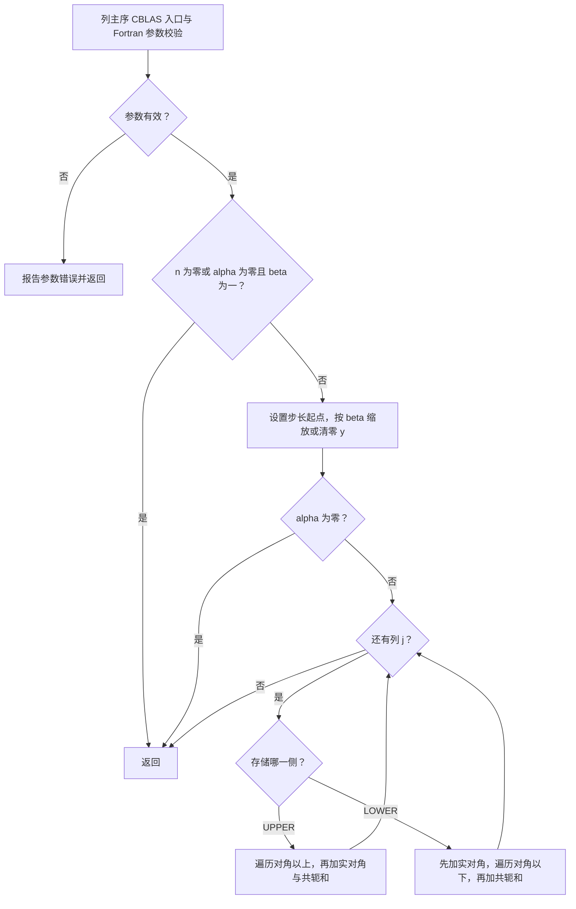
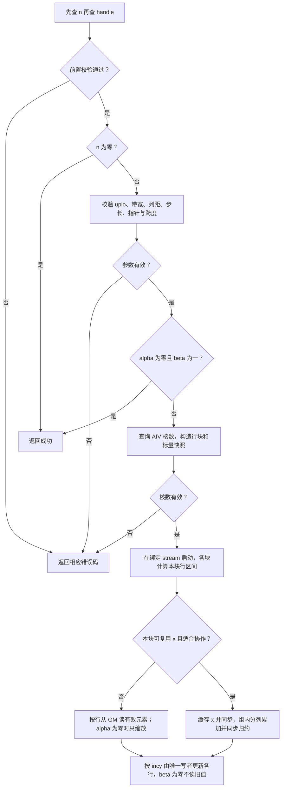

# 一、需求背景

## 1.1 需求来源

本任务为 Ascend 950PR 设计单精度复数 Hermitian 带状矩阵向量乘法 `aclblasChbmv`。调用者只保存一侧带形三角，由算子计算另一侧的共轭贡献，原地更新向量 y。需求以任务包内 `aclblasChbmv_Atlas950PR_task_doc.md` 为准，压缩包 SHA-256 为 `0c35941c1cce4c1ff7b6a9b2845fbb7eaf87a3331d4c873a57a615554d9bec08`。[官方任务页](https://www.hiascend.com/activities/task-center/details/47b20ecf102b45d39a549baf1bedaebf) · [正式任务书和测试附件](https://www.hiascend.com/p/resource/202610/bb68d3de82534023b8da0cf430c44247.zip)

## 1.2 背景介绍

### 1.2.1 aclblasChbmv 实现优化

任务书发布时按新增接口设计。核对 ops-blas 提交 `187d56dafbd373cb32e0a032bf4d7dc883bfcdf0`，共享头文件已有相同声明，`blas/sbmv/arch35/` 已有 Host、tiling 和 kernel，`test/sbmv/chbmv/arch35/` 已有测试。本设计复用现有 ABI 和按行计算的实现，拟对齐复合错误的校验次序，并减少无需协作归约时的 x 搬运。本文中的性能方案均待上板验证。[共享声明](https://gitcode.com/cann/ops-blas/blob/187d56dafbd373cb32e0a032bf4d7dc883bfcdf0/include/cann_ops_blas.h) · [950PR 实现目录](https://gitcode.com/cann/ops-blas/tree/187d56dafbd373cb32e0a032bf4d7dc883bfcdf0/blas/sbmv/arch35)

### 1.2.2 标杆算子现状分析

cuBLAS 的 `cublasChbmv` 给出接口语义，附件以 H100 耗时作为性能基线。精度基准是 Netlib BLAS 3.10.0 的列主序 `cblas_chbmv`。下图依据可核验的 Netlib 源码描述 CPU 标杆流程。ops-blas 直接在 handle 绑定的 stream 启动 kernel，模板中的 TBE 实现路径和算子信息库在此没有对应条目。[cuBLAS 12.4 HBMV](https://docs.nvidia.com/cuda/archive/12.4.0/cublas/index.html#cublas-t-hbmv) · [CBLAS 3.10.0 入口](https://github.com/Reference-LAPACK/lapack/blob/aa631b4b4bd13f6ae2dbab9ae9da209e1e05b0fc/CBLAS/src/cblas_chbmv.c)

#### 1.2.2.1 标杆算子支持的数据类型和数据格式

| 参数 | 950PR 类型与位置 | 访问与布局 |
| --- | --- | --- |
| handle、uplo | Host，`aclblasHandle_t`、`aclblasFillMode_t` | 有效上下文；`ACLBLAS_UPPER` 或 `ACLBLAS_LOWER` |
| n、k、lda、incx、incy | Host，均为 `int` | 阶数、半带宽、列距、x 和 y 的元素步长 |
| alpha、beta | Host，各指向一个只读 `aclblasComplex` | 复数标量，实部和虚部均为 FP32 |
| A | Device，只读 COMPLEX64，ND | 逻辑 n × n，物理 lda × n，列主序单侧带存储 |
| x | Device，只读 COMPLEX64，ND | 逻辑 n 元素，按 incx 取数 |
| y | Device，可写 COMPLEX64，ND | 逻辑 n 元素，按 incy 原地覆写；beta 非零时也是输入 |

`aclblasComplex` 依次存放 `float real`、`float imag`，每个复数占 8 字节。两标量均可取非零虚部。cuBLAS 允许按指针模式传标量，本任务指定 Host 指针，A、x、y 均取 Device 地址。[类型与枚举](https://gitcode.com/cann/ops-blas/blob/187d56dafbd373cb32e0a032bf4d7dc883bfcdf0/include/cann_ops_blas_common.h)

#### 1.2.2.2 标杆算子实现描述

Netlib 先检查 uplo、n、k、lda 和步长，再作快速返回。按步长确定逻辑起点后，先将 y 缩放为 beta·y；beta=0 时直接写零，beta=1 时保留原值。alpha 非零时逐列 j 读带内元素。令 t=alpha·x[j]，每个已存非对角元素 a 同时给 y[i] 加上 t·a，并给本列临时和加上 conj(a)·x[i]。UPPER 先遍历 i<j，再把实对角贡献与 alpha 乘临时和加到 y[j]；LOWER 先加实对角贡献，再遍历 i>j，最后加上 alpha 乘临时和。正单位步长和通用有符号步长使用相同的数学顺序。[Netlib 3.10.0 CHBMV 实现](https://github.com/Reference-LAPACK/lapack/blob/aa631b4b4bd13f6ae2dbab9ae9da209e1e05b0fc/BLAS/SRC/chbmv.f)

#### 1.2.2.3 标杆算子实现流程图



# 二、需求分析

## 2.1 外部组件依赖

运行环境为 Ascend 950PR 与 CANN 9.1.0，依赖 Ascend C 编译环境和 ACL Runtime 的设备内存、stream 管理。测试端由 ops-blas C++ GTest 装配 CSV，以 Netlib CBLAS 3.10.0 生成 golden，用 msprof op 采集设备耗时。附件标注 GPU H100、驱动 550.54、CUDA 12.4；交付的基线已含数值。

## 2.2 内部适配模块

| 模块 | 固定提交已有内容 | 本设计的处理 |
| --- | --- | --- |
| 共享接口与上下文 | `include/cann_ops_blas.h`、`include/cann_ops_blas_common.h`，handle 携带 stream | 复用单一公开符号及状态类型 |
| Host | `blas/sbmv/arch35/chbmv_host.cpp` 查询 AIV 核数、构造参数并启动 | 对齐任务书的错误优先级，检查长度可表示性 |
| 核内计算 | 同目录 `chbmv_tiling_data.h`、`chbmv_kernel.cpp`，含 GM 逐行与 UB 协作路径 | 保留两种 uplo 特化和有符号步长，比较共享 x 窗口的收益 |
| 测试 | `test/sbmv/chbmv/chbmv_golden.h` 调用 CBLAS，`arch35/chbmv_test.cpp` 装配用例 | 逐项回放任务包，补验复合错误、写保护和分布比例 |

## 2.3 需求模块设计

### 2.3.1 Ascend C 算子原型

```cpp
aclblasStatus_t aclblasChbmv(
    aclblasHandle_t handle, aclblasFillMode_t uplo, int n, int k,
    const aclblasComplex* alpha, const aclblasComplex* A, int lda,
    const aclblasComplex* x, int incx, const aclblasComplex* beta,
    aclblasComplex* y, int incy);
```

一次调用完成 `y ← alpha·A·x + beta·y`。两种 uplo 是同一接口的存储变体。无 trans、diag、batchCount、指针数组或批间 element-stride 参数，无广播或额外 tensor 视图。运行时 n、k 决定矩阵范围。

### 2.3.2 Ascend C 算子相关约束

全部下标从 0 起，令 B 为物理带数组。对于 n>0，令 b=min(k,n−1)。仅计算 |i−j|≤b 的元素。下表中 p 是相对 B 首地址的**复数元素偏移**。对角仅取 `B[p].real`，作为实数分别乘 x 的两个分量，避免用虚部零参与 `0×Inf`。

| 布局 | 已存位置 (i,j) 与偏移 p | 镜像位置 (i,j) 与偏移 p |
| --- | --- | --- |
| UPPER | i≤j，p=j·lda+k+i−j | i>j，p=i·lda+k+j−i，读后取共轭 |
| LOWER | i≥j，p=j·lda+i−j | i<j，p=i·lda+j−i，读后取共轭 |

UPPER 的主对角在物理行 k，LOWER 在物理行 0。k>n−1 合法；b 只裁剪遍历区间，UPPER 的主对角行仍用原 k，且 lda≥k+1。跳过带外、首尾列的无效三角及每列末尾 padding。例：n=3、k=4、lda=6，三个 UPPER 对角偏移为 4、10、16；逻辑 A[2,0] 取 conj(B[14])。

对向量步长 s，令 `v(t,s) = t·s`（s>0）或 `(n−1−t)·(−s)`（s<0）。传入物理缓冲区首地址，x[j] 取 v(j,incx)，y[i] 取 v(i,incy)，n>0 时所需元素数为 1+(n−1)·abs(s)。例如 n=3、incy=−2 只写偏移 4、2、0。仅 y 的自身原地更新有定义；任务书未规定 A/x 与 y 交叠的结果，调用者须保证输出写集与仍需读的输入不重叠。A/x 均只读，y 的步长间隙和保护区不写。

# 三、需求详细设计

## 3.1 调用方式

调用方创建 handle，用 `aclblasSetStream` 绑定 stream，在同一设备准备 A、x 和可写 y。Host 校验后按值捕获两个复数标量，将 tiling 随 kernel 启动参数入队。调用成功表示快速返回或完成下发；读取结果、释放设备缓冲区或跨流复用前，调用方须等待对应 stream 完成或建立事件依赖。公开接口无 ACLNN executor、TBE 注册或 workspace 查询阶段。[Host 调用](https://gitcode.com/cann/ops-blas/blob/187d56dafbd373cb32e0a032bf4d7dc883bfcdf0/blas/sbmv/arch35/chbmv_host.cpp)

## 3.2 需求总体设计

每个输出行 i 的带内列区间为 [max(0,i−b), min(n−1,i+b)]。行归属限定 y 的写者，列区间限定 A/x 的读集。这样可直接消费带状存储，不展开 n × n 的稠密矩阵。

### 3.2.1 Host 侧设计

按任务书 §2.5 定义以下可观测顺序。任一校验失败均在读取标量、查询核数或下发 kernel 前返回。

1. 若 n<0，返回 `ACLBLAS_STATUS_INVALID_VALUE` (3)，包括同时传入空 handle 的情况。
2. 若 handle 为空，返回 `ACLBLAS_STATUS_HANDLE_IS_NULLPTR` (9)。随后若 n=0，返回 `ACLBLAS_STATUS_SUCCESS` (0)，跳过其余参数且无设备访问。
3. 对 n>0，依次检查 uplo、k≥0、lda≥k+1、incx≠0、incy≠0、alpha、beta、A、x、y 非空。失败均返回 (3)，非法 uplo 也用 (3)。即使 beta=0 仍需可写 y，alpha=0 仍需 A/x 非空。
4. 在更宽类型内计算 k+1、步长绝对值、带下标及元素跨度。拟将已有的 `lda·n` 容量检查推广到 x/y：各跨度先与 `SIZE_MAX / sizeof(aclblasComplex)` 比较再转字节，不可表示时返回 (3)。`INT_MIN` 步长先提升到 int64 再取反，n=1 时跨度为 1。指针接口没有分配长度字段，实际缓冲区大小由调用方保证。
5. 合法输入取 Host 标量。alpha=0 且 beta=1 可直接成功；仅需缩放时按 beta 处理。需要启动时读取 handle 的 stream 和 AIV 核数；已有实现查得零核返回 `ACLBLAS_STATUS_EXECUTION_FAILED`。[Host 校验与分派](https://gitcode.com/cann/ops-blas/blob/187d56dafbd373cb32e0a032bf4d7dc883bfcdf0/blas/sbmv/arch35/chbmv_host.cpp)

#### 3.2.1.1 分核策略

沿用已有行分块。设可用 AIV 核数为 C；现有候选粒度 g 在 incx=1 且 k≥8 时取 8 行，否则取 32 行。Bcount=min(C,ceil(n/g))，R=ceil(n/Bcount)，块 q 负责半开区间 [qR,min(n,(q+1)R))。空区间退出，尾块按真实长度处理。每行有唯一负责人，协作路径只在核内拆一行。窄带、小 n 时启动更多核可能得不偿失；宽带时按行分块的两端工作量较小，可用逐行带长之和衡量块间不均衡。

#### 3.2.1.2 数据分块和内存优化策略

块区间 [s,e) 的 x 工作集为 [max(0,s−b),min(n,e+b))，元素数 L≤min(n,R+2b)。非单位 incx 走直接全局内存（GM）寻址；连续 x 有跨行重用时比较 GM 与核内统一缓冲区（UB）路径。逻辑乘积项数为 n(2b+1)−b(b+1)，单侧实际存储的有效元素数为 n(b+1)−b(b+1)/2。行方案可能将同一非对角元素读两次，节省了列方案所需的跨行输出归并。

固定提交中 UB 路径静态预留 8192 个复数的 x 数组和 `2·SIMT_MAX_THREAD_NUM` 个 FP32 的归约数组。该版本线程上限常量为 2048，两数组合计 81920 字节，即使 L 很小也应按静态分配额核算。8192 是实现阈值。选择候选配置须满足 `align(8·Xcap) + align(8·Tcap) + S ≤ U`，其中 Xcap≥L，Tcap 为预留线程数，align 按目标分配对齐，S 含编译器和其他核内临时占用，U 取目标平台可用 UB。预算不足或窗口越界回退 GM。该设计单缓冲，workspace 参数传空，无跨调用 GM 暂存，UB 随块结束释放。[核内数组](https://gitcode.com/cann/ops-blas/blob/187d56dafbd373cb32e0a032bf4d7dc883bfcdf0/blas/sbmv/arch35/chbmv_kernel.cpp) · [线程常量](https://gitcode.com/cann/ops-blas/blob/187d56dafbd373cb32e0a032bf4d7dc883bfcdf0/blas/common/helper/kernel_constant.h)

#### 3.2.1.3 tilingKey 规划策略

直调使用按值传递的 `ChbmvTilingData`，字段包含 n/k/lda/uplo、64 位 incx/incy、四个标量分量、块数、每块行数、线程数及 useUb，无图模式 tilingKey。现有 useUb 条件为 incx=1、n≥32、alpha 非零且最大窗口≤8192。核内只有在 alpha=1、beta=0、k≥8 且线程足够时才以多个线程协作一行，其余逐行算。拟把每行协作线程数的判断提到搬运之前：若为 1 则直接走 GM，节省一次共享窗口填充和一次屏障；尾块按自身行数选路。阈值调整须逐 case 比较耗时并重验精度。[tiling 字段](https://gitcode.com/cann/ops-blas/blob/187d56dafbd373cb32e0a032bf4d7dc883bfcdf0/blas/sbmv/arch35/chbmv_tiling_data.h)

### 3.2.2 Kernel 侧设计

设备侧沿用 AIV 上的 SIMT 行计算。进入具体 uplo 特化后，所有地址均按复数元素求出，再定位 real/imag。带边界求和及乘 lda 前做宽位运算。仅在实际需要的分支发出读写，不把对齐过读、跨步长空洞写回或对角虚部读取引入快路径。

#### 3.2.2.1 Kernel 侧实现描述

- **逐行路径**。每线程负责一行或以线程块大小为步长循环领取本块行。先构造 beta·y：beta=0 初始化两个零且不读 y，beta=1 直接取旧值，其他情况保留两个旧分量再复乘。alpha=0 时直接完成缩放；这是可选的避读优化，接口不承诺跳过 A/x。普通路径按 Netlib 的逐行贡献顺序累加。UPPER 先加实对角，再累计较小列的共轭和、乘 alpha 后加到本行，最后依次加较大列的直接项；LOWER 依次加较小列直接项、实对角和较大列共轭和。直接项先算 alpha·x[j] 再乘存储值。
- **协作路径**。线程共同搬入本块连续 x 窗口，经块内屏障后读取。每行分配 t 个线程（现有候选为 2、4、8、16），按列在组内交错分工。各线程分别累加直接项和共轭项，将复数部分和写入共享数组，经第二次块内屏障后，由组内首线程归约并写唯一的 y 元素。尾部无有效行的线程仍参加两次屏障。无跨块同步或全局原子加。
- **精度控制**。复数乘法按 (ar·xr−ai·xi, ar·xi+ai·xr) 计算，共轭只对非对角虚部变号；实对角单独走实数乘法。分量与部分和保持 FP32，不降为半精度。固定提交关闭浮点乘加收缩，逐行路径保留标杆的运算分组；协作归约改变加法顺序，须检查相消、极值溢出和非有限值分类。若某候选在其适用参数域无法通过验收，收窄其启用范围并回测逐行路径。[arch35 kernel](https://gitcode.com/cann/ops-blas/blob/187d56dafbd373cb32e0a032bf4d7dc883bfcdf0/blas/sbmv/arch35/chbmv_kernel.cpp)

#### 3.2.2.2 Ascend C 实现流程图



#### 3.2.2.3 与标杆流程的差异及原因

Netlib 按列顺序读单侧带，用一个存储元素更新两行；多核直接并行这些列会竞争 y。950PR 按输出行聚集，分别处理直接侧和共轭侧，以增加非对角读次数换取独立写回。参考实现先单独缩放所有 y，设备端将缩放融合在每行内。Netlib 的非法参数处理使用 Fortran 错误回调，Host 则按任务书优先级返回 BLAS 状态码。协作归约只要求满足分量误差标准，无逐位一致要求。

## 3.3 支持硬件

此次适配和验收目标为 Ascend 950PR（arch35），软件版本为 CANN 9.1.0。共享接口还存在 arch22 后端；其分核、标量约束和性能数据均不能作为本产品的验收依据。[同族产品说明](https://gitcode.com/cann/ops-blas/blob/187d56dafbd373cb32e0a032bf4d7dc883bfcdf0/blas/sbmv/README.md)

## 3.4 算子约束限制

k=0 只取实对角；n=1 且 k>0 时 UPPER 仍从偏移 k 读取；n=0 不求带宽、跨度或首地址。除 lda、incx 和 incy 描述的访问外，无任意非连续张量语义。任务书不要求确定性模式、专门的动态 shape 编译或峰值内存指标。附件生成器的 512 MiB 是测试输入预算，覆盖大至 n=4096 的用例，不限定 API 取值或硬件容量。

# 四、特性交叉分析

| 组合场景 | 需要观察的行为 |
| --- | --- |
| 空 handle × 负 n 或零 n | 负 n 按任务书先返回 (3)，零 n 遇空 handle 返回 (9)；有效 handle 且零 n 时忽略其余非法值 |
| beta=0 × y 含 NaN | y 有效逻辑位置可写，旧值不能影响输出；beta 非零时在覆盖前读全实虚分量 |
| alpha=0 × 输入特殊值 | 保持 y=beta·y 的接口语义。按任务书，x 含 Inf/NaN 的自验不与 alpha=0 组合 |
| 对角虚部、带外三角及 padding | 用非有限哨兵污染无效存储，对比有效结果；另检查 A/x 不变、y 的间隙与两端保护区逐字节不变 |
| 负步长 × 共轭 × 过宽带 | 用同一逻辑矩阵打包两种布局，反序存放 x、y，复用同一份逻辑 golden；验证主对角行始终由原 k 决定 |
| 多 stream 异步使用 | 各调用私有 tiling 和 UB，无全局可写部分和；共享只读输入可复用，重叠输出由调用方通过事件或同步排序 |

# 五、可维可测分析

## 5.1 精度标准/性能标准

**用例清单。** 按附件实际数据行（不含表头），`chbmv_test.csv` 有 1200 行，case 名唯一。前 1000 行为精度、返回码及边界用例（988 行预期 SUCCESS、12 行预期 INVALID_VALUE），后 200 行为性能。分类为 L0 6、SQ 90、AB 16、LD 12、INC 72、FL 18、CV 16、ED 29、EX 741、PF 200。精度行的 UPPER/LOWER/非法枚举分别为 506/491/3，性能行为 95/105；精度行含 n=−1、0 及最大 4096。附件 README 的 uplo 计数和精度尺寸上限与 CSV 不符，验收逐条以原始 CSV 为清单。[正式附件](https://www.hiascend.com/p/resource/202610/bb68d3de82534023b8da0cf430c44247.zip)

**精度与状态。** 用同一输入初值和种子，一份送 Device，另一份用 Netlib 3.10.0 的 `cblas_chbmv(CblasColMajor, …)` 生成单标杆。对 n 个逻辑 y 按有符号步长提取，实部、虚部分别作以下判定。负向和零尺寸用例核查状态、缓冲区和是否下发，非法参数不进 CBLAS。

| 指标 | 单个用例、单个分量的判定 |
| --- | --- |
| 有限值配对 | e=abs(actual−golden)，满足 e≤2⁻¹³+2⁻¹³·abs(golden) 的比例≥0.99 |
| 最大绝对误差 | 取有限对中最大 e 及其 golden FP32 值 g，要求 e≤max(0.01,32·ULP(g))；同时保留上游 GTest 对每个有限点的上限检查 |
| 非有限值 | 任一方非有限即单列计数。同为 NaN、同号 Inf、NaN 与任一符号 Inf 配对通过；异号 Inf、有限与非有限配对失败。此组须全部通过，不计入有限组分母或最大误差 |
| 空有限组 | 记录有限对数为 0，不做空集除法，按非有限组全通过判定。n=0 单独验证快速返回 |

最大误差点的 ULP 取其输出 dtype 所在值域。任务书明定单精度 CBLAS 和非有限值规则。CSV 的 `mere_threshold=0.00012207031`、`mare_multiplier=10.0` 是测试框架的附加指标，另列结果，不能替代混合容差。附件 `verify_accuracy.py` 解析 GTest 的 OK/FAILED 行，零条结果也可能以零退出；验收必须核对 1000 个预期 ID 及直接接口补测、分量统计和进程状态。[任务书引用的固定精度标准](https://gitcode.com/cann/opbase/blob/28a1ce52ae856353589841226a0002af73314a6b/docs/zh/ops_precision_standard/mixed_tolerance_standard.md) · [arch35 GTest](https://gitcode.com/cann/ops-blas/blob/187d56dafbd373cb32e0a032bf4d7dc883bfcdf0/test/sbmv/chbmv/arch35/chbmv_test.cpp)

**覆盖缺口。** 保留 1200 行原表。另以固定种子扩展常规随机输入，均匀 [−5,5] 和正态各占 50%，正态 μ∈[−5,5]、σ∈[0.1,2]，A、x、y、alpha、beta 的实虚部分别采样；有效对角仅取实部。生成器 `--dist mixed` 仍产生均匀分布，需记录实际生成方法与比例，复用已有的正态补测。覆盖 2 的幂及其相邻尺寸、k=0/1/满带/过宽带、lda padding、两侧各 36 种步长组合、纯虚/大值/零/一标量和 Inf/NaN。补充不经 CSV 的空 handle、复合错误和 n=1 配 `INT_MIN` 步长；分别核查两分量与步长间隙。在容量和精度边界，用 GM 与协作路径对同一输入作 CBLAS 比对。

**性能。** `gpu_baseline.csv` 的 200 个 `gpu_ms` 均已填写。原始 PF 均为 alpha=1、beta=0、incx=incy=1、lda=k+1。用 uplo、n、k、incx、incy、lda 与 PF 行一一对应，再核对标量和 case ID；基线与结果均转换到 µs。每个 case 的 `GPU_us / NPU_avg_us ≥ 0.4`，即平均耗时≤2.5·GPU_us；不能跨用例平均。以下上限由附件基线换算。

| 基线 ID | uplo | n | k | H100（µs） | NPU 平均耗时上限（µs） |
| --- | --- | ---: | ---: | ---: | ---: |
| chbmv-base-000 | UPPER | 512 | 8 | 5.479 | 13.6975 |
| chbmv-base-001 | UPPER | 1024 | 16 | 11.128 | 27.820 |
| chbmv-base-002 | LOWER | 2048 | 32 | 22.743 | 56.8575 |
| chbmv-base-003 | LOWER | 4096 | 64 | 43.828 | 109.570 |

任务书 §3.3 要求 msprof op 预热 5 次后取连续 10 次成功调用的设备 task duration 算术均值，§7.4 要求有效样本 >10，附件 README 和性能脚本注释要求 >50。拟对每个 PF 预热 5 次后采集连续 55 次成功调用，保留原始 µs 序列，分别判定前 10 次和全部 55 次的均值；两组均须达标。记录异常状态、同步失败及剔除原因，连续样本中断则保留失败记录并重采完整窗口。逐条关联 case、stream、kernel 和调用序号，计时窗口排除分配、拷贝、golden 和 Host 调度。

`verify_performance.py` 读取 GTest 的整例整数毫秒，按五字段匹配（不含 lda），且 NO_REF 也可能零退出。已有 GTest 的 event 平均值可诊断，正式判据仍取 msprof op 的 Task Duration。生成器会写空的基线占位，注释提到 P102；保留随包的 H100 数值和文件哈希。四条示例来自实表，任务书 §3.3 未列出逐行数值。性能报告须核对 200 个 case 全覆盖，无缺失基线、零耗时或失败样本冒充通过。

**验收记录。** 后续交付需提供算子源码版本、目录、产品支持 README、CSV 和测试代码、可复现步骤，以及含参数、两分量误差/非有限统计、设备耗时、倍率、截图和原始日志的自测报告。当前阶段只给出设计与判定办法。

## 5.2 兼容性分析

各产品线共用 `include/cann_ops_blas.h` 的同一签名。任务书和附件按“尚无声明、测试工程待建”编写，固定提交已实现 arch35，也已收录与本包字节一致的主测试 CSV。直接复用现有入口、类型和列名 `a_fill/x_fill/y_fill`，后续补测另行装配。

需要单独评审的是错误优先级。固定提交的 Host 和 `NullHandlePrecedence` 用例均先判空 handle，故 `n<0 && handle==nullptr` 返回 (9)；任务书 §2.5 要求 (3)。按本设计落地须使 950PR 实现与对应断言同步采用任务书顺序，记录对依赖旧复合错误码调用方的影响。非法 uplo 按任务书返回 INVALID_VALUE，不沿用任务书提及的 Csymv 的 INVALID_ENUM。上游的产品支持说明不构成本设计的精度或性能验收结果。[固定版本校验逻辑](https://gitcode.com/cann/ops-blas/blob/187d56dafbd373cb32e0a032bf4d7dc883bfcdf0/blas/sbmv/arch35/chbmv_host.cpp) · [复合错误测试](https://gitcode.com/cann/ops-blas/blob/187d56dafbd373cb32e0a032bf4d7dc883bfcdf0/test/sbmv/chbmv/arch35/chbmv_test.cpp)
