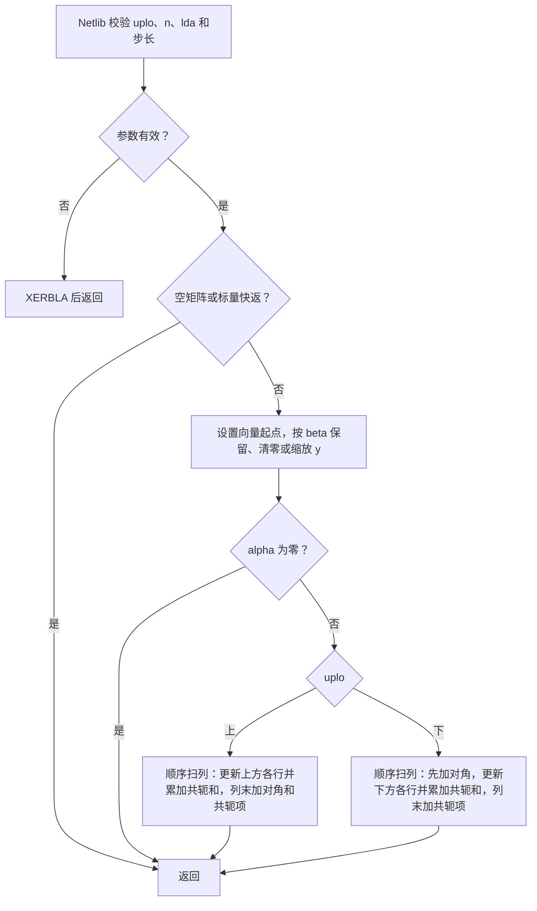
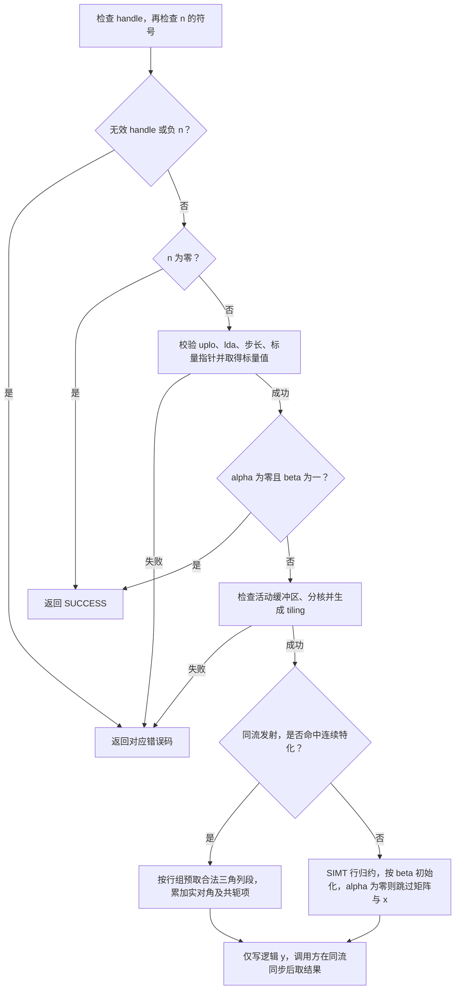

# 一、需求背景

## 1.1 需求来源

任务要求在 Atlas 950PR、CANN 9.1.0 上提供句柄式 `aclblasChemv`，补齐 BLAS Level 2 单精度复数 Hermitian 矩阵向量乘。一个公共接口覆盖上下三角及全部步长组合。本文依据任务 ID `00932c7652e946c7a7184aa98339a35a` 对应的正式任务书及同包测试附件，文件包 SHA-256 为 `55cbca730350679092736abe3e286f0b880380e6e9113cfd29a2206352c5df8f`。[任务页](https://www.hiascend.com/activities/task-center/details/00932c7652e946c7a7184aa98339a35a) · [正式任务书和测试包](https://www.hiascend.com/p/resource/202610/27d48277515f463ba86eea70e9ffd8d0.zip)

## 1.2 背景介绍

对结构化复数矩阵求矩阵向量积时，调用方只需初始化一个三角和对角实部。实现若将整块 A 当作有效稠密输入，会访问未初始化的另一半。设计同时约束计算使用的元素和实际发出的访存范围。

### 1.2.1 aclblasChemv 算子实现优化

任务书 §2.3 按发布时状态要求新增公共声明。本文核对的 ops-blas 提交 `b0193c1ac9ed0d5d94c265f9519ff4eb90665492` 已有同签名声明、arch35 Host、RegBase/SIMT kernel 和 CSV 驱动测试。设计沿用该入口与实现，拟补充的是访问边界、标量位置及逐例双采样窗口的验证。该工程通过 BLAS 库启动 Ascend C kernel，TBE 源文件、算子信息库及 ACLNN executor 均不适用。[公共头文件][api] · [arch35 源码目录][arch] · [950PR 测试目录][tests]

### 1.2.2 aclblasChemv 算子现状分析

功能和性能对标 cuBLAS `cublasChemv`，数值 golden 用任务书指定的 Netlib BLAS 3.10.0 `cblas_chemv`。下述算法与第一张流程图依据可审查的 Netlib 源码，cuBLAS 的设备内核调度属于其内部实现。[cuBLAS 12.4 HEMV][cublas] · [Netlib 3.10.0 CHEMV][netlib]

#### 1.2.2.1 标杆算子支持的数据类型和数据格式

| 参数 | 类型及位置 | 形状、布局与用途 |
| --- | --- | --- |
| handle、uplo | 库句柄、填充模式枚举，Host | 句柄绑定 stream。UPPER/LOWER 选择有效三角 |
| n、lda、incx、incy | 有符号 int，Host | 矩阵阶数、列间距、两个独立的向量元素步长 |
| alpha、beta | 各一个 complex64 标量，指针传入 | 实部、虚部均为 FP32。cuBLAS 基线使用 Host pointer mode |
| A | complex64，Device 只读 | ND 全存储，逻辑 n × n，列主序物理 lda × n。仅访问所选三角 |
| x、y | complex64，Device | 各有 n 个逻辑元素。x 只读，y 原地读写。每个元素实、虚相邻，共 8 字节 |

#### 1.2.2.2 标杆算子实现描述

令 H 为按 uplo 解释的逻辑矩阵。以零为下标起点，存储侧非对角有 `H(i,j) = A[i+j*lda]`，另一侧有 `H(i,j) = conj(A[j+i*lda])`，对角有 `H(i,i) = real(A[i+i*lda])`。每行的结果为 `y′[i] = alpha * Σⱼ H(i,j)*x[j] + beta*y[i]`。上下三角均表示同一运算，无需额外转置参数。

Netlib 先校验参数并处理快返，然后按 incy 缩放 y。beta 为零时直接写零，为一时保留原值。alpha 非零时按列 j 遍历：令 t = alpha·x[j]，对严格选中三角的每个 A(i,j) 同时加 t·A(i,j) 到 y[i]，并将 conj(A(i,j))·x[i] 累加到局部和 s。UPPER 在列末向 y[j] 依次累加对角项和 alpha·s。LOWER 先累加对角项，扫完该列下方元素后加 alpha·s。每个已存非对角元素只需读取一次。负步长改变物理地址，逻辑循环方向不变。[Netlib 源码][netlib]

#### 1.2.2.3 标杆算子实现流程图



# 二、需求分析

## 2.1 外部组件依赖

运行端依赖 CANN 9.1.0、Ascend C 和 ACL Runtime 的设备内存、stream 与 kernel 启动能力。测试端用 C++ GTest 驱动 CSV，以 Netlib 3.10.0 CBLAS 的 `CblasColMajor` 调用生成 golden。性能比对使用附件中已填数的 H100 基线，采集元数据据附件 README 为 CUDA 12.4、驱动 550.54、Host 标量。GPU 和 Netlib 只参与对标。[任务测试包][package] · [仓内 golden 入口][golden]

## 2.2 内部适配模块

| 固定提交中的模块 | 责任 |
| --- | --- |
| `include/cann_ops_blas.h`、`include/cann_ops_blas_common.h` | 导出共用 ABI，定义枚举、状态及 `aclblasComplex {float real; float imag;}` |
| `blas/common/helper/host_utils.h` | 识别标量位置。Host 取值，Device 通过句柄 stream 做 D2H 快照并同步，传播失败状态 |
| `blas/symv/arch35/chemv_host.cpp`、`chemv_tiling_data.h` | 校验、快返、查询 AIV 数量、生成值传递参数并派发 kernel |
| `blas/symv/arch35/chemv_RegOrdered.cpp` | 单位步长特化、通用有符号步长计算及三角访问边界 |
| `test/symv/chemv/arch35/`、`test/symv/chemv/chemv_compare.h` | 生成输入、注入无效区哨兵、检查返回码和跨步写回、分别统计两个分量 |

[共用类型][types] · [标量辅助函数][helper] · [Host][host] · [tiling 数据][tiling] · [kernel][kernel] · [分量比对][compare]

## 2.3 需求模块设计

### 2.3.1 Ascend C 算子原型

```cpp
aclblasStatus_t aclblasChemv(
    aclblasHandle_t handle, aclblasFillMode_t uplo, int n,
    const aclblasComplex* alpha, const aclblasComplex* A, int lda,
    const aclblasComplex* x, int incx, const aclblasComplex* beta,
    aclblasComplex* y, int incy);
```

参数序列与对标接口一一对应。`aclblasComplex` 用于全部数据与标量。无 dtype 选择器、转置选项、batchCount、指针数组或批间 element-stride。lda、incx、incy 的单位均为复数元素。单次调用处理一组运行时尺寸，不进行形状广播或构造输出视图。[接口声明][api]

### 2.3.2 Ascend C 算子相关约束

按下列顺序报告首个错误或快返，所有状态使用 `ACLBLAS_STATUS_` 前缀。

1. handle 为空返回 `HANDLE_IS_NULLPTR`。有效 handle 下 n < 0 返回 `INVALID_VALUE`，n = 0 立即 `SUCCESS`。后者跳过其余所有检查、标量读取和发射。
2. n > 0 时先验 uplo，仅允许 `ACLBLAS_UPPER` 和 `ACLBLAS_LOWER`，其他值返回 `INVALID_ENUM`。再验 lda ≥ n、两个步长和两个标量指针。零步长、空标量指针返回 `INVALID_VALUE`。任务书仅排除零步长，附件 TC_ED_217/218 和固定 Host 另将 `INT_MIN` 判为 `INVALID_VALUE`，实现对齐附件并单列此限制。
3. 解析 alpha、beta，两分量精确比较零或一。若 alpha = (0,0) 且 beta = (1,0)，返回 `SUCCESS`，A/x/y 均可为空。比较接受有符号零，NaN 不会被识别为零或一。
4. 其余路径要求 y 可写且非空。只有 alpha 非零时才要求 A、x 非空并可读。所需指针为空返回 `INVALID_VALUE`。beta 为零只豁免读取旧 y。属性或指针错误不修改 y。
5. 算法访问前以宽整数计算元素跨度及字节范围，乘 8 前检查可表示性，避免 int 取绝对值或窄化溢出。调用方提供覆盖所需跨度的设备存储。建议对不可表示的活动访问范围返回 `INVALID_VALUE`，这是拟增的发射前保护，不能把合法快返变为错误。

对于 n > 0 的向量，存储长度至少为 `1+(n-1)*abs(inc)`。调用方传入物理缓冲区首地址，令 `s = inc<0 ? (1-n)*inc : 0`，逻辑元素 k 的偏移为 `s+k*inc`。例如 n=3、incx=−2、incy=3 时，读 x 的偏移依次为 4、2、0，写 y 的偏移为 0、3、6。A 的每列只使用前 n 个位置中的所选三角，lda−n 为列尾填充。支持的非连续性由上述三个整数完整描述。

# 三、需求详细设计

## 3.1 调用方式

调用方创建 `aclblasHandle_t`，以 `aclblasSetStream` 绑定 stream，然后调用公共 `aclblasChemv`。Host 将标量值写入本次 `ChemvTilingData`，经 `chemv_kernel_do` 在同一 stream 上直接启动 `chemv_kernel`。调用方在读取 y、复用活动设备缓冲区或释放它们前，用该 stream 的同步或等价事件确认计算完成。固定启动包装返回 void，Host 在发射后返回 SUCCESS，设备执行错误还需在同步点检查。[Host][host] · [直接启动实现][kernel]

任务书 §2.4 要求 alpha 在 Host，beta 可在 Host/Device。固定版公共头注释将 950PR 的两者均写为 Host，同版本族 README 和 Host 源码则都支持分别解析这两个指针。设计保留任务要求的 Host alpha、两种 beta 位置，兼容已有 Device alpha 能力。对 Device 标量的 D2H 和随后的流同步发生在快返判定前，Host 不直接解引用设备地址。验收应覆盖混合位置，并在同流先写 beta 后调用，检查取得新值；头文件注释需与实现统一。[公共声明][api] · [族 README][family] · [标量读取][helper]

## 3.2 需求总体设计

每个逻辑输出行只由一个执行单元归约并写回。对角、直接引用和镜像引用使用各自的地址公式，读取 GM 前裁剪访问区间，既不用在 GM 中展开完整 H，也不用跨核合并部分和。

### 3.2.1 host 侧设计

#### 3.2.1.1 分核策略

从 `GetAivCoreCount()` 取得可用核数 C，需执行计算而 C=0 时返回 `ACLBLAS_STATUS_EXECUTION_FAILED`。连续特化从 R=16 起，当 R 小于 ceil(n/C) 且未达到 64 时倍增，取值为 16、32 或 64。行组数 G=ceil(n/R)，启动 B=min(C,G) 个核。每核分配 floor(G/B) 或 ceil(G/B) 组。余数组在 UPPER 优先分给前端核，在 LOWER 优先分给后端核，减轻镜像列较多的行组负担；每核约一组且有多个余组时，`SelectGroup` 对双组核配对两端的行组。尾组仅计算 min(R,n−base) 行。

通用 SIMT 取 R=32 计算 B，每块 32 线程，线程 t 从 `32*block+t` 开始，按 `32*B` 跨距遍历输出行。每个线程独占实、虚两个累加值，正负 incy 下逻辑输出行到物理位置仍是一一映射。[Host 分核][host] · [两种行调度][kernel]

#### 3.2.1.2 数据分块和内存优化策略

连续特化每次最多取 64 列，每行组最多 64 行。完全位于有效三角的矩形按物理列成批搬运，镜像矩形交换逻辑行列；交叉对角的 tile 先求每条有效列段，再搬运严格三角中的复数。对角另按 `8*(lda+1)` 字节间距每次读取 4 字节实部。对齐填充发生在 UB。输出搬运长度为 `8*有效行数`，不向 GM 尾部补写。

固定实现以 float 为单位的单核显式 UB 预算为 `4*(3*64*136 + 3*256 + 64*8 + 4*128) = 111616` 字节。各项依次为三槽矩阵队列、三槽 x 队列、对角队列，以及行 x、输出、主累加和镜像累加四个区。矩阵 pitch 为 136 个 float，x 槽包含原始值和预乘值两部分。该数是源码申请量。变更 tile 或队列深度时，须使各分配按平台要求对齐后的总量加运行时保留量不超过目标可用 UB，且每条 DMA 的长度、跨度均可表示。空间不足或跨度超出搬运参数范围时拟回退至通用路径。[队列与搬运参数][kernel]

搬入方分配槽、提交复制后入队，计算方出队使用，消费完成后释放槽才可复用。寄存器结果回到 UB 后由向量内存屏障保证后续读取可见；对角、镜像和直接贡献的阶段切换保持累加顺序，输出通过出队后按有效长度写回。通用路径按需访问 GM 并在线程局部累加。两条路径每次调用额外 GM workspace 均为 0 字节，无申请、跨流共享或延迟释放的临时矩阵。UB 槽位仅在所属核本次执行期间有效。[kernel 实现][kernel]

#### 3.2.1.3 tilingKey 规划策略

直调 ABI 值传递 n、lda、uplo、带符号 64 位步长、标量四个 FP32 分量、线程数和 rowsPerBlock。Host 和 kernel 使用同一特化条件：alpha=(1,0)、beta=(0,0)、incx=incy=1 时进入寄存器路径，其余进入通用 SIMT，二者各按 UPPER/LOWER 分派。padding 的 lda 也可进入特化。两种快返在 Host 完成，无需入队。此处由字段和模板分支完成派发，工程无需注册图算子的 tilingKey。[共享 tiling 定义][tiling] · [分派逻辑][kernel]

### 3.2.2 kernel 侧设计

#### 3.2.2.1 kernel 侧实现描述

对输出行 i，先处理 beta：为零时以零初始化累加器，为一时复制旧值，其他值作复数乘法。alpha 为零时直接写该结果，跳过 A、x。其余路径分别累加三类贡献。

| 来源 | 行 i 的列集合 | 计算及读取 |
| --- | --- | --- |
| 直接引用 | UPPER 为 j>i，LOWER 为 j<i | 取 A[i+j·lda]，向当前值加 (alpha·x[j])·A[i+j·lda] |
| 对角 | j=i | (alpha·x[i]) 的实、虚分量各乘实数 A[i+i·lda].real，对角虚部既不读取也不参加复乘 |
| 镜像引用 | UPPER 为 j<i，LOWER 为 j>i | 取 A[j+i·lda]。若其分量为 (a,b)，x[j]=(u,v)，向局部和加 (a·u+b·v, a·v−b·u)，最后乘 alpha 加回 |

UPPER 按对角、镜像和、直接列的顺序累加，LOWER 按直接列、对角、镜像和累加，各段内部按 j 递增。直接项先形成 alpha·x，镜像项先对 conj(A)·x 求和；改为在完整点积后统一乘 alpha 会改变舍入和抵消误差。复乘使用 FP32 分量乘积及独立加减，保留分组与中间舍入，不使用降精度输入或跨线程原子浮点加。寄存器路径每 lane 负责一行，掩码屏蔽无效行，三角裁剪在 GM 访问之前完成；SIMT 用同一分组按带符号索引逐行取数。对带 Inf/NaN 的有效输入保留既定运算次序，包括特化中 alpha·x 的零系数乘法。beta 为零时读旧 y 再乘零会传播 NaN，必须在读取前分支。[两条计算路径][kernel]

#### 3.2.2.2 Ascend C 实现流程图



#### 3.2.2.3 Ascend C 实现流程图与标杆算子流程图的差异及原因

Netlib 顺序扫一列可同时更新多个 y，直接将列分给不同核会产生写冲突。按输出行分工后，同一存储侧非对角元素一般分别提供一项直接贡献和一项镜像贡献，两个输出行可各读一次。代价是额外读取，收益是每行仅一次写回、无原子操作和核间同步。连续路径通过列段预取与 x 复用抵消部分访存开销。Netlib 在检查 uplo 等参数后才处理 n=0；任务 ABI 明确 n=0 优先，且空 handle 始终报错，因此保留独立的 Host 校验流程。

## 3.3 支持硬件

| 产品 | 运行栈 | 本任务覆盖 |
| --- | --- | --- |
| Ascend 950PR（Atlas 950PR） | CANN 9.1.0，ops-blas `blas/symv/arch35/` | AIV 上的复数单精度 HEMV；性能与精度均应在此配置验收 |

公共头文件同时供其他产品线使用。产品支持表以 `blas/symv/README.md` 的 Chemv 条目为入口，其他架构的内核与实测结果不在本任务范围内。[产品支持说明][family]

## 3.4 算子约束限制

A 与 x 只读，y 的活动元素可原地覆写。调用方保证可写 y 区域与仍需读取的 A、x 存储不重叠，特别是 x=y 会破坏其他行尚需读取的输入。任务未约定跨参数重叠检查或专用错误码。向量间隙、A 的另一半和 padding 不作为临时区。无稀疏、带状、打包存储或任意张量视图。n=1 也须检查所需步长和指针，仅使用对角实部。任务未规定 bit-exact、确定性模式或附加设备内存上限。

# 四、特性交叉分析

| 交叉情形 | 需要维持的可观察行为 | 验证设计 |
| --- | --- | --- |
| 三角选择 × 共轭 × 对角毒值 | 镜像虚部取反，对角仅取实部 | 令对角为 2、3，逻辑上三角为 1+2i，x=(1,i)，alpha=1、beta=0，结果为 (i,1+i)。切到 LOWER 时只填 1−2i。两次均将对角虚部和另一三角置 NaN |
| 负 inc × padding × 尾组 | 逻辑起点各自换算，y 间隙逐字节不变 | 用非对齐 n、正负混合步长与 lda>n，对比逻辑元素和哨兵，前后核对 A/x 快照；再用边界访存检查核实未发出越界或未引用三角读取，单靠输出无法证明未读 |
| 快返 × 错误优先级 | 首错稳定，无副作用 | 空 handle 叠加 n=0、负 n 叠加非法 uplo、n=0 叠加空标量与零步长、非法 uplo 叠加空 alpha，分别核验状态及 y 原始字节 |
| 零标量 × 非有限值 | alpha=0 时允许空 A/x；beta=0 时允许 y 旧值为 NaN；需写回时 y 必须有效 | 覆盖清零、仅缩放、不读旧 y 和空输出报错，分别检查分量及填充区 |
| 标量位置 × stream | Device beta 依赖同流先前写入，独立调用使用各自的标量快照 | 在前序写入后发射，核对 Host/Device 标量结果；双流使用独立输出检查无串扰 |

# 五、可维可测分析

## 5.1 精度标准/性能标准

**用例清单。** 附件 `test_cases/chemv_test.csv` 有 1200 条数据行，case_name 唯一。1000 条精度及边界用例分别为 L0 4、SQ 46、AB 16、LD 18、INC 72、FL 18、CV 16、ED 30、EX 780。其余 TC_PF_1001 至 TC_PF_1200 共 200 条。全表预期 SUCCESS 1182、INVALID_VALUE 16、INVALID_ENUM 2；空 handle 优先级另测。精度覆盖 n=0、1、质数、2 的幂及邻值、非对齐值至 2048、lda=n+1/+8/+16、±1/±2/±3 两步长两两组合，以及纯虚、大标量、零、极值、NaN、Inf。边界拒绝用例按指定状态核验，快返按写保护核验。[随包 CSV、README 及驱动脚本][package]

**输入与 golden。** 保留附件每行及种子，先保存旧 y，再在独立缓冲区用 Netlib 3.10.0 `cblas_chemv`、相同 uplo/lda/有符号步长计算全向量。记录实际链接的 CBLAS/BLAS 版本与符号来源。任务 §3.5 要求随机类输入均匀与正态各半，各复数分量独立采样，均匀区间 [−5,5]，正态均值在 [−5,5]、标准差在 [0.1,2]。附件生成器的 mixed 选项仍走均匀，alpha/beta 列也是固定组合。复用固定版 GTest 按随机种子选择的张量生成和 128 条额外标量分布测试，按 A/x/y/alpha/beta 分别记录两类数量及种子，不足时补成对用例，保留全部原始 CSV。[arch35 GTest][gtest] · [golden 实现][golden]

**逐例精度。** 对全部 n 个逻辑输出分别形成实部、虚部两个样本集，使用各自的有限值点数作分母。每个有限点以绝对误差 e 判定 `e ≤ 2⁻¹³ * (1+abs(golden))`。每一分量均须匹配率 ≥0.99，且最大绝对误差 ≤ `max(0.01, 32*ULP(g32))`，其中 g32 为该分量最大误差点的 FP32 golden。另记非有限点总数、符合数：两侧 NaN、同号 Inf、NaN 与任一 Inf 通过；异号 Inf 或一方有限另一方非有限失败。非有限点全部符合才通过。无有限点时记录计数为零，只验非有限点。任务指定单精度 CBLAS golden 及上述特殊值规则。[任务书 §3.2][package] · [固定版混合容差标准][precision]

**工程精度门槛。** CSV 的 mere_threshold=0.00012207031、mare_multiplier=10.0 为补充口径。仓内比较器对有限点分开处理完全相等、近零和其余点，近零支路限制 actual 的幅度，余点以 `e/(abs(golden)+1/16384)` 求 MERE、MARE，分别要求小于阈值和十倍阈值。现有仓内混合比对还固定要求最大误差 ≤0.01，比高量级时的 ULP 上限更严。报告分别保留任务判据和工程判据，两者均需核验。附件 `verify_accuracy.py` 只解析 GTest 行，未解析到结果时退出码也可能为零，须以 1000 个预期 case 名逐一对账并保存两分量统计。[固定比较器][compare] · [附件脚本][package]

**逐例性能。** 所有 PF 行均为 alpha=(1,0)、beta=(0,0)、incx=incy=1、lda=n，n 为 1 至 4096，UPPER 106 条、LOWER 94 条。任务书 §3.3 提及更多步长组合，附件实际性能集均连续；非单位步长通过功能集覆盖，可补采诊断数据，不套用连续基线。附件 `gpu_baseline.csv` 有 200 条正 `gpu_ms`。以 uplo、n、alpha/beta 四个分量、incx、incy、lda 九字段匹配，保留独立 case 名与基线 id。198 个参数键中，UPPER/512 和 LOWER/4096 各有两行，组内基线相同。不得丢弃重复参数行。每例要求平均 NPU kernel 时间 ≤ `1000*gpu_ms/0.4` 微秒。[H100 基线及读取脚本][package]

| 基线 id | uplo、n | 随包 GPU 时间（ms） | 换算的 NPU 上限（µs） |
| --- | --- | --- | --- |
| chemv-base-000 | UPPER，512 | 0.009771 | 24.4275 |
| chemv-base-001 | UPPER，1024 | 0.014071 | 35.1775 |
| chemv-base-002 | LOWER，2048 | 0.018284 | 45.7100 |
| chemv-base-003 | LOWER，4096 | 0.040722 | 101.8050 |

**采样与归档。** 任务书 §3.3 要求 msprof op 预热 5 次后取连续 10 次算术平均，§7 要求有效样本 >10，附件 README 写 >50。采用固定 GTest 的一次正确性调用、5 次预热、60 次有效调用安排，按 case 对齐实际 profiler 记录，剔除正确性调用及全部预热。分别报告事先指定的首 10 次和全部 60 次均值，两者逐例满足 2.5 倍耗时上限。只计成功、同步无错且有对应 task duration 的样本，异常留档并重新取得完整连续窗口。使用 msprof op 的 `OpBasicInfo.csv`、`Task Duration(us)`，确认一个样本对应一次 Chemv 发射。附件 `verify_performance.py` 解析 GTest 整数毫秒，含 Host 与 golden 开销，也可能将缺基线或耗时为零列为 NO_REF；此输出不能替代 kernel 采样。按 200 个 case 检查样本齐全，逐例记录均值、门槛、比值和判定。[仓内采样循环][gtest] · [任务书及附件口径][package]

优化候选按成本验证：小 n 比较 SIMT 单块与建队开销；大 n 保持行归约顺序，对比行组宽度和预取深度，分别记录 UPPER/LOWER 下镜像 gather 占比、有效访存与 kernel 时间。候选须先过精度和写保护检查，再按相同采样口径对比。附件的 512 MB 为测试端单例预算，正式任务 §3.4 无额外内存验收线。最终自测交付应含可复现步骤、全部用例与测试代码、代码版本、平台及依赖版本、两个分量的结果和截图、逐例性能表、原始日志与截图。本文未产生设备实测结果。

## 5.2 兼容性分析

沿用公共头中的唯一 `aclblasChemv` 签名、复数内存表示和状态码。arch35 实现和测试分别落在现有 `blas/symv/arch35/` 与 `test/symv/chemv/arch35/`。回归时保留已有 Host/Device 标量处理、非单位步长、原地 y 与隐式共轭规则，并检查族 README 中 950PR 支持项和公共头对标量位置的文字一致。本文结论限于设计与固定源码核对，上板精度、性能与验收结果须由实现阶段独立提供。[族接口说明][family] · [arch35 测试目录][tests]

[api]: https://gitcode.com/cann/ops-blas/blob/b0193c1ac9ed0d5d94c265f9519ff4eb90665492/include/cann_ops_blas.h
[types]: https://gitcode.com/cann/ops-blas/blob/b0193c1ac9ed0d5d94c265f9519ff4eb90665492/include/cann_ops_blas_common.h
[arch]: https://gitcode.com/cann/ops-blas/tree/b0193c1ac9ed0d5d94c265f9519ff4eb90665492/blas/symv/arch35
[family]: https://gitcode.com/cann/ops-blas/blob/b0193c1ac9ed0d5d94c265f9519ff4eb90665492/blas/symv/README.md
[host]: https://gitcode.com/cann/ops-blas/blob/b0193c1ac9ed0d5d94c265f9519ff4eb90665492/blas/symv/arch35/chemv_host.cpp
[helper]: https://gitcode.com/cann/ops-blas/blob/b0193c1ac9ed0d5d94c265f9519ff4eb90665492/blas/common/helper/host_utils.h
[kernel]: https://gitcode.com/cann/ops-blas/blob/b0193c1ac9ed0d5d94c265f9519ff4eb90665492/blas/symv/arch35/chemv_RegOrdered.cpp
[tiling]: https://gitcode.com/cann/ops-blas/blob/b0193c1ac9ed0d5d94c265f9519ff4eb90665492/blas/symv/arch35/chemv_tiling_data.h
[tests]: https://gitcode.com/cann/ops-blas/tree/b0193c1ac9ed0d5d94c265f9519ff4eb90665492/test/symv/chemv/arch35
[gtest]: https://gitcode.com/cann/ops-blas/blob/b0193c1ac9ed0d5d94c265f9519ff4eb90665492/test/symv/chemv/arch35/chemv_test.cpp
[golden]: https://gitcode.com/cann/ops-blas/blob/b0193c1ac9ed0d5d94c265f9519ff4eb90665492/test/symv/chemv/chemv_golden.h
[compare]: https://gitcode.com/cann/ops-blas/blob/b0193c1ac9ed0d5d94c265f9519ff4eb90665492/test/symv/chemv/chemv_compare.h
[netlib]: https://github.com/Reference-LAPACK/lapack/blob/aa631b4b4bd13f6ae2dbab9ae9da209e1e05b0fc/BLAS/SRC/chemv.f
[cublas]: https://docs.nvidia.com/cuda/archive/12.4.1/cublas/index.html#id3
[precision]: https://gitcode.com/cann/opbase/blob/28a1ce52ae856353589841226a0002af73314a6b/docs/zh/ops_precision_standard/mixed_tolerance_standard.md
[package]: https://www.hiascend.com/p/resource/202610/27d48277515f463ba86eea70e9ffd8d0.zip
