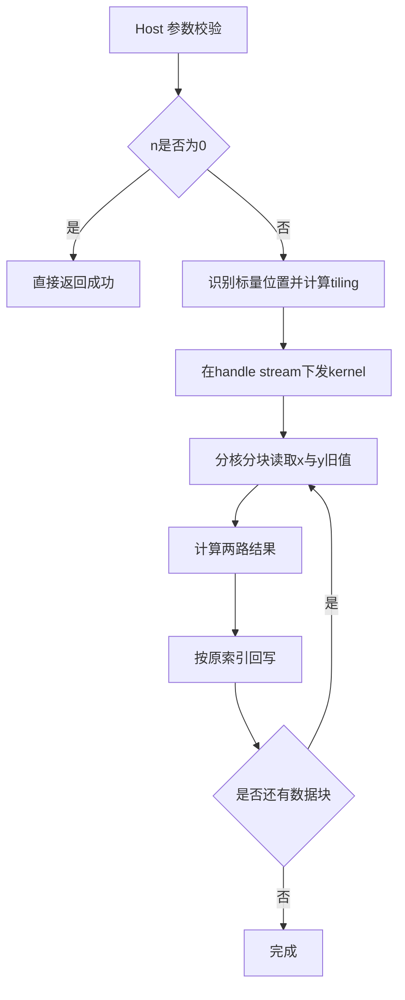
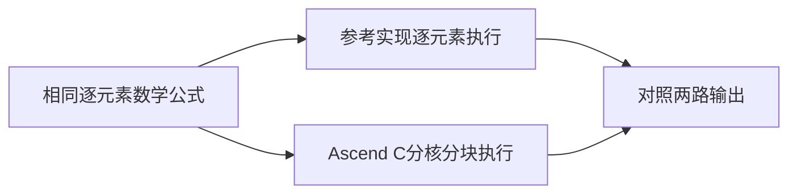

# aclblasSrot 算子设计（Atlas A2/A3）

## 需求背景（required）

### 需求来源

[11月社区任务-aclblasSrot算子开发（A2/A3）](https://www.hiascend.com/activities/task-center/details/a42dd9c650154f4f9acdfb3d2bea468b)。目标代码仓为 [cann/ops-blas](https://gitcode.com/cann/ops-blas)，开发目录为 `blas/rot/arch22/`，测试目录为 `test/rot/srot/arch22/`。

### 背景介绍

aclblasSrot 对两个单精度实数向量施加 Givens 平面旋转，原地更新 x、y。复用 ops-blas 现有公共接口和 handle/stream 管理，为 Atlas A2/A3 补充 Ascend C kernel 直调实现。已有 arch35 实现作为功能参考，arch22 的返回码和边界契约按本任务正文确定。

## 需求分析（required）

### 接口与数据类型

```cpp
aclblasStatus_t aclblasSrot(aclblasHandle_t handle, int n,
                          float* x, int incx, float* y, int incy,
                          const float* c, const float* s);
```

使用 `include/cann_ops_blas.h` 现有声明，不新增平行接口。x、y 为 Device FLOAT32 向量，c、s 为独立的 Host 或 Device FLOAT32 标量指针。

| 参数 | 含义 | 约束 |
| --- | --- | --- |
| handle | 携带执行 stream 的上下文 | 非空，优先校验 |
| n | 逻辑元素数 | 0 为快速返回，负数非法 |
| x、y | 输入兼输出向量 | n>0 时非空，物理长度分别为 1+(n-1)×abs(inc) |
| incx、incy | 有符号元素步长 | 非零且不为 INT_MIN，末元素偏移不超过 INT32_MAX |
| c、s | 旋转系数 | n>0 时非空，分别判定指针位置，不校验数值范围 |

### 需求拆解

1. 支持连续、正步长和负步长访问，保留未参与运算的间隔元素。
2. 支持 Host/Device 及混合标量位置，使用 handle 绑定的 stream 异步执行。
3. 覆盖快速返回、空指针、非法步长及偏移溢出的返回码。
4. 按任务要求完成精度、性能自验证，提交设计文档、测试工程及自测材料。

## 详细设计（required）

### 数学定义与参考流程

对逻辑下标 i∈[0,n)，定义：

```text
offset(i, inc) = i*inc                         (inc > 0)
offset(i, inc) = (n-1-i)*abs(inc)              (inc < 0)
x_old = x[offset(i, incx)]
y_old = y[offset(i, incy)]
x_new = c*x_old + s*y_old
y_new = c*y_old - s*x_old
```

两式均使用更新前的数据。计算后分别回写原位置，无广播和额外输出张量。


### Host 与 tiling 设计

先校验 handle，再处理 n=0 快速返回。n<0、n>0 时空数据/标量指针、零或 INT_MIN 步长均返回任务规定错误码。采用 int64 计算 `(n-1)*abs(inc)`，完成范围检查后才将索引信息下发，避免先发生 int32 溢出。

c、s 分别通过 `aclrtPointerGetAttributes` 判断内存位置。Host 标量值进入 tiling；Device 标量地址传入 kernel，由执行 stream 上的 kernel 读取，保持与前序任务的依赖关系。

依据 n、步长、可用向量核数和 UB 容量确定参与核数、每核逻辑范围及块长。连续访问与通用步长访问分开调度；小规模减少参与核数，大规模均衡划分。核间范围按搬运边界组织，尾块单独处理，避免写越界或覆盖相邻核数据。

### Kernel 设计

采用 CopyIn、Compute、CopyOut 流程。每块先取得对应的 x、y 旧值，再使用 Ascend C 向量乘法及加减法产生两路结果，完成计算后写回。

连续路径使用批量数据搬运；非连续路径根据逻辑下标和有符号步长建立映射，并保证间隔元素不变。临时数据保留在 UB，缓冲区复用前满足搬运与计算依赖。尾块按实际有效长度搬运，不以补齐长度访问 GM。



### 与参考实现的差异

参考实现按元素串行描述旋转；Ascend C 实现将互不依赖的元素对分配到向量核和数据块。差异来自执行组织与数据搬运，数学公式、步长寻址及原地更新语义保持一致。



### 约束逐项核对

| 约束 | 设计处理 |
| --- | --- |
| 返回码与快速返回 | handle空优先；n=0成功且不访问数据、不启动kernel；其他非法入参按正文返回INVALID_VALUE |
| 非连续访问 | 支持正负步长，负步长从物理span尾端开始，间隔元素不变 |
| 广播、动态shape | 不涉及广播；n和步长为运行时标量，由Host计算tiling |
| 原地更新 | 两个旧值读取后计算，避免第二式读到更新后的x |
| 确定性 | 同输入与参数采用相同寻址和逐元素运算流程，无跨核归约 |
| 空输入 | n=0快速返回；不引入图算子的0维Tensor规则 |
| 异步执行 | 使用handle绑定stream，调用成功表示已下发；读取输出前由调用方同步 |
| Inf/NaN | 不按系数特殊值跳过普通计算，按公式自然传播并依任务特殊值规则验收 |
| 兼容性 | 保持公共接口，变更限制在arch22及其测试，不改变arch35行为 |

### 支持硬件与环境

支持 Atlas A2/A3（arch22），CANN 9.1.0。按任务书要求在 Atlas 800T A2 910B3 出具自验证数据。

## 可维可测分析

### 精度验证

以 FLOAT32 cblas_srot/Netlib 参考结果分别验证 x、y。有限元素采用 atol=rtol=2^-13，matched_ratio≥0.99，并满足任务规定的最大绝对误差上限（1e-2 或32×ULP）。非有限元素单独按任务书等效性规则判定。

覆盖1000条精度用例以及 Host/Device/混合标量、正负步长、退化长度、非有限值和非法入参。补充要求的正态分布输入，记录均匀与正态分布覆盖。负向用例先判定预期错误域，使用dummy或空指针调用，避免测试框架先按溢出规模分配。

### 性能验证

覆盖200条性能用例。在910B3上使用 msprof op 的 kernel Task Duration(us)，排除5次预热后，成功的有效样本至少10次，取算术平均。以随包A100基线逐条对照，要求 `T_GPU/T_NPU >= 0.8`，毫秒基线先换算为微秒。异常样本及其处理在自测报告说明。

### 测试工程与交付

测试工程放入 `test/rot/srot/arch22/`，通过该算子的 CMake GTest 注册接入。精度、性能结果与源码提交对应，七份模板文件同步到私仓根目录 `task_submission/`。内存要求不涉及，相关模板文件明确标注“不涉及”。

### 口径与限制

本设计采用任务正文给出的arch22返回码与msprof性能口径；配套说明和用例中的边界期望若有差异，记录对照并在验收前确认，不将不同计时口径混为同一结果。本阶段提交设计方案，实测数据在开发完成后随验收材料提供。

## 参考资料

- [任务书](https://www.hiascend.com/p/resource/202611/3f3aa6d342ec4772b0638f8c7948088c.zip)
- [ops-blas rot](https://gitcode.com/cann/ops-blas/tree/master/blas/rot)
- [cuBLAS 文档](https://docs.nvidia.com/cuda/cublas/index.html)
- [Netlib srot](https://netlib.org/blas/srot.f)
