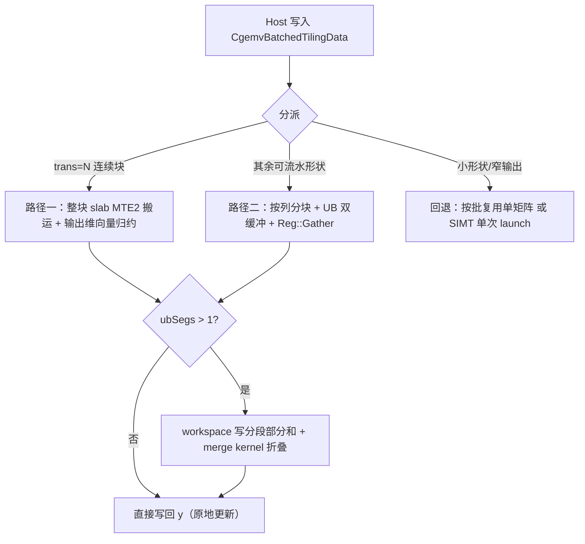

# 一、需求背景

## 1.1 需求来源

Ascend CANN 社区任务：在 Ascend 950PR（arch35）上基于 ops-blas 工程实现单精度复数批量矩阵-向量乘接口 `aclblasCgemvBatched`，并与 cuBLAS `cublasCgemvBatched`（legacy 指针数组形态）的数学语义与 API 语义对齐。

任务交付内容包括：`include/cann_ops_blas.h` 中的公共接口声明（本次由单指针形态修正为指针数组形态）、arch35 Ascend C Kernel、CSV 驱动的自测代码与自测报告。性能以 cuBLAS 在 H100 上的实测耗时为标杆，按 `avg task duration ≤ 2.5 × GPU baseline`（即 ≥ 0.4× GPU）判定。

合入目标目录（任务书 §5）：算子代码 `blas/gemv_batched/arch35/`，测试代码 `test/gemv_batched/cgemv_batched/arch35/`（含 csv 文件）。

## 1.2 背景介绍

### 1.2.1 标杆来源、TBE 源码与算子信息库核查

本任务是向 `ops-blas` 增加公共 BLAS 接口 `aclblasCgemvBatched` 的 Ascend C Kernel 直调实现，不是把既有 ACLNN/TBE 算子迁移为 Ascend C。因此下列审核项的结论是**不适用**，而不是缺少材料：

| 审核对象 | 核查结论 | 依据及替代参考 |
| --- | --- | --- |
| 原 TBE 算子源码路径（含文件名） | 不适用：任务书未给出 `aclblasCgemvBatched` 的 TBE 实现，目标仓也不存在该 complex64 批量接口 | 数学与 API 语义以 cuBLAS `cublasCgemvBatched`（CUDA 12.4 / 驱动 550.54，H100）为准；逐 batch 数值语义对齐 Netlib `cblas_cgemv` |
| 算子信息库路径（含文件名） | 不适用：本任务不注册 ACLNN 算子，不使用 ACLNN 算子信息库 | 公共接口声明位于 `ops-blas/include/cann_ops_blas.h`；接口名不是 `aclnn*` |
| 可复用工程实现 | 适用 | 同目录已有的实数/半精度批量 GEMV 实现（指针数组读回、平铺分核、单次 launch 框架）；`ops-blas/blas/gemv/arch35/cgemv_kernel_common.h`（复数算术与舍入口径）；单矩阵 `aclblasCgemv` 的分块流式 kernel |

因此本文不会虚构 TBE 标杆、ACLNN 算子信息库文件或私有 tilingKey。同族批量实现只作为工程接入参考；复数语义、转置语义与特殊值行为仍以任务书指定的 cuBLAS/Netlib 参考为准。

### 1.2.2 aclblasCgemvBatched 标杆算子现状分析

`aclblasCgemvBatched` 是 BLAS GEMV 的 complex64 批量版本：一次调用对 `batchCount` 组相互独立的 `(A_i, x_i, y_i)` 执行 `y_i = alpha * op(A_i) * x_i + beta * y_i`。任务开始时仓内公共头中的声明为单指针形态（与 cuBLAS legacy 的指针数组形态不一致），本任务按任务书 §2.3 强制要求修正为指针数组形态。正式实现位于 ops-blas：

```text
include/cann_ops_blas.h                                # 公共 C API 声明（当前 :233-236）
blas/gemv_batched/arch35/cgemv_batched_host.cpp        # 参数校验、指针数组回读、tiling、分派、launch
blas/gemv_batched/arch35/cgemv_batched_kernel.cpp      # 分块流水 / SIMT / x 压紧 / merge kernel
blas/gemv_batched/arch35/cgemv_batched_tiling_data.h   # Host–Kernel tiling ABI
blas/gemv_batched/arch22/cgemv_batched_host.cpp        # 并入已有：按 batch 逐个 launch，同步新签名
test/gemv_batched/cgemv_batched/arch35/                # CSV 驱动的 GTest、NPU wrapper
```

接口原型（`include/cann_ops_blas.h`）：

```cpp
aclblasStatus_t aclblasCgemvBatched(
    aclblasHandle_t handle, aclblasOperation_t trans, int m, int n, const aclblasComplex* alpha,
    const aclblasComplex* const Aarray[], int lda, const aclblasComplex* const xarray[], int incx,
    const aclblasComplex* beta, aclblasComplex* const yarray[], int incy, int batchCount);
```

#### 1.2.2.1 标杆支持的数据类型和数据格式

| 项目 | `aclblasCgemvBatched` 要求 |
| --- | --- |
| 数据类型 | `aclblasComplex`，实部与虚部均为 FP32 的 complex64 |
| 转置语义 | `N`：`op(A)=A`；`T`：`op(A)=Aᵀ`；`C`：`op(A)=Aᴴ`（共轭转置） |
| 矩阵访问 | `A_i` 列主序，元素 `A(row,col) = A[col*lda + row]`；`lda ≥ max(1, m)`，与 `trans` 无关 |
| 批量组织 | `Aarray/xarray/yarray` 为长度 `batchCount` 的**指针数组**（位于 Device 内存），各 batch 数据独立 |
| 标量 | `alpha`、`beta` 为 Host 复数标量，支持任意复数取值 |
| 步长 | `incx/incy` 以复数元素为单位，支持正负非零值；负步长从向量尾部起算；`0` 与 `INT_MIN` 判为非法 |
| 输出 | `yarray[i]` 原地更新；同一指针在多个 batch 重复出现时按顺序累加语义处理 |

#### 1.2.2.2 标杆实现描述

任务指定的语义标杆为 cuBLAS legacy 的 `cublasCgemvBatched` 参数序列，逐 batch 的数值语义与 Netlib `cblas_cgemv` 一致：按 `trans` 决定 `x` 长度为 `n`（`N`）或 `m`（`T/C`），`y` 长度相反；`A` 始终为列主序，`lda` 只约束列跨度。复数运算以 FP32 实部/虚部分量展开，不做超出参考实现的代数重排。

同族实数/半精度批量实现只提供 Host 校验、指针数组使用方式、handle 绑定 stream、Kernel 启动与构建接入的工程参考；其数值实现与数据类型均不能复用于 complex64，尤其不能复用它"按 batch 平铺整块输出"的分核粒度——复数 GEMV 的输出元素数只有 `batchCount × outSize`，按输出元素展平才能在小 batch 场景下用满核。

#### 1.2.2.3 标杆算子实现流程图

```mermaid
flowchart TD
    A[调用 cublasCgemvBatched / Netlib cblas_cgemv 语义] --> B{参数合法?}
    B -- 否 --> C[返回对应错误码，不启动 kernel]
    B -- 是 --> D[逐元素校验三个指针数组]
    D --> E{batchCount 组逐 batch 计算}
    E --> F{trans}
    F -- N --> G[y_i = beta*y_i + sum_j alpha*x_i[j]*A_i[j,i]]
    F -- T --> H[y_i = alpha*sum_j A_i[i,j]*x_i[j] + beta*y_i]
    F -- C --> I[y_i = alpha*sum_j conj(A_i[i,j])*x_i[j] + beta*y_i]
    G --> J[写回 yarray i，原地更新]
    H --> J
    I --> J
```

## 1.3 算子功能分析

计算公式：对每个 batch `i ∈ [0, batchCount)`：

```text
y_i = alpha * op(A_i) * x_i + beta * y_i
```

其中 `alpha`、`beta`、`A_i`、`x_i`、`y_i` 均为 complex64。按元素展开（`N` 模式）：

```text
y[m] = beta * y[m] + alpha * sum_j x[j] * A[j*lda + m],  j ∈ [0, n)
```

`T` 模式对每个输出 `i ∈ [0, n)` 累加 `sum_j conj?(A[i*lda + j]) * x[j]`，`j ∈ [0, m)`，`C` 模式在此基础上对 `A` 取共轭。

输入：`handle`、`trans`、`m`、`n`、`alpha`、`Aarray`、`lda`、`xarray`、`incx`、`beta`、`yarray`、`incy`、`batchCount`。

输出：原地更新 `yarray[0..batchCount-1]` 指向的向量。

支持数据类型：仅 complex64（`aclblasComplex`）。支持广播：不涉及——该接口是 BLAS 矩阵-向量接口，`A/x/y` 通过 `m/n/lda/incx/incy` 描述逻辑布局，不定义张量广播语义。

# 二、需求分析

## 2.1 外部组件依赖

| 组件 | 适配状态 | 用途 |
| --- | --- | --- |
| CANN 9.1.0 Ascend C / ACL runtime | 已适配 | 编译 Kernel、管理 Device 内存与在 stream 上启动 Kernel |
| Ascend 950PR（arch35） | 已适配 | 本任务唯一正式验收硬件 |
| cuBLAS / Netlib BLAS | 不作为运行时或生产依赖 | 仅作为 API/数学语义与性能标杆参考；精度 Golden 由仓内独立 CPU 实现生成 |
| GTest / CSV 驱动 | 已适配 | 仓内既有测试框架，不新增第三方依赖 |

不新增 CATLASS、GEMM、TBE、ACLNN 或其他生产第三方依赖。

## 2.2 内部适配模块

| 模块 | 仓内位置 | 适配内容 |
| --- | --- | --- |
| 公共 BLAS API | `include/cann_ops_blas.h` | 将 `aclblasCgemvBatched` 声明修正为指针数组形态（本任务唯一允许改动的公共头声明） |
| 句柄与 stream | `blas/gemv_batched/arch35/cgemv_batched_host.cpp` | 从 `aclblasHandle_t` 获取已绑定 stream，异步 launch |
| Kernel 与 tiling ABI | `blas/gemv_batched/arch35/cgemv_batched_*.{cpp,h}` | 分块流水、SIMT、x 压紧、merge kernel 与 `CgemvBatchedTilingData` |
| 单矩阵复用 | `blas/gemv/arch35/` | 按批复用 `aclblasCgemv` 的分块流式 kernel（`blas/CMakeLists.txt` 登记源码依赖） |
| 构建与测试 | `test/gemv_batched/cgemv_batched/` | CSV 参数化 GTest、NPU wrapper、独立 CPU Golden 与性能记录 |

## 2.3 需求模块设计

### 2.3.1 Ascend C 算子原型

使用 Ascend C 实现 `aclblasCgemvBatched`，在 Ascend 950PR（arch35）上支持 complex64 的 `N/T/C` 三种转置、复数 `alpha/beta`、指针数组形态、Device 侧任意正负非零步长；通过 handle 所绑定的 stream 异步启动 Kernel，单次 launch 覆盖全部 batch 或按部署策略分派。

### 2.3.2 Ascend C 算子相关约束

1. 在 `include/cann_ops_blas.h` 修正与 cuBLAS 参数顺序一致的公共接口（不得保留单指针重载，也不得新增 950PR 私有平行接口）：

   ```cpp
   aclblasStatus_t aclblasCgemvBatched(
       aclblasHandle_t handle, aclblasOperation_t trans, int m, int n, const aclblasComplex* alpha,
       const aclblasComplex* const Aarray[], int lda, const aclblasComplex* const xarray[], int incx,
       const aclblasComplex* beta, aclblasComplex* const yarray[], int incy, int batchCount);
   ```

2. 支持 complex64 普通复乘与复加，保持 FP32 分量计算；`C` 模式仅对 `A` 取共轭，不对 `x` 或 `alpha` 取共轭。
3. 支持 `ACLBLAS_OP_N`、`ACLBLAS_OP_T`、`ACLBLAS_OP_C`；`lda ≥ max(1, m)` 与 `trans` 无关。
4. 支持 `incx`、`incy` 为任意非零 `int` 值（含负步长）；`0` 与 `INT_MIN` 返回 `ACLBLAS_STATUS_INVALID_VALUE`。
5. 指针数组本身及**任一元素**都必须非空；元素判空在调用前完成（数组位于 Device 内存，需 D2H 回读）。
6. 每次调用必须给出确定结果：同一输入两次执行逐位一致，故归约顺序固定、无跨线程归约。
7. 零维/零批不是 no-op，返回 `ACLBLAS_STATUS_INVALID_VALUE`（比 cuBLAS quick return 严格，依任务书 §2.5）。
8. 正确性优先：性能路径不适用任何合法输入时必须回退到通用路径，不得缩小 API 支持范围。

#### 2.3.2.1 设计原则与非目标

| 原则 | 设计约束 |
| --- | --- |
| 单一公共接口 | 仅修正 `aclblasCgemvBatched` 一处声明；不定义私有 API、Device alpha 模式或 int64 公共签名 |
| 语义对齐参考实现 | 归约顺序、alpha 折叠位置、`x_j == 0` 跳过等细节与 Netlib 一致，不用代数等价替代浮点语义 |
| 正确性优先 | SIMT 通用路径覆盖所有合法布局；性能路径不适用时自动回退 |
| 证据驱动优化 | tile 宽度、块长、分段数、错位布局均由 950PR 实测 A/B 决定，不按固定性能 case 名称分派 |
| 无隐式同步 | API 只向 handle 绑定 stream 入队；除本次调用内临时缓冲释放前的一次同步外不同步 |
| 确定性 | 每个输出元素由单线程/单 lane 沿归约维递增累加，分段归约由 merge 按段号递增折叠 |

不在本次范围内：arch22/arch20 Kernel 移植（arch22 host 仅同步签名）、全仓框架重构、引入 CATLASS/GEMM 依赖、改变其他 BLAS 接口行为、修改任务书提供的性能基线。

# 三、需求详细设计

## 3.1 调用方式

本算子采用 **ops-blas 句柄式 BLAS API + Ascend C Kernel 直调**，不是 ACLNN 或 PyTorch 框架算子。调用方创建 handle 并以 `aclblasSetStream` 绑定 stream，把 Host 侧 `alpha/beta`、Device 侧 `Aarray/xarray/yarray`（指针数组）与 `lda/incx/incy` 传入 `aclblasCgemvBatched`；Host 完成校验、tiling 与分派后仅向该 stream 异步入队。调用方在读回 `yarray` 前负责同步同一 stream。


## 3.2 需求总体设计

### 算子数据模型

#### 数学公式

```text
for i in [0, batchCount):
    y_i := alpha * op(A_i) * x_i + beta * y_i
```

复数乘加按实部/虚部分量展开：

```text
(ar + i*ai) * (br + i*bi) = (ar*br - ai*bi) + i*(ar*bi + ai*br)
```

#### 支持数据类型

| 参数 | 数据类型 | 存储位置 |
| --- | --- | --- |
| `alpha`、`beta` | `const aclblasComplex*` | Host 标量 |
| `Aarray`、`xarray` | `const aclblasComplex* const[]` | Device 指针数组 → Device 数据，只读 |
| `yarray` | `aclblasComplex* const[]` | Device 指针数组 → Device 数据，原地读写 |
| `m/n/lda/incx/incy/batchCount` | `int` API 入参；Kernel ABI 中输出/归约长度为 `uint32_t`，`lda/incx/incy` 为 `int32_t` | Host / Kernel tiling |

#### 支持形状与布局

| 项目 | 支持范围 |
| --- | --- |
| 矩阵尺寸 | `m ≥ 1`、`n ≥ 1`、`batchCount ≥ 1`，均为运行时入参 |
| 存储顺序 | 列主序，元素地址为 `row + col * lda` |
| 矩阵前导维 | `lda ≥ max(1, m)`，与 `trans` 无关 |
| 输出/归约长度 | `N`：`outSize = m`、`dotSize = n`；`T/C`：`outSize = n`、`dotSize = m` |
| 向量逻辑元素 | `x[StridedIdx(j)]`、`y[StridedIdx(i)]`，负步长从远端起算 |
| 广播 | 不支持，也不适用 |

### 3.2.1 Host 侧设计

Host 侧职责是校验公共接口契约、回读 Device 侧指针数组、构造稳定的 Host–Kernel tiling 数据、按形状分派并在 handle 绑定 stream 上异步启动 Kernel。

#### 3.2.1.1 参数校验与启动边界

| 顺序 | 条件 | 行为 |
| --- | --- | --- |
| 1 | `handle == nullptr` | 返回 `ACLBLAS_STATUS_HANDLE_IS_NULLPTR` |
| 2 | `m <= 0 或 n <= 0` | 返回 `ACLBLAS_STATUS_INVALID_VALUE` |
| 3 | `lda < max(1, m)` | 返回 `ACLBLAS_STATUS_INVALID_VALUE` |
| 4 | `incx/incy == 0 或 == INT_MIN`，或 `batchCount <= 0` | 返回 `ACLBLAS_STATUS_INVALID_VALUE` |
| 5 | `Aarray/xarray/yarray == nullptr` | 返回 `ACLBLAS_STATUS_INVALID_VALUE` |
| 6 | 指针数组任一元素为 `nullptr` | 返回 `ACLBLAS_STATUS_INVALID_VALUE` |
| 7 | `alpha == nullptr 或 beta == nullptr` | 返回 `ACLBLAS_STATUS_INVALID_VALUE` |
| 8 | `trans ∉ {N, T, C}` | 返回 `ACLBLAS_STATUS_INVALID_ENUM` |
| 9 | 其他合法输入 | 计算 tiling，异步入队，返回成功 |

非法输入一律不启动任何 kernel，也不读写 `yarray`。`INT_MIN` 与 `0` 同等拒绝：其绝对值不可表示，索引算术无法承载这种步长。

**数组元素判空**：指针数组位于 Device 内存，任务书 §2.4 要求"调用前逐元素校验"，因此先用 3 次 `aclrtMemcpyAsync`（D2H）把三个数组回读到 host 缓冲（每次回读后同步 stream）并逐元素判空，代价是一次 host 同步。由于性能口径取 msprof 的 kernel task duration，该同步不进入性能数字，但会计入墙钟。

#### 3.2.1.2 分核、分块与 LocalMemory 优化策略

- **SIMT 通用路径**：工作量按**输出元素**展平，`totalItems = batchCount × outSize`；`itemsPerCore = ceil(totalItems / coreNum)`，块内线程数按 `SIMT_MIN_THREAD_NUM` 对齐且不超过 `CGEMV_BATCHED_MAX_THREADS`（2048）。按输出元素而非按 batch 展平，避免小 batch 场景只用到少数核。
- **分块流水路径**：输出块宽 `ubOutTile` 默认 64（`N` 与 `T/C` 各一组常量）；`outSize` 不足时按 1/2、1/4 收窄，最小 16。归约块长 `ubDotChunk`：`N` 为 192，`T/C` 为 144（错位布局）或 192（对齐布局）。
- **UB 布局**：`N` 路径的 A 块按输出列直接落 UB，列步长补齐到 32 B 的整数倍（4 个复数）；`T/C` 路径先把 32 B 对齐的列块搬入，再由 `CgemvBatchedUbRetile` 重排为"奇数复数列步长"的 4 B 错位布局，使 64 lane 的 `Reg::Gather` 从 4 个 bank（16-way 冲突）扩散到 16 个 bank（2-way）。
- **UB 预算**：设备 UB 为 248 KB；`N` 路径 A 双缓冲 + x/y/acc 缓冲；`T/C` 路径需要 A 双缓冲（151.6 KB）+ 错位副本（74.2 KB）= 226 KB，实测可用块长因此卡在约 153，`tiling_data.h` 中取 144 留余量。
- **并行项与分段**：并行项为 `batchCount × ceil(outSize / ubOutTile)`；不足 `2 × coreNum` 时按 `{2,4,8}` 候选拆分归约维（`ubSegs/ubSegLen`），并要求每段不短于 3 个 chunk。分段只在 `trans=N`（另加 `lda == outSize`）与 `trans=T`（`outSize > 64`）启用；`trans=C` 不启用长归约分段（其分段部分和落在 32 ULP 判据边界上，会翻转判定）。
- **占用率修正**：当并行项不是核数整数倍时，按 `ceil(items/cores)` 波次的占用率挑选分段数，只有提升超过 5% 才采纳；`C` 模式另有一条 56 lane 规则，用于把 `batchCount` 为 2/4 的形状项数对齐到核数整数倍。

#### 3.2.1.3 tiling 字段与分派标识

该 ops-blas 直调工程不使用 ACLNN/TBE 框架的 `tilingKey`。等价的可审计分派信息由 `CgemvBatchedTilingData` 字段与 Host launch 条件传递：

| 字段组 | 字段 | 含义 |
| --- | --- | --- |
| 形状 | `trans/m/n/outSize/dotSize/batchCount/lda/incx/incy` | 规范化后的形状与布局 |
| 标量 | `alphaR/alphaI/betaR/betaI/betaIsZero` | 复数标量；`betaIsZero` 决定是否读旧 `y` |
| SIMT | `totalItems/itemsPerCore/usedCoreNum/numThreads` | 输出元素展平后的分核参数 |
| 分块流水 | `ubItems/ubCoreNum/ubTilesBatch/ubOutTile/ubDotChunk/ubAStride/ubSkew/ubSlab` | 输出块、归约块、错位开关、连续 slab 档位 |
| 跨核归约 | `ubSegs/ubSegLen/ubWsBatch` | 归约分段数、每段长度、workspace 每 batch 跨度 |

分派仅依据输入布局与规模，不读取 case 名称、随机 seed 或性能基线值。`arch22` host 按 batch 逐个 launch，不做 arch35 的分块流水分派。

#### 3.2.1.4 索引、跨度与 ABI 边界

逻辑索引定义为：

```text
StridedIdx(i, len, inc) = (inc >= 0) ? i * inc : (len - 1 - i) * (-inc)
AIndex(row, col) = uint64(col) * uint64(lda) + uint64(row)
```

- 元素索引在 `int32` 内表达（长度与步长均来自 `int` 入参），矩阵偏移在 `uint64` 中计算，避免 `col * lda` 溢出。
- 负步长先按 `(len - 1 - i) * (-inc)` 计算，避免 `INT_MIN` 取反溢出；`INT_MIN` 本身在入口即被拒绝。
- `perBatchWork = size_t(m) * size_t(n)` 在 64 位类型中计算，`m/n` 上限不受 32 位乘法约束。
- tiling 按值传入 kernel，Host 标量在提交前折入 tiling，调用后修改 Host `alpha/beta` 不影响已提交任务。

#### 3.2.1.5 实际分派策略

| 路径 | 条件 | 实现 |
| --- | --- | --- |
| 连续 slab（`trans=N`） | `incy == 1`、`outSize ≥ 16`、`dotSize ≥ 32`、`lda == outSize`、`outSize ≤ 2048`、`outSize % 4 == 0` | 单次 launch；整个 `[dotLen][outSize]` 归约块连续，一次 MTE2 搬运 |
| 分块流水（staged） | `incy == 1`、`outSize ≥ 16`、`dotSize ≥ 32`，且 `trans=N` 时 `batchCount ≥ 2`、`trans=T/C` 时 `batchCount ≥ 5` | 按输出块 + 归约块做 UB 双缓冲流水；`T/C` 用 `Reg::Gather` |
| 按批复用单矩阵 | `m ≥ 128`、`m*n ≥ 256×256`、`batchCount ≤ 64`、`incy == 1` | 逐 batch 调用 `aclblasCgemv`（`incx ≠ 1` 时先压紧 x） |
| SIMT 单次 launch | 其余形状（窄输出、深归约、小尺寸） | 一个 kernel 覆盖全部 batch，GM 直读，按输出元素展平分核 |

阈值来自 200 条用例的两轮 A/B 扫频（`trans=N` 自 2 batch、`trans=T/C` 自 5 batch 起分块流水占优），更细的形状规则实测后没有整体收益。`N` 的 slab 档位由 `outSize` 决定（输出宽 64/128/256/512/1024/2048，块长 160/80/40/20/8/4，块长越小、单次搬运越宽），`ubSlab` 字段把档位编码进 tiling 以便选择模板实例。

### 3.2.2 Kernel 侧设计

#### 3.2.2.1 Kernel 侧实现描述

1. 每个 batch 的 `A/x/y` 基址从指针数组按 batch 索引读取（`ReadBatchPtr`），不在 host 侧展开成参数表。
2. 每个输出元素（或每个输出 lane）由唯一执行单元负责，禁止两个 block 写同一坐标。
3. `T/C` 的连续内存维是归约维、输出维跨 `lda`，向量化输出必须用 32-bit `Reg::Gather`；`N` 的输出维连续，可直接 `LoadAlign` + 广播 `x`。
4. 归约沿 `dotIdx` **严格递增**，`N` 模式先取 `beta*y` 再逐项累加 `(alpha*x_j) * a(i,j)`；`T/C` 模式先累加 `conj?(a(i,j)) * x_i`，最后 `y = alpha*acc + beta*y`，与 Netlib 参考一致。
5. Kernel 仅由 Host 在参数合法且数组元素非空后调用；调用方负责在读回结果前同步绑定 stream。

#### 3.2.2.2 Ascend C 实现流程图



流水节拍：MTE2 预取第 k+1 块、V 计算第 k 块、MTE3 写回第 k 块三级重叠，由 `MTE2→V`、`V→MTE3`、`MTE3→MTE2` 事件约束读写依赖。

#### 3.2.2.3 执行路径一：trans=N 的连续 slab（大块 MTE2）

当 `trans=N`、`lda == outSize` 且 `outSize % 4 == 0` 时，一个归约范围在内存中是 `[dotLen][outSize]` 的连续复数块，可以整块搬运：

- `CgemvBatchedUbCopySlab` 用一次 `DataCopyPad` 搬 `dotLen × outSize` 个复数（`DataCopyExtParams{1, bytes, 0, 0, 0}`），搬运粒度从"每列 `outCount×8` 字节"变成单个大块，MTE2 效率显著提升。
- `CgemvBatchedUbAccNSlab` 按 64 输出为一组，用 `DIST_DINTLV_B32` 解交织实/虚部，`x` 按行广播（`DIST_BRC_B32`），沿归约维递增做 `Mul/Sub/Add`，每个输出保持各自 lane 与参考累加顺序。
- 双缓冲以 `SLAB_FLOATS` 为单位交替；`x` 暂存缓冲独立于块长（`CHUNK = 1` 档也必须容得下 32 B 补齐后的长度，取 `max(16, 2×CHUNK)` 个 float）。
- 该路径只在 `outSize ≤ 2048` 启用：`outSize > 2048` 时为容纳 UB 必须令 `CHUNK == 1`，会把大块拆碎反而变慢。
- **行补齐的硬边界**：`DataCopyPad` 的 `dstStride` 以 32 B 块为单位，输出行跨度只能是 4 个复数的倍数，因此 `outSize % 4 ≠ 0` 的形状无法通过"行补齐"复用这条路径，只能回退（见 §5.3 的 N 簇分析）。

#### 3.2.2.4 执行路径二：按列分块 + UB 双缓冲 + Reg::Gather

`trans=T/C` 以及 `trans=N` 但不满足 slab 条件的形状走分块流水路径：

- `CgemvBatchedUbCopyT` 按输出列搬 `dotLen` 个复数，列步长按 32 B 对齐（`alignStride = CHUNK + 4`）；`CgemvBatchedUbRetile` 再把该块重排为奇数复数步长（`CHUNK + 1`），把 4 B 错位留进 UB。
- `CgemvBatchedUbAccT` 用 `Reg::Arange` + `Reg::Muls` 构造 64 lane 的列内偏移，`Reg::Gather` 取 `A` 的实部/虚部；`C` 模式用 `Muls(..., -1.0F)` 折入共轭，不额外搬一份数据。
- 每块之间用 `MTE2→V`、`V→MTE3`、`MTE3→MTE2` 事件约束读写依赖；复用缓冲槽前必须等上一块的向量读完成，否则 chunks ≥ 3 会累积成死锁。
- 写回用 `CgemvBatchedUbFinalizeT`（`alpha*acc + beta*y`，`alpha==1`/`beta==0` 跳过乘法以保留 Inf/NaN 语义）与 `CgemvBatchedUbCopyVecVf`。
- `trans=N` 的非 slab 形状走同类流水，但 A 块按输出列连续落 UB，无需错位重排。
- `trans=T/C` 的块长被 32 B 对齐与 UB 容量双重约束：错位布局每列只多 1 个复数，但 A 双缓冲加副本已占 226 KB；加大块长在实测中会触发 UB 超限或确定性掩码问题，故方形形状用 64×144 错位、深归约形状用 64×192 对齐两套配置。

#### 3.2.2.5 跨核归约：workspace + merge kernel

并行项不足核数时，把归约维切成 `ubSegs` 段，每段独立算部分和：

- 每段结果写入本次调用内 `aclrtMalloc` 的 workspace，按 `s * ubWsBatch + i` 布局（`ubWsBatch = batchCount × ubTilesBatch × ubOutTile`），段号递增。
- `cgemv_batched_merge` 逐输出折叠各段：`acc = Σ_s ws[s]`，再写回 `y`；`trans=N` 的 merge 直接把槽值写入 `y`，因此 `alpha`/`beta` 必须先折进槽内（`ubSlab != 0` 时 `CgemvBatchedUbRunNSlabSimple` 负责这一步），否则结果会少一次缩放。
- merge kernel 的线程数为 `dim3{ubOutTile}`，因此输出块宽必须 ≤ 64：输出较大时按 64 固定切块，输出较小时保持单个宽 tile（切碎反而更慢）。
- workspace 与压紧缓冲都在本次调用内 alloc/free；`free` 前同步 stream，保证入队 kernel 已完成。

#### 3.2.2.6 回退路径：按批复用单矩阵 / SIMT 单次 launch

- **按批复用单矩阵**：`m ≥ 128`、`m*n ≥ 256×256`、`batchCount ≤ 64` 且 `incy == 1` 时，逐 batch 调用仓内单矩阵 `aclblasCgemv`——其分块流式 kernel 单线程做不到的流式带宽由它承担。`incx ≠ 1` 时先用 `cgemv_batched_gather` 把各 batch 的 `x` 按逻辑顺序压紧到连续缓冲（按 block 分区，避免重复拷贝），再以单位步长调用，结束后同步一次 stream 再释放缓冲。
- **SIMT 单次 launch**：其余形状（窄输出、深归约、小尺寸）用一个 kernel 覆盖全部 batch。每线程负责一个输出元素，沿 `dotIdx` 顺序累加，无跨线程归约 ⇒ 逐位确定；`fmaf(lhs, rhs, -0.0F)` 强制单次乘法舍入，`#pragma clang fp contract(off)` 阻止乘加收缩（实测普通 `lhs*rhs` 会被收缩成 FMA，导致 11 条精度用例超差）。
- 退化标量：`alpha == 0` 不读 `A/x`，`beta == 0` 不读旧 `y`，`alpha/beta == 1` 跳过乘法。

#### 3.2.2.7 浮点顺序与特殊值

- `N`：`acc = beta*y`，随后逐项 `acc += (alpha*x_j) * a(i,j)`（`alpha` 按项折叠，与参考实现一致）。
- `T/C`：先累加 `sum_j conj?(a(i,j)) * x_i[j]`，最后 `y = alpha*acc + beta*y`；`x_j == 0` 的项跳过（与参考实现一致，避免 `0 × Inf` 伪影）。
- 复数乘法四项分别舍入，实部/虚部独立累加；不使用跨 lane 树形归约，`Reg::Reduce` 方案实测既慢一个数量级又破坏精度。
- `Inf/NaN`：同 NaN、同号 Inf、一 NaN 一 Inf 视为等效；有限与非有限不一致判失败；非有限值不计入 `matched_ratio`，单独统计且须全部通过。

#### 3.2.2.8 Ascend C 实现与标杆流程差异及原因

| 维度 | cuBLAS / Netlib 语义标杆 | Ascend C 实现 | 差异原因与正确性约束 |
| --- | --- | --- | --- |
| 执行位置 | cuBLAS 内部 kernel / CPU 参考循环 | 950PR 上 Host 异步 launch + arch35 Kernel | 适配 ops-blas 句柄与 stream；API 不在 Host 内同步 |
| 批量组织 | 指针数组一次调用覆盖全部 batch | 同一形态；额外提供按批复用单矩阵回退 | 复用单矩阵分块流式 kernel 的带宽，不改变 API 语义 |
| 归约向量化 | 对标实现不约束 | 输出维 64 lane 向量化，归约维严格递增 | 保持参考累加顺序，否则 32 ULP 判据下精度不可达 |
| `T/C` 取数 | 连续或 strided 读 | `Reg::Gather` + 4 B 错位 UB 布局 | 输出维跨 `lda`，32 B 对齐使列步长必为 4 的倍数 |
| 跨核归约 | 不规定 | 分段部分和 + merge 按段号折叠 | 只在实测不掉精度的形状启用；`C` 长归约不启用 |
| 确定性 | 不要求逐位 | 单线程/单 lane 递增累加，分段按序折叠 | 任务书确定性要求（同输入逐位一致） |

## 3.3 支持硬件

| 支持的芯片版本 | 涉及勾选 | 说明 |
| --- | --- | --- |
| Ascend 950PR（arch35） | √ | 正式目标平台，`SOC_VERSION=ascend950`，CANN 9.1.0 |
| 其他 Ascend 950 型号 | 辅助验证 | 同架构结果不能自动替代 950PR 正式验收 |
| Atlas A2/A3（arch22） | × | 仅同步 host 侧签名与批量循环，不提供 arch35 分块流水能力 |
| Ascend 310P（arch20） | × | 需独立 Kernel 适配，不在本次实现范围 |

## 3.4 算子约束限制

1. 仅实现 complex64 的 `aclblasCgemvBatched`；不包含 float/double/其他精度或单矩阵形态的平行 API。
2. 不支持张量广播、高维 ND 语义；`A_i` 必须列主序连续，只能通过 `lda` 表达列跨度。
3. `incx`、`incy` 必须非零且不等于 `INT_MIN`；`lda ≥ max(1, m)` 与 `trans` 无关。
4. `m/n/batchCount` 必须为正；零维/零批返回 `ACLBLAS_STATUS_INVALID_VALUE`，不写 `yarray`。
5. 指针数组本身与每个元素都必须非空；元素判空依赖一次 host 同步（D2H 回读）。
6. `yarray` 原地更新；同一指针在多个 batch 重复出现时按 batch 顺序累加，调用方需自行保证这种别名用法是预期行为。
7. 分块流水路径要求 `incy == 1`、`outSize ≥ 16`、`dotSize ≥ 32`；其余合法形状自动回退到 SIMT 或按批路径，能力不缩小。
8. 单次 launch 路径不使用 Device workspace；按批/分段归约路径临时分配缓冲，调用结束同步后释放。

# 四、特性交叉分析

| 交叉特性 | 组合 | 设计处理与验证重点 |
| --- | --- | --- |
| 转置与布局 | `N/T/C` × 紧凑 `lda` / padding | `N` 输出维连续走 slab 或列块；`T/C` 输出维跨 `lda`，用 `Gather` 取数 |
| 转置与步长 | `N/T/C` × `incx/incy = ±1/±2/±3…` | 统一由 `StridedIdx` 映射；`incx ≠ 1` 先压紧 x；`incy ≠ 1` 不进分块流水 |
| 批量与尺寸 | `batchCount=1` × 大矩阵 / 小矩阵 | 小 batch 大矩阵走按批复用单矩阵；大批量小矩阵走单次 launch 展平分核 |
| 复数标量与特殊值 | 一般复数 `alpha/beta` × Inf/NaN | `alpha==1`、`beta==0/1` 走跳过乘法的分支；其余按分量乘加，顺序与参考一致 |
| 性能路径与通用性 | 分块流水/连续 slab × 其他合法输入 | 分块流水不适用时回退 SIMT 或按批路径，不拒绝任何合法输入 |
| 分段归约与精度 | `ubSegs > 1` × 32 ULP 判据 | 仅 `trans=N`（及短归约 `C`）启用；merge 按段号折叠，长归约 `C` 不启用 |
| 异步与原地 | 绑定 stream × 连续调用 / 双 stream | Host 不同步（临时缓冲释放前除外）；每输出唯一写入，同 stream 顺序、异 stream 隔离 |

# 五、可维可测分析

## 5.1 精度与性能标准

| 验收标准 | 描述 | 标准来源 |
| --- | --- | --- |
| 数学正确性 | 逐 batch 与独立 CPU Golden 比对，实部、虚部分别统计，不混合以稀释单分量失败 | 任务书、Netlib `cblas_cgemv` 语义 |
| FLOAT32 分量精度 | `rtol = atol = 2^-13`，`matched_ratio ≥ 0.99`；逐元素 `max_abs_error ≤ max(1e-2, 32×ULP)` | 任务书 §3.2、生态精度标准 |
| 特殊值 | 同 NaN、同号 Inf、一 NaN 一 Inf 等效；有限与非有限不一致为硬失败；非有限值单独统计 | 任务书 §3.2 第 4 条 |
| 性能 | 200 条性能用例，`avg task duration ≤ 2.5 × GPU baseline`（≥ 0.4× GPU） | 任务书 §3.3 |
| 确定性 | 同输入连续两次调用逐位一致 | 任务书 §2.5 |
| 内存与隔离 | 单次 launch 不用 workspace；临时缓冲调用内释放；Host 回读缓冲 ≤ 6 KiB（batchCount=256） | 自测报告 §1.6 |

### 固定性能门槛（任务书 §3.3 四条典型用例）

| 用例 | trans | m | n | lda | incx | incy | batch | GPU(us) | 预算(us) | 实测(us) | 相对 GPU | 结论 |
| --- | --- | --- | --- | --- | --- | --- | --- | --- | --- | --- | --- | --- |
| TC_PF_1001 | N | 256 | 256 | 256 | 1 | 1 | 8 | 13.306 | 33.265 | 7.027 | 1.894× | ✅ |
| TC_PF_1002 | N | 1024 | 2048 | 2048 | 1 | 1 | 16 | 89.696 | 224.24 | 191.986 | 0.467× | ✅ |
| TC_PF_1003 | T | 4096 | 4096 | 4096 | 1 | 1 | 32 | 1352.2 | 3380.5 | 3137.772 | 0.431× | ✅ |
| TC_PF_1004 | C | 8192 | 1024 | 8192 | 2 | 1 | 64 | 1339.83 | 3349.575 | 3568.111 | 0.376× | ❌ 差 6% |

### 测试工程与数据流

测试链路必须保持 Golden 与待测 Kernel 的独立性：

```text
任务书 CSV（1000 条精度 + 200 条性能） -> C++ CSV 参数化 GTest（唯一 case 名）
  -> CPU Golden（逐 batch cblas_cgemv）+ 实/虚部精度累计
  -> NPU wrapper：分配、上传、指针数组装配、原参数调用、目标 stream 同步、回读
      -> aclblasCgemvBatched -> Host -> arch35 Kernel
  <- 汇总：精度/性能结构化记录 + 原始日志
```

- Golden 逐 batch 调用 Netlib `cblas_cgemv`（`trans` 映射 NoTrans/Trans/ConjTrans，负步长按 BLAS 语义从尾部起算），不调用待测 Kernel，也不复用其 tiling 解码与复乘 helper。
- wrapper 保留物理布局与原始负步长，不重排数据、不改写为 `inc = 1`；非法参数原样传至公共 API。
- 精度用例共 1004 条：1000 条 CSV 精度用例 + 4 条主机侧反例单测；性能用例 200 条，同时做正确性检查与独立性能采样。

### 精度判定规则

```text
d = abs(double(actual) - double(golden))         # 实部、虚部分别统计
element_match    = d <= 2^-13 + 2^-13 * abs(double(golden))
element_cap_ok   = d <= max(1e-2, 32 * ULP(golden))
component_pass   = matched_count / total_count >= 0.99  AND  every element_cap_ok
case_pass        = real_pass AND imag_pass
```

NaN 只比较分类，Inf 比较符号；有限与非有限不一致属于硬失败，不消耗 1% 容差。

### 性能测量与优化实验

性能计时只覆盖真实公共 API 的设备执行区间，排除分配、H2D/D2H、Golden、比对与逐调用日志：

```text
分配、生成、上传、装配指针数组、绑定 stream
warmup 5 次（不计入）；每用例执行 1 次精度校验 + 10 次采样
采集脚本取最后 10 次调用的 kernel Task Duration(us) 求均值
判据：avg <= 2.5 × GPU baseline
```

- 工具：`msprof --application=<gtest 二进制> --output=<dir> --aicpu=on`（整卡模式）。`msprof op` 对本 kernel 报 `Analyzing kernel data failed`，故改用整卡采集的 `Task Duration`。
- 一次调用含多个 kernel 时（按批路径每 batch 1–2 个；`incx ≠ 1` 多一个 x 压紧 kernel）按**一次调用内所有 kernel 耗时之和**计。
- **测量方法学**：本机存在会话级性能漂移（同一份代码跨会话实测可达 1.3–2.1×），因此所有定标均改为**同会话 A/B**（本轮为 97 个形状对照 + 16 个错位对照 + 18 个输出块对照），跨会话直接比较耗时不可信；采集前须确认无其它 host 负载。
- 优化实验记录按"改动 + 同会话依据 + 效果"落盘，被否证的方案同样归档（§5.3）。

## 5.2 兼容性分析

- **接口与构建**：仅把 `aclblasCgemvBatched` 一处声明由单指针修正为指针数组形态（任务书 §2.3 强制），不保留单指针重载，不新增 950PR 私有接口；其他 BLAS 接口参数与行为不变。`blas/CMakeLists.txt` 登记 `cgemv_batched → cgemv` 的源码依赖，单算子构建即可编入被复用的单矩阵实现。
- **arch22**：只同步 host 侧签名与"按 batch 逐个 launch"的循环（任务书 §2.3 强制项），不新增 arch22 Kernel，也不宣称 arch22 具备分块流水能力。
- **调用方**：`yarray` 原地更新、异步入队、依赖 handle 绑定 stream 的语义与仓内其他 BLAS 接口一致；新增的 host 同步只出现在指针数组回读与临时缓冲释放前，可由文档化的调用约定感知。
- **不兼容项**：不支持张量广播、非连续 `A`、`inc=0`、`INT_MIN` 步长与零维调用；这些在入口明确拒绝而不是静默降级。

## 5.3 实现与验证状态

**精度**：1004/1004 全过（1000 条 CSV 精度用例 + 4 条主机侧反例），判据为 `rtol = atol = 2^-13`、`matched_ratio ≥ 0.99`、逐元素 `max(1e-2, 32×ULP)`，未放宽任何口径。确定性满足：单线程/单 lane 顺序累加，无跨线程归约，同输入逐位一致。

**性能**：全量 200 条中 **150 条达标（75.0%）**，相对 GPU 标杆中位 **0.449×**。§3.3 四条典型用例 1001/1002/1003 达标（1.894×/0.467×/0.431×），1004 为 0.376× 未达（差 6%）。四条 KPI 之外，最好/最差分别为 1.658×/0.070×。

**剩余 50 条未达标的结构性原因**（按簇归档，均为实测结论）：

| 簇 | 条数 | 当前路径与实测 | 硬件 / API 边界 |
| --- | --- | --- | --- |
| `trans=C` | 20 | 分块流水，同形状 1.20 TB/s（`T` 为 1.37 TB/s） | `DataCopyPad` 目标 stride 以 32 B 为单位 ⇒ UB 列步长必为 4 的倍数 ⇒ 64 lane gather 只落 4 个 bank（16-way 冲突）；消除它要付与收益同量级的 retile 成本（实测 −14~17%） |
| `trans=T` | 21 | 错位布局后 1.37 TB/s | 块长受 UB 卡在约 153（A 双缓冲 151.6 KB + 错位副本 74.2 KB = 226 KB）；半宽错位、exact-multiple 分段、窄 tile 加大块长等 5 个变体均未通过精度或 UB 校验 |
| `trans=N` | 9 | 连续 slab / 列块流水 | 8 条为 `outSize % 4 ≠ 0`：行补齐只需 1–3 个复数，但 `DataCopyPad` 的 `dstStride` 以 32 B 块为单位，"`pitch % 4 == 0` 与 `outSize % 4 ≠ 0` 的差必不是 4 的倍数"，数学上表达不出来；1 条 `outSize = 3244` 的 slab 候选档位实测全部慢于原路径 |

**已采取并实测的优化**（均有同会话 A/B 支撑）：

| # | 改动 | 效果 |
| --- | --- | --- |
| 1 | `trans=N` 连续大块搬运（限 `segs == 1` 形状） | 用例 1016：31.9 → 13.3 µs（0.372× → 0.890×） |
| 2 | slab 路径把 `alpha/beta` 折入 workspace 槽，撤销标量门控 | 1074：0.256× → 0.427×；1115：0.393× → 0.598×；1094：0.394× → 0.711× |
| 3 | 按核占用率决定是否分段（>5% 且每段 ≥ 3 chunk） | 1139：0.399× → 0.408× |
| 4 | 513..1024 专档（`outMax=1024, chunk=8`）+ `outSize > 512` 的 merge tile 固定 64 | 1181：24.6 → 19.8 µs（0.379× → 0.470×）；1137：0.337× → 0.424× |

另有：`trans=T` 跨核归约分段、`trans=T/C` 4 B 错位列步 + `StoreUnAlign` 重排（gather bank 冲突 16-way → 2-way，1003 从 3648 → 3136 µs）、x 压紧 kernel 按 block 分区、`ubOutTile` 与 `ubTilesBatch` 的 64 输出粒度。

**被实测否证的方向**（避免后续重复投入）：

- 把 `Gather` 换成等量连续 `LoadAlign`（归因探针）：1150 336.6 → 345.4 µs、1058 294.9 → 303.9 µs（慢 2.6%~3.0%）⇒ gather 的 bank 冲突**不在关键路径**，"32/43 周期"模型不成立。
- 削减向量指令（合并 `MulAdd`、去标量行偏移、去 `Muls`）：指令数下降 7.6%/8.0%/90.6% 但不省时间（与 gather 异步重叠）；MTE2 块长 1536 → 3072 B 为 +0.0%/−0.1%，块长也不是 `T/C` 的瓶颈。
- 精确整数倍分段：+0.9% 且破坏 1003 精度；planar 布局（5 次实验，含对齐写）−14%~−17% ⇒ occupancy 与写对齐都不是瓶颈，retile 的二维流量吃光收益。
- 8 字节 gather 无法编译出正确语义（`b64` 只是寄存器宽度，硬件无每 lane 8 B gather）；`T/C` 改"归约维向量化 + 树归约"（`Reg::Reduce`）慢一个数量级且精度失败。
- Cube `N = 1` GEMM 仅 0.12 TB/s（慢 9 倍）、按列流式精度不可达 ⇒ 都与 GEMV 的访存模式不匹配。

**继续推进所需的外部条件**（当前版本无法在本机绕过）：

1. 放宽 §3.2 的 32 ULP 逐元素口径到分组求和级别——这是唯一能一次覆盖 `C` + `T` 共 41 条的路径；
2. 工具链提供非 32 B 对齐的 MTE2（或 `LoadUnAlign`），解锁 `N` 的 8 条 `outSize % 4 ≠ 0`；
3. 更大的 UB 预算（当前 248 KB），让 `outSize > 2048` 的 slab 与 `T` 的块长同时放宽。

**交付与复现**：

| 交付件 | 路径 |
| --- | --- |
| 设计文档 | `deliverables/01-设计文档/`（本文件即社区仓提交版） |
| 测试代码 | `deliverables/02-测试代码/`（CSV 驱动的 GTest + NPU wrapper + 生成/校验脚本） |
| 自测报告 | `deliverables/03-自测报告/`（步骤、精度 1004 条、性能 200 条、内存与明细数据） |
| 代码地址 | `deliverables/04-代码地址/`（分支、commit、补丁） |

```bash
cd <repo> && bash build.sh --ops=cgemv_batched --soc=ascend950    # 构建
./build/test/gemv_batched/cgemv_batched/cgemv_batched_test --gtest_filter='-*TC_PF*'   # 精度全量
GTEST_FILTER='*TC_PF_1001' CGEMV_BATCHED_PERF=1 msprof --application=./build/test/gemv_batched/cgemv_batched/cgemv_batched_test --output=/tmp/pf --aicpu=on   # 性能单条
```

设计文档遵循官方模板；社区 PR、开发者邀请与评审合入状态以平台真实记录为准。
