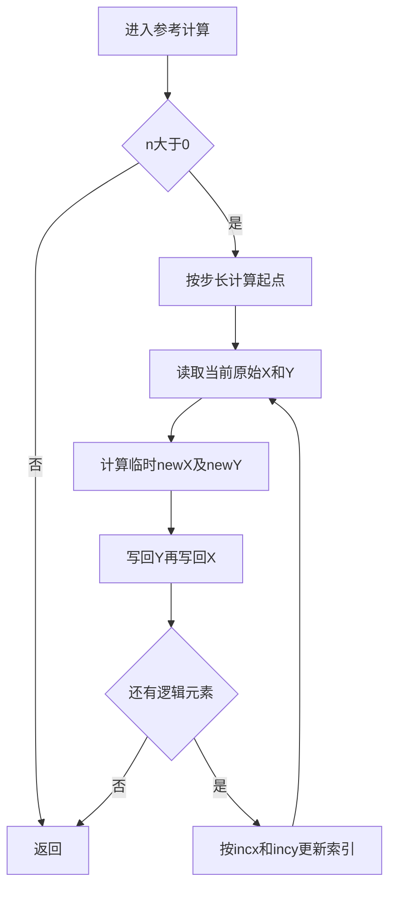
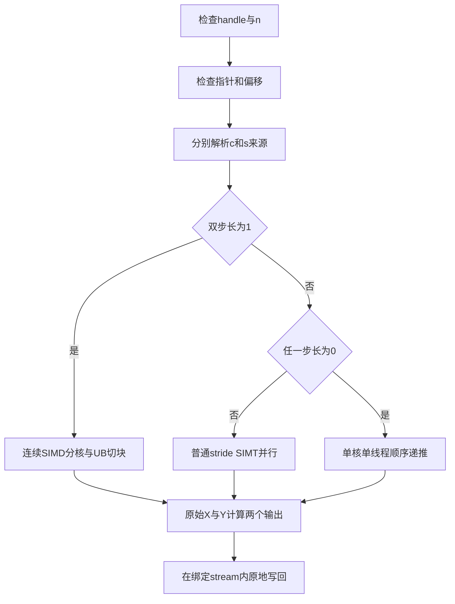

# 需求背景（required）

## 需求来源

本设计对应《CANN训练营南科大-aclblasCsrot算子开发(950)》社区任务，任务编号为e9368e9fd5d9432592efef050bfb2f0d。在Ascend 950PR、CANN 9.1.0上，基于ops-blas工程实现单精度复数向量的实数因子Givens平面旋转接口aclblasCsrot。

本文为待评审设计，尚未实施或上板验证，性能数值均为任务验收目标，不代表实测结果。

## 背景介绍

### 标杆语义与实现

接口参数顺序对齐cuBLAS cublasCsrot，计算和步长行为按任务书及Netlib csrot参考实现确定。c、s为实数float，x、y为complex64，不涉及复数旋转因子、共轭或矩阵乘法。

对于逻辑下标i（0 ≤ i < n），定义零基物理起点：

```text
start(inc) = inc < 0 ? -(int64(n) - 1) * int64(inc) : 0
kx(i) = start(incx) + int64(i) * int64(incx)
ky(i) = start(incy) + int64(i) * int64(incy)
```

每次迭代读取更新前的X = x[kx(i)]和Y = y[ky(i)]，执行：

```text
newX.real = c * X.real + s * Y.real
newX.imag = c * X.imag + s * Y.imag
newY.real = c * Y.real - s * X.real
newY.imag = c * Y.imag - s * X.imag
```

Netlib先保存CTEMP，再更新CY，最后将CTEMP写回CX。零步长时下一次迭代必须读取上一次更新后的值，不能将整个循环视为独立逐元素计算。Netlib文档注释限制步长非零，但其循环体对零步长具有递推行为；本任务明确要求零步长合法，因此按任务书使用该循环行为，不将其描述为所有BLAS库的通用保证。n为负数时也按任务书返回成功。



### 现有工程分析

参考代码基准为ops-blas提交`b91297331fd1b451c2ab73247c4910ee8c8c241b`。

- `include/cann_ops_blas.h`已有公共aclblasCsrot声明，不新增950私有API。
- `include/cann_ops_blas_common.h`中aclblasComplex由real、imag两个float成员组成。
- `blas/rot/arch35/srot_host.cpp`与`srot_kernel.cpp`提供950实数旋转的handle/stream、标量指针位置判断、连续SIMD及stride SIMT参考。
- `test/rot/csrot/`已有CMakeLists.txt和arch22测试，950测试应在该接口目录内扩展arch35，不覆盖其他架构。
- 本任务不是TBE迁移，也不需要新增ACLNN注册、op_graph或PyTorch扩展。

# 需求分析（required）

## 接口与数据契约

```cpp
aclblasStatus_t aclblasCsrot(
    aclblasHandle_t handle, int n, aclblasComplex* x, int incx,
    aclblasComplex* y, int incy, const float* c, const float* s);
```

| 参数 | 位置及方向 | 支持范围与要求 |
| --- | --- | --- |
| handle | Host输入 | 有效BLAS句柄，使用其绑定stream |
| n | Host输入 | int；n ≤ 0合法no-op |
| x、y | Device输入输出 | complex64，原地更新；实部、虚部均为float32 |
| incx、incy | Host输入 | int，可正、负、零；单位为复数元素，不是float分量或字节 |
| c、s | Host或Device输入 | float标量指针，分别判断位置，允许混合位置 |

n > 0时向量最小物理长度为`1 + (int64(n)-1) * abs(int64(inc))`。不参与旋转的间隙元素不得改动。c/s不要求满足c²+s²=1。单位旋转c=1且s=0也执行公式，不作恒等短路，以保留Inf/NaN参与运算的行为。

## 需求拆解

1. 实现公共句柄式BLAS接口，并在绑定stream上异步下发Kernel。
2. 连续路径用于incx=incy=1；其他情况进入stride路径，其中任一步长为零时采用顺序子路径。
3. 支持空操作、非法指针、偏移溢出、负步长、尾块、特殊浮点值、Host/Device/mixed标量。
4. 使用ops-blas测试框架、CSV与Netlib BLAS 3.10.0的cblas golden，满足任务精度和性能要求。

## 依赖与适配模块

依赖CANN 9.1.0提供的ACL运行时、Ascend C编译器及950相关API，复用ops-blas的handle、日志、平台资源查询、自动源码收集和GTest框架。测试依赖Netlib BLAS 3.10.0、Python和GTest。实现不依赖CUDA硬件，不能将OpenBLAS替换成指定Netlib标杆而不说明。

# 详细设计（required）

## 算子分析

### 运算性质与并行边界

本算子为BLAS Level-1复数向量原地旋转。非零步长且x/y访问集合互不重叠时，各逻辑元素独立，可以按元素分核；任一步长为零时存在跨迭代读后写依赖，必须切换顺序递推。连续情形每个复数元素包含四次输出分量计算，共8次实数乘法和4次实数加减，约12 FLOP；必要GM流量为32B，算术强度约0.375 FLOP/B，设计优先减少搬运和调度开销。

### 数据布局与原地写回

x/y均采用aclblasComplex的real、imag交错布局。连续路径将一个复数映射成两个float分量，但分核边界仍按复数元素计数。stride路径使用复数步长寻址，每次先读取四个原始分量再计算输出。顺序路径写Y再写X，与Netlib赋值顺序一致；非零步长并行路径的正确性依赖于不同线程访问范围不重叠。

### 方案选择

沿用仓内arch35 Srot已存在的SIMD与SIMT技术路线，避免在设计阶段引入未经验证的新工程依赖。连续路径使用UB批量搬运，普通stride通过SIMT直接寻址，零stride以单有效线程处理。RegBase可作为未来实测优化候选，不作为本轮基线必需条件；未测量前不声称某路径已达到性能要求。

## 调用方式与文件规划

调用流程为创建handle、绑定stream、调用aclblasCsrot、在读取结果前同步该stream。Device标量需在该stream执行到本Kernel时有效，调用者负责生命周期和跨stream依赖。

| 目录或文件 | 计划变更 |
| --- | --- |
| `blas/rot/arch35/csrot_host.cpp` | 参数检查、标量来源准备、Tiling、下发 |
| `blas/rot/arch35/csrot_kernel.cpp` | 连续SIMD和stride SIMT实现及直调封装 |
| `blas/rot/arch35/csrot_kernel.h` | 内部下发声明 |
| `blas/rot/arch35/csrot_tiling_data.h` | Host/Device共享切分数据 |
| `blas/rot/README.md` | 增补Csrot参数、约束及950PR支持说明 |
| `test/rot/csrot/CMakeLists.txt` | 按现有框架接入950测试，保留arch22 |
| `test/rot/csrot/arch35/` | CSV、测试主体及必要的NPU封装 |

测试参数和golden辅助文件按现有测试框架组织，能复用则不重复创建。源码目录不新增多余CMakeLists.txt。公共声明保持不变。实际文件拆分在实施时以仓库构建方式核对。

## Host/Tiling设计

### 参数校验与优先级

参考同族Srot，拟采用以下顺序；其中组合异常优先级作为评审确认项，不声称任务书已逐项定义。

1. handle为空返回ACLBLAS_STATUS_HANDLE_IS_NULLPTR。
2. 有效handle且n ≤ 0直接返回SUCCESS，不读取x/y/c/s、不查询平台、不启动Kernel。
3. n > 0时x/y/c/s任一为空返回INVALID_VALUE。
4. 用int64计算`(n-1)*incx`和`(n-1)*incy`，超出int32有符号范围返回INVALID_VALUE。先扩宽再乘；避免对INT_MIN直接取int绝对值。
5. 分别调用aclrtPointerGetAttributes判断c/s位置。Host标量在调用期间读入Tiling；Device标量传入Kernel，在stream依赖满足后读取。不添加D2H拷贝或全stream同步。
6. 查询有效AIV核数和可用UB资源；错误按仓库BLAS状态与日志约定返回，不直接套用GE错误码。

偏移合法性以任务书的复数元素偏移为准。内部字节偏移及两倍分量索引使用足够宽的整数；合法的负int32偏移绝对值可能为2³¹，不可再存回有符号int32。

### 路径与分核

| 路径 | 选择条件 | 执行方式 |
| --- | --- | --- |
| contiguous | incx=1且incy=1 | 多AIV核、GM↔UB、float32向量运算 |
| stride-parallel | 非连续且incx、incy均非零 | SIMT每个逻辑元素独立计算 |
| stride-serial | incx=0或incy=0 | 一个AIV核，仅一个有效SIMT线程顺序处理n次 |

连续路径以复数元素为切分单位，保证real/imag成对分配。初始分核粒度G=512个复数，即每输入向量4096B；K为平台有效AIV核数，核数B=min(K,ceil(n/G))且n > 0时至少为1。令q=floor(n/B)、r=n mod B，第b核处理`q + (b < r)`个复数，起点为`b*q + min(b,r)`。G为待实测调优参数，不是硬件限制。

普通stride采用grid-stride循环。若线程总数为B×T，线程t处理i=t、t+B×T……直到i ≥ n。T按950 SIMT支持的粒度选择并受编译launch bound约束，B不超过有效AIV核数。实施前核对真实API及线程限制，不能把CUDA launch配置直接照搬到Ascend。

零步长子路径仅启动一个核，并保证除指定线程外均不执行读写。无论只有一侧还是两侧为零，都按逻辑i递增执行，禁止并行更新共享元素，也不使用旋转矩阵幂代替逐步浮点运算。

### UB切分和数据结构

连续路径使用两份原始输入缓冲、两份输出缓冲和一份复用临时缓冲。每个tile包含m个复数，即2m个float分量；每份缓冲大小为8m字节。单缓冲总数据预算为40m字节。

令U为可用UB容量、R为经编译资源分析确认的额外预留、A为256B设计对齐粒度，则：

```text
m = 32 * floor((U - R) / (40 * 32))
UB_data = 40 * m
UB_total = UB_data + R <= U
```

256B只作为性能设计粒度，真实DMA/API约束仍需核对。m必须大于零，且每次搬运长度不得超过API字段范围。每核分为floor(count/m)个完整tile及count mod m个尾tile。

临时缓冲依次计算sY、cY、sX等中间量，生命周期不重叠时复用；原始X/Y在两个输出完成前保持不变。初始实现使用单缓冲，不宣称已形成搬运计算重叠；若后续开启双缓冲，四个输入/输出队列各两份、临时区一份时数据预算增为72m字节，必须重新推导tile和同步。

Tiling字段计划包括totalN、incx/incy、路径标识、每核数量与余数、tileComplexCount、SIMT线程配置、Host标量值及c/s来源标志。路径通过内部launcher分发，不新增ACLNN tilingKey注册体系。

## Kernel侧设计

### 连续计算

确认aclblasComplex布局为两个连续float、大小为8B后，按float32分量搬运和计算；用编译期布局检查约束这种视图，不能仅凭类型名称假定布局。

每块执行CopyIn→Compute→CopyOut。DataCopyPad按真实字节长度处理非对齐尾块，不能读写向量分配范围以外的填充值。计算仅覆盖2×validComplexCount个分量，不将UB填充区写回GM。

为降低消去误差与参考实现的舍入差异，基线方案分别进行乘法和加减，不预先假定FMA与Netlib数值等价。输入缓冲保留至newX/newY均完成，使用队列同步表达MTE2→Vector与Vector→MTE3依赖；同一流水内有读写依赖的向量操作按API规范补充同步。输出写回结束前不得重用对应缓冲。

### 非连续计算

每个线程用64位中间索引计算kx/ky，分别读取X.real、X.imag、Y.real、Y.imag，再计算四个结果并写回。步长单位为复数元素，地址换算乘sizeof(aclblasComplex)。仅访问选中元素，不能为了整块写回覆盖间隙。

### 零步长递推

单线程按Netlib循环顺序计算，每一步保留当前X/Y、计算临时结果、先写Y再写X，下一步使用更新后的共享元素。c/s在本次调用内按标量来源读取后保持一致。编译器是否融合乘加需在目标编译配置和实际golden下检查，不声称逐比特一致。



与标杆相比，连续及非零stride在不存在跨向量重叠的前提下按独立逻辑元素并行；零步长保留循环依赖。任务书未定义x/y跨向量部分重叠、以及标量与输出内存别名的保证，当前并行性证明不覆盖这些情形，需评审明确支持范围，不擅自添加拒绝返回或宣称支持所有别名。

## 硬件与约束

目标产品为Ascend 950PR，CANN版本9.1.0。仅complex64向量和float32实数因子；不引入半精度、批量接口、额外leading dimension或广播。n是运行时参数。新增arch35实现不修改arch22语义。采用已有SIMD/MemBase接口作为连续基线、SIMT处理stride，不将RegBase或CATLASS设为本任务的强制依赖。

# 特性交叉分析

| 特性组合 | 处理及验证 |
| --- | --- |
| n ≤ 0与空数据指针 | 有效handle时直接成功，不访问数据；组合优先级待评审确认 |
| 负步长与INT_MIN | 宽整数计算起点和绝对值，按元素偏移检查范围 |
| 零步长与大n | 顺序递推，测试长循环及溢出后Inf/NaN传播 |
| 单位旋转与Inf/NaN | 执行公式，不短路 |
| Host/Device/mixed标量与异步stream | 独立判断来源，Device值遵守stream顺序 |
| 非对齐起点、尾块和步长间隙 | 只读写有效范围，检查guard及间隙不变 |
| 其他架构 | 构建隔离，不破坏已有arch22实现和测试 |

# 可维可测分析

## 测试组织

以任务配套CSV、Python驱动和ops-blas C++ GTest框架为主。配套说明列出1000条精度和200条性能用例；实施时解析实际CSV核对计数、字段及覆盖，不能用说明中的数量代替实际运行证据。

golden使用Netlib BLAS 3.10.0的cblas csrot，测试前记录实际链接库版本。分别对x/y的实部和虚部统计，不以合并统计掩盖某一输出失败。补充用例至少包括：空handle；n为0和负数；x/y/c/s分别为空；n=1配极端步长；int32偏移溢出；正负零步长组合；小质数、2的幂及±1；非对齐起点；间隙和guard不变；两种mixed方向；单位旋转、负因子、大值、Inf/NaN；stream内先写Device标量再旋转。

偏移溢出负向测试在Host拒绝前不能分配巨大物理向量或调用参考BLAS。测试数据生成用宽整数验证长度，避免测试程序自身溢出。

NaN检查对应位置的分类；Inf检查分类和符号，有限值才进入数值误差统计。特殊值分类不一致直接失败，不通过忽略NaN降低分母。零步长输出可能经重复旋转溢出，不应仅因golden出现非有限值就丢弃该测试。

## 精度标准

任务书规定实部、虚部分别按float32混合容差判断：

```text
abs(actual - golden) <= 2^(-13) + 2^(-13) * abs(golden)
required_matched_ratio >= 0.99
max_abs_error_limit = 1e-2 or 32 * ULP
```

保留逐分量匹配比例、最大绝对误差及ULP诊断。验收标准“1e-2 or 32×ULP”的具体组合方式以指定精度规范确认，不能将其任意实现为更宽松阈值；初始自验先要求固定1e-2上限并同时报告ULP。已有框架的MERE/MARE可作为额外诊断，不能替代任务书指标。接近零的消去场景单独分析。

## 性能标准与方法

| n | incx | incy | 平均耗时上限 |
| --- | --- | --- | --- |
| 1048576 | 1 | 1 | 21.69μs |
| 2097152 | 1 | 1 | 43.19μs |
| 4194304 | 1 | 1 | 119.38μs |

在950PR上预热5次，再有效采样至少51次，取算术平均值。记录计时边界、设备型号、CANN版本、编译参数、标量位置、调用次数和原始时间数据。分别报告Kernel时间与接口/端到端时间，不能将含golden的测试耗时与Kernel基线混用；最终基线对应口径需任务方确认。性能采集不在循环内进行golden比对，不把数据初始化计入Kernel时间。原地多次旋转的输入重置策略需固定并记录，避免数值发散影响测试有效性。

连续路径每元素两份8B输入、两份8B输出，必要数据流量为32n字节；不含标量和调度开销，三个阈值对应约1.55、1.55、1.12TB/s有效带宽。这是目标推导而非硬件测量。调优依次观察核数、tile、DMA/Vector瓶颈和流水；每轮保留正确性回归，不承诺未经实测的达标结果。

## 内存与可维护性

设计不申请额外全局workspace；UB按预算分配。仍需按交付模板提供实际内存数据，记录输入输出和测试框架开销，不把“无workspace”写成“总内存为零”。

README列出产品支持、公式、参数、约束、调用和测试步骤。测试与实现共用公共类型，避免平行API。按仓库pre-commit执行格式、头文件和OAT检查，再做代码与同步审查。所有日志和报告绑定实际代码commit，未执行的检查标记未执行。

## 兼容性分析

保持公共接口签名、复数布局、handle/stream约定和已有架构构建不变。950代码与测试放arch35目录，测试CMake变更须回归已有架构收集行为。跨向量重叠、组合非法参数优先级、ULP判据和性能计时口径列为设计评审问题；评审结论同步更新设计及测试，不在实现中隐含改变契约。

## 参考资料

- [ops-blas源码仓](https://gitcode.com/cann/ops-blas)
- [Netlib csrot参考实现](https://www.netlib.org/blas/csrot.f)
- [cuBLAS旋转接口文档](https://docs.nvidia.com/cuda/cublas/index.html#cublas-t-rot)
- [任务指定精度规范](https://gitcode.com/cann/opbase/blob/28a1ce52ae856353589841226a0002af73314a6b/docs/zh/ops_precision_standard/mixed_tolerance_standard.md)

## 修订记录

| 版本 | 内容 | 状态 |
| --- | --- | --- |
| v0.1 | 按任务书、Netlib与本地ops-blas基准形成设计 | 待作者确认与社区评审，未上板 |
