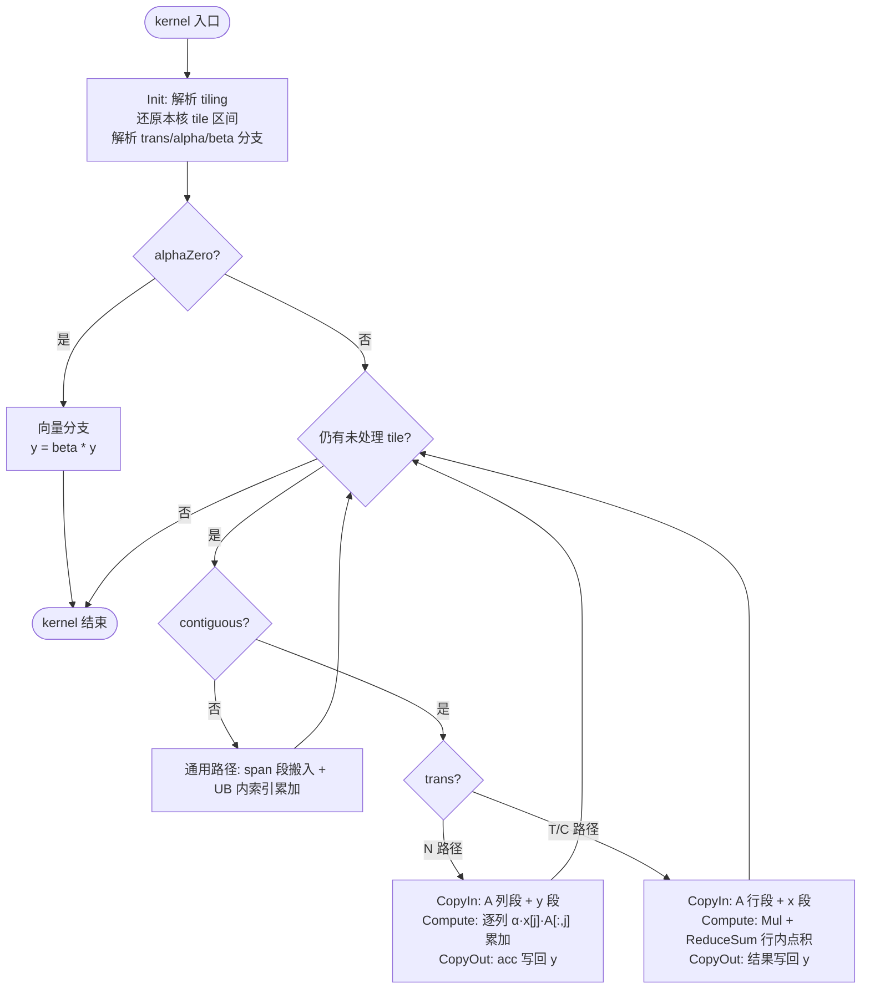

# aclblasSgemv 算子设计文档

## 一、需求背景（required）

### 1.1 需求来源

本需求来自社区任务"aclblasSgemv 算子开发（Atlas A2/A3）"。目标是在 Atlas A2/A3 系列产品（arch22）上使用 Ascend C 编程语言，以 kernel 直调方式实现单精度实数通用矩阵-向量算子 `aclblasSgemv`，补齐 Blas 仓 Atlas A2/A3 系列产品 BLAS-2 矩阵-向量能力缺口。算子对标 cuBLAS `cublasSgemv`，语义依据 cuBLAS 官方文档（§2.6.2）、Netlib BLAS 参考实现与仓内 950PR（arch35）既有实现，验收通过后合入昇腾算子开源仓 ops-blas（https://gitcode.com/cann/ops-blas，开发分支 master）。

实现代码合入 `blas/gemv/arch22/`，测试代码合入 `test/gemv/sgemv/arch22/`，接口声明复用仓内 `include/cann_ops_blas.h` 既有声明，不新增私有平行接口。

### 1.2 背景介绍

#### 1.2.1 aclblasSgemv 算子实现优化

`aclblasSgemv` 对标 cuBLAS `cublasSgemv`，属于 BLAS-2 矩阵-向量算子（通用矩阵-向量乘加）。ops-blas 仓 `blas/gemv/` 目录下 950PR（arch35）已提供 `sgemv_host.cpp` / `sgemv_kernel.cpp` 实现，Atlas A2/A3（arch22）侧尚为空白，本任务按同仓 arch22 兄弟算子的工程模式补齐 arch22 实现。

**对标基线接口及参考实现路径：**

| 项目 | 路径/链接 |
| --- | --- |
| 对标基线接口 | cuBLAS `cublasSgemv`：https://docs.nvidia.com/cuda/pdf/CUBLAS_Library.pdf §2.6.2 |
| 参考实现（golden） | Netlib BLAS `sgemv`：https://netlib.org/blas/sgemv.f |
| 算子实现仓 | ops-blas 开源仓：https://gitcode.com/cann/ops-blas |
| 同族既有实现 | `blas/gemv/arch35/sgemv_host.cpp`（参数校验与入口 L31-107）、`blas/gemv/arch35/sgemv_kernel.cpp` |
| per-arch 差异说明 | `blas/gemv/README.md` |
| 接口声明头文件 | `include/cann_ops_blas.h`（L461-463，与 950PR 共用声明） |
| 测试工程参考 | `test/gemv/sgemv/arch35/`（`sgemv_param.h`、`sgemv_golden.h`、`sgemv_test.cpp`） |
| Ascend C 算子开发文档 | https://www.hiascend.com/document/detail/zh/CANNCommunityEdition/850/opdevg/Ascendcopdevg/atlas_ascendc_map_10_0002.html |
| 生态算子开源精度标准 | https://gitcode.com/cann/opbase/blob/master/docs/zh/ops_precision_standard/mixed_tolerance_standard.md |

#### 1.2.2 aclblasSgemv 算子现状分析

##### 1.2.2.1 标杆算子支持的数据类型和数据格式

本算子对标 cuBLAS `cublasSgemv`，语义参考 Netlib `sgemv` 参考实现。标杆算子支持的数据类型和数据格式如下：

| 参数名 | 输入/输出 | 描述 | 数据类型 | dtype 类型 | 数据排布格式 | 维度(shape) | 值域范围 | 异常行为 |
| --- | --- | --- | --- | --- | --- | --- | --- | --- |
| handle | 输入 | 库上下文句柄（内部携带 stream），Host 内存 | attr | - | - | - | aclblasCreate 返回的非空句柄 | 为 nullptr 时返回 ACLBLAS_STATUS_HANDLE_IS_NULLPTR |
| trans | 输入 | 矩阵操作类型：ACLBLAS_OP_N（op(A)=A）、ACLBLAS_OP_T（op(A)=Aᵀ）、ACLBLAS_OP_C（op(A)=Aᴴ，实数矩阵等价于 Aᵀ），Host 内存 | attr | - | - | - | {ACLBLAS_OP_N, ACLBLAS_OP_T, ACLBLAS_OP_C} | 取值不在枚举集合内时返回 ACLBLAS_STATUS_INVALID_VALUE |
| m | 输入 | 矩阵 A 的行数，Host 内存 | attr | int | - | - | 任意非负 int32 整数（m=0 走 quick return，不报错） | m<0 时返回 ACLBLAS_STATUS_INVALID_VALUE；参数校验通过后 m=0 或 n=0 时不访问 A、x、y，直接返回成功 |
| n | 输入 | 矩阵 A 的列数，Host 内存 | attr | int | - | - | 任意非负 int32 整数（n=0 走 quick return，不报错） | n<0 时返回 ACLBLAS_STATUS_INVALID_VALUE |
| alpha | 输入 | 标量乘数 α 的指针，Host 内存 | scalar | FLOAT32 | - | - | 任意 FLOAT32 值（含 0.0、1.0、Inf、NaN，值不校验） | 为 nullptr 时返回 ACLBLAS_STATUS_INVALID_VALUE |
| A | 输入 | 列主序系数矩阵，前 m×n 部分为有效矩阵，Device 内存 | tensor | FLOAT32 | ND | 二维矩阵（列主序），维度 lda×n，前 m×n 为有效矩阵，物理长度 lda×n 个单精度实数元素 | 全值域（含 Inf/NaN，按 IEEE 规则自然传播） | m>0 且 n>0 时为 nullptr 返回 ACLBLAS_STATUS_INVALID_VALUE；元素值不校验，NaN/Inf 按公式自然传播 |
| lda | 输入 | 矩阵 A 的主维（列主序相邻列间距），Host 内存 | attr | int | - | - | lda ≥ max(1, m) 的 int32 整数 | lda < max(1, m) 时返回 ACLBLAS_STATUS_INVALID_VALUE |
| x | 输入 | 输入向量（单精度实数元素），Device 内存 | tensor | FLOAT32 | ND | 一维向量，trans=ACLBLAS_OP_N 时逻辑长度 n，否则逻辑长度 m；物理长度 1+(逻辑长度−1)×｜incx｜ 个单精度实数元素 | 全值域（含 Inf/NaN，按 IEEE 规则自然传播） | 逻辑长度非零时为 nullptr 返回 ACLBLAS_STATUS_INVALID_VALUE；元素值不校验，NaN/Inf 按公式自然传播 |
| incx | 输入 | x 中相邻元素之间的存储步长（元素为单位），Host 内存 | attr | int | - | - | 非零 int32 整数且不为 INT32_MIN（正负步长均支持） | 为 0 或 INT32_MIN 时返回 ACLBLAS_STATUS_INVALID_VALUE；(逻辑长度−1)×｜incx｜ 超出 int32 可表示范围时返回 ACLBLAS_STATUS_INVALID_VALUE（host 侧 int64 计算） |
| beta | 输入 | 标量乘数 β 的指针，Host 内存；β=0 时 y 的输入值不被使用 | scalar | FLOAT32 | - | - | 任意 FLOAT32 值（含 0.0、1.0、Inf、NaN，值不校验） | 为 nullptr 时返回 ACLBLAS_STATUS_INVALID_VALUE |
| y | 输出(原地输出) | 输入兼输出（y ← α·op(A)·x + β·y 原地覆写），向量（单精度实数元素），Device 内存 | tensor | FLOAT32 | ND | 一维向量，trans=ACLBLAS_OP_N 时逻辑长度 m，否则逻辑长度 n；物理长度 1+(逻辑长度−1)×｜incy｜ 个单精度实数元素 | 全值域（含 Inf/NaN，按 IEEE 规则自然传播） | 逻辑长度非零时为 nullptr 返回 ACLBLAS_STATUS_INVALID_VALUE；元素值不校验，NaN/Inf 按公式自然传播 |
| incy | 输入 | y 中相邻元素之间的存储步长（元素为单位），Host 内存 | attr | int | - | - | 非零 int32 整数且不为 INT32_MIN（正负步长均支持） | 为 0 或 INT32_MIN 时返回 ACLBLAS_STATUS_INVALID_VALUE；(逻辑长度−1)×｜incy｜ 超出 int32 可表示范围时返回 ACLBLAS_STATUS_INVALID_VALUE（host 侧 int64 计算） |

**接口声明：**

```text
aclblasStatus_t aclblasSgemv(aclblasHandle_t handle, aclblasOperation_t trans, int m, int n,
                             const float* alpha, const float* A, int lda, const float* x,
                             int incx, const float* beta, float* y, int incy);
```

**返回值：** `aclblasStatus_t`，状态码语义与 ops-blas 仓 `include/cann_ops_blas_common.h` 定义一致。

##### 1.2.2.2 标杆算子实现描述

标杆算子为 Netlib BLAS `sgemv`（Fortran，golden 由 CBLAS `cblas_sgemv` 生成），其核心功能是对列主序 m×n 矩阵 A 与向量 x 做乘加，结果原地累加到 y 上：

```text
y[j] = α × Σ(i=1..k) op(A)[j,i] × x[i] + β × y[j]，j = 1..len(y)
```

其中 op(A) = A（trans=ACLBLAS_OP_N）、Aᵀ（trans=ACLBLAS_OP_T）、Aᴴ（trans=ACLBLAS_OP_C，实数矩阵等价于 Aᵀ）；trans=N 时 k = n、len(y) = m；trans=T/C 时 k = m、len(y) = n。

Netlib 参考实现的逐元素循环体（trans=N 分支）为：

```fortran
DO J = 1, N
    TEMP = ALPHA * X(IX)
    IF (BETA.NE.ZERO) THEN
        DO I = 1, M
            Y(IY) = Y(IY) + TEMP * A(I,J)
            IY = IY + INCY
        END DO
    ELSE
        DO I = 1, M
            Y(IY) = TEMP * A(I,J)
            IY = IY + INCY
        END DO
    END IF
    X(IX) = X(IX) + INCX
END DO
```

即"以列为外层、按列累加到 y 向量"的 axpy 形式：第 j 列的贡献为 `α·x[j]·A[:,j]`，逐列累加进 y。trans=T/C 分支则为"以行为外层、行内做点积"的形式。两种形式数学等价，但**浮点累加顺序不同**（列外层 = 按列依次累加；行外层 = 行内顺序点积）。

**关键语义要点：**

1. **列主序定位**：A[i,j] 位于列主序数组偏移 `(i−1) + (j−1)×lda`（1-based），`lda` 是列间距而非行间距；`lda > m` 时列间存在空洞，只访问前 m 行有效数据；
2. **原地更新**：y 为输入兼输出，β 读取旧值参与计算，β=0 时不读 y 旧值、可直接覆写；A、x 只读；
3. **向量长度随 trans 变化**：trans=N 时 x 长 n、y 长 m；trans=T/C 时 x 长 m、y 长 n；
4. **步长语义**：incx/incy 为元素间存储间隔；负步长自向量物理 span 尾端起算（Netlib 语义）；
5. **快速返回**：参数校验通过后 `m == 0 或 n == 0` 时直接返回，不访问 A、x、y，不启动 kernel；
6. **标量位置**：alpha、beta 为 Host 内存标量指针（对标 cuBLAS 口径），值不校验；
7. **无广播**：BLAS-2 矩阵-向量算子，op(A) 与 x、y 的逻辑维度由 m、n、trans 唯一确定，不存在操作数间广播。

##### 1.2.2.3 快速返回与异常口径（任务书 §2.4/§2.5）

| 条件 | 口径 |
| --- | --- |
| handle 为 nullptr | ACLBLAS_STATUS_HANDLE_IS_NULLPTR |
| trans 不在 {ACLBLAS_OP_N, ACLBLAS_OP_T, ACLBLAS_OP_C} | ACLBLAS_STATUS_INVALID_VALUE |
| m < 0 或 n < 0 | ACLBLAS_STATUS_INVALID_VALUE |
| lda < max(1, m) | ACLBLAS_STATUS_INVALID_VALUE |
| incx 或 incy 为 0 或 INT32_MIN | ACLBLAS_STATUS_INVALID_VALUE |
| alpha 或 beta 为 nullptr | ACLBLAS_STATUS_INVALID_VALUE |
| m>0 且 n>0 时 A 为 nullptr | ACLBLAS_STATUS_INVALID_VALUE |
| x/y 逻辑长度非零时为 nullptr | ACLBLAS_STATUS_INVALID_VALUE |
| (逻辑长度−1)×|incx| 或 ×|incy| 超出 int32 可表示范围 | ACLBLAS_STATUS_INVALID_VALUE（host 侧 int64 计算，arch35 未提供，本实现按 §2.4 补齐） |
| m=0 或 n=0（参数校验通过后） | 合法快速返回：不访问 A、x、y，返回 ACLBLAS_STATUS_SUCCESS |
| alpha=0 | 实现侧短路为 y = βy（不读取 A/x）；A/x 含 Inf/NaN 时同样正常计算与比对 |
| beta=0 | y 旧值不被使用，可直接覆写 |
| alpha/beta/A/x/y 元素值 | 不校验，Inf/NaN 按公式自然传播 |
| 异步语义 | 计算经 handle 绑定的 stream 异步下发，读输出前须同步 stream |

> 以上口径与随包测试用例（`test_cases/`）及仓内 arch35 既有实现保持一致；非法 trans 返回 `ACLBLAS_STATUS_INVALID_VALUE`（仓内 `ValidateSgemvParams` 实际行为，与复数 `Cgemv` README 的 `INVALID_ENUM` 表述不同，按实数实现口径）。

## 二、需求分析（required）

### 2.1 外部组件依赖

本算子为 ops-blas 仓内 BLAS 算子，使用 Ascend C kernel 直调方式开发，外部组件依赖如下：

| 依赖组件 | 说明 |
| --- | --- |
| ops-blas 工程框架 | 提供 handle 句柄、stream 绑定、Host/Device 指针判别等基础设施 |
| Ascend C 运行时 | 提供 kernel 直调能力、AI Core 矢量执行环境（arch22） |
| CANN 9.1.0 | 适配的 CANN 版本，提供 Ascend C API 与编译工具链 |
| Netlib BLAS sgemv | 精度比对 golden 参考实现（CBLAS `cblas_sgemv`），随测试工程提供 |

### 2.2 内部适配模块

| 内部模块 | 说明 |
| --- | --- |
| `include/cann_ops_blas.h` | 接口声明（L461-463 既有声明），与 950PR 共用，不新增私有接口 |
| `blas/gemv/arch22/` | 算子实现目录：`sgemv_host.cpp`（Host 侧）、`sgemv_kernel.cpp`（kernel 侧）、`sgemv_tiling_data.h`（tiling 结构体） |
| `blas/gemv/README.md` | per-arch 差异表与产品支持表，新增 arch22 行 |
| handle/stream 机制 | 通过 `aclblasHandle_t` 绑定 stream，实现 kernel 直调 |
| 同族 950PR 实现 | 参照其 Host 侧参数校验、strided 溢出守卫与快速返回模式 |
| `test/gemv/sgemv/` | 测试工程：`sgemv_param.h`（CSV 解析）、`sgemv_golden.h`（cblas_sgemv 包装）复用，`arch22/` 新建 |

### 2.3 需求模块设计

#### 2.3.1 Ascend C 算子原型

使用 Ascend C 编程语言实现 `aclblasSgemv` 算子，对齐标杆算子 cuBLAS `cublasSgemv`（语义参考 Netlib `sgemv`）。

**算子原型：**

```text
aclblasStatus_t aclblasSgemv(aclblasHandle_t handle, aclblasOperation_t trans, int m, int n,
                             const float* alpha, const float* A, int lda, const float* x,
                             int incx, const float* beta, float* y, int incy);
```

**参数语义对齐标杆算子：**

| 参数 | 标杆算子 cublasSgemv | Ascend C 实现 | 对齐说明 |
| --- | --- | --- | --- |
| handle | cublasHandle_t | aclblasHandle_t | ops-blas 句柄，携带 stream |
| trans | cublasOperation_t | aclblasOperation_t | N/T/C 三态，实数下 T 与 C 等价 |
| m | int | int | 矩阵行数，参数序列逐位一致，无需映射 |
| n | int | int | 矩阵列数 |
| alpha | const float* | const float* | Host 内存标量指针，值不校验 |
| A | const float* | const float* | Device 内存，列主序，lda 为列间距 |
| lda | int | int | 列主序相邻列间距，须 ≥ max(1, m) |
| x | const float* | const float* | Device 内存，逻辑长度随 trans 变化 |
| incx | int | int | 元素步长，正负均支持 |
| beta | const float* | const float* | Host 内存标量指针，值不校验 |
| y | float*（inout） | float*（inout） | Device 内存，原地更新 |
| incy | int | int | 元素步长，正负均支持 |

**数学公式对齐标杆算子：**

```text
y[j] = α × Σ(i=1..k) op(A)[j,i] × x[i] + β × y[j]
op(A) = A（trans=N）/ Aᵀ（trans=T）/ Aᴴ（trans=C，实数等价 Aᵀ）
trans=N 时 k = n、len(y) = m；trans=T/C 时 k = m、len(y) = n
```

**特殊分支语义对齐 Netlib sgemv：**

- `m == 0 || n == 0`：直接返回成功，不访问任何指针、不启动 kernel；
- `lda > m`：列间存在空洞，只访问前 m 行有效数据；
- `beta == 0`：不读 y 旧值，可直接覆写；
- `alpha == 0`：实现侧短路为 `y = beta * y`，不读取 A/x；
- incx/incy 为负：逻辑元素自物理 span 尾端起算。

#### 2.3.2 Ascend C 算子相关约束

与标杆算子 cuBLAS `cublasSgemv` 相比，本 Ascend C 实现的功能完全对齐，无功能缺失。相关约束如下（按任务书 §2.5 口径）：

| 约束项 | 内容 |
| --- | --- |
| 参数合法性与校验层级 | handle 为 nullptr 返回 ACLBLAS_STATUS_HANDLE_IS_NULLPTR；trans 非法、m<0、n<0、lda<max(1,m)、incx/incy 为 0 或 INT32_MIN、alpha/beta 为 nullptr、m>0 且 n>0 时 A 为 nullptr、x/y 逻辑长度非零时为 nullptr、跨度溢出均返回 ACLBLAS_STATUS_INVALID_VALUE；m=0 或 n=0 为合法快速返回；标量与元素值不校验 |
| 非连续 Tensor 支持 | 支持：矩阵按 lda 跨列访问（lda>m 时列间有空洞）、向量按 incx/incy 步长访问（间隔元素跳过）；正负步长均生效（负步长自物理 span 尾端起算） |
| broadcast 规则 | 不涉及：BLAS-2 矩阵-向量算子，op(A) 与 x、y 的逻辑维度由 m、n、trans 唯一确定 |
| dynamic shape 要求 | 不要求：m、n、lda、incx、incy 为运行时入参，host tiling 按运行时 m、n 计算，任意合法规模一次适配 |
| 原地与视图语义 | y 原地覆写：输入旧值与输出新值复用同一入参 y 内存（β 读取旧值参与计算，β=0 时不读），不返回视图；A、x 只读 |
| 确定性计算要求 | 不要求：行内点积归约的浮点累加顺序不保证跨次一致（无确定性计算要求）；单次执行内部确定 |
| 空 Tensor 处理 | 等价口径为 m=0 或 n=0：不访问 A、x、y 数据、不启动计算 kernel，快速返回成功，不存在空 Device 指针参与计算的路径 |
| 0 维 Tensor 处理 | 不涉及：矩阵-向量算子无 0 维输入，标量语义由 m/n=0 快速返回与 Host 标量入参承担 |
| 异步执行 | 计算经 handle 绑定的 stream 异步下发，返回成功仅表示 Host 已提交，不保证完成；读取输出前须调用 aclrtSynchronizeStream |

## 三、需求详细设计（required）

### 3.1 调用方式

本算子使用 **Ascend C kernel 直调方式** 开发。基于 ops-blas 开源仓工程框架，实现 `aclblasSgemv` 句柄式 BLAS 接口，通过 handle 绑定 stream 直调 NPU kernel。

**调用流程：**

1. 用户调用 `aclblasSgemv(handle, trans, m, n, alpha, A, lda, x, incx, beta, y, incy)` 接口；
2. Host 侧（`sgemv_host.cpp`）进行参数校验（handle/nullptr/维度/步长/strided 溢出守卫）；
3. 快速返回判定（`m == 0 || n == 0` 直接返回成功，不启动 kernel）；
4. `alpha == 0` 短路判定（不读取 A/x，退化为 `y = beta * y` 向量算子）；
5. Host 侧计算 tiling 参数（分核策略、tile 长度、每核任务区间、列主序基偏移）；
6. 通过 handle 绑定的 stream 直调 NPU kernel（`sgemv_kernel.cpp`）在 Device 上执行计算；
7. 返回 `aclblasStatus_t` 状态码。

**调用方式说明：** 本算子不涉及 ACLNN 框架的多分支 tilingKey infer shape 机制，也不涉及 Pytorch 框架适配，采用 ops-blas 仓 BLAS 算子标准的 kernel 直调模式，参照同族 950PR `blas/gemv/arch35/sgemv_host.cpp` 的校验与分发模式。

### 3.2 需求总体设计

#### 3.2.1 host 侧设计

Host 侧（`sgemv_host.cpp`）负责参数校验、快速返回、alpha=0 短路、tiling 计算与 kernel 下发。

##### 3.2.1.1 参数校验与快速返回

Host 侧按以下顺序检查，确保错误码稳定可预期：

1. `handle == nullptr` → 返回 `ACLBLAS_STATUS_HANDLE_IS_NULLPTR`；
2. `trans` 不在 {ACLBLAS_OP_N, ACLBLAS_OP_T, ACLBLAS_OP_C} → 返回 `ACLBLAS_STATUS_INVALID_VALUE`；
3. `m < 0 || n < 0` → 返回 `ACLBLAS_STATUS_INVALID_VALUE`；
4. `lda < max(1, m)` → 返回 `ACLBLAS_STATUS_INVALID_VALUE`；
5. `alpha == nullptr || beta == nullptr` → 返回 `ACLBLAS_STATUS_INVALID_VALUE`；
6. `incx == 0 || incx == INT32_MIN || incy == 0 || incy == INT32_MIN` → 返回 `ACLBLAS_STATUS_INVALID_VALUE`；
7. strided 溢出守卫：逻辑长度 `lenX = (trans == N) ? n : m`、`lenY = (trans == N) ? m : n`，以 int64 计算 `spanX = (int64)(lenX-1) * llabs((int64)incx)`、`spanY = (int64)(lenY-1) * llabs((int64)incy)`，任一超出 int32 可表示范围 → 返回 `ACLBLAS_STATUS_INVALID_VALUE`；
8. `m > 0 && n > 0` 时 `A == nullptr` → 返回 `ACLBLAS_STATUS_INVALID_VALUE`；`lenX > 0` 时 `x == nullptr` 或 `lenY > 0` 时 `y == nullptr` → 返回 `ACLBLAS_STATUS_INVALID_VALUE`；
9. `m == 0 || n == 0` → 直接返回 `ACLBLAS_STATUS_SUCCESS`，不访问 A、x、y，不启动 kernel；
10. `alpha == 0` → 走短路分支（见 3.2.1.2），否则走主计算分支。

> 实现要点：`llabs((int64)INT32_MIN)` 可安全得到 2147483648，避免 `std::abs(INT32_MIN)` 的未定义行为；溢出判定必须在 int64 域完成。该校验在仓内 arch35 参考实现中尚未提供，本实现按任务书 §2.4 补齐（issue #866/#860 口径）。

##### 3.2.1.2 alpha=0 短路分支

`alpha == 0` 时算子退化为纯向量运算 `y[j] = beta * y[j]`，不读取 A/x：

| beta | 行为 |
| --- | --- |
| beta == 0 | y 整体置 0（不读 y 旧值，直接覆写） |
| beta == 1 | y 保持不变（读后原样写回，语义正确但存在冗余写） |
| 其他 | y 逐元素乘 beta |

该分支复用向量 tile 流水（连续/通用两条路径），只做一次 `Muls`，不搬入 A/x，把 A/x 可能含 Inf/NaN 的情况完全隔离——对应测试用例 TC_AB 中 `alpha=0 且 A=Inf / x=NaN` 的语义要求。

##### 3.2.1.3 分核策略

**任务空间：** 本算子输出元素为 y 的各分量，每个 y[j] 的计算相互独立（行内点积归约，无跨 y 分量的数据依赖），任务空间即 y 的逻辑下标集合，总任务数 `lenY`。

**优先使用满核的原则：**

```text
tileNum = ceil(lenY / tileLen)
coreNum = min(platformCoreNum, tileNum)
base    = tileNum / coreNum
rem     = tileNum % coreNum
```

前 `rem` 个核每核多处理 1 个 tile（`base + 1` 个），其余核处理 `base` 个 tile。由于 `coreNum <= tileNum`，必有 `base >= 1`，不存在空闲核。

**每核任务区间：** 第 `coreIdx` 核的 tile 区间 `[startTile, endTile)` 由 Host 侧按同一公式约定，kernel 侧按公式还原，不逐核展开存储：

```text
startTile = coreIdx * base + min(coreIdx, rem)
endTile   = startTile + base + (coreIdx < rem ? 1 : 0)
```

**两种 trans 的任务空间形态：**

| trans | 输出 y 长度 | 归约维度 k | 访存特征 |
| --- | --- | --- | --- |
| N | m | n（列） | 每个 y[j] 需跨 A 的第 j 行（列主序下跨 n 列、步长 lda）累加；A 按列连续，适合按列组织 |
| T/C | n | m（行） | 每个 y[j] 需读 A 的第 j 行（列主序下连续 m 个元素）+ x 广播，行访问连续，适合按行组织 |

##### 3.2.1.4 数据分块和内存优化策略

**充分使用 UB 空间的原则。** 单核内切分大小由平台 UB 容量（`GetCoreMemSize` 查询，arch22 以查询返回为准）、是否开启 double buffer、kernel 侧所需 buffer 数综合决定，不写死任何平台的 UB 数值。

**tileLen 计算（按访存路径分档）：**

| 路径 | 触发条件 | UB 内 buffer | tileLen 公式 |
| --- | --- | --- | --- |
| 连续路径 | `incx == 1 && incy == 1 && lda == m` | aLocal、yLocal、accLocal 各 BUFFER_NUM 份（double buffer） | `(ubAvail - reserve) / (BUFFER_NUM * 3 * sizeof(float))`，按 32B（8 元素）对齐 |
| 通用路径 | 其余（lda>m、任一步长非 1） | aLocal、yLocal、accLocal 各 1 份（不开 double buffer） | 按归约维 k 与矩阵列跨度综合核算，钳制下限 1 |

**矩阵搬运策略（列主序适配）：**

- **trans=N（按列累加形态）**：以 y 分量为外层任务，一个 tile 处理若干 y[j]；内层需跨 A 的各列累加。由于列主序下同一列内连续，采用「按列搬入 A 的第 j 列有效段 + x 标量广播」的方式组织：每列做一次 `Muls` + `Axpy` 到 acc 累加器，逐列推进。A 的无效行（第 m..lda-1 行）不搬入。
- **trans=T/C（按行点积形态）**：每个 y[j] 对应 A 第 j 行的连续 m 元素与 x 的点积，直接连续搬入整行，UB 内做 `Mul` + `ReduceSum` 归约，最后与 beta·y[j] 合并。

**批量搬运：** 连续路径下一个 tile 一次性完成 A 段、y 段的搬入与搬出，搬运次数为 `tileNum × 2`（而非 `lenY × k × 2`），冗余开销随 tileLen 增大而摊薄。尾 tile 长度不足时按实际剩余长度搬运，与标准 tile 走同一套流程，不产生数据碎片。

**double buffer 流水：** 连续路径开启 double buffer，第 i 个 tile 的计算与第 i+1 个 tile 的搬入流水重叠，掩盖 GlobalMemory 访问延迟。本算子为访存与归约混合型负载（A 为 m×n 主数据，每输出元素读 k 个 A 元素与 2 个向量元素），带宽利用率是性能决定性因素，double buffer 为必选优化。

**acc buffer 的必要性：** trans=N 形态下 y[j] 的累加需跨多列完成，必须保留 acc 累加器直到最后一列才能与 beta·y[j] 合并写回；trans=T/C 形态下归约结果同样需暂存。因此采用 3 个逻辑 buffer（aLocal、yLocal、accLocal），物理份数 = 3 × BUFFER_NUM。

##### 3.2.1.5 tilingKey 规划策略

tilingKey 用于让 kernel 侧按 host 侧已知的访存模式走不同分支，避免每 tile 重复判断：

| tilingKey | 含义 | kernel 路径 |
| --- | --- | --- |
| 0 | 连续路径 + trans=N（lda==m、incx==incy==1） | 按列累加，矢量运算 + double buffer 流水 |
| 1 | 连续路径 + trans=T/C（lda==m、incx==incy==1） | 按行点积归约 + double buffer 流水 |
| 2 | 通用路径（lda>m 或任一 abs(stride) != 1） | 矩阵按列 span 搬入或按行索引 + UB 内处理 |

beta 形态（0 / 1 / 其他）与 alpha=0 短路不编入 tilingKey：beta 值在每 tile 的合并阶段才使用，由 tiling 字段 `betaMode` 在 `Init` 阶段一次性解析为 kernel 局部变量即可，拆分成更多 tilingKey 反而使 kernel 函数数量膨胀。

##### 3.2.1.6 TilingData 设计

`SgemvTilingData` 结构体（host/kernel 共享，定义于 `sgemv_tiling_data.h`）：

| 字段 | 类型 | 说明 |
| --- | --- | --- |
| `m` | int32 | 矩阵行数 |
| `n` | int32 | 矩阵列数 |
| `lda` | int32 | 列主序列间距 |
| `lenX` | int32 | x 逻辑长度（trans=N 为 n，否则为 m） |
| `lenY` | int32 | y 逻辑长度（trans=N 为 m，否则为 n） |
| `tileNum` | int32 | tile 总数 = ceil(lenY / tileLen) |
| `tileLen` | int32 | 标准 tile 元素数 |
| `tailLen` | int32 | 尾 tile 元素数（= lenY - (tileNum-1)*tileLen） |
| `coreNum` | int32 | 实际参与计算的 AI Core 数 |
| `baseTilePerCore` | int32 | 每核基准 tile 数 |
| `remTile` | int32 | 前 remTile 个核多 1 个 tile |
| `trans` | uint32 | 0：N；1：T/C |
| `incx`、`incy` | int32 | 步长原值（含符号） |
| `xBaseOffset`、`yBaseOffset` | int64 | 负步长起点偏移（元素为单位） |
| `alphaVal` | float | Host 侧 α 标量值 |
| `betaVal` | float | Host 侧 β 标量值 |
| `betaMode` | uint32 | 0：beta 一般值；1：beta==0；2：beta==1 |
| `alphaZero` | uint32 | 1：alpha==0 短路分支 |
| `contiguous` | uint32 | 1：连续路径；0：通用路径 |

**Workspace 设计：** 本算子所有路径均不需要额外 workspace（y 逐元素独立计算，无跨 tile 归约、无多核同步）。kernel 内部仅使用 UB 临时 buffer，大小由 tileLen 决定，不向 Host 暴露。

#### 3.2.2 kernel 侧设计

kernel 侧（`sgemv_kernel.cpp`）采用 `Init` + `Process` 结构。`Process` 中遍历本核分配的 tile 区间，每个 tile 按 `CopyIn` → `Compute` → `CopyOut` 执行。

##### 3.2.2.1 Init 阶段

1. 解析 `SgemvTilingData`，还原本核 tile 区间 `[startTile, endTile)`；
2. 按 `trans`、`alphaZero`、`betaMode`、`contiguous` 字段确定分支，预计算 `alphaVal`、`betaVal`、负步长 base offset 等局部变量；
3. 计算每 tile 的物理 span 起点偏移。

##### 3.2.2.2 连续路径 trans=N（tilingKey = 0）

**CopyIn：** 以 tile 为单位，将 y 的对应段与 A 的对应列段搬入 UB：

```text
offY = yBaseOffset + t * tileLen          // incy == 1
len  = (t == tileNum - 1) ? tailLen : tileLen
DataCopy(yUB[ping], yGM + offY, len)
// 对第 j 列（j = offY + i，i ∈ [0, len)）：
DataCopy(aUB, aGM + j * lda, m)           // 列内连续，跳过 lda 后的无效行
```

**Compute：** 按列累加形态，逐列将贡献累加到 acc 累加器：

```text
// accLocal 初始化为 beta * y（betaMode 决定初始值来源）
for j in [tileStart, tileEnd):
    Muls (tmp, aUB[j 列], alphaVal * x[j], m)   // tmp = α·x[j]·A[:,j]
    Add  (accLocal, accLocal, tmp, m)
```

**CopyOut：** 将累加结果写回 y 对应段：

```text
DataCopy(yGM + offY, accUB, len)
```

**流水：** 相邻 tile 间以 ping/pong 两组 UB buffer 交替，`CopyIn(t+1)` 与 `Compute(t)`、`CopyOut(t)` 重叠。

##### 3.2.2.3 连续路径 trans=T/C（tilingKey = 1）

**CopyIn：** 每个 y[j] 对应 A 第 j 行的连续 m 元素与 x：

```text
offX = xBaseOffset + t * tileLen          // incx == 1
len  = (t == tileNum - 1) ? tailLen : tileLen
DataCopy(xUB[ping], xGM + offX, len)      // 供整行广播
for j in [tileStart, tileEnd):
    DataCopy(aUB, aGM + j * lda, m)       // 第 j 行连续 m 元素
```

**Compute：** 行内点积归约：

```text
for j in [tileStart, tileEnd):
    Mul  (prod, aUB, xUB, m)              // prod[i] = A[j,i] * x[i]
    ReduceSum (sum, prod, m)              // 行内归约
    accLocal[j] = alphaVal * sum + betaVal * y[offY + j]
```

**CopyOut：** 将计算结果写回 y 对应段（同 tilingKey 0 流程）。

##### 3.2.2.4 通用路径（tilingKey = 2）

**设计取舍：** `lda > m` 时矩阵列间存在空洞，逐列直接访问 GM 会把空洞数据一并读入 cache sector，浪费带宽；步长非 1 时同理。本路径把非连续访存收敛到 UB：按 tile 对应的物理 span 段连续搬入，再在 UB 内按步长索引访问。

**矩阵 span 搬入（lda > m）：** 每列搬入时以行为单位跳过无效段，或按 tile 覆盖的列区间整体搬入后在内层按列偏移索引；两种方式由 host 侧按 `lda/m` 比例选择，避免小比例空洞时的逐列碎片搬运。

**向量 span 搬入（步长非 1）：** 与同族 `aclblasSrot` 通用路径一致，按物理 span 段连续搬入后 UB 内步长索引。

**Compute：** UB 内按索引完成累加或点积，语义与连续路径完全一致，仅寻址方式不同。

通用路径不开 double buffer：该路径面向功能覆盖（lda 排布与步长维度），非性能判据路径；span 长度随 tile 与步长变化，双 buffer 会使 UB 预算与尾 tile 处理显著复杂化，收益不匹配。

##### 3.2.2.5 Ascend C 实现流程图

Host 侧入口流程：

```mermaid
flowchart TD
    Start([aclblasSgemv 入口]) --> ChkHandle{handle == nullptr?}
    ChkHandle -- 是 --> RetHandle[返回 HANDLE_IS_NULLPTR]
    ChkHandle -- 否 --> ChkTrans{trans 合法?}
    ChkTrans -- 否 --> RetInvalid[返回 INVALID_VALUE]
    ChkTrans -- 是 --> ChkDim{m<0 或 n<0<br/>或 lda<max(1,m)?}
    ChkDim -- 是 --> RetInvalid
    ChkDim -- 否 --> ChkPtr{alpha/beta 为 nullptr?}
    ChkPtr -- 是 --> RetInvalid
    ChkPtr -- 否 --> ChkInc{incx/incy 为 0 或 INT32_MIN?}
    ChkInc -- 是 --> RetInvalid
    ChkInc -- 否 --> ChkSpan{（len-1）×stride 超 int32?}
    ChkSpan -- 是 --> RetInvalid
    ChkSpan -- 否 --> ChkTensor{A/x/y 空指针?}
    ChkTensor -- 是 --> RetInvalid
    ChkTensor -- 否 --> ChkQuick{m==0 或 n==0?}
    ChkQuick -- 是 --> RetNoop[返回 SUCCESS<br/>不访问 A/x/y]
    ChkQuick -- 否 --> ChkAlpha{alpha==0?}
    ChkAlpha -- 是 --> TilingShortcut[计算向量 tile 参数<br/>alphaZero=1]
    ChkAlpha -- 否 --> Tiling[按 trans 计算<br/>tileLen/tileNum/coreNum<br/>填充 SgemvTilingData]
    TilingShortcut --> Launch[handle stream 上下发 kernel]
    Tiling --> Launch
    Launch --> RetOk[返回 SUCCESS]
```

kernel 侧流程：



##### 3.2.2.6 Ascend C 实现与标杆算子流程的差异点和原因

| 差异点 | 标杆算子（Netlib sgemv） | Ascend C 实现 | 原因 |
| --- | --- | --- | --- |
| 执行环境 | CPU 上直接访问内存 | NPU Device 上执行，需 CopyIn/CopyOut 数据搬运 | Ascend C kernel 在 NPU 上执行，数据需在 GlobalMemory 与 UB 间搬运 |
| 累加形态 | trans=N 按列外层 axpy 累加；trans=T 按行内点积 | trans=N 保留按列累加形态；trans=T/C 采用按行点积归约 | 列主序下行访问连续，ReduceSum 归约效率高；列累加形态下按列连续搬入 + 广播乘加，两者均贴合列主序访存特征 |
| 数据搬运 | 无显式搬运 | tile 级批量 DataCopy（连续路径）/ span 段批量 DataCopy（通用路径） | 编程模型要求；批量搬运摊薄单次搬运开销 |
| 并行度 | 单线程串行循环 | 多 AI Core 按 y 分量 tile 均分 + double buffer 流水 | NPU 多核并行是性能来源；y 分量相互独立，切分零同步成本 |
| 浮点累加顺序 | 行内按 i 递增顺序累加 | 归约维内部顺序与列累加顺序由实现决定 | 任务书明确"行内点积归约的浮点累加顺序不保证跨次一致（无确定性计算要求）"，容差 2^-13 远大于累加顺序引入的偏差 |
| 快速返回 | `IF (M==0 .OR. N==0) RETURN` 前置在参数校验后 | Host 侧校验后直接返回，不启动 kernel | 与 Netlib 口径一致；避免空 Device 指针参与计算 |
| 标量位置 | alpha/beta 为 Host 值直接参与运算 | 随 tiling 下发为 `alphaVal`/`betaVal` | 接口规定 alpha/beta 为 Host 内存标量指针 |
| 计算逻辑接口 | Fortran 内建乘加 | Ascend C 矢量接口（Muls/Mul/Add/Axpy/ReduceSum） | 编程语言差异，数学语义完全一致 |

**核心结论：** Ascend C 实现与标杆算子在**计算逻辑（数学公式、原地更新语义、步长语义、列主序定位、特殊分支口径）上完全一致**，差异仅源于执行环境（CPU vs NPU）和编程模型（Fortran vs Ascend C）的固有不同，体现为数据搬运阶段、并行切分、累加组织形态与接口选型，不影响数学正确性。

### 3.3 支持硬件

| 支持的芯片版本 | 涉及勾选 |
| --- | --- |
| Atlas 800I/T A2（910B3） | √ |
| Atlas 800T A3（arch22） | √ |

与《算子任务书》要求支持的硬件保持一致，本算子适配 Atlas A2/A3 系列产品（arch22），CANN 版本 9.1.0，性能测试设备为 Atlas 800T A2（910B3）。arch22 实现与仓内 arch35 实现同目录分层、行为口径一致，差异仅在于 arch 专属实现与测试工程。

### 3.4 算子约束限制

| 约束项 | 内容 |
| --- | --- |
| 支持数据类型 | 仅 FLOAT32（A 矩阵、x/y 向量与 alpha/beta 标量全部为 FLOAT32，对标 `cublasSgemv` 单精度口径）；不支持 FLOAT16/BFLOAT16/双精度/复数等其他 dtype |
| 支持形状 | 二维列主序矩阵（物理 lda×n，前 m×n 有效）+ 一维向量（逻辑长度随 trans 变化）；无 0 维输入 |
| 矩阵布局约束 | 必须列主序，`lda` 为列间距且 ≥ max(1, m)；不支持行主序输入 |
| 步长约束 | incx/incy 必须为非零且非 INT32_MIN 的 int32；`(逻辑长度−1)×abs(stride)` 不得超出 int32 可表示范围 |
| trans 约束 | 仅 {ACLBLAS_OP_N, ACLBLAS_OP_T, ACLBLAS_OP_C}；实数矩阵下 T 与 C 等价 |
| broadcast 规则 | 不涉及 |
| dynamic shape 要求 | 不要求；m、n、lda、incx、incy 为运行时入参，host tiling 按运行时值计算 |
| 原地与视图语义 | y 原地覆写，不返回视图；A、x 只读 |
| 异步执行 | 计算经 handle 绑定的 stream 异步下发，读输出前须 `aclrtSynchronizeStream` |
| Workspace | 所有路径均不需要额外 workspace |
| 通用路径性能 | lda>m 或大步长场景 tileLen 退化，执行效率低于连续路径；该路径仅覆盖功能维度，不纳入性能判据 |

## 四、特性交叉分析

本算子仅支持 FLOAT32 单一 dtype，但 trans 三态、lda 排布、向量步长、标量取值等维度组合丰富，需确认各维度组合下的覆盖完整性：

| 特性维度 | 是否涉及 | 说明 |
| --- | --- | --- |
| 数据类型交叉 | 否 | 仅 FLOAT32 一种 dtype，A/x/y/alpha/beta 类型固定，无 dtype 组合 |
| trans 交叉 | 是（核心） | N/T/C 三态决定归约形态、x/y 逻辑长度与访存模式；T 与 C 实数等价需分别路由与校验，同形状结果应完全一致 |
| shape 交叉 | 是（核心） | m、n ∈ {0,1,3,64,512,2048} 及极端矩形（1048576×4、4×1048576）跨 trans 组合；方形与非方阵均覆盖 |
| lda 排布交叉 | 是 | lda ∈ {max(1,m), m+1, m+7, 2m}，触发连续/通用两条路径；lda>m 的列间空洞是通用路径主要来源 |
| 步长符号交叉 | 是 | incx/incy ∈ {1,2,7,−1,−3} 正负组合（正正、正负、负正、负负）；负步长起点由 base offset 统一处理 |
| 标量取值交叉 | 是 | alpha ∈ {0,1,2.5,−1.5,0.1,10,Inf,NaN} × beta ∈ {0,1,0.6,−0.5,Inf,NaN}；alpha=0 短路与 beta=0/1 特殊态均覆盖 |
| 填充模式交叉 | 是 | 均匀分布 [-5,5] 与正态分布（μ∈[−5,5]、σ∈[0.1,2]）各 50%，另含 Inf/NaN 填充 token |
| broadcast 交叉 | 否 | BLAS-2 矩阵-向量算子，无操作数间广播 |
| 排布格式交叉 | 否 | 仅 ND：矩阵列主序 + 向量一维 |
| 0 维/空 Tensor | 否 | 无 0 维输入；空语义等价于 m=0/n=0 快速返回 |

交叉结论：核心交叉为「trans × 形状 × lda 排布 × 步长符号 × 标量取值」，测试用例的 TC_L0/TC_SQ/TC_LD/TC_INC/TC_AB/TC_EX 六个类别即按此设计，确保每一维度组合均有用例覆盖；其中 trans × lda 的组合直接决定 kernel 三条路径（tilingKey 0/1/2）是否均被执行。

## 五、可维可测分析

### 5.1 精度标准/性能标准

#### 精度标准

**精度比对 golden：** 由 Netlib BLAS `sgemv.f` 的 CPU 单元实现（CBLAS `cblas_sgemv`，float32 直接计算并落盘）生成，与仓内 `sgemv_golden.h` 的 `cblas_sgemv` 一致。

**判定对象：** y（原地更新后的 FLOAT32 向量），逐元素判定。

**精度阈值（生态算子开源精度标准 mixed_tolerance 口径，FLOAT32 行）：**

| 数据类型 | rtol | atol | required_matched_ratio | max_abs_error_limit |
| --- | --- | --- | --- | --- |
| FLOAT32 | 2^-13 (1.2e-4) | 2^-13 (1.2e-4) | 0.99 | 1e-2 或 32 * ULP |

逐元素通过条件：`|actual - golden| <= atol + rtol * |golden|`。

**精度判定公式：** 当用例同时满足 `matched_ratio >= required_matched_ratio` 且 `max_abs_error <= max_abs_error_limit` 时，判定该用例精度通过。

**Inf/NaN 特殊值判定规则：** 当 golden 或 NPU 输出中出现 Inf/NaN 时，不适用上述判定式：golden 与 actual 同为 NaN、同为同号 Inf，或一方为 NaN 而另一方为 ±Inf，视为等效，判定通过；一方为有限值、另一方为 Inf/NaN，判定不通过。非有限值元素不计入 matched_ratio 与 max_abs_error 统计，单独记录非有限值元素总数及其中判定通过数；用例通过条件为有限值元素满足 matched_ratio ≥ 0.99 且 max_abs_error ≤ max_abs_error_limit，且非有限值元素全部按上述规则判定通过。

**精度标准来源：** 生态算子开源精度标准（mixed_tolerance，https://gitcode.com/cann/opbase/blob/master/docs/zh/ops_precision_standard/mixed_tolerance_standard.md ），不低于 Netlib sgemv 参考实现。

**数值一致性说明：** golden 与本实现使用同一公式，逐元素的乘加组合方式一致；误差来源为长累加链舍入累积（每个输出元素累加 n 次或 m 次）。任务书明确"行内点积归约的浮点累加顺序不保证跨次一致（无确定性计算要求）"，故不要求 bit 级一致，累加顺序差异引入的偏差远小于 2^-13 容差。alpha/beta 为 Inf/NaN 时按 IEEE 规则自然传播，与 golden 的等价性判定规则对齐。

#### 性能标准

**测试设备：** Atlas 800T A2（910B3）。性能数据为 FLOAT32 输入场景下的平均单次耗时（Avg time，单位 us），有效采样 ≥10 次取平均。

**采集方式：** 采用 msprof op 模式采集单算子 task duration（单位 us）作为单次耗时；msprof op 自带 5 次 warmup，warmup 不计入样本；warmup 后连续执行 ≥10 次作为有效样本（异常返回样本不计入并在自测报告中说明）。GTest 侧以 `aclrtEvent` 夹住连续下发取 `avg_us`（已排除 H2D/D2H、host 造数与 golden 比对），用于快速回归；msprof 的 kernel task duration 用于精确核时交叉验证。

**判据：** 平均单次耗时不高于 GPU 标杆耗时的 1.25 倍（即达到标杆 0.8 倍以上性能），即 `NPU Avg time <= gpu_ms / 0.8`。

**性能数据参考（`test_cases/gpu_baseline.csv`，NVIDIA A100-SXM4-80GB / CUDA 12.8 / cuBLAS 12.8.4 实测，warmup 5 后取有效采样均值）：**

| case | trans | m | n | GPU 标杆耗时（us） | NPU 判据上限（us） |
| --- | --- | --- | --- | --- | --- |
| sgemv-base-000 | N | 4096 | 4096 | 52.6335992 | 65.7919990 |
| sgemv-base-001 | T | 4096 | 4096 | 51.4047988 | 64.2559985 |
| sgemv-base-002 | C | 4096 | 4096 | 52.2239987 | 65.2799984 |

**性能特征分析：** 本算子为访存与归约混合型负载，A 矩阵为主数据（4096×4096 约 64MB），每输出元素读 k 个 A 元素（k 为归约维）与 2 个向量元素。以 trans=N、m=n=4096 为例，A 总访存 64MB，标杆 52.6us 对应约 1.22 TB/s 有效带宽，NPU 侧判据上限 65.8us 对应约 973 GB/s。连续路径采用 double buffer 流水 + 大 tile 批量搬运 + 满核均分，目标是将 GlobalMemory 带宽利用率拉到高位，满足判据；小尺寸用例（1×1 ~ 512）延迟受 kernel 启动开销主导，需靠 tile 粒度控制避免过切。

### 5.2 自测用例设计

在 ops-blas 仓 `test/gemv/sgemv/arch22` 新建测试工程（CSV 用例描述 + C++ GTest 加载执行），随包用例 `test_cases/sgemv_test.csv` 共 1200 条（精度 1000 条 + 性能 200 条；本算子仅 FLOAT32 一个 dtype 面，全部条数归入 FLOAT32）。

**用例分类（`test_cases/README.md`）：**

| 类别 | 前缀 | 条数 | 说明 |
| --- | --- | --- | --- |
| L0 基础 | TC_L0 | 14 | 8×8 方形 × trans N/T/C、alpha/beta 组合（0/1、1/0、0/0、−1/1）、非单位步长、矩形 N/T |
| 形状扫描 | TC_SQ | 63 | 23 种方形（1→4096）、16 组矩形（含 1048576×4）N/T 双查、5 组非 2 幂、trans=T/C 等价复测 |
| lda 排布 | TC_LD | 14 | lda = m+1 / m+7 / 2m × 3 种规模、矩形 + lda>m + trans=T、非对齐偏移 1/3/5 |
| 步长 | TC_INC | 21 | 正步长 3×3、负步长 incx/incy 各 3 条、双负、混合正负、trans=T 下的负步长 |
| alpha/beta | TC_AB | 26 | alpha、beta 各 8 组取值、Inf/NaN、alpha=0 时 A=Inf / x=NaN、beta=0 且 y 含 Inf/NaN、beta=1 累加 + y=Inf/NaN |
| 填充模式 | TC_FL | 28 | 7 种填充 × a（2 种形状）/ x / y |
| 边界负向 | TC_ED | 30 | quick return 7 条（m=0/n=0 × trans 三态，含 A/x/y 空指针组合）、非法 trans 2、负维度 3、lda 非法 4、步长非法 5、alpha/beta 空指针 3、A 空指针 1、x/y 空指针 5 |
| 扩展 | TC_EX | 804 | 形状 × trans × lda × 步长 × alpha/beta × 填充的确定性采样 |
| 性能 | TC_PF | 200 | 3 条规模锚点 + 小尺寸（1~2048）+ 规模扫描（1536/3072/4095/4097）+ 矩形（含 1048576×4）+ trans 三态 + 混合 |

**用例入参生成规则（任务书 §3.5）：**

| 参数名 | Tensor 值域分布 | Attr 覆盖规则 |
| --- | --- | --- |
| handle | - | 合法句柄（正常域）与 nullptr（负向域，校验返回码） |
| trans | - | 覆盖 {ACLBLAS_OP_N, ACLBLAS_OP_T, ACLBLAS_OP_C}（含非法枚举负向域） |
| m | - | {0, 1, 3, 64, 512, 2048}、m≠n 非方阵组合（如 m=2048、n=512）、m<0 负向 |
| n | - | {0, 1, 3, 64, 512, 2048}、n<0 负向 |
| alpha | - | {0.0, 1.0, 2.5, −1.5, 0.1, 10.0}（值不校验） |
| A | 均匀分布 [-5,5] 占 50%、正态分布（μ∈[-5,5]，σ∈[0.1,2]）占 50%，全值域含 Inf/NaN；生成时含 lda>n 的列间空洞 | - |
| lda | - | {max(1, m), m+8}（lda>m 的列间空洞） |
| x | 均匀分布 [-5,5] 占 50%、正态分布占 50%，全值域含 Inf/NaN | - |
| incx | - | {1, 2, 7, −1, −3}（正负步长均生效） |
| beta | - | {0.0, 1.0, 0.6, −0.5}（β=0 时 y 输入值不被使用的语义样本） |
| y | 均匀分布 [-5,5] 占 50%、正态分布占 50%，全值域含 Inf/NaN；生成 y 初值对照原地更新后的 golden | - |
| incy | - | {1, 2, 7, −1, −3}（正负步长均生效） |

**用例分层：** 边界域（m=0、n=0、m=1 或 n=1、beta=0、alpha=0、非方阵 m≠n、lda>m 列间空洞、负步长）；负向域（handle 为 nullptr、trans 非法枚举、m<0、n<0、lda<max(1,m)、incx 或 incy 为 0/INT32_MIN、跨度溢出（如 m=n=4 且 incx=INT_MAX）、alpha/beta 为 nullptr、m>0 且 n>0 时 A 为 nullptr、x/y 逻辑长度非零时为 nullptr）。

**正态分布用例补充要求：** 随包 `gen_csv.py` 默认仅以均匀分布 `RANDOM_NORM_5_5`（[-5,5]）生成用例；任务书要求的正态分布用例（μ∈[-5,5]、σ∈[0.1,2]，填充 token 为 `GAUSS_NORM_5_2`）需开发者补充，可通过 `gen_csv.py --dist mixed` 或单独补充 CSV 用例实现，并纳入精度自验证，在自测报告中说明补齐方式、用例数量及覆盖情况。

**负向用例缓冲区分配规则：** 期望返回值非 `ACLBLAS_STATUS_SUCCESS` 的用例，测试工程不得按 `(逻辑长度−1)×|incx|`（及 ×|incy|）预分配输入缓冲区——INT32_MIN 步长与规模的乘积在 int 域即溢出，元素数可达数十亿，测试工程会因自身分配失败而误判接口行为。此类用例须以单元素 dummy 缓冲区（或 NULLPTR）占位，由接口在读取数据前返回预期错误码即判定通过；m=0/n=0 的 quick return 用例同样无需按步长分配。

**负向用例期望返回码：**

| 场景 | 期望 |
| --- | --- |
| `handle == nullptr` | ACLBLAS_STATUS_HANDLE_IS_NULLPTR |
| trans 不在 {N, T, C} | ACLBLAS_STATUS_INVALID_VALUE |
| `m < 0` 或 `n < 0` | ACLBLAS_STATUS_INVALID_VALUE |
| `lda < max(1, m)` | ACLBLAS_STATUS_INVALID_VALUE |
| `incx == 0` 或 `INT32_MIN`，`incy` 同理 | ACLBLAS_STATUS_INVALID_VALUE |
| `alpha == nullptr` 或 `beta == nullptr` | ACLBLAS_STATUS_INVALID_VALUE |
| `m>0 && n>0` 时 `A == nullptr` | ACLBLAS_STATUS_INVALID_VALUE |
| x/y 逻辑长度 > 0 时为 nullptr | ACLBLAS_STATUS_INVALID_VALUE |
| `(逻辑长度−1)×abs(inc)` 超出 int32 | ACLBLAS_STATUS_INVALID_VALUE |
| `m == 0` 或 `n == 0`（校验通过后） | ACLBLAS_STATUS_SUCCESS（quick return，不访问指针） |

### 5.3 兼容性分析

本算子为 ops-blas 仓新增 arch22 实现，接口声明复用 `include/cann_ops_blas.h` 既有声明（L461-463），不修改公共结构体布局、枚举值、参数顺序或导出符号。

| 兼容性维度 | 分析 |
| --- | --- |
| 接口兼容性 | 复用既有声明，与 cuBLAS `cublasSgemv` 参数序列逐位一致，无需额外映射说明；不新增 950PR/arch22 私有平行接口 |
| 向后兼容性 | 新 arch 实现，不涉及向后兼容；不改动 arch35 既有实现与行为 |
| 跨产品线兼容性 | 接口声明为各产品线共用；实现放在 `blas/gemv/arch22/`（Atlas A2/A3 专属 arch 目录），与 arch35 同目录分层 |
| 同族算子兼容性 | 参照 arch35 `sgemv_host.cpp`/`sgemv_kernel.cpp` 的实现模式，保持仓内 BLAS 算子实现风格一致 |
| 构建兼容性 | `test/gemv/sgemv/CMakeLists.txt` 需在 arch22 分支注册 GTest（当前仅 arch35 分支注册，A2/A3 构建会退回非 GTest runner，输出整数毫秒，无法满足 §3.3 精度采集口径），须随本任务补齐 |
| README 更新 | `blas/gemv/README.md` 产品支持表新增 `aclblasSgemv` 并标注 Atlas A2/A3：支持 |

### 5.4 风险与应对

| 风险 | 影响 | 应对 |
| --- | --- | --- |
| 列主序定位错误（把 lda 当行主序主维） | 大面积结果错乱 | host/kernel 统一按 `off(i,j) = i + j*lda` 计算；TC_LD 中 lda>m 的 14 条用例专项覆盖，可在干扰填充列上直接暴露 |
| 归约维长度随 trans 取错（k 与 len(y) 互换） | 全部元素错误或越界 | host 侧由 `trans` 单点派生 lenX/lenY 并随 tiling 下发；TC_ED 的 `x_null_transT`/`y_null_transT` 与 transN 成对存在，锁住按 trans 定长度的语义 |
| 负步长起点偏移计算错误 | 访问越界或取错元素，表现为少量元素值异常 | Host 统一计算 base offset 并传入 kernel；TC_INC 负步长 9 条专项覆盖 |
| beta 语义处理错误（beta=0 仍读旧值） | y 初值含 Inf/NaN 时结果错误 | `betaMode` 三态（0/1/2）显式分支；TC_AB 中 `beta=0 且 y 含 Inf/NaN` 用例覆盖 |
| alpha=0 短路遗漏（仍读 A/x） | A/x 含 Inf/NaN 时结果错误 | `alphaZero` 标志走独立向量分支；TC_AB 中 `alpha=0 且 A=Inf / x=NaN` 用例覆盖 |
| 累加顺序跨次不一致 | 极端情况下末位偏差 | 任务书明确无确定性要求，容差 2^-13 远大于该偏差；不引入额外同步 |
| UB 预算估算偏差 | 编译失败或运行期越界 | tileLen 由 `GetCoreMemSize` 动态计算并预留 reserve；分档公式分别核算 buffer 份数 |
| 多核负载不均 | 尾核空闲、性能下降 | `tileNum` 均分 + 前 remTile 个核多 1 个 tile；核数取 `min(platformCoreNum, tileNum)` |
| 小尺寸 kernel 启动开销主导 | 1×1 等小 case 延迟不达标 | tile 粒度钳制下限，小形状单核单 tile，避免多核调度开销 |
| 异步返回后未同步 | Host 读到未完成数据 | 测试工程读回前统一 `aclrtSynchronizeStream`；自验报告记录同步点 |
| 上游主干继续变化 | 合并冲突 | 代码 PR 前同步最新 master，重新执行编译与正确性准入 |

### 5.5 可观测性分析

1. **分核可观测**：tiling 字段包含 `tileNum`、`coreNum`、 `baseTilePerCore`、`remTile`、`tileLen`、`tailLen`，可在日志中打印，便于定位负载不均衡与尾 tile 处理异常；
2. **路径可观测**：`trans`、`contiguous`、`alphaZero`、`betaMode` 字段与 tilingKey 对应，三条 kernel 路径（tilingKey 0/1/2）可独立计数，单元测试可断言各路径均被执行；
3. **trans 路由可观测**：`lenX`/`lenY` 字段可直接核对 trans 推导的逻辑长度是否符合预期（TC_ED 空指针用例的判据即来源于此）；
4. **精度可观测**：y 向量逐元素统计 matched_ratio 与 max_abs_error，失败用例可按 GTest 名称与 CSV 行号定位到具体用例参数。

## 六、参考资料

1. aclblasSgemv 算子任务书（Atlas A2/A3）：`task/Readme.md`；
2. cuBLAS 官方文档（对标接口语义与返回码，§2.6.2）：https://docs.nvidia.com/cuda/pdf/CUBLAS_Library.pdf ；
3. Netlib BLAS sgemv（golden 语义）：https://netlib.org/blas/sgemv.f ；
4. ops-blas 仓 gemv 目录（既有实现与 README，含 per-arch 差异说明）：https://gitcode.com/cann/ops-blas/tree/master/blas/gemv ；
5. 生态算子开源精度标准（mixed_tolerance）：https://gitcode.com/cann/opbase/blob/master/docs/zh/ops_precision_standard/mixed_tolerance_standard.md ；
6. 社区任务设计模板：`04_tasks/01_community-task-2026/resources/design_template.md`；
7. 随包测试用例说明：`test_cases/README.md`（用例分类、CSV 列格式、精度/性能采集口径）；
8. 同族算子设计文档参考：`aclblasSrot_AscendA2A3/design_doc/design.md`。
