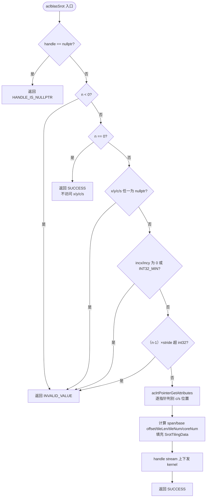
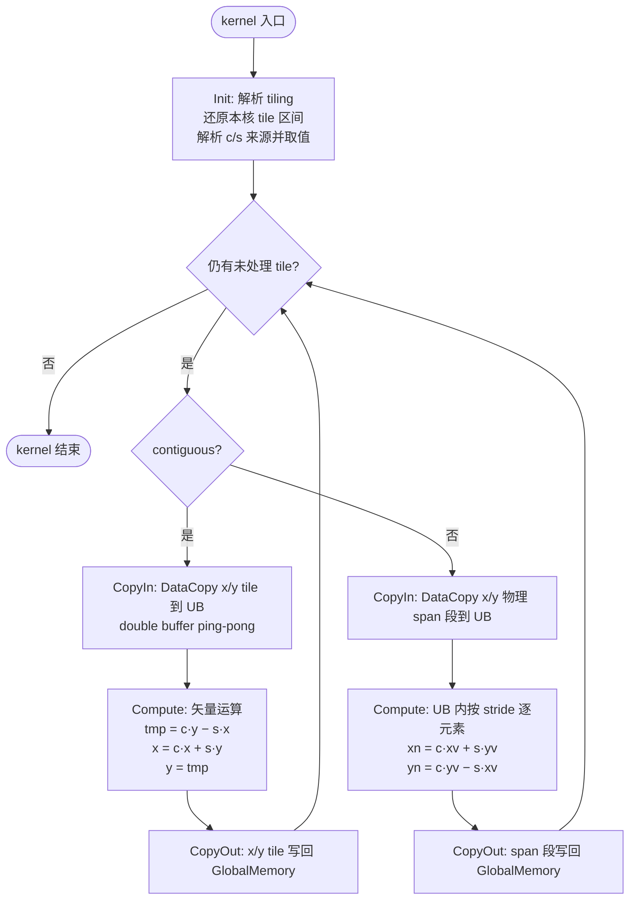

# aclblasSrot 算子设计文档

## 一、需求背景（required）

### 1.1 需求来源

本需求来自社区任务"aclblasSrot 算子开发（Atlas A2/A3）"。目标是在 Atlas A2/A3 系列产品（arch22）上使用 Ascend C 编程语言，以 kernel 直调方式实现单精度实数 Givens 平面旋转算子 `aclblasSrot`，补齐 Blas 仓 Atlas A2/A3 系列产品 BLAS-1 能力缺口。算子对标 cuBLAS `cublasSrot`，语义依据 cuBLAS 官方文档（§2.5.8）、Netlib BLAS 参考实现与仓内 950PR（arch35）既有实现，验收通过后合入昇腾算子开源仓 ops-blas（https://gitcode.com/cann/ops-blas，开发分支 master）。

实现代码合入 `blas/rot/arch22/`，测试代码合入 `test/rot/srot/arch22/`，接口声明复用仓内 `include/cann_ops_blas.h` 既有声明，不新增私有平行接口。

### 1.2 背景介绍

#### 1.2.1 aclblasSrot 算子实现优化

`aclblasSrot` 对标 cuBLAS `cublasSrot`，属于 BLAS-1 向量算子（修改平面旋转）。ops-blas 仓 `blas/rot/` 目录下 950PR（arch35）已提供 `srot_host.cpp` / `srot_kernel.cpp` 实现，Atlas A2/A3（arch22）侧尚为空白，本任务按同仓 arch22 兄弟算子的工程模式补齐 arch22 实现。

**对标基线接口及参考实现路径：**

| 项目 | 路径/链接 |
| --- | --- |
| 对标基线接口 | cuBLAS `cublasSrot`：https://docs.nvidia.com/cuda/pdf/CUBLAS_Library.pdf §2.5.8 |
| 参考实现（golden） | Netlib BLAS `srot`：https://netlib.org/blas/srot.f |
| 算子实现仓 | ops-blas 开源仓：https://gitcode.com/cann/ops-blas |
| 同族既有实现 | `blas/rot/arch35/srot_host.cpp`（入口 L242-251，strided 溢出守卫 L116-129）、`blas/rot/arch35/srot_kernel.cpp` |
| per-arch 差异说明 | `blas/rot/README.md` |
| 接口声明头文件 | `include/cann_ops_blas.h`（L448-449，与 950PR 共用声明） |
| 测试工程参考 | `test/rot/srot/arch35/`（`srot_param.h`、`srot_golden.h`、`srot_test.cpp`） |
| Ascend C 算子开发文档 | https://www.hiascend.com/document/detail/zh/CANNCommunityEdition/850/opdevg/Ascendcopdevg/atlas_ascendc_map_10_0002.html |
| 生态算子开源精度标准 | https://gitcode.com/cann/opbase/blob/master/docs/zh/ops_precision_standard/mixed_tolerance_standard.md |

#### 1.2.2 aclblasSrot 算子现状分析

##### 1.2.2.1 标杆算子支持的数据类型和数据格式

本算子对标 cuBLAS `cublasSrot`，语义参考 Netlib `srot` 参考实现。标杆算子支持的数据类型和数据格式如下：

| 参数名 | 输入/输出 | 描述 | 数据类型 | dtype 类型 | 数据排布格式 | 维度(shape) | 值域范围 | 异常行为 |
| --- | --- | --- | --- | --- | --- | --- | --- | --- |
| handle | 输入 | 库上下文句柄（内部携带 stream），Host 内存 | attr | - | - | - | aclblasCreate 返回的非空句柄 | 为 nullptr 时返回 ACLBLAS_STATUS_HANDLE_IS_NULLPTR |
| n | 输入 | 向量元素个数，Host 内存 | attr | int | - | - | 任意 int32 整数（n=0 走 no-op，不报错） | n<0 返回 ACLBLAS_STATUS_INVALID_VALUE；n=0 时 x、y 不修改，返回成功 |
| x | 输出（原地输出） | 输入兼输出，Givens 旋转原地更新，Device 内存 | tensor | FLOAT32 | ND | 一维向量，物理长度 1+(n−1)×abs(incx) 个单精度实数元素 | 全值域（含 Inf/NaN，按 IEEE 规则自然传播） | n>0 时为 nullptr 返回 ACLBLAS_STATUS_INVALID_VALUE；元素值不校验 |
| incx | 输入 | x 中相邻元素的存储步长（元素为单位），Host 内存 | attr | int | - | - | 非零 int32 整数且不为 INT32_MIN（正负步长均支持） | 为 0 或 INT32_MIN 返回 ACLBLAS_STATUS_INVALID_VALUE；(n−1)×abs(incx) 超 int32 返回 ACLBLAS_STATUS_INVALID_VALUE |
| y | 输出（原地输出） | 输入兼输出，Givens 旋转原地更新，Device 内存 | tensor | FLOAT32 | ND | 一维向量，物理长度 1+(n−1)×abs(incy) 个单精度实数元素 | 全值域（含 Inf/NaN，按 IEEE 规则自然传播） | n>0 时为 nullptr 返回 ACLBLAS_STATUS_INVALID_VALUE；元素值不校验 |
| incy | 输入 | y 中相邻元素的存储步长（元素为单位），Host 内存 | attr | int | - | - | 非零 int32 整数且不为 INT32_MIN（正负步长均支持） | 为 0 或 INT32_MIN 返回 ACLBLAS_STATUS_INVALID_VALUE；(n−1)×abs(incy) 超 int32 返回 ACLBLAS_STATUS_INVALID_VALUE |
| c | 输入 | 旋转矩阵余弦元素，Host 或 Device 内存（运行时经 aclrtPointerGetAttributes 自动判定） | scalar | FLOAT32 | - | - | 任意 FLOAT32 值（值不校验） | n>0 时为 nullptr 返回 ACLBLAS_STATUS_INVALID_VALUE |
| s | 输入 | 旋转矩阵正弦元素，Host 或 Device 内存（运行时经 aclrtPointerGetAttributes 自动判定） | scalar | FLOAT32 | - | - | 任意 FLOAT32 值（值不校验） | n>0 时为 nullptr 返回 ACLBLAS_STATUS_INVALID_VALUE |

**接口声明：**

```text
aclblasStatus_t aclblasSrot(aclblasHandle_t handle, int n, float* x, int incx,
                            float* y, int incy, const float* c, const float* s);
```

**返回值：** `aclblasStatus_t`，状态码语义与 ops-blas 仓 `include/cann_ops_blas_common.h` 定义一致。

##### 1.2.2.2 标杆算子实现描述

标杆算子为 Netlib BLAS `srot`（Fortran，golden 由 CBLAS `cblas_srot` 生成），其核心功能是对长度为 n 的向量对 (x, y) 施加 Givens 平面旋转 G = [[c, s], [−s, c]]，x、y 原地更新：

```text
x[k] = c * x[k] + s * y[j]
y[j] = −s * x[k] + c * y[j]        （等式右端 x[k] 为更新前值）
```

其中 Fortran 风格索引 `k = 1 + (i−1)*incx`、`j = 1 + (i−1)*incy`，`i = 1..n`。

Netlib 参考实现的逐元素循环体为：

```fortran
DO I = 1, N
    XTEMP = C * X(IX) + S * Y(IY)
    Y(IY) = C * Y(IY) - S * X(IX)
    X(IX) = XTEMP
    IX = IX + INCX
    IY = IY + INCY
END DO
```

即先用旧 x、旧 y 算出并覆写 y，再用暂存的 XTEMP 覆写 x；与任务书公式完全等价，且天然满足"每个元素对先读后写"的原地语义。

**关键语义要点：**

1. **原地更新**：x、y 为输入兼输出，输入旧值与输出新值复用同一入参内存，不返回视图；
2. **步长语义**：incx/incy 为元素间存储间隔；负步长自向量物理 span 尾端起算（Netlib 语义）；
3. **快速返回**：`n <= 0` 时直接返回，不访问任何指针（Netlib `IF (N.LE.0) RETURN`）；
4. **标量位置**：c、s 可为 Host 或 Device 内存指针，逐指针独立判定，二者不必同侧；
5. **无广播**：BLAS-1 向量算子，参与运算的 x、y 元素个数同为 n，不存在操作数间广播。

##### 1.2.2.3 快速返回与异常口径（任务书 §2.4/§2.5）

| 条件 | 口径 |
| --- | --- |
| handle 为 nullptr | ACLBLAS_STATUS_HANDLE_IS_NULLPTR |
| n < 0 | ACLBLAS_STATUS_INVALID_VALUE |
| n = 0 | 合法快速返回：不访问 x、y、c、s，返回 ACLBLAS_STATUS_SUCCESS |
| n > 0 且 x/y/c/s 任一为 nullptr | ACLBLAS_STATUS_INVALID_VALUE |
| incx 或 incy 为 0 或 INT32_MIN | ACLBLAS_STATUS_INVALID_VALUE |
| (n−1)×abs(stride) 超出 int32 可表示范围 | ACLBLAS_STATUS_INVALID_VALUE |
| c、s 标量值 | 不校验，Inf/NaN 按公式自然传播 |
| 异步语义 | 计算经 handle 绑定的 stream 异步下发，读输出前须同步 stream |

> 以上口径与随包测试用例（`test_cases/`）及仓内 arch35 既有实现保持一致。

## 二、需求分析（required）

### 2.1 外部组件依赖

本算子为 ops-blas 仓内 BLAS 算子，使用 Ascend C kernel 直调方式开发，外部组件依赖如下：

| 依赖组件 | 说明 |
| --- | --- |
| ops-blas 工程框架 | 提供 handle 句柄、stream 绑定、Host/Device 指针判别等基础设施 |
| Ascend C 运行时 | 提供 kernel 直调能力、AI Core 矢量执行环境（arch22） |
| CANN 9.1.0 | 适配的 CANN 版本，提供 Ascend C API 与编译工具链 |
| aclrtPointerGetAttributes | 运行时判定 c、s 指针的内存位置（Host/Device） |
| Netlib BLAS srot | 精度比对 golden 参考实现（CBLAS `cblas_srot`），随测试工程提供 |

### 2.2 内部适配模块

| 内部模块 | 说明 |
| --- | --- |
| `include/cann_ops_blas.h` | 接口声明（L448-449 既有声明），与 950PR 共用，不新增私有接口 |
| `blas/rot/arch22/` | 算子实现目录：`srot_host.cpp`（Host 侧）、`srot_kernel.cpp`（kernel 侧）、`srot_tiling_data.h`（tiling 结构体） |
| `blas/rot/README.md` | per-arch 差异表与产品支持表，新增 arch22 行 |
| handle/stream 机制 | 通过 `aclblasHandle_t` 绑定 stream，实现 kernel 直调 |
| 同族 950PR 实现 | 参照其 Host 侧参数校验、strided 溢出守卫与 Host/Device 双路径判别模式 |
| `test/rot/srot/` | 测试工程：`srot_param.h`（CSV 解析）、`srot_golden.h`（cblas_srot 包装）复用，`arch22/` 新建 |

### 2.3 需求模块设计

#### 2.3.1 Ascend C 算子原型

使用 Ascend C 编程语言实现 `aclblasSrot` 算子，对齐标杆算子 cuBLAS `cublasSrot`（语义参考 Netlib `srot`）。

**算子原型：**

```text
aclblasStatus_t aclblasSrot(aclblasHandle_t handle, int n, float* x, int incx,
                            float* y, int incy, const float* c, const float* s);
```

**参数语义对齐标杆算子：**

| 参数 | 标杆算子 cublasSrot | Ascend C 实现 | 对齐说明 |
| --- | --- | --- | --- |
| handle | cublasHandle_t | aclblasHandle_t | ops-blas 句柄，携带 stream |
| n | int | int | 向量元素个数，参数序列逐位一致，无需映射 |
| x | float*（inout） | float*（inout） | Device 内存，原地更新 |
| incx | int | int | 元素步长，正负均支持 |
| y | float*（inout） | float*（inout） | Device 内存，原地更新 |
| incy | int | int | 元素步长，正负均支持 |
| c | const float* | const float* | Host 或 Device 内存，运行时判别 |
| s | const float* | const float* | Host 或 Device 内存，运行时判别 |

**数学公式对齐标杆算子：**

```text
x[k] = c * x[k] + s * y[j]
y[j] = c * y[j] − s * x[k]        （右端 x 为更新前值）
```

**特殊分支语义对齐 Netlib srot：**

- n <= 0：直接返回，不访问任何指针；
- incx/incy 为负：逻辑元素自物理 span 尾端起算；
- c = 0 或 s = 0：按公式自然计算（c=1、s=0 为单位旋转，x、y 不变），不设特例分支。

#### 2.3.2 Ascend C 算子相关约束

与标杆算子 cuBLAS `cublasSrot` 相比，本 Ascend C 实现的功能完全对齐，无功能缺失。相关约束如下（按任务书 §2.5 口径）：

| 约束项 | 内容 |
| --- | --- |
| 参数合法性与校验层级 | handle 为 nullptr 返回 ACLBLAS_STATUS_HANDLE_IS_NULLPTR；n<0、n>0 时 x/y/c/s 为 nullptr、incx 或 incy 为 0/INT32_MIN、(n−1)×abs(stride) 超出 int32 均返回 ACLBLAS_STATUS_INVALID_VALUE；n=0 为合法快速返回；c、s 标量值不校验 |
| 非连续 Tensor 支持 | 支持：x 按 incx、y 按 incy 间隔访问（间隔元素跳过）；正负步长均生效（负步长自物理 span 尾端起算） |
| broadcast 规则 | 不涉及：BLAS-1 向量算子，无操作数间广播 |
| dynamic shape 要求 | 不要求：n、incx、incy 为运行时入参，host tiling 按运行时 n 计算，任意合法规模一次适配 |
| 原地与视图语义 | x、y 原地更新（每个元素对先读后写，第二等式的 x 取更新前值），不返回视图 |
| 确定性计算要求 | 逐元素运算输出为单次执行内确定；同输入、同步长跨次执行 bit 级一致 |
| 空 Tensor 处理 | 等价口径为 n=0：不访问向量数据、不启动计算 kernel，快速返回成功 |
| 0 维 Tensor 处理 | 不涉及：向量算子无 0 维输入，标量语义由 Host 标量入参承担 |
| 异步执行 | 计算经 handle 绑定的 stream 异步下发；c、s 指针内存位置由 aclrtPointerGetAttributes 自动判定 |

## 三、需求详细设计（required）

### 3.1 调用方式

本算子使用 **Ascend C kernel 直调方式** 开发。基于 ops-blas 开源仓工程框架，实现 `aclblasSrot` 句柄式 BLAS 接口，通过 handle 绑定 stream 直调 NPU kernel。

**调用流程：**

1. 用户调用 `aclblasSrot(handle, n, x, incx, y, incy, c, s)` 接口；
2. Host 侧（`srot_host.cpp`）进行参数校验（handle/nullptr/步长/strided 溢出守卫）；
3. 判别 c、s 指针内存位置（`aclrtPointerGetAttributes` 逐指针判定，Host/Device/mixed 三态均支持）；
4. Host 侧计算 tiling 参数（tileLen、tileNum、coreNum、每核任务区间、负步长 base offset）；
5. 通过 handle 绑定的 stream 直调 NPU kernel（`srot_kernel.cpp`）在 Device 上执行计算；
6. 返回 `aclblasStatus_t` 状态码。

**调用方式说明：** 本算子不涉及 ACLNN 框架的多分支 tilingKey infer shape 机制，也不涉及 Pytorch 框架适配，采用 ops-blas 仓 BLAS 算子标准的 kernel 直调模式，参照同族 950PR `blas/rot/arch35/srot_host.cpp` 的校验与分发模式。

### 3.2 需求总体设计

#### 3.2.1 host 侧设计

Host 侧（`srot_host.cpp`）负责参数校验、快速返回、c/s 内存位置判别、tiling 计算与 kernel 下发。

##### 3.2.1.1 参数校验与快速返回

Host 侧按以下顺序检查，确保错误码稳定可预期：

1. `handle == nullptr` → 返回 `ACLBLAS_STATUS_HANDLE_IS_NULLPTR`；
2. `n < 0` → 返回 `ACLBLAS_STATUS_INVALID_VALUE`；
3. `n == 0` → 直接返回 `ACLBLAS_STATUS_SUCCESS`，不访问 x/y/c/s，不启动 kernel；
4. `n > 0` 时 x/y/c/s 任一为 nullptr → 返回 `ACLBLAS_STATUS_INVALID_VALUE`；
5. `incx == 0 || incx == INT32_MIN || incy == 0 || incy == INT32_MIN` → 返回 `ACLBLAS_STATUS_INVALID_VALUE`；
6. strided 溢出守卫：以 int64 计算 `spanX = (int64)(n-1) * llabs((int64)incx)`、`spanY = (int64)(n-1) * llabs((int64)incy)`，任一超出 int32 可表示范围 → 返回 `ACLBLAS_STATUS_INVALID_VALUE`。

> 实现要点：`llabs((int64)INT32_MIN)` 可安全得到 2147483648，避免 `std::abs(INT32_MIN)` 的未定义行为；溢出判定必须在 int64 域完成，与仓内 arch35 的 strided 溢出守卫（`srot_host.cpp` L116-129）口径一致。

##### 3.2.1.2 c/s 内存位置判别

Host 侧对 c、s 指针分别调用 `aclrtPointerGetAttributes` 判定内存位置，结果以位图形式写入 tiling（bit0：c 在 Device；bit1：s 在 Device）：

| c 位置 | s 位置 | 位图 | kernel 取值方式 |
| --- | --- | --- | --- |
| Host | Host | 0 | 直接使用 tiling 下发的标量值 |
| Device | Host | 1 | c 由 kernel 从 GlobalMemory 读一次；s 用 tiling 值 |
| Host | Device | 2 | s 由 kernel 从 GlobalMemory 读一次；c 用 tiling 值 |
| Device | Device | 3 | c、s 均由 kernel 从 GlobalMemory 各读一次 |

Host 侧标量在 `n > 0` 时读入一次并随 tiling 下发，避免 kernel 反复访问 Host 内存；Device 侧标量由 kernel 在 `Init` 阶段读取一次到局部变量，全 tile 复用，摊薄到每 tile 的额外开销为 0。

##### 3.2.1.3 分核策略

**任务空间：** 本算子为逐元素独立的向量算子，逻辑索引 `i ∈ [0, n)` 与输出元素对 `(x[i], y[i])` 一一对应，无归约、无批次，任务空间为一维线性，总任务数即元素数 n。

**优先使用满核的原则：**

```text
tileNum = ceil(n / tileLen)
coreNum = min(platformCoreNum, tileNum)
base    = tileNum / coreNum
rem     = tileNum % coreNum
```

前 `rem` 个核每核多处理 1 个 tile（`base + 1` 个），其余核处理 `base` 个 tile。由于 `coreNum <= tileNum`，必有 `base >= 1`，不存在空闲核。

**每核任务区间：** 第 `coreIdx` 核的 tile 区间 `[startTile, endTile)` 由 Host 侧按同一公式约定，kernel 侧按公式还原，不逐核展开存储：

```text
startTile = coreIdx * base + min(coreIdx, rem)
endTile   = startTile + base + (coreIdx < rem ? 1 : 0)
```

**边界 case 处理：**

- `n <= tileLen`（小向量，如 n=1/8/33）：`tileNum = 1`，`coreNum = 1`，单核单 tile，无多核调度开销；
- `n` 极大（如 n=4194304）：`coreNum` 取满平台核数，靠每核多 tile 吸收负载；
- 核间能均分（`rem == 0`）时，大核小核数据块一致，无大小核区分。

##### 3.2.1.4 数据分块和内存优化策略

**充分使用 UB 空间的原则。** 单核内切分大小由平台 UB 容量（`GetCoreMemSize` 查询，arch22 以查询返回为准）、是否开启 double buffer、kernel 侧所需 buffer 数综合决定，不写死任何平台的 UB 数值。

**索引映射（Host 与 Kernel 一致）：**

```text
逻辑索引 i 的物理偏移：
    offX(i) = xBaseOffset + i * incx
    offY(i) = yBaseOffset + i * incy
    xBaseOffset = (incx < 0) ? (n-1) * (-incx) : 0
    yBaseOffset = (incy < 0) ? (n-1) * (-incy) : 0
```

负步长时，逻辑首元素落在物理 span 尾部，末元素落在 span 头部，偏移单调递减，与 Netlib 语义一致。

**tileLen 计算（按访存路径分档）：**

| 路径 | 触发条件 | UB 内 buffer | tileLen 公式 |
| --- | --- | --- | --- |
| 连续路径 | `incx == 1 && incy == 1` | xLocal、yLocal、tmp 各 BUFFER_NUM 份（double buffer） | `(ubAvail - reserve) / (BUFFER_NUM * 3 * sizeof(float))`，按 32B（8 元素）对齐 |
| 通用路径 | 其余（任一 abs(stride) != 1） | xSpan、ySpan、tmp 各 1 份（不开 double buffer） | `(ubAvail - reserve) / (3 * (abs(incx)+abs(incy)) * sizeof(float))`，钳制下限 1 |

通用路径的 UB 占用与步长成正比：步长越大，单 tile 可容纳的逻辑元素越少；当 `abs(incx)+abs(incy)` 超过预算时 tileLen 退化为 1，逐元素处理。该类组合受 strided 溢出守卫约束（`(n-1)*abs(inc) <= INT32_MAX`），只会出现在 n 较小的非性能用例中，正确性不受影响。

**批量搬运：** 连续路径下一个 tile 一次性完成 x、y 两段 DataCopy 搬入、两段 DataCopy 搬出，搬运次数为 `tileNum * 2`（而非 `n * 2`），冗余开销随 tileLen 增大而摊薄。尾 tile 长度不足时按实际剩余长度搬运，与标准 tile 走同一套流程，不产生数据碎片。

**double buffer 流水：** 连续路径开启 double buffer，第 i 个 tile 的计算与第 i+1 个 tile 的搬入流水重叠，掩盖 GlobalMemory 访问延迟。本算子为纯访存密集型负载（每元素读 8B、写 8B，仅 4 乘 2 加），带宽利用率是性能决定性因素，double buffer 为必选优化。

**tmp buffer 的必要性：** `x' = c*x + s*y` 与 `y' = c*y - s*x` 均依赖旧 x、旧 y，两个新值必须同时存在后才能覆写输入，因此无法把 UB buffer 压到 2 个；采用 3 个逻辑 buffer（xLocal、yLocal、tmp），物理份数 = 3 × BUFFER_NUM。

##### 3.2.1.5 tilingKey 规划策略

tilingKey 用于让 kernel 侧按 host 侧已知的访存模式走不同分支，避免每 tile 重复判断：

| tilingKey | 含义 | kernel 路径 |
| --- | --- | --- |
| 0 | 连续路径（`incx == 1 && incy == 1`） | 矢量运算 + double buffer 流水 |
| 1 | 通用路径（任一 abs(stride) != 1） | span 段搬入 + UB 内按步长索引 |

c/s 来源（tiling 标量值 / Device GlobalMemory）不编入 tilingKey，由 tiling 内 `csOnDevice` 位图在 `Init` 阶段一次性解析为 kernel 局部变量：该信息每 tile 都会使用，放在 tiling 字段中由 Init 统一收敛，比拆分成更多 tilingKey 更简洁，且不增加每 tile 分支。

##### 3.2.1.6 TilingData 设计

`SrotTilingData` 结构体（host/kernel 共享，定义于 `srot_tiling_data.h`）：

| 字段 | 类型 | 说明 |
| --- | --- | --- |
| `totalNum` | int64 | n，逻辑元素总数（int64 防中间计算溢出） |
| `tileNum` | int32 | tile 总数 = ceil(n / tileLen) |
| `tileLen` | int32 | 标准 tile 元素数 |
| `tailLen` | int32 | 尾 tile 元素数（= n - (tileNum-1)*tileLen） |
| `coreNum` | int32 | 实际参与计算的 AI Core 数 |
| `baseTilePerCore` | int32 | 每核基准 tile 数 |
| `remTile` | int32 | 前 remTile 个核多 1 个 tile |
| `incx`、`incy` | int32 | 步长原值（含符号） |
| `xBaseOffset`、`yBaseOffset` | int64 | 负步长起点偏移（元素为单位） |
| `cHost`、`sHost` | float | Host 侧标量值（Device 来源时无效） |
| `cDevPtr`、`sDevPtr` | __gm__ float* | Device 侧标量指针（Host 来源时为空） |
| `csOnDevice` | uint32 | bit0：c 在 Device；bit1：s 在 Device |
| `contiguous` | uint32 | 1：连续路径；0：通用路径 |

**Workspace 设计：** 本算子所有路径均不需要额外 workspace（x、y 原地更新，无临时矩阵、无归约累加器）。kernel 内部仅使用 UB 临时 buffer，大小由 tileLen 决定，不向 Host 暴露。

#### 3.2.2 kernel 侧设计

kernel 侧（`srot_kernel.cpp`）采用 `Init` + `Process` 结构。`Process` 中遍历本核分配的 tile 区间，每个 tile 按 `CopyIn` → `Compute` → `CopyOut` 执行。

##### 3.2.2.1 Init 阶段

1. 解析 `SrotTilingData`，还原本核 tile 区间 `[startTile, endTile)`；
2. 按 `csOnDevice` 位图确定 c、s 取值来源：Host 来源取 `cHost`/`sHost`，Device 来源从 `cDevPtr[0]`/`sDevPtr[0]` 读取一次，存入 kernel 局部变量 `cVal`、`sVal`，并预计算 `negS = -sVal`；
3. 计算每 tile 的物理 span 起点偏移。

##### 3.2.2.2 连续路径（tilingKey = 0）

**CopyIn：** 以 tile 为单位，将 x、y 两段连续数据搬入 UB：

```text
offX = xBaseOffset + t * tileLen        // incx == 1
offY = yBaseOffset + t * tileLen        // incy == 1
len  = (t == tileNum - 1) ? tailLen : tileLen
DataCopy(xUB[ping], xGM + offX, len)
DataCopy(yUB[ping], yGM + offY, len)
```

**Compute：** 使用 Ascend C 矢量接口完成逐元素旋转，计算顺序保证旧值先于覆写被读取：

```text
// 1) 先算 y'（依赖旧 x、旧 y，此时 xUB/yUB 均未被修改）
Mul  (tmp,  yUB, cVal, len)              // tmp  = c * y
Axpy (tmp,  xUB, negS, len)              // tmp  = -s * x + c * y = y'
// 2) 再算 x'（旧 y 仍完好）
Muls (xUB,  xUB, cVal, len)              // xUB  = c * x
Axpy (xUB,  yUB, sVal,  len)             // xUB  = s * y + c * x = x'
// 3) y' 落位
DataCopy(yUB, tmp, len)                  // yUB  = y'
```

**CopyOut：** 将更新后的 x、y 两段数据写回原地址：

```text
DataCopy(xGM + offX, xUB, len)
DataCopy(yGM + offY, yUB, len)
```

**流水：** 相邻 tile 间以 ping/pong 两组 UB buffer 交替，`CopyIn(t+1)` 与 `Compute(t)`、`CopyOut(t)` 重叠。

##### 3.2.2.3 通用路径（tilingKey = 1）

**设计取舍：** 非连续步长下 GlobalMemory 上每次只访问 4B 有效数据却占一个 cache sector，若逐元素直接访问 GM 会严重浪费带宽。本路径将 strided 访存收敛到 UB：按 tile 逻辑区间对应的**物理 span 段连续搬入**，再在 UB 内以步长索引访问。

**CopyIn：**

```text
spanStartX = xBaseOffset + t * tileLen * incx + (incx < 0 ? (len-1) * incx : 0)
spanStartY = yBaseOffset + t * tileLen * incy + (incy < 0 ? (len-1) * incy : 0)
spanLenX   = (len - 1) * abs(incx) + 1
spanLenY   = (len - 1) * abs(incy) + 1
DataCopy(xUB, xGM + spanStartX, spanLenX)
DataCopy(yUB, yGM + spanStartY, spanLenY)
```

span 起点取本 tile 逻辑区间物理偏移的较小端，保证 `DataCopy` 的地址连续；span 内第 `i` 个逻辑元素固定位于偏移 `i * abs(inc)` 处，正负步长由此统一。

**Compute：** UB 内按步长索引逐元素旋转（先读旧值、算毕、后覆写）：

```text
for i in [0, len):
    xv = xUB[i * abs(incx)]
    yv = yUB[i * abs(incy)]
    xUB[i * abs(incx)] = cVal * xv + sVal * yv
    yUB[i * abs(incy)] = cVal * yv + negS * xv
```

**CopyOut：** span 段整体写回原地址（与 CopyIn 同址同长）。

通用路径不开 double buffer：该路径面向功能覆盖（步长维度），非性能判据路径；span 长度随 tile 与步长变化，双 buffer 会使 UB 预算与尾 tile 处理显著复杂化，收益不匹配。

##### 3.2.2.4 Ascend C 实现流程图

Host 侧入口流程：



kernel 侧流程：



##### 3.2.2.5 Ascend C 实现与标杆算子流程的差异点和原因

| 差异点 | 标杆算子（Netlib srot） | Ascend C 实现 | 原因 |
| --- | --- | --- | --- |
| 执行环境 | CPU 上直接访问内存 | NPU Device 上执行，需 CopyIn/CopyOut 数据搬运 | Ascend C kernel 在 NPU 上执行，数据需在 GlobalMemory 与 UB 间搬运 |
| 数据搬运 | 无显式搬运 | tile 级批量 DataCopy（连续路径）/ span 段批量 DataCopy（通用路径） | 编程模型要求；批量搬运摊薄单次搬运开销 |
| 访存模式 | 标量指针 + 步长寻址，逐元素串行 | 连续路径整段矢量化；通用路径 span 搬入 + UB 内步长索引 | 连续场景（含全部性能用例）带宽利用率是关键；非连续场景把 strided 收敛到 UB 避免 GM 带宽浪费 |
| 并行度 | 单线程串行循环 | 多 AI Core 按 tile 均分 + double buffer 流水 | NPU 多核并行是性能来源；访存密集型负载需流水掩盖延迟 |
| 标量来源 | c、s 为 Host 值直接参与运算 | Host 值随 tiling 下发；Device 值由 kernel Init 阶段读一次 | 接口允许 c、s 位于 Host 或 Device，需两路取值统一收敛 |
| 浮点运算接口 | Fortran 内建乘加 | Ascend C 矢量接口（Mul/Muls/Axpy） | 编程语言差异，数学语义完全一致 |
| 计算逻辑 | `XTEMP = c*x + s*y; y = c*y - s*x; x = XTEMP` | `tmp = c*y - s*x; x = c*x + s*y; y = tmp` | 均满足"先读旧值后覆写"的原地语义，两式互换顺序不影响结果 |

**核心结论：** Ascend C 实现与标杆算子在**计算逻辑（数学公式、原地更新语义、步长语义、特殊分支口径）上完全一致**，差异仅源于执行环境（CPU vs NPU）和编程模型（Fortran vs Ascend C）的固有不同，体现为数据搬运阶段、并行切分与接口选型，不影响数学正确性。

### 3.3 支持硬件

| 支持的芯片版本 | 涉及勾选 |
| --- | --- |
| Atlas 800I/T A2（910B3） | √ |
| Atlas 800T A3（arch22） | √ |

与《算子任务书》要求支持的硬件保持一致，本算子适配 Atlas A2/A3 系列产品（arch22），CANN 版本 9.1.0，性能测试设备为 Atlas 800T A2（910B3）。arch22 实现与仓内 arch35 实现同目录分层、行为口径一致，差异仅在于 arch 专属实现与测试工程。

### 3.4 算子约束限制

| 约束项 | 内容 |
| --- | --- |
| 支持数据类型 | 仅 FLOAT32（x、y 向量与 c、s 标量全部为 FLOAT32，对标 `cublasSrot` 单精度口径）；不支持 FLOAT16/BFLOAT16/复数等其他 dtype |
| 支持形状 | 一维向量，物理长度 `1+(n-1)*abs(inc)`；无 0 维输入 |
| 步长约束 | incx/incy 必须为非零且非 INT32_MIN 的 int32；`(n-1)*abs(stride)` 不得超出 int32 可表示范围 |
| 标量内存位置 | c、s 可为 Host 或 Device 内存，逐指针独立判定，允许混合（mixed） |
| broadcast 规则 | 不涉及 |
| dynamic shape 要求 | 不要求；n、incx、incy 为运行时入参，host tiling 按运行时 n 计算 |
| 原地与视图语义 | x、y 原地更新，不返回视图；x 与 y 的逻辑访问区域不得重叠（BLAS 族通用约束，重叠时行为未定义） |
| 异步执行 | 计算经 handle 绑定的 stream 异步下发，读输出前须 `aclrtSynchronizeStream` |
| Workspace | 所有路径均不需要额外 workspace |
| 通用路径性能 | 大步长场景 tileLen 退化，执行效率低于连续路径；该路径仅覆盖功能维度，不纳入性能判据 |

## 四、特性交叉分析

本算子仅支持 FLOAT32 单一 dtype、一维向量单一形状、无广播、无多排布格式，特性维度简单，但仍需确认各维度组合下的覆盖完整性：

| 特性维度 | 是否涉及 | 说明 |
| --- | --- | --- |
| 数据类型交叉 | 否 | 仅 FLOAT32 一种 dtype，x/y/c/s 类型固定，无 dtype 组合 |
| shape 交叉 | 是（轻量） | n 与步长的组合决定物理 span：n ∈ {0,1,2,3,1024,16384,262144,1048576}（精度）/ 至 4194304（性能）× incx/incy ∈ {±1,±2,±7,0}；连续与通用两条路径即由该交叉触发 |
| 步长符号交叉 | 是 | incx/incy 正负四种组合（正正、正负、负正、负负）均需覆盖，负步长起点由 base offset 统一处理 |
| 标量内存位置交叉 | 是 | c/s 位置 host/device/mixed 三态 × 取值 {0.6,1.0,0.0,-0.5}，由 `cs_ptr_mode` 列驱动 |
| broadcast 交叉 | 否 | BLAS-1 向量算子，无操作数间广播 |
| 排布格式交叉 | 否 | 仅 ND 一维向量 |
| 0 维/空 Tensor | 否 | 无 0 维输入；空语义等价于 n=0 快速返回 |

交叉结论：核心交叉为「步长符号 × 标量位置 × 尺寸」，测试用例的 TC_INC / TC_CSM / TC_EX 三个类别即按此设计，确保每一维度组合均有用例覆盖。

## 五、可维可测分析

### 5.1 精度标准/性能标准

#### 精度标准

**精度比对 golden：** 由 Netlib BLAS `srot.f` 的 CPU 单元实现（CBLAS `cblas_srot`，float32 直接计算并落盘）生成，与仓内 `srot_golden.h` 的 `cblas_srot` 一致。

**判定对象：** x 与 y（Givens 旋转原地更新后的两个 FLOAT32 向量，两向量分别判定）。

**精度阈值（生态算子开源精度标准 mixed_tolerance 口径，FLOAT32 行）：**

| 数据类型 | rtol | atol | required_matched_ratio | max_abs_error_limit |
| --- | --- | --- | --- | --- |
| FLOAT32 | 2^-13 (1.2e-4) | 2^-13 (1.2e-4) | 0.99 | 1e-2 或 32 * ULP |

逐元素通过条件：`|actual - golden| <= atol + rtol * |golden|`。

**精度判定公式：** 当用例同时满足 `matched_ratio >= required_matched_ratio` 且 `max_abs_error <= max_abs_error_limit` 时，判定该用例精度通过。

**Inf/NaN 特殊值判定规则：** 当 golden 或 NPU 输出中出现 Inf/NaN 时，不适用上述判定式：golden 与 actual 同为 NaN、同为同号 Inf，或一方为 NaN 而另一方为 ±Inf，视为等效，判定通过；一方为有限值、另一方为 Inf/NaN，判定不通过。非有限值元素不计入 matched_ratio 与 max_abs_error 统计，单独记录非有限值元素总数及其中判定通过数；用例通过条件为有限值元素满足 matched_ratio ≥ 0.99 且 max_abs_error ≤ max_abs_error_limit，且非有限值元素全部按上述规则判定通过。

**精度标准来源：** 生态算子开源精度标准（mixed_tolerance，https://gitcode.com/cann/opbase/blob/master/docs/zh/ops_precision_standard/mixed_tolerance_standard.md ），不低于 Netlib srot 参考实现。

**数值一致性说明：** golden 与本实现使用同一公式（`x' = c*x + s*y`、`y' = c*y - s*x`），逐元素两个乘积与一个加法的组合方式一致；NPU 侧若将乘加融合为 FMA，与 CPU 的分别乘加存在约 1 ULP 差异，远小于 2^-13 容差，不影响判定。

#### 性能标准

**测试设备：** Atlas 800T A2（910B3）。性能数据为 FLOAT32 输入场景下的平均单次耗时（Avg time，单位 us），有效采样 ≥10 次取平均。

**采集方式：** 采用 msprof op 模式采集单算子 task duration（单位 us）作为单次耗时；msprof op 自带 5 次 warmup，warmup 不计入样本；warmup 后连续执行 ≥10 次作为有效样本（异常返回样本不计入并在自测报告中说明）。GTest 侧以 `aclrtEvent` 夹住连续下发取 `avg_us`（已排除 H2D/D2H、host 造数与 golden 比对），用于快速回归；msprof 的 kernel task duration 用于精确核时交叉验证。

**判据：** 平均单次耗时不高于 GPU 标杆耗时的 1.25 倍（即达到标杆 0.8 倍以上性能），即 `NPU Avg time <= gpu_ms / 0.8`。

**性能数据参考（`test_cases/gpu_baseline.csv`，NVIDIA A100-SXM4-80GB / CUDA 12.8 / cuBLAS 12.8.4 实测，warmup 5 后取有效采样均值）：**

| case | n | incx | incy | c | s | GPU 标杆耗时（us） | NPU 判据上限（us） |
| --- | --- | --- | --- | --- | --- | --- | --- |
| srot-base-000 | 1048576 | 1 | 1 | 0.6 | 0.8 | 16.5717334 | 20.7146668 |
| srot-base-001 | 2097152 | 1 | 1 | 0.6 | 0.8 | 25.0709335 | 31.3386669 |
| srot-base-002 | 4194304 | 1 | 1 | 0.6 | 0.8 | 48.8277345 | 61.0346681 |

**性能特征分析：** 本算子为纯访存密集型负载，每元素读 x/y 各 4B、写 x/y 各 4B（合计 16B/元素），计算仅 4 乘 2 加。以 n=1048576 为例，总访存 16MB，标杆 16.57us 对应约 965 GB/s 有效带宽，NPU 侧判据上限 20.7us 对应约 772 GB/s。连续路径采用 double buffer 流水 + 大 tile 批量搬运 + 满核均分，目标是将 GlobalMemory 带宽利用率拉到高位，满足判据。

### 5.2 自测用例设计

在 ops-blas 仓 `test/rot/srot/arch22` 新建测试工程（CSV 用例描述 + C++ GTest 加载执行），随包用例 `test_cases/srot_test.csv` 共 1200 条（精度 1000 条 + 性能 200 条；本算子仅 FLOAT32 一个 dtype 面，全部条数归入 FLOAT32）。

**用例分类（`test_cases/README.md`）：**

| 类别 | 前缀 | 条数 | 说明 |
| --- | --- | --- | --- |
| L0 基础 | TC_L0 | 12 | n ∈ {1, 8, 33} × 步长 (1,1)/(2,1)/(1,2)/(2,3) |
| 尺寸扫描 | TC_SQ | 38 | 38 种尺寸（1 → 1048576），incx=incy=1，填充轮转 |
| 步长 | TC_INC | 21 | 正步长 3×3、负步长各 3 条、双负、正负混合、零步长 3 条 |
| c/s 取值 | TC_CS | 22 | 11 组 (c,s)（单位旋转/90°/普通/取反/大值/极小值/Inf/NaN）× 2 尺寸 |
| c/s 指针位置 | TC_CSM | 11 | host/device/mixed × 3 组取值 + device/mixed × 非连续步长 |
| 填充模式 | TC_FL | 24 | 6 种填充 × x/y 各 1 次 × 2 尺寸 |
| 边界负向 | TC_ED | 17 | n=0/负 n no-op、x/y 空指针 3 条、步长乘积 int32 溢出 3 条 |
| 扩展 | TC_EX | 855 | 尺寸 × 步长 × c/s × 指针位置 × 填充的确定性采样 |
| 性能 | TC_PF | 200 | 3 条任务书典型 case + 小尺寸延迟区 + 规模扫描 + 特殊填充 + 混合 |

**用例入参生成规则（任务书 §3.5）：**

| 参数名 | Tensor 值域分布 | Attr 覆盖规则 |
| --- | --- | --- |
| handle | - | 合法句柄（正常域）与 nullptr（负向域，测试工程覆盖） |
| n | - | {0, 1, 2, 3, 1024, 16384, 262144, 1048576}、n<0 负向；跨步组合含溢出负向（n=1048577 且 incx=4096、n=65537 且 incy=65536、n=4 且 incx=INT32_MIN） |
| x | 均匀分布 [-5,5] 占 50%、正态分布（μ∈[-5,5]，σ∈[0.1,2]）占 50%，全值域含 Inf/NaN | - |
| incx | - | {1, 2, 7, -1, -3}；跨步溢出负向同上 |
| y | 同 x | - |
| incy | - | {1, 2, 7, -1, -3}；跨步溢出负向同上 |
| c | - | {0.6, 1.0, 0.0, -0.5}（值不校验） |
| s | - | {0.6, 1.0, 0.0, -0.5}（值不校验） |

**用例分层：** 边界域（n=0、n=1、c=0 与 s=0、负步长）；负向域（handle 为 nullptr、n<0、n>0 时 x/y/c/s 为 nullptr、incx 或 incy 为 0/INT32_MIN、步长溢出）。

**正态分布用例补充要求：** 随包 `gen_csv.py` 默认仅以均匀分布 `RANDOM_NORM_5_5`（[-5,5]）生成用例；任务书要求的正态分布用例（μ∈[-5,5]、σ∈[0.1,2]，填充 token 为 `GAUSS_NORM_5_2`）需开发者补充，可通过 `gen_csv.py --dist mixed` 或单独补充 CSV 用例实现，并纳入精度自验证。

**负向用例缓冲区分配规则：** 期望返回非 `ACLBLAS_STATUS_SUCCESS` 的用例，测试工程不得按 `(n-1)*abs(incx)`（及 `(n-1)*abs(incy)`）预分配输入缓冲区——`INT32_MIN` 步长与 `(n-1)*|inc|` 的规模乘积在 int 域即溢出，元素数可达数十亿，测试工程会因自身分配失败而误判接口行为。此类用例须以单元素 dummy 缓冲区（或 NULLPTR）占位，由接口在读取数据前返回预期错误码即判定通过。

**负向用例期望返回码：**

| 场景 | 期望 |
| --- | --- |
| `handle == nullptr` | ACLBLAS_STATUS_HANDLE_IS_NULLPTR |
| `n < 0` | ACLBLAS_STATUS_INVALID_VALUE |
| `n > 0` 时 x/y/c/s 为 nullptr | ACLBLAS_STATUS_INVALID_VALUE |
| `incx == 0 || incx == INT32_MIN || incy == 0 || incy == INT32_MIN` | ACLBLAS_STATUS_INVALID_VALUE |
| `(n-1)*abs(incx)` 或 `(n-1)*abs(incy)` 超出 int32 | ACLBLAS_STATUS_INVALID_VALUE |
| `n == 0` | ACLBLAS_STATUS_SUCCESS（no-op，不访问指针） |

### 5.3 兼容性分析

本算子为 ops-blas 仓新增 arch22 实现，接口声明复用 `include/cann_ops_blas.h` 既有声明（L448-449），不修改公共结构体布局、枚举值、参数顺序或导出符号。

| 兼容性维度 | 分析 |
| --- | --- |
| 接口兼容性 | 复用既有声明，与 cuBLAS `cublasSrot` 参数序列逐位一致，无需额外映射说明；不新增 950PR/arch22 私有平行接口 |
| 向后兼容性 | 新 arch 实现，不涉及向后兼容；不改动 arch35 既有实现与行为 |
| 跨产品线兼容性 | 接口声明为各产品线共用；实现放在 `blas/rot/arch22/`（Atlas A2/A3 专属 arch 目录），与 arch35 同目录分层 |
| 同族算子兼容性 | 参照 arch35 `srot_host.cpp`/`srot_kernel.cpp` 的实现模式，保持仓内 BLAS 算子实现风格一致 |
| 构建兼容性 | `test/rot/srot/CMakeLists.txt` 需在 arch22 分支注册 GTest（当前仅 arch35 分支注册，A2/A3 构建会退回非 GTest runner，输出整数毫秒，无法满足 §3.3 精度采集口径） |
| README 更新 | `blas/rot/README.md` 产品支持表新增 `aclblasSrot` 并标注 Atlas A2/A3：支持 |

### 5.4 风险与应对

| 风险 | 影响 | 应对 |
| --- | --- | --- |
| 原地更新顺序错误 | 第二等式读到已覆写的新 x，结果错误且仅部分元素异常 | kernel 侧显式采用 tmp buffer 中转，TC_L0/TC_EX 小 n 用例可直接观察 |
| 负步长起点偏移计算错误 | 访问越界或取错元素，表现为少量元素值异常 | Host 统一计算 base offset 并传入 kernel；TC_INC 负步长 8 条专项覆盖 |
| 大步长 tileLen 退化 | 通用路径逐元素处理，小 n 用例性能差 | 该路径不纳入性能判据；性能用例固定 incx=incy=1 |
| UB 预算估算偏差 | 编译失败或运行期越界 | tileLen 由 `GetCoreMemSize` 动态计算并预留 reserve；分档公式分别核算 buffer 份数 |
| 多核负载不均 | 尾核空闲、性能下降 | `tileNum` 均分 + 前 remTile 个核多 1 个 tile；核数取 `min(platformCoreNum, tileNum)` |
| 异步返回后未同步 | Host 读到未完成数据 | 测试工程读回前统一 `aclrtSynchronizeStream`；自验报告记录同步点 |
| 上游主干继续变化 | 合并冲突 | 代码 PR 前同步最新 master，重新执行编译与正确性准入 |

### 5.5 可观测性分析

1. **分核可观测**：tiling 字段包含 `tileNum`、`coreNum`、`baseTilePerCore`、`remTile`、`tileLen`、`tailLen`，可在日志中打印，便于定位负载不均衡与尾 tile 处理异常；
2. **路径可观测**：`contiguous` 字段与 tilingKey 对应，连续/通用两条路径可通过 tilingKey 独立计数，单元测试可断言各路径均被执行；
3. **标量来源可观测**：`csOnDevice` 位图可断言 host/device/mixed 三态均被覆盖；
4. **精度可观测**：x、y 两向量分别统计 matched_ratio 与 max_abs_error，失败用例可按 GTest 名称与 CSV 行号定位到具体用例参数。

## 六、参考资料

1. aclblasSrot 算子任务书（Atlas A2/A3）：`task/Readme.md`；
2. cuBLAS 官方文档（对标接口语义与返回码，§2.5.8）：https://docs.nvidia.com/cuda/pdf/CUBLAS_Library.pdf ；
3. Netlib BLAS srot（golden 语义）：https://netlib.org/blas/srot.f ；
4. ops-blas 仓 rot 目录（既有实现与 README，含 per-arch 差异说明）：https://gitcode.com/cann/ops-blas/tree/master/blas/rot ；
5. ops-blas 仓编译与运行样例：https://gitcode.com/cann/ops-blas/blob/master/docs/zh/develop/compile_and_run_example.md ；
6. 生态算子开源精度标准（mixed_tolerance）：https://gitcode.com/cann/opbase/blob/master/docs/zh/ops_precision_standard/mixed_tolerance_standard.md ；
7. 社区任务设计模板：`04_tasks/01_community-task-2026/resources/design_template.md`；
8. 随包测试用例说明：`test_cases/README.md`（用例分类、CSV 列格式、精度/性能采集口径）。


