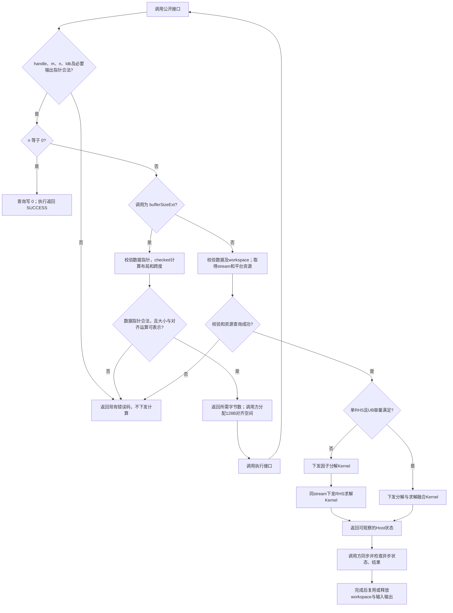
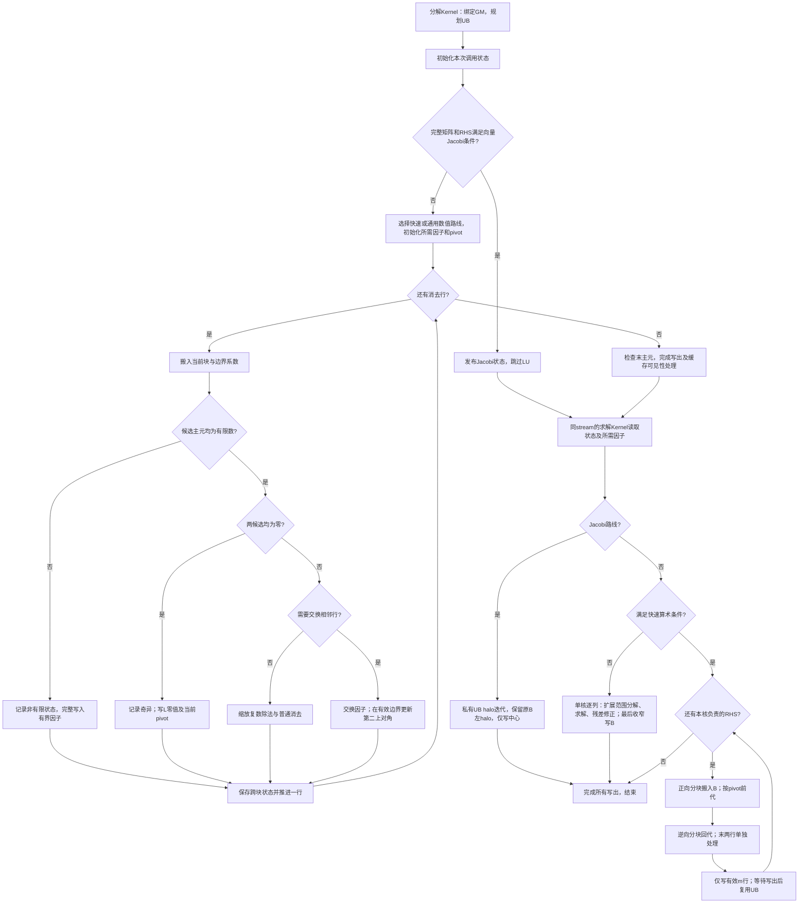

# aclsparseCgtsv2（A2/A3）算子设计文档

## 需求背景（required）

### 需求来源

[10月社区任务-aclsparseCgtsv2算子开发（A2/A3）](https://www.hiascend.com/activities/task-center/details/b8289b3a952d4e13a9e79c3a242a8338?menu=tasks)要求使用 C++、Ascend C 和 ops-sparse 工程，在 Atlas A2/A3 上新增 complex64 三对角线性方程组求解能力。接口与能力对标 CUDA Toolkit 13.3 Update 1 文档中的 `cusparseCgtsv2`，核心计算通过 NPU Dispatch 执行。

设计依据包括当前下载任务书、`test_cases/atk/` 的 Tensor/Attr YAML、约束插件及比较器、`test_cases/common/` 的输入与参考实现，以及 `test_cases/performance/` 的203条冻结用例、GPU基线和采集器。实现目标仓库为 `cann/ops-sparse` 的 `master`；设计文档按社区流程提交至 `cann/cann-ops-competitions` 对应任务与贡献者目录的 `docs/design.md`。

### 背景介绍

#### 现有实现与复用边界

当前 ops-sparse 的 `sparse/gtsv2/arch22/` 已有实数 Sgtsv2 的 Host、分解与求解 Kernel、单 RHS 融合路径及大尺寸处理，可参考其 handle/stream、UB/GM 搬运、写入所有权和测试接入方式。Cgtsv2 需新增复数运算、公开类型及独立接口；不能通过改变 `aclsparseSgtsv2(float*)` 的参数类型完成扩展。

公共头已有 `aclsparseComplex {float x; float y;}`。本任务要求 `aclsparseComplex_t` 提供 `real/imag` 字段，计划新增独立结构体，保留原类型和实数接口。两种结构体布局兼容不表示它们是同一 C++ 类型，不能任意转换指针后混用。

#### 算子功能分析

算子求解一个复数三对角矩阵 A 对应的 n 列右端项，n 是 RHS 数，不是 batchCount。输入 `dl/d/du` 只读，解 X 原地写回 B 的有效区域。采用带相邻行部分选主元的消去过程，保留换行产生的第二上对角，再前代、回代；不能仅实现无主元 Thomas 算法。

#### 任务包与验证边界

| 材料 | 设计用途与约束 |
| --- | --- |
| 任务书 | 公开 ABI、动态尺寸、目标平台、精度/性能/内存及交付要求 |
| 发布精度200条及额外800配置 | 使用官方 ATK 原生生成与执行，两组分别验证 |
| full、special、contract 配置 | 完整有限因子域、非有限分类及适配层拒绝，分别审计与运行 |
| 冻结性能203条与 GPU CSV | 保持原输入构造、顺序、种子和性能门槛，逐例配对 |
| ATK BaseApi 与公共调用层 | 规定真实 NPU 注册点、B 恢复、Golden 和采集边界；注册适配由开发者实现 |

全部任务书要求、全部规定用例及所有必需平台均应形成达标证据。元数据覆盖、目标编译、接口返回、设备精度、性能阈值和官方验收分别记录，不以其中一项替代其他项。

## 需求分析（required）

### 需求描述

计划采用 aclsparse Legacy C++ API 直接调度 arch22 Ascend C Kernel，实现 complex64、部分选主元、单/多 RHS、B 原地更新、workspace 查询及异步 stream 执行。调用方按查询值分配128字节对齐工作区，在同一 stream 的计算完成后复用或释放。

### 接口与参数分析

#### 公开类型及接口

```cpp
typedef struct {
    float real;
    float imag;
} aclsparseComplex_t;

aclsparseStatus_t aclsparseCgtsv2_bufferSizeExt(
    aclsparseHandle_t handle, int m, int n,
    const aclsparseComplex_t *dl, const aclsparseComplex_t *d,
    const aclsparseComplex_t *du, const aclsparseComplex_t *B,
    int ldb, size_t *pBufferSizeInBytes);

aclsparseStatus_t aclsparseCgtsv2(
    aclsparseHandle_t handle, int m, int n,
    const aclsparseComplex_t *dl, const aclsparseComplex_t *d,
    const aclsparseComplex_t *du, aclsparseComplex_t *B,
    int ldb, void *pBuffer);
```

编译期应断言 `sizeof(aclsparseComplex_t)==8`、`alignof(aclsparseComplex_t)==alignof(float)`，并核对两个字段的偏移分别为0和4；C++ UT 补充 standard-layout 和 trivially-copyable 检查。声明使用公共头既有导出及语言链接约定。

#### 输入、输出和属性

| 参数 | 角色 | 类型 | Shape / 布局 | 约束与行为 |
| --- | --- | --- | --- | --- |
| `handle` | 输入 | `aclsparseHandle_t` | 标量 | 有效句柄，提供执行 stream |
| `m` | 属性 | int32 | 标量 | `m>=3`，三对角系统阶数 |
| `n` | 属性 | int32 | 标量 | `n>=0`，RHS列数；0为空操作 |
| `dl` | 输入，只读 | complex64 | 连续 `[m]` | `dl[0]=0+0i`；n>0时非空 |
| `d` | 输入，只读 | complex64 | 连续 `[m]` | 主对角；n>0时非空 |
| `du` | 输入，只读 | complex64 | 连续 `[m]` | `du[m-1]=0+0i`；n>0时非空 |
| `B` | 查询时只读，执行时输入输出 | complex64 | 列主序 `[ldb,n]` | n>0时非空；有效m行原地写回，padding不变 |
| `ldb` | 属性 | int32 | 标量 | `ldb>=max(1,m)`，列跨度 |
| `pBufferSizeInBytes` | 独立输出 | `size_t*` | Host标量指针 | 非空；查询不计算、不修改B；n0写0 |
| `pBuffer` | 工作区 | `void*` | 连续字节地址 | n>0时按query足量分配，地址128B对齐；n0不要求 |

元素地址为 `B[i+j*ldb]`，其中 `0<=i<m,0<=j<n`；`m<=i<ldb` 为保留区。没有独立 X、batchCount、广播、转置视图或任意 stride 入口。m/n/ldb 是运行时参数，不能将性能清单的尺寸上限当作公开 ABI 上限。

raw ABI 无法获知实际 dtype、分配容量或 Tensor stride；调用方负责真实存储，Tensor 适配层校验可见元数据。Host 不承诺检查任意野指针、实际 workspace 容量或设备数组端点值。

#### 参数校验及错误边界

| 条件 | 计划行为 |
| --- | --- |
| 空handle | `ACL_SPARSE_STATUS_HANDLE_IS_NULLPTR` |
| m<3、n<0、ldb<m、空查询输出指针 | `ACL_SPARSE_STATUS_INVALID_VALUE` |
| n>0时空dl/d/du/B、空workspace或workspace错对齐 | `ACL_SPARSE_STATUS_INVALID_VALUE` |
| checked乘法、加法、对齐或寻址跨度不可表示 | `ACL_SPARSE_STATUS_INVALID_VALUE` |
| 合法n0 | query写0；compute返回SUCCESS，不启动求解Kernel |
| stream获取或平台查询失败 | 沿用现有接口可观察的错误码；不吞掉错误继续下发 |
| 异步设备失败 | 由调用方同步时检查并记录；Host返回SUCCESS不证明设备计算完成 |
| 真正奇异系统 | 保证有界执行和内存安全，单列实际返回码、同步状态及输出，不以非有限值计常规精度通过 |

query和compute均拟先处理handle、整数约束及必要的输出指针检查，再处理n0，最后检查n>0所需的数据与workspace。query输出指针检查不能被n0早退绕过。错误优先级通过真实C++ UT固定；无效句柄结构仍遵循仓内handle访问器规则，不从任意地址推断句柄有效性。

### 需求拆解

| 工作项 | 实现边界 | 完成判据 |
| --- | --- | --- |
| 公开ABI与Host | 新类型、两个接口、checked布局、stream调度 | 类型/符号、错误码、空RHS、溢出及生命周期UT/ST |
| 复数数值算法 | 模长选主元、缩放除法、换行、第二上对角及回代 | 定向分支和官方有限精度，奇异/非有限独立记录 |
| 动态尺寸与存储 | UB分块、GM因子、宽索引、保守写入调度 | 对齐/非对齐、跨块pivot、大m、padding/只读检查 |
| ATK真实适配 | 两固定torch注册点、构建安装与加载 | 当前NPU stream调用真实C++ API，无CPU fallback |
| 全量功能精度 | 200、独立800、full及特殊/合同/C++套件 | 910B3、910B4、具体A3型号分别执行并留证 |
| 性能与内存 | 910B3全203、双时间口径及内存统计 | 每例倍率和全部倍率平均均达标，内存满足二择一门槛 |
| 兼容与交付 | 原Sgtsv2、旧复数类型、A5公共代码回归 | 原有路径不回归，设计、自测、代码和验收状态独立 |

### 交付件与证据

| 交付件 | 计划内容 |
| --- | --- |
| 设计文档 | 本文及两张职责不同的流程图，按官方流程评审 |
| 自测代码 | C++ API/Host/Kernel UT/ST、官方ATK YAML及原生命令、真实NPU适配、精度/性能/内存入口 |
| 自测报告 | 每平台逐用例结果、完整环境、代码提交、复跑、原始Profiler/内存日志和截图 |
| 待验收代码 | ops-sparse个人仓、分支及 `sparse/cgtsv2/`、`test/cgtsv2/` 等准确路径 |
| `task_submission` | 保留任务规定的 `1 自验证步骤说明.md`、`2.1 精度自验证报告.xlsx`、`2.2 精度自验证日志.log`、`3.1 性能自验证报告.xlsx`、`3.2 性能自验证日志.log`、`4.1 内存自验证报告.xlsx`、`4.2 内存自验证日志.log` |

## 详细设计（required）

### 算子分析

#### 数学公式

对零基下标，定义 `A[i,i]=d[i]`、`A[i,i-1]=dl[i]`、`A[i,i+1]=du[i]`，其余元素为0。每列j满足：

\[
A X_{:,j}=B_{:,j},\qquad 0\leq j<n.
\]

##### 1. 复数运算与主元比较

复数乘法使用固定FP32操作顺序：

\[
(a+ib)(c+id)=(ac-bd)+i(ad+bc).
\]

任务要求按复数模长比较，不能直接采用LAPACK的 `|real|+|imag|` 度量。对有限候选p、l，取四分量绝对值的共同最大尺度s；s=0单独处理，否则比较归一化平方和：

\[
(p_r/s)^2+(p_i/s)^2\;\geq\;(l_r/s)^2+(l_i/s)^2.
\]

有限相等时计划保留当前行，固定确定性。subnormal、尺度差异很大的分量及舍入分界应专项验证；不把该比较描述为无限精度模长判定。

复数除法拟采用LAPACK SLADIV类的FP32保护路线：依据分子与分母的幅值对极大/极小有限数作二次幂缩放，再按分母实虚部大小选择比率分支，并执行对应的补偿和结果缩放。以经保护缩放的a+ib、c+id为例，若 `|c|>=|d|`，取 `r=d/c`、`t=c+d*r`，计算 `((a+b*r)/t, (b-a*r)/t)`；另一分支交换实虚主分量。不能省略保护缩放后直接使用该比率公式，也不假定A2/A3支持FP64计算。分母全零、纯实/纯虚、极大极小有限、subnormal和非有限输入分别验证；编译器FMA与浮点选项按实际环境记录。

##### 2. 带相邻行选主元的分解

工作区保存 `L[m-1]、D[m]、U[m-1]、V[m-2]、pivot[m]`，V为第二上对角。每次执行均从只读输入重建D/U，V清零、pivot初始化为自身行号、状态清零，L各有效项在消去时写入，避免复用workspace读旧因子。

对 `i=0,...,m-2`，令 `a=D[i]`、`l=dl[i+1]`、`u=U[i]`、`q=D[i+1]`：

| 有限数路径 | 因子更新 |
| --- | --- |
| `abs(a)>=abs(l)`，且a非零 | `f=l/a; L[i]=f; D[i+1]=q-f*u; pivot[i]=i` |
| `abs(a)<abs(l)` | `f=a/l; L[i]=f; D[i]=l; U[i]=q; D[i+1]=u-f*q; pivot[i]=i+1`；当 `i<m-2`，先保存旧U[i+1]，再令 `V[i]=旧U[i+1]`、`U[i+1]=-f*旧U[i+1]` |
| a和l同时为零 | `L[i]=0; pivot[i]=i`，记录奇异位置，V保持已初始化值；继续有界流程 |

V仅有m-2项，最后消去步 `i=m-2` 不访问 `V[i]` 或 `U[i+1]`。最终D[m-1]亦检查零值。

非有限系数不进入只覆盖有限大小关系的分支表：计划显式标记非有限状态、完整写入所需因子与pivot，保证无未初始化访问和越界。其返回与输出另行记录；任务特殊值套件中的有限单位系数与非有限B，仍必须完成参考分类语义验证。

##### 3. 按RHS执行前代与回代

分解完成后，每列j按pivot顺序前代。不交换时：

\[
b_{i+1,j}\leftarrow b_{i+1,j}-L_i b_{i,j}.
\]

交换时先保存 `t=b[i,j]`，再令 `b[i,j]=旧b[i+1,j]`、`b[i+1,j]=t-L[i]*b[i,j]`，不能覆盖t后再使用。

回代分别处理末两行：

\[
x_{m-1,j}=b_{m-1,j}/D_{m-1},\qquad
x_{m-2,j}=(b_{m-2,j}-U_{m-2}x_{m-1,j})/D_{m-2}.
\]

其余行按逆序计算：

\[
x_{i,j}=\frac{b_{i,j}-U_i x_{i+1,j}-V_i x_{i+2,j}}{D_i},\qquad i=m-3,...,0.
\]

所有写回均限于B有效m行。特殊值测试还须核对零乘数参与 `0*Inf/NaN` 时的传播与Golden一致性，不能通过跳过零项、按case编号特判或引用其他库的未定义行为放宽本任务规则。

##### 4. 数值保护与快速路径

通用有限数路径拟将实部、虚部分别表示为FP32高/低尾数与独立int64指数，在该表示内完成带主元分解、前代、回代及一次残差修正；不依赖设备FP64。原B在求解完成前保持原始RHS，一列扩展范围工作数组保存初解，另一列复用为残差 `r=b-Ax` 和修正量。复用同一组带主元因子求解 `A*delta=r`，再在扩展范围内更新 `x+=delta`，最后才按RNE收窄至complex64并写回B。这样，超出FP32但在参考精度内有限的中间量不会先变为Inf，再通过复数乘减污染其余位置。该路径由单核逐列复用O(m)空间，不增加独立全量X；真正奇异与非有限输入保持独立有界路线，不将其当常规精度通过。

快速算术拟由本次调用的完整矩阵预检决定，不按用例编号、种子或分布标签选择。对每行复数z取 `U(z)=max(|Re(z)|,|Im(z)|)+0.5*min(|Re(z)|,|Im(z)|)`，作为复数模长的保守上界；主对角取 `D_lower=max(|Re(d)|,|Im(d)|)`。只有全部系数有限、处于限定正常幅值范围，且每行 `D_lower>1.250031*(U(dl)+U(du))` 时才允许快速FP32乘减及受保护的比率除法。主元仍按欧氏模长比较；不满足条件时执行通用路线。每次执行均重新预检，不能缓存同地址旧输入的结论；各路径均须通过原官方输入和比较器验证。

对于满足预检、`m>=1024`、全部RHS分量有限且绝对值不超过16的输入，拟增加向量Jacobi路线，跳过串行LU链。迭代以原始B及原始系数为依据，从零初值同步更新 `x_i^(t+1)=(b_i-dl_i*x_(i-1)^t-du_i*x_(i+1)^t)/d_i`。矩阵预检提供小于0.8的无穷范数收缩上界；计划执行80步，实际数值精度仍按官方用例验证，不能仅以截断误差估算宣称通过。

每核拟独占完整RHS列，并以448行中心、左右各80行halo进行片上迭代，只写回中心。80步后中心只依赖原始输入的80行邻域，因此无需跨核迭代屏障。逐块前移前保留原始B的左侧halo到本核私有UB环形区，防止读到上一块已写回的解；右侧尚未写入，系数始终只读。局部数组和环形区合计预算43,072字节。任一矩阵或RHS预检失败时，完整调用回到带主元的通用路线；小m仍保留已有快速直接求解，不改变公开支持范围。

#### 支持数据类型和形状

| 对象 | GM存储 / 计算 | 范围 |
| --- | --- | --- |
| dl/d/du、B与因子 | complex64，FP32实虚分量 | 系数1D、B列主序2D，不广播 |
| pivot、状态 | int32 / uint32 | 仅内部workspace，不增加公开ABI参数 |
| 地址和字节跨度 | checked size_t / 宽整数 | m/n/ldb仍为公开int32，乘法先扩宽 |
| CPU Golden | 同一complex64输入升complex128 | SciPy/LAPACK带主元带状求解 |

### 算子实现

#### 3.2.1 整体架构

计划采用同stream的两个阶段：一次因子分解和按RHS求解，分解由所有列复用。n=1且UB容量满足预算时，计划在一个Kernel内完成分解和求解，复用同一TPipe与UB空间；融合路径保持相同数值合同、workspace查询与完整通用能力。

下图描述Host校验、查询、下发与调用方资源生命周期；n0不分配工作区、不下发求解Kernel。



#### 3.2.2 Host侧设计

**工程接入。** 在 `include/cann_ops_sparse.h` 新增一次公开类型及声明，公共辅助置于 `sparse/cgtsv2/`，平台Host/Kernel置于 `sparse/cgtsv2/arch22/`。由 `sparse/CMakeLists.txt` 按架构与 `OP_LIST` 收集源文件；新增 `test/cgtsv2/CMakeLists.txt`，沿当前实际GTest函数模式注册测试，测试源置于 `test/cgtsv2/arch22/`。文档中的通用贡献示例与当前CMake函数名称如有差异，接入以当前实际构建接口为准。

**checked布局。** query与compute共用布局函数。记 `A128(x)=ceil(x/128)*128`，拟采用下列不重叠工作区：

| 区域 | 内容 | 大小 / 生命周期 |
| --- | --- | --- |
| L | 消去乘子；扩展路线为高尾数 | `8*(m-1)`；分解写，求解只读 |
| D | 修改后的主对角；扩展路线为高尾数 | `8*m`；分解写，求解只读 |
| U | 第一上对角；扩展路线为高尾数 | `8*(m-1)`；分解写，求解只读 |
| V | 第二上对角，起始为零 | `8*(m-2)`；分解写，求解只读 |
| pivot | 相邻换行决策 | `4*m`；分解写，求解只读 |
| 状态区 | 奇异/非有限标志及必要内部状态 | 拟16字节，并按128B分区；不增加公开info输出 |
| RHS scratch | 一列求解高尾数 | `8*m`；通用数值路径由单核逐列复用 |
| L/D/U低尾数 | 三个独立complex64分区 | 分别 `8*(m-1)`、`8*m`、`8*(m-1)` |
| L/D/U指数 | 实部、虚部各自int64指数 | 分别 `16*(m-1)`、`16*m`、`16*(m-1)` |
| RHS低尾数及指数 | 两个独立分区 | 分别 `8*m`、`16*m` |
| 残差/修正量 | 高尾数、低尾数及指数三个分区 | 分别 `8*m`、`8*m`、`16*m` |

各区起点128B对齐，拟查询：

\[
\begin{aligned}
W={}&4A128(8(m-1))+6A128(8m)+A128(8(m-2))\\
 &+A128(4m)+A128(16)+2A128(16(m-1))+3A128(16m).
\end{aligned}
\]

全部数组未补齐前为 `172m-80` 字节，另计16字节状态区及各区对齐，工作区O(m)。分块临时数据留在UB，不创建全量B转置或独立X。全部数值scratch纳入同一checked布局与query，不能隐藏分配或沿用不足的查询值；通用数值路径逐列复用，快速路径无需读取低尾数及指数分区。V只取原始上对角元素或零，可保留complex64表示。状态区区分普通因子与扩展尾数表示，防止求解阶段误解同一分区。

计算每项大小、offset累加、`bytes+127`、B的 `ldb*n*8` 和元素地址跨度时均作溢出检查。实际workspace容量不在ABI中传入，由调用方按query保证；并发调用不得共享同一可变workspace。

**分核与调度。** Host查询实际AIV核数和UB容量。分解阶段为有序行依赖；通过矩阵预检的UB求解按RHS列分配独立写入区域，block数不超过可用核数与有效列数。n=1不制造虚假的批矩阵并行。GM scalar/DCache及共享scratch修正路径仅由单核写入。UB搬运使用支持非对齐GM地址的DataCopyPad；只有B基址和 `ldb*8` 均32B对齐时才允许独立列并行，否则仍以单核处理全部列，不能据逻辑列不重叠推断物理边界写入安全。

**stream与错误。** 从现有handle访问器取得stream，两个Kernel同流顺序下发，不通过Host读回系数、pivot或奇异状态完成计算。当前参考Kernel包装器返回void，不能承诺立即返回异步计算错误；应传播可观察的Host错误，并在ST记录调用方同步状态。输入输出、workspace和handle应存活至对应计算完成。

#### 3.2.3 Kernel侧设计

下图描述两个设备阶段。分解循环与RHS循环职责独立，内部状态每次初始化；计算在所有有效行和列处理后结束。



**UB规划。** 使用交错实虚存储或UB内拆分实虚视图时，须统一元素索引、复数8B步长和DMA字节数。所有UB区域按32B及API要求补齐；pivot、状态、输入/输出队列、除法临时量、边界携带和API scratch均计入预算。块长T和每核RHS分组C依据实际buffer生命周期选择，满足：

\[
U_{factor}(T)\leq U_{available},\qquad U_{solve}(T,C)\leq U_{available}.
\]

其中 `U_factor/U_solve` 为各存活区补齐字节数之和，包含32B padding和固定开销。以FP32实现时每个复数数组为 `8*T` 字节、每个int32 pivot数组为 `4*T` 字节；GM数组的128B补齐不能代替UB预算。不得照搬实数路径的8192阈值；超出驻留能力的合法m采用分块通用路径。

**跨块状态。** 正向消去保留下一行修改后的D/U、当前乘子与pivot，换行时保留未来一项上对角；跨块更新先完成必要写出再供后续块读取。前代保留上一有效行的修改后RHS，回代保留下一行与下两行的解。块尾、总尾及最后两行分别限制读写范围，V访问始终受 `i<m-2` 保护。

**同步与物理可见性。** 对MTE2搬入、Vector/Scalar计算和MTE3写出使用目标SDK支持的事件与队列同步，等待最后使用者完成后复用UB。scalar GM写出的因子、pivot和状态需按当前arch22支持的缓存clean/invalidate模式处理，再交给后继Kernel；同stream的执行顺序不能代替设备DCache可见性协议。性能优化不得删除尚未证明多余的屏障或扩大DMA写回到padding。

**数值与确定性。** 固定有限pivot相等规则、运算顺序和RHS所有权，不依赖原子更新或非确定性归约。以恢复原始B后的重复执行验证输出一致。非有限路径、真正奇异及FP32范围极端输入单独归档；任何复数范围扩展或迭代改进须与原始输入和官方比较器闭环验证后启用。

#### 3.2.4 复杂度与优化依据

分解O(m)，全部RHS前代/回代O(mn)，主workspace O(m)，无额外X。顺序因子链和n=1是需要Profiler验证的性能风险；不能据复杂度或同一矩阵共享因子直接承诺达标。拟先比较最小通用路径在小m/n1和大m/多RHS上的完整API Kernel耗时，再评估单RHS融合、UB驻留、因子局部复用及搬运流水。所有合法输入保留带pivot能力，不根据冻结性能分布删去通用分支。

### 支持硬件

| 设备 | 计划验证范围 |
| --- | --- |
| Atlas A2，910B3 | 功能、全部精度及203条性能、内存 |
| Atlas A2，910B4 | 功能、全部精度及内存/生命周期记录，不要求性能倍率验收 |
| Atlas A3，任务提供的具体型号 | 功能、全部精度及内存/生命周期记录，保存完整SoC型号 |
| A5相关现有路径 | 公共类型/Host改动的交叉构建与受影响路径回归；与本任务arch22验证独立 |

环境按任务使用CANN9.0.0及后续经验证的配套版本；Python3.10/3.11、NumPy<2，ATK26.9.8固定提交 `9504bee6076820ca74259fb919a790a12ef88cf8`。真实Tensor适配按任务使用PyTorch2.7及以上、torch_npu26.0.0及之后的配套组合。报告记录实际驱动、固件、Toolkit、编译器、框架、ATK及源码版本，不由任务书版本下限推断兼容性。

### 算子约束限制

设备数据统一complex64，系数连续一维，B列主序二维；没有广播和任意stride支持。合法动态m/n/ldb应正确执行，不能因UB容量而静默截断；资源不足应如实报告，不转为其他布局或CPU fallback。workspace需足量且128B对齐；n0为零workspace空操作。Inf/NaN允许范围与真正奇异行为按任务独立记录，不将非有限Golden计为普通精度通过。

## 可维可测分析

### 精度标准、性能标准及来源

| 验收项 | 计划判据 | 来源 |
| --- | --- | --- |
| 常规有限精度 | 相同complex64输入升complex128，实虚分别 `atol=rtol=2^-13`、匹配率≥0.99，并满足最大有限绝对误差上限 | 任务书3.2、指定opbase精度标准 |
| 特殊分类 | NaN/Inf位置与分类一致，Inf符号一致；剩余有限分量逐点混合容差 | 任务书3.2及独立special配置 |
| 性能 | 全203例逐例GPU/NPU Kernel总中位数比≥0.25，全部倍率算术平均≥0.35 | 任务书3.3及冻结GPU CSV |
| 内存 | >500MB输入输出时同Torch API口径NPU较GPU额外内存≤GPU总量5%，或固有workspace≤目标硬件L2容量，二者满足其一 | 任务书3.4 |
| 安全与一致性 | 无越界/泄漏/非法同步；系数只读、padding不变、非奇异确定性、完整异步生命周期 | 任务书2.1、2.4、3.5 |

常规精度的最大误差判定按实虚分别执行：只在双方有限位置求最大绝对误差，取该位置Golden按RNE收窄float32得到 `g_low`，要求误差不超过 `max(1e-2,32*ULP(g_low))`。ULP按随包比较器沿 `nextafter(g_low,+Inf)` 的间距计算，不先对锚点取绝对值；双方有限但该误差点Golden收窄后为Inf时按比较器判失败。不得改用全局最大Golden幅值放宽锚点。NPU为±Inf、Golden有限时，仅当Golden按RNE收窄为同号Inf才满足溢出特例；常规比较含NaN不记通过。

独立special套件直接比较收窄前Golden的分类与位置：NaN只与同位置NaN匹配，Inf只与同位置同号Inf匹配，不比较NaN payload或符号。任何分类、位置或Inf符号不一致则整例失败，其余有限分量逐点满足混合容差；不套用0.99匹配率或普通ULP上限。

### 正式用例与目标

| 套件 | 数量 / 覆盖 | 计划执行与证据 |
| --- | --- | --- |
| 发布精度 | 200条，含4条n0 | 910B3/B4/A3分别运行原发布集，保留原命令与结果 |
| 独立验收精度 | 新种子生成800条，含4条n0 | 与200分开生成、保存与运行，不能重复旧数据充数 |
| full有限网格 | 66,432个有效因子组合 | 官方ATK原生生成、独立覆盖审计及实际数值执行分别统计 |
| 特殊值 | 8条 | NaN/Inf分类、符号、位置与有限分量独立检查 |
| 适配拒绝合同 | 12条 | 只证明Tensor适配层约束；不代替C++ API错误码ST |
| 定向C++/数值 | 按合同列出 | pivot、连续换行、第二上对角、零主对角非奇异、病态/奇异及生命周期 |
| 正式性能 | 203条，即3主场景+200扩展 | 仅910B3按固定输入完整测量并逐例比较 |

三条主性能场景如下，逐例上限由 `GPU/0.25` 推得；全部203条平均倍率目标仍独立满足。

| 场景 | m / n / ldb | GPU Kernel总中位数（μs） | NPU逐例上限（μs） |
| --- | --- | --- | --- |
| P-01 | 8192 / 64 / 8192 | 732.032 | 2928.128 |
| P-02 | 4096 / 64 / 4096 | 717.120 | 2868.480 |
| P-03 | 7168 / 128 / 7168 | 1390.480 | 5561.920 |

### 精度与合同测试设计

1. 使用官方 `atk case -f case_designs/accuracy.yaml -p atk_plugins.py -s 1028` 等原生命令，保留JSON/CSV/XLSX及工具报告；额外800/full/special/contract按其YAML分别生成。原生清单执行 `atk task` 带 `--disable_id_seed`，使用序列化的default_seed。Tensor生成、CaseConfig和序列化由官方ATK完成，不替换为自制随机JSON。
2. 新版精度四个Tensor各50%使用 `[-5,5]` 均匀分布、50%使用正态分布，正态参数由ATK在 `mu∈[-5,5]`、`sigma∈[0.1,2]` 内采样；四输入的16种分布组合正交覆盖，仅按接口将dl首元素与du末元素置零；不把新版随机系数改成对角占优。冻结性能仍使用其历史构造，两组输入与证据分别绑定。
3. C++ UT/ST分别验证两个ABI的handle/null/整数/错对齐/溢出/n0，类型布局、合法非对齐ldb及大尺寸分块；对系数、B padding和分配guard作前后比较。不存在的runtime库、注册点或OOM不能当作预期参数拒绝。
4. 显式构造有限数pivot、连续交换、跨块交换及V非零样例，覆盖纯实/纯虚除数、零候选、极端幅值、subnormal和病态输入；所有非奇异结果按官方比较器验证。真正奇异和非有限按独立状态/分类记录。
5. 每次先恢复原始B再重复求解，保存逐元素或字节一致性、环境与配置。覆盖同地址换输入、多次复用workspace、非默认stream和异步调用后正确释放；并发请求各持独立workspace。
6. 真实NPU模块须提供 `torch.ops.ops_sparse_test.cgtsv2_buffer_size_ext_npu` 和 `cgtsv2_npu`，在当前torch_npu device/stream调用公开API，保持B列主序和原地语义。非法Tensor合同按包内 `CGTSV2_INVALID_PARAMETER:` 前缀传播，普通运行失败原样保留；不实现CPU/reference fallback。

完整网格包含 `[1,2^20]` 内合法幂次/幂次减一、padding等价类及分布组合，经 `ldb<=2^20`、总元素 `<=2^34` 过滤。原包记录ATK通用尺寸检查与该域冲突，full为 `oversize_case=True/result=False`；元数据审计通过不能改写这一结果。

最大组合裸IO近128GiB；按原调用层显式对象静态估算，构造期raw B、执行B和恢复副本三份B约384GiB，另计系数、workspace和allocator开销，不能把多卡独立HBM直接相加。CPU参考路径中的B及恢复副本、complex128 RHS和结果复制涉及约768GiB数量级的同时存活对象，ATK原输入和SciPy临时量还会增加需求；这些是源码估算，不是实测峰值或任务规定的机器规格。应逐项规划足量环境与执行方式，保存未执行组合、资源估算和原工具失败；获取相应环境或任务方明确处理意见前，不得宣称完整full数值覆盖完成，也不得静默删例或修改第三方阈值。

### 性能测试设计

每例预热不少于10次、正式采样不少于30次。每次求解先恢复原B，恢复完成后开始采集；workspace在预热和采样期间复用。排除首次编译、输入生成、初始化和数据拷贝，计入同一次求解的全部计算Kernel，先逐调用求和，再取正式样本中位数：

\[
T_{case}=\operatorname{median}_{r}\left(\sum_{k\in\mathrm{solve}(r)}t_k\right),\quad
R_{case}=T_{GPU}/T_{NPU},\quad
\overline R=\frac{1}{203}\sum_{case=1}^{203}R_{case}.
\]

核对每例调用数、Kernel名称/数量、多阶段归属、完整采样数和单位，保留原始NCU/Profiler与解析结果，同时记录GPU型号及实际CUDA、cuSPARSE、NCU版本。GPU/NPU用同一冻结清单和种子配对；属性hash相同仍须核对输入构造环境，必要时补Tensor字节摘要。缺少有效基线或Profiler证据的用例标为未验证，不计通过。

GPU/NPU Event在同stream包围求解调用，排除B恢复，结果与Kernel数据分列，不参与倍率验收。正式性能采集使用独占设备测量窗口，避免其他作业污染。已发布GPU汇总CSV的原始采样、NCU及环境材料应补充或由任务方确认使用口径，不以开发者自采的新输入直接套旧基线。

### 内存测试设计

每条性能用例同步统计：

\[
IO=(3m+ldb\times n)\times 8\;\mathrm{bytes}.
\]

B只计一次算子IO，恢复副本单列。分别记录query字节、实际对齐分配、恢复副本、框架allocated/reserved的基线/峰值/增量及设备free/total；库原生分配另记，不将设备全局快照冒充单算子allocator峰值。注明单位、同步点与统计范围。

以真实query和精确SoC L2容量核对workspace门槛；若选择>500MB IO的同Torch API比较，则按任务公式记录GPU总量及NPU额外内存，不混用统计范围。补充循环创建/执行/释放、连续请求和异常后释放，保留实际资源结果与可用工具的内存/同步检查证据。

### 兼容性分析

保留Sgtsv2原ABI、旧复数类型及其测试。Cgtsv2的公共声明、Host辅助与arch22计算分离，A2/A3与A5 PR先后合入时基于最新主线消解重复定义和公共Host冲突，完成同源集成及受影响路径交叉回归。普通构建、ICPU/Simulator、真实NPU验证和官方验收分别标注，不用其他平台或旧任务的通过记录替代本任务要求。
